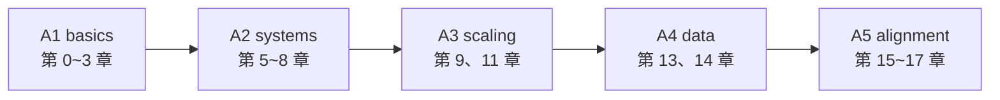

# 附录 A 作业实战路线：五个作业怎么做、在哪做、怎么自测

> 对应：CS336 Spring 2026 官方作业仓库 [assignment1-basics](https://github.com/stanford-cs336/assignment1-basics) · [assignment2-systems](https://github.com/stanford-cs336/assignment2-systems) · [assignment3-scaling](https://github.com/stanford-cs336/assignment3-scaling) · [assignment4-data](https://github.com/stanford-cs336/assignment4-data) · [assignment5-alignment](https://github.com/stanford-cs336/assignment5-alignment)
>
> 本附录根据各仓库的 README 和作业说明 PDF（A1 v26.0.3、A2 v26.1.3、A3 v26.0.5、A4 v26.0.1、A5 v26.0.0）整理。仓库会持续更新，**以你 clone 下来的版本为准**。

## 本附录你将得到

- 一套适合 Mac 用户的环境搭建流程：`uv`、单元测试、什么时候需要 GPU、怎么用 Modal 租 GPU。
- 每个作业要实现的模块清单（含分值），以及每个模块对应本书哪一章。
- 哪些部分在 Mac 上就能完成，哪些必须上 NVIDIA GPU，哪些是纸笔题。
- 推荐的完成顺序、常见的坑、自测方法。

::: warning 关于“答案”和 AI 工具
本附录**不提供任何作业答案代码**，只讲“要做什么、怎么验证、哪里容易错”。
课程对选课学生的 AI 政策很明确：AI 可以回答高层概念问题、查函数签名和库 API，但**不允许用 AI（包括 Claude Code、Cursor、Copilot 等编码代理和 AI 自动补全）实现作业的任何部分**；每个仓库都带了一个 `AGENTS.md`，规定 AI 助手只能当“助教”（解释概念、提引导性问题、建议自测手段），不能写代码。即使你是自学者，也强烈建议遵守同样的规则——CS336 的价值就在于亲手把每个零件写出来。
:::

## 先说结论（一分钟版）

1. 五个作业：**A1 从零写 Transformer**（分词器、模型、优化器、训练循环）→ **A2 系统优化**（性能分析、FlashAttention-2 Triton 内核、DDP/FSDP）→ **A3 缩放定律**（用有限预算拟合 scaling law）→ **A4 数据**（Common Crawl 过滤与去重）→ **A5 对齐/RL**（GRPO 让 1B 模型学会做小学数学题）。
2. 每个作业的形式都一样：你在空目录里自由写代码，然后在 `tests/adapters.py` 里把你的实现“接”到官方单元测试上，`uv run pytest` 全绿就说明核心实现正确。
3. **Mac 能做的比你想象的多**：A1 全部单元测试和 TinyStories 小规模训练、A4 全部单元测试和小样本实验、A5 全部必做单元测试、A2 的 DDP/FSDP/优化器分片测试（用 CPU 上的 gloo 后端）都能在 Mac 上完成。
4. **必须有 NVIDIA GPU 的**：A2 的 Triton 内核与 Nsight 性能分析、所有“正式规模”的训练实验、A5 的 vLLM 采样与 GRPO 实验。课程用 **Modal** 按需租用 B200。
5. A3 的训练 API 只对斯坦福学生开放；自学者可以做其中的 IsoFLOPs 拟合题（数据就在仓库里），再用 A1 的代码自己跑一组小规模扫描来练手。

---

## A.1 总览：五个作业一张表

| 作业 | 主题 | 你要实现的核心模块 | 主要对应章节 | Mac 本地能否完成核心单测 |
|---|---|---|---|---|
| A1 basics | 从零构建并训练 Transformer LM | BPE 分词器、Linear/Embedding/RMSNorm/SwiGLU/RoPE/注意力/Transformer、交叉熵、AdamW、学习率调度、梯度裁剪、数据加载、检查点、训练循环、解码 | [第 0 章](./ch00-primer)、[第 1 章](./ch01-overview-tokenization)、[第 2 章](./ch02-pytorch-resource)、[第 3 章](./ch03-architectures) | ✅ 全部 |
| A2 systems | 单卡优化 + 多卡并行 | 基准测试脚本、混合精度、显存分析、激活检查点、FlashAttention-2（PyTorch 版 + Triton 版）、DDP（朴素/扁平/重叠）、优化器状态分片、FSDP | [第 5 章](./ch05-gpus-tpus)、[第 6 章](./ch06-kernels-triton)、[第 7 章](./ch07-parallelism-1)、[第 8 章](./ch08-parallelism-2) | ⚠️ 大部分（Triton 测试需 CUDA） |
| A3 scaling | 缩放定律 | IsoFLOPs 拟合脚本；用训练 API 规划实验、拟合 scaling law、预测最优模型与 loss | [第 9 章](./ch09-scaling-laws-1)、[第 11 章](./ch11-scaling-laws-2) | ⚠️ 只有 IsoFLOPs 题（API 仅限斯坦福） |
| A4 data | 过滤 Common Crawl | HTML→文本、语言识别、PII 脱敏、有害内容分类、Gopher 规则、质量分类器、精确行去重、MinHash+LSH 去重、过滤流水线 | [第 13 章](./ch13-data-sources)、[第 14 章](./ch14-data-processing) | ✅ 全部单测 |
| A5 alignment | 推理 RL | 提示词基线、GRPO 各组件（分词、log-prob、奖励、组归一化、策略梯度损失、聚合、训练步）、Dr. GRPO / MaxRL / 离策略变体 | [第 12 章](./ch12-evaluation)、[第 15 章](./ch15-mid-post-training)、[第 16 章](./ch16-rlvr)、[第 17 章](./ch17-alignment-multimodality) | ✅ 必做单测（用 tiny-gpt2 夹具） |

下面这个小工具把每个作业的题目按“在哪能做”分了类，选你的硬件条件，就能看到哪些题本地可做、哪些要租 GPU、哪些是纸笔题。

<Demo src="appA-roadmap.html" title="作业路线规划器：按硬件条件看每道题在哪做" :height="680" />

---

## A.2 环境搭建（一次配好，五个作业通用）

### A.2.1 uv：Python 世界的 “Gradle Wrapper + lockfile”

所有作业都用 [uv](https://github.com/astral-sh/uv) 管理环境。

::: tip 移动端类比
- `pyproject.toml` ≈ `build.gradle.kts` / `Package.swift`：声明依赖；
- `uv.lock` ≈ `gradle.lockfile` / `Package.resolved` / `Podfile.lock`：锁定确切版本，保证你和助教跑的是同一套依赖；
- `uv run xxx` ≈ `./gradlew xxx`：第一次运行时自动下载合适的 Python、创建虚拟环境、装好依赖，然后执行命令。你基本不用手动 `pip install`。
:::

```sh
# 安装 uv（任选其一）
brew install uv
# 或：curl -LsSf https://astral.sh/uv/install.sh | sh

# 拉代码
git clone https://github.com/stanford-cs336/assignment1-basics.git
cd assignment1-basics

# 第一次跑测试：uv 会自动解析环境（初始状态下应全部因 NotImplementedError 失败）
uv run pytest
```

常用命令：

| 命令 | 作用 |
|---|---|
| `uv run pytest` | 跑全部测试 |
| `uv run pytest -k test_linear` | 只跑名字匹配的测试（作业说明里每题都会告诉你用哪个 `-k`） |
| `uv run pytest tests/test_train_bpe.py` | 跑某个测试文件 |
| `uv run python your_script.py` | 在项目环境里运行脚本 |
| `uv sync` | 按 lockfile 同步环境 |
| `uv add 包名` | 加依赖（会改 `pyproject.toml` 和 `uv.lock`，谨慎使用，确保提交时能复现） |

几点注意：

- **Python 版本**：A1、A2 要求 3.12~3.13；A5 要求 3.12（部分依赖还不支持 3.13）。仓库里设置了 `python-preference = "managed"`，uv 会自己下载合适的 Python，不用动系统 Python。
- **A5 的特殊安装顺序**（README 原文）：先 `uv sync --no-install-package flash-attn`，再 `uv sync`。`flash-attn` 只在 Linux x86_64 的 GPU 环境里安装；A5 的 `pyproject.toml` 显式支持 macOS arm64，所以 Mac 上能装好跑单测的那部分依赖。
- **A4 把 numpy 固定在 2.0 以下**（为了兼容 fastText 等库），别手动升级。

### A.2.2 作业代码的统一结构：adapters 就是“协议适配层”

每个仓库都长这样：

```
cs336_xxx/          ← 你的代码（几乎是空的，随你组织）
tests/
  adapters.py       ← 你要填的“胶水代码”：把测试的调用转发给你的实现
  test_*.py         ← 官方测试（不要改）
  fixtures/         ← 测试用的参考数据、快照
```

`adapters.py` 里是一堆形如 `run_linear(...)`、`get_adamw_cls()` 的函数，初始全部 `raise NotImplementedError`。你在里面**只做转发**——比如实例化你的模块、加载给定权重、调用 forward——不要在里面写实质逻辑（A1 说明里明确写了这一点）。

::: tip 移动端类比
这就像官方给了你一套 XCTest/JUnit 测试，测的是一个 `protocol`/`interface`；你可以用任何方式实现内部，只要写一个 Adapter 让它“遵循协议”。测试即规格说明——先读测试，再写实现，这在 CS336 里非常好用。
:::

另外：

- **测试会用固定的权重和输入比对输出**（`fixtures/` 和 `_snapshots/` 里存着期望结果），所以张量形状、参数命名、数值细节都要对。
- **作业说明 PDF 才是完整的需求文档**，README 只讲环境。每道题都标了分值和“交付物（Deliverable）”，有的是代码，有的是图表或 2~3 句文字回答。
- 提交时用仓库里的 `make_submission.sh` 或 `test_and_make_submission.sh` 打包（自学者可以忽略提交，但这个脚本也是一个完整的“跑一遍所有测试”的入口）。

### A.2.3 Mac 本地能做什么

作业说明里专门有“低资源提示（Low-Resource Tip）”框，给没有大 GPU 的人用。要点：

- **设备选择**：PyTorch 在 Apple Silicon 上用 `"mps"` 设备（Metal GPU），否则用 `"cpu"`。模型和数据要放在同一设备上。
- **A1 的官方参考**：用助教的参考实现，在 M4 Max（36 GB 内存）上训练一个能写出简单儿童故事的小模型，MPS 上不到 5 分钟、CPU 上约 30 分钟。低资源配置是把总训练 token 数降到约 4000 万（例如 batch 32 × 5000 步 × 上下文 256），在 M4 Max 上 CPU 约 1 小时 22 分、MPS 约 36 分钟，第 5000 步验证 loss 约 1.80；对应地，目标验证 loss 可从 1.45 放宽到 2.00。
- **MPS 上的两个坑**（来自 A1 说明，基于 torch 2.9）：
  - **不要**像在 CUDA 上那样设置 `torch.set_float32_matmul_precision('high')`（TF32），助教发现 MPS 后端有时会用到“静默出错”的内核，导致训练不稳定；
  - `torch.compile` 在 CPU 上可直接用；在 MPS 上 Inductor 后端不支持，可以用 `backend="aot_eager"` 稍微优化反向传播。
- **先缩小再放大（Downscaling）**：先在小数据（例如用 TinyStories 验证集代替训练集训练 BPE）、小模型上把代码调通，再上全量。调试集要大到能暴露同样的瓶颈，又小到不至于跑半天。
- **大文件用内存映射**：训练数据用 `np.memmap`（或 `np.load(..., mmap_mode='r')`）读取，像操作内存数组一样按需从磁盘加载，并注意 dtype 一致。

### A.2.4 需要 GPU 时：Modal

课程统一使用 [Modal](https://modal.com/) 提供 GPU（A4、A5 的仓库里直接带了 Modal 脚本；A1 的排行榜规则也提到可用 SLURM 或 Modal）。Modal 是一个 Serverless 计算平台：你在本地写普通 Python 函数，加个装饰器声明“这个函数要在带某种 GPU 的容器里跑”，然后 `modal run` 一下，它在云端拉起容器执行、把日志流回你的终端，按实际用量计费。

::: tip 移动端类比
很像 Firebase Cloud Functions / AWS Lambda，只不过函数能申请 GPU。容器镜像在代码里声明（像 Dockerfile 的 Python 版），数据放在 **Volume**（云端持久化磁盘，类似挂载的存储桶），API Key 之类放在 **Secret** 里。
:::

基本流程（以下是 Modal 的通用用法，与作业答案无关）：

```sh
uv run modal setup          # 浏览器登录，授权本机的 Modal token（只需一次）
uv run modal run some_script.py           # 运行脚本里的 local_entrypoint
uv run modal volume ls 卷名               # 查看云端卷里的文件
uv run modal volume put 卷名 本地文件 远端路径   # 上传数据
```

一个最小的 GPU 函数长这样：

```python
import modal

app = modal.App("cs336-hello")
image = modal.Image.debian_slim().pip_install("torch")   # 声明容器环境

@app.function(gpu="B200", image=image, timeout=600)      # 申请一块 GPU
def check_gpu():
    import torch
    return torch.cuda.get_device_name(0)

@app.local_entrypoint()
def main():
    print(check_gpu.remote())   # .remote() 表示在云端执行
```

作业里的 Modal 配置要点：

- **A4**：`cs336_data/modal_utils.py` 里定义了数据卷和共享数据卷；最终训练用 `scripts/train.py`，配置是 **8 块 B200**（`uv run modal run scripts/train.py --train-bin ...`），助教的那次训练约 2 小时。README 写明非斯坦福学生要**删掉** `shared_data_volume` 里的 `environment_name` 参数；不用 Modal 的话可以改 `cs336_data/common.py` 里的路径在本地跑。
- **A5**：`cs336_alignment/modal_utils.py` 默认每个任务申请 **2 块 B200**（一块训练、一块跑 vLLM 采样），要求你先填一个 `SUNET_ID`（自学者填任意唯一标识即可），并在 Modal 里建一个名为 `wandb` 的 Secret 存 Weights & Biases 的 key。
- **省钱原则**：所有代码先在本地用最小配置跑通（哪怕在 CPU 上只跑 2 步），再上云；云上先跑短任务确认日志和产出路径，再跑长任务。作业说明给每个实验都标注了参考用时（例如 “2 B200 hrs”），可以据此估算开销。

::: warning 常见误区
不要把 Modal 当成“远程的 Mac”：容器每次都是全新的，本地文件不会自动出现在云端。数据要么在镜像构建时拷进去，要么放进 Volume；训练产出（检查点、日志）也要写进 Volume，否则容器一退出就没了。
:::

---

## A.3 作业 1（basics）：从零搭一个 Transformer 语言模型

**目标**：从零实现训练一个标准 Transformer LM 所需的全部组件，在 TinyStories 上训练，再在 OpenWebText 上训练并（可选）冲排行榜。

**规则**：除了 `torch.nn.Parameter`、容器类（`Module`、`ModuleList`、`Sequential` 等）和 `torch.optim.Optimizer` 基类，**不能用** `torch.nn`、`torch.nn.functional`、`torch.optim` 里的现成定义。其他 PyTorch 功能可以用。

**数据**：TinyStories（简单儿童故事）和 OpenWebText 样本，README 里有 `wget` 下载命令。

### 模块清单与推荐顺序

| 顺序 | 题目（分值） | 内容 | 自测命令 | 对应章节 |
|---|---|---|---|---|
| 0 | unicode1/2（1+3） | 理解 Unicode 与 UTF-8 编码（文字题） | — | [第 1 章](./ch01-overview-tokenization) |
| 1 | train_bpe（15） | 训练字节级 BPE：输入文本路径、词表大小、特殊 token，输出 `vocab` 和 `merges` | `uv run pytest tests/test_train_bpe.py` | 第 1 章 |
| 2 | tokenizer（15） | `Tokenizer` 类：`encode`、`decode`、`encode_iterable`（流式、省内存） | `uv run pytest tests/test_tokenizer.py` | 第 1 章 |
| 3 | train_bpe_tinystories / owt、tokenizer_experiments（2+2+4） | 在两个数据集上训练分词器、测压缩率和吞吐，把数据集编码成 `uint16` 数组 | — | 第 1 章 |
| 4 | linear、embedding（1+1） | 自己的 `Linear`（无 bias）和 `Embedding`，按规定初始化 | `-k test_linear`、`-k test_embedding` | [第 0 章](./ch00-primer)、[第 2 章](./ch02-pytorch-resource) |
| 5 | rmsnorm（1） | RMSNorm | `-k test_rmsnorm` | [第 3 章](./ch03-architectures) |
| 6 | positionwise_feedforward（2） | SwiGLU 前馈层（含 SiLU） | `-k test_swiglu` | 第 3 章 |
| 7 | rope（2） | 旋转位置编码 | `-k test_rope` | 第 3 章 |
| 8 | softmax、scaled_dot_product_attention（1+5） | 数值稳定的 softmax；带掩码的缩放点积注意力 | `-k test_softmax`、`-k test_scaled_dot_product_attention` | 第 0、3 章 |
| 9 | multihead_self_attention（5） | 因果多头自注意力（含 RoPE 版本） | `-k test_multihead_self_attention` | 第 3 章 |
| 10 | transformer_block、transformer_lm（3+3） | Pre-norm Transformer 块与完整 LM | `-k test_transformer_block`、`-k test_transformer_lm` | 第 3 章 |
| 11 | transformer_accounting（5） | 手算参数量、FLOPs、显存（文字/计算题） | — | [第 2 章](./ch02-pytorch-resource) |
| 12 | cross_entropy（1） | 数值稳定的交叉熵 | `-k test_cross_entropy` | 第 0 章 |
| 13 | learning_rate_tuning（1） | 用 SGD 玩学习率 | — | 第 0 章 |
| 14 | adamw、adamw_accounting（2+2） | 实现 AdamW；算优化器显存与 FLOPs | `-k test_adamw` | 第 2 章 |
| 15 | learning_rate_schedule（1） | 带 warmup 的余弦学习率 | `-k test_get_lr_cosine_schedule` | 第 2 章、[第 11 章](./ch11-scaling-laws-2) |
| 16 | gradient_clipping（1） | 全局 L2 范数梯度裁剪 | `-k test_gradient_clipping` | 第 2 章 |
| 17 | data_loading（2） | 从 token 数组随机采样 (输入, 目标) batch | `-k test_get_batch` | 第 2 章 |
| 18 | checkpointing（1） | 保存/恢复模型 + 优化器 + 迭代步数 | `-k test_checkpointing` | 第 2 章 |
| 19 | training_together（4） | 把一切组装成可配置的训练脚本 | — | 第 2 章 |
| 20 | decoding（3） | 温度采样、top-p 采样生成文本 | — | [第 10 章](./ch10-inference) |
| 21 | 实验：experiment_log、learning_rate、batch_size_experiment、generate | 在 TinyStories 上调学习率、批大小，生成故事 | — | 第 2、9 章 |
| 22 | 消融：去掉 RMSNorm、post-norm、NoPE、SwiGLU vs SiLU | 架构消融实验 | — | 第 3 章 |
| 23 | main_experiment、leaderboard | OpenWebText 训练；45 分钟 B200 限时排行榜（基线 loss 5.0） | — | 全书 |

### 常见的坑（只说“哪里会错”，不说“怎么写”）

- **BPE 的平局规则**：频率相同的字节对，要**确定性地选字典序更大的那个**。测试是和参考结果逐条比对 merges 的，平局处理错一个，后面全错。
- **特殊 token 是硬边界**：训练时不能跨越 `<|endoftext|>` 合并，也不参与统计；编码时要先把特殊 token 切出来（重叠的特殊 token 要优先匹配更长的）。
- **BPE 训练太慢**：朴素实现每次合并都重新数一遍所有字节对。只有与被合并字节对重叠的计数会变——想想怎么增量更新。预分词可以多进程并行（仓库里的 `pretokenization_example.py` 演示了怎么按特殊 token 切分文件块），但合并步骤在 Python 里没法并行。用 `cProfile` 或 `py-spy` 找瓶颈。
- **行向量 vs. 列向量**：说明里的数学公式用列向量（$y = Wx$），但 PyTorch 是行优先存储，`W` 的形状是 `(d_out, d_in)`。直接写矩阵乘法时要注意转置；用 `einsum`/`einops` 并标好轴名，这个问题就不存在了（[第 2 章](./ch02-pytorch-resource)）。测试会加载给定形状的权重，形状错了直接挂。
- **softmax / 交叉熵的数值稳定**：先减去最大值，不要真的算出 `exp` 再取 `log`（[第 0 章](./ch00-primer)）。
- **注意力掩码**：掩码要在 softmax **之前**施加，被遮住的位置应是一个极大的负数而不是 0；还要确认它能正确广播到 (batch, head, query, key) 形状。
- **RoPE**：搞清楚是哪两个维度配成一对旋转，以及位置索引 `token_positions` 从哪来；可以预先算好 cos/sin 缓存成 buffer。
- **AdamW**：权重衰减是“解耦”的（直接作用在参数上，不经过梯度矩估计）；偏差修正用的步数从 1 开始。
- **数据加载**：随机起点要保证 `起点 + 上下文长度 + 1` 不越界；目标是输入右移一位。
- **训练变慢**：说明里给的基准是“正确且高效的实现在 1 块 B200 上约 20~30 分钟训完 TinyStories 主配置”。远慢于此时，先查数据加载、检查点、验证 loss 计算是否成了瓶颈，以及是否真的批量化了。

### 自测方法

- **单元测试全绿**是底线。建议按上表顺序一题一题地 `-k` 跑。
- **对单个 batch 过拟合**：模型正确的话，反复训练同一个小 batch，loss 应该能很快降到接近 0。这是作业说明里推荐的第一步。
- **断言形状**：在每个模块的 forward 里临时加 `assert x.shape == (...)`。
- **监控范数**：记录激活、权重、梯度的范数，看是否爆炸或消失。
- **用调试器**：说明里推荐熟悉 IDE 自带的调试器（VS Code 等），比到处 `print` 高效。
- **生成文本做“冒烟测试”**：TinyStories 训练好后应该能生成大体通顺的英文故事；只训 4000 万 token 的低资源版本会通顺度差一些，但仍像英语。

---

## A.4 作业 2（systems）：让训练更快、跑上多卡

**目标**：在单卡上分析并优化训练速度和显存，然后把训练扩展到多卡。仓库里的 `cs336-basics/` 是 A1 的参考实现（也可以换成你自己的），`cs336_systems/` 是你写代码的地方。

### 模块清单

| 部分 | 题目（分值） | 内容 | 硬件 | 对应章节 |
|---|---|---|---|---|
| 性能分析 | benchmarking_script（4） | 计时前向、反向、优化器步；预热、`torch.cuda.synchronize()`、均值与标准差 | GPU（CPU 可先写逻辑） | [第 2 章](./ch02-pytorch-resource)、[第 5 章](./ch05-gpus-tpus) |
| | nsys_profile（5） | 用 NVIDIA Nsight Systems 看时间花在哪些内核上 | **NVIDIA GPU** | 第 5、6 章 |
| | mixed_precision_accumulation（1）、benchmarking_mixed_precision（2） | FP16/BF16 累加误差实验；`torch.autocast` | 前者 CPU 可做；后者 GPU | 第 5 章 |
| | memory_profiling（4） | PyTorch 显存快照，分析峰值来自哪里 | GPU | 第 2 章 |
| 单卡显存 | gradient_checkpointing（4） | 推导最省显存的激活检查点策略（可嵌套），并实测 | 推导：纸笔；实测：GPU | 第 2、8 章 |
| 内核 | pytorch_attention（2）、torch_compile（2） | 普通注意力在不同序列长度下的耗时/显存/OOM；`torch.compile` 对比 | GPU | [第 6 章](./ch06-kernels-triton) |
| | flash_forward（15） | (a) **纯 PyTorch** 分块版 FlashAttention-2 前向；(b) **Triton** 内核版；(c) 因果掩码 | (a) **Mac 可做**；(b)(c) **NVIDIA GPU** | 第 6 章 |
| | flash_backward（5） | 用重计算 + `torch.compile` 写反向 | PyTorch 版测试 Mac 可跑；Triton 版需 CUDA | 第 6 章 |
| | flash_benchmarking（5） | `triton.testing.do_bench` 对比 | GPU | 第 6 章 |
| 分布式 | distributed_communication_single_node（5） | all-reduce 基准：不同数据量、2/4/6 个进程 | 逻辑可在 CPU（gloo）；正式测量用多 GPU | [第 7 章](./ch07-parallelism-1) |
| | naive_ddp（5）+ 基准（3） | 朴素 DDP：每个参数梯度单独 all-reduce | **单测 CPU 可做** | 第 7 章 |
| | minimal_ddp_flat_benchmarking（2）、ddp_overlap_individual_parameters（5）+ 基准（1） | 扁平化梯度减少通信次数；反向传播与通信重叠 | 实现与单测 CPU；基准 GPU | 第 7 章 |
| | optimizer_state_sharding（15）+ accounting（5） | 优化器状态分片（ZeRO-1 思路） | **单测 CPU 可做** | [第 8 章](./ch08-parallelism-2) |
| | fsdp（15）+ fsdp_accounting（5） | 完全分片数据并行 | **单测 CPU 可做** | 第 8 章 |
| 并行分析 | alternate_ring_all_reduce、data_parallel_calcs、fsdp_calcs、tp_calcs、fsdp_tp_calcs | 通信量与显存的推导题 | **纸笔** | 第 7、8 章 |
| 排行榜 | leaderboard（10） | 2 块 B200 上 8B 模型、32K 上下文的最快训练步 | 多 GPU | 全部 |

测试文件只有四个：`test_attention.py`、`test_ddp.py`、`test_fsdp.py`、`test_sharded_optimizer.py`。其中 Triton 相关测试在没有 CUDA 时会被**自动跳过**；DDP、FSDP、优化器分片的测试用的是 CPU 上的 **gloo** 后端，在 Mac 上就能跑。

### 推荐顺序

1. 先读 [第 5 章](./ch05-gpus-tpus)、[第 6 章](./ch06-kernels-triton)，在 Mac 上把 **纯 PyTorch 分块版 FlashAttention** 写出来并通过 `test_flash_forward_pass_pytorch`——这一步把在线 softmax 的数学彻底弄懂，比直接写 Triton 容易调试得多（说明里也建议用它来对照调试 Triton 内核）。
2. 接着在 Mac 上完成 **DDP → 扁平化 → 重叠 → 优化器分片 → FSDP**，全部用 gloo 单测验证。
3. 做纸笔推导题（并行分析、检查点策略）。
4. 最后租 GPU，一次性完成基准测试、Nsight 分析、Triton 内核和所有计时实验，减少云上调试时间。

### 常见的坑

- **计时不同步**：CUDA 调用是异步的，`torch.matmul` 返回时 GPU 可能还没算完。每步后要 `torch.cuda.synchronize()`，并且一定要**预热**——前几步包含编译、缓存分配等一次性开销。
- **Triton 调试**：`TRITON_INTERPRET=1` 可以在 CPU 上解释执行 Triton，但说明里提醒它“有 bug”，不要完全依赖；用 `tl.device_print` 打印，逐个操作和你的 PyTorch 分块版对比。
- **精度**：片上的累加缓冲（输出、`l`、`m`）要用 `float32`；`P̃` 乘 `V` 之前转成 `V` 的 dtype；写回全局内存前转成输出 dtype。
- **块指针**：偏移量要乘以对应的 tile 大小；在循环末尾推进块指针；启动网格是 `(T_q, batch_size)`。
- **因果掩码**：被遮住的位置加一个常数（说明里要求 −1e6），并把 `is_causal` 存进 `ctx` 供反向使用。
- **分布式基准**：多进程程序的打印顺序不确定是正常的；基准测试要按说明里的“最佳实践”做预热和同步。

### 自测方法

- `uv run pytest -k test_flash_forward_pass_pytorch`、`-k test_flash_backward_pytorch`（Mac 可跑）；`-k test_flash_forward_pass_triton`、`-k test_flash_backward_triton`（需 CUDA，否则自动跳过）；
- `uv run pytest tests/test_ddp.py`、`tests/test_sharded_optimizer.py`、`tests/test_fsdp.py`（Mac 可跑）；
- 自己写一个“对拍”脚本：随机输入下，你的注意力输出和普通实现的输出差异在容差内；
- 显存题用 PyTorch 的显存快照验证你的手算结果（参见 [第 2 章](./ch02-pytorch-resource) 的资源核算方法）。

---

## A.5 作业 3（scaling）：用有限预算拟合缩放定律

**设定**：你负责训练“ClosedAI”的下一代模型，正式训练预算是 **48 B200 小时**；另有 **12 B200 小时**（正式预算的 25%）用于做 scaling law 实验。你不自己训练，而是向一个**训练 API** 提交超参数（层数、宽度、头数、batch、学习率、训练 token 数……）和最长运行时间，API 返回验证 loss。目标是选出在 48 B200 小时下 loss 最低的配置，并**预测**它的 loss。

| 题目（分值） | 内容 | 能否自学完成 | 对应章节 |
|---|---|---|---|
| chinchilla_isoflops（5） | 用仓库里的 `data/isoflops_curves.json`（合成数据）复现 Chinchilla 的 IsoFLOPs 方法：每个计算预算取 loss 最低的模型，得到 ⟨C, N_opt⟩，拟合幂律 $N_{opt} \propto C^a$、$D_{opt} \propto C^b$，外推到 $10^{23}$、$10^{24}$ FLOPs | ✅ 完全离线 | [第 9 章](./ch09-scaling-laws-1) |
| scaling_laws（50） | 在 12 小时实验预算内规划实验、拟合 scaling law、提交最优配置与预测 loss（排行榜按真实结果打分） | ❌ API 需斯坦福网络与学号 | 第 9、[11 章](./ch11-scaling-laws-2) |

**IsoFLOPs 题的要点**（[第 9 章](./ch09-scaling-laws-1) 有完整推导和拟合演示）：

- 计算量近似 $C \approx 6ND$（$N$ 参数量、$D$ 训练 token 数），所以固定 $C$ 时 $D = C / (6N)$；
- 说明里建议直接取每个预算下 loss 最低的那次运行当最优点（而不是像原论文那样拟合二次曲线）；
- 可以用 `scipy.optimize.curve_fit`，但在对数坐标下做线性回归同样可行；
- 交付物是两张图（模型大小、数据量随计算预算的外推）和预测值。

**API 的规则**（对斯坦福学生；了解它有助于你设计自己的实验）：

- 提交的实验会**预留**全部 `max_runtime_seconds`，完成后按实际用时退回；超时按上限计费；超过 12 小时预算后 API 会拒绝请求；
- 重复提交完全相同的配置返回 409，不额外扣预算；
- 配置有一致性约束：`hidden_size` 必须等于 `num_attention_heads × head_dim`，头数要能被 KV 头数整除，`total_train_tokens` 要能被 `512 × train_batch_size` 整除；
- 训练数据是 DCLM 分词后的固定顺序数据，**不会重复 epoch**；上下文长度固定为 512；`model_seed` 只影响初始化。

**自学者的替代练习**：用你 A1 的模型和训练循环，在 TinyStories 或 OpenWebText 样本上做一个迷你版：选 3~4 个计算预算（例如让每个预算下的训练在 Mac 上几分钟到十几分钟内跑完），每个预算扫 4~5 个模型大小，画出 IsoFLOPs 曲线并拟合幂律。规模虽小，但能完整体验“规划预算 → 扫描 → 拟合 → 外推 → 验证”的流程。仓库 README 也给了非学生自建训练 API 的方法（需要 GPU、Modal 和数据库），工作量较大，一般没必要。

### 常见的坑

- **只看 loss 不看预算**：要先规划“这 12 小时怎么花”，小模型多扫、大模型少扫，留出验证外推的预算。
- **学习率等超参数也随规模变化**：不同大小的模型最好用各自合适的学习率，否则 IsoFLOPs 曲线会被“没调好”的点扭曲（[第 11 章](./ch11-scaling-laws-2) 的 μP 与 WSD 讨论）。
- **外推的不确定性**：在对数坐标下拟合，少量点、跨度小的时候外推误差会很大；写报告时要说明拟合质量。

---

## A.6 作业 4（data）：把 Common Crawl 变成训练数据

**目标**：实现一套 Common Crawl 过滤流水线，用它产出训练数据，训练一个 GPT-2 small 形状的模型，使其在 Paloma 基准的 C4 100 domains 子集上的验证 loss 尽量低。**不能改模型和训练流程**——比拼的是数据。本书 [第 13 章](./ch13-data-sources)、[第 14 章](./ch14-data-processing) 就是为这个作业准备的。

### 获取数据

- 斯坦福学生的数据在 Modal 的 `/shared-data` 里；
- **自学者**：`uv run scripts/download_data.py --offline-only` 只下载离线所需文件到本地 `local-shared-data/`：Paloma 验证集（已分词）、一个示例 WARC 和对应 WET 文件、fastText 语言识别模型 `lid.176.bin`、Dolma 的 NSFW 和仇恨言论分类器。这些足够完成全部单元测试和小规模实验，在 Mac 上就能做。
- 完整数据（2500 个英文 WET 文件、Wikipedia 外链列表）需要较大的下载和存储，README 里说明了 Modal 和非 Modal 两种方式；可以通过修改 `wet_files.py` 里的 `n_files` 少下载一些。

### 模块清单

| 顺序 | 题目（分值） | 内容 | 自测命令 | 对应章节 |
|---|---|---|---|---|
| 1 | look_at_cc（4） | 看 WARC/WET，标注 25 篇文档 | — | [13.4 节](./ch13-data-sources) |
| 2 | extract_text（3） | 用 resiliparse 从 HTML **字节串**抽文本；处理非 UTF-8 编码；与 WET 对比 | `-k test_extract_text_from_html_bytes` | [14.2 节](./ch14-data-processing) |
| 3 | language_identification（6） | 用 fastText `lid.176.bin` 返回 (语言, 置信度)；人工核对 20 个样本，选阈值 | `-k test_identify_language` | 14.3 节 |
| 4 | mask_pii（3） | 用正则把邮箱、美国电话号码、IPv4 地址替换成指定占位符，并返回替换次数 | `-k test_mask_emails`、`-k test_mask_phones`、`-k test_mask_ips` | 第 13 章（FineWeb 的 PII 处理） |
| 5 | harmful_content（6） | 用 Dolma 的 fastText 分类器检测 NSFW 和有毒言论 | `-k test_classify_nsfw`、`-k test_classify_toxic_speech` | 14.3 节 |
| 6 | gopher_quality_filters（3） | 至少实现：词数 50~100,000；平均词长 3~10；以省略号结尾的行 ≤ 30%；含字母的词 ≥ 80% | `-k test_gopher` | 13.5、14.3 节 |
| 7 | quality_classifier（15） | 以 Wikipedia 外链网页为正例、随机 CC 为负例，训练 fastText 质量分类器 | `-k test_classify_quality` | 14.3 节 |
| 8 | exact_deduplication（3） | 两遍扫描：先用行的哈希计数，再只保留在整个语料中唯一的行 | `-k test_exact_line_deduplication` | 14.4 节 |
| 9 | minhash_deduplication（8） | MinHash 签名 + LSH 分桶 + 真实 Jaccard 复核 + 聚类后随机保留一篇 | `-k test_minhash_deduplication` | 14.4 节 |
| 10 | filter_data（6） | 并行过滤 WET 文件，报告每个过滤器各删掉多少 | — | 第 14 章 |
| 11 | inspect_filtered_data（4） | 抽查保留和删除的样本，迭代流水线 | — | 第 14 章 |
| 12 | tokenize_data（2） | 用 GPT-2 分词器编码，每篇文档后加 GPT-2 的文档结束符（endoftext token），存成 `uint16` 二进制 | — | [第 1 章](./ch01-overview-tokenization) |
| 13 | train_model（8） | 用固定配置在 8 块 B200 上训练约 4.3 亿参数模型（约 86 亿训练 token） | — | 第 14 章 |

### 常见的坑

- **编码**：输入是字节串，未必是 UTF-8。先尝试 UTF-8，失败再用 resiliparse 的编码检测。
- **fastText 的输入**：fastText 的 `predict` 一次处理一行文本，输入里含换行符会报错，记得先处理换行。标签形如 `__label__en`，测试期望的是 `"en"`、`"zh"`，需要在 adapter 里转换。
- **PII 正则的误报和漏报**：电话号码格式极其多样（括号、短横线、空格、国家码），IP 要检查每段不超过 255。作业还要求你讨论“天真地应用这些过滤器”会给模型带来什么下游问题。
- **Gopher 规则的“词”**：用 `nltk.word_tokenize` 或简单空白切分都可以，但要前后一致；“含字母的词”的判定要想清楚标点怎么算。
- **精确行去重**：统计的是**所有输入文件合在一起**的行频；出现超过一次的行在**所有**文件里都删掉（不是“保留一份”）。用哈希做键以节省内存。
- **MinHash 去重**：说明要求先做规范化（小写、去标点、规范空白、去重音、NFD）以提高召回；n-gram 按**词**算；候选对要用真实 Jaccard 复核；重复关系要**传递地聚类**（A~B、B~C ⇒ A、B、C 一簇），每簇随机留一篇。哈希数需能被 band 数整除。
- **质量分类器的正例**：Wikipedia 外链网页本身也可能有低质量内容，说明建议用你前面写的语言识别、规则等先清洗正例。
- **不能把验证集数据抄进训练集**：可以用 Paloma 验证数据来构造过滤器或分类器，但**绝不能**把验证集原文放进训练数据。
- **分词格式**：必须严格按示例用 `np.uint16` 并 `tofile`，否则训练脚本读不对。

### 自测方法

- 全部单元测试：`uv run pytest`（21 个测试，Mac 可跑）。注意说明里反复提醒：分类器的测试只是**健全性检查**，通过不代表分类器准确——要自己抽样核对。
- 用 [第 13 章的漏斗演示](./ch13-data-sources) 和 [第 14 章的 MinHash 演示](./ch14-data-processing) 帮助理解每一步的行为。
- 流水线要打印“每个过滤器删掉多少”，这是作业的交付物，也是最好的调试信息。
- 正式训练前，先在本地用小数据跑通“过滤 → 分词 → 读取”全流程，确认 `.bin` 文件的 token 数和内容（解码前几千个 token 看看）。

---

## A.7 作业 5（alignment）：用 GRPO 教 1B 模型做数学题

**目标**：在 OLMo-2-0425-1B 基座模型（预训练 + 中期训练共 4T token）上，以 GSM8K（小学数学应用题）为任务，先测提示词基线，再实现 GRPO 强化学习，最后探索算法变体。课程选用这个外部模型，是因为课上自己训练的模型太弱，解不了数学题。

### 模块清单

| 部分 | 题目（分值） | 内容 | 硬件 | 对应章节 |
|---|---|---|---|---|
| 提示词 | prompting_baselines（5） | 用 vLLM 跑 `question_only` 与 `r1_zero`（思维链）提示词，用提供的评分函数打分 | GPU（vLLM） | [第 12 章](./ch12-evaluation)、[第 16 章](./ch16-rlvr) |
| 理论 | baseline_calcs（5） | 计算策略梯度估计量的方差，理解 baseline 的作用 | 纸笔 | 第 16 章 |
| GRPO 组件 | tokenize_prompt_and_output（1） | 拼接提示与回答并生成**回答部分的掩码** | **Mac 可做** | [第 15 章](./ch15-mid-post-training)、第 16 章 |
| | get_response_log_probs（1） | 逐 token 对数概率（可选返回熵） | Mac 可做 | 第 16 章 |
| | compute_rollout_rewards（1） | 调用评分函数得到每条回答的奖励 | Mac 可做 | 第 16 章 |
| | compute_group_normalized_rewards_grpo（1） | 组内归一化得到优势（advantage） | Mac 可做 | 第 16 章 |
| | compute_policy_gradient_loss_on_policy（1） | 同策略的策略梯度损失 | Mac 可做 | 第 16 章 |
| | aggregate_loss_across_microbatch_sequence（0.5） | 按 token 和序列聚合损失（掩码平均） | Mac 可做 | 第 16 章 |
| | grpo_train_step_standard_on_policy（5） | 组装一个训练步（含梯度累积） | Mac 可做（单测） | 第 16 章 |
| 实验 | grpo_experiments、grpo_learning_rate、grpo_prompt_ablation（10+3+3） | 4 个随机种子跑 GRPO、调学习率、提示词消融 | **2×B200**（各 2~4 B200 小时） | 第 16 章 |
| 变体 | Dr. GRPO、RFT、MaxRL 的思考、推导与实现（每题 0.5~6 分） | 长度归一化、拒绝采样微调、难度重加权 | 实现：Mac；实验：GPU | 第 16 章 |
| 离策略 | derive_surrogate_objectives、compute_policy_gradient_loss_off_policy、GSPO 等 | 重要性重加权与裁剪（PPO/GRPO 式、GSPO 式） | 推导：纸笔；实现：Mac；实验：GPU | 第 16 章 |
| 开放 | try_your_own（10） | 设计你自己的策略梯度估计量 | GPU | 第 16 章 |
| 选做补充 | SFT、DPO、安全对齐（单独的 supplement PDF） | 指令微调、偏好优化 | — | 第 15、[17 章](./ch17-alignment-multimodality) |

**必做测试**是 `tests/test_grpo.py`（`uv run pytest tests/test_grpo.py`），它用仓库里的 `tiny-gpt2` 小模型夹具，**在 Mac 的 CPU 上就能跑**。选做补充部分的测试（SFT 数据打包、MMLU/GSM8K 解析、DPO 损失）在其他测试文件里。

### 训练时的硬件布局

说明里的配置是：一块 GPU 上放 Hugging Face 模型和优化器做训练，另一块 GPU 上跑 vLLM（含模型和 KV cache）做采样，每次采样前把最新权重同步给 vLLM（`vllm_utils.py` 已经提供）。参考超参数：200 个 rollout 步、学习率 1e-5、每批 256 条回答（32 道题 × 每题 8 条）、梯度累积 32、采样温度 1.0、最长 512 token、遇到 `</answer>` 停止。

### 推荐顺序

1. 先读 [第 16 章](./ch16-rlvr)，弄懂策略梯度、baseline、组归一化优势；做 baseline_calcs 推导题。
2. 在 Mac 上依次实现 GRPO 的 7 个组件，每个都用 `-k` 单测验证。
3. 读懂 `vllm_utils.py` 和 `drgrpo_grader.py` 的接口（不需要改）。
4. 上 Modal：先跑提示词基线（确认 vLLM 和评分流程），再跑一次短的 GRPO 确认奖励在上升，最后才跑 4 个种子的正式实验。
5. 做变体和离策略部分：推导题纸笔完成，实现在本地单测，实验上云。

### 常见的坑

- **掩码**：损失只应该在**回答部分**的 token 上计算；提示部分和 padding 都要排除。分词时提示与回答的边界要对齐。
- **对数概率的位置偏移**：第 t 个位置的 logits 预测的是第 t+1 个 token，取 log-prob 时要对齐。
- **组归一化**：同一道题的 G 条回答一组；除以标准差时要加一个小常数防止除零（全对或全错的组标准差为 0）。
- **损失聚合方式会改变优化目标**：按序列长度归一化与按常数归一化（Dr. GRPO）对长回答的偏好不同——这正是说明里的思考题。
- **RL 方差很大**：说明要求 4 个随机种子并画出方差（均值 + 置信区间或各条曲线），单次运行的结论不可靠。
- **评测要足够大**：至少 1024 个验证样本，思维链评测本身噪声就大。
- **记录 rollout 文本**：定期把模型的采样输出打印/记录下来，比只看奖励曲线更能发现问题（比如格式崩坏、答案标签缺失）。

### 自测方法

- `uv run pytest tests/test_grpo.py` 全绿；
- 用手造的小例子手算：比如一组 4 条回答奖励为 [1, 0, 0, 1]，归一化优势应该是什么？和你的函数输出对比；
- GRPO 训练开始后的第一件事：确认**验证奖励随步数上升**（说明里说，用参考超参数时大多数种子都应如此）。

---

## A.8 推荐完成顺序

### 官方顺序（跟课走）



### 给 Mac 用户的“先本地、后上云”顺序

如果你只有一台 Mac，并且想把租 GPU 的时间压到最少：

1. **A1 全部**（本地：单测 + TinyStories 低资源训练 + 消融实验的缩小版）。这是后面所有作业的地基，务必扎实。
2. **A4 单测 + 小样本流水线**（本地）：数据处理基本不需要 GPU，而且能立刻用上第 13、14 章的知识。
3. **A5 GRPO 组件单测**（本地）+ 推导题。
4. **A2 中能在 CPU 上完成的部分**：纯 PyTorch 版 FlashAttention、DDP/分片/FSDP 单测、全部并行分析推导题。
5. **A3 的 IsoFLOPs 拟合 + 用 A1 代码做迷你 scaling 实验**（本地）。
6. **集中上云**：A2 的 Triton 内核与性能分析、A5 的 GRPO 实验、（可选）A4 的正式训练和 A1 的 OpenWebText 实验。

::: tip 为什么这样排
这就像移动端开发里“先把业务逻辑和单测在模拟器上跑通，再上真机做性能测试”：真机（GPU）贵且排队，能在本地验证的正确性问题都应该在本地解决，云上只做必须在真机上做的“性能与规模”实验。
:::

---

## A.9 通用的自测与调试清单

| 场景 | 手段 |
|---|---|
| 实现是否正确 | 官方单测；对单个 batch 过拟合；与简单参考实现对拍（例如分块注意力 vs. 普通注意力） |
| 形状错误 | 在 forward 中断言形状；用 `einops` 写清轴名 |
| 训练发散 / NaN | 降低学习率；检查 softmax/交叉熵是否数值稳定；监控激活、权重、梯度范数；检查混合精度下的累加 dtype |
| 训练太慢 | 先 profile（`cProfile`、`py-spy`、PyTorch profiler、Nsight）；检查数据加载、检查点、验证是否成为瓶颈；确认批量化 |
| 显存不够 | 手算参数/梯度/优化器状态/激活（[第 2 章](./ch02-pytorch-resource)）；激活检查点；混合精度；分片 |
| GPU 计时不准 | 预热 + `torch.cuda.synchronize()`；多次取均值和标准差 |
| 数据流水线 | 每个过滤器打印删除数量；随机抽样肉眼检查保留和删除的样本 |
| RL 不涨 | 先确认奖励函数对“标准答案”给满分；打印 rollout；检查掩码和优势符号；多种子 |

---

## 动手练习

1. **环境热身**：clone A1 仓库，运行 `uv run pytest`，确认所有测试都以 `NotImplementedError` 失败；然后打开 `tests/adapters.py` 和 `tests/test_model.py`，找出 `run_linear` 被哪个测试调用、测试传入了哪些参数、期望的输出形状是什么。（不写实现，只读规格。）
2. **读测试推需求**：在 A4 的 `tests/test_deduplication.py` 和 `tests/fixtures/` 中，找出 MinHash 去重测试使用的参数（哈希数、band 数、n-gram 长度、阈值），用 [第 14 章](./ch14-data-processing) 的公式算出这组参数的相变点 $(1/b)^{1/r}$，判断它大概在找多相似的文档。
3. **预算规划**：A1 低资源配置是 batch 32 × 5000 步 × 上下文 256。算出总 token 数；如果你的 Mac 在 MPS 上的吞吐是每秒 2 万 token，需要多久？再估算主配置（约 3.3 亿 token）在同样吞吐下要多久，以及为什么说明里建议没有 GPU 的人用缩小配置。
   ::: details 答案
   32 × 5000 × 256 = 40,960,000 ≈ 4100 万 token；按 2 万 token/秒约 2048 秒 ≈ 34 分钟（和说明里 M4 Max 上 36 分钟同一量级）。主配置 327,680,000 token ≈ 16,384 秒 ≈ 4.5 小时，是低资源配置的 8 倍——调学习率要跑很多次，本地就不现实了。
   :::
4. **Modal 冒烟测试**：注册 Modal 后，用 A.2.4 节的最小示例确认能拿到 GPU 并打印出设备名；再把 A1 的单元测试放到 Modal 的 GPU 容器里跑一遍（提示：镜像里需要你的代码和依赖），体会“本地与云端环境一致”的重要性。

## 本附录小结

- 五个作业形式统一：自由实现 + `adapters.py` 胶水 + 官方单测；作业说明 PDF 才是完整需求。
- 环境用 uv 一键复现；Mac 用 `mps`/`cpu`，注意 MPS 上不要开 TF32；需要 GPU 时用 Modal，数据和产出放 Volume。
- A1、A4 的单测和小规模实验、A5 的 GRPO 组件、A2 的分布式单测都能在 Mac 上完成；Triton、Nsight、正式训练和 RL 实验需要 NVIDIA GPU；A3 的训练 API 仅限斯坦福学生，但 IsoFLOPs 拟合题可离线完成。
- 先本地、后上云：所有正确性问题在本地解决，云上只做性能与规模实验。
- 遵守课程的 AI 政策：让 AI 做助教，不做枪手。

## 延伸阅读

- 课程主页：[cs336.stanford.edu](https://cs336.stanford.edu/)
- 作业仓库：[assignment1-basics](https://github.com/stanford-cs336/assignment1-basics)、[assignment2-systems](https://github.com/stanford-cs336/assignment2-systems)、[assignment3-scaling](https://github.com/stanford-cs336/assignment3-scaling)、[assignment4-data](https://github.com/stanford-cs336/assignment4-data)、[assignment5-alignment](https://github.com/stanford-cs336/assignment5-alignment)
- A1 排行榜：[assignment1-basics-leaderboard](https://github.com/stanford-cs336/assignment1-basics-leaderboard)
- uv 文档：[docs.astral.sh/uv](https://docs.astral.sh/uv/guides/projects/)
- PyTorch MPS 后端：[docs.pytorch.org/docs/stable/notes/mps.html](https://docs.pytorch.org/docs/stable/notes/mps.html)
- Modal 文档：[modal.com/docs](https://modal.com/docs)
- Triton 教程：[triton-lang.org](https://triton-lang.org/main/getting-started/tutorials/index.html)
- Mining of Massive Datasets 第 3 章（A4 去重）：[infolab.stanford.edu/~ullman/mmds/ch3n.pdf](http://infolab.stanford.edu/~ullman/mmds/ch3n.pdf)
