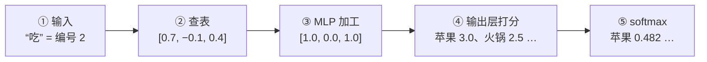
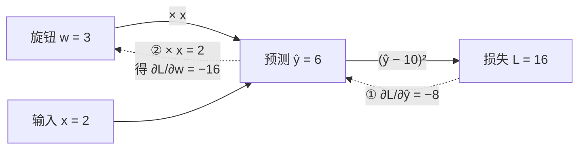

# 第 0 章 预备知识速成

> 本章为本书原创的“补课”章节，没有对应的课程视频。它只讲读懂后续 18 章所**必需**的数学与 PyTorch 知识，并刻意跳过证明。课程官网：[cs336.stanford.edu](https://cs336.stanford.edu/)

## 本章你将学到

- 向量、矩阵、张量到底是什么，矩阵乘法的**形状规则**为什么是一切的基础
- 导数、偏导、梯度、链式法则的直觉，以及“梯度下降”这个训练模型的核心动作
- 概率分布、softmax、对数、交叉熵、困惑度（perplexity）——语言模型的“记分规则”
- 神经网络 = 线性层 + 激活函数；反向传播在做什么、为什么它要占那么多显存
- PyTorch 最小入门：tensor、autograd、`nn.Module`、一个完整训练循环
- 浮点数 fp32 / fp16 / bf16 的区别，以及“一个参数占几个字节”

## 先说结论（一分钟版）

大语言模型本质上是一个**巨大的函数**：输入一串整数（token），输出“下一个 token 是谁”的概率分布。这个函数几乎全部由**矩阵乘法**搭成，中间穿插少量非线性运算。训练它，就是不断地：算出模型在训练数据上“猜错了多少”（交叉熵损失），用链式法则求出每个参数该往哪个方向改（反向传播求梯度），然后沿着让损失变小的方向挪一小步（梯度下降）。PyTorch 帮我们自动完成“求梯度”这件最麻烦的事。最后，所有这些数字都以浮点数存在 GPU 显存里，用几个字节存一个数，直接决定了你能训多大的模型。

如果你只记住一句话：**形状（shape）对上了，代码就成功了一半。**

::: tip 怎么读这一章
本章按“够用就好”的原则写。每节都先给直觉，再给定义，最后才是公式。公式看不懂可以先跳过，**但请一定动手玩一下这几个交互演示**——它们比文字更快让你建立直觉。后续章节遇到不熟的概念，可以随时回来查。
:::

## 0.1 向量：一排数字

### 直觉

在 Kotlin 里你一定写过 `FloatArray(4)`，在 Swift 里写过 `[Float](repeating: 0, count: 4)`。**向量（vector）就是这么一排数字。**数学上写成

$$
\mathbf{x} = [x_1, x_2, \dots, x_d]
$$

其中 $d$ 叫做向量的**维度（dimension）**，$x_i$ 是第 $i$ 个分量。

为什么要用向量？因为机器学习里几乎所有“东西”都会被表示成一排数字：

- 一张 28×28 的灰度图 → 拉平成 784 个像素值的向量；
- 一个用户 → [年龄, 日活时长, 付费金额, …]；
- 一个词（token）→ 一个几百到几千维的向量，叫做**嵌入（embedding）**。语言模型的第一步就是查表：把整数编号的 token 换成它对应的向量。

### 点积：衡量“像不像”

两个同样长度的向量可以做**点积（dot product）**：对应位置相乘，再全部加起来。

$$
\mathbf{x} \cdot \mathbf{w} = \sum_{i=1}^{d} x_i w_i = x_1 w_1 + x_2 w_2 + \dots + x_d w_d
$$

$\sum$ 是“求和”符号，$i$ 从 1 走到 $d$；整句话就是“逐位相乘，然后加总”。

例子：$[1, 2, 3] \cdot [1, 1, 1] = 1 + 2 + 3 = 6$。

点积的直觉意义：两个向量方向越一致，点积越大；方向相反就是负数；垂直则为 0。后面讲注意力机制（attention）时，“query 和 key 的点积越大就越关注”，用的就是这个直觉。

```python
# 用纯 Python 写一个点积
def dot(x, w):
    assert len(x) == len(w)          # 长度必须一样
    return sum(a * b for a, b in zip(x, w))

print(dot([1, 2, 3], [1, 1, 1]))     # 6
```

做一次长度为 $d$ 的点积，需要 $d$ 次乘法和 $d-1$ 次加法，大约 **$2d$ 次浮点运算（FLOPs）**。记住这个“2”，第 2 章算训练成本时它会变成著名的 $6ND$ 里的一部分。

## 0.2 矩阵与矩阵乘法：形状规则

### 矩阵是什么

**矩阵（matrix）**是一个二维的数字表格，有 $m$ 行 $n$ 列，我们说它的**形状（shape）**是 $m \times n$。你可以把它想成 Kotlin 的 `Array(m) { FloatArray(n) }`，或者一张 Excel 表。

$$
A = \begin{bmatrix} 1 & 2 & 3 \\ 4 & 5 & 6 \end{bmatrix} \quad (2 \times 3)
$$

### 矩阵乘法：一堆点积

矩阵乘法 $C = AB$ 的定义只有一句话：

> **C 的第 i 行第 j 列 = A 的第 i 行 与 B 的第 j 列 的点积。**

$$
C_{ij} = \sum_{t=1}^{k} A_{it} B_{tj}
$$

$A_{it}$ 是 A 第 $i$ 行第 $t$ 列的数，$B_{tj}$ 是 B 第 $t$ 行第 $j$ 列的数；对 $t$ 求和就是把“一行”和“一列”逐位相乘再加起来。

由此直接推出**形状规则**：

$$
\underbrace{A}_{m \times k} \;\; \underbrace{B}_{k \times n} = \underbrace{C}_{m \times n}
$$

- A 的列数必须等于 B 的行数（都是 $k$），否则“一行”和“一列”长度不一样，没法做点积；
- 中间这个 $k$ 在结果里**消失了**（被求和掉了）；
- 结果的形状由“外面两个数”决定：$m \times n$。

::: tip 移动端类比
把形状规则想成函数签名的类型检查：`fun mul(a: Mat<M, K>, b: Mat<K, N>): Mat<M, N>`。两个 `K` 必须相同，编译器（PyTorch）才让你过。PyTorch 里最常见的报错之一就是 `mat1 and mat2 shapes cannot be multiplied (2x3 and 2x2)`，意思就是这两个 K 对不上。
:::

<Demo src="ch00-matmul.html" title="矩阵乘法：形状规则 + 逐元素计算" :height="620" />

在上面的演示里，试着把 A 的 k 和 B 的 k′ 设成不同的数，看看会发生什么；再单步执行，观察 C 的每个格子是怎么由“一行 · 一列”算出来的。

### 矩阵乘法有多贵

C 一共有 $m \times n$ 个元素，每个元素是长度 $k$ 的点积，约 $2k$ 次运算，所以：

$$
\text{FLOPs}(AB) \approx 2mkn
$$

手算一下：$(1024 \times 1024)$ 乘 $(1024 \times 1024)$，约 $2 \times 1024^3 \approx 2.1 \times 10^9$ 次浮点运算，也就是 21 亿次。这个公式在第 2 章会反复出现。

### 线性层 = 矩阵乘法

神经网络里最常见的操作“线性层（linear layer）”就是一个矩阵乘法。设一批数据有 $B$ 条样本，每条是 $D$ 维向量，排成形状 $(B, D)$ 的矩阵 $X$；权重矩阵 $W$ 形状为 $(D, K)$；则

$$
Y = XW, \quad (B \times D)(D \times K) = (B \times K)
$$

意思是：把每条 $D$ 维输入，变换成 $K$ 维输出。$W$ 里的 $D \times K$ 个数就是这个层的**参数（parameters）**，也是训练要学习的东西。

### 转置

**转置（transpose）**就是行列互换：形状 $(m \times n)$ 变成 $(n \times m)$，记作 $A^\top$。PyTorch 里写 `A.T` 或 `A.transpose(0, 1)`。你会在注意力里看到 $QK^\top$：Q 形状 $(S, d)$，K 形状 $(S, d)$，直接相乘对不上，转置一下 $K^\top$ 变成 $(d, S)$，乘出来 $(S, S)$——正好是“每个位置对每个位置”的打分表。

## 0.3 张量与形状：多维数组

### 张量就是多维数组

**张量（tensor）**是向量和矩阵的推广：

| 名字 | 维数（rank） | 例子 | 形状 |
|---|---|---|---|
| 标量 scalar | 0 | 损失值 | `()` |
| 向量 vector | 1 | 一个词向量 | `(D,)` |
| 矩阵 matrix | 2 | 一批词向量 | `(B, D)` |
| 3 维张量 | 3 | 一批句子 | `(B, S, D)` |
| 4 维张量 | 4 | 多头注意力 | `(B, S, H, D)` |

这里 $B$ = batch size（一次处理多少条样本），$S$ = sequence length（每条有多少个 token），$H$ = 注意力头数，$D$ = 每个向量的维度。**这几个字母在全书里含义固定，请记住。**

在 Transformer 里，最常见的数据就是形状 `(B, S, D)` 的张量：B 句话，每句 S 个 token，每个 token 一个 D 维向量。

### 形状操作

几个高频操作（第 2 章会用 einops 给它们更好的写法）：

- `reshape` / `view`：不改数据，只改“怎么解读”。例如 `(3, 8)` 看成 `(3, 2, 4)`。
- `transpose`：交换两个维度。
- `sum(dim=...)`：沿某个维度求和，这个维度就消失了。

```python
import torch
x = torch.arange(24).reshape(3, 8)   # 0..23 排成 3 行 8 列
y = x.view(3, 2, 4)                  # 同样的 24 个数，看成 3×2×4
z = y.transpose(0, 1)                # 交换前两维 → 形状 (2, 3, 4)
s = x.sum(dim=-1)                    # 沿最后一维求和 → 形状 (3,)
print(y.shape, z.shape, s.shape)
```

`dim=-1` 表示“最后一个维度”，`-2` 表示倒数第二个，和 Python 列表的负索引一样。

::: details 深入一点：内存里其实是一维的（可跳过）
无论几维，张量在内存里都是一长条连续的数字，按“行优先（row-major）”排列：最后一维变化最快。`(3, 8)` 的第 1 行第 2 列，在内存里的位置是 $1 \times 8 + 2 = 10$。这和你在 Android 里把一个二维像素数组存进 `IntArray(width * height)`、用 `y * width + x` 取像素是一模一样的。`view` 之所以“免费”，就是因为它只改了这套下标换算规则，数据一个字节都没动。
:::

### 广播（broadcasting）

形状不同的张量做逐元素运算时，PyTorch 会自动把“长度为 1 或缺失的维度”复制扩展。例如 `(B, D)` 的矩阵加上 `(D,)` 的偏置向量，相当于每一行都加上同一个向量。这很方便，但也是隐蔽 bug 的温床——**形状不对时它可能不报错，而是悄悄算出错误结果**。养成习惯：在代码里用注释写下每个张量的形状。

## 0.4 导数、偏导、梯度与链式法则

### 导数：斜率

你在微积分里学过：函数 $f(x)$ 的**导数（derivative）** $f'(x)$ 表示“$x$ 增加一点点时，$f$ 变化多快”，也就是曲线在这一点的斜率。

例：$f(x) = (x - 3)^2$，导数 $f'(x) = 2(x - 3)$。
- 在 $x = 0$ 处，$f'(0) = -6$：斜率为负，往右走 $f$ 会下降；
- 在 $x = 3$ 处，$f'(3) = 0$：到底了，平的；
- 在 $x = 5$ 处，$f'(5) = 4$：斜率为正，往左走才会下降。

**导数的符号告诉你“下坡在哪边”，大小告诉你“坡有多陡”。**这就是训练模型需要的全部信息。

### 偏导与梯度：多个旋钮

真实的模型有成千上万（甚至上万亿）个参数。损失函数 $L(w_1, w_2, \dots, w_n)$ 依赖所有参数。

**偏导数（partial derivative）** $\frac{\partial L}{\partial w_i}$：只动 $w_i$、其他参数都不动时，$L$ 的变化率。把所有偏导排成一个向量，就是**梯度（gradient）**：

$$
\nabla L = \left[\frac{\partial L}{\partial w_1}, \frac{\partial L}{\partial w_2}, \dots, \frac{\partial L}{\partial w_n}\right]
$$

$\nabla$ 读作 nabla，“对所有参数求偏导”。

一个关键事实：**梯度的形状和参数的形状完全相同**。参数 $W$ 是 $(D, K)$ 的矩阵，它的梯度也是 $(D, K)$ 的矩阵，每个位置告诉你“这个参数该往哪边调、调多猛”。这也意味着：**存梯度要再花一份和参数一样大的内存**（第 2 章会算）。

::: tip 移动端类比
想象一个有 1000 个滑块的调音台，你想让音质评分（损失）最低。梯度就是一张“每个滑块往哪推、推多少能最快改善评分”的清单。
:::

### 链式法则：一环扣一环

神经网络是很多函数一层套一层：$y = f(g(x))$。**链式法则（chain rule）**说：

$$
\frac{dy}{dx} = \frac{dy}{du} \cdot \frac{du}{dx}, \quad \text{其中 } u = g(x)
$$

意思是：总的变化率 = 每一环变化率的**乘积**。

手算一个：$y = (3x + 1)^2$，求 $x = 1$ 处的导数。
- 令 $u = 3x + 1$，则 $y = u^2$；
- $x = 1$ 时 $u = 4$；$\frac{dy}{du} = 2u = 8$；$\frac{du}{dx} = 3$；
- 所以 $\frac{dy}{dx} = 8 \times 3 = 24$。

直觉：齿轮传动。第一个齿轮转 1 圈带动第二个转 3 圈，第二个转 1 圈带动第三个转 8 圈，那第一个转 1 圈，第三个转 24 圈。

## 0.5 梯度下降：沿着坡往下走

### 算法

训练的目标是找到让损失 $L$ 最小的参数。我们不知道最低点在哪，但每到一个位置都能算出梯度（坡度）。于是：

$$
w \leftarrow w - \eta \cdot \nabla L(w)
$$

- $w$：当前参数；
- $\nabla L(w)$：当前位置的梯度（指向“上坡最陡”的方向）；
- $\eta$（读作 eta）：**学习率（learning rate）**，每一步走多远；
- 减号：往梯度的**反方向**走，也就是下坡。

手算两步：$f(x) = (x-3)^2$，从 $x = 0$ 出发，$\eta = 0.1$：
- 第 1 步：$f'(0) = -6$，$x = 0 - 0.1 \times (-6) = 0.6$；
- 第 2 步：$f'(0.6) = -4.8$，$x = 0.6 + 0.48 = 1.08$；
- ……越来越接近 3，每一步都比上一步走得少（因为越接近谷底坡越缓）。

如果 $\eta = 1.0$：第 1 步跳到 $x = 6$，第 2 步跳回 $x = 0$……永远来回震荡。$\eta$ 再大就会越跳越远，也就是**发散（diverge）**——训练中损失突然变成 `NaN`，常常就是这个原因。

<Demo src="ch00-gradient-descent.html" title="梯度下降：小球滑坡" :height="640" />

玩一玩：
1. 碗形函数，学习率从 0.05 拉到 0.9 再到 1.1，观察“慢慢滑 → 来回震荡 → 发散”；
2. 切到“陡峭碗”，同样的学习率为什么更容易发散？（坡越陡，梯度越大，一步迈得越远）；
3. 切到“双山谷”，从右边出发会停在右边那个较浅的谷——这叫**局部最小值**。

### 随机梯度下降（SGD）与 batch

真实训练数据有上万亿 token，不可能每一步都在全部数据上算损失。做法是每一步随机抽一小批（**mini-batch**）数据，用它算出的梯度近似真实梯度。这叫**随机梯度下降（Stochastic Gradient Descent, SGD）**。batch 越大，梯度估计越准，但每步越贵、越占内存——第 2 章的“梯度累积”就是为了在内存有限时也能用大 batch。

### 比 SGD 更聪明的优化器

后面你会频繁听到 **Adam / AdamW** 优化器。现在只需知道：它们在 SGD 的基础上，为**每个参数**额外记住两个“历史统计量”（梯度的滑动平均、梯度平方的滑动平均），用来自动调节每个参数的步长。代价是：每个参数要多存 2 个数。这个“优化器状态（optimizer state）”在第 2 章的显存计算里占大头。

## 0.6 概率：模型到底输出什么、怎么给它打分

前面几节讲的是“怎么算”，这一节讲**算什么**：语言模型输出的到底是什么东西？训练时又用什么标准判断它“猜得好不好”？

这一节的概念一个接一个，后一个都是为了解决前一个留下的问题。先看全貌：


整节都用同一个例子贯穿：

> **场景**：用户已经输入了“我爱吃”，模型要猜下一个词。为了好算，假设整个词表只有 5 个词：**苹果、火锅、饭、键盘、。（句号）**

### 0.6.1 概率分布：一张“可能性清单”

天气预报说“明天降水概率 70%”，意思是“下雨”这个结果的可能性是 0.7，“不下雨”是 0.3。

**概率分布（probability distribution）**就是这样一张清单：把**所有可能的结果**都列出来，每个结果配一个数，表示它有多可能。这张清单必须满足两条规则：

1. 每个数都在 0 到 1 之间（0 = 不可能，1 = 一定发生）；
2. 所有数加起来**正好等于 1**（总有一个结果会发生）。

掷一个公平的骰子，清单是六个面各 $1/6$，加起来正好是 1。

**语言模型每一步输出的就是这样一张清单**，结果是“词表里的每一个词”：

| 下一个词 | 苹果 | 火锅 | 饭 | 键盘 | 。 | 合计 |
|---|---|---|---|---|---|---|
| 概率 | 0.48 | 0.29 | 0.18 | 0.01 | 0.04 | 1.00 |

::: tip 移动端类比
这就是输入法的联想词。你打出“我爱吃”，键盘上方会冒出“苹果”“火锅”几个候选。区别在于输入法只**显示**前 3 名，而语言模型要给词表里**每一个**词都算一个概率。真实词表有 5 万到 20 万个词，所以模型每一步都要输出一个长度为 5 万到 20 万的数组。
:::

数学上，这件事写成：

$$
p(\text{苹果} \mid \text{我, 爱, 吃}) = 0.48
$$

逐个符号读：

- $p(\ \cdot\ )$：括号里这件事发生的概率；
- 竖线 $\mid$：读作“**在……已知的条件下**”。竖线**右边是已知的**，**左边是要猜的**。

整句读作：**已知前面是“我、爱、吃”，下一个词是“苹果”的概率是 0.48。**

把具体的词换成代号，就得到书里常见的通用写法：

$$
p(x_t \mid x_1, x_2, \dots, x_{t-1})
$$

$x_1, x_2, \dots$ 是句子里第 1、第 2……个词，$x_t$ 是第 $t$ 个位置上要猜的词，竖线右边是它前面所有已经出现的词。它和上面那句“已知我爱吃，下一个是苹果的概率”说的是同一件事。

### 0.6.2 一整句话的概率：一路乘下去

模型只会“猜下一个词”。那它能不能判断**一整句话**有多像人话？可以，方法是从头开始，一个词一个词地猜：

| 步骤 | 已知的前文 | 下一个词 | 模型给的概率 |
|---|---|---|---|
| 1 | （开头） | 我 | 0.05 |
| 2 | 我 | 爱 | 0.10 |
| 3 | 我 爱 | 吃 | 0.30 |
| 4 | 我 爱 吃 | 苹果 | 0.48 |

整句话“我爱吃苹果”的概率 = 每一步概率**相乘**：

$$
0.05 \times 0.10 \times 0.30 \times 0.48 = 0.00072
$$

**为什么是乘法？**想想抛硬币：第一次正面的概率是 $\frac12$，**连续两次**都是正面的概率是 $\frac12 \times \frac12 = \frac14$。“几件事依次全都发生”的概率，就是把每一步的概率乘起来。这里唯一的不同是：每一步的概率都依赖前面已经出现的词。

换一句“我爱吃键盘”，前三步完全一样，第 4 步变成 $p(\text{键盘} \mid \text{我爱吃}) = 0.01$：

$$
0.05 \times 0.10 \times 0.30 \times 0.01 = 0.000015
$$

比前一句小了将近 50 倍。模型由此“认为”第一句更像人话。

写成通用公式（这叫**概率的链式法则**）：

$$
p(x_1, x_2, \dots, x_T) = p(x_1) \times p(x_2 \mid x_1) \times p(x_3 \mid x_1, x_2) \times \cdots
$$

公式只是把上面那张表横过来写，$T$ 是句子的总长度。

::: tip 这一小节的结论很重要
一句话的概率**完全由**“每一步猜下一个词”的概率组成。所以只要把“猜下一个词”学好，模型就自动学会了“判断任意一段文字像不像真实文本”。这就是 GPT 这类模型在预训练阶段的**全部**训练目标，没有别的了。
:::

### 0.6.3 对数：把“越乘越小”变成“越加越多”

上面的乘法有个现实问题：真实文本动辄几千个词，就算每一步都猜得不错（比如每一步概率 0.1），1000 步乘下来也是

$$
0.1 \times 0.1 \times \cdots \times 0.1 = 0.1^{1000} = 10^{-1000}
$$

小数点后面跟 999 个 0。计算机的浮点数根本存不下这么小的数，会直接变成 0（这叫**下溢 underflow**，0.10 节会讲）。变成 0 以后，所有句子的概率都是 0，就没法比较了。

解决办法是**对数（logarithm，记作 log）**。先用最熟悉的“以 10 为底的对数”建立直觉：

> $\log_{10}(x)$ 可以理解为：**$x$ 是 10 的几次方？**大于 1 的整十数，就是“数一数后面有几个 0”；小于 1 的小数，就是“数一数小数点后面第几位才出现 1”，再加个负号。

| $x$ | 1000 | 100 | 10 | 1 | 0.1 | 0.01 | 0.001 |
|---|---|---|---|---|---|---|---|
| $\log_{10} x$ | 3 | 2 | 1 | 0 | −1 | −2 | −3 |

对数最有用的性质是**把乘法变成加法**：

$$
\log(a \times b) = \log a + \log b
$$

验证一下：$1000 \times 100 = 100000$，左边 $\log_{10} 100000 = 5$，右边 $3 + 2 = 5$，对上了。

于是刚才那个存不下的乘积，取对数以后就变成了加法：

$$
\log_{10}(0.1^{1000}) = \underbrace{(-1) + (-1) + \cdots + (-1)}_{1000 \text{ 个}} = -1000
$$

$-1000$ 这个数计算机存起来毫无压力。**这就是为什么机器学习里到处都是 log：概率连乘会下溢，换成 log 后连加就安全了。**

**自然对数 $\ln$。**机器学习里默认用的不是以 10 为底，而是以 $e \approx 2.718$ 为底的**自然对数**，写作 $\ln$（本书里写 $\log$ 时也指它）。不用纠结为什么偏偏是 2.718（它让很多求导公式最简洁），你可以把它当成**换了一把刻度不同的尺子**：$\ln x \approx 2.303 \times \log_{10} x$，大小关系和所有性质都不变。后面会反复用到这几个值：

| $p$ | 1 | 0.5 | 0.1 | 0.01 | 0.001 | 接近 0 |
|---|---|---|---|---|---|---|
| $\ln p$ | 0 | −0.69 | −2.30 | −4.61 | −6.91 | 趋向 $-\infty$ |

从表里能读出三条规律，记住它们就够了：

1. $\ln 1 = 0$；概率都在 0 到 1 之间，所以**概率的对数总是 ≤ 0**；
2. 概率越小，对数越负，而且**越接近 0 掉得越快**；
3. 对数是单调的：$p$ 越大，$\ln p$ 越大，大小顺序不会被打乱。

### 0.6.4 softmax：把任意分数变成概率

模型内部是一堆矩阵乘法（0.7 节讲），它最后吐出来的不是概率，而是**每个词一个任意的实数分数**，叫 **logits**（读作“逻辑值”，可以理解成“原始打分”）。比如：

| 词 | 苹果 | 火锅 | 饭 | 键盘 | 。 |
|---|---|---|---|---|---|
| logit | 3.0 | 2.5 | 2.0 | −1.0 | 0.5 |

这显然不是概率：有负数，加起来也不等于 1。我们需要一个办法把它“转换”成合法的概率分布，而且要**保持排名**：分数高的词，概率也要高。

**第一次尝试：每个数除以总和。**总和是 $3 + 2.5 + 2 - 1 + 0.5 = 7$，“键盘”变成 $-1/7$，出现了负概率。不行。

**第二次尝试：先把所有数变成正数，再除以总和。**怎么变正数？用**指数函数** $e^x$（$e$ 就是上面那个 2.718，$e^x$ 也写作 $\exp(x)$）。它有两个正好需要的性质：

- **永远是正数**：$e^{-1} = 0.37$，$e^{-10} = 0.000045$，再负也只是很接近 0，不会变负；
- **保持顺序，并且拉大差距**：$x$ 每大 1，$e^x$ 就乘以 2.718。分数上的小领先会被放大成概率上的明显领先。

手算一遍：

| 词 | logit $z$ | $e^z$ | 除以总和 41.67 = 概率 |
|---|---|---|---|
| 苹果 | 3.0 | 20.09 | **0.482** |
| 火锅 | 2.5 | 12.18 | **0.292** |
| 饭 | 2.0 | 7.39 | **0.177** |
| 键盘 | −1.0 | 0.37 | **0.009** |
| 。 | 0.5 | 1.65 | **0.040** |
| 合计 | | 41.67 | 1.000 |

全部为正、加起来等于 1、排名没变。这就是 **softmax**，0.6.1 节那张概率表就是这么来的。写成公式：

$$
p_i = \frac{e^{z_i}}{\sum_{j=1}^{V} e^{z_j}}
$$

- $z_i$：第 $i$ 个词的 logit；分子 $e^{z_i}$ 就是表里第三列；
- $\sum_{j=1}^{V}$：希腊字母 Σ（读“sigma”）表示**求和**，“把 $j$ 从 1 到 $V$ 的所有项加起来”。分母就是第三列的总和 41.67；
- $V$：词表大小，这里是 5。

用代码写只有三行：

```kotlin
// Kotlin 版 softmax
fun softmax(z: DoubleArray): DoubleArray {
    val m = z.max()                        // 先减去最大值（下面解释原因）
    val e = z.map { exp(it - m) }          // 每个分数取指数
    val sum = e.sum()                      // 求和（就是公式里的 Σ）
    return e.map { it / sum }.toDoubleArray()  // 每个除以总和
}
```

::: details 为什么代码里要先减去最大值？
因为 softmax 有个性质：**所有 logit 同时加减同一个数，结果不变**（分子分母同时乘了同一个倍数，约掉了）。而 $e^{1000}$ 会超出浮点数范围变成无穷大，所以实际实现总是先把所有 logit 减去最大值，让最大的那个变成 0，$e^0 = 1$，就不会溢出了。第 2 章和作业 1 都会要求你这样实现。
:::

### 0.6.5 温度：控制模型“放不放得开”

用 ChatGPT 类产品时你可能见过 **temperature（温度）**参数。它的做法很简单：**做 softmax 之前，先把所有 logit 除以温度 $T$**：

$$
p_i = \frac{e^{z_i / T}}{\sum_j e^{z_j / T}}
$$

用同一组 logit 算三种温度：

| 词 | $T = 0.5$（除以 0.5 = 乘 2） | $T = 1$（原样） | $T = 2$（除以 2） |
|---|---|---|---|
| 苹果 | **0.662** | 0.482 | 0.356 |
| 火锅 | 0.244 | 0.292 | 0.277 |
| 饭 | 0.090 | 0.177 | 0.216 |
| 键盘 | 0.0002 | 0.009 | 0.048 |
| 。 | 0.004 | 0.040 | 0.102 |

- **低温（$T$ 小于 1）**：分数差距被放大，第一名更突出，分布更“尖”。模型变得保守、稳定、可预测。$T$ 趋近 0 时就只会选第一名（叫**贪心解码**）。
- **高温（$T$ 大于 1）**：分数差距被缩小，分布更“平”，冷门词也有机会被选中。模型更随机、更“有创意”，也更容易胡说（“键盘”从 0.9% 涨到了 4.8%）。

::: tip 生活类比
就像点外卖：温度很低时，你每次都点最爱的那家；温度很高时，你闭着眼在列表里随便点。温度**只在生成文本时**使用，训练时不用它。
:::

### 0.6.6 交叉熵：给模型的猜测打分

训练时，我们手里有真实文本，所以知道**正确答案**。比如训练数据里这句话确实是“我爱吃苹果”，正确答案就是“苹果”。

我们需要一个**扣分规则**（损失函数），满足两点：

- 模型给正确答案的概率越高，扣分越少；完全猜中（概率为 1）就不扣分；
- 模型越**自信地猜错**（给正确答案的概率接近 0），扣分越狠。

**交叉熵损失（cross-entropy loss）**就是这样一个规则：

$$
L = -\ln p_{\text{正确答案}}
$$

即：**只看模型给正确答案的那个概率，取对数，再加个负号**（对数是负的，加负号变成正的扣分）。对照 0.6.3 节的 $\ln$ 表：

| 模型给正确答案的概率 | 扣分 $-\ln p$ | 解读 |
|---|---|---|
| 1.0 | 0 | 完全猜中，不扣分 |
| 0.48 | 0.73 | 猜得不错 |
| 0.1 | 2.30 | 不太确定 |
| 0.01 | 4.61 | 基本没想到 |
| 0.001 | 6.91 | 被重罚 |
| 接近 0 | 趋向无穷大 | “我 100% 确定不是它”，结果偏偏是它 |

用我们的例子：

- 正确答案是“苹果”，模型给了 0.482，扣分 $-\ln 0.482 = 0.73$；
- 如果正确答案其实是“键盘”，模型只给了 0.009，扣分 $-\ln 0.009 = 4.71$。

::: details 为什么不用更简单的“1 减概率”做扣分？
用 $1 - p$ 的话，概率 0.01 扣 0.99 分，概率 0.0001 也只扣 0.9999 分，两者几乎一样。可是“只有 1% 的把握”和“只有万分之一的把握”是差别很大的错误。$-\ln p$ 能把它们区分开（4.6 分对 9.2 分），对“自信地犯错”的惩罚远重得多，模型因此会被逼着不把任何可能的答案压到接近 0。

另一个好处来自 0.6.2 节：**每一步的 $-\ln p$ 加起来，正好等于整句话概率的 $-\ln$**（对数把乘法变成了加法）。所以“把每一步的平均交叉熵压低”和“让整句话的概率变高”是同一件事。
:::

你可能会问：公式只看正确答案的概率，那些错误答案的概率不管了吗？不用管。所有概率加起来必须等于 1，正确答案的概率涨了，其他词的概率**自然就降了**。

实际训练时，一段文本有很多个位置，每个位置都扣一次分，**取平均**就是这段文本的损失。训练语言模型，就是不断调整参数让这个平均损失越来越小（具体怎么调，就是 0.5 节的梯度下降）。

::: warning 常见误区
PyTorch 的 `F.cross_entropy(logits, target)` 第一个参数要的是 **logits（原始分数）**，不是概率。它会在内部自己做 softmax 和取对数（用的是数值更稳定的写法）。如果你先手动做一遍 softmax 再传进去，相当于做了两次 softmax，结果是错的，而且**不会报错**。
:::

### 0.6.7 困惑度：把损失翻译成“几选一”

“平均损失 2.3”到底算好还是差？这个数不太直观。**困惑度（perplexity，缩写 PPL）**把它翻译成一个人能理解的数：

$$
\text{PPL} = e^{L}
$$

它的意思是：**模型的水平，相当于每一步都在几个候选里均匀地瞎猜。**

用骰子来理解：一个模型如果完全不懂，只能在 6 个面里平均地猜，那么它给正确答案的概率是 $1/6$，损失 $L = -\ln(1/6) = \ln 6 = 1.79$，困惑度 $e^{1.79} = 6$。正好就是“6 选 1”。

再看几个例子：

| 平均损失 $L$ | 困惑度 $e^L$ | 含义 |
|---|---|---|
| $\ln 100000 \approx 11.5$ | 100000 | 什么都没学会，在 10 万个词里瞎猜 |
| 2.30 | 10 | 相当于每一步在 10 个词里猜 |
| 0.73 | 2.07 | 相当于大约二选一 |
| 0 | 1 | 每一步都百分百猜中 |

所以困惑度**越低越好**，最低是 1。课程作业的排行榜比的就是：在规定的时间预算内，谁能把验证集上的困惑度（或者说损失）压得更低。

<Demo src="ch00-softmax.html" title="softmax、温度、交叉熵与困惑度" :height="720" />

建议在演示里做三件事：

1. 拖动 logit 滑块，看概率怎么跟着变，验证“排名不变、总和为 1”；
2. 调温度，看分布怎么变尖、变平；
3. 点选不同的“正确答案”，看交叉熵和困惑度怎么变。再按“设为均匀分布”，确认 5 个候选时困惑度正好是 5。

::: tip 一张表回顾 0.6 节
| 概念 | 一句话 | 我们例子里的值 |
|---|---|---|
| logits | 模型吐出的原始分数 | 苹果 3.0、键盘 −1.0 … |
| softmax | 取指数再除以总和，变成概率 | 苹果 0.482 |
| 温度 | 生成时先除以 $T$ 再 softmax，调节随机性 | $T=0.5$ 时苹果 0.662 |
| 交叉熵 | 正确答案概率的 $-\ln$，作为扣分 | $-\ln 0.482 = 0.73$ |
| 困惑度 | $e^{\text{平均损失}}$，相当于几选一 | $e^{0.73} = 2.07$ |
:::

## 0.7 神经网络：一台装满旋钮的“打分机”

上一节说模型最后会吐出 logits。这一节回答：**这些分数是怎么算出来的？**答案是神经网络。别被名字吓到，它是由两种很朴素的零件搭起来的：**线性层**和**激活函数**。

### 0.7.1 线性层：加权打分

先看一个和语言无关的例子。假设你在做外卖 App 的推荐，要给每家店打一个“推荐分”，手里有三个特征：

| 特征 | 店铺 A |
|---|---|
| 评分（满分 5） | 4.8 |
| 距离（公里） | 1.2 |
| 人均价格（十元） | 3.5 |

最简单的打分方法是**每个特征乘一个权重，然后加起来**：

$$
\text{推荐分} = 2.0 \times \text{评分} + (-1.0) \times \text{距离} + (-0.5) \times \text{价格}
$$

$$
= 2.0 \times 4.8 - 1.0 \times 1.2 - 0.5 \times 3.5 = 9.6 - 1.2 - 1.75 = 6.65
$$

权重的正负和大小表达了“偏好”：评分越高越好（正权重），距离越远越差（负权重）。这不就是 0.1 节的**点积**吗？特征向量 $[4.8, 1.2, 3.5]$ 和权重向量 $[2.0, -1.0, -0.5]$ 做点积。

如果想同时算**好几个**分数呢？比如“推荐分”“适合减肥分”“适合聚餐分”。每个分数用一组自己的权重，三组权重排在一起就是一个**矩阵**，一次矩阵乘法就把三个分数全算出来了：

$$
\underbrace{[\,4.8,\ 1.2,\ 3.5\,]}_{\text{1 个店，3 个特征}} \times \underbrace{W}_{3 \times 3 \text{ 的权重矩阵}} = \underbrace{[\,\text{推荐分},\ \text{减肥分},\ \text{聚餐分}\,]}_{3 \text{ 个分数}}
$$

这就是**线性层（linear layer）**：输入一个向量，乘以一个权重矩阵（通常还会再加一个叫“偏置 bias”的常数向量），输出另一个向量。

关键在于：**权重不是人定的，是训练出来的。**0.5 节的梯度下降，调的就是这些权重。一个大模型有几十亿到上万亿个这样的权重，你可以把它们想象成几十亿个旋钮，训练就是把每个旋钮拧到合适的位置。

### 0.7.2 为什么光有线性层不够：激活函数

线性层有个致命弱点：**叠多少层都等于一层。**

看个最简单的例子。第一层把输入乘以 2，第二层再乘以 3：

$$
y = 2x, \qquad z = 3y \quad\Longrightarrow\quad z = 6x
$$

两层合起来就是“乘以 6”，一层就能做到。矩阵也一样：$X W_1 W_2 = X (W_1 W_2)$，两个矩阵可以先乘成一个矩阵。所以不管叠多少层，线性层能表达的都只是“加权求和”这种**直来直去**的关系。

但真实世界的规律经常是“拐弯”的：

- 价格**适中**最受欢迎，太便宜怕质量差，太贵买不起；
- 平时距离无所谓，**下雨天**距离就很重要（两个因素互相影响）；
- 语言更是如此：“不”字会把后面整句的意思反转。

解决办法是在两个线性层之间插一个**非线性**的函数，叫**激活函数（activation function）**。最常用的是 **ReLU**，它简单到只有一句话：

$$
\text{ReLU}(x) = \max(0, x) \qquad \text{（负数变成 0，正数原样通过）}
$$

| $x$ | −3 | −1 | 0 | 2 | 5 |
|---|---|---|---|---|---|
| ReLU($x$) | 0 | 0 | 0 | 2 | 5 |

它像一个**单向阀门**，或者一个“**低于门槛就当没有**”的开关。

就这么一个简单的“拐弯”，为什么能解决问题？因为**很多个拐弯拼起来，可以逼近任意形状的曲线**。就像用矢量图工具画圆，可以用很多段短直线拼出一个足够圆的形状：每个 ReLU 提供一个“拐点”，网络里有成千上万个 ReLU，就能拼出极其复杂的规律。

::: details 举个具体的拼接例子
想表达“价格适中最好”（价格 3 附近分数最高，往两边递减），可以用三个 ReLU 拼：

$$
f(x) = \text{ReLU}(x - 1) - 2\,\text{ReLU}(x - 3) + \text{ReLU}(x - 5)
$$

| $x$ | 0 | 1 | 2 | 3 | 4 | 5 | 6 |
|---|---|---|---|---|---|---|---|
| $f(x)$ | 0 | 0 | 1 | 2 | 1 | 0 | 0 |

在 $x = 3$ 处达到最高，两边对称下降，一个“山峰”就拼出来了。光用线性层，无论怎么加权都做不出这种先升后降的形状。
:::

激活函数是**逐元素（element-wise）**运算：对向量里每个数各算各的，形状不变。除了 ReLU，你还会在后面见到：

- **GELU**：ReLU 的平滑版，在 0 附近不是一个尖角而是一段圆滑的曲线，GPT-2 用它；
- **SwiGLU**：现代大模型（如 Llama）常用的“带门控”版本，第 3 章细讲。

### 0.7.3 多层感知机（MLP）：展开、筛选、汇总

把“线性层 → 激活函数 → 线性层”串起来，就是**多层感知机（MLP，Multi-Layer Perceptron）**，也叫**前馈网络（feed-forward network）**。Transformer 的每一层里都有一个这样的 MLP。

它的典型结构是“**先放大 4 倍，再缩回来**”：


一种好理解的看法：

1. **展开**：第一个线性层把 $D$ 个数变成 $4D$ 个数，相当于准备了 $4D$ 个“特征探测器”，每个探测器检查输入里有没有某种模式（比如“这是不是在说食物”“前面有没有否定词”）；
2. **筛选**：ReLU 让没探测到的（结果为负的）直接归零，只保留被触发的探测器；
3. **汇总**：第二个线性层把被触发的探测器的结果综合起来，写回 $D$ 维的输出。

**参数量手算。**第一个权重矩阵是 $D \times 4D$，第二个是 $4D \times D$，合计（忽略偏置）：

$$
D \times 4D + 4D \times D = 8D^2
$$

如果 $D = 4096$（7B 级别模型的典型值），就是 $8 \times 4096^2 \approx 1.34$ 亿个参数。而这**只是一层里的一个子模块**，一个模型有几十层。大模型的参数大部分就来自这些 MLP。

### 0.7.4 参数与激活值：别把它们搞混

后面讲显存时，这两个词会反复出现：

| | 参数（parameters / weights） | 激活值（activations） |
|---|---|---|
| 是什么 | 网络里的权重，比如 $W_1$、$W_2$ | 数据流过网络时，每一层算出的中间结果 |
| 何时变化 | 只在训练更新时变 | 每来一个新输入就不一样 |
| 存在哪 | 训练完存进模型文件 | 用完就扔，**但训练时必须暂存**（0.8 节解释） |
| 移动端类比 | App 安装包里的代码和配置 | 运行时函数里的局部变量 |

另外一个常见词是**隐藏维度（hidden dimension）**，记作 $D$ 或 $d_\text{model}$，指的是网络内部向量的长度，比如上面的 4096。

### 0.7.5 嵌入层：把词编号换成向量

还有一个问题：神经网络处理的是向量，可分词器（第 1 章）给出的是**整数编号**，比如“苹果”= 3。怎么把整数变成向量？

答案是**查表**。**嵌入层（embedding）**就是一张大表，每个词编号对应一行向量：

| 编号 | 词 | 向量（$D = 3$） |
|---|---|---|
| 0 | 我 | [0.1, 0.9, −0.3] |
| 1 | 爱 | [−0.5, 0.2, 0.8] |
| 2 | 吃 | [0.7, −0.1, 0.4] |
| 3 | 苹果 | [0.2, −1.1, 0.7] |
| 4 | 火锅 | [0.3, −0.9, 0.6] |

输入编号 3，就取出第 3 行 $[0.2, -1.1, 0.7]$。在 Kotlin 里它就是一个 `Array<FloatArray>`，用下标取值。表的大小是 $V \times D$（词表大小 × 隐藏维度）。

表里的数字一开始是随机的，也是**训练出来的参数**。训练完以后会出现一个有趣的现象：**意思相近的词，向量也相近**。比如上表里“苹果”和“火锅”的向量就很像，因为它们经常出现在相似的上下文里（“我爱吃___”）。

### 0.7.6 拼起来：用“我爱吃苹果”完整走一遍

零件都齐了，现在回到 0.6 节的例子，把一个**真实的数字**从头到尾推一遍，看 0.6 节那组 logits（苹果 3.0、火锅 2.5……）到底是怎么算出来的。

为了能手算，模型做得极小：

- 词编号沿用 0.7.5 节的嵌入表：我(0)、爱(1)、吃(2)、苹果(3)、火锅(4)……；
- 为了和 0.6 节对得上，输出时只给那 5 个候选（苹果、火锅、饭、键盘、句号）打分。真实模型会给词表里每个词都打分，道理完全一样；
- 每个词用 **3 个数**表示（$D = 3$）；
- 模型**只看当前这一个词**来猜下一个词（这个限制在本节最后再说）。

现在模型读到了“吃”，要猜下一个词。整个流程分五步：



#### 第 ① 步：把“吃”变成编号

分词器（第 1 章）已经把“吃”换成了编号 **2**。模型拿到的只是一个整数。

#### 第 ② 步：嵌入层查表，编号变向量

去 0.7.5 节那张嵌入表里取第 2 行：

$$
\text{“吃”} \;\rightarrow\; [\,0.7,\ -0.1,\ 0.4\,]
$$

现在“吃”变成了 3 个数，网络可以对它做计算了。

#### 第 ③ 步：MLP 加工这个向量

按 0.7.3 节的“展开 → 筛选 → 汇总”来做。为了好算，这里只展开成 2 个探测器（真实模型是 $4D$ 个）。

**展开**：用两组权重分别和输入做点积，得到两个探测器的读数：

| 探测器 | 权重 | 点积计算 | 读数 |
|---|---|---|---|
| 探测器 1 | [1, −1, 0.5] | $0.7 \times 1 + (-0.1) \times (-1) + 0.4 \times 0.5$ | **1.0** |
| 探测器 2 | [−1, 0, 0] | $0.7 \times (-1) + 0 + 0$ | **−0.7** |

**筛选**：过 ReLU，负数归零：$[1.0,\ -0.7] \rightarrow [1.0,\ 0]$。探测器 1 被触发了，探测器 2 没反应。你可以把探测器 1 想象成“这是个吃东西的动作，后面该接食物了”。

**汇总**：每个被触发的探测器往结果里“写”一组数。探测器 1 写入 $[0.3,\ 0.1,\ 0.6]$，乘上它的读数 1.0；探测器 2 读数是 0，什么也不写：

$$
1.0 \times [0.3,\ 0.1,\ 0.6] + 0 \times [\dots] = [\,0.3,\ 0.1,\ 0.6\,]
$$

最后把加工结果**加回原来的向量**（这叫残差连接，第 3 章细讲）：

$$
[0.7,\ -0.1,\ 0.4] + [0.3,\ 0.1,\ 0.6] = [\,1.0,\ 0.0,\ 1.0\,]
$$

这个 $[1.0,\ 0.0,\ 1.0]$ 就是模型对“吃后面该接什么”的理解，用 3 个数表达。

#### 第 ④ 步：输出层给每个候选词打分

输出层也是一个线性层。换个角度理解它会更直观：**每个候选词都有一个自己的 3 维“特征向量”，拿它和第 ③ 步的结果做点积，越像分数越高。**

| 候选词 | 该词的特征向量 | 点积：$[1.0,\ 0.0,\ 1.0] \cdot$ 特征向量 | logit |
|---|---|---|---|
| 苹果 | [2.0, 0.5, 1.0] | $1.0 \times 2.0 + 0 \times 0.5 + 1.0 \times 1.0$ | **3.0** |
| 火锅 | [1.5, −0.3, 1.0] | $1.5 + 0 + 1.0$ | **2.5** |
| 饭 | [1.0, 0.8, 1.0] | $1.0 + 0 + 1.0$ | **2.0** |
| 键盘 | [−0.5, 0.2, −0.5] | $-0.5 + 0 - 0.5$ | **−1.0** |
| 。 | [0.2, 0.4, 0.3] | $0.2 + 0 + 0.3$ | **0.5** |

看最后一列：这正是 0.6.4 节用的那组 logits。0.6 节里它们像是凭空给出的，现在你知道它们是怎么一步步算出来的了。

“键盘”的特征向量和 $[1.0,\ 0.0,\ 1.0]$ 方向相反，点积是负数，所以分数最低：模型“觉得”键盘不是能吃的东西。

把这 5 个特征向量竖着排在一起，就是输出层的权重矩阵（形状 $3 \times 5$，即 $D \times V$）。一次矩阵乘法，5 个分数一起算出来。

#### 第 ⑤ 步：softmax 变概率，交叉熵算扣分

接下来就是 0.6 节做过的事：

- softmax 把 $[3.0,\ 2.5,\ 2.0,\ -1.0,\ 0.5]$ 变成概率：**苹果 0.482**、火锅 0.292、饭 0.177、键盘 0.009、句号 0.040；
- 训练数据里真实的下一个词是“苹果”，所以扣分 $= -\ln 0.482 = 0.73$。

#### 训练时会发生什么

0.73 分还不算满意，训练就是要把它继续压低。接下来（0.8 节）反向传播会算出：上面出现过的**每一个数**（嵌入表里“吃”的那一行、两个探测器的权重、苹果和其他词的特征向量……）该往哪个方向微调，才能让“苹果”的概率更高。比如它会让“苹果”的特征向量更接近 $[1.0,\ 0.0,\ 1.0]$，让下一次的分数从 3.0 涨上去。

真实训练时，这套流程在海量文本的每一个位置上重复几十亿次。所有这些数字，一开始都是随机的，最后都被“拧”到了合适的位置。

#### 这个小模型的致命缺陷

它**只看当前一个词**。所以“我爱**吃**”和“我不**吃**”，在第 ① 步拿到的都是同一个“吃”，后面每一步都一模一样，算出的概率也完全相同。可这两句话后面该接的词显然不一样。

要解决这个问题，模型必须在第 ③ 步“加工”的时候，**能看到前面所有的词**（“我”“爱”或者“我”“不”）。第 3 章的 Transformer 做的正是这件事：把第 ③ 步的 MLP 换成一种能同时参考整段前文的结构（注意力机制）。除此之外，① ② ④ ⑤ 四步和这里完全一样。

## 0.8 反向传播：算出每个旋钮该往哪拧

### 0.8.1 要解决的问题

回顾一下我们手里有什么：

- 一个有几十亿个旋钮（参数）的网络；
- 一个扣分规则（交叉熵损失）。

0.5 节说过，训练就是“沿着让损失变小的方向挪一小步”。为此我们需要知道**每一个旋钮的梯度**：这个旋钮往上拧一点点，损失会变大还是变小？变化多快？

最笨的办法是一个个试：把旋钮 1 拧一点点，重新跑一遍网络看损失变了多少；再拧旋钮 2，再跑一遍……几十亿个旋钮就要跑几十亿遍，根本不可能。

**反向传播（backpropagation）**能做到：**只多花大约两遍前向计算的代价，就把所有旋钮的梯度一次性全算出来。**它的核心就是 0.4 节的**链式法则**。

### 0.8.2 先理解链式法则：汇率换算

链式法则用一个生活例子就能讲清楚。假设：

- 1 美元 = 7 人民币；
- 1 人民币 = 20 日元。

那么 1 美元 = 多少日元？$7 \times 20 = 140$。**每一环的“兑换率”乘起来，就是首尾之间的兑换率。**

链式法则说的就是这个。如果 $A$ 影响 $B$，$B$ 又影响 $C$：

$$
\frac{\partial C}{\partial A} = \frac{\partial C}{\partial B} \times \frac{\partial B}{\partial A}
$$

符号 $\frac{\partial C}{\partial A}$ 读作“$C$ 对 $A$ 的偏导”，意思就是“**$A$ 变一点点，$C$ 跟着变几倍**”，也就是这一环的兑换率。

### 0.8.3 手算一个完整例子

用一个只有**一个旋钮**的模型，把前向和反向完整走一遍：

- 输入 $x = 2$，正确答案 $y = 10$；
- 模型：预测值 $\hat{y} = w \times x$（$\hat{y}$ 读“y hat”，表示预测值），旋钮 $w$ 当前是 3；
- 损失：$L = (\hat{y} - y)^2$，预测和答案差得越多，损失越大。

**第一步：前向传播（forward），从左往右算。**

| 计算 | 结果 |
|---|---|
| $\hat{y} = w \times x = 3 \times 2$ | 6 |
| $L = (\hat{y} - y)^2 = (6 - 10)^2$ | 16 |

预测了 6，正确答案是 10，损失 16。

**第二步：反向传播（backward），从右往左算每一环的兑换率。**

**第 ① 环：$\hat{y}$ 变一点点，$L$ 变几倍？**

对 $L = (\hat{y} - 10)^2$ 求导：$\frac{\partial L}{\partial \hat{y}} = 2(\hat{y} - 10) = 2 \times (6 - 10) = -8$。

负号表示：$\hat{y}$ **变大**，损失**变小**（预测值离 10 更近了）。用数字验证：把 $\hat{y}$ 从 6 改成 6.01，损失变成 $(6.01 - 10)^2 = 15.9201$，减少了 0.0799，约等于 $8 \times 0.01$。对上了。

**第 ② 环：$w$ 变一点点，$\hat{y}$ 变几倍？**

$\hat{y} = w \times 2$，所以 $w$ 每变 1，$\hat{y}$ 变 2：$\frac{\partial \hat{y}}{\partial w} = x = 2$。

**把两环乘起来（链式法则）：**

$$
\frac{\partial L}{\partial w} = \frac{\partial L}{\partial \hat{y}} \times \frac{\partial \hat{y}}{\partial w} = (-8) \times 2 = -16
$$

验证：把 $w$ 从 3 改成 3.01，$\hat{y} = 6.02$，损失 $= (6.02 - 10)^2 = 15.8404$，减少了 0.1596，约等于 $16 \times 0.01$。对上了。

**第三步：梯度下降，更新旋钮。**

梯度是 $-16$，意思是“$w$ 往大了拧，损失会下降”。用学习率 0.05 走一步：

$$
w_{\text{新}} = w - \text{学习率} \times \text{梯度} = 3 - 0.05 \times (-16) = 3.8
$$

新的预测是 $3.8 \times 2 = 7.6$，比 6 更接近 10，损失从 16 降到 $(7.6 - 10)^2 = 5.76$。再重复几轮，$w$ 就会越来越接近正确值 5。



图里实线是前向（算值），虚线是反向（传梯度）。

### 0.8.4 推广到很多层：接力传递

真实网络有几十层、几十亿个旋钮，但做法完全一样，就是一场**从后往前的接力**：

1. 最后一层先算出“损失对我的输出有多敏感”；
2. 把这个数传给前一层；
3. 前一层拿到后，乘上自己这一环的兑换率，一方面得到**自己旋钮的梯度**，一方面得到“损失对**我的输入**有多敏感”，再传给更前一层；
4. 一直传到第一层。

每一层只需要做“本地”的计算：拿到后面传来的数，乘上自己的兑换率，往前传。走一趟，所有旋钮的梯度就都有了。

::: tip 移动端类比
反向传播很像线上事故的“责任追溯”：用户给了差评（损失大），你沿着调用链一层层往回查，每一层根据自己当时的输入输出，算出自己该背多少锅（梯度），再把剩下的锅甩给上游。而要能追溯，前提是**每一层当时的现场日志都还在**，这就是下面第一个推论。
:::

<Demo src="ch00-backprop.html" title="反向传播单步演示：前向算值，反向传梯度" :height="600" />

### 0.8.5 两个影响深远的推论

**推论一：训练时必须保存每一层的中间结果（激活值），所以训练比推理费显存得多。**

回头看第 ② 环：要算 $\frac{\partial \hat{y}}{\partial w} = x$，必须知道前向时的输入 $x$ 是多少。对任何一层都一样：**反向时要用到这一层在前向时的输入**。所以前向时算出的每一层激活值都不能扔，要一直留到反向用完为止。模型越深、句子越长、batch 越大，要存的东西就越多。第 2 章的“激活检查点（activation checkpointing）”就是为了省这部分显存：先扔掉一部分，反向时需要了再重算一遍。

**推论二：反向的计算量大约是前向的 2 倍。**

对一个线性层，前向只做一次矩阵乘法（输入 × 权重）。反向却要算**两样**东西：

- 对**权重**的梯度：用来更新这一层自己的旋钮；
- 对**输入**的梯度：用来传给前一层，让接力继续。

每一样都是一次和前向同样大的矩阵乘法，所以反向 ≈ 2 倍前向。前向时，每个参数对每个 token 大约要做 2 次浮点运算（一次乘法、一次加法），反向就是 4 次，合计“前向 2 + 反向 4 = 6”。这就是第 2 章著名的训练计算量公式 $6ND$ 的来历（$N$ 是参数个数，$D$ 是训练的 token 数）。

好消息是：**你永远不需要手写反向传播。**PyTorch 会在前向时自动记下计算的每一步（叫**计算图**），你只要调用一句 `loss.backward()`，它就沿着图从后往前把所有梯度算好。下一节马上演示。

## 0.9 PyTorch 最小入门

前面讲的所有概念，在 PyTorch 里都只需要几行代码。这一节的每段代码都对应前面的某一节，建议对照着看。

### 0.9.1 张量：PyTorch 里的数组

```python
import torch

x = torch.zeros(4, 8)                  # 4 行 8 列，全是 0（默认 float32，见 0.10 节）
y = torch.randn(4, 8)                  # 4×8 的随机数
z = torch.tensor([[1., 2.], [3., 4.]]) # 从 Python 列表创建

print(x.shape)          # torch.Size([4, 8])：形状
print(x.dtype)          # torch.float32：每个元素的类型
print(x.device)         # cpu：存在哪个设备上
print(x.numel())        # 32：元素个数 = 4 × 8
print(x.element_size()) # 4：每个元素占 4 字节

w = torch.randn(8, 3)
out = y @ w             # @ 是矩阵乘法：(4,8) @ (8,3) → (4,3)，形状规则见 0.2 节
e = y * 2 + 1           # 逐元素运算：每个数各自乘 2 加 1，形状不变
```

`torch.Tensor` 可以理解成一个**带形状信息的多维数组**，类似 Kotlin 的 `FloatArray`，只是多了形状、类型、设备三个属性，并且支持矩阵乘法等运算。

要放到 GPU 上算，写 `x = x.to("cuda")`。Apple Silicon 的 Mac 可以用 `"mps"`。注意 GPU 上的张量只能和 GPU 上的张量一起运算。本书大多数小例子在 Mac 的 CPU 上就能跑。

### 0.9.2 autograd：自动帮你做反向传播

把 0.8.3 节手算的例子交给 PyTorch：

```python
import torch

x = torch.tensor(2.0)                       # 输入
y = torch.tensor(10.0)                      # 正确答案
w = torch.tensor(3.0, requires_grad=True)   # 旋钮：告诉 PyTorch“我需要它的梯度”

pred = w * x                                # 前向：预测 = 6
loss = (pred - y) ** 2                      # 损失 = 16
loss.backward()                             # 反向：自动沿计算图求梯度

print(loss.item())   # 16.0
print(w.grad)        # tensor(-16.)  ← 和手算的 -16 完全一致
```

三个要点：

1. `requires_grad=True`：只有打了这个标记的张量，PyTorch 才会追踪它、为它算梯度。模型的参数默认都带这个标记。
2. `backward()` 必须从一个**单独的数**（标量，比如平均损失）出发。
3. 梯度会**累加**到 `.grad` 里，而不是覆盖。如果连着调用两次 `backward()`，`w.grad` 会变成 −32。所以每次更新前都要先清零（下面的 `zero_grad()`）。这个“累加”的特性后来被巧妙地用来实现“梯度累积”（第 2 章）。

### 0.9.3 nn.Module：把参数和计算打包成一个模型

```python
import torch
from torch import nn
import torch.nn.functional as F

class MLP(nn.Module):
    def __init__(self, dim: int):
        super().__init__()
        # nn.Parameter：登记为“可训练参数”（即旋钮）
        self.w1 = nn.Parameter(torch.randn(dim, 4 * dim) / dim ** 0.5)
        self.w2 = nn.Parameter(torch.randn(4 * dim, dim) / (4 * dim) ** 0.5)

    def forward(self, x):           # x 的形状: (B, dim)，B 是一批样本数
        h = F.relu(x @ self.w1)     # 展开 + 筛选：(B, 4*dim)，见 0.7.3 节
        return h @ self.w2          # 汇总：(B, dim)

model = MLP(16)
print(sum(p.numel() for p in model.parameters()))  # 8 × 16 × 16 = 2048 个参数，对上 8D²
y = model(torch.randn(5, 16))       # 写 model(x) 就会自动调用 forward
```

`nn.Module` 很像 Android 的自定义 `View` 或 iOS 的 `UIView` 子类：构造函数里声明“零件”（参数、子模块），`forward` 里写“怎么用这些零件计算”，就像 `onDraw` / `draw(_:)` 里写怎么画。PyTorch 自带 `nn.Linear`、`nn.Embedding` 等现成零件，但 CS336 的作业要求你**自己从零实现**它们。

### 0.9.4 一个完整的训练循环

下面让模型学会一个它事先不知道的规律：$y = 1 \cdot x_1 - 2 \cdot x_2 + 3 \cdot x_3 + 0.5 \cdot x_4$。

```python
import torch
from torch import nn

torch.manual_seed(0)
true_w = torch.tensor([1., -2., 3., 0.5])     # “真实规律”，模型不知道

model = nn.Linear(4, 1, bias=False)           # 4 个旋钮，初始值是随机的
opt = torch.optim.SGD(model.parameters(), lr=0.1)  # 优化器：负责“拧旋钮”，学习率 0.1

for step in range(200):
    x = torch.randn(32, 4)                    # ① 取一批数据：32 条样本，每条 4 个特征
    y = x @ true_w                            #    对应的正确答案，形状 (32,)
    pred = model(x).squeeze(-1)               # ② 前向：算预测值，(32,1) → (32,)
    loss = ((pred - y) ** 2).mean()           #    算损失：预测和答案差的平方，取平均
    opt.zero_grad()                           # ③ 清空上一轮留下的梯度
    loss.backward()                           # ④ 反向：算出每个旋钮的梯度
    opt.step()                                # ⑤ 更新：每个旋钮 -= 学习率 × 梯度

print(model.weight.data)   # 接近 [1, -2, 3, 0.5]，学会了
```

| 步骤 | 代码 | 对应本章哪一节 |
|---|---|---|
| ① 取数据 | `torch.randn(32, 4)` | 0.5 节的 mini-batch |
| ② 前向 + 算损失 | `model(x)`、`loss = ...` | 0.7 节网络、0.6 节损失 |
| ③ 清梯度 | `opt.zero_grad()` | 0.9.2 节“梯度会累加” |
| ④ 反向 | `loss.backward()` | 0.8 节反向传播 |
| ⑤ 更新 | `opt.step()` | 0.5 节梯度下降 |

**这五步是所有深度学习训练的骨架。**从这个只有 4 个旋钮的玩具，到上千亿参数的大模型，循环本身都一样。区别只是模型更复杂、数据更多、要拆到更多 GPU 上跑。

::: details Kotlin 伪代码对照
```kotlin
repeat(200) {
    val (x, y) = dataLoader.nextBatch()                // ① 取数据
    val loss = mse(model.forward(x), y)                // ② 前向 + 损失
    model.params.forEach { it.grad = 0f }              // ③ 清梯度
    loss.backward()                                    // ④ 反向（框架自动完成）
    model.params.forEach { it.value -= lr * it.grad }  // ⑤ 更新
}
```
:::

## 0.10 浮点数：一个数占几个字节

最后一个基础话题看起来和模型无关，却直接决定了“一张显卡能装下多大的模型”。

### 0.10.1 先用十进制理解：格子有限，必须取舍

计算机存小数的方法，和科学计数法是一个思路：

$$
123400 = 1.234 \times 10^{5}, \qquad 0.00056 = 5.6 \times 10^{-4}
$$

一个数被拆成两部分：**有效数字**（1.234）和**指数**（5，决定小数点挪几位）。

现在假设你只有 **6 个格子**能写数字，必须决定怎么分：

| 分法 | 能写的例子 | 优点 | 缺点 |
|---|---|---|---|
| 4 格有效数字 + 2 格指数 | $1.234 \times 10^{35}$ | 数可以很大很小，也比较精细 | — |
| 5 格有效数字 + 1 格指数 | $1.2345 \times 10^{9}$ | 更精细 | 最大只到 $10^9$ 左右 |
| 3 格有效数字 + 3 格指数 | $1.23 \times 10^{300}$ | 范围极大 | 只有 3 位有效数字，比较粗 |

这就是浮点数设计的核心矛盾：**总格子数固定，分给“指数”的多，能表示的范围就大；分给“有效数字”的多，精度就高。两者不可兼得。**

计算机里是一样的道理，只不过格子是二进制位（bit），一个浮点数由三部分组成：

- **符号位**：1 位，正还是负；
- **指数位**：决定**范围**（dynamic range），能表示多大、多小的数；
- **尾数位**：决定**精度**（precision），有效数字有多细。

### 0.10.2 三种最常见的格式

| 格式 | 总位数 | 字节 | 指数位 | 尾数位 | 一句话 |
|---|---|---|---|---|---|
| fp32（单精度） | 32 | 4 | 8 | 23 | PyTorch 默认，范围大、精度高，但占地方 |
| fp16（半精度） | 16 | 2 | **5** | 10 | 省一半空间，精度还行，但**范围很小** |
| bf16（bfloat16） | 16 | 2 | **8** | 7 | 省一半空间，**范围和 fp32 一样大**，但精度粗 |

fp16 和 bf16 都是 16 位，区别就是 0.10.1 节那张表的两种分法：fp16 把更多位给了精度，bf16 把更多位给了范围。

用具体的数看看它们各自的“性格”（这些值都是实际转换的结果）：

| 想存的数 | fp32 存成 | fp16 存成 | bf16 存成 | 说明 |
|---|---|---|---|---|
| 3.14159265 | 3.1415927 | 3.140625 | 3.140625 | 16 位格式都只剩三四位有效数字 |
| 1000.5 | 1000.5 | 1000.5 | **1000** | bf16 精度粗，0.5 被丢掉了 |
| 70000 | 70000 | **无穷大（溢出）** | 70144 | fp16 最大只能到 65504 |
| 0.00000001（$10^{-8}$） | ≈ $10^{-8}$ | **0（下溢）** | ≈ $1.001 \times 10^{-8}$ | fp16 存不下这么小的数 |

还有一个很能说明问题的例子：在 bf16 里计算 **1000 + 1，结果还是 1000**。因为 bf16 在 1000 附近能表示的相邻两个数是 1000 和 1004，加上的 1 太小，被四舍五入掉了。这也是为什么训练时有些需要不断累加小数的地方（比如把很多小梯度加起来）要用 fp32 来做，第 2 章“混合精度训练”会讲。

<Demo src="ch00-float.html" title="浮点数格式对比：同一个数在 fp32 / fp16 / bf16 里变成什么" :height="560" />

**为什么大模型训练偏爱 bf16？**深度学习的计算本来就“粗糙”：数据是随机抽的，梯度本来就带噪声，有效数字少几位影响不大。但**范围不够是致命的**：一旦某个数溢出成无穷大，或者下溢成 0，训练就会直接崩掉（损失变成 NaN）。所以**范围比精度更重要**，bf16 正好用精度换了范围。

::: tip 移动端类比
这很像 Android 的 Bitmap 格式：`ARGB_8888` 每像素 4 字节，`RGB_565` 每像素 2 字节，省一半内存但颜色层次变少。fp32 → bf16 也是用“细节”换“一半的内存”，而且专门保住了最不能丢的“范围”。
:::

### 0.10.3 全书最常用的一条算式

$$
\text{占用的内存（字节）} = \text{元素个数} \times \text{每个元素的字节数}
$$

手算：一个 70 亿参数（7B）的模型，

- 用 bf16 存：$7 \times 10^9 \times 2 = 1.4 \times 10^{10}$ 字节 = **14 GB**；
- 用 fp32 存：$7 \times 10^9 \times 4$ = **28 GB**。

这还只是“把模型装进去”。训练时还要存梯度（每个参数一份）、优化器状态（Adam 每个参数再多两份，见 0.5 节）和激活值（0.8.5 节），第 2 章会算出训练时**每个参数要 12 到 16 字节**的结论，7B 模型光这些就要上百 GB。

更激进的格式（fp8、fp4）已经出现在最新的显卡和模型上，第 2 章和第 5 章会介绍。

## 0.11 把一切串起来：一个迷你语言模型

现在把本章所有零件拼成一个**真的能训练**的语言模型。它非常简陋：只看**当前这一个词**来猜下一个词（这叫 bigram 模型），但它的输入输出形式、损失的算法、训练的流程，和 GPT **完全一样**。第 3 章的 Transformer 只是把中间那块换成了强大得多的结构。

### 0.11.1 训练数据：文本自己就是答案

假设分词器（第 1 章）已经把“我 爱 吃 苹果 。”变成了编号 `[0, 1, 2, 3, 5]`。怎么从这一句话里造出训练题？**把它错开一位**：

| 位置 | 1 | 2 | 3 | 4 |
|---|---|---|---|---|
| 输入 x（看到的词） | 我 (0) | 爱 (1) | 吃 (2) | 苹果 (3) |
| 目标 y（该猜出的下一个词） | 爱 (1) | 吃 (2) | 苹果 (3) | 。 (5) |

```
token 序列：  [0, 1, 2, 3, 5]
输入 x：      [0, 1, 2, 3]      ← 去掉最后一个
目标 y：      [1, 2, 3, 5]      ← 去掉第一个（整体左移一位）
```

一句 5 个词的话，一下子就产生了 4 道“猜下一个词”的题，而且**答案就在文本里**，不需要任何人工标注。这就是语言模型能用整个互联网的文本来训练的原因。

### 0.11.2 形状一路走下去

实际训练时，一次会同时处理好几句话（一个 batch）。设一批有 $B$ 句，每句 $S$ 个词，词表大小 $V$，隐藏维度 $D$。用一组很小的数代入：$B = 2,\ S = 4,\ V = 6,\ D = 3$。

| 步骤 | 做了什么 | 形状（通用） | 代入小数字 | 含义 |
|---|---|---|---|---|
| 输入 | 词编号 | `(B, S)` | (2, 4) | 2 句话，每句 4 个编号 |
| 嵌入层 | 每个编号查表换成向量（0.7.5 节） | `(B, S, D)` | (2, 4, 3) | 每个编号变成 3 个数 |
| 中间网络 | MLP 加工（0.7.3 节） | `(B, S, D)` | (2, 4, 3) | 形状不变，内容被加工 |
| 输出层 | 线性层 $D \to V$ | `(B, S, V)` | (2, 4, 6) | 每个位置给 6 个词各打一个分（logits） |
| 损失 | softmax + 交叉熵，和目标 `(B, S)` 对比（0.6 节） | 一个数 | 一个数 | 2×4 = 8 道题的平均扣分 |

最后一步要特别留意：**每个位置都输出 $V$ 个分数**，所以输出是 `(B, S, V)`。真实的 $V$ 有几万到二十万，这个张量会非常大，后面几章会反复遇到它带来的内存压力。

### 0.11.3 代码

```python
import torch
from torch import nn
import torch.nn.functional as F

V, D = 100, 32                              # 词表 100 个词，隐藏维度 32

class TinyLM(nn.Module):
    def __init__(self):
        super().__init__()
        self.emb = nn.Embedding(V, D)       # 嵌入表 (V, D)：编号 → 向量
        self.mlp = nn.Sequential(           # 中间网络：展开 → 激活 → 汇总
            nn.Linear(D, 4 * D), nn.GELU(), nn.Linear(4 * D, D))
        self.out = nn.Linear(D, V)          # 输出层：D 维 → V 个分数

    def forward(self, x):                   # x: (B, S) 整数编号
        h = self.emb(x)                     # (B, S, D)
        h = h + self.mlp(h)                 # (B, S, D)，把加工结果加回原向量（残差连接，第 3 章讲）
        return self.out(h)                  # (B, S, V)，即 logits

model = TinyLM()
opt = torch.optim.AdamW(model.parameters(), lr=1e-3)
tokens = torch.randint(0, V, (8, 65))       # 假数据：8 句话，每句 65 个随机编号
x, y = tokens[:, :-1], tokens[:, 1:]        # 错开一位：输入和目标，形状都是 (8, 64)

for step in range(100):
    logits = model(x)                                              # (8, 64, 100)
    loss = F.cross_entropy(logits.reshape(-1, V), y.reshape(-1))   # 拉平成 (512, 100) 和 (512,)
    opt.zero_grad(); loss.backward(); opt.step()                   # 0.9.4 节的五步

print(loss.item(), torch.exp(loss).item())  # 损失，以及困惑度 = e 的损失次方
```

几点说明：

- **为什么要 `reshape`？**`F.cross_entropy` 要求输入是二维的 `(题目数, 候选数)`。我们有 8 句 × 64 个位置 = 512 道题，每道题 100 个候选，所以把 `(8, 64, 100)` 拉平成 `(512, 100)`，目标也拉平成 `(512,)`。这种拉平操作在作业里非常常见。
- **用来自检的“魔法数字”。**这里用的是随机数据，模型学不到任何规律。训练刚开始时，模型对 100 个词基本是平均地猜，所以损失应该约等于 $\ln 100 \approx 4.6$，困惑度约 100（0.6.7 节的“100 选 1”）。这是一个很好的**健全性检查（sanity check）**：自己写的模型如果初始损失离 $\ln V$ 很远，多半是哪里写错了。
- 换成真实文本（比如作业 1 用的 TinyStories 童话故事数据集），损失会稳步下降，困惑度会从上百一路降下来。

::: tip 本书路线图
把这个 `TinyLM` 记在心里，后面每一章都是在升级它的某个部分：

- 第 1 章：文本怎么变成 `(B, S)` 的编号（分词器）；
- 第 2 章：它要多少内存、多少计算量；
- 第 3、4 章：把中间的 MLP 换成真正的 Transformer；
- 第 5~8 章：让它在一张乃至上千张 GPU 上跑得飞快；
- 第 9、11 章：它该做多大、训练多久；
- 第 12~14 章：怎么评估它、喂它什么数据；
- 第 15~17 章：教它听话、会推理、能看图。
:::

## 0.12 读后续章节的符号速查

| 符号 | 含义 |
|---|---|
| $B$ | batch size，一批样本数 |
| $S$ 或 $T$ | 序列长度（token 数） |
| $D$ 或 $d_\text{model}$ | 隐藏维度 |
| $H$ | 注意力头数 |
| $V$ | 词表大小 |
| $L$ | 层数（有时也表示损失，看上下文） |
| $N$ | 模型参数总数 |
| $D$（在 $6ND$ 里） | 训练 token 总数（注意和隐藏维度区分） |
| FLOPs | 浮点运算次数（计算量） |
| FLOP/s | 每秒浮点运算次数（硬件速度） |
| $\eta$ | 学习率 |
| $\nabla L$ | 损失对参数的梯度 |

## 动手练习

1. **形状推理。**$X$ 形状 $(32, 512)$，$W_1$ 形状 $(512, 2048)$，$W_2$ 形状 $(2048, 512)$。`relu(X @ W1) @ W2` 的输出形状是什么？两次矩阵乘法一共多少 FLOPs？

   ::: details 答案
   输出 $(32, 512)$。FLOPs = $2 \times 32 \times 512 \times 2048 \times 2 \approx 1.34 \times 10^8$。
   :::

2. **手算 softmax 与交叉熵。**logits = [1, 1, 1, 1]，softmax 是多少？如果正确答案是第 1 个，交叉熵和困惑度是多少？

   ::: details 答案
   每个都是 0.25；交叉熵 $= -\ln 0.25 = \ln 4 \approx 1.386$；困惑度 $= 4$。
   :::

3. **手算梯度。**仿照 0.8.3 节：$L = (w x - y)^2$，这次 $x = 3$，$y = 6$，$w = 1$。求 $\frac{\partial L}{\partial w}$，并用学习率 0.05 走一步梯度下降，新的 $w$ 是多少？再用 0.9.2 节的 PyTorch 代码验证。

   ::: details 答案
   前向：$\hat{y} = wx = 3$，$L = (3 - 6)^2 = 9$。反向：$\frac{\partial L}{\partial \hat{y}} = 2(\hat{y} - y) = -6$，$\frac{\partial \hat{y}}{\partial w} = x = 3$，相乘得 $\frac{\partial L}{\partial w} = -18$。新 $w = 1 - 0.05 \times (-18) = 1.9$。（正确值是 $w = 2$，确实在靠近。）
   :::

4. **改写训练循环。**把 0.9 节的训练循环改成用 0.9 节定义的 `MLP` 去拟合 $y = \sin(x)$（x 为一维，可在外面再加一层把 1 维映射到 16 维）。观察学习率取 0.001、0.01、0.1 时损失曲线的差异。

5. **显存估算（为第 2 章热身）。**一个 1B（10 亿）参数的模型，用 fp32 存参数、梯度，再加上 Adam 的两份 fp32 状态，一共需要多少 GB？

   ::: details 答案
   每参数 $4 + 4 + 4 + 4 = 16$ 字节，共 $16 \times 10^9$ 字节 = 16 GB（还没算激活值）。
   :::

## 本章小结

- **向量/矩阵/张量**都是多维数组；矩阵乘法 $(m \times k)(k \times n) = (m \times n)$，代价约 $2mkn$ FLOPs。神经网络的计算量几乎全在矩阵乘法里。
- **梯度**告诉每个参数该往哪调；**梯度下降** $w \leftarrow w - \eta \nabla L$ 是训练的核心动作；学习率太大会发散。
- 语言模型输出下一个 token 的**概率分布**（logits 经 **softmax**），用**交叉熵** $-\log p_y$ 作为损失，**困惑度** $e^L$ 表示“相当于在几个选项里猜”。
- 神经网络 = 线性层 + 非线性激活；**反向传播**用链式法则自动求梯度，需要保存前向的激活值，计算量约为前向的 2 倍。
- PyTorch 的五步训练循环：取数据 → 前向 → 清梯度 → 反向 → 更新。
- 浮点格式决定“一个数几个字节”：fp32 4 字节，bf16/fp16 2 字节；bf16 用精度换范围，是大模型训练的主力。

有了这些基础，下一章我们正式进入 CS336 第 1 讲：先俯瞰整门课，再从第一个组件——**分词器（tokenizer）**——开始从零构建。见 [第 1 章](./ch01-overview-tokenization)。

## 延伸阅读

- [3Blue1Brown：线性代数的本质（视频系列）](https://www.youtube.com/playlist?list=PLZHQObOWTQDPD3MizzM2xVFitgF8hE_ab) —— 用动画建立矩阵直觉
- [3Blue1Brown：神经网络（视频系列）](https://www.youtube.com/playlist?list=PLZHQObOWTQDNU6R1_67000Dx_ZCJB-3pi) —— 梯度下降与反向传播的可视化讲解
- [PyTorch 官方教程：Learn the Basics](https://pytorch.org/tutorials/beginner/basics/intro.html)
- Andrej Karpathy：*Neural Networks: Zero to Hero*（YouTube 系列视频），从零手写反向传播与小型语言模型
- 维基百科：[bfloat16 浮点格式](https://en.wikipedia.org/wiki/Bfloat16_floating-point_format)
