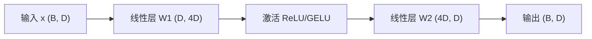
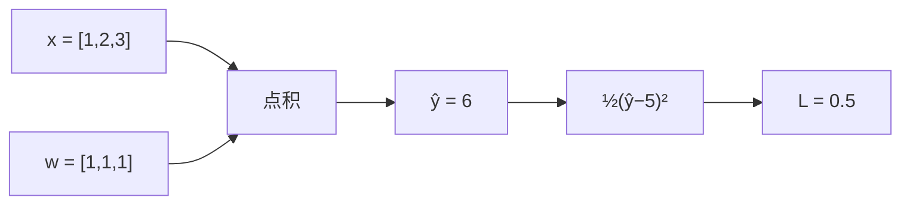

# 第 0 章 预备知识速成

> 本章为本书原创的“补课”章节，没有对应的课程视频。它只讲读懂后续 18 章所**必需**的数学与 PyTorch 知识，并刻意跳过证明。课程官网：[cs336.stanford.edu](https://cs336.stanford.edu/)

## 本章你将学到

- 向量、矩阵、张量到底是什么，矩阵乘法的**形状规则**为什么是一切的基础
- 导数、偏导、梯度、链式法则的直觉，以及“梯度下降”这个训练模型的核心动作
- 概率分布、softmax、对数、交叉熵、困惑度（perplexity）——语言模型的“记分规则”
- 神经网络 = 线性层 + 激活函数；反向传播在做什么、为什么它要占那么多显存
- PyTorch 最小入门：tensor、autograd、`nn.Module`、一个完整训练循环
- 浮点数 fp32 / fp16 / bf16 的区别，以及“一个参数占几个字节”

## 先说结论（一分钟版）

大语言模型本质上是一个**巨大的函数**：输入一串整数（token），输出“下一个 token 是谁”的概率分布。这个函数几乎全部由**矩阵乘法**搭成，中间穿插少量非线性运算。训练它，就是不断地：算出模型在训练数据上“猜错了多少”（交叉熵损失），用链式法则求出每个参数该往哪个方向改（反向传播求梯度），然后沿着让损失变小的方向挪一小步（梯度下降）。PyTorch 帮我们自动完成“求梯度”这件最麻烦的事。最后，所有这些数字都以浮点数存在 GPU 显存里，用几个字节存一个数，直接决定了你能训多大的模型。

如果你只记住一句话：**形状（shape）对上了，代码就成功了一半。**

::: tip 怎么读这一章
本章按“够用就好”的原则写。每节都先给直觉，再给定义，最后才是公式。公式看不懂可以先跳过，**但请一定动手玩一下三个交互演示**——它们比文字更快让你建立直觉。后续章节遇到不熟的概念，可以随时回来查。
:::

## 0.1 向量：一排数字

### 直觉

在 Kotlin 里你一定写过 `FloatArray(4)`，在 Swift 里写过 `[Float](repeating: 0, count: 4)`。**向量（vector）就是这么一排数字。**数学上写成

$$
\mathbf{x} = [x_1, x_2, \dots, x_d]
$$

其中 $d$ 叫做向量的**维度（dimension）**，$x_i$ 是第 $i$ 个分量。

为什么要用向量？因为机器学习里几乎所有“东西”都会被表示成一排数字：

- 一张 28×28 的灰度图 → 拉平成 784 个像素值的向量；
- 一个用户 → [年龄, 日活时长, 付费金额, …]；
- 一个词（token）→ 一个几百到几千维的向量，叫做**嵌入（embedding）**。语言模型的第一步就是查表：把整数编号的 token 换成它对应的向量。

### 点积：衡量“像不像”

两个同样长度的向量可以做**点积（dot product）**：对应位置相乘，再全部加起来。

$$
\mathbf{x} \cdot \mathbf{w} = \sum_{i=1}^{d} x_i w_i = x_1 w_1 + x_2 w_2 + \dots + x_d w_d
$$

$\sum$ 是“求和”符号，$i$ 从 1 走到 $d$；整句话就是“逐位相乘，然后加总”。

例子：$[1, 2, 3] \cdot [1, 1, 1] = 1 + 2 + 3 = 6$。

点积的直觉意义：两个向量方向越一致，点积越大；方向相反就是负数；垂直则为 0。后面讲注意力机制（attention）时，“query 和 key 的点积越大就越关注”，用的就是这个直觉。

```python
# 用纯 Python 写一个点积
def dot(x, w):
    assert len(x) == len(w)          # 长度必须一样
    return sum(a * b for a, b in zip(x, w))

print(dot([1, 2, 3], [1, 1, 1]))     # 6
```

做一次长度为 $d$ 的点积，需要 $d$ 次乘法和 $d-1$ 次加法，大约 **$2d$ 次浮点运算（FLOPs）**。记住这个“2”，第 2 章算训练成本时它会变成著名的 $6ND$ 里的一部分。

## 0.2 矩阵与矩阵乘法：形状规则

### 矩阵是什么

**矩阵（matrix）**是一个二维的数字表格，有 $m$ 行 $n$ 列，我们说它的**形状（shape）**是 $m \times n$。你可以把它想成 Kotlin 的 `Array(m) { FloatArray(n) }`，或者一张 Excel 表。

$$
A = \begin{bmatrix} 1 & 2 & 3 \\ 4 & 5 & 6 \end{bmatrix} \quad (2 \times 3)
$$

### 矩阵乘法：一堆点积

矩阵乘法 $C = AB$ 的定义只有一句话：

> **C 的第 i 行第 j 列 = A 的第 i 行 与 B 的第 j 列 的点积。**

$$
C_{ij} = \sum_{t=1}^{k} A_{it} B_{tj}
$$

$A_{it}$ 是 A 第 $i$ 行第 $t$ 列的数，$B_{tj}$ 是 B 第 $t$ 行第 $j$ 列的数；对 $t$ 求和就是把“一行”和“一列”逐位相乘再加起来。

由此直接推出**形状规则**：

$$
\underbrace{A}_{m \times k} \;\; \underbrace{B}_{k \times n} = \underbrace{C}_{m \times n}
$$

- A 的列数必须等于 B 的行数（都是 $k$），否则“一行”和“一列”长度不一样，没法做点积；
- 中间这个 $k$ 在结果里**消失了**（被求和掉了）；
- 结果的形状由“外面两个数”决定：$m \times n$。

::: tip 移动端类比
把形状规则想成函数签名的类型检查：`fun mul(a: Mat<M, K>, b: Mat<K, N>): Mat<M, N>`。两个 `K` 必须相同，编译器（PyTorch）才让你过。PyTorch 里最常见的报错之一就是 `mat1 and mat2 shapes cannot be multiplied (2x3 and 2x2)`，意思就是这两个 K 对不上。
:::

<Demo src="ch00-matmul.html" title="矩阵乘法：形状规则 + 逐元素计算" :height="620" />

在上面的演示里，试着把 A 的 k 和 B 的 k′ 设成不同的数，看看会发生什么；再单步执行，观察 C 的每个格子是怎么由“一行 · 一列”算出来的。

### 矩阵乘法有多贵

C 一共有 $m \times n$ 个元素，每个元素是长度 $k$ 的点积，约 $2k$ 次运算，所以：

$$
\text{FLOPs}(AB) \approx 2mkn
$$

手算一下：$(1024 \times 1024)$ 乘 $(1024 \times 1024)$，约 $2 \times 1024^3 \approx 2.1 \times 10^9$ 次浮点运算，也就是 21 亿次。这个公式在第 2 章会反复出现。

### 线性层 = 矩阵乘法

神经网络里最常见的操作“线性层（linear layer）”就是一个矩阵乘法。设一批数据有 $B$ 条样本，每条是 $D$ 维向量，排成形状 $(B, D)$ 的矩阵 $X$；权重矩阵 $W$ 形状为 $(D, K)$；则

$$
Y = XW, \quad (B \times D)(D \times K) = (B \times K)
$$

意思是：把每条 $D$ 维输入，变换成 $K$ 维输出。$W$ 里的 $D \times K$ 个数就是这个层的**参数（parameters）**，也是训练要学习的东西。

### 转置

**转置（transpose）**就是行列互换：形状 $(m \times n)$ 变成 $(n \times m)$，记作 $A^\top$。PyTorch 里写 `A.T` 或 `A.transpose(0, 1)`。你会在注意力里看到 $QK^\top$：Q 形状 $(S, d)$，K 形状 $(S, d)$，直接相乘对不上，转置一下 $K^\top$ 变成 $(d, S)$，乘出来 $(S, S)$——正好是“每个位置对每个位置”的打分表。

## 0.3 张量与形状：多维数组

### 张量就是多维数组

**张量（tensor）**是向量和矩阵的推广：

| 名字 | 维数（rank） | 例子 | 形状 |
|---|---|---|---|
| 标量 scalar | 0 | 损失值 | `()` |
| 向量 vector | 1 | 一个词向量 | `(D,)` |
| 矩阵 matrix | 2 | 一批词向量 | `(B, D)` |
| 3 维张量 | 3 | 一批句子 | `(B, S, D)` |
| 4 维张量 | 4 | 多头注意力 | `(B, S, H, D)` |

这里 $B$ = batch size（一次处理多少条样本），$S$ = sequence length（每条有多少个 token），$H$ = 注意力头数，$D$ = 每个向量的维度。**这几个字母在全书里含义固定，请记住。**

在 Transformer 里，最常见的数据就是形状 `(B, S, D)` 的张量：B 句话，每句 S 个 token，每个 token 一个 D 维向量。

### 形状操作

几个高频操作（第 2 章会用 einops 给它们更好的写法）：

- `reshape` / `view`：不改数据，只改“怎么解读”。例如 `(3, 8)` 看成 `(3, 2, 4)`。
- `transpose`：交换两个维度。
- `sum(dim=...)`：沿某个维度求和，这个维度就消失了。

```python
import torch
x = torch.arange(24).reshape(3, 8)   # 0..23 排成 3 行 8 列
y = x.view(3, 2, 4)                  # 同样的 24 个数，看成 3×2×4
z = y.transpose(0, 1)                # 交换前两维 → 形状 (2, 3, 4)
s = x.sum(dim=-1)                    # 沿最后一维求和 → 形状 (3,)
print(y.shape, z.shape, s.shape)
```

`dim=-1` 表示“最后一个维度”，`-2` 表示倒数第二个，和 Python 列表的负索引一样。

::: details 深入一点：内存里其实是一维的（可跳过）
无论几维，张量在内存里都是一长条连续的数字，按“行优先（row-major）”排列：最后一维变化最快。`(3, 8)` 的第 1 行第 2 列，在内存里的位置是 $1 \times 8 + 2 = 10$。这和你在 Android 里把一个二维像素数组存进 `IntArray(width * height)`、用 `y * width + x` 取像素是一模一样的。`view` 之所以“免费”，就是因为它只改了这套下标换算规则，数据一个字节都没动。
:::

### 广播（broadcasting）

形状不同的张量做逐元素运算时，PyTorch 会自动把“长度为 1 或缺失的维度”复制扩展。例如 `(B, D)` 的矩阵加上 `(D,)` 的偏置向量，相当于每一行都加上同一个向量。这很方便，但也是隐蔽 bug 的温床——**形状不对时它可能不报错，而是悄悄算出错误结果**。养成习惯：在代码里用注释写下每个张量的形状。

## 0.4 导数、偏导、梯度与链式法则

### 导数：斜率

你在微积分里学过：函数 $f(x)$ 的**导数（derivative）** $f'(x)$ 表示“$x$ 增加一点点时，$f$ 变化多快”，也就是曲线在这一点的斜率。

例：$f(x) = (x - 3)^2$，导数 $f'(x) = 2(x - 3)$。
- 在 $x = 0$ 处，$f'(0) = -6$：斜率为负，往右走 $f$ 会下降；
- 在 $x = 3$ 处，$f'(3) = 0$：到底了，平的；
- 在 $x = 5$ 处，$f'(5) = 4$：斜率为正，往左走才会下降。

**导数的符号告诉你“下坡在哪边”，大小告诉你“坡有多陡”。**这就是训练模型需要的全部信息。

### 偏导与梯度：多个旋钮

真实的模型有成千上万（甚至上万亿）个参数。损失函数 $L(w_1, w_2, \dots, w_n)$ 依赖所有参数。

**偏导数（partial derivative）** $\frac{\partial L}{\partial w_i}$：只动 $w_i$、其他参数都不动时，$L$ 的变化率。把所有偏导排成一个向量，就是**梯度（gradient）**：

$$
\nabla L = \left[\frac{\partial L}{\partial w_1}, \frac{\partial L}{\partial w_2}, \dots, \frac{\partial L}{\partial w_n}\right]
$$

$\nabla$ 读作 nabla，“对所有参数求偏导”。

一个关键事实：**梯度的形状和参数的形状完全相同**。参数 $W$ 是 $(D, K)$ 的矩阵，它的梯度也是 $(D, K)$ 的矩阵，每个位置告诉你“这个参数该往哪边调、调多猛”。这也意味着：**存梯度要再花一份和参数一样大的内存**（第 2 章会算）。

::: tip 移动端类比
想象一个有 1000 个滑块的调音台，你想让音质评分（损失）最低。梯度就是一张“每个滑块往哪推、推多少能最快改善评分”的清单。
:::

### 链式法则：一环扣一环

神经网络是很多函数一层套一层：$y = f(g(x))$。**链式法则（chain rule）**说：

$$
\frac{dy}{dx} = \frac{dy}{du} \cdot \frac{du}{dx}, \quad \text{其中 } u = g(x)
$$

意思是：总的变化率 = 每一环变化率的**乘积**。

手算一个：$y = (3x + 1)^2$，求 $x = 1$ 处的导数。
- 令 $u = 3x + 1$，则 $y = u^2$；
- $x = 1$ 时 $u = 4$；$\frac{dy}{du} = 2u = 8$；$\frac{du}{dx} = 3$；
- 所以 $\frac{dy}{dx} = 8 \times 3 = 24$。

直觉：齿轮传动。第一个齿轮转 1 圈带动第二个转 3 圈，第二个转 1 圈带动第三个转 8 圈，那第一个转 1 圈，第三个转 24 圈。

## 0.5 梯度下降：沿着坡往下走

### 算法

训练的目标是找到让损失 $L$ 最小的参数。我们不知道最低点在哪，但每到一个位置都能算出梯度（坡度）。于是：

$$
w \leftarrow w - \eta \cdot \nabla L(w)
$$

- $w$：当前参数；
- $\nabla L(w)$：当前位置的梯度（指向“上坡最陡”的方向）；
- $\eta$（读作 eta）：**学习率（learning rate）**，每一步走多远；
- 减号：往梯度的**反方向**走，也就是下坡。

手算两步：$f(x) = (x-3)^2$，从 $x = 0$ 出发，$\eta = 0.1$：
- 第 1 步：$f'(0) = -6$，$x = 0 - 0.1 \times (-6) = 0.6$；
- 第 2 步：$f'(0.6) = -4.8$，$x = 0.6 + 0.48 = 1.08$；
- ……越来越接近 3，每一步都比上一步走得少（因为越接近谷底坡越缓）。

如果 $\eta = 1.0$：第 1 步跳到 $x = 6$，第 2 步跳回 $x = 0$……永远来回震荡。$\eta$ 再大就会越跳越远，也就是**发散（diverge）**——训练中损失突然变成 `NaN`，常常就是这个原因。

<Demo src="ch00-gradient-descent.html" title="梯度下降：小球滑坡" :height="640" />

玩一玩：
1. 碗形函数，学习率从 0.05 拉到 0.9 再到 1.1，观察“慢慢滑 → 来回震荡 → 发散”；
2. 切到“陡峭碗”，同样的学习率为什么更容易发散？（坡越陡，梯度越大，一步迈得越远）；
3. 切到“双山谷”，从右边出发会停在右边那个较浅的谷——这叫**局部最小值**。

### 随机梯度下降（SGD）与 batch

真实训练数据有上万亿 token，不可能每一步都在全部数据上算损失。做法是每一步随机抽一小批（**mini-batch**）数据，用它算出的梯度近似真实梯度。这叫**随机梯度下降（Stochastic Gradient Descent, SGD）**。batch 越大，梯度估计越准，但每步越贵、越占内存——第 2 章的“梯度累积”就是为了在内存有限时也能用大 batch。

### 比 SGD 更聪明的优化器

后面你会频繁听到 **Adam / AdamW** 优化器。现在只需知道：它们在 SGD 的基础上，为**每个参数**额外记住两个“历史统计量”（梯度的滑动平均、梯度平方的滑动平均），用来自动调节每个参数的步长。代价是：每个参数要多存 2 个数。这个“优化器状态（optimizer state）”在第 2 章的显存计算里占大头。

## 0.6 概率、softmax、交叉熵与困惑度

这一节是理解“语言模型在学什么”的关键。

### 概率分布

**概率分布（probability distribution）**就是给每种可能结果分配一个 0 到 1 之间的数，且全部加起来等于 1。比如掷骰子：每个面 $1/6$。

**语言模型（language model）**做的事情是：给定前文，输出“下一个 token 是词表里每个 token”的概率分布：

$$
p(x_t \mid x_1, x_2, \dots, x_{t-1})
$$

竖线 $\mid$ 读作“在……的条件下”。整句话：已知前面 $t-1$ 个 token，第 $t$ 个 token 是某个值的概率。词表大小 $V$ 通常是几万到二十万，所以模型每一步要输出一个长度为 $V$ 的概率向量。

一整句话的概率，可以拆成一连串“下一个词”概率的乘积（这叫概率的链式法则）：

$$
p(x_1, \dots, x_T) = p(x_1)\, p(x_2 \mid x_1)\, p(x_3 \mid x_1, x_2) \cdots
$$

所以“学会预测下一个 token”就等于“学会了给整段文本打分”。这就是 GPT 类模型训练目标的全部。

### 对数：把乘法变加法

$\log$ 是对数。本书默认自然对数 $\ln$（以 $e \approx 2.718$ 为底）。你只需要记住三条性质：

- $\log(ab) = \log a + \log b$：乘积变求和。很多个小概率连乘会小到浮点数表示不了（下溢），取对数后变成相加就安全了；
- $\log 1 = 0$；$0 < p < 1$ 时 $\log p < 0$；$p$ 越接近 0，$\log p$ 越接近 $-\infty$；
- $\log$ 是单调递增的：$p$ 越大，$\log p$ 越大。

### softmax：把打分变成概率

模型最后一层输出的是 $V$ 个任意实数，叫 **logits**（可以理解为“原始打分”），可正可负、加起来也不等于 1。**softmax** 把它们变成合法的概率分布：

$$
p_i = \frac{e^{z_i}}{\sum_{j=1}^{V} e^{z_j}}
$$

- $z_i$：第 $i$ 个候选的 logit；
- $e^{z_i}$：取指数，保证结果为正，并且放大差距；
- 分母：所有候选的指数之和，用来归一化，使总和为 1。

手算：logits = [2.0, 1.0, 0.1]
- $e^{2} = 7.389$，$e^{1} = 2.718$，$e^{0.1} = 1.105$，总和 $11.212$；
- 概率 = [0.659, 0.242, 0.099]。

性质：所有 logit 同时加上同一个常数，softmax 结果不变（只看相对差距）。实现时正是利用这一点，先减去最大值再取指数，避免 $e^{1000}$ 溢出。

### 温度（temperature）

生成文本时常见一个参数“温度” $T$：先把 logits 除以 $T$ 再做 softmax。

$$
p_i = \frac{e^{z_i / T}}{\sum_j e^{z_j / T}}
$$

- $T < 1$：差距被放大，分布更“尖”，模型更保守、更确定；$T \to 0$ 时只选最大的那个（贪心解码）；
- $T > 1$：差距被缩小，分布更“平”，输出更随机、更“有创意”。

用上面的例子：$T = 0.5$ 时概率 ≈ [0.864, 0.117, 0.019]；$T = 2$ 时 ≈ [0.502, 0.304, 0.194]。

### 交叉熵：语言模型的损失函数

训练时我们知道“正确答案”（训练文本里真实的下一个 token，记作 $y$）。我们希望模型给它的概率 $p_y$ 越大越好。**交叉熵损失（cross-entropy loss）**定义为：

$$
L = -\log p_y
$$

只看正确答案拿到的概率，取对数再取负号。

- $p_y = 1$（完全猜中且毫不犹豫）：$L = 0$；
- $p_y = 0.5$：$L = \ln 2 \approx 0.693$；
- $p_y = 0.01$：$L \approx 4.6$；
- $p_y \to 0$：$L \to \infty$——自信地猜错会被重罚。

一段文本的损失 = 每个位置损失的平均。训练语言模型 = 用梯度下降让这个平均交叉熵越来越小。

::: warning 常见误区
PyTorch 的 `F.cross_entropy(logits, target)` 接收的是 **logits**，不是概率——它内部会自己做 softmax（还用了数值更稳定的写法）。如果你先手动 softmax 再传进去，结果会是错的，而且不会报错。
:::

### 困惑度（perplexity）

损失是个对数量，不太直观。**困惑度（perplexity, PPL）**把它变回“个数”：

$$
\text{PPL} = e^{L}
$$

$L$ 是平均交叉熵（自然对数）。

直觉：**困惑度 = 模型平均相当于在几个选项里均匀瞎猜。**
- 若模型对 $V$ 个 token 完全均匀猜，$p_y = 1/V$，$L = \ln V$，PPL $= V$；
- 若每次给正确答案 0.5 的概率，PPL $= 2$，相当于在两个词里二选一；
- 完美模型 PPL $= 1$。

课程的作业排行榜，就是比谁在给定时间预算内把验证集困惑度压得最低。

<Demo src="ch00-softmax.html" title="softmax、温度、交叉熵与困惑度" :height="720" />

在演示里：拖动 logit、调温度、点选不同的“正确答案”，观察交叉熵和困惑度如何变化；按“设为均匀分布”，确认 5 个候选时困惑度正好是 5；再试试采样，感受温度对“创意”的影响。

## 0.7 神经网络：线性层 + 激活函数

### 为什么需要非线性

如果网络只有线性层，那么叠多少层都等价于一层：$X W_1 W_2 = X (W_1 W_2)$，两个矩阵乘起来还是一个矩阵。为了表达复杂的规律，每个线性层后面要接一个**非线性的激活函数（activation function）**。

最常见的几个：

- **ReLU**：$\text{ReLU}(x) = \max(0, x)$。负数变 0，正数原样通过。像一个“单向阀”。
- **GELU**：ReLU 的平滑版本，在 0 附近是一条柔和的曲线，GPT-2 等模型使用。
- **SwiGLU**：现代 LLM（如 Llama）常用的“带门控”的变体，第 3 章细讲。

激活函数是**逐元素（element-wise）**的：对张量里每个数各算各的，形状不变。

### 多层感知机（MLP）

“线性层 → 激活 → 线性层 → 激活 → …”叠起来，就是**多层感知机（MLP, Multi-Layer Perceptron）**，也叫前馈网络（feed-forward network）。Transformer 每一层里都有一个 MLP 子层。



这个 MLP 的参数量是 $D \times 4D + 4D \times D = 8D^2$（忽略偏置）。若 $D = 4096$，就是约 1.34 亿个参数——仅仅一层里的一个子模块。

### 参数、激活值与“隐藏维度”

- **参数（parameters / weights）**：要学习的数，例如各个 $W$。训练结束后存进模型文件。
- **激活值（activations）**：数据流经网络时每层算出的中间结果，例如上图里 $W_1$ 之后的 $(B, 4D)$ 张量。它们随输入而变，不需要保存到模型文件，但**训练时必须暂存**（下一节解释原因）。
- **隐藏维度（hidden dimension）**：中间向量的长度，常记作 $D$ 或 $d_\text{model}$。

### 嵌入层：查表

语言模型的输入是整数 token 编号，而网络需要向量。**嵌入层（embedding）**就是一张形状 $(V, D)$ 的参数表：第 $i$ 行就是 token $i$ 的向量。查表即可，本质上等价于“one-hot 向量乘以这个矩阵”。

## 0.8 反向传播：链式法则的自动化

### 计算图

把一次前向计算画成一张图：每个节点是一个运算，箭头表示数据流向。例如第 2 课讲义里的简单例子：

$$
\hat{y} = \mathbf{x} \cdot \mathbf{w}, \qquad L = \tfrac{1}{2}(\hat{y} - 5)^2
$$

$\hat{y}$ 是模型预测，5 是真实答案，$L$ 是平方误差损失。



### 反向走一遍

**前向传播（forward pass）**：从左到右算出 $L = 0.5$。
**反向传播（backward pass / backpropagation）**：从右往左，用链式法则一路乘回去：

1. $\frac{\partial L}{\partial \hat{y}} = \hat{y} - 5 = 1$；
2. $\frac{\partial \hat{y}}{\partial w_i} = x_i$（点积对 $w_i$ 求偏导就剩 $x_i$）；
3. 链式法则：$\frac{\partial L}{\partial w_i} = 1 \times x_i$，所以梯度 $= [1, 2, 3]$。

这正是第 2 讲讲义里 `w.grad == [1, 2, 3]` 的由来。

### 两个重要推论

1. **反向需要前向的中间结果。**上面第 2 步要用到 $x_i$；对一般的网络，每一层求梯度都要用到这一层的输入（激活值）。所以训练时必须把每层的激活值**存起来**等反向用——这就是训练比推理费显存得多的根本原因，也是第 2 章“激活检查点（activation checkpointing）”要解决的问题。
2. **反向比前向贵。**对每个线性层，反向既要算“对输入的梯度”（传给前一层），又要算“对权重的梯度”（用来更新参数），是两个和前向同样大的矩阵乘法。所以反向 ≈ 2 倍前向。前向 2 + 反向 4 = 6，这就是第 2 章 $6ND$ 公式的来历。

::: tip 移动端类比
反向传播像是 App 的“崩溃归因”：用户最终给了差评（损失大），你要沿着调用栈一层层往回追，算出每个模块该背多少锅（梯度），然后各自改进。而要追溯，你就得保留每一层的现场日志（激活值）。
:::

好消息是：**你永远不需要手写反向传播。**PyTorch 的自动求导（autograd）会记录前向时的计算图，调用 `loss.backward()` 就自动沿图往回算出所有梯度。

## 0.9 PyTorch 最小入门

### 张量的创建与属性

```python
import torch

x = torch.zeros(4, 8)                  # 4×8 全 0 矩阵，默认 float32
y = torch.randn(4, 8)                  # 标准正态分布随机数
z = torch.tensor([[1., 2.], [3., 4.]]) # 从 Python 列表创建

print(x.shape)         # torch.Size([4, 8])
print(x.dtype)         # torch.float32：每个元素的数据类型
print(x.device)        # cpu：存在哪个设备上
print(x.numel())       # 32：元素个数
print(x.element_size())# 4：每个元素占 4 字节

w = torch.randn(8, 3)
out = y @ w            # 矩阵乘法，(4,8)@(8,3) → (4,3)
e = y * 2 + 1          # 逐元素运算，形状不变
```

把张量放到 GPU：`x = x.to("cuda")`。GPU 上的张量只能和 GPU 上的张量运算。没有 GPU 的笔记本（包括 Apple Silicon 的 Mac 用 `"mps"`）也能跑本书大多数小例子。

### autograd：自动求梯度

```python
import torch

x = torch.tensor([1., 2., 3.])
w = torch.tensor([1., 1., 1.], requires_grad=True)  # 告诉 PyTorch：我要 w 的梯度

pred = x @ w                        # 前向：点积 = 6
loss = 0.5 * (pred - 5) ** 2        # 损失 = 0.5
loss.backward()                     # 反向：自动沿计算图求梯度

print(w.grad)                       # tensor([1., 2., 3.])，和手算一致
```

要点：`requires_grad=True` 的张量会被“追踪”；`backward()` 只能从一个**标量**（如平均损失）出发；梯度会**累加**进 `.grad`，所以每步更新前要清零——这个“累加”特性后来被巧妙利用成“梯度累积”。

### nn.Module：把参数和计算打包

```python
import torch
from torch import nn
import torch.nn.functional as F

class MLP(nn.Module):
    def __init__(self, dim: int):
        super().__init__()
        # nn.Parameter 会被自动登记为“可训练参数”
        self.w1 = nn.Parameter(torch.randn(dim, 4 * dim) / dim ** 0.5)
        self.w2 = nn.Parameter(torch.randn(4 * dim, dim) / (4 * dim) ** 0.5)

    def forward(self, x):           # x: (B, dim)
        h = F.relu(x @ self.w1)     # (B, 4*dim)
        return h @ self.w2          # (B, dim)

model = MLP(16)
print(sum(p.numel() for p in model.parameters()))  # 8 * 16 * 16 = 2048 个参数
y = model(torch.randn(5, 16))       # 调用 model(x) 会执行 forward
```

`nn.Module` 类似 Android 里的自定义 `View` 或 iOS 里的 `UIView` 子类：构造函数里声明“子部件”（参数、子模块），`forward` 里写“怎么画”（怎么计算）。PyTorch 自带 `nn.Linear`、`nn.Embedding` 等现成模块，但 CS336 作业要求你**自己实现**它们。

### 一个完整的训练循环

下面这段代码与第 2 讲讲义里的训练循环同构：让模型学会一个未知的线性规律。

```python
import torch
from torch import nn

torch.manual_seed(0)
D = 4
true_w = torch.tensor([1., -2., 3., 0.5])     # “真实规律”，模型不知道

model = nn.Linear(D, 1, bias=False)           # 待学参数，形状 (1, 4)
opt = torch.optim.SGD(model.parameters(), lr=0.1)

for step in range(200):
    x = torch.randn(32, D)                    # 1. 取一个 batch：32 条样本
    y = x @ true_w                            #    对应的正确答案 (32,)
    pred = model(x).squeeze(-1)               # 2. 前向：(32,1) → (32,)
    loss = ((pred - y) ** 2).mean()           #    均方误差损失
    opt.zero_grad()                           # 3. 清空上一步的梯度
    loss.backward()                           # 4. 反向：求 d loss / d 参数
    opt.step()                                # 5. 更新：参数 -= lr * 梯度

print(model.weight.data)   # 应接近 [1, -2, 3, 0.5]
```

**取数据 → 前向算损失 → 清梯度 → 反向求梯度 → 优化器更新**，这五步就是所有深度学习训练的骨架，从这个 4 个参数的玩具到上千亿参数的大模型都一样。不同的只是模型更复杂、数据更多、要切分到更多 GPU 上。

::: details Kotlin 伪代码对照（帮助理解训练循环）
```kotlin
repeat(200) {
    val (x, y) = dataLoader.nextBatch()     // 取数据
    val loss = mse(model.forward(x), y)     // 前向
    model.params.forEach { it.grad = 0f }   // 清梯度
    loss.backward()                         // 反向（框架自动完成）
    model.params.forEach { it.value -= lr * it.grad }  // 更新
}
```
:::

## 0.10 浮点数：一个数占几个字节

### 浮点数的结构

计算机用**浮点数（floating point）**表示实数，思路和科学计数法一样：$-1.5 \times 2^{3}$。一个浮点数由三部分组成：

- **符号位（sign）**：1 位，正还是负；
- **指数（exponent）**：决定数量级，能表示多大、多小的数——即**动态范围（dynamic range）**；
- **尾数（mantissa / fraction）**：决定有效数字，能表示多精细——即**精度（precision / resolution）**。

位数是固定的，分给指数的多了，分给尾数的就少了。

### 三种最常见的格式

| 格式 | 总位数 | 字节 | 指数位 | 尾数位 | 特点 |
|---|---|---|---|---|---|
| fp32（float32，单精度） | 32 | 4 | 8 | 23 | PyTorch 默认，范围大、精度高 |
| fp16（float16，半精度） | 16 | 2 | 5 | 10 | 省一半内存，但范围小，容易下溢/溢出 |
| bf16（bfloat16） | 16 | 2 | 8 | 7 | 和 fp32 一样的范围，精度较粗 |

几个直观数字：
- fp16 能表示的最大数是 65504，而它能表示的最小正数约为 $6 \times 10^{-8}$。所以 `torch.tensor([1e-8], dtype=torch.float16)` 会直接变成 0——这叫**下溢（underflow）**。第 2 讲讲义里正好演示了这个例子；
- bf16 有 8 位指数，范围和 fp32 相当（可到约 $10^{-38}$ 到 $10^{38}$），所以 1e-8 不会变 0；代价是只有大约 2~3 位有效十进制数字。

深度学习的计算本来就“很粗糙”（随机采样的数据、带噪声的梯度），**范围比精度更重要**：数值一旦溢出成无穷大或下溢成 0，训练就崩了；而精度粗一点，影响往往不大。这就是 bf16 成为大模型训练主流格式的原因。

::: tip 移动端类比
这就像图片格式：ARGB_8888 每像素 4 字节，RGB_565 每像素 2 字节。后者省一半内存，但颜色层次少了。bf16 相当于一种“保留了亮度范围、牺牲了一点色彩层次”的压缩格式。
:::

### 内存 = 元素个数 × 每元素字节数

这是全书最常用的一条算式：

$$
\text{内存（字节）} = \text{numel} \times \text{每元素字节数}
$$

手算：一个 70 亿（7B）参数的模型，用 bf16 存储权重：$7 \times 10^9 \times 2 = 1.4 \times 10^{10}$ 字节 = 14 GB。用 fp32 则是 28 GB。而训练时还要存梯度和优化器状态，远不止这些——第 2 章会算出“每个参数 12~16 字节”的结论。

更激进的格式（fp8、fp4）也已经出现在最新的硬件和模型上，第 2 章会简单介绍。

## 0.11 把一切串起来：一个迷你语言模型

前面各节的零件，现在拼成一个能训练的“语言模型”。它非常简陋——只看前一个 token 来预测下一个（这叫 bigram 模型）——但**输入输出的形状、损失的算法、训练的流程，和 GPT 完全一样**。第 3 章的 Transformer 只是把中间那块换成了强大得多的网络。

### 训练数据长什么样

假设分词器（第 1 章）已经把文本变成了整数序列：

```
token 序列：  [5, 9, 2, 7, 3]
输入 x：      [5, 9, 2, 7]      ← 去掉最后一个
目标 y：      [9, 2, 7, 3]      ← 去掉第一个（整体左移一位）
```

每个位置的任务都是“看到 x[t]，预测 y[t]（也就是下一个 token）”。一段长度为 $S$ 的文本，一次就提供了 $S$ 个训练样本——这就是语言模型可以用海量无标注文本训练的原因：**文本自己就是答案**。

### 形状一路走下去

| 步骤 | 运算 | 形状 |
|---|---|---|
| 输入 token 编号 | — | `(B, S)` 整数 |
| 嵌入查表 | `E[x]`，E 形状 `(V, D)` | `(B, S, D)` |
| 中间网络（这里只是一个 MLP） | 线性 + 激活 + 线性 | `(B, S, D)` |
| 输出层 | 乘以 `(D, V)` 的矩阵 | `(B, S, V)`，即 logits |
| softmax + 交叉熵 | 与目标 `(B, S)` 比较 | 标量损失 |

请特别注意最后一步：每个位置都输出一个长度为 $V$ 的 logits 向量（对词表里每个 token 打分），所以输出张量是 `(B, S, V)`。$V$ 往往有几万到二十万，这个张量会非常大——这也是后面几章反复出现的一个内存热点。

### 代码

```python
import torch
from torch import nn
import torch.nn.functional as F

V, D = 100, 32                              # 词表大小、隐藏维度
class TinyLM(nn.Module):
    def __init__(self):
        super().__init__()
        self.emb = nn.Embedding(V, D)       # 嵌入表 (V, D)
        self.mlp = nn.Sequential(nn.Linear(D, 4 * D), nn.GELU(), nn.Linear(4 * D, D))
        self.out = nn.Linear(D, V)          # 输出层：D 维 → V 个打分
    def forward(self, x):                   # x: (B, S) 整数
        h = self.emb(x)                     # (B, S, D)
        h = h + self.mlp(h)                 # (B, S, D)，加回输入（残差连接，第 3 章讲）
        return self.out(h)                  # (B, S, V) logits

model = TinyLM()
opt = torch.optim.AdamW(model.parameters(), lr=1e-3)
tokens = torch.randint(0, V, (8, 65))       # 假数据：8 条序列，每条 65 个 token
x, y = tokens[:, :-1], tokens[:, 1:]        # 输入与“左移一位”的目标，形状都是 (8, 64)
for step in range(100):
    logits = model(x)                                         # (8, 64, 100)
    loss = F.cross_entropy(logits.reshape(-1, V), y.reshape(-1))  # 拉平成 (512, 100) 与 (512,)
    opt.zero_grad(); loss.backward(); opt.step()
print(loss.item(), torch.exp(loss).item())  # 损失与困惑度
```

几点说明：

- `F.cross_entropy` 要求 logits 是二维 `(样本数, 类别数)`，所以把 `(B, S, V)` 拉平成 `(B·S, V)`，目标拉平成 `(B·S,)`。这种 `reshape` 在作业里非常常见。
- 这里用的是随机假数据，模型学不到规律。一开始的损失约为 $\ln 100 \approx 4.6$（困惑度约 100，相当于在 100 个 token 里瞎猜），这是一个很好的**健全性检查（sanity check）**：如果你的模型初始损失远离 $\ln V$，多半是哪里写错了。
- 换成真实文本（比如作业 1 用的 TinyStories），损失会稳步下降，困惑度从上百降到个位数。

::: tip 本书路线图
把上面这个 `TinyLM` 记在心里：第 1 章解决“文本怎么变成 `(B, S)` 的整数”；第 2 章算清楚它要多少内存和计算；第 3、4 章把中间的 MLP 换成真正的 Transformer 层；第 5~8 章让它在一张乃至上千张 GPU 上跑得飞快；第 9、11 章决定它该多大、训多久；第 13、14 章决定喂它什么数据；第 15~17 章教它听话、会推理。
:::

## 0.12 读后续章节的符号速查

| 符号 | 含义 |
|---|---|
| $B$ | batch size，一批样本数 |
| $S$ 或 $T$ | 序列长度（token 数） |
| $D$ 或 $d_\text{model}$ | 隐藏维度 |
| $H$ | 注意力头数 |
| $V$ | 词表大小 |
| $L$ | 层数（有时也表示损失，看上下文） |
| $N$ | 模型参数总数 |
| $D$（在 $6ND$ 里） | 训练 token 总数（注意和隐藏维度区分） |
| FLOPs | 浮点运算次数（计算量） |
| FLOP/s | 每秒浮点运算次数（硬件速度） |
| $\eta$ | 学习率 |
| $\nabla L$ | 损失对参数的梯度 |

## 动手练习

1. **形状推理。**$X$ 形状 $(32, 512)$，$W_1$ 形状 $(512, 2048)$，$W_2$ 形状 $(2048, 512)$。`relu(X @ W1) @ W2` 的输出形状是什么？两次矩阵乘法一共多少 FLOPs？

   ::: details 答案
   输出 $(32, 512)$。FLOPs = $2 \times 32 \times 512 \times 2048 \times 2 \approx 1.34 \times 10^8$。
   :::

2. **手算 softmax 与交叉熵。**logits = [1, 1, 1, 1]，softmax 是多少？如果正确答案是第 1 个，交叉熵和困惑度是多少？

   ::: details 答案
   每个都是 0.25；交叉熵 $= -\ln 0.25 = \ln 4 \approx 1.386$；困惑度 $= 4$。
   :::

3. **手算梯度。**$L = (w x - y)^2$，$x = 2$，$y = 10$，$w = 3$。求 $\frac{\partial L}{\partial w}$，并用学习率 0.05 走一步梯度下降，新的 $w$ 是多少？再用 PyTorch 验证。

   ::: details 答案
   $wx - y = -4$，$\frac{\partial L}{\partial w} = 2(wx-y)\cdot x = 2 \times (-4) \times 2 = -16$。新 $w = 3 - 0.05 \times (-16) = 3.8$。（正确答案是 $w = 5$，确实在靠近。）
   :::

4. **改写训练循环。**把 0.9 节的训练循环改成用 0.9 节定义的 `MLP` 去拟合 $y = \sin(x)$（x 为一维，可在外面再加一层把 1 维映射到 16 维）。观察学习率取 0.001、0.01、0.1 时损失曲线的差异。

5. **显存估算（为第 2 章热身）。**一个 1B（10 亿）参数的模型，用 fp32 存参数、梯度，再加上 Adam 的两份 fp32 状态，一共需要多少 GB？

   ::: details 答案
   每参数 $4 + 4 + 4 + 4 = 16$ 字节，共 $16 \times 10^9$ 字节 = 16 GB（还没算激活值）。
   :::

## 本章小结

- **向量/矩阵/张量**都是多维数组；矩阵乘法 $(m \times k)(k \times n) = (m \times n)$，代价约 $2mkn$ FLOPs。神经网络的计算量几乎全在矩阵乘法里。
- **梯度**告诉每个参数该往哪调；**梯度下降** $w \leftarrow w - \eta \nabla L$ 是训练的核心动作；学习率太大会发散。
- 语言模型输出下一个 token 的**概率分布**（logits 经 **softmax**），用**交叉熵** $-\log p_y$ 作为损失，**困惑度** $e^L$ 表示“相当于在几个选项里猜”。
- 神经网络 = 线性层 + 非线性激活；**反向传播**用链式法则自动求梯度，需要保存前向的激活值，计算量约为前向的 2 倍。
- PyTorch 的五步训练循环：取数据 → 前向 → 清梯度 → 反向 → 更新。
- 浮点格式决定“一个数几个字节”：fp32 4 字节，bf16/fp16 2 字节；bf16 用精度换范围，是大模型训练的主力。

有了这些基础，下一章我们正式进入 CS336 第 1 讲：先俯瞰整门课，再从第一个组件——**分词器（tokenizer）**——开始从零构建。见 [第 1 章](./ch01-overview-tokenization)。

## 延伸阅读

- [3Blue1Brown：线性代数的本质（视频系列）](https://www.youtube.com/playlist?list=PLZHQObOWTQDPD3MizzM2xVFitgF8hE_ab) —— 用动画建立矩阵直觉
- [3Blue1Brown：神经网络（视频系列）](https://www.youtube.com/playlist?list=PLZHQObOWTQDNU6R1_67000Dx_ZCJB-3pi) —— 梯度下降与反向传播的可视化讲解
- [PyTorch 官方教程：Learn the Basics](https://pytorch.org/tutorials/beginner/basics/intro.html)
- Andrej Karpathy：*Neural Networks: Zero to Hero*（YouTube 系列视频），从零手写反向传播与小型语言模型
- 维基百科：[bfloat16 浮点格式](https://en.wikipedia.org/wiki/Bfloat16_floating-point_format)
