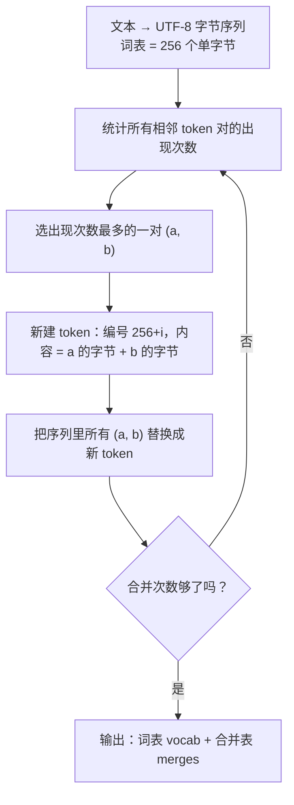

# 第 1 章 课程总览与分词（Tokenization）

> 对应课程：Lecture 1《Overview, Tokenization》 · [YouTube](https://www.youtube.com/watch?v=JuoVZkPBiKk) · 官方讲义：[可执行讲义 lecture_01](https://cs336.stanford.edu/lectures/?trace=lecture_01)

<Video id="JuoVZkPBiKk" title="Lecture 1 原视频" />

## 本章你将学到

- CS336 为什么坚持“从零构建”，以及在买不起前沿算力的情况下，我们到底能学到什么
- “苦涩的教训”的正确读法：**准确率 = 效率 × 资源**，整门课的主线是效率
- 语言模型十几年的发展脉络，以及“开放权重”和“开源”的区别
- 课程五大单元（基础、系统、Scaling Laws、数据、对齐）各讲什么、作业做什么
- 分词器是什么；字符、字节、单词三种朴素分词为什么都不好
- BPE（字节对编码）算法的完整流程，能手算一遍，并理解作业 1 要在哪些地方改进

## 先说结论（一分钟版）

这门课的目标是让你**亲手**把语言模型的每一层搭出来：分词器、Transformer、优化器、GPU 内核、并行训练、Scaling Law、数据管线、对齐。前沿模型训练动辄上亿美元、细节不公开，我们只能训小模型，但**机制（mechanics）和思维方式（mindset）是可以迁移的**，而这种思维方式的核心就是“在固定资源下榨干效率”。本章的技术部分是分词：分词器把字符串和整数序列互相转换。按字符分，词表大而稀疏；按字节分，序列太长；按单词分，会遇到没见过的词。**BPE 从字节出发，反复把最常见的相邻对合并成新 token**，让常见片段变短、罕见片段退化为字节，是目前前沿模型仍在使用的方案。

## 1.1 为什么要开这门课

### 研究者正在和技术“脱节”

Percy Liang 开场就点出问题 [▶ 03:05](https://www.youtube.com/watch?v=JuoVZkPBiKk&t=185s)：

- 大约十年前，AI 研究者会自己实现、自己训练模型；
- 后来（以 BERT 为代表），大家下载预训练模型再微调；
- 今天，很多人只需要调用 API、写提示词（prompt）。

抽象层级不断提升，生产力确实提高了。但他指出：**这些抽象是“漏”的**。编程语言、操作系统这种抽象几乎从不让你操心下层，而语言模型不同——你一定遇到过“提示词怎么写都不行、又无从下手”的情况。如果你想做基础研究，只停留在提示词层面会极大地限制你能探索的设计空间。

所以这门课的哲学是：**通过构建来理解（understanding via building）**。

::: tip 移动端类比
就像只会用高层 UI 框架的工程师，遇到掉帧时往往束手无策；而亲手写过自定义 View 的 `onMeasure`/`onLayout`/`onDraw`、懂渲染管线的人，才能定位“到底是哪一次多余的 layout pass 拖慢了”。抽象很好，但它会漏，懂底层的人才能修。
:::

### 一个小问题：语言模型已经“工业化”了

[▶ 04:06](https://www.youtube.com/watch?v=JuoVZkPBiKk&t=246s) 前沿模型极其昂贵：据报道 2023 年 GPT-4 的训练花费约 1 亿美元，2025 年 xAI 为训练 Grok 搭建了约 23 万张 GPU 的集群。而且这些模型**没有公开细节**——GPT-4 技术报告明确表示，出于竞争和安全考虑，不披露架构、硬件、训练方法等信息。

我们当然可以训练小模型（10 亿参数以下），但小模型未必能代表大模型。讲义给了两个例子 [▶ 05:07](https://www.youtube.com/watch?v=JuoVZkPBiKk&t=307s)：

1. **计算量分布随规模变化。**小模型里，MLP 层只占约 44% 的 FLOPs；到 1750 亿参数规模，这个比例升到约 80%。在小模型上优化注意力带来的收益，到了大模型上可能就不明显了。
2. **能力随规模“涌现”。**在一些任务上，小模型的零样本/少样本表现几乎为零，直到规模超过某个临界点才突然变好。只在小规模上做实验，可能永远看不到这些现象。

### 那我们能学到什么？三种知识

[▶ 07:09](https://www.youtube.com/watch?v=JuoVZkPBiKk&t=429s) Percy 把知识分成三类：

| 类别 | 含义 | 能否从小规模迁移到大规模 |
|---|---|---|
| 机制（Mechanics） | 东西怎么工作：Transformer 是什么、模型并行怎么做 | ✅ 能 |
| 思维方式（Mindset） | 榨干硬件、认真对待规模、凡事先测量和剖析 | ✅ 能 |
| 直觉（Intuitions） | 哪些数据和建模决策能带来好效果 | ⚠️ 只能部分迁移 |

关于“直觉”，讲义举了一个有点好笑的例子 [▶ 08:09](https://www.youtube.com/watch?v=JuoVZkPBiKk&t=489s)：Noam Shazeer 在提出 SwiGLU 激活函数的论文结尾坦白写道，他们无法解释这些结构为什么有效，只能把成功“归功于神的仁慈（divine benevolence）”。很多架构选择确实只能靠实验得来——这正是为什么后面的 Scaling Law 单元如此重要。

## 1.2 “苦涩的教训”的正确读法

[▶ 09:09](https://www.youtube.com/watch?v=JuoVZkPBiKk&t=549s) Rich Sutton 的《苦涩的教训》（The Bitter Lesson）常被误读为“规模就是一切，算法不重要”。Percy 认为正确的理解是：**能够随规模扩展的算法才是重要的。**

他给了一个简洁的公式：

$$
\text{准确率} = \text{效率} \times \text{资源}
$$

“资源”是投入（算力、数据），“效率”是单位投入的产出。规模越大，效率越重要：小实验慢一倍，你等一倍时间就是了；但一次上亿美元的训练，哪怕 5% 的效率提升都是巨款。

实证上，OpenAI 2020 年的一项研究发现，2012 到 2019 年间，ImageNet 上达到同等精度所需的计算量因**算法改进**下降了约 44 倍 [▶ 10:09](https://www.youtube.com/watch?v=JuoVZkPBiKk&t=609s)。硬件进步乘以算法进步，才有了今天的飞跃。

于是整门课的框架问题是：

> **给定一定的算力和数据预算，能训练出的最好模型是什么？**

换句话说：**最大化效率**。这句话会贯穿全书。

## 1.3 语言模型简史

[▶ 11:09](https://www.youtube.com/watch?v=JuoVZkPBiKk&t=669s) 讲义把历史分成几个阶段：

| 阶段 | 代表工作 | 要点 |
|---|---|---|
| 前神经网络时代 | Shannon（1950）用语言模型估计英文的熵；n-gram 模型 | n-gram 曾是机器翻译、语音识别系统中保证输出流畅的重要部件 |
| 神经网络要素（2010s） | LSTM（1997）、Bengio 第一个神经语言模型（2003，前馈网络）、seq2seq（2014）、Adam（2014）、注意力（2015）、Transformer（2017）、混合专家 MoE（2017）、模型并行（2018~2019） | 架构、优化器、系统三条线的积累 |
| 早期基础模型 | ELMo、BERT（2018）、Google T5（11B） | “预训练 + 下游微调”范式；T5 把一切任务都变成文本到文本 |
| 拥抱规模 | GPT-2（1.5B）、Kaplan Scaling Laws（2020）、GPT-3（175B，上下文学习）、PaLM（540B，训练不足）、Chinchilla（70B，计算最优） | 规模带来可预测的进步与涌现能力 |
| 开放模型 | EleutherAI 的 The Pile 与 GPT-J、Meta 的 OPT（175B）、BigScience 的 BLOOM（176B）；之后 Llama、Mistral、DeepSeek、Qwen、Kimi、GLM、MiniMax、小米 MiMo 等 | 开放权重模型正在逼近闭源模型 |

注意讲义对“开放”的两层区分 [▶ 16:10](https://www.youtube.com/watch?v=JuoVZkPBiKk&t=970s)：

- **开放权重（open-weight）**：公开权重和论文，例如 Llama、DeepSeek、Qwen。
- **开源（open-source）**：权重 + 论文 + **代码 + 数据**全部公开，例如 AI2 的 OLMo、NVIDIA 的 Nemotron、Percy 参与的 Marin 项目（字幕里误听为 "Moraine/Marine"）。

Percy 强调：正是这些开放模型及其论文，让这门课能够“管中窥豹”地教授前沿模型的构建方式；当然即使是开放权重的论文也缺失大量细节（尤其是数据配比）。

“语言模型是什么”的含义也一直在变 [▶ 17:10](https://www.youtube.com/watch?v=JuoVZkPBiKk&t=1030s)：

- 2018（BERT）：一个你拿来**微调**的东西；
- 2020（GPT-3）：一个你拿来**提示**的东西；
- 2022（ChatGPT）：一个你和它**对话**的东西；
- 2026（智能体 agents）：一个能**自主行动**的东西。

但他认为底层基本功没怎么变：仍然是 GPU 与内核、基于梯度的优化、Transformer 与注意力。变的是“规格”：上下文更长，推理效率更重要。

## 1.4 关于“可执行讲义”

[▶ 19:10](https://www.youtube.com/watch?v=JuoVZkPBiKk&t=1150s) CS336 的很多讲义是一个 Python 程序（如 `lecture_01.py`），运行它就是“播放”这堂课：可以单步执行代码、查看变量，也能看到讲义的层次结构。本书引用的代码片段大多来自这些讲义，你可以在课程网站上在线浏览。

## 1.5 课程安排与五个作业

### 课程定位

[▶ 20:10](https://www.youtube.com/watch?v=JuoVZkPBiKk&t=1210s) 这是一门 5 学分的课，以工作量大著称（有学生评价：第一个作业的工作量就相当于另一门 NLP 课全部作业加期末项目）。

**适合你**：你有强烈的“想搞懂东西怎么工作”的冲动；你想锻炼研究工程能力。
**不适合你**：你这学期想赶研究进度；你想学最新潮的技术（多模态、RAG 等，本课不深入）；你只是想在自己的应用领域拿到好效果——那应该先写提示词、再微调，**预训练是最后手段**，因为它又贵又麻烦。

### 作业形式

[▶ 23:13](https://www.youtube.com/watch?v=JuoVZkPBiKk&t=1393s)

- 5 个作业：基础、系统、Scaling Laws、数据、对齐；
- **不给脚手架代码**，但提供单元测试和适配器接口，帮你检查正确性；
- 建议先在本地笔记本上实现、跑通测试，再到集群上跑基准（精度和速度）；
- 部分作业有排行榜，例如“在给定训练预算内把困惑度压到最低”。

### AI 使用政策

[▶ 25:13](https://www.youtube.com/watch?v=JuoVZkPBiKk&t=1513s) 课程承认：编程智能体已经可以独立完成所有作业，但那样你什么也学不到。AI 适合用来答疑和辅导，所以课程提供了一个 `AGENTS.md` 文件（即一段提示词），要求 AI 以“教学为导向”——帮你澄清理解，但不会在作业要求你实现 Transformer 时直接替你写出来。这一年是第一次尝试这种政策。今年的算力由 Modal 平台赞助。

::: tip 给自学读者的建议
如果你用 Claude、ChatGPT 之类的工具辅助学习本书，也可以借鉴这个做法：在对话开头声明“我在学习，请只解释概念、指出我代码的问题，不要直接给出完整实现”。
:::

### 五大单元一览

[▶ 27:17](https://www.youtube.com/watch?v=JuoVZkPBiKk&t=1637s)


#### 单元一：基础（Basics）

目标：能训练一个基本的语言模型。组件是分词、模型架构、训练。

- **分词**：模型操作的“原子”是什么？分词器在原始字节和整数序列之间转换。从效率视角看，它有两个好处 [▶ 28:17](https://www.youtube.com/watch?v=JuoVZkPBiKk&t=1697s)：一是**缩短序列**（约 1000 字节 → 约 250 个 token）；二是更微妙也更重要的**自适应计算**：常见内容压成一个 token，少花计算；罕见或有趣的部分保留成多个 token，多分配模型容量。
- **架构**：起点是原版 Transformer，此后在激活函数（ReLU → SwiGLU）、位置编码（正弦 → RoPE）、归一化（LayerNorm、RMSNorm、QK norm、pre-norm 与 post-norm）、注意力（全注意力、稀疏/滑动窗口、GQA、MLA）、状态空间模型与线性注意力（Mamba、Gated DeltaNet，常与注意力混合使用）、MLP（稠密 vs 混合专家 MoE）以及**模型形状**（层数、隐藏维度、头数、专家数）上都有大量改进 [▶ 30:17](https://www.youtube.com/watch?v=JuoVZkPBiKk&t=1817s)。详见 [第 3 章](./ch03-architectures) 和 [第 4 章](./ch04-attention-alternatives)。
- **训练**：损失函数（默认下一个 token 预测，也有多 token 预测）、优化器（AdamW，以及在 Kimi K2 等模型中使用的 Muon；字幕把 Kimi 误听成 "Kimmy"）、初始化尺度、学习率调度（cosine、WSD）、正则化、batch size、MoE 的负载均衡 [▶ 32:18](https://www.youtube.com/watch?v=JuoVZkPBiKk&t=1938s)。这些看似“只是超参数”，但以有原则的方式设置它们，决定了一次训练是“炸掉”还是“达到最先进水平”。

**作业 1** [▶ 33:20](https://www.youtube.com/watch?v=JuoVZkPBiKk&t=2000s)：实现 BPE 分词器；实现 Transformer、交叉熵损失、AdamW 优化器和训练循环；做资源核算；在 TinyStories 和 OpenWebText 上训练；排行榜比赛——在一张 B200 上 45 分钟内把 OpenWebText 困惑度压到最低（类似 NanoGPT speedrun）。

Percy 总结的高层原则 [▶ 34:20](https://www.youtube.com/watch?v=JuoVZkPBiKk&t=2060s)：一切都是在三者之间平衡——

- **表达力（Expressivity）**：能表示数据中复杂的依赖；
- **稳定性（Stability）**：让参数和梯度的范数待在“刚刚好”的区间，不爆炸也不消失——训练大模型很大程度上就是在和稳定性斗争；
- **效率（Efficiency）**：在硬件上跑得快，训练和推理都是。

#### 单元二：系统（Systems）

目标：榨干硬件（GPU/TPU）。组件是内核、并行、推理。[▶ 35:21](https://www.youtube.com/watch?v=JuoVZkPBiKk&t=2121s)

- **资源核算**：一个模型的内存和计算特性。例如训练 70B 参数模型、1T token，约需 $6 \times 70 \times 10^9 \times 10^{12} = 4.2 \times 10^{23}$ FLOPs（$6ND$ 公式的来历见 [第 2 章](./ch02-pytorch-resource)）。
- **硬件的卡通图**：内存（HBM）和计算单元（SM）不在一个地方，参数必须从内存搬到计算单元，这常常就是瓶颈。例如 B200 的 bf16 算力约 2.25 PFLOP/s，内存带宽约 8 TB/s [▶ 37:22](https://www.youtube.com/watch?v=JuoVZkPBiKk&t=2242s)。Roofline 分析帮你判断一个计算是“算力瓶颈”还是“内存瓶颈”——通常是后者。一台 DGX B200 有 8 张 GPU，用 NVLink 互连；上千张 GPU 时再用 InfiniBand 或以太网连接多台机器。
- **内核（kernel）**：在 GPU 上运行的函数。PyTorch 的每个基本操作都会启动一个内置内核；你也可以写自定义内核。核心原则是**组织计算以最小化数据搬运** [▶ 39:24](https://www.youtube.com/watch?v=JuoVZkPBiKk&t=2364s)：朴素做法是“读 HBM → 算 A → 写 HBM → 读 HBM → 算 B → 写 HBM”，**融合（fusion）**后是“读 HBM → 算 A 和 B → 写 HBM”。分块（tiling，如 FlashAttention）是更复杂的同类思想。作业里会用 Triton 写内核。详见 [第 5 章](./ch05-gpus-tpus)、[第 6 章](./ch06-kernels-triton)。
- **并行**：有 1024 张 GPU 怎么办？GPU 之间搬数据更慢，但“最小化数据搬运”的原则不变。使用 gather、reduce、all-reduce 等集合通信操作，把参数、激活、梯度、优化器状态切分到各 GPU 上；切分方式有数据、张量、流水线、序列、专家并行 [▶ 40:25](https://www.youtube.com/watch?v=JuoVZkPBiKk&t=2425s)。详见 [第 7 章](./ch07-parallelism-1)、[第 8 章](./ch08-parallelism-2)。
- **推理**：给定提示词生成 token。推理不仅用于聊天，也用于强化学习的 rollout、测试时计算、合成数据、评估。分两个阶段 [▶ 42:27](https://www.youtube.com/watch?v=JuoVZkPBiKk&t=2547s)：**预填充（prefill）**一次性处理所有提示词 token，类似训练，属于计算瓶颈；**解码（decode）**一次只能生成一个 token，属于内存瓶颈，这就是推理难的原因。加速方法：用更便宜的模型（剪枝、量化、蒸馏）；**投机解码（speculative decoding）**——小的“草稿”模型先猜一串 token，大模型并行打分验证，猜对就一次接受多个，而且结果与原模型完全一致；系统优化（融合内核、连续批处理 continuous batching）。服务场景中请求随时到达、需要动态组 batch，这一点和训练很不同。详见 [第 10 章](./ch10-inference)。

**作业 2**：用 Triton 实现融合的 RMSNorm 内核、实现分布式数据并行训练、实现优化器状态切分、对实现进行基准测试和剖析（细节今年可能调整）。推荐读物：Google 的 *How to Scale Your Model* [▶ 44:30](https://www.youtube.com/watch?v=JuoVZkPBiKk&t=2670s)，以 TPU 为主但概念相通，新增了 GPU 章节。

#### 单元三：Scaling Laws

[▶ 45:30](https://www.youtube.com/watch?v=JuoVZkPBiKk&t=2730s) 场景：如果你有 $10^{25}$ FLOPs（数千万美元）的算力，该用什么超参数训练？全规模下没法调参——你只有一次机会。

**关键的思维转变**：不要只想“训练一个模型”，而要想一个**缩放配方（scaling recipe）**——从 FLOPs 预算映射到一组超参数（基本就是一个配置文件）。然后：

1. 在多个较小规模（如最高 $10^{24}$ FLOPs）上跑实验，得到损失；
2. 拟合一条 scaling law，预测目标规模（如 $10^{25}$）的损失。

这样你可以 (1) 用小实验优化面向大规模的配方；(2) **在真正花钱之前就预测出最终损失**——这也是拉投资时的底气。

Percy 特别强调 [▶ 47:31](https://www.youtube.com/watch?v=JuoVZkPBiKk&t=2851s)：**Scaling law 不是自然定律，它不会自动出现，需要你精心构造配方才能“让它存在”。**要让小规模的超参数能迁移到大规模（**超参数迁移**，如 muP），模型的参数化方式要设计好。**可预测性至少和最优性一样重要。**

经典问题：给定 FLOPs 预算 $C = 6ND$，是用更大的模型（$N$）还是更多 token（$D$）？Kaplan 和 Chinchilla 的计算最优 scaling law 给出答案 [▶ 49:33](https://www.youtube.com/watch?v=JuoVZkPBiKk&t=2973s)：对每个小预算画一条 **IsoFLOP 曲线**（固定 FLOPs、扫不同模型大小），找到最优 $N$，再拟合外推。粗略的经验法则是 **$D \approx 20N$**：70B 参数的模型应训练约 1.4T token。注意这没考虑推理成本——实际中很多模型更小、训练 token 远超“计算最优”，因为小模型推理便宜。

Marin 项目做了一件有意思的事：先用一系列小规模实验拟合 scaling law，**提前公开（“预注册”）**对一次更大规模训练的损失预测，再真正去训练、看预测准不准 [▶ 50:33](https://www.youtube.com/watch?v=JuoVZkPBiKk&t=3033s)。这次训练的结果在下一讲开头揭晓（见第 2 章）。

**作业 3**：课程提供一个“训练 API”（输入超参数、返回损失，基于事先训好的大量模型缓存），你在 FLOPs 预算内“提交训练任务”收集数据点、拟合 scaling law、提交外推的超参数和损失预测；排行榜比谁在预算内损失最低。详见 [第 9 章](./ch09-scaling-laws-1)、[第 11 章](./ch11-scaling-laws-2)。

#### 单元四：数据

[▶ 53:34](https://www.youtube.com/watch?v=JuoVZkPBiKk&t=3214s) 你希望模型具备什么能力？多语言？擅长对话？能做长程智能体编程？数据决定了模型。

- **评估**：两种目的要分清 [▶ 54:36](https://www.youtube.com/watch?v=JuoVZkPBiKk&t=3276s)。**内部评估**指导模型开发，关心跨规模的平滑性和相对表现，困惑度至今仍是衡量模型内在质量的好指标（最好在不在网上的私有文档上算，避免数据污染）；**外部评估**衡量真实场景的绝对质量，关心“生态效度”，如 GPQA、HLE、SWE-Bench、Terminal-Bench。语言模型是通用的，需要多样化的评估；把它们平均成一个数往往会混淆很多东西。
- **数据整理**：数据不会从天而降 [▶ 56:38](https://www.youtube.com/watch?v=JuoVZkPBiKk&t=3398s)。来源有网页爬取、书籍、arXiv 论文、GitHub 代码等；涉及版权与合理使用、数据授权（如 Google 与 Reddit 的协议）、无许可证代码如何处理等法律问题。原始数据是 HTML、PDF、代码目录，不是文本。
- **数据处理** [▶ 58:40](https://www.youtube.com/watch?v=JuoVZkPBiKk&t=3520s)：转换（HTML/PDF → 正文）、过滤（用分类器保留高质量、去除有害内容）、去重（Bloom filter、MinHash，省算力、避免记忆）、配比（每个来源加多少权重）、改写/合成数据（用 LM 把真实数据改写成更接近下游任务的形式）。
- **数据类型**：预训练数据（大而杂）、中期训练（mid-training，高质量、含长上下文）、后训练数据（SFT 对话、带工具调用的智能体轨迹）。

**作业 4**：把 Common Crawl 的 HTML 转成文本、训练质量和有害内容分类器、用 MinHash 去重；排行榜比在给定 token 预算下的困惑度。详见 [第 12 章](./ch12-evaluation) 至 [第 14 章](./ch14-data-processing)。

#### 单元五：对齐（Alignment）

[▶ 59:40](https://www.youtube.com/watch?v=JuoVZkPBiKk&t=3580s) 到目前为止都是**全监督**（预测下一个 token）。模型已经不错之后，可以用**弱监督**继续提升——因为很多时候“评判”比“生成”容易。基本模板：

1. 让模型生成回答；
2. 用人类、验证器（verifier）或 LM 评委打分；
3. 更新模型，使其更偏好好的回答。

算法有 PPO（来自强化学习）、DPO（针对偏好数据，更简单）、GRPO（去掉价值函数）。挑战在于 RL 算法不稳定、难调；规模化时需要大量新基础设施（推理服务器异步生成 rollout、训练服务器更新），并在系统吞吐和“on-policy 程度”之间不断权衡 [▶ 61:40](https://www.youtube.com/watch?v=JuoVZkPBiKk&t=3700s)。

**作业 5**：去年是实现 DPO 和 GRPO 并在数学基准上跑通，今年在讨论更贴近现实的版本。详见 [第 15 章](./ch15-mid-post-training)、[第 16 章](./ch16-rlvr)。

### 一切为了效率

[▶ 62:40](https://www.youtube.com/watch?v=JuoVZkPBiKk&t=3760s) 资源 = 数据 + 硬件（计算、内存、通信带宽）。今天我们**受算力约束**，所以设计决策都围绕“榨干给定硬件”：

| 环节 | 效率视角 |
|---|---|
| 系统 | 显然是为了效率 |
| 分词 | 直接用原始字节很优雅，但在今天的架构下计算效率太低 |
| 模型架构 | 很多改动是为了减少内存或 FLOPs（共享 KV cache、滑动窗口注意力），且常受推理速度驱动 |
| 数据过滤 | 不把宝贵算力浪费在差的或无关的数据上——固定预算下，花在坏数据上的时间就是少花在好数据上的时间 |
| Scaling laws | 在小模型上用更少算力做超参数调优 |

将来我们可能会**受数据约束**，那时设计决策的算法会变，但“思考你的方法的效率”这一思维方式不会变。

## 1.6 分词：模型眼里的“原子”

[▶ 64:40](https://www.youtube.com/watch?v=JuoVZkPBiKk&t=3880s) 讲义的分词部分受到 Andrej Karpathy 分词视频的启发，强烈推荐一看。

### 分词器做什么

原始文本是 **Unicode 字符串**，例如 `"Hello, 🌍! 你好!"`。而语言模型是在 **token 序列**（通常是整数编号）上定义概率分布的，例如 `[15496, 11, 995, 0]`。所以我们需要：

- **编码（encode）**：字符串 → 整数序列；
- **解码（decode）**：整数序列 → 字符串。

实现这两个方法的类就是**分词器（Tokenizer）**。讲义里的抽象接口：

```python
class Tokenizer(ABC):
    """分词器的抽象接口"""
    def encode(self, string: str) -> list[int]:   # 字符串 → token 编号
        raise NotImplementedError

    def decode(self, indices: list[int]) -> str:  # token 编号 → 字符串
        raise NotImplementedError
```

::: details Kotlin 对照
```kotlin
interface Tokenizer {
    fun encode(text: String): List<Int>
    fun decode(ids: List<Int>): String
}
```
一个合格的分词器必须能**往返（round trip）**：`decode(encode(s)) == s`。不能往返的分词器是有 bug 的。
:::

### 观察真实分词器

讲义推荐用 [tiktokenizer](https://tiktokenizer.vercel.app/?encoder=gpt2) 网站在线体验各种分词器。几个值得注意的现象 [▶ 65:40](https://www.youtube.com/watch?v=JuoVZkPBiKk&t=3940s)：

1. **单词通常和它前面的空格合成一个 token**，例如 `" world"`。你会看到大量“空格+单词”形式的 token。
2. **同一个单词在句首和句中是不同的 token**。`"hello hello"` 里的两个 hello，一个是 `"hello"`，一个是 `" hello"`，编号完全不同、彼此毫无关系。
3. **数字会被切成每几位一段**，切法有时可预测、有时不可预测。也有分词器把每个数字单独作为 token，但那样 token 数会膨胀，是一种权衡。

这些怪癖正是大家想摆脱分词器的原因之一。

### 压缩率与词表大小

讲义用 OpenAI 的 GPT-5 分词器（tiktoken 库里的 `o200k_base`）编码 `"Hello, 🌍! 你好!"`：这个字符串的 UTF-8 编码共 **20 字节**，编码成 **8 个 token**，解码后与原串一致 [▶ 66:40](https://www.youtube.com/watch?v=JuoVZkPBiKk&t=4000s)。

**压缩率（compression ratio）** 定义为每个 token 平均对应多少字节：

$$
\text{压缩率} = \frac{\text{UTF-8 字节数}}{\text{token 数}} = \frac{20}{8} = 2.5
$$

```python
def get_compression_ratio(string: str, indices: list[int]) -> float:
    num_bytes = len(bytes(string, encoding="utf-8"))  # 字节数
    num_tokens = len(indices)                         # token 数
    return num_bytes / num_tokens
```

压缩率越高，序列越短。这很重要，因为**注意力的计算量与序列长度的平方成正比**，序列短一半，注意力开销降到四分之一。

提高压缩率最直接的办法是**增大词表**（可能的 token 种类更多）。但词表越大越稀疏：每个 token 都被当作独立的东西学习，罕见 token 出现次数少、学不好。如今的分词器，尤其是多语言的，词表通常在 10 万到 20 万之间 [▶ 67:42](https://www.youtube.com/watch?v=JuoVZkPBiKk&t=4062s)。

下面依次看几种构造分词器的思路。

## 1.7 三种朴素的分词方式

### 字符分词（Character）

[▶ 68:43](https://www.youtube.com/watch?v=JuoVZkPBiKk&t=4123s) Unicode 字符串本来就是一串 Unicode 字符，每个字符对应一个整数**码点（code point）**。Python 里 `ord` 和 `chr` 互相转换：

```python
assert ord("a") == 97
assert ord("🌍") == 127757
assert chr(97) == "a"

class CharacterTokenizer(Tokenizer):
    def encode(self, string):  return list(map(ord, string))   # 每个字符 → 码点
    def decode(self, indices): return "".join(map(chr, indices))
```

`"Hello, 🌍! 你好!"` 有 13 个字符，所以是 13 个 token，压缩率 $20/13 \approx 1.54$。问题：

1. **词表很大**：Unicode 约有 15 万个字符；
2. **很多字符极罕见**（比如 🌍），浪费词表容量，模型也学不好它们。

讲义的评价：这是“两头都不讨好”的方案——词表大，压缩率还低。

### 字节分词（Byte）

[▶ 69:44](https://www.youtube.com/watch?v=JuoVZkPBiKk&t=4184s) Unicode 字符串可以编码成字节序列，最常用的编码是 **UTF-8**：英文字母 1 字节，中文通常 3 字节，emoji 通常 4 字节。

```python
assert bytes("a", encoding="utf-8") == b"a"
assert bytes("🌍", encoding="utf-8") == b"\xf0\x9f\x8c\x8d"   # 4 个字节

class ByteTokenizer(Tokenizer):
    def encode(self, string):
        return list(string.encode("utf-8"))        # 每个字节是 0~255 的整数
    def decode(self, indices):
        return bytes(indices).decode("utf-8")
```

::: tip 移动端类比
这就是你在 Android 里写的 `text.toByteArray(Charsets.UTF_8)`，或 iOS 里的 `Array(text.utf8)`。你一定踩过“按字节截断字符串导致中文乱码”的坑——同样的问题在字节级分词器里也存在：一个 token 序列切到一半，可能对应半个汉字，单独解码会失败。
:::

优点：**词表只有 256**，小而整洁，而且任何文本都能表示，不会有未知字符。
缺点：**压缩率恒为 1**，序列太长。Transformer 的上下文长度有限，而且注意力是平方复杂度，这条路走不通（至少在今天的架构下）。

### 单词分词（Word）

[▶ 70:44](https://www.youtube.com/watch?v=JuoVZkPBiKk&t=4244s) 这是传统 NLP 的做法：用空格或正则表达式把字符串切成单词。

```python
import regex
string = "I'll say supercalifragilisticexpialidocious!"
chunks = regex.findall(r"\w+|.", string)
# ['I', "'", 'll', ' ', 'say', ' ', 'supercalifragilisticexpialidocious', '!']
```

正则 `\w+|.` 的意思是“连续的字母数字为一块，其他字符各自一块”。接着为每个不同的块分配一个整数编号即可。

优点：每个 token 有意义（单词是人类发明的语义单位），压缩率高（这个例子 44 字节 / 8 块 = 5.5）。
缺点：

- **词表大小 = 训练数据中不同单词的数量**，可能极其巨大，而且没有固定上限；
- 很多单词很罕见，模型学不到什么；
- 测试时遇到训练时没见过的词怎么办？只能用一个特殊的 **UNK（unknown）** token 代替。这既丑陋，又会搞乱困惑度的计算 [▶ 71:45](https://www.youtube.com/watch?v=JuoVZkPBiKk&t=4305s)。

下面的演示把四种方式放在一起对比（BPE 稍后详细讲）。试试“生僻长词”和“中文”两个例子：单词法会出现红色的 UNK，而 BPE 永远不会。

<Demo src="ch01-tokenizers.html" title="字符 / 字节 / 单词 / BPE 四种分词对比" :height="760" />

::: details 深入一点：为什么不用“字符分词 + 小词表”？（可跳过）
可以只保留最常见的几千个字符、其余的映射成 UNK，但这仍然逃不开 UNK 问题，而且对中日韩这类字符集很大的语言非常不友好。字节级方案的妙处在于：**256 个字节覆盖一切**，在此基础上合并出更大的单位，就同时拥有了“没有 UNK”和“序列短”两个优点——这正是 BPE 的思路。
:::

## 1.8 字节对编码（BPE）

### 来历

[▶ 71:45](https://www.youtube.com/watch?v=JuoVZkPBiKk&t=4305s) BPE（Byte Pair Encoding）最早由 Philip Gage 在 1994 年作为一种**数据压缩算法**提出，远早于语言模型。2016 年 Sennrich 等人把它引入 NLP，用于神经机器翻译（此前论文多用单词分词）。之后 GPT-2 采用了 BPE，从此它成为语言模型的主流分词方案。

**基本思想**：在原始文本上**训练**分词器，构造一个为数据量身定做的词表。

**直觉**：常见的字节序列用一个 token 表示，罕见的序列用多个 token 表示。罕见内容不会变成 UNK，只是被拆成更小的单元（最坏退化成单个字节）。

### 训练算法

[▶ 72:45](https://www.youtube.com/watch?v=JuoVZkPBiKk&t=4365s) 概括为一句话：**从“每个字节是一个 token”开始，反复把出现次数最多的相邻 token 对合并成一个新 token。**



讲义中的实现（加了中文注释）：

```python
def train_bpe(string: str, num_merges: int) -> BPETokenizerParams:
    indices = list(map(int, string.encode("utf-8")))     # 从字节开始
    merges: dict[tuple[int, int], int] = {}              # (a, b) -> 新编号
    vocab: dict[int, bytes] = {x: bytes([x]) for x in range(256)}  # 编号 -> 字节串
    for i in range(num_merges):
        counts = count_adjacent_pairs(indices)           # 1. 数相邻对
        pair = max(counts, key=counts.get)               # 2. 取最常见的一对
        new_index = 256 + i                              # 3. 新 token 编号
        merges[pair] = new_index
        vocab[new_index] = vocab[pair[0]] + vocab[pair[1]]
        indices = merge(indices, pair, new_index)        # 4. 替换
    return BPETokenizerParams(vocab=vocab, merges=merges)

def merge(indices, pair, new_index):
    """把 indices 中所有出现的 pair 替换成 new_index（从左到右、不重叠）"""
    new_indices, i = [], 0
    while i < len(indices):
        if i + 1 < len(indices) and (indices[i], indices[i + 1]) == pair:
            new_indices.append(new_index); i += 2
        else:
            new_indices.append(indices[i]); i += 1
    return new_indices
```

训练的产出是两张表：**词表 vocab**（编号 → 字节串）和**合并表 merges**（有顺序的合并规则）。

### 手算一遍：`"the cat in the hat"`

讲义的例子 [▶ 73:45](https://www.youtube.com/watch?v=JuoVZkPBiKk&t=4425s)，合并 3 次。

**第 0 步**：转成字节，共 18 个：

```
t   h   e   ␣  c  a  t   ␣  i   n   ␣  t   h   e   ␣  h   a  t
116 104 101 32 99 97 116 32 105 110 32 116 104 101 32 104 97 116
```

**第 1 次合并**：统计相邻对。`(116,104)` 即 "th" 出现 2 次；"he"、"e␣"、"at" 也都是 2 次，出现平局。讲义代码用 Python 的 `max`，平局时取**最先出现**的那一对，即 `(116, 104)`。新建 token **256 = "th"**，序列变成 16 个 token：

```
[th] e ␣ c a t ␣ i n ␣ [th] e ␣ h a t
```

**第 2 次合并**：现在最多的是 `(256, 101)` 即 "th"+"e"，2 次（与 "e␣"、"at" 平局，它最先出现）。新建 **257 = "the"**，序列 14 个 token。

**第 3 次合并**：`(257, 32)` 即 "the"+"␣"，2 次。新建 **258 = "the␣"**，序列 12 个 token：

```
[the␣] c a t ␣ i n ␣ [the␣] h a t
```

压缩率 $= 18 / 12 = 1.5$，与讲义一致 [▶ 74:47](https://www.youtube.com/watch?v=JuoVZkPBiKk&t=4487s)。序列在缩短，词表在增长（256 → 259）。

下面的演示可以让你单步观看这个过程，也可以输入自己的文本、切换“预分词”和“平局规则”，观察合并表、词表大小和压缩率的变化。

<Demo src="ch01-bpe.html" title="BPE 训练逐步合并动画" :height="980" />

建议这样玩：

1. 先用“讲义例子”单步 3 次，核对上面的手算；
2. 点“low/newest”这个经典例子，看 "est"、"low" 这类常见片段如何逐渐长成一个 token；
3. 换成“中文”，注意前几步合并的往往是一个汉字的 3 个 UTF-8 字节——BPE 先“重新发现”了汉字，然后才合并成词；
4. 勾选“预分词”，观察合并不再跨越空格（虚线框是一个预分词块）。

### 用训练好的分词器编码新文本

[▶ 74:47](https://www.youtube.com/watch?v=JuoVZkPBiKk&t=4487s) 有了合并表，编码新字符串的方法是：先转成字节，然后**按训练时的顺序**依次应用每一条合并规则。

```python
class BPETokenizer(Tokenizer):
    def __init__(self, params: BPETokenizerParams):
        self.params = params

    def encode(self, string):
        indices = list(map(int, string.encode("utf-8")))
        for pair, new_index in self.params.merges.items():   # 注意：很慢的实现
            indices = merge(indices, pair, new_index)
        return indices

    def decode(self, indices):
        bytes_list = [self.params.vocab[i] for i in indices]  # 查表还原字节
        return b"".join(bytes_list).decode("utf-8")
```

用上面 3 次合并学到的规则编码 `"the quick brown fox"`：开头的 "the␣" 变成一个 token 258，其余都还是单字节，结果是 16 个 token；解码回来与原文一致。演示底部的“用学到的合并表给新文本编码”就是这个过程。

为什么必须按顺序？因为后面的规则依赖前面的产物：规则 3 合并的是 `(257, 32)`，而 257 只有在规则 2 执行之后才会出现。

### 作业 1 要在哪些地方超越这个实现

[▶ 75:47](https://www.youtube.com/watch?v=JuoVZkPBiKk&t=4547s) 讲义的实现是“完整的 BPE”，但**极慢**。作业 1 要求你在以下方面改进：

1. **编码只遍历相关的合并。**当前 `encode` 遍历全部合并规则，而合并数 ≈ 词表大小 − 256（可能有几万条）。应该只处理当前序列里实际存在的对，这需要建立合适的索引。
2. **识别并保留特殊 token**，例如 `<|endoftext|>`（文档结束标记）。它必须作为一个整体 token，不能被拆开或与旁边内容合并。概念上不深，但对构建现代分词器很重要。
3. **预分词（pre-tokenization）** [▶ 76:49](https://www.youtube.com/watch?v=JuoVZkPBiKk&t=4609s)。真实做法不是把整个语料当成一个长串，而是先用正则（如 GPT-2 的正则）把文本切成“词块”，再在每个块内部做 BPE。好处：一是快得多——相同的词块只需统计一次，乘以出现次数即可；二是合并不会跨越单词边界，不会学出 "dog." 和 "dog!" 这样的冗余 token。
4. **尽可能快。**到某个时候你会发现 Python 本身就不够快，可以考虑用 Rust、C 等语言实现关键部分。

::: details 深入一点：GPT-2 的预分词正则与增量计数（可跳过）
GPT-2 使用的预分词正则大致如下（需要支持 `\p{...}` 的 `regex` 库）：

```python
PAT = r"""'(?:[sdmt]|ll|ve|re)| ?\p{L}+| ?\p{N}+| ?[^\s\p{L}\p{N}]+|\s+(?!\S)|\s+"""
```

它把英文缩写（'s、'll）、“可选空格 + 一串字母”、“可选空格 + 一串数字”、“可选空格 + 一串标点”、空白分别切开。这就是为什么单词总是和**前面的**空格连在一起。

训练提速的另一个关键是**增量更新计数**：每次合并只会影响包含被合并对的那些位置，没必要每一步都从头重数所有相邻对。只更新受影响的计数，可以把训练从“每步扫描全量数据”变成“每步只动一小部分”。

另外，作业 1 的说明对平局有明确约定：频次相同时选**字典序更大**的那一对（而不是讲义里“先出现的”）。演示里的“平局时”下拉框可以切换这两种规则，看看合并结果会有什么不同。具体以你拿到的作业 PDF 为准。
:::

::: warning 常见误区
- “token 就是单词”——不是。token 可以是半个单词、一个带前导空格的单词、一个汉字的几个字节，甚至几个词。
- “词表越大越好”——词表越大压缩率越高，但嵌入表和输出层更大、罕见 token 学不好。这是一个需要权衡的超参数。
- “BPE 的解码一定能得到合法字符串”——对完整的编码结果是的；但如果你截取 token 序列的一段单独解码，可能落在一个多字节字符的中间，需要用 `errors="replace"` 之类的方式处理。
:::

## 1.9 分词的未来：能否直接用字节？

[▶ 29:17](https://www.youtube.com/watch?v=JuoVZkPBiKk&t=1757s) Percy 说他每年都希望“明年不用再教分词了”。理想是**无分词器（tokenizer-free）**的架构，直接在字节上建模。已有不少尝试：ByT5、MegaByte、BLT（Byte Latent Transformer）、T-Free、H-Net 等，其中 H-Net 看起来很有前景。但这些方法**尚未扩展到前沿规模**，前沿模型仍在使用分词器，所以分词仍值得学。

讲义的结尾总结 [▶ 77:49](https://www.youtube.com/watch?v=JuoVZkPBiKk&t=4669s)：

- 分词器：字符串 ↔ token（整数编号）；
- 字符级、字节级、单词级分词都很不理想；
- BPE 是一种有效的、数据驱动的启发式方法；
- 分词是一个独立的步骤，也许有一天能端到端地从字节学起。

但不论用什么方案取代它，都必须满足两条性质：

1. **模型要在序列的“块”（抽象）上运算。**这在视频、DNA 等模态上更明显：单个字节或单元的信噪比很低，必须抬升到更高层的抽象才好建模；
2. **块应该是可变长的。**要有自适应计算——把更多模型容量分给“有意思”的部分，否则就是次优的。

## 动手练习

1. **手算 BPE。**对字符串 `"aaabdaaabac"` 手工执行 BPE（平局取先出现者），合并 3 次。写出每步的新 token、序列和压缩率。然后在演示中输入它验证。

   ::: details 答案
   字节序列 a a a b d a a a b a c（11 个）。第 1 次："aa" 出现 4 次（重叠计数：aaa 中有两个 aa），合并为 256；序列变为 [aa] a b d [aa] a b a c（9 个）。第 2 次：`(256, a)` 和 `(a, b)` 各 2 次，先出现的是 `(256, a)`，合并为 257 = "aaa"；序列 [aaa] b d [aaa] b a c（7 个）。第 3 次：`(257, b)` 2 次，合并为 258 = "aaab"；序列 [aaab] d [aaab] a c（5 个），压缩率 11/5 = 2.2。注意计数时“aaa”里的两个重叠 "aa" 都被数到了，但替换时只能从左到右不重叠地替换。
   :::

2. **实现两个基础函数。**不看讲义，用 Python 写出 `count_adjacent_pairs(indices)` 和 `merge(indices, pair, new_index)`，并用 `"the cat in the hat"` 检查 3 次合并后得到 `[258, 99, 97, 116, 32, 105, 110, 32, 258, 104, 97, 116]`。

3. **测压缩率。**安装 `tiktoken`，分别用 `gpt2` 和 `o200k_base` 编码同一段英文和同一段中文，计算压缩率。哪种语言的压缩率更低？为什么多语言分词器需要更大的词表？

4. **体会预分词的作用（对应作业 1）。**在演示中输入一段有大量重复单词的英文，分别在开启和关闭“预分词”时合并 30 次，对比学到的 token 有什么不同（是否出现跨越空格的 token，如 "e␣t"）。

5. **思考题。**为什么 GPT 系列分词器把空格放在单词**前面**（`" world"`）而不是后面？提示：想想生成文本时，模型一次输出一个 token 的过程。

## 本章小结

- CS336 的哲学是“通过构建来理解”。前沿模型昂贵且不透明，小模型不完全代表大模型，但**机制和思维方式能迁移**。
- 整门课的主线是**效率**：准确率 = 效率 × 资源；目标是在给定算力和数据下训出最好的模型。
- 课程分五个单元：基础（分词/架构/训练）、系统（内核/并行/推理）、Scaling Laws（用小实验预测大模型）、数据（评估/整理/处理）、对齐（弱监督与 RL）。
- 分词器在字符串和整数序列之间往返转换；压缩率 = 字节数 / token 数，越高序列越短。
- 字符分词词表大而稀疏，字节分词序列太长，单词分词有 UNK 问题；**BPE 从字节出发反复合并最常见的相邻对**，兼顾“没有 UNK”和“序列短”。
- 作业 1 要实现一个快速的 BPE：只处理相关合并、支持特殊 token、预分词、增量计数，必要时用更快的语言。

下一章（[第 2 章](./ch02-pytorch-resource)）进入“资源核算”：一个张量占多少内存、一次矩阵乘法多少 FLOPs、为什么训练成本是 $6ND$、一个参数在训练中要占多少字节——这是贯穿全课的“算账”基本功。

## 延伸阅读

- Andrej Karpathy：[Let's build the GPT Tokenizer（视频）](https://www.youtube.com/watch?v=zduSFxRajkE)
- Sennrich et al.：[Neural Machine Translation of Rare Words with Subword Units](https://arxiv.org/abs/1508.07909)（2016，将 BPE 引入 NLP）
- Radford et al.：[Language Models are Unsupervised Multitask Learners](https://cdn.openai.com/better-language-models/language_models_are_unsupervised_multitask_learners.pdf)（GPT-2）
- OpenAI [tiktoken](https://github.com/openai/tiktoken) 与在线体验工具 [tiktokenizer](https://tiktokenizer.vercel.app/?encoder=gpt2)
- Rich Sutton：[The Bitter Lesson](http://www.incompleteideas.net/IncIdeas/BitterLesson.html)
- Hernandez & Brown：[Measuring the Algorithmic Efficiency of Neural Networks](https://arxiv.org/abs/2005.04305)（44 倍算法效率提升）
- Vaswani et al.：[Attention Is All You Need](https://arxiv.org/abs/1706.03762)（Transformer）
- Kaplan et al.：[Scaling Laws for Neural Language Models](https://arxiv.org/abs/2001.08361)；Hoffmann et al.：[Training Compute-Optimal Large Language Models](https://arxiv.org/abs/2203.15556)（Chinchilla）
- Shazeer：[GLU Variants Improve Transformer](https://arxiv.org/abs/2002.05202)（SwiGLU，“divine benevolence”出处）
- 无分词器方向：[ByT5](https://arxiv.org/abs/2105.13626)、[MegaByte](https://arxiv.org/abs/2305.07185)、[Byte Latent Transformer](https://arxiv.org/abs/2412.09871)、[T-Free](https://arxiv.org/abs/2406.19223)、[H-Net](https://arxiv.org/abs/2507.07955)
- Google：[How to Scale Your Model](https://jax-ml.github.io/scaling-book/)
- 作业 1 仓库：[stanford-cs336/assignment1-basics](https://github.com/stanford-cs336/assignment1-basics)
