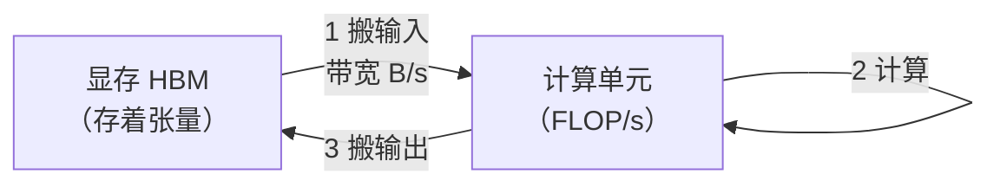
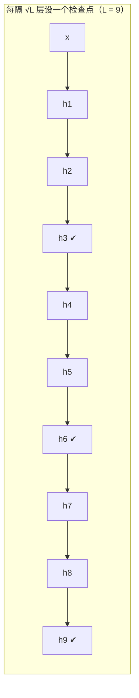

# 第 2 章 PyTorch 与资源核算

> 对应课程：Lecture 2《PyTorch (einops) / Resource Accounting》 · [YouTube](https://www.youtube.com/watch?v=kuYAsz7zspQ) · 官方讲义：[可执行讲义 lecture_02](https://cs336.stanford.edu/lectures/?trace=lecture_02)

<Video id="kuYAsz7zspQ" title="Lecture 2 原视频" />

## 本章你将学到

- 张量占多少内存：fp32、fp16、bf16、fp8、fp4 的取舍，以及混合精度训练
- 用 einops 的“具名维度”写张量运算，告别 `transpose(-2, -1)` 式的猜谜
- FLOPs 与 FLOP/s 的区别；矩阵乘法为什么是 $2 \times$ 三个维度之积；什么是 MFU
- 算术强度与 roofline：一个运算是被“算力”卡住还是被“搬数据”卡住
- 训练一步的 FLOPs 为什么是 $6 \times$ token 数 $\times$ 参数量；每个参数在训练中要占几个字节
- 梯度累积与激活检查点：用时间换内存的两个常用技巧

## 先说结论（一分钟版）

训练中的一切——数据、参数、梯度、优化器状态、激活值——都是张量。**内存** = 元素个数 × 每个元素的字节数；**计算** 几乎全部花在矩阵乘法上，$(B \times D) @ (D \times K)$ 需要 $2BDK$ 次浮点运算。前向是 $2 \times$ token 数 $\times$ 参数量，反向是它的 2 倍，所以训练一步约 $6ND$ FLOPs。但算得快不等于跑得快：数据要从显存搬到计算单元，**只有像大矩阵乘法这样“每搬一个字节能做很多运算”的操作才能喂饱 GPU，其余（逐元素运算、矩阵乘向量）基本都卡在内存带宽上**。用 bf16 存参数和梯度、fp32 存 AdamW 状态，每个参数约 12 字节——据此可以秒算“8 张 H100 最多训多大的模型”。

## 2.1 开场：一次被提前说中的训练

[▶ 00:05](https://www.youtube.com/watch?v=kuYAsz7zspQ&t=5s) 上一讲提到 Marin 项目“预注册”了一次大规模训练的损失预测。这一讲开头 Percy 报告：这次约 $10^{23}$ FLOPs 的训练已经结束，结果**与预测吻合**（据字幕，损失误差在 0.05 左右以内）。做法正是第 1 章讲的：对一系列 IsoFLOP 曲线找计算最优点、拟合 scaling law、外推预测。这是“可预测性至少和最优性一样重要”的一次漂亮验证。

## 2.2 两道“餐巾纸数学”题

[▶ 01:05](https://www.youtube.com/watch?v=kuYAsz7zspQ&t=65s) 本讲的主题是**资源核算（resource accounting）**。回忆整门课的目标：在固定资源（算力、内存）下训练最好的模型，也就是最大化计算效率。前提是：你得先知道一个计算到底要花多少资源。

Percy 先抛出两个问题，读完本章你应该能自己算出来。

**问题 1：在 1024 张 H100 上，用 15T（15 万亿）token 训练一个 70B 参数的模型，要多久？** [▶ 02:06](https://www.youtube.com/watch?v=kuYAsz7zspQ&t=126s)

```python
total_flops = 6 * 70e9 * 15e12        # 6ND = 6.3e24 FLOPs（6ND 的来历见 2.9 节）
h100_flop_per_sec = 1979e12 / 2       # H100 bf16 稠密算力 ≈ 989.5 TFLOP/s（2.6 节解释为何除以 2）
mfu = 0.5                              # 实际只能用到约一半（2.6 节解释 MFU）
flops_per_day = h100_flop_per_sec * mfu * 1024 * 60 * 60 * 24   # ≈ 4.38e22
days = total_flops / flops_per_day     # ≈ 144 天
```

手算一遍：$6 \times 70 \times 10^9 \times 15 \times 10^{12} = 6.3 \times 10^{24}$。每天集群能做 $989.5 \times 10^{12} \times 0.5 \times 1024 \times 86400 \approx 4.38 \times 10^{22}$ 次运算。两者相除约 **143~144 天**。

**问题 2：8 张 H100、用 AdamW 优化器，最大能训多大的模型？** [▶ 02:06](https://www.youtube.com/watch?v=kuYAsz7zspQ&t=126s)

```python
h100_bytes = 80e9                                  # 每张 H100 有 80 GB 显存（HBM）
bytes_per_parameter = 2 + 2 + (4 + 4)              # 参数 bf16 + 梯度 bf16 + Adam 两份 fp32 状态
num_parameters = (h100_bytes * 8) / bytes_per_parameter   # ≈ 5.3e10，约 53B
```

$8 \times 80\text{ GB} = 640\text{ GB}$，每参数 12 字节，$640 \times 10^9 / 12 \approx 5.3 \times 10^{10}$，即约 **530 亿参数**。注意这没算**激活值**（取决于 batch 大小和序列长度），所以只是上界。

这些都是粗略估算，重点不是精确到每个字节，而是**快速把握事情的大致形状**。下面这个计算器把两道题做成了可调的版本：

<Demo src="ch02-resource-calculator.html" title="训练资源计算器：6ND 与每参数字节数" :height="860" />

本讲要带走的三类知识 [▶ 04:09](https://www.youtube.com/watch?v=kuYAsz7zspQ&t=249s)：**机制**很直接（就是 PyTorch 的语义）；**思维方式**是养成资源核算的习惯——每写一行代码都想想它的性能；**直觉**是对资源花在哪儿有个感觉。本讲没有任何“机器学习魔法”。

## 2.3 一切皆张量

[▶ 04:09](https://www.youtube.com/watch?v=kuYAsz7zspQ&t=249s) 张量是存储一切的基本单元：数据、参数、梯度、优化器状态、激活值。打开 Hugging Face 上 DeepSeek V3.2 的模型文件索引，你会看到模型就是一大堆有名字、有形状、有精度的张量。

每个张量有一个 **rank（维数）**：

```python
x = torch.zeros(4)        # rank 1：向量
x = torch.zeros(4, 8)     # rank 2：矩阵
x = torch.zeros(4, 8, 2)  # rank 3
# Transformer 里常见 rank 4：
B, S, H, D = 32, 16, 16, 64   # batch、序列长度、头数、每头维度
x = torch.zeros(B, S, H, D)
```

（如果对张量和形状还不熟，先回看 [第 0 章](./ch00-primer) 0.3 节。）

## 2.4 张量的内存：浮点格式

[▶ 05:10](https://www.youtube.com/watch?v=kuYAsz7zspQ&t=310s) 内存由两件事决定：(1) 元素个数；(2) 每个元素的数据类型。

### fp32：默认格式

**fp32**（float32，单精度）共 32 位：1 位符号、8 位指数（决定动态范围）、23 位尾数（决定精度）[▶ 06:12](https://www.youtube.com/watch?v=kuYAsz7zspQ&t=372s)。“单精度”这个名字来自科学计算：在那里 fp32 是底线，需要更高精度时用 fp64（双精度）。而深度学习走的是反方向——**可以粗糙得多**。

```python
x = torch.zeros(4, 8)
assert x.dtype == torch.float32      # 默认就是 fp32
assert x.numel() == 4 * 8            # 32 个元素
assert x.element_size() == 4         # 每个 4 字节
# 内存 = 32 × 4 = 128 字节
```

感受一下量级 [▶ 07:12](https://www.youtube.com/watch?v=kuYAsz7zspQ&t=432s)：GPT-3 前馈层的一个权重矩阵形状是 $(12288 \times 4) \times 12288$，元素数 $49152 \times 12288 \approx 6.04 \times 10^8$，乘以 4 字节约 $2.4 \times 10^9$ 字节（讲义写作 2304 MB，约 2.3 GB）。这还只是一个矩阵。

### fp16：省一半，但范围太小

[▶ 08:12](https://www.youtube.com/watch?v=kuYAsz7zspQ&t=492s) 降低精度既省内存，也省时间（16 位运算通常更快，大致快一倍，但不总是）；而且后面会看到，**省内存本身也会省时间**。

最直接的做法是砍掉一半位数：**fp16**（半精度），1 位符号、5 位指数、10 位尾数。问题在于**动态范围很差**：

```python
x = torch.tensor([1e-8], dtype=torch.float16)
assert x == 0          # 下溢（underflow）！1e-8 直接变成 0
```

指数只有 5 位，既表示不了很大的数，也表示不了很小的数。早年用 fp16 训练的人经常遇到下溢、上溢、`NaN`，非常痛苦 [▶ 09:14](https://www.youtube.com/watch?v=kuYAsz7zspQ&t=554s)。

### bf16：和 fp32 一样的范围

2018 年 Google Brain 提出 **bf16**（brain floating point）：总位数和 fp16 一样是 16 位，但把位数从尾数挪给了指数——**8 位指数、7 位尾数**。于是它和 fp32 有**相同的动态范围**，代价是分辨率更差 [▶ 10:14](https://www.youtube.com/watch?v=kuYAsz7zspQ&t=614s)。

```python
x = torch.tensor([1e-8], dtype=torch.bfloat16)
assert x != 0          # 没有下溢
```

天下没有免费的午餐，但在深度学习里这笔交易很划算：最怕的是溢出和下溢；而训练本身就充满随机性，不需要那么高的精度。

| 格式 | 位数 | 符号/指数/尾数 | 字节 | 特点 |
|---|---|---|---|---|
| fp32 | 32 | 1 / 8 / 23 | 4 | 默认；范围大、精度高 |
| fp16 | 16 | 1 / 5 / 10 | 2 | 范围小，易下溢 |
| bf16 | 16 | 1 / 8 / 7 | 2 | 范围同 fp32，精度粗 |

### 混合精度训练

[▶ 11:14](https://www.youtube.com/watch?v=kuYAsz7zspQ&t=674s) 对训练的影响：

- 全用 fp32 能训，小模型而且你不想操心时完全可以，但每个数 4 字节，很占内存；
- 全用 fp16 风险太大，bf16 也可能不稳定；
- 常见做法是**混合精度（mixed precision）**：不同的计算用不同的精度。一般规则是：**参数、激活值、梯度用 bf16；优化器状态用 fp32**（原因见 2.10 节）。

PyTorch 提供自动混合精度（AMP）库 [▶ 12:14](https://www.youtube.com/watch?v=kuYAsz7zspQ&t=734s)：把代码包在 `autocast` 里，它会在安全的地方自动转成 bf16（比如矩阵乘法通常安全），在不安全的地方（比如取指数）保留 fp32。

```python
with torch.amp.autocast("cuda", dtype=torch.bfloat16):
    y = model(x)       # 其中的 matmul 等会自动用 bf16 计算
```

### 更激进：fp8 与 fp4

[▶ 13:14](https://www.youtube.com/watch?v=kuYAsz7zspQ&t=794s) 如果你够大胆，还能更低：

- **fp8**：2022 年左右标准化，专为机器学习设计。H100 支持两种变体：**E4M3**（4 位指数 3 位尾数，范围约 ±448，精度较好）和 **E5M2**（范围约 ±57344，范围更大）——按“要范围还是要精度”二选一。NVIDIA 的 Transformer Engine 支持 fp8。
- **fp4**：2025 年 NVIDIA 推出 **NVFP4**，每个值只有 4 位！能表示的值少到一行写得下：$\pm\{0, 0.5, 1, 1.5, 2, 3, 4, 6\}$。

只用这几个值显然没法好好训练，所以有个“小作弊” [▶ 14:16](https://www.youtube.com/watch?v=kuYAsz7zspQ&t=856s)：数值按**块（block）**分组，每块配一个单独的缩放因子（scale）。块内每个值有 4 位自由度，整块又可以整体放大缩小。这样单看一个值，实际动态范围远超 4 位；但它不能和相邻的值相差太远。讲义提到 NVIDIA 的 Nemotron 3 Super 就是用 NVFP4 训练的（字幕误听为 "NeMo-3 Super"）。

::: tip 移动端类比
块缩放很像图片压缩里的“分块量化”：每个 8×8 块有自己的量化表，块内像素只用很少的位，但不同块可以亮度差别很大。块和块之间可以天差地别，块内的邻居则必须“差不多”。
:::

这些超低精度很多是在 NVIDIA 的软件栈内部完成的，你并不是简单地创建一个“fp4 张量”。

::: details 课堂问答：能不能用 1 位训练？
[▶ 16:17](https://www.youtube.com/watch?v=kuYAsz7zspQ&t=977s) 有同学问能不能推到 1 位。Percy 区分了**训练**和**推理**：很多低比特的工作是先用 bf16 等精度训练好，再**量化（quantization）**成 1~2 位用于推理，这比直接训练一个 1 位模型容易得多；据他所知，还没有人直接训练出可信的 1 位语言模型。量化会在推理相关章节（[第 10 章](./ch10-inference)）再谈。
:::

## 2.5 张量放在哪里：CPU 与 GPU

[▶ 17:20](https://www.youtube.com/watch?v=kuYAsz7zspQ&t=1040s) 张量默认存在 CPU 内存里。要利用 GPU 的大规模并行，必须把它们搬到 GPU 显存：

```python
x = torch.zeros(32, 32)
assert x.device == torch.device("cpu")
x = x.to("cuda")                   # 从 CPU 内存拷到 GPU 显存
with torch.device("cuda"):         # 或者直接在 GPU 上创建，省一次拷贝
    y = torch.zeros(32, 32)
```

::: tip 移动端类比
这和把 Bitmap 上传成 GPU 纹理很像：CPU 内存和 GPU 显存是两块不同的内存，中间的拷贝有代价。忘了搬，代码照样能跑，只是慢——就像在主线程里做图像处理。
:::

## 2.6 einops：给维度起名字

### 动机

[▶ 18:22](https://www.youtube.com/watch?v=kuYAsz7zspQ&t=1102s) 传统 PyTorch 代码常长这样：

```python
x = torch.ones(2, 2, 3)          # batch seq hidden
y = torch.ones(2, 2, 3)          # batch seq hidden
z = x @ y.transpose(-2, -1)      # batch seq seq
```

`-2`、`-1` 是什么？要么写注释，要么在脑子里推演。很容易搞错。**einops** 是一个用“具名维度”操作张量的库，灵感来自爱因斯坦求和记号（Einstein summation，1916）。它包含三个核心函数：`einsum`、`reduce`、`rearrange`。

### einsum：记账清楚的广义矩阵乘法

[▶ 19:23](https://www.youtube.com/watch?v=kuYAsz7zspQ&t=1163s)

```python
from einops import einsum
x = torch.ones(3, 4)   # seq1 hidden
y = torch.ones(4, 3)   # hidden seq2
z = x @ y                                                   # 老写法
z = einsum(x, y, "seq1 hidden, hidden seq2 -> seq1 seq2")   # 新写法
```

读法：x 的两个轴叫 `seq1` 和 `hidden`，y 的两个轴叫 `hidden` 和 `seq2`，输出保留 `seq1 seq2`。**输出里没有出现的轴（这里是 `hidden`）会被求和掉。**它的语义就是：遍历所有轴的所有取值组合，把 `x[seq1, hidden] * y[hidden, seq2]` 累加到 `z[seq1, seq2]`。

更复杂的例子：

```python
x = torch.ones(2, 3, 4)   # batch seq1 hidden
y = torch.ones(2, 3, 4)   # batch seq2 hidden
z = x @ y.transpose(-2, -1)                                                 # 老写法
z = einsum(x, y, "batch seq1 hidden, batch seq2 hidden -> batch seq1 seq2") # 新写法
z = einsum(x, y, "... seq1 hidden, ... seq2 hidden -> ... seq1 seq2")       # 用 ... 代表任意多个前导维度
```

注意新写法里**没有转置**——转置已经通过命名隐式完成了。Percy 说他总是被转置搞糊涂，不用想转置让他很开心 [▶ 21:24](https://www.youtube.com/watch?v=kuYAsz7zspQ&t=1284s)。`...` 很实用：语言模型里经常有 batch、序列、头等多个“陪跑”维度，用 `...` 可以写出不关心前面有几个维度的模块化代码。

### reduce：按名字归约

[▶ 22:24](https://www.youtube.com/watch?v=kuYAsz7zspQ&t=1344s)

```python
from einops import reduce
x = torch.ones(2, 3, 4)                    # batch seq hidden
y = x.sum(dim=-1)                          # 老写法
y = reduce(x, "... hidden -> ...", "sum")  # 新写法：hidden 不在右边，被 sum 掉
```

归约操作可以是 `sum`、`mean`、`max`、`min`。有同学问 einops 会不会更快——不会，它最后归结为同样的底层操作，只是**语法糖**，速度一样。

### rearrange：拆分与合并维度

[▶ 23:24](https://www.youtube.com/watch?v=kuYAsz7zspQ&t=1404s) 有时一个维度其实代表两个维度（比如把矩阵拉平过），而你想只对其中一个操作。典型场景是多头注意力：隐藏维度 = 头数 × 每头维度。

```python
from einops import rearrange, einsum
x = torch.ones(3, 8)    # seq total_hidden，其中 total_hidden = heads * hidden1
w = torch.ones(4, 4)    # hidden1 hidden2

# 1. 把 total_hidden 拆成 heads 和 hidden1 两个维度（8 = 2 × 4）
x = rearrange(x, "... (heads hidden1) -> ... heads hidden1", heads=2)   # (3, 2, 4)
# 2. 对每个头分别做变换
x = einsum(x, w, "... hidden1, hidden1 hidden2 -> ... hidden2")         # (3, 2, 4)
# 3. 再把 heads 和 hidden2 合并回一个维度
x = rearrange(x, "... heads hidden2 -> ... (heads hidden2)")            # (3, 8)
```

括号表示“这个维度是几个维度的乘积”。8 可以拆成 2×4 也可以拆成 4×2，所以要告诉它 `heads=2`，另一个自动推出为 4。

有同学问 [▶ 26:30](https://www.youtube.com/watch?v=kuYAsz7zspQ&t=1590s)：二维合并成一维时有“行优先”和“列优先”两种方式，用哪种？答：**由括号里的书写顺序决定**。`(heads hidden)` 表示 heads 在外、hidden 在内（hidden 变化最快）；写成 `(hidden heads)` 就是另一种排列。下面的演示里，预设 4 正好展示这两种顺序的区别。

<Demo src="ch02-einops.html" title="einops 维度重排可视化" :height="760" />

在演示中把鼠标放在输出格子上，可以看到它来自输入的哪个（哪些）元素；“逐个填充输出”会按内存顺序依次填出结果。试试：

1. 预设 1 → 点“把输出当作新的 x” → 把模式改成 `seq heads hidden1 -> seq (heads hidden1)`，验证能原样还原；
2. 预设 3：把 heads 挪到最前面，这正是多头注意力里“每个头独立计算”前的准备动作；
3. einsum 预设：悬停在输出上，高亮出参与求和的那一行和那一列。

Percy 的建议：einops 需要一点时间适应，但非常值得——习惯以后，转置、归约都会变成更流畅的“按名字思考”。作业中会用到它。

## 2.7 计算量：FLOPs

### 两个让人困惑的缩写

[▶ 27:31](https://www.youtube.com/watch?v=kuYAsz7zspQ&t=1651s) 一次**浮点运算（FLOP）**指一次基本运算，如加法或乘法。GPU 还能做别的操作，但加和乘占了绝大部分时间。

两个读音相同、意思不同的缩写（Percy 的“心头之恨”）：

- **FLOPs**（小写 s）：浮点运算的**次数**，衡量计算量；
- **FLOP/s**（有时写作 FLOPS）：每秒浮点运算次数，衡量**硬件速度**。

本书遵循讲义的写法：速度一律写成 FLOP/s。

### 建立量级直觉

[▶ 28:32](https://www.youtube.com/watch?v=kuYAsz7zspQ&t=1712s)

- 训练 GPT-3（2020）约用了 $3.14 \times 10^{23}$ FLOPs；
- 训练 GPT-4（2023）据推测约 $2 \times 10^{25}$ FLOPs。

H100 的规格表写着 bf16 算力 1979 TFLOP/s，但你一跑基准就会发现达不到。看规格表的小字脚注：这是**带稀疏性（sparsity）**的数字，稠密矩阵要**除以 2**，即约 989.5 TFLOP/s [▶ 29:32](https://www.youtube.com/watch?v=kuYAsz7zspQ&t=1772s)。所以讲义里到处是 `1979e12 / 2`。

8 张 H100 跑一周能做多少运算？

$$
8 \times (7 \times 24 \times 3600) \times 989.5 \times 10^{12} \approx 4.8 \times 10^{21}
$$

即 8 张卡 × 604800 秒 × 每秒运算数。（讲义文字写的是“两周”，但代码里算的是一周，Percy 课上也说“看起来是一周”，结果约 $5 \times 10^{21}$。）对比一下：GPT-3 的训练量是它的约 65 倍。

### 矩阵乘法的 FLOPs

[▶ 30:33](https://www.youtube.com/watch?v=kuYAsz7zspQ&t=1833s) 以一个线性模型为例：$B$ 个数据点，每个 $D$ 维，映射到 $K$ 维输出。

```python
x = torch.ones(B, D)     # 数据矩阵
w = torch.randn(D, K)    # 权重矩阵
y = x @ w                # 输出 (B, K)
actual_num_flops = 2 * B * D * K
```

为什么是 $2BDK$？对每个 $(i, j, k)$ 三元组，都有一次乘法 `x[i][j] * w[j][k]` 和一次加法（累加进结果）。严格说每个输出元素只需 $D-1$ 次加法，但忽略这个“减一”。

**一个漂亮的重新解读** [▶ 33:33](https://www.youtube.com/watch?v=kuYAsz7zspQ&t=2013s)：$B$ 是数据点（token）个数，$DK$ 是参数个数，所以

$$
\text{前向 FLOPs} = 2 \times (\text{token 数}) \times (\text{参数量})
$$

每个参数对每个 token 做一次乘、一次加。这已经能看到 $6ND$ 的雏形了。

其他运算呢 [▶ 31:33](https://www.youtube.com/watch?v=kuYAsz7zspQ&t=1893s)？逐元素运算（如两个 $m \times n$ 矩阵相加）只需 $mn$ 次运算。对于足够大的矩阵，**没有任何其他运算比矩阵乘法更贵**，所以 FLOPs 核算基本只看矩阵乘法——但内存是个重要例外，见 2.8 节。

::: details 课堂问答
- **有没有比 $O(n^3)$ 更快的矩阵乘法算法？** [▶ 32:33](https://www.youtube.com/watch?v=kuYAsz7zspQ&t=1953s) 有（亚立方算法），但实践中优化矩阵乘法主要靠和硬件协同设计，而不是这些渐近意义上的算法。
- **加法不是比乘法便宜吗？** 直觉上是，但按硬件的构造方式，两者基本一样贵。
:::

### 实测时间与 MFU

[▶ 34:34](https://www.youtube.com/watch?v=kuYAsz7zspQ&t=2074s) FLOPs 与硬件无关，只是“要做多少计算”。实际多久，要靠计时：

```python
def benchmark(func, num_trials=5):
    torch.cuda.synchronize()          # 先等之前的 GPU 任务都结束
    def run():
        func()
        torch.cuda.synchronize()      # 等这次的 GPU 任务结束
    return timeit.timeit(run, number=num_trials) / num_trials   # 多次取平均
```

关键是 `torch.cuda.synchronize()`：GPU 是**异步**执行的，PyTorch 调用只是把任务提交出去就立刻返回。不加同步，你会测出“快得惊人”的假结果。

::: tip 移动端类比
这和在 Android 上测一次异步网络请求的耗时一样：如果只计时 `enqueue()` 的调用本身，得到的是几微秒；你得等回调回来再停表。
:::

实际 FLOP/s = FLOPs ÷ 实测时间。再拿它和规格表比，得到**模型 FLOPs 利用率（MFU, Model FLOPs Utilization）** [▶ 36:39](https://www.youtube.com/watch?v=kuYAsz7zspQ&t=2199s)：

$$
\text{MFU} = \frac{\text{实际 FLOP/s}}{\text{标称 FLOP/s}}
$$

分子用的是模型“逻辑上”需要的 FLOPs（不算通信等额外开销）除以墙钟时间。经验值：

- 现代模型 MFU **≥ 0.5 就相当不错**；
- 单纯的大矩阵乘法可能到 0.8 左右；
- 如果只有 0.1，说明哪里出了大问题。

注意标称算力**强烈依赖数据类型**：H100 的 fp32 稠密算力只有约 67.5 TFLOP/s，bf16 约 989.5 TFLOP/s，差了十几倍。今天的硬件主要为 bf16、fp8 这类低精度优化，用 fp32 会非常慢 [▶ 39:42](https://www.youtube.com/watch?v=kuYAsz7zspQ&t=2382s)。

::: warning 常见误区
- **把 FLOPs 和 FLOP/s 混为一谈**：前者是“活儿有多少”，后者是“干活有多快”，二者相除才是时间。
- **直接拿规格表上的最大数字**：先看清是不是“含稀疏性”的数字、是什么数据类型。H100 的 1979 TFLOP/s 是 bf16 稀疏值，稠密要除以 2；fp32 又低一个数量级。
- **计时不加 `torch.cuda.synchronize()`**：测到的只是“提交任务”的时间。
- **只测一次**：第一次运行常包含内核编译、内存分配等预热开销，应先预热、再多次取平均。
:::

那为什么 MFU 到不了 1？要回答这个问题，得看数据是怎么在 GPU 里流动的。

## 2.8 算术强度：算得快不等于跑得快

### 计算一个东西的三步

[▶ 40:43](https://www.youtube.com/watch?v=kuYAsz7zspQ&t=2443s) 讲义里的“卡通版硬件”：



1. 把输入从显存送到计算单元；
2. 计算；
3. 把输出送回显存。

所以耗时取决于两件事：**计算速度（FLOP/s）** 和 **内存带宽（bytes/s）**。H100：bf16 约 $989.5 \times 10^{12}$ FLOP/s，带宽约 $3.35 \times 10^{12}$ 字节/秒 [▶ 41:44](https://www.youtube.com/watch?v=kuYAsz7zspQ&t=2504s)。

这也说明内存不只是“装不装得下”的问题：数据要搬运，搬运要时间，**张量的大小直接影响速度**。

### 例 1：ReLU

[▶ 42:44](https://www.youtube.com/watch?v=kuYAsz7zspQ&t=2564s) 对 $n = 2^{20}$（约 100 万）个 bf16 元素做 ReLU（$\max(x, 0)$）：

- 搬运字节：读 x $2n$ + 写 y $2n$ = $4n \approx 4.2 \times 10^6$ 字节；
- 运算：每个元素比较一次，共 $n$ 次。

```python
communication_time = bytes / h100_bytes_per_sec   # 4.2e6 / 3.35e12 ≈ 1.25e-6 秒
computation_time = flops / h100_flop_per_sec      # 1.05e6 / 9.9e14 ≈ 1.06e-9 秒
```

假设搬运和计算能**完美重叠**（数据一到就开始算，边算边搬）[▶ 43:46](https://www.youtube.com/watch?v=kuYAsz7zspQ&t=2626s)，总时间就是两者的最大值，约 $1.25 \times 10^{-6}$ 秒。实际中重叠不完美，但这个模型够用了。

- 搬运时间 > 计算时间：**内存瓶颈（memory-bound）**——大部分时间在等数据；
- 计算时间 > 搬运时间：**计算瓶颈（compute-bound）**。

ReLU 的计算时间比搬运时间小了上千倍，显然是内存瓶颈。

### 用“强度”来判断

[▶ 45:46](https://www.youtube.com/watch?v=kuYAsz7zspQ&t=2746s) 换个更通用的说法：

- **硬件强度（accelerator intensity）** = 硬件 FLOP/s ÷ 带宽 bytes/s，表示“每搬一个字节，硬件能做多少运算”。H100：$989.5 / 3.35 \approx$ **295**。记住这个数：**大约 300**。
- **算术强度（arithmetic intensity）** = 某个运算的 FLOPs ÷ 搬运字节数，表示“这个工作每个字节实际做了多少运算”。ReLU：$n / 4n = 0.25$。

判断规则（和上面的时间比较在代数上等价，只是把分式移项）：

- 算术强度 < 硬件强度 → 内存瓶颈；
- 算术强度 > 硬件强度 → 计算瓶颈。

如果有人告诉你某个运算的算术强度是 0.25，你应该立刻反应：“这很糟糕。”总的来说，**我们大部分时候都处在内存瓶颈**，因为数据搬运很贵。

::: tip 移动端类比
这就像主线程和 IO：主线程（计算单元）一秒能处理海量逻辑，但如果每处理一点数据都要等一次磁盘读取（显存带宽），CPU 再快也只能干等。要让主线程忙起来，就得“每读一次数据，尽量多做点事”——这就是提高算术强度。
:::

### 例 2~5：GELU、点积、矩阵乘向量、矩阵乘矩阵

[▶ 47:48](https://www.youtube.com/watch?v=kuYAsz7zspQ&t=2868s) 同样的分析做一遍（bf16，每元素 2 字节）：

| 运算 | 搬运字节 | FLOPs | 算术强度 | 结论（H100 硬件强度 ≈ 295） |
|---|---|---|---|---|
| ReLU（长 n 向量） | $2n + 2n$ | $n$ | 0.25 | 内存瓶颈 |
| GELU（长 n 向量） | $2n + 2n$ | 约 $20n$ | 约 5 | 内存瓶颈 |
| 点积 $x \cdot w$ | $2n + 2n + 2$ | $2n - 1$ | 约 0.5 | 内存瓶颈 |
| 矩阵乘向量 $(n \times n)(n)$ | $2n + 2n^2 + 2n$ | $n(2n-1)$ | 约 1 | 内存瓶颈 |
| 矩阵乘矩阵 $(n \times n)(n \times n)$ | $2n^2 \times 3$ | $n^2(2n-1)$ | 约 $n/3$（n=1024 时约 341） | **计算瓶颈** |

几个要点：

- **GELU 比 ReLU 复杂得多，但一样快** [▶ 48:51](https://www.youtube.com/watch?v=kuYAsz7zspQ&t=2931s)。GELU 每元素约 20 次运算（tanh 可以用多项式等方式近似，20 是粗估），强度约 5，仍远小于 295。瓶颈在搬数据，多做的那些计算是“免费”的。单独看时，ReLU 并不比 GELU 快。
- **矩阵乘法终于是计算瓶颈** [▶ 51:56](https://www.youtube.com/watch?v=kuYAsz7zspQ&t=3116s)。直觉：搬 $O(n^2)$ 个数，做 $O(n^3)$ 次运算，强度是 $O(n)$，**矩阵越大越好**。这就是为什么大家总说“要用大 batch、大矩阵”：低于硬件强度时，把东西变小并不会更快；超过它，才真正喂饱了 GPU。
- **Transformer 本质上是一堆大矩阵乘法，中间撒了点别的东西** [▶ 52:57](https://www.youtube.com/watch?v=kuYAsz7zspQ&t=3177s)。这是刻意设计的结果：Transformer 天生就有高算术强度。
- **推理为什么是内存瓶颈**：生成时一次只产出一个 token，计算形如“一个向量乘一个大矩阵”——正是上表里强度约 1 的矩阵乘向量。而训练时整段序列一起处理，是矩阵乘矩阵。（[第 10 章](./ch10-inference) 详谈。）
- 强度还与精度有关：同样的运算，fp32 每元素 4 字节，搬运量翻倍。

### Roofline 图

[▶ 56:00](https://www.youtube.com/watch?v=kuYAsz7zspQ&t=3360s) 把上面的关系画成图：横轴是算术强度，纵轴是能达到的 FLOP/s。每个运算是横轴上的一个位置；每种硬件是一条折线——左边是一条斜线（受带宽限制，强度越高越快），右边是平顶（受峰值算力限制）。**拐点**就是硬件强度。由此可以把 MFU 写成：

$$
\text{MFU} \le \min\left(1, \frac{\text{算术强度}}{\text{硬件强度}}\right)
$$

强度低于拐点时，你最多只能用到峰值算力的“强度 ÷ 拐点”那么多；高于拐点时，上限是 100%。

<Demo src="ch02-roofline.html" title="算术强度与 Roofline" :height="760" />

在演示里：切换五种运算，拖动 n，观察红点在 roofline 上的位置；把矩阵乘法的 n 拉到很小（比如 16、64），它也会掉进内存瓶颈区；切换 B200（拐点约 281）和 fp32，感受硬件与精度的影响。

::: details 课堂问答：为什么不把加速器设计得“平衡”一点？
[▶ 54:58](https://www.youtube.com/watch?v=kuYAsz7zspQ&t=3298s) 有同学问：既然大部分运算都卡在内存，计算单元经常在空等，为什么硬件的算力要做得这么“超配”？Percy 说等讲到 GPU 原理（[第 5 章](./ch05-gpus-tpus)）时可以再讨论；如果你有好答案，“应该去告诉 Jensen（黄仁勋）”。
:::

## 2.9 训练的计算账：6ND 从哪来

### 一个简单的深度网络

[▶ 58:01](https://www.youtube.com/watch?v=kuYAsz7zspQ&t=3481s) 讲义用一个“玩具深度网络”贯穿后面的核算：输入 $B \times D$；共 $L$ 层，每层是一个 $D \times D$ 矩阵乘法加一个逐元素 ReLU；输出维度不变。

```python
class Block(nn.Module):
    """一层：线性变换 + ReLU"""
    def __init__(self, dim: int):
        super().__init__()
        self.weight = nn.Parameter(torch.randn(dim, dim) / math.sqrt(dim))
    def forward(self, x):
        x = x @ self.weight     # 线性：(B, D) @ (D, D) -> (B, D)
        x = F.relu(x)           # 激活
        return x

class DeepNetwork(nn.Module):
    def __init__(self, dim: int, num_layers: int):
        super().__init__()
        self.layers = nn.ModuleList([Block(dim) for _ in range(num_layers)])
    def forward(self, x):
        for layer in self.layers:   # 依次通过每一层
            x = layer(x)
        return x
# 参数量 = D * D * L
```

### 梯度的机制回顾

[▶ 59:01](https://www.youtube.com/watch?v=kuYAsz7zspQ&t=3541s) 先用最简单的线性回归看看 PyTorch 求梯度：

```python
x = torch.tensor([1., 2, 3])
w = torch.tensor([1., 1, 1], requires_grad=True)   # 需要 w 的梯度
pred_y = x @ w                                     # 前向：6
loss = 0.5 * (pred_y - 5).pow(2)                   # 损失：0.5
loss.backward()                                    # 反向
assert torch.equal(w.grad, torch.tensor([1., 2, 3]))
```

（手算推导见 [第 0 章](./ch00-primer) 0.8 节。）

### 反向的 FLOPs：恰好是前向的 2 倍

[▶ 61:04](https://www.youtube.com/watch?v=kuYAsz7zspQ&t=3664s) 用一个去掉 ReLU 的两层线性网络来数（ReLU 是逐元素运算，FLOPs 可忽略）：

```python
x = torch.ones(B, D)
w1 = torch.randn(D, D, requires_grad=True)
w2 = torch.randn(D, D, requires_grad=True)
h1 = einsum(x, w1, "batch in, in out -> batch out")    # x @ w1
h2 = einsum(h1, w2, "batch in, in out -> batch out")   # h1 @ w2
loss = (h2.mean() - 0) ** 2                            # 随便定一个损失
loss.backward()
```

聚焦第二层 $h_2 = h_1 W_2$。**前向**：一次 $(B \times D)(D \times D)$ 矩阵乘法，$2BD^2$ FLOPs。

**反向**要算两样东西 [▶ 62:08](https://www.youtube.com/watch?v=kuYAsz7zspQ&t=3728s)：

1. **对输入的梯度** $\frac{\partial L}{\partial h_1}$（传给前一层的“反向消息”）：

```python
h1_grad = einsum(h2.grad, w2, "batch out, in out -> batch in")   # 对 out 求和
```

2. **对参数的梯度** $\frac{\partial L}{\partial W_2}$（用来更新参数）：

```python
w2_grad = einsum(h2.grad, h1, "batch out, batch in -> in out")   # 对 batch 求和
```

讲义用 `torch.allclose` 验证了它们和 `loss.backward()` 算出的结果一致。

::: tip einsum 让链式法则不再“忘了转置”
Percy 说他学微积分时总记不住哪边要转置、乘的顺序是什么 [▶ 63:09](https://www.youtube.com/watch?v=kuYAsz7zspQ&t=3789s)。用 einsum 就简单了：从标量情形你知道它“应该长成” `h1.grad = h2.grad × w2`，剩下的只是按名字对齐维度——输出要 `batch in`，那就把 `out` 求和掉。
:::

数 FLOPs [▶ 64:10](https://www.youtube.com/watch?v=kuYAsz7zspQ&t=3850s)：einsum 的 FLOPs 就是“所有出现的维度之积 × 2”，与哪个维度被求和无关。两个梯度各涉及 batch、in、out 三个维度，各需 $2BD^2$，合计 $4BD^2$。

**反向恰好是前向的 2 倍**，因为对每个参数矩阵，要算两个梯度：一个对参数、一个对输入。

推广到所有层 [▶ 65:10](https://www.youtube.com/watch?v=kuYAsz7zspQ&t=3910s)：

- 前向：$2 \times (\text{数据点数}) \times (\text{参数量})$
- 反向：$4 \times (\text{数据点数}) \times (\text{参数量})$
- **合计：$6 \times (\text{数据点数}) \times (\text{参数量})$**

把“数据点”换成训练的总 token 数 $D$，参数量记作 $N$，就是著名的

$$
C_\text{训练} \approx 6ND
$$

这是对 MLP 推出来的，但对 Transformer 也是很好的近似——**只要上下文长度不太长**。上下文很长时，注意力里与序列长度平方相关的计算不在这笔账里 [▶ 66:11](https://www.youtube.com/watch?v=kuYAsz7zspQ&t=3971s)。作业 1 会要求你对 Transformer 做更精细的核算。

::: warning 注意符号
在 $6ND$ 里，$D$ 是**训练 token 数**，不是隐藏维度。讲义总结里写的是“每个训练步 6 ×（数据点数）×（参数量）”，Percy 在课上补充：对一个训练步来说，“数据点数”就是 batch 大小（准确说是这一步处理的 token 数）。
:::

## 2.10 优化器与内存总账

### 优化器家族

[▶ 66:11](https://www.youtube.com/watch?v=kuYAsz7zspQ&t=3971s) 有了梯度，还要用优化器更新参数。为了不直接给出作业 1 的答案（作业要你实现 AdamW），讲义用 **AdaGrad**（2011）来演示。几种优化器的关系：

- **SGD**：$w \leftarrow w - \eta g$；
- **Momentum** = SGD + 梯度的指数滑动平均（一阶矩）；
- **AdaGrad** = SGD + 用梯度平方的累计和来缩放步长（二阶矩）；
- **RMSProp** = AdaGrad，但梯度平方改用指数滑动平均；
- **Adam** = RMSProp + Momentum（同时维护一阶和二阶矩）。

```python
class AdaGrad(torch.optim.Optimizer):
    def __init__(self, params, lr=0.01):
        super().__init__(params, dict(lr=lr))

    def step(self):
        for group in self.param_groups:
            lr = group["lr"]
            for p in group["params"]:
                state = self.state[p]                 # 优化器状态：每个参数一份
                grad = p.grad.data
                g2 = state.get("g2", torch.zeros_like(grad))  # 历史梯度平方和
                g2 += torch.square(grad)              # 更新状态
                state["g2"] = g2
                p.data -= lr * grad / torch.sqrt(g2 + 1e-5)   # 按历史幅度缩放步长
```

**优化器状态（optimizer state）**就是优化器在运行中需要一直保存的东西 [▶ 67:11](https://www.youtube.com/watch?v=kuYAsz7zspQ&t=4031s)。AdaGrad 为每个参数存一个 $g^2$；Adam 存两个（$m$ 和 $v$）。每步结束后用 `optimizer.zero_grad(set_to_none=True)` 释放梯度内存。

### 内存总账

[▶ 69:12](https://www.youtube.com/watch?v=kuYAsz7zspQ&t=4152s) 对 $L$ 层、每层 $D \times D$ 的网络，参数量 $N = D^2 L$：

| 项目 | 字节数 | 说明 |
|---|---|---|
| 参数 | $2N$ | bf16 |
| 梯度 | $2N$ | bf16，和参数一一对应 |
| 优化器状态 | AdaGrad $4N$；Adam $8N$ | fp32 |
| 激活值 | $2 \times B \times D \times L$ | bf16，每层存一份 $(B, D)$ |

（讲义代码里优化器状态一行在课上被 Percy 指出有笔误，应按“参数量”计，上表是更正后的形式。）

为什么优化器状态习惯用 fp32 [▶ 70:12](https://www.youtube.com/watch?v=kuYAsz7zspQ&t=4212s)？因为它要对梯度取平方、跨越成千上万步做累积平均，用 bf16 会不稳定。

于是对 **bf16 参数 + bf16 梯度 + fp32 Adam**：每个参数 $2 + 2 + 4 + 4 = 12$ 字节——这就是 2.2 节第二道题的来源。

优化器状态占了很大一块内存。但 Percy 指出一个细节 [▶ 71:13](https://www.youtube.com/watch?v=kuYAsz7zspQ&t=4273s)：内存有两个作用，一是“装得下”，二是“要被搬运”。优化器状态每步只在更新时读写一次，通常**不是速度瓶颈**，它的主要影响是限制你能装下多大的模型。

一步训练的计算量：$6 \times B \times N$。Transformer 的核算更复杂，但思路完全一样，作业 1 会让你做。

### 拼起来：两张完整的账单

**账单 1：讲义里的玩具。** $D = 4$，$L = 3$，$B = 2$，用 AdaGrad：

- 参数量 $N = 4 \times 4 \times 3 = 48$；
- 参数 $2 \times 48 = 96$ 字节，梯度 96 字节，AdaGrad 状态 $4 \times 48 = 192$ 字节；
- 激活值 $2 \times (2 \times 4 \times 3) = 48$ 字节；
- 合计 432 字节；一步训练 $6 \times 2 \times 48 = 576$ FLOPs。

数字小得可笑，但**拆法**和大模型一模一样。

**账单 2：放大到“像样”的规模。** 同样的网络结构，$D = 4096$，$L = 32$，每步处理 100 万（$10^6$）个 token（把每个 token 当成一个数据点），bf16 + fp32 Adam，单张 H100：

| 项目 | 计算 | 结果 |
|---|---|---|
| 参数量 $N$ | $4096^2 \times 32$ | $\approx 5.4 \times 10^8$ |
| 模型状态（12 字节/参数） | $5.4 \times 10^8 \times 12$ | $\approx 6.4$ GB |
| 激活值 | $2 \times 10^6 \times 4096 \times 32$ | $\approx 262$ GB |
| 每步 FLOPs | $6 \times 10^6 \times 5.4 \times 10^8$ | $\approx 3.2 \times 10^{15}$ |
| 每步时间（MFU 0.5） | $3.2 \times 10^{15} / (989.5 \times 10^{12} \times 0.5)$ | $\approx 6.5$ 秒 |

结论很有启发性：模型状态 6.4 GB 轻松放得下，**真正爆显存的是激活值**（262 GB，远超 80 GB）。而且真实 Transformer 每层要存的激活远不止一个 $(B, D)$ 张量（注意力的中间结果、MLP 的 4 倍宽中间层等），只会更多。这就引出了本讲最后两个技巧。


::: details 深入一点：实践中常见的“16 字节/参数”（讲义之外的补充）
很多混合精度实现还会额外保留一份 **fp32 的“主权重（master weights）”**，因为把很小的更新量加到 bf16 参数上可能直接被舍入掉。这样每参数是 $2 + 2 + 4 + 4 + 4 = 16$ 字节。ZeRO 论文等资料常用这个口径。计算器里的“同上 + fp32 主权重副本”选项就是它。课上用的是 12 字节口径，二者都只是估算框架，关键是**会拆、会算**。
:::

### 训练循环

讲义最后给出了完整训练循环（课上跳过，结构与 [第 0 章](./ch00-primer) 的一致）：

```python
for t in range(num_train_steps):
    x, y = get_batch()                 # 取数据
    pred_y = model(x).mean()           # 前向
    loss = F.mse_loss(pred_y, y)
    loss.backward()                    # 反向
    optimizer.step()                   # 更新参数
    optimizer.zero_grad(set_to_none=True)   # 释放梯度
```

## 2.11 省内存技巧一：梯度累积

[▶ 72:14](https://www.youtube.com/watch?v=kuYAsz7zspQ&t=4334s) 内存既影响能存多大的模型，有时也影响速度，所以总希望减少内存占用。

大 batch 能提高训练稳定性（一直到某个“临界 batch size”，后续 Tatsu 会讲）。但**激活值内存随 batch 线性增长**，batch 太大就会爆显存。

手算：$B = 64$，$D = 1024$，$L = 16$，激活值 $= 2 \times 64 \times 1024 \times 16 \approx 2.1 \times 10^6$ 字节。

**梯度累积（gradient accumulation）**：

1. 把一个大 batch 切成若干个**微批次（micro-batch）**；
2. 对每个微批次做前向+反向，梯度**累加**而不清零（PyTorch 的 `.grad` 本来就是累加的）；
3. 每处理完 `batch_size / micro_batch_size` 个微批次，才更新一次参数并清零梯度。

微批次为 $64/4 = 16$ 时，激活值只需原来的四分之一。

```python
accum_steps = 4                                  # 64 = 4 × 16
for i, (x, y) in enumerate(micro_batches):       # 每个微批次 16 条
    loss = loss_fn(model(x), y) / accum_steps    # 除以步数，使累加结果等于大 batch 的平均
    loss.backward()                              # 梯度累加进 .grad
    if (i + 1) % accum_steps == 0:
        optimizer.step()
        optimizer.zero_grad(set_to_none=True)
```

代码改动很小，数学上（几乎）等价于用大 batch 训练，代价是要串行跑更多次前向反向。

回到 2.10 节的“账单 2”：把每步 100 万 token 切成 16 个各 62500 token 的微批次，激活值从约 262 GB 降到约 16 GB，加上 6.4 GB 的模型状态，一张 80 GB 的 H100 就能装下了；总计算量不变，每次参数更新照样“看到”100 万 token。

## 2.12 省内存技巧二：激活检查点

[▶ 73:14](https://www.youtube.com/watch?v=kuYAsz7zspQ&t=4394s) 训练时必须保存所有层的激活值（反向要用）。有意思的是，**推理时不需要算梯度，只需保留当前层的激活值**，所以推理省得多。

**激活检查点（activation checkpointing）**，也叫梯度检查点（gradient checkpointing）或重物化（rematerialization）：

- 前向时，只保存一部分层的激活值（“检查点”）；
- 反向时，缺的激活值从最近的检查点**重新算一遍**。

这是系统领域的通用招数：**用计算换内存**。

PyTorch 里实现起来很简单 [▶ 74:15](https://www.youtube.com/watch?v=kuYAsz7zspQ&t=4455s)：

```python
class DeepNetworkCheckpointed(nn.Module):
    def __init__(self, dim, num_layers):
        super().__init__()
        self.layers = nn.ModuleList([Block(dim) for _ in range(num_layers)])
    def forward(self, x):
        for layer in self.layers:
            # 关键：只存检查点处的激活，层内中间结果反向时再重算
            x = torch.utils.checkpoint.checkpoint(layer, x)
        return x
```

在我们的网络里，每个 Block 有两个中间结果：ReLU 之前的 $g_i$ 和之后的 $h_i$。全存需要 `x g1 h1 g2 h2 g3 h3 g4 h4`；对每个 Block 做检查点后只存 `x h1 h2 h3 h4`，**大约省一半**。反向需要 $g_3$ 时，从 $h_2$ 再算一次即可，很便宜。

还能更激进 [▶ 75:16](https://www.youtube.com/watch?v=kuYAsz7zspQ&t=4516s)。对 $L$ 层的深网络，检查点该多密？

| 策略 | 激活内存 | 额外重算 |
|---|---|---|
| 每层都存 | $O(L)$ | 无 |
| 一层都不存 | $O(1)$ | $O(L^2)$（每层都要从头算起） |
| 每 $\sqrt{L}$ 层存一个 | $O(\sqrt{L})$ | $O(L)$（大约多一次前向） |



反向时，每段内部的激活值从这一段的检查点重算，同一时刻只需保存 $\sqrt{L}$ 个检查点加一段 $\sqrt{L}$ 层的临时激活。（字幕里 Percy 口头说重算开销“也是 $\sqrt{L}$”，讲义代码注释写的是“$O(L)$ 重算”；两者说的是不同的归一化方式——按每段算是 $\sqrt{L}$ 层，按总量算约为再做一次前向，即 $O(L)$。）

## 2.13 本讲小结（讲义原版）

[▶ 76:18](https://www.youtube.com/watch?v=kuYAsz7zspQ&t=4578s)

- 一切都是张量上的运算（参数、梯度、激活、优化器状态、数据）；
- einops：思考张量运算的更好方式；
- 每个训练步约 $6 \times$（数据点数）$\times$（参数量）FLOPs；
- 算术强度 / roofline 分析：判断计算瓶颈还是内存瓶颈；
- 矩阵乘法是计算瓶颈，逐元素运算是内存瓶颈；
- 梯度累积、激活检查点：降低内存，从而能用更大的 batch。

## 动手练习

1. **显存手算。**一个 7B 模型，用“bf16 参数/梯度 + fp32 AdamW 状态”训练，模型状态需要多少 GB？一张 80 GB 的 H100 装得下吗？至少要几张？（先手算，再用计算器验证。）

   ::: details 答案
   $7 \times 10^9 \times 12 = 84$ GB，单卡 80 GB 装不下（更别说激活值），至少需要 2 张，而且需要把模型状态切分到两张卡上（见 [第 7 章](./ch07-parallelism-1) 的 ZeRO/FSDP）。
   :::

2. **训练时长。**按 Chinchilla 经验法则 $D = 20N$，在 64 张 H100、MFU = 0.4 的条件下训练一个 1B 模型要多久？

   ::: details 答案
   $D = 2 \times 10^{10}$，FLOPs $= 6 \times 10^9 \times 2 \times 10^{10} = 1.2 \times 10^{20}$。每秒 $989.5 \times 10^{12} \times 0.4 \times 64 \approx 2.53 \times 10^{16}$，约 $4.7 \times 10^3$ 秒，约 1.3 小时。
   :::

3. **算术强度。**对 $(B \times D) @ (D \times K)$ 的矩阵乘法（bf16），写出算术强度公式。当 $B = 1$（推理时的单个 token）、$D = K = 4096$ 时强度是多少？$B = 4096$ 时呢？分别是什么瓶颈？

   ::: details 答案
   FLOPs $= 2BDK$；字节 $= 2(BD + DK + BK)$；强度 $= \frac{BDK}{BD + DK + BK}$。$B=1$ 时约 $\frac{4096^2}{4096 \cdot 2 + 4096^2} \approx 1$，内存瓶颈；$B = D = K = 4096$ 时约 $4096/3 \approx 1365$，计算瓶颈。这正是“推理慢、训练快”的根源，也是推理要做批处理的原因。
   :::

4. **einops 改写（对应作业 1）。**把下面的代码改写成 einops，不用任何 `transpose`/`view`：给定 `x` 形状 `(batch, seq, d_model)`，`d_model = heads * d_head`，先拆出头维度并把它放到 seq 前面，计算每个头的 $QK^\top$（这里 Q 和 K 都用 x 代替），得到 `(batch, heads, seq, seq)`。

   ::: details 参考
   ```python
   q = rearrange(x, "b s (h d) -> b h s d", h=heads)
   scores = einsum(q, q, "b h s1 d, b h s2 d -> b h s1 s2")
   ```
   :::

5. **验证 6ND。**用本章的 `DeepNetwork`（D=1024，L=8），在 GPU 或 CPU 上实测一次前向、一次前向+反向的时间，看后者是否接近前者的 3 倍。再用 `torch.utils.checkpoint` 版本测一次，对比时间和 `torch.cuda.max_memory_allocated()`。

## 本章小结

- 内存 = 元素数 × 每元素字节数。fp32 4 字节；bf16 2 字节且范围同 fp32；混合精度用 bf16 存参数/激活/梯度、fp32 存优化器状态；fp8、fp4 依靠硬件与块缩放走得更远。
- einops 用具名维度表达 `einsum`/`reduce`/`rearrange`：输出里没出现的轴被求和；括号表示合并维度，顺序决定内存排列。
- 矩阵乘法 $2BDK$ FLOPs = 2 × token × 参数；反向是前向的 2 倍，合计 $6ND$。看规格表要除以 2（稀疏 vs 稠密），MFU ≥ 0.5 就不错。
- 算术强度 vs 硬件强度（H100 约 295）决定瓶颈：大矩阵乘法是计算瓶颈，逐元素运算、矩阵乘向量（推理）是内存瓶颈。
- 每参数训练内存约 12 字节（bf16 + fp32 Adam），外加随 batch 增长的激活值；梯度累积和激活检查点用时间换内存。

下一章（[第 3 章](./ch03-architectures)）由 Tatsu 主讲 Transformer 架构的各种现代改进：归一化、激活函数、位置编码、超参数选择——带着本章的“算账”眼光去看，你会发现很多设计都和 FLOPs、内存、稳定性直接相关。

## 延伸阅读

- [einops 官方教程](https://einops.rocks/1-einops-basics/)
- Micikevicius et al.：[Mixed Precision Training](https://arxiv.org/abs/1710.03740)
- Micikevicius et al.：[FP8 Formats for Deep Learning](https://arxiv.org/abs/2209.05433)
- NVIDIA：[Introducing NVFP4 for Efficient and Accurate Low-Precision Inference](https://developer.nvidia.com/blog/introducing-nvfp4-for-efficient-and-accurate-low-precision-inference/)
- NVIDIA Transformer Engine：[FP8 primer](https://docs.nvidia.com/deeplearning/transformer-engine/user-guide/examples/fp8_primer.html)
- PyTorch：[自动混合精度 AMP 文档](https://pytorch.org/docs/stable/amp.html)
- Google：[How to Scale Your Model —— Roofline 章节](https://jax-ml.github.io/scaling-book/roofline/)
- Duchi et al.：[Adaptive Subgradient Methods（AdaGrad）](https://www.jmlr.org/papers/volume12/duchi11a/duchi11a.pdf)
- Transformer 训练内存核算博客：[erees.dev/transformer-memory](https://erees.dev/transformer-memory/)；Transformer FLOPs 核算博客：[adamcasson.com/posts/transformer-flops](https://www.adamcasson.com/posts/transformer-flops)
- DeepSeek-V3.2 模型文件（看看真实模型的张量清单）：[Hugging Face](https://huggingface.co/deepseek-ai/DeepSeek-V3.2)
