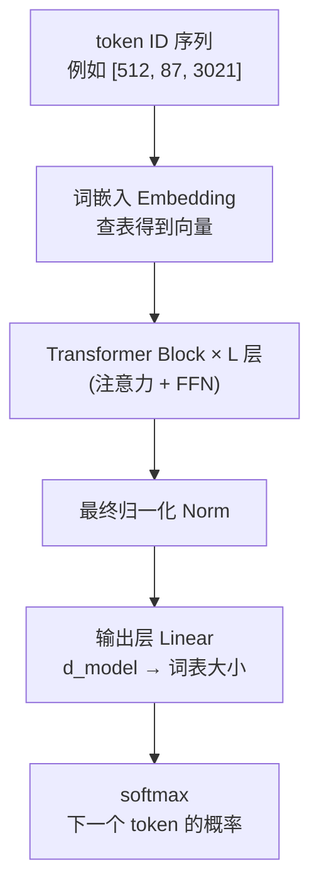
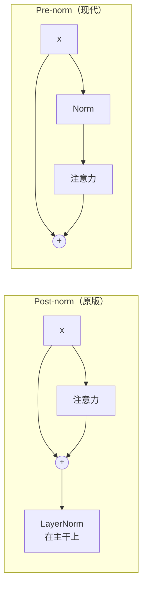
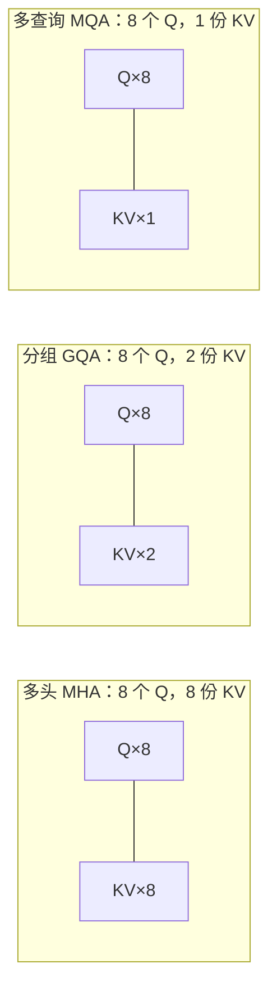
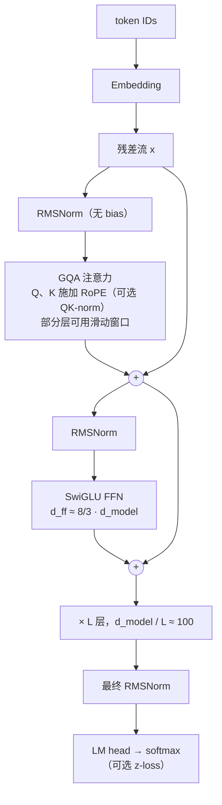

# 第 3 章 模型架构：从零搭一个 Transformer，再看现代 LLM 都改了什么

> 对应课程：Lecture 3《Architectures》（讲义标题：Everything you didn't want to know about LM architecture and hyperparameters）· [YouTube](https://www.youtube.com/watch?v=lVynu4bo1rY) · 官方讲义：[幻灯片 lecture_03.pdf](https://github.com/stanford-cs336/lectures/blob/main/lecture_03.pdf)

<Video id="lVynu4bo1rY" title="Lecture 3 原视频" />

## 本章你将学到

- 一个“语言模型版” Transformer 从输入 token 到输出概率，中间每一步在做什么：词嵌入、自注意力（Q/K/V）、多头、残差连接、归一化、前馈网络（FFN）、输出层。
- 作业 A1 要你实现的“现代版” Transformer 和 2017 年原版有哪几处不同（pre-norm、RMSNorm、RoPE、SwiGLU、去掉 bias），以及**为什么**大家都这么改。
- 一组“看起来很玄、其实大家都差不多”的超参数：`d_ff / d_model`、头数与头维度、宽深比、词表大小、dropout 与权重衰减。
- 训练稳定性的三板斧：z-loss、QK-norm、logit soft-capping——它们都在对付同一个危险分子：softmax。
- 推理成本驱动的注意力改造：MQA / GQA，以及“滑动窗口 + 全注意力”交错的长上下文方案。

## 先说结论（一分钟版）

1. 今天几乎所有大模型的骨架，仍然是 2017 年那篇 Transformer 论文的结构；真正改动的只是少数几个零件。
2. 大家一致同意的改动：**把归一化移出残差主干（pre-norm）**、**用 RMSNorm 替代 LayerNorm**、**去掉偏置项**、**用门控激活（SwiGLU/GeGLU）**、**用 RoPE 编码位置**。理由一半是效果，一半是系统效率和训练稳定性。
3. 很多超参数存在一个“宽阔的盆地”：`d_ff ≈ 4·d_model`（门控版约 8/3 倍）、`头数 × 头维度 = d_model`、`d_model / 层数 ≈ 100`，在附近选都不会差太多。
4. 训练会“炸”的地方通常是 softmax（有指数、有除法）。z-loss 管输出 softmax，QK-norm 和 soft-capping 管注意力 softmax。
5. 推理时最贵的往往不是计算而是**搬运 KV cache**，于是有了 MQA/GQA（让多个查询头共享 K、V）和滑动窗口注意力。

---

## 3.1 这一讲的思路：向别人的“实验记录”学习

主讲人 Tatsu 一开场就坦白：架构这件事“不太优雅”。最好的学习方式是自己动手训练各种架构，但没人有那么多算力把整个设计空间试一遍。所以退而求其次——**把近几年公开的几十个模型摆在一起看**：哪些选择是大家都一样的（说明大概率是对的），哪些选择五花八门（说明可能不太重要）。[▶ 01:06](https://www.youtube.com/watch?v=lVynu4bo1rY&t=66s)

他特别强调，一个架构要同时满足三件事：

- 能从数据里学到东西、泛化得好；
- 能在 GPU 上高效地训练；
- 训练到一半**不会炸**（loss 突然飙升，再也降不下来）。

这三个要求互相牵制，于是架构里就充满了“为了系统效率”“为了稳定”而做的妥协。

从历史上看大致是这样：Transformer 刚出现到 GPT-3 时期是“百花齐放”的试验期；LLaMA 2 出来之后，大家纷纷训练“LLaMA 2 的翻版”；2025 年前后，架构改动集中在**训练稳定性**；而到课程录制的 2026 年春，主旋律变成了**长上下文**。[▶ 06:10](https://www.youtube.com/watch?v=lVynu4bo1rY&t=370s)

::: tip 移动端类比
这很像 Android 架构组件的演进：早年大家各写各的 MVC/MVP/MVVM，后来 Google 推出 Jetpack 架构指南，大家都“照着官方模板 + 一点点自定义”。LLaMA 就是大模型界的“官方模板”。
:::

课上主讲人默认大家见过 Transformer。考虑到本书读者此前没学过，我们先花一大节**从零把 Transformer 拆开讲清楚**，再回到课上的“现代变体”。如果你对向量、矩阵乘法、softmax 还不熟，请先看 [第 0 章](./ch00-primer)。

---

## 3.2 先补课：一个语言模型 Transformer，从头到尾

### 3.2.1 任务是什么

[第 1 章](./ch01-overview-tokenization) 讲过：语言模型做的事情就是**给定前面的 token，预测下一个 token 的概率分布**。输入是一串 token ID（整数），输出是对词表里每个 token 的概率。

整条流水线长这样：



下面一步一步来。为了统一记号：`B` 是 batch 大小，`T` 是序列长度，`d_model`（简写 `d`）是每个 token 向量的维度，`V` 是词表大小，`L` 是层数。

### 3.2.2 第一步：词嵌入（Embedding）——查表

**直觉**：token ID 只是一个编号，比如 512 号代表“猫”。编号本身没有“含义”，512 和 513 也不一定相近。我们需要把每个编号换成一个能被神经网络计算的“特征向量”。

**定义**：准备一个形状为 `(V, d_model)` 的大矩阵，第 i 行就是 i 号 token 的向量。输入 ID 序列，按行查表即可。这个矩阵的数值是训练学出来的。

```python
import torch
import torch.nn as nn

V, d_model = 10000, 512
emb = nn.Embedding(V, d_model)          # 一个 (V, d_model) 的可学习矩阵
ids = torch.tensor([[512, 87, 3021]])   # 形状 (B=1, T=3)
x = emb(ids)                            # 按行查表 → 形状 (1, 3, 512)
```

::: tip 移动端类比
就像 `R.drawable.xxx` 这种资源 ID：ID 本身只是个 int，真正的内容要去资源表里“查”出来。Embedding 就是一张可学习的资源表。
:::

### 3.2.3 残差流：贯穿整个网络的“主干道”

在讲注意力之前，先建立一个贯穿全章的画面：**残差流（residual stream）**。

把 `x`（形状 `(B, T, d)`）想象成一条从底部流到顶部的主干道。每一层 block 都不是“把 x 替换掉”，而是**读一下 x，算出一个修正量，再加回去**：

$$x \leftarrow x + \text{子层}(x)$$

> 大白话：`x` 是当前每个位置的“理解”；子层算出一个增量；加回去后，主干上的信息被一点点丰富。

这种“加回去”的结构叫**残差连接（residual connection）**。它的两大好处：一是子层只需要学“修正量”，学起来更容易；二是反向传播时，梯度可以沿着这条加法主干**直通**回底层，不容易在很深的网络里消失。后面讲 pre-norm 时，你会发现“保持主干道干净”是现代架构设计的一条金科玉律。

::: tip 移动端类比
残差流像一个在各个模块之间传递的共享状态对象（比如一个 `UiState`）。每个模块不新建状态，而是 `state = state + 我的贡献`。最后谁都能看到前面所有模块累积的结果。
:::

### 3.2.4 第二步：自注意力（Self-Attention）——让 token 互相“打听”

到目前为止，每个位置的向量只知道“自己是谁”，不知道上下文。比如“它的尾巴”里的“它”，需要去前文找“它”指的是谁。**注意力是 Transformer 里唯一让不同位置交换信息的部件。**

**直觉：一次搜索**

想象每个 token 都在发起一次“搜索”：

- **Query（查询，Q）**：我想找什么样的信息？（搜索框里输入的关键词）
- **Key（键，K）**：我身上贴着什么标签？（每篇文章的标题）
- **Value（值，V）**：如果你找到我，我能提供的内容是什么？（文章正文）

每个 token 用自己的 Q 去和所有 token 的 K 比较“匹配度”，匹配度高的，就多拿一些它的 V。

**定义：三个投影**

Q、K、V 都是由同一个输入 `x` 乘上三个不同的可学习矩阵得到的：

$$Q = xW_Q,\quad K = xW_K,\quad V = xW_V$$

> 大白话：`W_Q`、`W_K`、`W_V` 是三个 `d × d_k` 的矩阵（参数），把每个位置的向量“投影”成查询、键、值三种角色。

**公式：缩放点积注意力**

$$\text{Attention}(Q,K,V)=\text{softmax}\!\left(\frac{QK^\top}{\sqrt{d_k}} + M\right)V$$

逐个符号解释：

- `QKᵀ`：每个查询和每个键做点积，得到一个 `T × T` 的打分矩阵，第 i 行第 j 列表示“第 i 个 token 对第 j 个 token 有多感兴趣”。
- `√d_k`：除以键向量维度的平方根。维度越高，点积的数值越容易变大，softmax 就会变得极端（几乎全给一个位置）。缩放能让分布温和一些。
- `M`：因果掩码（causal mask）。语言模型预测下一个词时**不能偷看后文**，所以对 `j > i` 的位置加上 −∞，softmax 之后它们的权重就是 0。
- `softmax`：对每一行做 softmax，把分数变成一组和为 1 的权重。
- `× V`：按权重把各个位置的 V 加权求和，得到每个位置的输出。

**手算一遍**

假设只有 3 个 token，`d_k = 2`。我们算第 3 个 token 的输出（它能看到 1、2、3 号）：

- `q₃ = [1, 2]`；`k₁ = [1, 0]`，`k₂ = [0, 1]`，`k₃ = [1, 1]`
- 点积：`q₃·k₁ = 1`，`q₃·k₂ = 2`，`q₃·k₃ = 1 + 2 = 3`
- 除以 `√2 ≈ 1.414`：得到 `0.71, 1.41, 2.12`
- 取指数：`e^0.71 ≈ 2.03`，`e^1.41 ≈ 4.11`，`e^2.12 ≈ 8.34`，总和 `≈ 14.48`
- softmax 权重：`0.14, 0.28, 0.58`
- 若 `v₁ = [1, 0]`，`v₂ = [0, 1]`，`v₃ = [1, 1]`，输出 `= 0.14·[1,0] + 0.28·[0,1] + 0.58·[1,1] ≈ [0.72, 0.86]`

就这么简单：**打分 → 缩放 → 掩码 → softmax → 加权求和**。下面这个演示把每一步都摊开给你看，你可以切换“提问者”，开关因果掩码和缩放，观察权重如何变化。

<Demo src="ch03-self-attention.html" title="自注意力逐步计算（带因果掩码开关）" :height="720" />

::: warning 常见误区
“注意力权重高 = 模型理解了指代关系”并不总成立。注意力只是一种**可学习的加权平均**机制，具体学到什么完全取决于训练。演示里的向量是手工设计的，为了让“它的”明显关注“小猫”。
:::

### 3.2.5 多头注意力（Multi-Head Attention）

一次注意力只能形成一种“关注模式”。但理解一句话往往需要同时关注多种关系：语法上的主谓、指代、相邻词……**多头**就是并行做 h 次注意力，每个头用自己的一套 `W_Q, W_K, W_V`，各看各的，最后把结果拼起来，再用一个输出矩阵 `W_O` 混合。

标准做法是：把 `d_model` 平均切成 h 份，每个头的维度 `d_k = d_model / h`。这样多头的总计算量和单个大头差不多（3.8 节会看到这是一个“几乎所有人都遵守”的约定）。

```python
import torch, math

def causal_mha(x, Wq, Wk, Wv, Wo, h):
    # x: (B, T, d)；Wq/Wk/Wv/Wo: (d, d)；h: 头数
    B, T, d = x.shape
    dk = d // h
    # 1) 投影后切成 h 个头: (B, h, T, dk)
    q = (x @ Wq).view(B, T, h, dk).transpose(1, 2)
    k = (x @ Wk).view(B, T, h, dk).transpose(1, 2)
    v = (x @ Wv).view(B, T, h, dk).transpose(1, 2)
    # 2) 打分并缩放: (B, h, T, T)
    scores = q @ k.transpose(-2, -1) / math.sqrt(dk)
    # 3) 因果掩码：上三角（未来位置）填 -inf
    mask = torch.triu(torch.ones(T, T, dtype=torch.bool), diagonal=1)
    scores = scores.masked_fill(mask, float("-inf"))
    # 4) softmax 得到权重，再加权求和 V
    out = torch.softmax(scores, dim=-1) @ v          # (B, h, T, dk)
    # 5) 拼回 (B, T, d)，再过输出投影
    out = out.transpose(1, 2).reshape(B, T, d)
    return out @ Wo
```

注意第 2 步的打分矩阵形状是 `(B, h, T, T)`——**它随序列长度的平方增长**。这是下一章“注意力替代方案”的根本动机。

### 3.2.6 第三步：前馈网络（FFN / MLP）——各自回工位思考

注意力负责“开会交流”，FFN 负责“各自回工位消化”。FFN 对**每个位置独立**地做同样的变换，不跨位置交换信息：

$$\text{FFN}(x) = \sigma(xW_1)\,W_2$$

> 大白话：先用 `W_1`（形状 `d × d_ff`）把向量“升维”到更宽的空间，经过一个非线性函数 σ（比如 ReLU：负数变 0），再用 `W_2`（`d_ff × d`）降回原来的维度。

原始 Transformer 里 `d_ff = 4·d_model`。FFN 的参数是 `2·d·d_ff = 8d²`，比注意力的 `4d²`（Q、K、V、O 四个 `d×d` 矩阵）还多一倍，**模型的大部分参数都在 FFN 里**。

### 3.2.7 归一化：给每个向量“调音量”

深层网络里，数值很容易越传越大或越传越小。**归一化**就是在进入每个子层之前，把每个位置的向量“标准化”一下。原始 Transformer 用的是 LayerNorm：

$$\text{LayerNorm}(x) = \frac{x-\mu}{\sqrt{\sigma^2+\varepsilon}}\odot\gamma+\beta$$

> 大白话：μ 和 σ² 是这个向量 d 个分量的均值和方差。先减均值、除以标准差，把它变成“均值 0、方差 1”，再用可学习的 γ（缩放）和 β（偏移）调回合适的尺度。ε 是防止除以 0 的小常数。

现代模型几乎都改用了更简单的 RMSNorm，3.4 节细讲。

::: tip 移动端类比
就像音频处理里的“自动增益”：不管输入声音大小，先归一到标准音量，再按需要调整。这样后面的处理模块不用担心输入忽大忽小。
:::

### 3.2.8 第四步：输出层

所有 block 跑完之后，再做一次最终归一化，然后用一个 `d × V` 的线性层（常叫 LM head）把每个位置的向量变成 V 个分数（logits），softmax 之后就是“下一个 token 是谁”的概率分布。训练时用交叉熵损失：正确答案的概率越高，损失越小。有些模型会让输出层和词嵌入**共享同一个矩阵**以节省参数。

### 3.2.9 拼起来：一个 block、一个模型

把上面的零件拼成一个**现代（pre-norm）**的 block：

```python
class Block(nn.Module):
    def __init__(self, d, h, d_ff):
        super().__init__()
        self.norm1 = nn.RMSNorm(d)        # PyTorch 2.4+ 自带；作业里要求你自己实现
        self.attn = MultiHeadSelfAttention(d, h)   # 内部做因果掩码 + RoPE
        self.norm2 = nn.RMSNorm(d)
        self.ffn = SwiGLU(d, d_ff)

    def forward(self, x):
        x = x + self.attn(self.norm1(x))  # 归一化只在“支路”上，主干直通
        x = x + self.ffn(self.norm2(x))
        return x
```

block 的输入输出形状完全一样 `(B, T, d)`，所以可以像乐高一样叠 L 层。

**手算参数量**：忽略归一化的小参数，一个经典 block 约有 `4d²`（注意力）`+ 8d²`（FFN）`= 12d²` 个参数。拿 GPT-3 验证一下：`d = 12288`，`L = 96`：

$$12 \times 12288^2 \times 96 \approx 12 \times 1.51\times10^8 \times 96 \approx 1.74\times10^{11}$$

再加上词嵌入 `50257 × 12288 ≈ 0.6B`，总共约 175B——正是 GPT-3 的“1750 亿参数”。

下面的演示可以播放一个 block 内的数据流，并在右侧调整形状，实时看到每层参数、总参数、KV cache 大小（KV cache 在 3.10 节解释）。

<Demo src="ch03-block-flow.html" title="Transformer block 数据流 + 参数计算器" :height="760" />

### 3.2.10 原版 vs 你要在 A1 里实现的版本

课上第一张对比表 [▶ 02:06](https://www.youtube.com/watch?v=lVynu4bo1rY&t=126s)：

| 零件 | 原始 Transformer（2017） | 作业 A1 的“现代”版本 |
|---|---|---|
| 位置编码 | 正弦/余弦，加在输入上 | RoPE（旋转位置编码），作用在每层的 Q、K 上 |
| FFN 激活 | ReLU | SwiGLU |
| 归一化位置 | post-norm（在残差主干上） | pre-norm（在支路的入口） |
| 归一化类型 | LayerNorm | RMSNorm |
| 偏置项 | 线性层有 bias | 线性层和归一化都没有 bias |

为什么选这些？课上的回答很实在：“一部分原因是我们照搬了 LLaMA，但其他所有人也都这么做。”接下来几节逐个解释这些选择背后的道理。

---

## 3.3 归一化放在哪：pre-norm vs post-norm

### 3.3.1 唯一的共识

Tatsu 说，大家对架构可以吵很多事，但有一件事几乎所有人都同意：**原始 Transformer 把 LayerNorm 放错了地方。**[▶ 07:10](https://www.youtube.com/watch?v=lVynu4bo1rY&t=430s)



- **Post-norm**：先做 `x + 子层(x)`，再把结果过 LayerNorm。归一化**在主干道上**，每一层都会“改写”主干信号。
- **Pre-norm**：先对 x 做归一化，再送进子层，最后把子层输出加回**原封不动的** x。归一化只在**支路**上，主干是干净的。

几乎所有现代语言模型都用 pre-norm。课上提到一个“好笑的例外”：OPT-350M——只有这一个尺寸用了 post-norm，原因不明。另外，BERT 是 post-norm。

### 3.3.2 为什么 pre-norm 更好

最早研究这个问题的动机是**去掉学习率预热（warmup）**。训练 Transformer 通常需要在开头让学习率从很小慢慢升上来，研究者希望能省掉这一步。Xiong 等人（2020）的实验显示：不做 warmup 时，post-norm 收敛明显更差，而 pre-norm 好得多。[▶ 09:11](https://www.youtube.com/watch?v=lVynu4bo1rY&t=551s)

但人们很快意识到更重要的意义在于**稳定性和可以做深**：

- **梯度衰减（gradient attenuation）**：pre-norm 下，梯度可以沿着干净的残差主干直通到底层，各层梯度大小基本一致；post-norm 每层都要穿过一次 LayerNorm，梯度范数会被逐层改变。
- **梯度尖峰（gradient spikes）**：Nguyen 与 Salazar（2019）观察到，pre-norm 下梯度尖峰的大小和频率都更小。

做架构的人常挂在嘴边的一句话：**保持残差流干净（keep your residual stream clean）**。

### 3.3.3 新花样：“双重归一化”

既然“归一化放在主干上”是坏的，那为什么非得放在子层**前面**？放在子层**后面**、但仍然在支路上，同样不污染主干。[▶ 12:12](https://www.youtube.com/watch?v=lVynu4bo1rY&t=732s)

确实有模型这么做：Grok、Gemma 2 在子层前后**各放一个**归一化（“double norm”）；OLMo 2 只在子层**之后**（但在残差之外）放归一化。

Tatsu 还总结了一条听起来很荒唐、却屡试不爽的经验：**遇到稳定性问题，就往里面撒点归一化**。我们在 3.9 节的 QK-norm 里会再见到它。

---

## 3.4 LayerNorm → RMSNorm，以及“去掉 bias”

### 3.4.1 RMSNorm 是什么

$$\text{RMSNorm}(x) = \frac{x}{\sqrt{\frac{1}{d}\sum_{i=1}^{d} x_i^2+\varepsilon}}\odot\gamma$$

> 大白话：不减均值，也不加偏移 β，只是把向量除以它的“均方根”（大致就是它的平均大小），再乘以可学习的缩放 γ。

LayerNorm 在表达能力上严格更强，RMSNorm 也没有什么理论优势。但实践中两者效果一样好，而 RMSNorm **更快**。用 RMSNorm 的代表：LLaMA 家族、PaLM、Chinchilla、T5；用 LayerNorm 的：GPT-1/2/3、OPT、GPT-J、BLOOM。[▶ 13:13](https://www.youtube.com/watch?v=lVynu4bo1rY&t=793s)

### 3.4.2 “只占 0.17% 的计算量，凭什么值得优化？”

这里是本章第一个“系统与架构协同设计”的例子。

你可能会想：归一化的浮点运算（FLOPs）在整个模型里只占约 **0.17%**，省掉减均值这一步有什么意义？关键在于 **FLOPs 不等于运行时间**。Ivanov 等人的分析显示，归一化这类操作虽然只占 0.17% 的 FLOPs，在某些设置下却能占到 **25% 的运行时间**。[▶ 15:16](https://www.youtube.com/watch?v=lVynu4bo1rY&t=916s)

原因是[第 2 章](./ch02-pytorch-resource)讲过的**算术强度**（每搬运 1 字节数据做多少次运算）：矩阵乘法搬一次数据能做大量乘加，GPU 算力被充分利用；而归一化几乎每个数只做一两次运算，时间几乎全花在“把数据从显存搬进来再搬出去”上。

::: tip 移动端类比
这就像在主线程上做大量零碎的小 IO：每次读写的数据量很小、计算也很少，但每次都要等 IO。总“计算量”微不足道，卡顿却很明显。去掉不必要的减均值，就像合并掉一次多余的磁盘读写。
:::

Narang 等人（2020）的大规模对比实验也证实：换成 RMSNorm 后，训练每秒步数更多，而且最终效果还略好（后者不是必然的，算是附赠）。所以几乎所有人都换了。

### 3.4.3 去掉 bias

同样的逻辑推广一下：原始 Transformer 的线性层都有偏置项 `+b`，但现代实现基本都去掉了：

$$\text{FFN}(x) = \sigma(xW_1)W_2 \quad \text{（没有 } +b_1, +b_2\text{）}$$

理由主要是系统层面的：bias 的计算量小但要单独搬运内存，不划算；课上也顺带提到 bias 有时会引发稳定性问题。整体结论：**去掉线性层和归一化里的 bias，对典型语言建模任务没有损失。**

> 课上的一句心里话：遗憾的是，这些事你没法事先推理出来。我们“知道”去掉 bias 没问题，靠的是大量实验积累起来的集体经验。

---

## 3.5 激活函数与门控：从 ReLU 到 SwiGLU

### 3.5.1 一堆名字

ReLU、GELU、Swish、ELU、GLU、GeGLU、ReGLU、SeLU、SwiGLU、LiGLU……Tatsu 说他曾经“以从不知道 SwiGLU 是什么为荣”，但现在必须搞懂了。[▶ 19:19](https://www.youtube.com/watch?v=lVynu4bo1rY&t=1159s)

先看三个基本激活：

| 激活 | 公式 | 直觉 | 代表模型 |
|---|---|---|---|
| ReLU | `max(0, x)` | 负数直接砍成 0 | 原始 Transformer、T5、Gopher、Chinchilla、OPT |
| GELU | `x·Φ(x)`（Φ 是标准正态分布的累积分布函数） | 像 ReLU，但在 0 附近有一个小“凹陷”，更平滑 | GPT-1/2/3、GPT-J、GPT-NeoX、BLOOM |
| Swish（SiLU） | `x·sigmoid(x)` | 也是平滑版 ReLU | ——（用在 SwiGLU 里） |

用 ReLU 就能训出不错的模型；用 GELU 可以训出 GPT-3。但真正的“主角”是**门控线性单元**。

### 3.5.2 门控线性单元（GLU）

架构设计里有一句常被引用的经验：**门控（gating）通常很有用**。把它用到 FFN 上：原来是

$$\text{FF}(x) = \max(0, xW_1)\,W_2$$

现在再加一个同样大小的分支 `xV`，和第一支**逐元素相乘**：

$$\text{FF}_{\text{ReGLU}}(x) = \big(\max(0, xW_1)\otimes xV\big)\,W_2$$

> 大白话：`xV` 像一个“音量旋钮阵列”，逐个维度决定 `max(0, xW_1)` 的每一项放大还是关小。⊗ 表示逐元素相乘。V 是新增的可学习矩阵。

命名规则就是“激活名 + GLU”：ReLU 门控叫 ReGLU，GELU 门控叫 GeGLU，Swish 门控就是 **SwiGLU**：

$$\text{FF}_{\text{SwiGLU}}(x) = \big(\text{Swish}(xW_1)\otimes xV\big)\,W_2$$

谁在用：Google 系（T5 v1.1、mT5、LaMDA、Phi-3、Gemma 2/3/4）多用 GeGLU；LLaMA 1/2/3、PaLM、Mistral、OLMo 以及 2023 年后的大多数模型用 SwiGLU。课上的判断是：SwiGLU 更主流，但在门控家族内部选哪个其实无所谓。

```python
import torch.nn.functional as F

class SwiGLU(nn.Module):
    def __init__(self, d, d_ff):
        super().__init__()
        self.w1 = nn.Linear(d, d_ff, bias=False)   # 主分支
        self.v  = nn.Linear(d, d_ff, bias=False)   # 门控分支（作业里常记为 W3）
        self.w2 = nn.Linear(d_ff, d, bias=False)   # 降维回 d
    def forward(self, x):
        return self.w2(F.silu(self.w1(x)) * self.v(x))   # silu 就是 Swish
```

### 3.5.3 一个“以后会考”的小知识：2/3 修正

门控版多了一个矩阵 V，参数从 2 个矩阵变成 3 个。为了和普通 FFN **参数量相同**做公平比较，通常把 `d_ff` 缩小到原来的 2/3。手算一下：

- 普通 FFN：`2 × d × 4d = 8d²`
- 门控 FFN：`3 × d × d_ff`，令它等于 `8d²`，得 `d_ff = 8d/3 ≈ 2.67d`

这就是为什么你会在很多模型里看到 `d_ff ≈ 2.67·d_model`，作业 A1 里也有这个设置。[▶ 24:22](https://www.youtube.com/watch?v=lVynu4bo1rY&t=1462s)

### 3.5.4 证据

Noam Shazeer（2020）在**参数量对齐**的条件下比较了各种 GLU 变体，GLU 系列几乎都稳定地优于非门控版本，而且他还跑了多次重复实验给出误差范围。Narang 等人（2020）的大规模对比也得出同样结论。当然门控不是必需的：GPT-3 用 GELU，Nemotron-4 340B 甚至用了“平方 ReLU”，都是好模型。但如今不用门控的模型已经很少见了。

---

## 3.6 串行还是并行：一个渐渐过气的点子

标准 block 是**串行**的：先算注意力，再算 FFN。一个系统工程师可能会想：两者能不能**并行**？[▶ 27:24](https://www.youtube.com/watch?v=lVynu4bo1rY&t=1644s)

$$\text{串行：}\; y = x + \text{FFN}\big(\text{Norm}(x + \text{Attn}(\text{Norm}(x)))\big)$$
$$\text{并行：}\; y = x + \text{FFN}(\text{Norm}(x)) + \text{Attn}(\text{Norm}(x))$$

> 大白话：并行版里，注意力和 FFN 都读同一个输入，结果一起加回主干。好处是可以共享归一化、把两者的矩阵乘法融合成一次大乘法。

这个想法最早来自 GPT-J，PaLM、GPT-NeoX 都采用过；近期 Cohere 的 Command A / Command R+、Falcon 2 11B 也在用。PaLM 报告里很自信：没有性能损失，系统利用率提升约 15%。

但过去两年它明显失宠了。课上的解释：串行版的系统优化已经足够好，并行带来的收益抵不过表达能力的小损失——你可以粗略理解为“深度减半”。而且后来的 Google 模型自己也不用了，这本身就是个信号。不过严格控制变量的对比实验，据讲者所知还没人做过。

---

## 3.7 位置编码：从正弦到 RoPE

### 3.7.1 为什么需要位置信息

回看注意力公式：它只是一堆点积和加权平均。如果把输入序列**打乱顺序**，每个位置得到的输出也只是跟着换了位置，数值完全一样。也就是说，**注意力本身不知道词的先后顺序**——“狗咬人”和“人咬狗”在它看来是一回事。所以必须额外注入位置信息。[▶ 31:27](https://www.youtube.com/watch?v=lVynu4bo1rY&t=1887s)

### 3.7.2 四种方案

| 方案 | 做法 | 代表模型 |
|---|---|---|
| 正弦编码 | `Embed(x, i) = v_x + PE_i`，PE 是不同频率的 sin/cos | 原始 Transformer |
| 绝对位置编码 | `Embed(x, i) = v_x + u_i`，每个位置一个可学习向量 | GPT-1/2/3、OPT |
| 相对位置编码 | 在注意力打分上直接加一个与距离 `i−j` 有关的偏置 | T5、Gopher、Chinchilla |
| RoPE（旋转位置编码） | 按位置把 Q、K **旋转**一个角度 | GPT-J、PaLM、LLaMA，以及 2024 年后的绝大多数模型 |

### 3.7.3 RoPE 想解决的问题

RoPE 的出发点是一个“有主见”的立场：**注意力只应该关心两个词的相对距离，而不应该关心它们的绝对位置**。比如“一个苹果”出现在句首还是句尾，“一个”和“苹果”之间的关系应该一样。

写成数学：我们想找一个把“词 + 位置”编码成向量的函数 f，使得

$$\langle f(x, i),\, f(y, j)\rangle = g(x, y, i-j)$$

> 大白话：词 x 在位置 i、词 y 在位置 j，二者编码后的点积（也就是注意力打分）只能依赖 x、y 本身和距离 `i−j`，不能依赖 i、j 各自是多少。

已有方案都不满足：

- 正弦编码：展开点积会出现 `⟨PE_i, v_y⟩` 这种**交叉项**，含有绝对位置信息；
- 绝对编码：顾名思义，不是相对的；
- 相对偏置：确实是相对的，但它是直接加在注意力矩阵上，不能写成两个向量的点积形式。

### 3.7.4 核心思想：旋转

我们知道一个几何事实：**两个向量同时旋转同一个角度，它们的点积不变**（夹角没变）。于是：

1. 先拿到与位置无关的“语义向量”；
2. 位置为 m 的词，就把它的向量**旋转 m·θ 度**。

课上的例子 [▶ 34:31](https://www.youtube.com/watch?v=lVynu4bo1rY&t=2071s)：

- 句子 “we know that”：“we” 在位置 0，不转；“know” 在位置 1，转 1 份角度。
- 句子 “of course we know”：“we” 在位置 2，转 2 份；“know” 在位置 3，转 3 份。

两个句子里，“we” 和 “know” 的**夹角差都是 1 份**，所以它们的点积一样——这就实现了纯粹的相对位置编码。

<Demo src="ch03-rope.html" title="RoPE 旋转可视化：平移整句，点积不变" :height="640" />

### 3.7.5 高维怎么转

二维平面里旋转只有一个自由度，很简单。但 Q、K 是几十上百维的向量，高维空间里的旋转方式有无穷多种，选哪个？答案是**最简单的那个**：把 d 维向量两两配对，切成 d/2 个二维平面，每一对各自在自己的平面里旋转。[▶ 36:32](https://www.youtube.com/watch?v=lVynu4bo1rY&t=2192s)

不同的对用不同的旋转速度：

$$\theta_i = \Theta^{-2i/d},\quad i = 0, 1, \dots, d/2-1$$

> 大白话：Θ 是一个常数（常用 10000）。第 0 对转得最快（每个位置转 1 弧度），越往后转得越慢。转得快的维度像秒针，能分辨“紧挨着的邻居”；转得慢的维度像时针，负责感知“很远的距离”。

位置 m 处、第 i 对坐标 `(x₂ᵢ, x₂ᵢ₊₁)` 的旋转就是一个 2×2 旋转矩阵：

$$\begin{pmatrix}x'_{2i}\\x'_{2i+1}\end{pmatrix}=\begin{pmatrix}\cos m\theta_i & -\sin m\theta_i\\ \sin m\theta_i & \cos m\theta_i\end{pmatrix}\begin{pmatrix}x_{2i}\\x_{2i+1}\end{pmatrix}$$

为什么点积只依赖相对位置？因为旋转矩阵满足 `R_mᵀ R_n = R_{n−m}`，所以 `⟨R_m q, R_n k⟩ = ⟨q, R_{n−m} k⟩`，只剩下 `n − m`。

RoPE 原论文用复数来推导，讲者认为直接从“二维旋转”去理解最直观。

::: warning 常见误区
RoPE 也用 sin 和 cos，但和正弦位置编码有本质区别：正弦编码是把 sin/cos **加**到词向量上（会产生交叉项）；RoPE 是用 sin/cos **乘**（旋转）Q 和 K，没有交叉项，点积里不残留任何绝对位置信息。
:::

### 3.7.6 实现要点

- RoPE **不作用在输入嵌入上**，而是在**每一层的注意力里**，对 Q 和 K 施加旋转（V 不转）。这样每一次注意力计算都强制满足相对位置性质。
- 实现时先根据位置 ID 预先算好 cos、sin 表，然后对 Q、K 做逐元素运算即可，不需要真的构造稀疏的旋转矩阵。

```python
def rope(x, pos, theta=10000.0):
    # x: (..., T, d)，d 为偶数；pos: (T,) 每个 token 的位置
    d = x.shape[-1]
    freqs = theta ** (-torch.arange(0, d, 2, dtype=torch.float32) / d)  # (d/2,) 各对的 θ_i
    ang = pos[:, None].float() * freqs[None, :]                          # (T, d/2) 角度 m·θ_i
    cos, sin = ang.cos(), ang.sin()
    x1, x2 = x[..., 0::2], x[..., 1::2]          # 拆成 (偶数维, 奇数维) 两两配对
    out = torch.empty_like(x)
    out[..., 0::2] = x1 * cos - x2 * sin         # 二维旋转公式
    out[..., 1::2] = x1 * sin + x2 * cos
    return out
# 在注意力里：q = rope(q, pos); k = rope(k, pos)  —— v 不旋转
```

### 3.7.7 变体与问答

- 课上提到 Gemma 4 用了一种叫 p-RoPE（proportional RoPE）的变体，讲者描述为“只旋转部分坐标”。在问答中他解释：低频的那些维度本来就转得很慢，丢掉它们也没多大影响，这主要是给隐藏维度很小的模型省空间的技巧。
- 有同学问“有没有人做更高维的旋转？”——讲者说没见过，任何二维旋转组合本质上都是这个方案的变体。
- 还有同学问“相对位置偏置（如 ALiBi）不能写成点积，有什么问题？”——讲者说这更多是“审美”问题：如果你要求“相对 + 可分解为点积”，那它不在解集里；ALiBi 这类方法实际效果也不错，只是没有成为主流。

---

## 3.8 超参数：看起来很重要、其实很“宽容”的数字

一旦你真的要训练模型，就会冒出一堆问题：FFN 该多宽？几个头？词表多大？要不要正则化？深一点还是宽一点？好消息是：大家实际用的取值范围其实很窄。[▶ 43:36](https://www.youtube.com/watch?v=lVynu4bo1rY&t=2616s)

### 3.8.1 FFN 宽度：d_ff = 4 × d_model

这是一个几乎被所有模型遵守的经验值。例外有两类：

**例外一：门控 FFN**。如 3.5.3 节所述，按 2/3 缩小后约为 2.67 倍。课上的数据：

| 模型 | d_ff / d_model |
|---|---|
| PaLM | 4 |
| Mistral 7B | 3.5 |
| LLaMA-2 70B | 3.5 |
| LLaMA 70B | 2.68 |
| Qwen 14B | 2.67 |
| DeepSeek 67B | 2.68 |
| Yi 34B | 2.85 |
| T5 v1.1 | 2.5 |

LLaMA 2 和 Mistral 的 3.5 稍大一点。课上的解读是：LLaMA 2 用了更省的注意力（GQA，见 3.10 节），于是把省下的预算多分给了 MLP。

**例外二：T5 的大胆选择**。T5 11B 用了 `d_ff = 65536`、`d_model = 1024`，足足 **64 倍**。理由是系统层面的：矩阵越大，硬件利用率越高。Gemma 2 也用到了 8 倍。但有个有趣的结局：T5 的“改进版” T5 v1.1 又回到了标准的 2.5 倍（GeGLU）。言外之意，64 倍大概并不划算。

**证据**：Kaplan 等人（2020）的经典缩放律论文中有一组对比，`d_ff / d_model` 从 1 到 10 左右是一个**又宽又平的盆地**，损失几乎不变；超过 10 甚至到 100，损失才明显上升。所以 2.6 到 4 之间的取值都稳稳落在盆地里。

### 3.8.2 头维度 × 头数 = d_model

另一个“莫名其妙但人人遵守”的约定：每个头的维度 = `d_model / 头数`，于是多头加起来恰好等于 d_model。[▶ 49:38](https://www.youtube.com/watch?v=lVynu4bo1rY&t=2978s)

| 模型 | 头数 | 头维度 | d_model | 比值 |
|---|---|---|---|---|
| GPT-3 | 96 | 128 | 12288 | 1 |
| T5 | 128 | 128 | 1024 | 16 |
| T5 v1.1 | 64 | 64 | 4096 | 1 |
| LaMDA | 128 | 128 | 8192 | 2 |
| PaLM | 48 | 258 | 18432 | 1.48 |
| LLaMA 2 | 64 | 128 | 8192 | 1 |
| Qwen 3.5（27B） | 24 | 256 | 5120 | 1.2 |

（表中数字照录讲义。注意 PaLM 这一行讲义有笔误：PaLM 540B 的实际头维度是 256，按“头数×头维度÷d_model”算，比值应约为 48×256÷18432 ≈ 0.67，而不是 1.48。）绝大多数模型比值在 1 附近，例外又是几个 Google 模型。这个超参数同样有一个较宽的盆地，不算最关键。

### 3.8.3 宽深比：d_model / 层数 ≈ 100

把模型放大或缩小时，通常固定一个“宽深比”，然后整体放大。这个比值决定了“深而窄”还是“浅而宽”。[▶ 51:39](https://www.youtube.com/watch?v=lVynu4bo1rY&t=3099s)

| 模型 | d_model / n_layer |
|---|---|
| BLOOM | 205 |
| T5 v1.1 | 171 |
| PaLM（540B） | 156 |
| GPT-3 / OPT / Mistral / Qwen / OLMo 3 | 128 |
| LLaMA / LLaMA 2 | 102 |
| Gemma 3 | 87 |
| Gemma 4 | 61 |
| T5（11B） | 33 |

手算 GPT-3：`12288 / 96 = 128`。大多数模型落在 100 到 200 之间。

为什么不更深？很大程度上是**系统原因**：非常深的模型延迟更高，也更难并行。把模型按层切到不同 GPU 上叫**流水线并行**，课上说“大多数人真的不想碰它”；而把很宽的矩阵切开（**张量并行**）要简单得多。这些会在 [第 7 章](./ch07-parallelism-1) 详细讲。所以系统上倾向于宽，表达能力上也许倾向于深，最后落在 100 左右。

证据方面：Kaplan 等人发现，不同规模的模型最优宽深比都差不多；Tay 等人（2021）则发现，在一大片“合理”的形状里，**真正决定效果的主要是计算量（FLOPs）**，而不是形状本身。结论：在宽容的范围内随便挑，然后把精力花在系统效率上。

### 3.8.4 词表大小

两大阵营：[▶ 54:40](https://www.youtube.com/watch?v=lVynu4bo1rY&t=3280s)

- **单语（英语为主）模型**：3 万到 5 万。原始 Transformer 37000，GPT 40257，GPT-2/3 50257，T5 32128，LLaMA 32000。
- **多语言 / 生产级模型**：10 万到 25 万。mT5 250000，PaLM 256000，GPT-4 100276，Gemma 4 262144，DeepSeek 100000，Qwen 15B 152064，Yi 64000。

多语言模型需要覆盖更多文字，自然需要更大的词表。另外，越大的模型能“消化”越大的词表（有缩放律研究支持），而现在基本没人训练大型单语模型了。

::: details 问答：不同分词器的模型，能直接比较 bits-per-byte 吗？
可以。只要分词器是“完整”的（任何字节序列都能编码，不会丢字符），并且归一化用的分母都是**原文的字节数**，那么 bits-per-byte 就是在同一个量（原始文本）上比较概率，是公平的。早期一些会丢弃词的分词器就不满足这一点。详见 [第 1 章](./ch01-overview-tokenization) 对分词器的讨论。
:::

### 3.8.5 正则化：dropout 和权重衰减

经典机器学习直觉说：参数多就要正则化防过拟合。但大模型预训练的情形很特殊：[▶ 58:49](https://www.youtube.com/watch?v=lVynu4bo1rY&t=3529s)

- 数据极多（万亿 token），比参数还多；
- 通常只过一遍数据（single epoch），很难“背住”训练集。

所以过拟合基本不是问题。那实际中大家怎么做？

| 模型 | Dropout | 权重衰减 |
|---|---|---|
| 原始 Transformer | 0.1 | 0 |
| GPT-2 | 0.1 | 0.1 |
| T5 | 0.1 | 0 |
| GPT-3 | 0.1 | 0.1 |
| T5 v1.1 | 0 | 0 |
| PaLM | 0 | （可变） |
| OPT | 0.1 | 0.1 |
| LLaMA | 0 | 0.1 |
| Qwen 14B | 0.1 | 0.1 |

规律是：老模型常用 dropout，新模型（Qwen 除外）基本只用**权重衰减**。（很多论文根本不提 dropout，对开源模型来说这基本等于“没用”。）

为什么数据都不会过拟合了，还要权重衰减？Andriushchenko 等人（2023）的发现很反直觉：**权重衰减在这里根本不是在防过拟合**——不同衰减强度下，训练损失和验证损失几乎重合。它的作用在于和**学习率衰减**（比如余弦退火）相互作用：强权重衰减的模型前期降得慢，但在学习率衰减阶段能收敛到更好的位置。也就是说，它是一种**优化**手段，而不是**正则化**手段。

这正是这门课强调动手的原因：很多事情没法从第一性原理推出来。

### 3.8.6 超参数小结

| 超参数 | 惯例 | 证据强度 |
|---|---|---|
| FFN 倍数 | 4 倍（门控版 8/3） | 有实验支持 |
| 头维度 × 头数 | = d_model | 验证较少，但很少出问题 |
| 宽深比 | 100 到 200 之间都可以 | 主要由系统因素决定 |
| 正则化 | 仍做权重衰减 | 作用主要在优化动力学 |

---

## 3.9 训练稳定性：小心 softmax

### 3.9.1 问题长什么样

近几年大家越来越关注**训练稳定性**，因为模型越大、训练越贵，炸一次的代价越高。所谓“炸”，就是训练曲线上布满尖峰，梯度范数突然暴涨，严重时模型再也训不回来，几百万美元的算力打水漂。[▶ 64:53](https://www.youtube.com/watch?v=lVynu4bo1rY&t=3893s)

“嫌疑犯”名单的第一位就是 **softmax**，它有两个危险操作：**指数**（数值很容易爆炸）和**除法**（分母可能接近 0）。语言模型里有两处 softmax：

1. 输出层：把 logits 变成词表上的概率；
2. 注意力：把打分变成权重。

（下一章的 MoE 路由器里还有第三处。）

### 3.9.2 输出 softmax：z-loss

先写出输出 softmax 的对数概率：

$$\log P(x) = U_r(x) - \log Z(x),\qquad Z(x) = \sum_{r'=1}^{V} e^{U_{r'}(x)}$$

> 大白话：`U_r` 是正确答案 r 的 logit，`Z` 是所有 logit 取指数后的总和（归一化常数）。`log P` 等于“正确答案的分数”减去“log 总和”。

`U` 是模型输出，通常还算规矩；危险的是 `log Z`：Z 是一堆指数之和，可能非常大，也可能非常小，两个方向都会出数值问题。理想情况是 `Z ≈ 1`，也就是 `log Z ≈ 0`。

关键观察：softmax 是**过参数化**的——给所有 logit 同时加一个常数，概率完全不变，只有 Z 变了。所以我们可以“免费”地要求模型把 Z 维持在 1 附近，只需在损失里加一项：

$$\mathcal{L}_{z} = \alpha \cdot \log^2 Z(x)$$

> 大白话：惩罚 log Z 偏离 0 的程度。α 是一个很小的系数（PaLM 用的是 10⁻⁴）。

这个技巧叫 **z-loss**，最早来自 Devlin 等人 2014 年的工作，PaLM 用过，后来又在开源模型里流行起来：Baichuan 2（2023）、DCLM（2024）、OLMo 2 与 OLMo 3（2025）等。[▶ 67:54](https://www.youtube.com/watch?v=lVynu4bo1rY&t=4074s)

### 3.9.3 注意力 softmax：QK-norm

注意力打分是 `q·k`，如果 q 和 k 的数值越来越大，打分就会越来越极端，softmax 输出接近 one-hot，梯度变得很糟。

QK-norm 体现了“哪里不稳就撒归一化”的哲学：**在 q 和 k 做点积之前，各自过一次 RMSNorm/LayerNorm**。这样进入 softmax 的打分尺度大致恒定。[▶ 69:54](https://www.youtube.com/watch?v=lVynu4bo1rY&t=4194s)

```python
q = rmsnorm_q(q)   # 每个头的 q、k 各自归一化（有独立的可学习 γ）
k = rmsnorm_k(k)
scores = q @ k.transpose(-2, -1) / math.sqrt(dk)
```

这个技巧最初来自视觉和多模态领域（Dehghani 等 2023 训练 22B 参数视觉 Transformer，以及 IDEFICS、Chameleon 等多模态模型），后来被语言模型广泛采用：DCLM、OLMo 2、Gemma 2、Qwen3、OLMo 3、Gemma 4。课上说现在它“已经非常标准”，从大量训练结果看不影响效果，但能有效防止注意力退化。

回头数一数：pre-norm 一层，子层后面再加一层（double norm），现在 Q、K 上又各一层——现代模型里的归一化真的是“撒”得到处都是。

### 3.9.4 更强硬的手段：logit soft-capping

QK-norm 是控制 softmax 的**输入**，希望输出因此变得规矩。如果想**硬性保证**进入 softmax 的 logits 不会太大，可以直接“封顶”：[▶ 72:55](https://www.youtube.com/watch?v=lVynu4bo1rY&t=4375s)

$$\text{logits} \leftarrow c \cdot \tanh\!\left(\frac{\text{logits}}{c}\right)$$

> 大白话：tanh 的输出被夹在 −1 到 1 之间，所以变换后的 logits 永远在 −c 到 c 之间。logits 较小时几乎不变，较大时被“软软地”压住。c 是封顶值。

这主要是 Google 的做法，Gemma 2、3、4 都用了。但代价是：模型永远无法在 softmax 里表达“非常确定”的信号。NVIDIA 的研究者做过系统对比：QK-norm 由于允许使用更大的学习率，效果略好于基线；而**单独**使用 soft-capping 反而会损失效果。所以它是一个“很安全但有副作用”的选项。

| 技巧 | 作用位置 | 思路 | 代表 |
|---|---|---|---|
| z-loss | 输出 softmax | 损失里惩罚 log Z 偏离 0 | PaLM、Baichuan 2、DCLM、OLMo 2/3 |
| QK-norm | 注意力 softmax 的输入 | 对 q、k 先归一化 | DCLM、OLMo 2、Gemma 2、Qwen3、Gemma 4 |
| soft-capping | 注意力 logits | 用 tanh 硬性封顶 | Gemma 2/3/4 |

---

## 3.10 改造注意力头：GQA/MQA 与滑动窗口

本节只讨论对“稠密的全注意力”的改造。线性时间注意力、状态空间模型留到 [第 4 章](./ch04-attention-alternatives)。[▶ 73:57](https://www.youtube.com/watch?v=lVynu4bo1rY&t=4437s)

### 3.10.1 推理时的瓶颈：搬运 KV cache

前面一直在讲训练，现在换个视角：模型训好了，要部署给大量用户用。服务成本有两样：**计算量（FLOPs）**和**内存访问量**。

**训练（或推理时的预填充 prefill，即一次性处理用户输入的整段提示）**：所有位置可以并行计算。设 b 为 batch 大小、n 为序列长度、d 为隐藏维度、h 为头数、k 为头维度（d/h）。总运算量约 `bnd²`，内存访问约 `bnd + bhn² + d²`，算术强度约为

$$O\!\left(\left(\frac{1}{k}+\frac{1}{bn}\right)^{-1}\right)$$

> 大白话：只要头维度 k 不太小、batch 和序列不太短，算术强度就很高，GPU 能“吃饱”。

**生成（decode）**：自回归生成只能一个 token 一个 token 地来。为了不重复计算，我们把之前所有位置的 K 和 V 存起来，称为 **KV cache**；每生成一个新 token，只需要算新 token 的 q、k、v，再和缓存里的 K、V 做注意力。

::: tip 移动端类比
KV cache 就像列表滚动时的图片缓存：已经解码过的图片存在内存里，新出现一张才解码一张，不必每次重绘全部。代价是缓存会越来越大，而且每帧都要从内存里把它们读出来。
:::

计算量省下来了，但问题来了：每生成一步，都要把**整个 KV cache 和全部参数从显存读一遍**。此时运算总量不变，内存访问却变成约 `bn²d + nd²`，算术强度变为

$$O\!\left(\left(\frac{n}{d}+\frac{1}{b}\right)^{-1}\right)$$

> 大白话：想让 GPU 吃饱，需要 batch 很大、序列很短（n/d 小），或者模型维度很大。`n/d` 这一项尤其难对付——序列越长越糟。

（推理的细节会在 [第 10 章](./ch10-inference) 展开。）

### 3.10.2 MQA：所有头共享一份 K、V

**多查询注意力（Multi-Query Attention, MQA）** 的想法很直接：每个头仍然有自己的 Q，但**所有头共用同一份 K 和 V**。KV cache 一下子缩小为原来的 1/h。[▶ 78:59](https://www.youtube.com/watch?v=lVynu4bo1rY&t=4739s)

此时内存访问变为 `bnd + bn²k + nd²`，算术强度约为

$$O\!\left(\left(\frac{1}{d}+\frac{n}{dh}+\frac{1}{b}\right)^{-1}\right)$$

> 大白话：讨厌的 `n/d` 项被除以了头数 h，头越多收益越大。

代价是表达能力下降：Shazeer（2019）报告 MQA 有一点困惑度（perplexity）损失。

### 3.10.3 GQA：折中方案

**分组查询注意力（Grouped-Query Attention, GQA）**：不要一刀切到 1 份 K/V，而是把查询头分成若干组，**每组共享一份 K、V**。



“KV 头数”成了一个简单的旋钮，可以在表达能力和推理效率之间连续调节。Ainslie 等人（2023）的实验显示：MHA 效果最好但最慢；MQA 最快但效果明显下降；GQA 几乎拿到了 MHA 的效果，同时推理速度接近 MQA——只需少量减少 KV 头，就能拿到大部分收益。这就是如今几乎所有模型都用 GQA 的原因。[▶ 81:02](https://www.youtube.com/watch?v=lVynu4bo1rY&t=4862s)

**手算 KV cache**：以 LLaMA 2 70B 的形状为例（80 层、64 个查询头、8 个 KV 头、头维度 128，bf16 每个数 2 字节）：

- 每个 token、每层要存 K 和 V：`2 × 8 × 128 = 2048` 个数 = 4 KiB
- 80 层：`4 KiB × 80 = 320 KiB` / token
- 如果不用 GQA（64 个 KV 头）：`320 KiB × 8 = 2.5 MiB` / token
- 一条 4096 token 的对话：GQA 约 1.25 GiB，MHA 约 10 GiB

差了 8 倍，这直接决定了一张卡能同时服务多少用户。你可以在前面的“block 数据流 + 参数计算器”演示里选“LLaMA 2 70B 形状”验证这个数字。

问答中有同学指出：KV 头数不只是推理时的设置，**训练时就必须用这个结构**——没错，你用几个 KV 头训练，推理时就是几个。另外，DeepSeek-V2 提出的多头潜在注意力（MLA）是另一种压缩 KV cache 的思路，[第 4 章](./ch04-attention-alternatives) 会简要介绍。

### 3.10.4 滑动窗口注意力，以及“局部 + 全局”交错

全注意力里每个位置要看所有前文，代价随序列长度平方增长。**滑动窗口注意力（Sliding Window Attention, SWA）**只让每个位置看最近的 w 个 token，注意力矩阵变成一条“带状”。这是个老点子：GPT-3 就交替使用全注意力层和带状稀疏注意力层（源自 Child 等人 2019 年的稀疏 Transformer 工作）。[▶ 85:03](https://www.youtube.com/watch?v=lVynu4bo1rY&t=5103s)

但它在最近一年突然大热，形式是**交错**：

- Cohere Command A：每 4 层里 1 层全注意力、3 层滑动窗口。有意思的是，长距离的全注意力层**不用位置编码**（NoPE），短距离的滑动窗口层用 RoPE。
- LLaMA 4、Gemma 3、Gemma 4、OLMo 3：滑动窗口 + 全注意力交错，全都用 RoPE。
- Qwen 3.5：同样是“每 4 层 1 层全注意力”的交错结构，但便宜的那 3 层不是滑动窗口，而是一种叫 Gated DeltaNet 的状态空间模型（第 4 章讲）。

为什么交错就够用？因为层层叠加时，局部信息会被逐层汇聚：底层的窗口只能看到附近，但上层的位置看到的是“已经融合了附近信息”的表示，相当于视野逐层扩大；再隔几层插一次全注意力，就能直接拿到全局信息。这样既控制了长上下文的成本，又不必上更激进的方案。

课上的判断：**如何平衡长上下文的成本与性能，是当前架构研究最活跃的方向**，目前的主流答案是“混合”——既不全是全局注意力，也不全是廉价注意力。

---

## 3.11 全景回顾：一个“现代 LLaMA 式”模型



| 选择 | 共识程度 | 主要理由 |
|---|---|---|
| pre-norm（或非残差 post-norm） | 几乎所有人 | 梯度传播、稳定性 |
| RMSNorm、无 bias | 几乎所有人 | 更少的内存搬运，效果不降 |
| 门控 FFN（SwiGLU/GeGLU） | 绝大多数 | 参数对齐下稳定更好 |
| 串行 block | 绝大多数 | 并行版收益不抵损失 |
| RoPE | 2024 年后绝大多数 | 纯相对位置 |
| GQA | 绝大多数 | 推理时 KV cache 小 |
| QK-norm / z-loss | 越来越普遍 | 训练稳定 |
| 局部/全局交错 | 2025 年起快速普及 | 长上下文成本 |

讲者最后的总结：大模型之间有很多共同点；真正的差异主要在**位置编码、激活函数、分词**，以及**如何处理长上下文**。[▶ 88:06](https://www.youtube.com/watch?v=lVynu4bo1rY&t=5286s)

---

## 动手练习

1. **手算参数量**（对应 A1 的资源核算题）：一个模型 `d_model = 1600`、`L = 48`、`d_ff = 6400`、非门控 FFN、词表 50257、输出层与嵌入不共享。估算总参数量。
   ::: details 思路
   每层约 `4d² + 2·d·d_ff = 4×1600² + 2×1600×6400 = 10.24M + 20.48M = 30.72M`，48 层约 1.47B；嵌入加输出层 `2 × 50257 × 1600 ≈ 0.16B`。合计约 1.6B（这是 GPT-2 XL 的形状；GPT-2 实际共享嵌入，所以官方数字约 1.5B）。
   :::

2. **实现 RMSNorm**（A1 必做）：输入形状 `(B, T, d)`，在最后一维上计算。注意先把输入转成 float32 再算平方均值，最后转回原 dtype。思考：为什么在低精度下直接平方可能溢出？

3. **验证 RoPE 的相对性质**：用 3.7.6 节的 `rope` 函数，随机生成 q、k，计算 `rope(q, m)·rope(k, n)`，然后把 m、n 同时加 7 再算一次，确认两者相等（误差在 1e-5 量级）。再把 V 也旋转，想想为什么没必要。

4. **SwiGLU 的 d_ff 怎么取**：当 `d_model = 512` 时，8/3 倍是 1365.3。实际中通常取为 64 的倍数以利于 GPU 计算——你会取多少？（A1 的 TinyStories 配置里用的是 1344。）

5. **KV cache 估算**：一个 32 层、`d_model = 4096`、32 个查询头的模型，分别用 MHA、8 个 KV 头的 GQA、MQA，计算 bf16 下每个 token 的 KV cache 大小，以及 32K 上下文时单条序列的总量。
   ::: details 答案
   头维度 128。MHA：`2×32×128×32 层×2 字节 = 512 KiB/token`，32K 时 16 GiB；GQA-8：128 KiB/token，4 GiB；MQA：16 KiB/token，512 MiB。
   :::

## 本章小结

- Transformer = 词嵌入 + L 个 block（注意力负责跨位置交流、FFN 负责逐位置加工，都通过残差加回主干）+ 输出层。注意力的打分矩阵随序列长度平方增长。
- 现代模型对原版的改动不多，但几乎都是共识：pre-norm、RMSNorm、去 bias、SwiGLU、RoPE。理由往往同时涉及效果、系统效率（FLOPs 不等于运行时间）和稳定性。
- 许多超参数有宽阔的“盆地”：FFN 4 倍（门控 8/3）、头维度 × 头数 = d_model、宽深比约 100；权重衰减在大模型里更像优化手段而不是正则化。
- 稳定性问题多出在 softmax：z-loss、QK-norm、soft-capping 各管一段。
- 推理时的内存搬运推动了 GQA；长上下文推动了局部/全局交错注意力。

下一章我们将直面“注意力随长度平方增长”这个根本问题：线性注意力、状态空间模型（Mamba、Gated DeltaNet）、稀疏注意力，以及另一项重要的架构改造——把 FFN 换成**混合专家（MoE）**。

## 延伸阅读

- Vaswani et al., 2017. *Attention Is All You Need*. [arXiv:1706.03762](https://arxiv.org/abs/1706.03762)
- Xiong et al., 2020. *On Layer Normalization in the Transformer Architecture*. [arXiv:2002.04745](https://arxiv.org/abs/2002.04745)
- Nguyen & Salazar, 2019. *Transformers without Tears: Improving the Normalization of Self-Attention*. [arXiv:1910.05895](https://arxiv.org/abs/1910.05895)
- Zhang & Sennrich, 2019. *Root Mean Square Layer Normalization*. [arXiv:1910.07467](https://arxiv.org/abs/1910.07467)
- Ivanov et al. *Data Movement Is All You Need: A Case Study on Optimizing Transformers*. [arXiv:2007.00072](https://arxiv.org/abs/2007.00072)
- Narang et al. *Do Transformer Modifications Transfer Across Implementations and Applications?* [arXiv:2102.11972](https://arxiv.org/abs/2102.11972)
- Shazeer, 2020. *GLU Variants Improve Transformer*. [arXiv:2002.05202](https://arxiv.org/abs/2002.05202)
- Su et al., 2021. *RoFormer: Enhanced Transformer with Rotary Position Embedding*. [arXiv:2104.09864](https://arxiv.org/abs/2104.09864)
- Kaplan et al., 2020. *Scaling Laws for Neural Language Models*. [arXiv:2001.08361](https://arxiv.org/abs/2001.08361)
- Tay et al., 2021. *Scale Efficiently: Insights from Pre-training and Fine-tuning Transformers*. [arXiv:2109.10686](https://arxiv.org/abs/2109.10686)
- Andriushchenko et al., 2023. *Why Do We Need Weight Decay in Modern Deep Learning?* [arXiv:2310.04415](https://arxiv.org/abs/2310.04415)
- Dehghani et al., 2023. *Scaling Vision Transformers to 22 Billion Parameters*. [arXiv:2302.05442](https://arxiv.org/abs/2302.05442)
- Shazeer, 2019. *Fast Transformer Decoding: One Write-Head is All You Need*（MQA）. [arXiv:1911.02150](https://arxiv.org/abs/1911.02150)
- Ainslie et al., 2023. *GQA: Training Generalized Multi-Query Transformer Models from Multi-Head Checkpoints*. [arXiv:2305.13245](https://arxiv.org/abs/2305.13245)
- Child et al., 2019. *Generating Long Sequences with Sparse Transformers*. [arXiv:1904.10509](https://arxiv.org/abs/1904.10509)
- Chowdhery et al., 2022. *PaLM: Scaling Language Modeling with Pathways*（并行 block、z-loss）. [arXiv:2204.02311](https://arxiv.org/abs/2204.02311)
- 作业仓库：[stanford-cs336/assignment1-basics](https://github.com/stanford-cs336/assignment1-basics)
