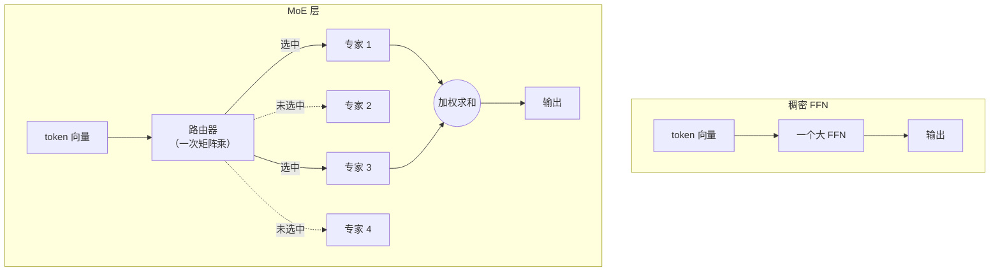

# 第 4 章 注意力的替代方案与混合专家（MoE）

> 对应课程：Lecture 4《Attention Alternatives》（讲义标题：Attention Alternatives and Mixtures of Experts）· [YouTube](https://www.youtube.com/watch?v=cKSwj_qZ8Jg) · 官方讲义：[幻灯片 lecture_04.pdf](https://github.com/stanford-cs336/lectures/blob/main/lecture_04.pdf)

<Video id="cKSwj_qZ8Jg" title="Lecture 4 原视频" />

## 本章你将学到

- 为什么上下文越长，注意力越成为成本大头；以及“局部 + 全局”和系统工程（FlashAttention）这两件“基础工具”。
- **线性注意力**：只靠矩阵乘法结合律，就把平方复杂度变成线性，并且自然得到一个 RNN 形式。
- 从线性注意力出发，加门控得到 **Mamba-2**，再加“擦除”得到 **Gated DeltaNet**；为什么工业界的做法都是“混合”。
- 另一条路：DeepSeek 的**稀疏注意力 DSA**（轻量索引器 + top-k）。
- **混合专家（MoE）**：怎样用“更多参数、同样计算量”换来更好的模型；路由、细粒度与共享专家、负载均衡损失、系统与稳定性问题。
- 以 DeepSeek V1→V2→V3 为线索，顺带认识 MLA（多头潜在注意力）和 MTP（多 token 预测）。

## 先说结论（一分钟版）

1. 去掉注意力里的 softmax，`(QKᵀ)V` 就能改写成 `Q(KᵀV)`，复杂度从 `n²` 变成 `n`；而且它等价于一个“状态大小固定”的 RNN——训练时用并行形式，推理时用递推形式。
2. 在这个 RNN 状态更新上加“遗忘门”得到 Mamba-2，再加“写入门 + 按 key 擦除”得到 Gated DeltaNet。只要门控只依赖当前输入，就能保留“并行训练 / 递推推理”的双重形式。
3. 到目前为止，没有人在大规模上证明过**纯**线性模型够用；成功的生产模型都是**混合**的（例如 3 层 Gated DeltaNet + 1 层全注意力）。
4. MoE 把一个大 FFN 换成很多个 FFN 加一个路由器，每个 token 只激活其中 k 个。参数多了，计算量不变，效果更好、训练更快。
5. MoE 难在训练：top-k 选择不可导，还会“强者愈强”导致专家塌缩。实际做法是一组启发式：直接对选中的专家反传梯度 + 负载均衡辅助损失 + 路由器用 float32 / z-loss。

---

## 4.1 为什么要找注意力的替代品

### 4.1.1 上下文越来越长

大家都想要更长的上下文：塞进更多资料、让智能体处理更长的任务。主流模型的上下文窗口这几年呈指数增长（讲义里的图是对数坐标）。[▶ 01:05](https://www.youtube.com/watch?v=cKSwj_qZ8Jg&t=65s)

但成本结构也随之变化。FFN 的计算量随序列长度**线性**增长，注意力是所有位置两两交互，随长度**平方**增长。序列较短时 FFN 是大头；序列一长，注意力很快反超。

**手算交叉点**（每层、前向、忽略因果掩码省下的一半；FLOPs 按“一次乘加 = 2 FLOPs”）：

- 投影（Q、K、V、O 共 `4d²` 参数）+ FFN（`8d²` 参数）：每个 token 约 `2 × 12d² = 24d²`，n 个 token 共 `24nd²`
- 注意力打分 `QKᵀ` 与加权 `AV`：各约 `2n²d`，共 `4n²d`
- 令 `4n²d > 24nd²`，得 `n > 6d`

当 `d_model = 4096` 时，约 2.4 万 token 之后注意力本身就超过了其余所有计算之和。到百万 token 时，它会是其余部分的约 40 倍。

### 4.1.2 基础工具箱

在“更激进”的方案之前，已有两件工具：[▶ 02:05](https://www.youtube.com/watch?v=cKSwj_qZ8Jg&t=125s)

1. **局部 + 全局混合**：上一章讲的滑动窗口交错。如果每 8 层才有 1 层全注意力，其余都是局部注意力，成本就被控制住了。
2. **系统工程**：讲者特别强调“常数因子非常重要”。FlashAttention 并没有改变平方复杂度，只是重新安排计算顺序、避免把巨大的注意力矩阵写回显存，就带来了约 2 倍量级的加速，并且让原本放不进显存的长度也能跑起来。（细节见 [第 6 章](./ch06-kernels-triton)。）

::: tip 移动端类比
这就像优化列表性能：先不改算法，而是减少 overdraw、复用 ViewHolder、避免重复 layout。大 O 没变，但实际帧率可能翻倍。理论派容易只盯着大 O，工程派知道常数因子能决定成败。
:::

但如果目标是 500 万、1000 万 token，这些就不够了，需要**线性复杂度**的方案。讲者说，前几年有不少失败的尝试，但最近两年出现了一组**经过大规模实战检验**的配方，所以今年第一次把线性注意力放进课程。

下面的演示可以直观对比几种方案在不同序列长度下的计算量和推理内存：

<Demo src="ch04-attention-cost.html" title="全注意力 vs 滑动窗口 vs 线性注意力 vs 混合：成本随序列长度变化" :height="820" />

---

## 4.2 线性注意力：一个“挪括号”的魔法

### 4.2.1 核心想法：矩阵乘法结合律

讲者说，理解所有这些方法只需要先理解一个核心想法：**矩阵乘法的结合律**。[▶ 05:07](https://www.youtube.com/watch?v=cKSwj_qZ8Jg&t=307s)

把注意力写成：

$$\text{Attn}(Q,K,V) = \rho(QK^\top)\,V,\qquad Q,K\in\mathbb{R}^{n\times d_k},\; V\in\mathbb{R}^{n\times d_v}$$

> 大白话：ρ 代表按行 softmax。`QKᵀ` 是 `n × n` 的打分矩阵，计算量约 `n²d_k`，这就是平方的来源。

现在做一件“看起来很傻”的事：**暂时把 ρ（softmax）去掉**。那么

$$(QK^\top)V = Q(K^\top V)$$

左边先算 `n × n` 的大矩阵；右边先算 `KᵀV`，它只是一个 `d_k × d_v` 的小矩阵，与序列长度无关！计算量从 `n²d_k + n²d_v` 变成 `2nd_kd_v`。

**手算**：`n = 100 万`，`d_k = d_v = 128`。

- 原来：约 `2 × (10⁶)² × 128 ≈ 2.6 × 10¹⁴`
- 现在：约 `2 × 10⁶ × 128 × 128 ≈ 3.3 × 10¹⁰`
- 相差 `n / d = 10⁶ / 128 ≈ 8000` 倍

序列长度 n 动辄百万，而隐藏维度通常只是几千、几万量级，没人会有百万维的隐藏层。所以“对 d 平方、对 n 线性”远比“对 n 平方”友好。

> 讲义注：带核函数的版本见 Katharopoulos 等 2020（用一个特征映射 φ 代替 softmax），更早的有 Shen 等 2018；它也与“快速权重编程器（fast weight programmers）”有渊源。

::: warning 常见误区
“线性注意力和普通注意力只是算法不同、结果一样”——**不对**。去掉 softmax 这一步本身就是有损的，模型的表达能力变了。之后从“挪括号”到“RNN 形式”的变换才是严格等价的。课上有同学专门问过这个问题。[▶ 21:16](https://www.youtube.com/watch?v=cKSwj_qZ8Jg&t=1276s)
:::

### 4.2.2 更妙的是：它就是一个 RNN

对于因果（只能看过去）的情形，第 t 个位置只能用前 t 个 key、value。把 `KᵀV` 按时间展开，就是逐步累加的外积：[▶ 07:08](https://www.youtube.com/watch?v=cKSwj_qZ8Jg&t=428s)

$$S_t = S_{t-1} + k_t v_t^\top,\qquad y_t = q_t^\top S_t$$

> 大白话：`S_t` 是一个 `d_k × d_v` 的“记忆矩阵”（状态）。每来一个 token，就把它的 key 与 value 的外积 `k_t v_tᵀ`“写”进记忆；输出时用 query 去“读”记忆。

这有什么好处？看两种用法：

| | 并行形式（矩阵乘） | 递推形式（RNN） |
|---|---|---|
| 适合 | 训练：一次处理整个序列，GPU 友好 | 推理：一次一个 token |
| 每步内存 | —— | 固定的 `d_k × d_v` 状态，与已生成长度无关 |

普通注意力推理时要保存不断增长的 KV cache；线性注意力只需要保存一个**固定大小**的状态。传统 RNN 推理便宜但训练无法并行；线性注意力两头都占：**训练用并行形式，推理用递推形式**。讲者把这称为“对偶性（duality）”。

```python
import torch
n, dk, dv = 6, 4, 3
q, k, v = torch.randn(n, dk), torch.randn(n, dk), torch.randn(n, dv)

# 并行形式：带因果掩码的 (Q Kᵀ) V，没有 softmax
mask = torch.tril(torch.ones(n, n))          # 下三角：只看过去
y_par = ((q @ k.T) * mask) @ v               # (n, dv)

# 递推形式：维护固定大小的状态 S
S = torch.zeros(dk, dv)
y_rec = []
for t in range(n):
    S = S + torch.outer(k[t], v[t])          # 写入：外积累加
    y_rec.append(q[t] @ S)                   # 读出：q_tᵀ S_t
y_rec = torch.stack(y_rec)

print(torch.allclose(y_par, y_rec, atol=1e-5))   # True：两种算法等价
```

::: tip 移动端类比
普通注意力像“把所有历史日志都存下来，每次查询全量扫描”；线性注意力像“维护一个滚动的聚合统计（累加器）”，新事件来了更新一下，查询时只读这个聚合值。前者精确但越来越慢、越来越占内存；后者常数时间、常数内存，但会丢失细节。
:::

讲义还提到：如果每一步都把旧状态乘以一个固定衰减系数 γ，即 `S_t = γS_{t−1} + k_t v_tᵀ`，就得到 RetNet。

### 4.2.3 真有人这么用：MiniMax-M1

MiniMax-M1（以及 MiniMax-Text-01）是一个规模相当大的中国开源模型，用的是 **7:1 混合**：7 层线性注意力 + 1 层完整 softmax 注意力。效果可以和 OpenAI o3、DeepSeek R1 这类强模型相比，而且对上下文长度的依赖大部分是线性的。[▶ 09:09](https://www.youtube.com/watch?v=cKSwj_qZ8Jg&t=549s)

这说明即便是最朴素的线性注意力，只要**保留一些全注意力层**，就能在大规模上奏效。讲者强调：**到目前为止，还没有人在大规模上证明过“纯”线性的注意力机制**，接下来讲的每一个方法在实际部署中都是混合的。

---

## 4.3 加上门控：Mamba-2

线性注意力的一个明显问题：状态**只加不减**，所有历史都永远堆在里面。从 LSTM 时代我们就知道，**知道何时遗忘**很重要。于是加一个遗忘门 γ：[▶ 11:11](https://www.youtube.com/watch?v=cKSwj_qZ8Jg&t=671s)

$$S_t = \gamma_t S_{t-1} + k_t v_t^\top,\qquad y_t = q_t^\top S_t + v_t^\top D,\qquad \gamma_t = f(x_t)$$

> 大白话：每一步先把旧记忆乘以 `γ_t`（0 到 1 之间，越小忘得越多），再写入新内容。关键是 `γ_t` **只依赖当前输入** `x_t`，不依赖状态 S。最后那项 `v_tᵀD` 是一个类似残差的“直通”：让当前 token 的 value 直接流到输出，D 控制直通多少。

这就是 Mamba-2（Albert Gu、Tri Dao 等人提出的状态空间模型家族；现在已经有 Mamba 3）。原论文从状态空间理论出发，有一大套推导，但从机制上看，它就是**线性注意力加了门控**。讲者的那句老话又出现了：“门控是好东西”。

为什么要强调 γ 只依赖输入？因为这样一来，所有 γ 可以**提前并行算出来**，并行形式依然成立（衰减相当于在因果掩码矩阵里乘上 `γ` 的累乘），对偶性被保留。

谁在用：Nemotron 3（上一讲提过）把 Mamba-2 作为轻量层，每隔几层穿插一层全注意力（讲义写“约 3:1”）。它在效果上可与 Qwen3、GPT-OSS 比较，并且由于大量 Mamba-2 层，长上下文下吞吐量很高。讲者的评价：这些是“小型前沿模型”，不是最大的那种，但证明了可行。

---

## 4.4 再进一步：Gated DeltaNet

### 4.4.1 规则：门只看输入，就能继续加花样

讲者给了一条经验法则：**只要你对 RNN 各项的门控只依赖当前输入、不依赖状态，就仍然能保持“并行训练 / 递推推理”的对偶性。**在这个框架下，Gated DeltaNet 大概是目前用得最广的状态空间模型，Qwen 3.5 做了大规模验证。[▶ 14:13](https://www.youtube.com/watch?v=cKSwj_qZ8Jg&t=853s)

$$S_t = \gamma_t\,(I - \beta_t k_t k_t^\top)\,S_{t-1} + \beta_t k_t v_t^\top,\qquad y_t = q_t^\top S_t$$

> 大白话：在 Mamba-2 的基础上多了两样东西。
> - `β_t`：**写入门**。`β_t = 0` 表示“这一步什么都不写”，什么也不做（类似 LSTM 的输入门）。
> - `(I − β_t k_t k_tᵀ)`：**按 key 擦除**。在写入新内容之前，先把记忆里 `k_t` 方向上的旧内容抹掉。

### 4.4.2 为什么“擦除”很重要：把 S 当成一本字典

把状态 S 理解为一个“键 → 值”的**联想记忆**：写入 `k v ᵀ`，就是存了一条“k 对应 v”；用 `kᵀS` 读出，就是查字典。

假设各个 key 互相正交且长度为 1。用 key A 写入“红”，再写入 B、C……此时用 A 查，能准确得到“红”。但如果后来 A 的值要**更新**成“黄”：

- 线性注意力：直接再加一个 `A·黄ᵀ`，查 A 得到的是“红 + 黄”——新旧混在一起；
- Mamba-2：所有记忆一起衰减，旧值变淡了，但 B、C 也一起变淡了；
- Gated DeltaNet：先读出 A 位置的旧值“红”，把它擦掉（`β = 1` 时完全擦掉），再写入“黄”。查 A 得到“黄”，B、C 不受影响。

把擦除项展开会更清楚：

$$S_t = S_{t-1} + \beta_t\, k_t\,\big(v_t - k_t^\top S_{t-1}\big)^\top \quad (\gamma_t = 1\text{ 时})$$

> 大白话：`k_tᵀS_{t−1}` 是“当前记忆里 key 对应的旧值”；`v_t − 旧值` 是“预测误差”；按 β 的比例把误差修正进去。这正是经典的 **delta 规则**——也就是对“让 `kᵀS` 尽量接近 v”这个最小二乘目标做一步梯度下降。

所以讲者提到，这个更新形式在“快速权重编程（fast weight programming）”和“测试时训练（test-time training）”等方向被**独立地重新发明**过：从完全不同的设计原则出发，大家都走到了同一个解。

下面的演示让你亲手把几个“键 → 值”写进 4×4 的记忆矩阵，对比三种更新规则，并检查“并行形式 = 递推形式”：

<Demo src="ch04-linear-recurrence.html" title="状态递推动画：线性注意力 / Mamba-2 / Gated DeltaNet" :height="800" />

### 4.4.3 Qwen 3.5 / Qwen-Next 与混合比例

Qwen 3.5 以及它的前身 Qwen-Next（课上称之为目前最好的开源模型之一）采用 **3:1 的 Gated DeltaNet / 注意力混合**。效果和闭源模型、上一代模型相比几乎没有损失，同时随着上下文变长，解码吞吐量比 Qwen3 高得多。[▶ 18:16](https://www.youtube.com/watch?v=cKSwj_qZ8Jg&t=1096s)

混合比例怎么选？严格的对照研究不多。讲者引用了字节跳动 Seed 与 UC Santa Cruz 的一项研究，它比较了 Mamba-2、Gated DeltaNet 等架构在不同“线性层占比”下的表现：

- 线性层比例较低时，最好的那几种架构**几乎没有损失**；
- 超过某个比例后，长上下文任务开始明显下降；
- 走到“纯 RNN”，所有架构都有明显退化。

“单 key 检索”这类任务是这些架构专门优化过的，但在问答类任务上也能看到同样的趋势：混合比例越高，效果越稳定地下降。

### 4.4.4 那代价是什么？

有同学问：状态空间模型总得有缺点吧？讲者的回答：[▶ 32:27](https://www.youtube.com/watch?v=cKSwj_qZ8Jg&t=1947s)

- 缺点是**表达能力**。softmax 注意力的全连接非常强大，而且容易训练。
- 当年注意力打败 LSTM 的一大原因是**可并行训练**。现在线性注意力的对偶性把这个短板补上了，所以状态空间模型才重新流行。
- 但“有限状态”的根本限制还在：所有信息都得压缩进一个固定大小的状态。状态越小越省，但想把超长上下文里的一切都压进一个小状态，必然丢信息。

::: details 问答：去掉 softmax 会不会带来训练不稳定？
讲者说没见过这方面的报道。反倒是 softmax 本身常常是不稳定的来源（见第 3 章 3.9 节），所以去掉它可能还有利于稳定性。
:::

---

## 4.5 另一条路：DeepSeek 稀疏注意力（DSA）

除了“混合线性层”，还有一种完全不同的思路：**不去看所有 token，只挑一部分来做完整注意力**。DeepSeek V3.2 提出的 DSA（DeepSeek Sparse Attention）就是这样：[▶ 22:17](https://www.youtube.com/watch?v=cKSwj_qZ8Jg&t=1337s)


1. **轻量索引器（lightning indexer）**：对当前 query 和每个历史 token 算一个便宜的分数——用 q、k 的内积，过 ReLU，再按一组由当前 token 得到的权重加权求和。
2. **top-k 选择**：只留下得分最高的 k 个位置。
3. **正常注意力**：只在这 k 个位置上做完整的 softmax 注意力。

注意它**不是线性复杂度**：索引器仍然要和所有 token 两两打分，是平方的。但索引器可以做得极其便宜——低维投影、低精度（课上有同学问到 FP4，讲者认为“低精度选择 + 全精度计算”的组合很合理），常数因子非常小；而真正昂贵的注意力只在 k 个 token 上做，k 是可控的。讲者再次强调：**别太执着于“平方还是线性”，常数因子有时才是关键**。

另一个巧妙之处：**不必从头用 DSA 训练**。DeepSeek V3.2 和 GLM 5 的做法是：先正常训练一个稠密的短上下文模型；在“长上下文扩展”阶段再把索引器装上，让模型适应它。由于开源模型的常见流程本来就是“短上下文预训练 → 长上下文扩展 → 后训练”，把省钱的结构“顺便”加在第二阶段，额外成本很小。

效果方面：DeepSeek V3.2 能与同期的 Claude Sonnet 4.5、Gemini 3 等前沿模型相比，预填充和解码的成本随长度的增长都比上一代平缓得多；GLM 5 的消融实验也表明，完整的 DSA 训练相比全注意力损失很小，即使在 RNN 类架构难以应付的长上下文检索任务上也是如此。

讲者特别提醒：**“top-k 选择”这个看起来不可导、有点吓人的操作，正是下半节 MoE 的核心。**

---

## 4.6 混合专家（MoE）是什么

### 4.6.1 一句话定义

讲者的定位很直接：MoE 并没有“改变游戏规则”，**它就是一个更高效的 MLP**。[▶ 33:28](https://www.youtube.com/watch?v=cKSwj_qZ8Jg&t=2008s)



把原来的一个 FFN 换成**多个 FFN（专家）**，再加一个**路由器**决定每个 token 送去哪几个专家。假如有 4 个和原 FFN 一样大的专家、每个 token 只走 1 个：FFN 部分的**参数变成 4 倍，但每次前向/反向只付 1 个 FFN 的计算量**。

早期 MoE 论文的视角就是“以参数为中心”：如果你相信参数越多越好，又不想为参数付计算费，那就用 MoE。

::: tip 移动端类比
可以把它想成一个带分发器（dispatcher）的线程池：有很多 worker，但每个任务只派给其中一两个；worker 越多，系统总“容量”越大，单个任务的处理成本却不变。不过要警惕把“专家”想成“医学专家”“法律专家”——见 4.9 节，它们没那么聪明。
:::

### 4.6.2 为什么现在人人都在用

- **同样计算量，参数越多越好**：Fedus 等（2022，Switch Transformer）显示，保持激活参数不变、增加专家数，语言建模的测试损失一路下降；同样的训练计算量下，专家越多效果越好。
- **训练更快**：AI2 的 OLMoE 论文显示，MoE 相比同计算量的稠密模型，训练损失、验证损失、下游指标都更好，大约快 2 倍。
- **按激活参数算更强**：DeepSeek V2 等早期 MoE 出来时，用少得多的激活参数就达到了同等甚至更高的 MMLU 成绩。
- **多一个并行维度**：每个专家是天然的切分单位，可以放在不同设备上，再把 token 路由过去，这叫**专家并行**（[第 7 章](./ch07-parallelism-1)、[第 8 章](./ch08-parallelism-2) 讲并行）。

西方的大型开源 MoE 有 Llama 4 和 OpenAI 的 GPT-OSS；但讲者认为 MoE 的很多研究和训练实践发生在中国团队：Qwen、DeepSeek、MiniCPM 等很早就在做。比如 Qwen 1.5-MoE 只有 2.7B 激活参数，却超过了当时许多 7B 稠密模型。讲者还特别推荐阅读 DeepSeek 的早期 MoE 论文，里面有大量消融实验：用稠密层会怎样、用哈希路由会怎样、用 Switch 路由器会怎样……

### 4.6.3 那为什么之前不流行？

Google 2022 年前后就在大力推 MoE，但到 2024 年后才真正普及。原因：[▶ 45:33](https://www.youtube.com/watch?v=cKSwj_qZ8Jg&t=2733s)

- **基础设施复杂**：参数太多，单卡放不下，跨设备高效并行很难；
- **训练目标是启发式的，还可能不稳定**：MoE 训练容易炸。

另外，也有工作把 MoE 用在注意力头上（如 ModuleFormer、JetMoE），但远不如“替换 FFN”常见，讲者认为它们更难驯服。本章只讨论替换 FFN 的做法。

讲者把 MoE 的设计空间分成三条轴：**路由函数、专家大小、训练目标**。

---

## 4.7 路由：谁决定去哪个专家

### 4.7.1 三种选择方式

所有方案都要“只激活一部分专家”，通常都是某种 top-k：[▶ 48:34](https://www.youtube.com/watch?v=cKSwj_qZ8Jg&t=2914s)

- **token 选专家（token choice）**：每个 token 挑自己最喜欢的 k 个专家；
- **专家选 token（expert choice）**：每个专家挑自己最喜欢的若干 token；
- **全局优化**：把“哪个 token 去哪个专家”当成一个整体分配问题来解。

几乎所有 MoE 都用 **token choice top-k**。OLMoE 的对比显示 token choice 的验证损失更低、下游分数更高。expert choice 也能训，但 token choice 更容易调通，已经是标准做法。

路由的粒度是 **token 级别**：每个 token 单独决定去哪。而且路由器极其简单——就是一次矩阵乘法。它不会“理解”这是不是一道医学题，更像是“这个 token 看起来像日文，送去 7 号专家吧”。

### 4.7.2 top-k 路由的公式

讲义采用 DeepSeekMoE 的写法：[▶ 52:36](https://www.youtube.com/watch?v=cKSwj_qZ8Jg&t=3156s)

$$s_{i,t} = \text{Softmax}_i\big(u_t^\top e_i\big)$$

$$g_{i,t} = \begin{cases} s_{i,t}, & s_{i,t}\in \text{TopK}(\{s_{j,t}\}_{j=1}^{N}, K) \\ 0, & \text{否则}\end{cases}$$

$$h_t = \sum_{i=1}^{N} g_{i,t}\,\text{FFN}_i(u_t) + u_t$$

> 大白话：
> - `u_t` 是第 t 个 token 进入 MoE 层的向量；`e_i` 是第 i 个专家的“路由向量”（可学习）。内积越大，表示这个 token 越“像”该专家的口味。
> - 对 N 个专家的打分做 softmax 得到 `s_{i,t}`，只保留最高的 K 个作为门控权重 `g`，其余置 0。
> - 输出是被选中专家输出的加权和，再加上残差 `u_t`。

细节差异：DeepSeek V1/V2、Grok、Qwen 是**先 softmax 再 top-k**（如上）；Mixtral、DBRX、DeepSeek V3 是**先 top-k 再对选中的分数 softmax**。

```python
import torch, torch.nn as nn, torch.nn.functional as F

class TopKMoE(nn.Module):
    def __init__(self, d, d_ff, n_experts=8, k=2):
        super().__init__()
        self.k = k
        self.router = nn.Linear(d, n_experts, bias=False)   # 每行就是一个 e_i
        self.experts = nn.ModuleList(SwiGLU(d, d_ff) for _ in range(n_experts))

    def forward(self, u):                       # u: (N_tok, d)，已把 batch 和序列摊平
        probs = F.softmax(self.router(u).float(), dim=-1)    # 路由器用 float32 更稳
        gate, idx = probs.topk(self.k, dim=-1)               # 每个 token 选 k 个专家
        out = torch.zeros_like(u)
        for e, expert in enumerate(self.experts):
            tok, slot = (idx == e).nonzero(as_tuple=True)    # 哪些 token 选了专家 e
            if tok.numel() > 0:
                y = expert(u[tok]) * gate[tok, slot, None].to(u.dtype)
                out.index_add_(0, tok, y)                     # 加权累加回各自位置
        return out + u, probs, idx               # probs/idx 用来算负载均衡损失
```

（真实实现不会用 Python 循环，而是用分组/块稀疏矩阵乘法，见 4.10 节。）

各模型的 k：Switch Transformer 取 1，GShard、Grok、Mixtral 取 2，Qwen、DBRX 取 4，DeepSeek（V1）激活 6 个路由专家（讲义 top-k 那页写的是 7，可能把共享专家也算进去了，以 4.8 节表格为准）。

### 4.7.3 其他路由方法（了解即可）

- **哈希路由**：不学习，直接按 token 哈希到某个专家。神奇的是这也有收益（虽然不如 top-k），常作为论文基线，但实际部署不用。
- **强化学习路由**：把路由器当策略，用 RL 学。从“选 K 个、只观察到被选中的结果”来看，这本来就是个多臂老虎机问题，所以最早的工作（Bengio 2013）这么做。但 RL 的方差和复杂度带来了不小开销，不常用。
- **线性分配**：先算所有 token-专家对的得分，再精确求解最优匹配。讲者作为“喜欢讲道理的人”很喜欢这个想法，但它太贵了，没在大规模上见过。

---

## 4.8 专家大小：细粒度专家 + 共享专家

DeepSeekMoE 带来了两个现在被广泛采用的改进：[▶ 53:36](https://www.youtube.com/watch?v=cKSwj_qZ8Jg&t=3216s)

1. **细粒度专家（fine-grained experts）**：把每个专家切小，同时增加专家数量和每个 token 激活的数量。总计算量不变，但组合方式多得多。
2. **共享专家（shared experts）**：有些处理是**所有 token 都需要的**。与其让每个路由专家都重复学这些通用能力，不如设一两个**永远激活、绕过路由器**的共享专家来承担，让路由专家更专注于“专精”的部分。（讲义注：这个点子最早来自 DeepSpeed-MoE。）

DeepSeek 的消融：从 GShard 式的“16 个大专家、无共享专家”出发，专家越切越细、再加 1 个共享专家，两项改动都带来明显提升；在 TriviaQA、Natural Questions 等任务上，共享专家的贡献尤其大。OLMoE 的结论略有不同：细粒度专家有用，共享专家则**没什么用**。两边都有严谨的消融，所以这一点还存在分歧。

| 模型 | 路由专家数 | 激活数 | 共享专家 | 细粒度比例 |
|---|---|---|---|---|
| GShard | 2048 | 2 | 0 | |
| Switch Transformer | 64 | 1 | 0 | |
| ST-MoE | 64 | 2 | 0 | |
| Mixtral | 8 | 2 | 0 | |
| DBRX | 16 | 4 | 0 | |
| Grok | 8 | 2 | 0 | |
| DeepSeek V1 | 64 | 6 | 2 | 1/4 |
| Qwen 1.5 | 60 | 4 | 4 | 1/8 |
| DeepSeek V3 | 256 | 8 | 1 | 1/14 |
| OLMoE | 64 | 8 | 0 | 1/8 |
| MiniMax | 32 | 2 | 0 | 约 1/4 |
| Llama 4（Maverick） | 128 | 1 | 1 | 1/2 |

（“细粒度比例”指每个专家相对于同规模稠密 FFN 的大小。）

可以看到一条清晰的历史线：前三个来自 Google；Mixtral、DBRX、Grok 是西方早期的尝试；DeepSeek V1 提出细粒度 + 共享专家，之后大家基本照搬。讲者打了个比方：**DeepSeekMoE / DeepSeek V3 之于 MoE，就像 LLaMA 之于稠密 Transformer**——成了事实标准。Qwen 3.5、GLM 等现代模型都还在用这套设计。

问答中有人问：共享专家怎么做并行？答：共享专家每个 token 都要过，没有并行收益；可以在每台设备上复制一份，用内存换通信。

---

## 4.9 训练 MoE：一堆“居然管用”的启发式

### 4.9.1 难在哪

讲者说，刚学 MoE 时他觉得“这玩意儿根本不可能训好”。[▶ 58:40](https://www.youtube.com/watch?v=cKSwj_qZ8Jg&t=3520s)

- 训练时也必须**稀疏**（否则要付所有专家的计算费），
- 但 top-k 的离散选择**不可导**，
- 而且我们只能看到被选中专家的结果，**看不到“如果选了别的专家会怎样”**。

可选的解法有三类：① 用强化学习优化路由策略；② 随机扰动；③ 一堆启发式的“均衡”损失。“猜猜实际用的是哪个？”——当然是第三个。

### 4.9.2 前两类（不常用，但值得知道）

**强化学习**：Clark 等人（讲义标注 2020）用 REINFORCE 训练路由器，确实能用，但因为梯度方差大、实现复杂，并没有明显更好，论文里提出的其他方法反而轻松胜出。

**随机扰动**：最早的 Shazeer 等（2017）MoE 论文，在路由打分上加入与输入尺度相关的高斯噪声，再取 top-k 和 softmax：

$$H(x)_i = (x W_g)_i + \epsilon\cdot\text{Softplus}\big((xW_{\text{noise}})_i\big),\quad \epsilon\sim\mathcal{N}(0,1)$$

> 大白话：两个专家打分接近时，噪声让模型有时选这个、有时选那个，相当于“探索”。有用的专家会在反向传播中得到越来越高的权重。这样学出的专家更鲁棒，softmax 也让模型学会给 K 个专家排序。

Fedus 等（2022）用过一种均匀的乘性抖动（jitter），目的同样是让专家不那么脆弱；但 Zoph 等（2022）后来去掉了它，后续消融显示不加这些随机项，稳定性和最终质量反而更好。

### 4.9.3 实际做法：直接反传 + 负载均衡损失

如果直接做梯度下降、不管探索问题，会发生什么？被选中的专家得到梯度信号——“这个专家有用，加强它”——于是它的权重更大，下次更容易被选中……这就是**强者愈强**。最后少数专家包揽所有 token，其余专家“饿死”，这叫**专家塌缩（expert collapse）**。这是启发式训练 MoE 要解决的核心问题。[▶ 62:44](https://www.youtube.com/watch?v=cKSwj_qZ8Jg&t=3764s)

解法：在语言模型损失之外，加一个**负载均衡辅助损失**。Switch Transformer 的版本：

$$\mathcal{L}_{\text{balance}} = \alpha\, N \sum_{i=1}^{N} f_i\, P_i$$

$$f_i = \frac{1}{T}\sum_{x\in\mathcal{B}}\mathbb{1}\{\arg\max p(x) = i\},\qquad P_i = \frac{1}{T}\sum_{x\in\mathcal{B}} p_i(x)$$

> 大白话：
> - N 是专家数，T 是这个 batch 的 token 数，α 是系数。
> - `f_i`：实际被派给专家 i 的 token 比例（硬计数，不可导）。
> - `P_i`：路由器分给专家 i 的概率总量（软的，可导）。
> - 当所有专家完全均匀时，这一项约等于 α。

这个式子很难“从第一性原理”看出含义，讲者建议看它的**梯度**：对 `p_i(x)` 求导，得到 `αN/T² × (被派给 i 的 token 数)`，即正比于 `f_i`。也就是说：**越热门的专家，它的路由概率被往下压得越狠**。

**手算**：4 个专家，某个 batch 里 `f = [0.7, 0.1, 0.1, 0.1]`，且 P 与 f 相近。

- `N Σ f_i P_i ≈ 4 × (0.49 + 0.01 × 3) = 2.08`，而完全均匀时是 `4 × 4 × 0.0625 = 1`；
- 梯度正比于 f：热门专家 0 被压低的力度是其他专家的 7 倍。

一边是“有用就加强”的正反馈，一边是“越热门压得越狠”的负反馈，两者相互抵消，专家利用率就均匀了。讲者坦言，这么一个“有点粗糙”的方案在大规模上稳定有效，至今让他觉得意外。

下面的玩具模拟用真实的 Switch 负载均衡梯度，配合一个“被选中就被奖励”的简化主损失，你可以开关均衡损失，观察专家塌缩：

<Demo src="ch04-moe-routing.html" title="MoE 路由玩具模拟：负载均衡与专家塌缩" :height="760" />

### 4.9.4 DeepSeek 的版本

用这些零件就能“重建” DeepSeek V1/V2 的 MoE：[▶ 65:46](https://www.youtube.com/watch?v=cKSwj_qZ8Jg&t=3946s)

- 正常的语言模型损失，直接穿过被选中的专家反传，不管不可导和探索问题；
- **按专家**的均衡损失，和 Switch Transformer 一模一样；
- **按设备**的均衡损失：形式相同，只是把 `f`、`P` 按设备聚合。专家分布在不同机器上，DeepSeek 不仅希望专家均匀，还希望**每台机器的负载均匀**，这样所有设备都能满负荷运转。

有同学问：既然专家均匀了设备自然也均匀，为什么还要单独的设备损失？讲者的理解：把专家损失调得太强、强求完全均匀，会损害训练动力学；而设备均衡对系统利用率太重要，值得额外付一点损失代价。

DeepSeek V3 进一步引入了**每个专家一个偏置项**：这个偏置只用于 top-k 选择，用在线学习的方式调整——某专家负载过高就把它的偏置调低，过低就调高。他们称之为“无辅助损失的均衡（auxiliary-loss-free balancing）”。但讲者指出，它**并不是完全无辅助损失**：V3 仍然保留了一个按序列的辅助损失，防止极端不均衡。目前还没有方法能彻底摆脱这些辅助损失。

### 4.9.5 去掉均衡损失会怎样

OLMoE 做了干净的消融：去掉负载均衡损失后，训练和验证损失都明显变差；更直观的是专家利用率——**几乎所有 token 都只去了两个专家**，其余专家在大部分训练中什么都没干，等于白白扔掉了大量参数。加上均衡损失后，所有专家都被均匀使用。[▶ 67:47](https://www.youtube.com/watch?v=cKSwj_qZ8Jg&t=4067s)

讲者还指出：**“top-k 选择 + 辅助损失来绕过不可导”** 这一套组合，在 DSA、H-Net（一种试图去掉分词器的架构）等很多地方都出现了，未来很可能成为架构设计的常用积木。

::: details 问答：专家真的是“专家”吗？
有论文可视化过哪些 token 被送到哪些专家。由于路由器极其简单，专家并没有“语义”上的专长，不存在“医学专家”“华尔街日报专家”。能看到的是：标点可能集中到某个专家，某些符号到另一个，非英文字符集到另一个——更像是按“表面特征”分工。
:::

---

## 4.10 系统侧：专家并行与它带来的麻烦

### 4.10.1 又一个并行维度

常规的并行方式各有上限：数据并行受 batch 大小限制，模型并行受模型能切开的“切口”数量限制。专家并行提供了又一个可以切的维度：每个专家放在不同设备上。[▶ 71:52](https://www.youtube.com/watch?v=cKSwj_qZ8Jg&t=4312s)

代价是**通信**：token 的激活必须被发送到它的专家所在的设备，算完再送回来。这是用更多的总算力、更少的单卡内存，去换通信成本。值不值，取决于网络拓扑等因素（作业里会让你思考这类问题）。

### 4.10.2 把很多小矩阵乘变成一个大的

一张 GPU 上有多个专家时，朴素做法是做很多次小矩阵乘，硬件利用率差。更好的做法是利用**结构化稀疏**：最简单的形式是块对角矩阵，把多个专家的计算拼成一次大的稀疏矩阵乘。MegaBlocks 等开源 MoE 框架就是这么做的。MoE 的计算模式恰好对应硬件容易高效支持的结构化矩阵乘，这又是一个“硬件与架构协同设计”的例子。

### 4.10.3 Nemotron 3：先降维再通信

一个很新的技巧：既然专家并行要把激活发出去，那就**先把残差流向量降维，再做集合通信**，到了专家那边再处理。共享专家不需要通信，可以保持高维。这样既大幅减少通信量，又不必真的把整个模型的隐藏维度缩小。[▶ 73:54](https://www.youtube.com/watch?v=cKSwj_qZ8Jg&t=4434s)

### 4.10.4 一个有趣的副作用：别人的请求会“挤掉”你的 token

如果某个专家特别热门，送给它的 token 队列会越排越长，超过**容量**之后只能丢弃多出来的 token。早期的 MoE 推理框架会**悄悄丢掉**这些 token，返回 0，然后若无其事地继续计算。由于丢弃发生在**batch 级别**，结果就是：别人同时发来的请求如果也挤到了你用的专家，你的结果可能变差。这让 MoE 有了普通模型没有的额外随机性。[▶ 74:55](https://www.youtube.com/watch?v=cKSwj_qZ8Jg&t=4495s)

如今的“无丢弃（dropless）”实现（MegaBlocks 等）已经解决了这个问题。你可以在上面的玩具模拟里勾选“专家容量限制”，在不开负载均衡时看看丢了多少 token。

---

## 4.11 稳定性、微调与 upcycling

### 4.11.1 第三个 softmax

还记得第 3 章说“softmax 是危险地带”吗？MoE 又引入了一个 softmax：路由器。Zoph 等（2022）专门写了一篇关于 MoE 稳定性的论文。常见解法：[▶ 76:58](https://www.youtube.com/watch?v=cKSwj_qZ8Jg&t=4618s)

- **路由器单独用 float32 计算**（其余部分可以用 bf16）；
- 在路由器上加 **z-loss**（第 3 章 3.9.2 节的那个技巧）。

OLMoE 的消融显示：去掉路由器 z-loss，训练损失曲线上出现大量尖峰。

### 4.11.2 微调容易过拟合

MoE 参数太多，在小数据上微调很容易过拟合：稠密模型微调时训练集与验证集表现接近，而稀疏模型两者的差距可能非常大（Zoph 等在一个 GLUE 类任务上的观察）。解法：[▶ 77:59](https://www.youtube.com/watch?v=cKSwj_qZ8Jg&t=4679s)

- Zoph 等：只微调**非 MoE** 的部分（如稠密 MLP 层）；只微调注意力也是近来 MoE 工作中常见的做法；
- DeepSeek：用“苦涩的教训”式解法——**数据多就行**，他们的 SFT 用了 140 万条样本。

### 4.11.3 Upcycling：从稠密模型“升级”成 MoE

能不能拿一个训好的稠密模型来初始化 MoE？做法是：把 MLP 复制成多份作为各个专家，路由器随机初始化，然后继续训练。由于不同输入被随机分到不同副本，专家会逐渐分化。[▶ 80:00](https://www.youtube.com/watch?v=cKSwj_qZ8Jg&t=4800s)

- MiniCPM：用自家的小型稠密模型 upcycle 成 8 个专家、top-2、约 4B 激活参数的 MoE，训练约 5200 亿 token，相比基础模型有不错的提升；
- Qwen MoE：从 Qwen 1.8B 初始化，60 个专家、其中 4 个共享、top-4，得到 Qwen 1.5-MoE-A2.7B，是最早被确认的大规模 upcycling 成功案例之一。

不过讲者说，**今年他一个 upcycle 的模型都没见到**：既然大家最后都要 MoE，不如一开始就直接训练 MoE。但它仍然是 MoE 设计空间里值得知道的一招。

---

## 4.12 收尾：DeepSeek V1 → V2 → V3

讲者推荐所有对架构感兴趣的人读 DeepSeek 的论文。[▶ 82:01](https://www.youtube.com/watch?v=cKSwj_qZ8Jg&t=4921s)

| 版本 | 规模（总 / 激活） | 专家配置 | 均衡方式 |
|---|---|---|---|
| V1 | 16B / 2.8B | 2 个共享 + 64 个细粒度（1/4 大小），激活 6 个 | 标准辅助损失（按专家 + 按设备） |
| V2 | 236B / 21B | 2 个共享 + 160 个细粒度，激活 6 个 | 新增通信均衡损失（发出与接收两个方向），top-M 设备路由 |
| V3 | 671B / 37B | 1 个共享 + 256 个细粒度，激活 8 个 | 无辅助损失的偏置均衡 + 按序列辅助损失；sigmoid 打分 |

（讲义 V3 那页的标题误写成了“V2 (671B – 37 active)”，专家数写成 258；按专家配置表和 DeepSeek V3 论文应为 256 个路由专家。）

- **V1** 已经是现代 MoE 的“柏拉图式原型”：细粒度 + 共享专家、top-k 路由、辅助损失均衡。
- **V2** 基本是把 V1 放大，并加入两样**为系统服务**的东西：**top-M 设备路由**（每个 token 选中的专家最多分布在 M 台设备上，限制通信）和**通信均衡损失**。讲者借此强调：成功的大模型训练不只是深度学习，还要**尊重你的系统**。
- **V3** 保留了共享 + 细粒度设计，改用 sigmoid 计算专家亲和度（再在选中的专家间归一化）、无辅助损失的偏置均衡。

### 4.12.1 MLA：多头潜在注意力

V3（从 V2 起）的另一个关键组件是 **MLA（Multi-head Latent Attention）**，它从另一个角度解决上一章的 KV cache 问题。[▶ 83:02](https://www.youtube.com/watch?v=cKSwj_qZ8Jg&t=4982s)

普通注意力直接从隐藏状态 `h_t` 投影出 K、V。MLA 先把 `h_t` 压缩成一个**低维的潜在向量** `c_t^{KV}`，再从它“解压”出 K 和 V：

$$c_t^{KV} = W^{DKV} h_t,\qquad k_t = W^{UK} c_t^{KV},\qquad v_t = W^{UV} c_t^{KV}$$

> 大白话：D 表示 down（降维），U 表示 up（升维）。推理时**只需要缓存低维的 `c_t^{KV}`**，而不是完整的 K、V，KV cache 大幅缩小。

更妙的是，打分时 `q_tᵀ k_s = (W^Q h_t)ᵀ W^{UK} c_s`，`W^{UK}` 可以**提前合并进 Q 的投影矩阵**，推理时根本不用真的解压出 K。（DeepSeek 还对 Q 做了类似压缩，用来节省训练时的激活内存。）

麻烦出在 **RoPE**：RoPE 要在 Q 和 K 之间插入一个依赖位置的旋转矩阵，`(W^Q h)ᵀ R_q R_k W^{UK} c`，这个旋转夹在中间，`W^{UK}` 就没法再提前合并了。DeepSeek 的解法是：额外留出**少量不经压缩的 key 维度专门用来做 RoPE 旋转**，其余维度走潜在压缩路线。

### 4.12.2 MTP：多 token 预测

V3 还用了 **MTP（Multi-Token Prediction）**：除了预测下一个 token，再用一个小型轻量模块往后多预测一步。统计上的理由是“让模型更好地规划未来”；系统上的好处是，它天然就是一个**内置的推测解码草稿模型**，可以加速生成（推测解码见 [第 10 章](./ch10-inference)）。讲者说这个点子很酷，但没有被广泛跟进；而且 DeepSeek 实际上只多预测了一个 token。

---

## 动手练习

1. **验证对偶性**：运行 4.2.2 节的代码，确认并行形式与递推形式结果一致。然后在两种形式里都加上固定衰减 γ = 0.9（并行形式里，掩码矩阵第 i 行第 j 列乘以 `γ^(i−j)`），再次验证。思考：如果 γ 依赖状态 S，并行形式为什么就不成立了？

2. **手算长上下文成本**：一个 `d_model = 8192`、64 层、head_dim 128、不用 GQA 的模型，在 100 万 token 上下文下，bf16 的 KV cache 一共多大？如果把其中 3/4 的层换成线性注意力（每层状态 `d_model × head_dim`），总量变成多少？
   ::: details 答案
   全注意力每层 `2 × 10⁶ × 8192 × 2 字节 ≈ 32.8 GB`（约 30.5 GiB），64 层约 2 TB。换成 3:1 混合后只有 16 层需要 KV cache，约 0.52 TB；线性层每层状态 `8192 × 128 × 2 字节 = 2 MiB`，48 层不到 100 MiB，可忽略。
   :::

3. **实现 delta 规则**：用 PyTorch 实现 `S = S + β k (v − kᵀS)ᵀ`，按顺序写入 (A→红)、(B→绿)、(A→黄)，分别用 β = 1 和 β = 0.5 读出 A，并与线性注意力的结果对比。再验证它等于 `(I − β k kᵀ)S + β k vᵀ`。

4. **负载均衡损失**：基于 4.7.2 节的 `TopKMoE`，利用返回的 `probs` 和 `idx` 实现 Switch 负载均衡损失 `α·N·Σ fᵢ·Pᵢ`。构造一个所有 token 都选专家 0 的 batch，确认损失远大于 α；再构造均匀分配的 batch，确认损失约等于 α。

5. **MoE 参数核算**：DeepSeek V3 有 671B 总参数、37B 激活参数。假设一个“同激活参数”的稠密模型，前向每个 token 的 FLOPs 约为 `2 × 激活参数`。估算 V3 每个 token 前向的 FLOPs，以及它的总参数是激活参数的多少倍。这对显存和计算分别意味着什么？

## 本章小结

- 注意力的平方成本在长上下文下成为主要瓶颈；基础手段是局部/全局混合与系统优化（FlashAttention），更激进的手段是线性时间架构。
- 线性注意力 = 去掉 softmax + 结合律；它等价于一个固定状态的 RNN，可以“并行训练、递推推理”。Mamba-2 加了遗忘门，Gated DeltaNet 又加了写入门和按 key 擦除（delta 规则）。只要门控只依赖输入，对偶性就保留。
- 实际部署的都是混合模型（MiniMax-M1 7:1、Nemotron 3、Qwen 3.5 的 3:1）；纯线性模型在长上下文上会明显退化，根源是有限状态的信息压缩。
- DSA 走另一条路：便宜的索引器 + top-k，再做完整注意力；可在长上下文扩展阶段事后加入。
- MoE 用更多参数、同样计算量换效果；token choice top-k 是标准路由；细粒度 + 共享专家是 DeepSeek 带来的事实标准；训练靠直接反传 + 负载均衡损失；系统上带来专家并行、通信与 token 丢弃等新问题；路由器要用 float32 和 z-loss 保稳定。

到这里，我们对模型“长什么样”已经有了完整的了解。下一章开始转向硬件：GPU 和 TPU 到底是怎么工作的，为什么“FLOPs 不等于运行时间”，以及怎样让这些架构在硬件上跑得飞快。

## 延伸阅读

- Katharopoulos et al., 2020. *Transformers are RNNs: Fast Autoregressive Transformers with Linear Attention*. [arXiv:2006.16236](https://arxiv.org/abs/2006.16236)
- Shen et al., 2018. *Efficient Attention: Attention with Linear Complexities*. [arXiv:1812.01243](https://arxiv.org/abs/1812.01243)
- Sun et al., 2023. *Retentive Network: A Successor to Transformer for Large Language Models*（RetNet）. [arXiv:2307.08621](https://arxiv.org/abs/2307.08621)
- Dao & Gu, 2024. *Transformers are SSMs: Generalized Models and Efficient Algorithms Through Structured State Space Duality*（Mamba-2）. [arXiv:2405.21060](https://arxiv.org/abs/2405.21060)
- Yang et al., 2024. *Gated Delta Networks: Improving Mamba2 with Delta Rule*. [arXiv:2412.06464](https://arxiv.org/abs/2412.06464)
- MiniMax, 2025. *MiniMax-M1* 技术报告
- DeepSeek-AI. *DeepSeek-V3.2* 技术报告（DSA）
- Shazeer et al., 2017. *Outrageously Large Neural Networks: The Sparsely-Gated Mixture-of-Experts Layer*. [arXiv:1701.06538](https://arxiv.org/abs/1701.06538)
- Fedus et al., 2022. *Switch Transformers: Scaling to Trillion Parameter Models with Simple and Efficient Sparsity*. [arXiv:2101.03961](https://arxiv.org/abs/2101.03961)
- Zoph et al., 2022. *ST-MoE: Designing Stable and Transferable Sparse Expert Models*. [arXiv:2202.08906](https://arxiv.org/abs/2202.08906)
- Dai et al., 2024. *DeepSeekMoE: Towards Ultimate Expert Specialization in Mixture-of-Experts Language Models*. [arXiv:2401.06066](https://arxiv.org/abs/2401.06066)
- Muennighoff et al., 2024. *OLMoE: Open Mixture-of-Experts Language Models*. [arXiv:2409.02060](https://arxiv.org/abs/2409.02060)
- Gale et al., 2022. *MegaBlocks: Efficient Sparse Training with Mixture-of-Experts*. [arXiv:2211.15841](https://arxiv.org/abs/2211.15841)
- Komatsuzaki et al., 2022. *Sparse Upcycling: Training Mixture-of-Experts from Dense Checkpoints*. [arXiv:2212.05055](https://arxiv.org/abs/2212.05055)
- DeepSeek-AI, 2024. *DeepSeek-V2*（MLA）. [arXiv:2405.04434](https://arxiv.org/abs/2405.04434)
- DeepSeek-AI, 2024. *DeepSeek-V3 Technical Report*. [arXiv:2412.19437](https://arxiv.org/abs/2412.19437)
- Clark et al., 2022. *Unified Scaling Laws for Routed Language Models*（含 RL 路由对比）
