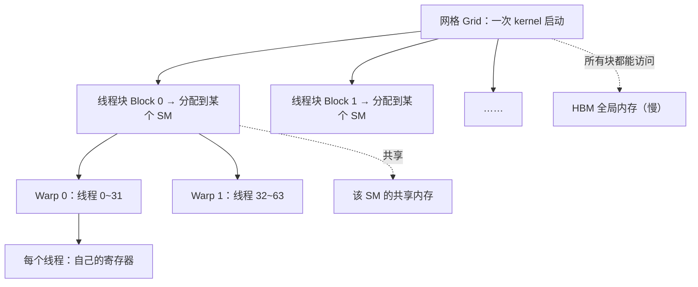
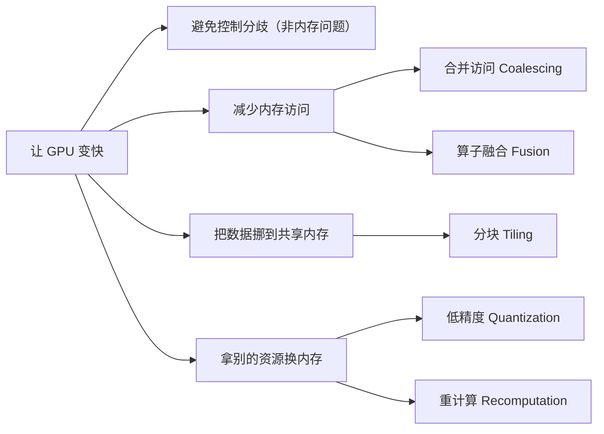
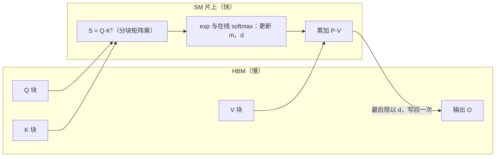

# 第 5 章 GPU 与 TPU：硬件如何决定模型跑多快

> 对应课程：Lecture 5《GPUs, TPUs》（主讲：Tatsunori Hashimoto） · [YouTube](https://www.youtube.com/watch?v=izZba4UA7iY) · 官方讲义：[幻灯片 lecture_05.pdf](https://github.com/stanford-cs336/lectures/blob/main/lecture_05.pdf)

<Video id="izZba4UA7iY" title="Lecture 5 原视频" />

## 本章你将学到

- GPU 和 CPU 在设计哲学上的根本区别：一个追求“延迟”，一个追求“吞吐”。
- GPU 的硬件解剖：SM（流式多处理器）、Tensor Core，以及寄存器 / 共享内存 / L2 / HBM 组成的内存层级。
- GPU 的执行模型：线程（thread）、线程块（block）、线程束（warp），以及 TPU 和 GPU 的异同。
- Roofline（屋顶线）模型：怎样一眼判断一个运算是“内存受限”还是“计算受限”。
- 让 GPU 变快的 6 个技巧：避免控制分歧、低精度、算子融合、重计算、内存合并访问、分块（tiling）。
- 用这些知识解释“矩阵大小差 1，速度差一截”的怪现象，并复原 FlashAttention 的核心思路。

## 先说结论（一分钟版）

时钟频率早就涨不动了，算力的增长几乎全部来自“并行”，GPU 就是并行的化身。但 GPU 的算力增长远远快于内存带宽的增长，所以**今天绝大多数性能问题都是“数据搬不过来”，而不是“算不过来”**。GPU 的内存是分层的：离计算单元越近越快、越小、越贵。所有优化技巧——低精度、融合、重计算、合并访问、分块——本质上都在做同一件事：**少碰慢内存，多用快内存**。FlashAttention 不是什么新数学，它只是把分块、融合、重计算这几招用到了注意力上。

---

## 5.1 为什么要关心硬件

### 5.1.1 一张让人困惑的图

讲座一开场，Tatsu 展示了一张图：横轴是方阵的边长，纵轴是矩阵乘法的吞吐量（每秒处理多少运算）。按直觉，矩阵越大活越多，GPU 越能“吃饱”，曲线应该平滑上升。但实际曲线上下乱跳：某些尺寸快，某些尺寸慢得离谱，还有周期性的断崖。[▶ 01:06](https://www.youtube.com/watch?v=izZba4UA7iY&t=66s)

他的承诺是：**听完这一讲，你能解释这张图上的每一个怪现象**。本章最后（5.6 节）我们会兑现这个承诺。

为什么即便你不打算做系统工程师，也该懂这些？因为第 1 章就讲过，做大模型的本质是“把手头的计算资源用到极致”。如果你不知道模型在硬件上是怎么跑的，就没法判断一个架构改动是会让训练变快还是变慢——这正是下一讲、以及作业 2（assignment2-systems）的出发点。

### 5.1.2 从“更快”到“更多”：Dennard 缩放的终结

上世纪 90 年代，让计算机变快的办法很简单：晶体管做小，时钟频率提高，CPU 一条一条执行指令，每条都更快。这条路叫 **Dennard 缩放（Dennard scaling）**，大约在 2000 年代走到尽头。晶体管数量还在增加，但晶体管变小不再意味着它能跑得更快——物理上有一些根本限制。[▶ 05:07](https://www.youtube.com/watch?v=izZba4UA7iY&t=307s)

于是大家转向**横向扩展**：既然单个工人跑不快了，那就雇一万个工人同时干。这就是 GPU，也是后面第 7、8 章要讲的多卡并行。两者属于同一个范式。

讲义引用了 NVIDIA 首席科学家 Bill Dally 在 HotChips 上的一张图：从 K20、M40 到 P100、V100，再到后面的世代，单卡算力在 10 年里增长了 **1000 倍以上**，而且是“超指数”式的。Tatsu 的原话大意是：**没有 GPU 的扩展，就没有 LLM 的扩展**。[▶ 06:08](https://www.youtube.com/watch?v=izZba4UA7iY&t=368s)

这 1000 倍从哪来？图上标出了几个关键节点：

- 2017 年 V100 引入 **Tensor Core**（专门做矩阵乘法的电路）；
- 之后几代引入结构化稀疏、FP8 等**更低精度的数字格式**。

后面我们会看到，“低精度”本身就是让 GPU 变快的一大招。

## 5.2 GPU 是什么样的机器

### 5.2.1 CPU 追求延迟，GPU 追求吞吐

**直觉**：CPU 像一位全能的老师傅，什么复杂活都能干，遇到岔路（if/else）也能灵活处理，每件活都干得飞快；GPU 像一个巨大的流水线车间，有成千上万个只会简单动作的工人，每件活单独看不快，但同一时间在干几万件。

**定义**：

- CPU 为**低延迟**设计：从拿到一条指令到完成它的时间要尽量短。所以 CPU 芯片上大块面积给了控制单元（分支预测、乱序执行）和缓存，真正做算术的 ALU 不多。
- GPU 为**高吞吐**设计：单个任务也许要等很久才完成，中途还可能被挂起去干别的，但**所有任务加起来**的处理量巨大。所以 GPU 塞了成百上千个轻量计算单元，对分支的支持很弱。[▶ 07:08](https://www.youtube.com/watch?v=izZba4UA7iY&t=428s)

::: tip 移动端类比
你写 App 时，UI 主线程就像 CPU：一次点击要尽快响应，延迟是第一位的。而后台批量压缩一千张照片就像 GPU 的活：没人在乎某一张照片压了多久，只在乎一千张多久压完。GPU 就是一台“只做后台批处理”的机器，而且一次开几万个“协程”。
:::

### 5.2.2 SM：GPU 里的“核”

GPU 的基本单元叫 **SM（Streaming Multiprocessor，流式多处理器）**。你可以把一个 SM 粗略理解成一个“核”：它能独立接任务、独立执行，内部又有很多更小的 **SP（Streaming Processor）** 来并行跑线程，还有自己的 Tensor Core 和片上内存。[▶ 09:09](https://www.youtube.com/watch?v=izZba4UA7iY&t=549s)

一块 GPU 有很多个 SM：

| GPU | SM 数量 | 来源 |
|---|---|---|
| A100 | 108 | 第 5、6 讲 |
| H100 | 132 | 第 5、6 讲 |
| B200 | 148 | 第 6 讲 |

（字幕中 Tatsu 一度说“A100 有 128 个 SM”，但他在后面解释波量化时用的是 108，讲义也写 108。A100 实际启用的是 108 个 SM，128 是完整芯片的设计规模。）

这些数字后面会反复出现，请记住它们的量级：**一百多个**。

### 5.2.3 内存层级：越近越快，越近越小

如果说 SM 是“工人”，那内存就是“仓库”。Tatsu 强调：**现代硬件和 LLM 优化，本质上是由内存定义的**。[▶ 10:10](https://www.youtube.com/watch?v=izZba4UA7iY&t=610s)

GPU 的内存从近到远分为：

1. **寄存器（register）**：每个线程私有，最快、最小。
2. **L1 缓存 / 共享内存（shared memory）**：在 SM 内部，同一个线程块里的线程共享。课上展示的 A100 测量数据中，访问它们只需约 20～30 个时钟周期。
3. **L2 缓存**：整个芯片共享，在芯片上但离 SM 远一些，慢不少。
4. **全局内存 / HBM（High Bandwidth Memory，高带宽内存）**：在芯片**旁边**的独立内存颗粒，比 L1 慢约 10 倍。我们平时说“H100 有 80GB 显存”，说的就是它。

第 6 讲开头给了一张更完整的规格表，我们提前用上：

| 层级 | A100 | H100 | B200 |
|---|---|---|---|
| 寄存器（每 SM） | 256 KB | 256 KB | 256 KB |
| L1 + 共享内存（每 SM） | 192 KB | 256 KB | 256 KB |
| L2 缓存（全芯片） | 40 MB | 50 MB | 96–126 MB |
| HBM | 80 GB | 80 GB | 192 GB |
| 寄存器带宽 | ~116 TB/s | ~401 TB/s | ~447 TB/s |
| L1/共享内存带宽 | ~19 TB/s | ~33 TB/s | ~40 TB/s |
| L2 带宽 | ~5–8 TB/s | ~12 TB/s | ~17 TB/s |
| HBM 带宽 | 2 TB/s | 3.35 TB/s | 8 TB/s |

（讲义注明：L1/L2 带宽是粗略估计，各方来源不一。）

看两个趋势：**容量从上到下增大几个数量级，带宽从上到下减小几个数量级**。寄存器加起来才几十 MB 量级，HBM 有几十上百 GB；寄存器带宽几百 TB/s，HBM 只有几 TB/s。

**为什么不把整块芯片都做成共享内存？** 有学生问了这个问题。答案是：共享内存用的是 SRAM，讲义说 SRAM 比 DRAM（HBM 用的）**贵约 100 倍**、快约 8 倍；SRAM 需要一直通电才能保持数据，非常耗电；而且它必须物理上靠近计算单元，信号传输也是难题。[▶ 12:13](https://www.youtube.com/watch?v=izZba4UA7iY&t=733s) 有些公司确实做了“全 SRAM”的芯片（课上提到 Groq，对推理这类负载很有效），但主流加速器都是分层设计，你必须尊重这个层级。

**共享内存和 L1 缓存有什么区别？** 它们在硬件上是同一块，但用法不同：L1 是**自动**的缓存，硬件自己决定存什么；共享内存是**可编程**的，你自己决定往里放什么、什么时候放。后面所有优化技巧都要靠“自己动手管理共享内存”。

::: tip 移动端类比
把这套层级对应到 App 开发：寄存器 ≈ 函数里的局部变量；共享内存 ≈ 你自己维护的内存 LRU 缓存（比如图片内存缓存）；L2 ≈ 系统自动的磁盘缓存；HBM ≈ 每次都要发起的网络请求。你肯定不会在 RecyclerView 的每次 `onBindViewHolder` 里都重新下载同一张图——GPU 编程的核心思想完全一样：**同一份数据，只从远处搬一次，然后在近处反复用。**
:::

下面这个演示把“同一个数被使用 R 次”的三种取数方式做成了动画。拉大 R，看看每次都去 HBM 取和先搬进共享内存再复用的差距有多大。

<Demo src="ch05-memory-hierarchy.html" title="GPU 内存层级：数据从哪儿来" :height="640" />

### 5.2.4 执行模型：线程、线程块、线程束

硬件讲完，看软件怎么映射上去。GPU 编程模型里有三个关键角色：[▶ 13:13](https://www.youtube.com/watch?v=izZba4UA7iY&t=793s)

- **线程（thread）**：干活的最小单位。GPU 遵循 **SIMT（Single Instruction, Multiple Threads，单指令多线程）**模型：所有线程执行**完全相同的指令**，只是输入数据不同。
- **线程块（block）**：一组线程。一个块**保证在同一个 SM 上运行**，因此块内的线程能共享这个 SM 的共享内存。这一点是后面“分块”技巧的基础。
- **线程束（warp）**：调度的基本单位。线程总是以 **32 个编号连续的线程**为一组一起执行，这一组就是一个 warp。这样调度器不用逐个线程决策，开销更小。

有学生追问：“所有线程执行相同指令”，是指同一个块，还是同一个 warp？答案是**同一个 warp**。调度器决定下一步让哪个 warp 执行。[▶ 15:14](https://www.youtube.com/watch?v=izZba4UA7iY&t=914s)



对应的内存可见范围是：每个线程有自己的寄存器；同一个块内的线程共享共享内存；**跨块交换信息只能经过全局内存**（慢）。另外还有常量内存、以及可以把数据卸载到 CPU 内存（host memory）的路径，但都不是主角。

Tatsu 的总结是：**一旦离开共享内存，一切都会变慢**。所以“想办法把线程组织成块，减少全局内存读取”，就是贯穿整讲的主题。[▶ 16:14](https://www.youtube.com/watch?v=izZba4UA7iY&t=974s)

### 5.2.5 GPU 的优势：为什么它赢了

讲义总结了 GPU 模型的三个优点：[▶ 22:18](https://www.youtube.com/watch?v=izZba4UA7iY&t=1338s)

1. **容易横向扩展**：想要更多吞吐？加 SM 就行（只要内存带宽跟得上）。
2. **（相对）容易编程**：因为 SIMT，你不用为每个线程写不同的代码，只要写“一份指令，作用到所有输入上”，有点像函数式编程里的 `map`。
3. **线程很轻**：可以随时暂停、随时切换。某个 warp 在等数据时，调度器立刻换另一个 warp 上来，几乎零开销。这是 GPU 隐藏内存延迟的关键手段。

### 5.2.6 Tensor Core：矩阵乘法成了“特权运算”

早期 GPU 是给图形渲染用的。有一批研究者发现，可以“黑”进可编程着色器（shader），让它算矩阵乘法——这是非常酷的 hacker 式工作。[▶ 23:19](https://www.youtube.com/watch?v=izZba4UA7iY&t=1399s)

从 V100 开始，NVIDIA 直接加了专门做矩阵乘法的硬件 **Tensor Core**。从此矩阵乘法（matmul）成了机器学习里**唯一的特权运算**：讲义说，矩阵乘法比其他浮点运算**快 10 倍以上**。[▶ 24:20](https://www.youtube.com/watch?v=izZba4UA7iY&t=1460s)

推论很重要：**任何想随算力扩展的新架构，几乎必然以矩阵乘法为主体**。如果你设计了一个精巧但无法写成矩阵乘法的结构，它很可能在 GPU 上跑得很慢。第 4 章讨论的各种注意力替代方案，能不能写成大矩阵乘法就是它们能否落地的关键考量之一。

### 5.2.7 内存墙：算力跑得比带宽快

最后一张硬件图可能是整讲最重要的。它画出了不同组件随时间的增长速度：[▶ 25:20](https://www.youtube.com/watch?v=izZba4UA7iY&t=1520s)

- 灰线：算力（FLOPs）——增长最快；
- 绿线：内存带宽——增长慢得多；
- 蓝线：芯片间互联带宽——同样慢。

在 GPU 编程的早期，算力和内存搬运速度差不多，你不太需要关心内存。但时间越往后，两者差距越大。**今天，喂饱计算单元越来越难**，所以本讲大部分技巧都是“内存优化”。

::: warning 常见误区
“GPU 慢是因为算得慢，换更快的卡就行。”——对大多数非矩阵乘法的运算来说，瓶颈根本不在算力，而在把数据从 HBM 搬过来。换一张算力翻倍、带宽只涨 30% 的新卡，这类运算可能只快 30%。
:::

课后问答里，有学生问：这个差距持续扩大，会不会影响芯片设计？Tatsu 提到推理领域已经出现了很“疯狂”的做法：**预填充-解码分离（prefill-decode disaggregation）**——预填充（prefill，一次处理整段提示词）是重矩阵乘法，放一种芯片；解码（decode，一次生成一个 token）受带宽限制，放另一种芯片。他还提到阶跃星辰的 Step-3 模型甚至把注意力层和 MLP 层拆到不同的加速器上。[▶ 28:21](https://www.youtube.com/watch?v=izZba4UA7iY&t=1701s) 这些内容第 10 章（推理）和第 18 章（Dan Fu 的嘉宾讲座）会展开。

### 5.2.8 旁支：TPU 长什么样

本讲大部分内容关于 GPU，但 Tatsu 专门花了两页讲 TPU，因为 TPU 是“另一条进化路线”，对比起来很有启发。[▶ 17:17](https://www.youtube.com/watch?v=izZba4UA7iY&t=1037s)

**核心观点：趋同进化。** 想造一个高能效的机器学习加速器，最后都会走到差不多的地方：

- 轻量的控制单元；
- 一个又快又大的矩阵乘法单元；
- 一块快速的片上内存，加一块慢速的大容量 HBM。

GPU 和 TPU 的概念几乎一一对应。比如 GPU 的 Tensor Core 对应 TPU 的 **MXU（矩阵乘法单元）**，而且底层都是**脉动阵列（systolic array）**——数据像心脏泵血一样有节奏地流过一个网格完成乘加。

::: warning 名字陷阱
TPU 把它的“处理器核”叫 **TensorCore**，而 GPU 把“矩阵乘法单元”叫 **Tensor Core**。同一个名字，指的是完全不同层级的东西，只能看上下文分辨。
:::

区别主要在**数量和粒度**：[▶ 20:18](https://www.youtube.com/watch?v=izZba4UA7iY&t=1218s)

| | H100（GPU） | TPU（课上示例） |
|---|---|---|
| 处理器核 | 132 个 SM | 2 个 TensorCore |
| 矩阵乘法单元 | 528 个 Tensor Core（小而多） | 8 个 MXU（大而少） |

GPU 用很多个小矩阵乘法单元，灵活；TPU 用少数几个大单元，只适合大矩阵乘法。Tatsu 讲了个亲身经历：他做批大小扫描实验时，扫到 64 就停了——因为 TPU 的矩阵单元拒绝接受小于 64 维的输入。讲义还提到 TPU 没有 warp 的概念，只有块，这是在“矩阵乘法 vs 非矩阵乘法”性能上的权衡。

此外，TPU 的 L2 等价物（片上内存）更快，这是它的卖点之一；而 GPU 和 TPU **最大的区别其实在网络互联**，不在单芯片——这留到并行化那两讲（第 7、8 章）。如果想深入，Tatsu 强烈推荐 Google 的 JAX 团队写的《How to Scale Your Model》（课上叫“TPU book”，现在也有 GPU 章节），作业里会出现类似风格的练习题。

---

## 5.3 Roofline 模型：内存受限还是计算受限

### 5.3.1 直觉

想象一家工厂：原料从仓库（HBM）经传送带运到车间（SM），车间加工后再运回去。工厂的产出由两个上限决定：

- **传送带有多快**（内存带宽，字节/秒）；
- **车间有多快**（峰值算力，FLOP/秒）。

如果每吨原料只需要加工一下下，车间大部分时间在等原料——你被**传送带**卡住了，这叫**内存受限（memory-bound）**。如果每吨原料要精加工很久，传送带供货绰绰有余，车间满负荷运转——你被**车间**卡住了，这叫**计算受限（compute-bound）**。

### 5.3.2 定义与公式

衡量“每吨原料要加工多久”的量叫**算术强度（arithmetic intensity）**：

$$
I = \frac{\text{运算次数（FLOPs）}}{\text{搬运的字节数（bytes）}}
$$

$I$ 表示每从内存搬 1 个字节，平均要做多少次浮点运算。

一个运算能达到的速度上限是：

$$
\text{可达算力} = \min\left(P_{\text{峰值}},\ I \times B_{\text{带宽}}\right)
$$

$P_{\text{峰值}}$ 是 GPU 的峰值算力；$B_{\text{带宽}}$ 是 HBM 带宽；$I \times B$ 表示“带宽能供应多少运算”。两者取小的那个。

把这个公式画在对数坐标上，就是一条斜线接一条水平线，像屋顶，所以叫 **Roofline（屋顶线）模型**。斜线部分是内存受限区，水平部分是计算受限区。拐点处的强度叫**加速器强度**：

$$
I^{*} = \frac{P_{\text{峰值}}}{B_{\text{带宽}}}
$$

当你的运算 $I \lt I^{*}$ 时，内存受限；$I \gt I^{*}$ 时，计算受限。[▶ 30:23](https://www.youtube.com/watch?v=izZba4UA7iY&t=1823s)

### 5.3.3 手算一遍：H100 的拐点在哪

用课程讲义（第 2 讲 `facts.py`）里的 H100 数字：BF16 稠密峰值 $989.5$ TFLOP/s（官方写的 1979 是含稀疏的数字，要除以 2），HBM 带宽 $3.35$ TB/s。

$$
I^{*}_{\text{H100}} = \frac{989.5 \times 10^{12}}{3.35 \times 10^{12}} \approx 295\ \text{FLOP/字节}
$$

意思是：在 H100 上，每搬 1 个字节，你得做将近 300 次运算，才能让 Tensor Core 不闲着。这个要求非常高。

同样算一下另外两张卡（BF16 稠密）：

- A100：$312 \div 2 = 156$ FLOP/字节；
- B200：$2250 \div 8 \approx 281$ FLOP/字节。

再看几个常见运算的强度（BF16，每个数 2 字节）：

- **ReLU**：读 $n$ 个数、写 $n$ 个数，共 $4n$ 字节；做 $n$ 次比较。$I = n / 4n = 0.25$。比 295 小了一千多倍——**严重内存受限**。
- **向量点积**：读两个长度 $n$ 的向量（$4n$ 字节），做约 $2n$ 次运算，$I \approx 0.5$。
- **矩阵 × 向量**（$n \times n$ 矩阵）：主要搬运是矩阵本身 $2n^2$ 字节，运算约 $2n^2$ 次，$I \approx 1$。这正是**推理解码**时的形态，所以解码是内存受限的。
- **矩阵 × 矩阵**（两个 $n \times n$）：读两个、写一个，共 $6n^2$ 字节；运算约 $2n^3$ 次，$I \approx n/3$。当 $n = 1024$ 时 $I \approx 341 \gt 295$，终于计算受限了！

这就是为什么训练 Transformer 能把 GPU 用满（全是大矩阵乘法），而推理解码很难（全是矩阵 × 向量）。

下面的演示可以选 GPU、选精度，用滑块拖动算术强度，或点预设运算，看看它落在屋顶的哪一段。

<Demo src="ch05-roofline.html" title="Roofline 屋顶线：拖动算术强度看瓶颈" :height="720" />

::: tip 动手观察
1. 选“矩阵×矩阵”，把 n 从 16 拖到 16384，看在哪个 n 越过拐点。
2. 把精度从 BF16 改成 FP32：峰值算力大幅下降，拐点左移，但同一个运算的强度也减半（每个数变 4 字节）。
3. 切换 A100 / H100 / B200：B200 的带宽提升到 8 TB/s，但算力涨得更多，拐点并没有降低多少——这正是“内存墙”。
:::

### 5.3.4 优化目标：爬上屋顶

Tatsu 说：要让代码在 GPU 上高效，就要**待在平顶上**。一旦到了平顶，就没什么可优化的了——你已经达到最大吞吐。所以目标是**提高算术强度**：每次读内存，要做足够多的计算。[▶ 31:24](https://www.youtube.com/watch?v=izZba4UA7iY&t=1884s)

接下来的 6 个技巧，除了第一个，全是在做这件事。

---

## 5.4 让 GPU 变快的 6 个技巧



（讲义幻灯片里的编号有点乱：列表中控制分歧是 1、低精度是 2，但分节标题又把低精度叫“Trick 1”。我们按“1 个非内存技巧 + 5 个内存技巧”来理解即可。）

### 5.4.1 技巧 0：避免控制分歧

在 CPU 上写 `if/else`，CPU 只走一个分支，另一个分支根本不执行。GPU 不一样：**同一个 warp 里的 32 个线程必须执行同一条指令**。如果其中一半线程走 if、一半走 else，那么 warp 会**两个分支都走一遍**：先执行 if 分支，else 那一半线程被屏蔽（mask）掉、原地空等；再执行 else 分支，if 那一半空等。[▶ 32:25](https://www.youtube.com/watch?v=izZba4UA7iY&t=1945s)

这叫**控制分歧（control divergence）**。它简化了编程模型，但代价是计算单元有一半时间在发呆。

所以 GPU 代码里常见一种“反直觉”写法：不用 if，而是**乘以一个 0/1 掩码**。比如实现 ReLU 时，与其写“如果小于 0 就赋 0”，不如直接乘一个掩码——乘法所有线程可以一起做。

```python
import torch

x = torch.randn(1024, device="cuda")
# 思路 A（伪代码，GPU 上会分歧）：if x[i] < 0: y[i] = 0 else: y[i] = x[i]
# 思路 B：用掩码乘法，所有线程执行同一条指令
mask = (x > 0).to(x.dtype)   # 0/1 掩码
y = x * mask                 # 没有分支
```

::: tip 移动端类比
SIMT 有点像 `RecyclerView` 的 Adapter：所有 item 用同一套绑定代码。如果你在 `onBindViewHolder` 里按 viewType 写了一大坨分支，每种类型都要跑不同逻辑，就容易让性能变差。GPU 上这件事被放大了 32 倍。
:::

### 5.4.2 技巧 1：低精度计算

**直觉**：数字的位数少一半，要搬的字节就少一半。在内存受限的世界里，这几乎等于速度翻倍。

讲义用 ReLU 举了个例子：[▶ 35:27](https://www.youtube.com/watch?v=izZba4UA7iY&t=2127s)

- FP32：读 1 个数（4 字节）+ 写 1 个数（4 字节）= 8 字节，做 1 次运算 → **8 字节/FLOP**；
- FP16：同样操作只要 4 字节 → **4 字节/FLOP**。

（这里是“字节每 FLOP”，是算术强度的倒数。Tatsu 在课上也自己纠正了这一点。）

前面 Bill Dally 那张“1000 倍”的图里，相当一部分增长就来自数字格式：FP32 → BF16 → INT8 → FP8……

**混合精度矩阵乘法**：现代 Tensor Core 的低精度乘法并不是“全程低精度”。典型流程是：输入下转（downcast）为低精度后做乘法，**累加部分和时用高精度（FP32）**，输出可能也是 FP32。[▶ 36:27](https://www.youtube.com/watch?v=izZba4UA7iY&t=2187s)

低精度之所以是“黑魔法”，难点不在于降精度本身（谁都会），而在于**哪些运算可以降、哪些不能**。矩阵乘法的权重和激活可以低精度；softmax、指数运算可能要 FP32（或许 BF16 也行）。业界花了好几年、做了大量琐碎的实验，才摸清低精度训练的边界。

#### FP8 与 MXFP8：越来越“奇异”的格式

到了 8 位，就不再有统一标准了。常见两种：

- **E4M3**：4 位指数、3 位尾数——精度高些，范围小些；
- **E5M2**：5 位指数、2 位尾数——范围大些，精度低些。

指数位这么少，数值很容易上溢或下溢，所以传统 FP8 训练会给整个张量配一个 **FP32 缩放因子**，把数值“挪”到可表示的范围。[▶ 38:30](https://www.youtube.com/watch?v=izZba4UA7iY&t=2310s)

问题是一个矩阵里不同部分的数值大小可能差很多，一个缩放因子顾不过来。于是 Blackwell 架构支持的 **MXFP8** 用了“**块缩放**”：

- 每 **32 个元素**配一个缩放因子；
- 缩放因子本身也是 8 位，格式为 **E8M0**（只有指数，没有尾数，也就是说都是 2 的幂）；
- 因为缩放更精细，元素本身用 **E4M3**（多给尾数）。

Tatsu 随后抛出一个问题：这种设计有什么麻烦？答案是**转置**。原来转置一个矩阵什么都不用做；但现在缩放因子是“每 32 个元素沿某个方向一组”，转置后分组方向变了，必须**重新量化**。实际做法相当“疯狂”：训练时**每个量化矩阵存两份**，一份原矩阵，一份转置，需要转置时直接拿现成的。[▶ 40:31](https://www.youtube.com/watch?v=izZba4UA7iY&t=2431s)

讲义引用的 MXFP8 训练论文（arXiv 2506.08027）还显示：**并不是所有层都量化**，只有被认为安全的层才量化，这又是靠反复试错得出的。最后的收益是：矩阵乘法部分大约能省 **20%～30%**（看矩阵大小可能更多），但达不到 2 倍，因为量化/反量化本身有不小的开销。

有学生问：为什么第一层和最后一层很难量化？Tatsu 对最后一层的直觉是：它直接决定了损失，是“一阶因素”，量化它会带来不稳定和明显的损失上升。

#### FP4：只有 -6 到 6

再往下就是 4 位。Tatsu 说他放这页几乎是因为它太离谱：讲义一页就能列出 FP4 能表示的**全部数值**，范围只有 -6 到 6。[▶ 42:33](https://www.youtube.com/watch?v=izZba4UA7iY&t=2553s) 讲义描述的方案是每 16 个元素一个缩放因子，缩放因子用 E4M3。已有论文用 FP4 训练过，但 Tatsu 说还没听说谁在实际的大型模型上成功用 FP4 训练——不过他认为下一代模型很可能就是 FP4。

（严格来说，OCP 标准里的 MXFP4 是每 32 个元素一个 E8M0 缩放；“每 16 个元素 + E4M3 缩放”是 NVIDIA 的 NVFP4 的做法。讲义标题写的是 MXFP4，描述的细节更接近 NVFP4，这里如实转述并加以说明。第 18 章里 Dan Fu 也提到了 NVFP4 与 MXFP4 的区别。）

::: details 深入一点：量化的“现状”（课堂问答）
有学生问：现在最好的做法是什么？全精度训练再蒸馏/量化成小模型放到手机上跑吗？Tatsu 的回答是：通常是训练一个更大的模型再量化下来；已经有人研究“量化的 scaling law”，刻画其中的权衡；最佳实践一般结合**量化感知训练（QAT）**和**训练后量化（PTQ）**。他也坦言很多事情还没被完全理解，连工业界团队都还在做“量化的科学”研究。

对移动端工程师来说，这就是你在 Core ML / TFLite / ExecuTorch 里看到 INT8、INT4 选项背后的故事：端侧推理本质上也是内存受限的，量化同时省内存和带宽。
:::

### 5.4.3 技巧 2：算子融合（Operator Fusion）

**直觉**：还是那个工厂。如果你要对原料做 5 道工序，每做一道就把半成品运回仓库、下一道再运出来，传送带会被来回运输塞满。更好的做法是：**原料运进来一次，5 道工序在车间里一口气做完，再把成品运回去**。这就是算子融合。[▶ 47:35](https://www.youtube.com/watch?v=izZba4UA7iY&t=2855s)

课上的例子是计算 $\sin^2 x + \cos^2 x$。在 PyTorch 里朴素地写：

```python
import torch

x = torch.randn(4096, 4096, device="cuda")
# 朴素写法：每个运算都是一个独立的 CUDA kernel
# sin -> 写回 HBM；cos -> 写回 HBM；平方 ×2 -> 写回 HBM；相加 -> 写回 HBM
y = torch.sin(x) ** 2 + torch.cos(x) ** 2   # 共启动 5 个 kernel

# 融合：torch.compile 会把这 5 个逐元素运算合并成 1 个 kernel
f = torch.compile(lambda t: torch.sin(t) ** 2 + torch.cos(t) ** 2)
y2 = f(x)   # 只读一次 x，只写一次 y
```

朴素版启动 5 个 kernel，每个都要从 HBM 读输入、把结果写回 HBM。融合版只读一次 `x`、写一次 `y`，中间结果全在 SM 里。

像这种“简单的逐元素运算链”，编译器能自动融合：PyTorch 的 `torch.compile`、JAX 的编译器（XLA）都能做到。更复杂的融合（比如把 softmax 融进矩阵乘法）则往往需要手写 kernel——这正是下一章 Triton 的主题。第 6 章还有一个专门的演示，逐个 kernel 数 HBM 读写次数。

::: tip 移动端类比
这和 Android 里避免“多次 measure/layout pass”是一回事：嵌套多层的 `LinearLayout`（带 weight）会让同一个 View 被测量好几遍；换成一个扁平的 `ConstraintLayout`，一次 pass 搞定。也像数据库操作：10 条 `UPDATE` 各开一个事务，不如合成一个事务一起提交。
:::

### 5.4.4 技巧 3：重计算（Recomputation）

反向传播时，我们在前向过程中把中间激活值存下来，反向时再读出来计算梯度。从数学角度看这天经地义；但从**系统**角度看，“存下来再读回去”就是内存访问。[▶ 49:37](https://www.youtube.com/watch?v=izZba4UA7iY&t=2977s)

讲义的例子：堆叠三个 sigmoid，`x → sigmoid → sigmoid → sigmoid → out`。

**存激活的做法**：

- 前向：读 `x`（1 次），写中间结果 `s1`、`s2` 和输出 `out`（3 次）；
- 反向：读梯度 `d_out` 和存下的激活，写 `dx`；
- 合计 **8 次**内存读写，而计算量很小，算术强度极低。

**重计算的做法**：前向只写最终输出，中间激活全部扔掉。反向时读入 `x` 和 `d_out`，**在 SM 里把前向重新算一遍**得到需要的激活，直接算出 `dx` 写回。

- 前向：读 `x`、写 `out`（2 次）；
- 反向：读 `d_out`、读 `x`、写 `dx`（3 次）；
- 合计 **5 次**——只有原来的 5/8。[▶ 51:39](https://www.youtube.com/watch?v=izZba4UA7iY&t=3099s)

多花一点计算，省下内存访问。在“算力过剩、带宽紧缺”的今天，这笔交易很划算。

::: tip 移动端类比
列表里的缩略图，你可以把解码后的 Bitmap 缓存在内存里（存激活），也可以每次滑到时从小文件重新解码（重计算）。当内存吃紧而 CPU 闲着时，重新解码反而更好。
:::

（重计算在大模型训练里还有另一个名字：**激活检查点（activation checkpointing）**，它主要用来省显存容量。本讲强调的是它省**带宽**的一面，两者是一体两面。）

### 5.4.5 技巧 4：内存合并访问（Coalescing）

这一招看起来像“DRAM 冷知识”，但实际影响很大。

**DRAM 的突发模式（burst mode）**：HBM 是 DRAM，它的存储单元按网格排列。读一个位置时，硬件要先把整行数据“激活”到读出放大器（sense amplifier）上，这一步很慢；一旦激活了，**同一段里相邻的数据几乎可以免费读出**。所以你读第一个元素时，后面几个元素会顺带一起送过来。这一段叫**突发段（burst section）**，一次可能是 128 字节。[▶ 52:40](https://www.youtube.com/watch?v=izZba4UA7iY&t=3160s)

**合并访问（coalesced access）**：如果一个 warp 里所有线程要读的地址**落在同一个突发段里**，那么一次内存事务就能满足所有线程，这叫合并访问。

问题来了：矩阵在内存里是按行连续存的（行主序，row-major）。假设一个 4×4 的矩阵，4 个线程：

- 如果每个线程负责一行，第 1 步大家都读各自行的第 1 个元素——这 4 个元素分属 4 个不同的突发段，要 4 次事务，而每次事务带回来的大部分数据当下都没用上；
- 如果每个线程负责一列，第 1 步大家读的是第 1 行的 4 个连续元素——**一个突发段全搞定**。

讲义给的记忆口诀：**对行主序矩阵，沿行方向移动的线程（即各自遍历一行）不是合并访问**。[▶ 56:41](https://www.youtube.com/watch?v=izZba4UA7iY&t=3401s) 换个更好记的说法：**让同一时刻、相邻编号的线程去读内存里相邻的地址**。

::: tip 移动端类比
这和顺序读文件 vs 随机读文件一样。在 SQLite 里一次 `SELECT` 拿回 100 行，比发 100 次单行查询快得多——磁盘和网络都有“一次传一大块”的特性，DRAM 也是。
:::

### 5.4.6 技巧 5（重头戏）：分块（Tiling）

Tatsu 把影响最大的这一招留到最后。**分块**就是：把要处理的数据切成小块（tile），每次把一块搬进共享内存，然后**在这一块上尽可能多地反复计算**，再换下一块。[▶ 57:41](https://www.youtube.com/watch?v=izZba4UA7iY&t=3461s)

以矩阵乘法 $P = M \times N$ 为例（都是 $n \times n$）。朴素做法中，每个输出元素要读一整行 $M$ 和一整列 $N$。所以**每个输入元素都被从全局内存读了 $n$ 次**。比如 $M_{0,0}$，计算输出第 0 行的每个元素时都要读它一次。

既然同一个数被反复读，为什么不把这些读取合并到一起？矩阵有个天然的分组方式：**切成子矩阵**。

分块算法（以 2×2 的块为例）：

1. 把 $M$ 的左上块 $M_{0,0}$ 和 $N$ 的左上块 $N_{0,0}$ 从全局内存搬进共享内存（慢，但只搬一次）；
2. 在共享内存里把这两个小块相乘，结果累加到输出块（也在共享内存里）；
3. 换下一对块（$M_{0,1}$ 和 $N_{1,0}$），重复；
4. 输出块累加完毕，写回全局内存。

**手算一下**：设块边长为 $T$。

- 不分块：每个输入元素从全局内存读 $n$ 次；
- 分块：每个输入元素从全局内存读 $\frac{n}{T}$ 次，在每个块内又从共享内存读 $T$ 次。

全局内存访问减少到原来的 $\frac{1}{T}$。[▶ 59:42](https://www.youtube.com/watch?v=izZba4UA7iY&t=3582s) 极端情况 $T = n$ 时，每个元素只从全局内存读 1 次——当然前提是整个矩阵塞得进共享内存，现实中不可能（除非你买的是全 SRAM 芯片，非常贵）。

具体数一数：两个 $1024 \times 1024$ 的矩阵相乘，若块边长 $T = 64$，每个输入元素从 HBM 读的次数从 1024 次降到 $1024 / 64 = 16$ 次。

```python
import torch

def tiled_matmul(A, B, T=64):
    """分块矩阵乘法的“教学版”：外层循环模拟 HBM ↔ 共享内存的搬运"""
    n = A.shape[0]
    C = torch.zeros(n, n, device=A.device)
    for i in range(0, n, T):          # 输出块的行
        for j in range(0, n, T):      # 输出块的列
            acc = torch.zeros(T, T, device=A.device)   # 累加块，放“共享内存”
            for k in range(0, n, T):  # 沿 K 方向逐块推进
                a = A[i:i+T, k:k+T]   # 搬一块 A 进“共享内存”
                b = B[k:k+T, j:j+T]   # 搬一块 B 进“共享内存”
                acc += a @ b          # 块内反复使用 a、b
            C[i:i+T, j:j+T] = acc     # 写回一次
    return C
```

这段 Python 只是说明逻辑，并不会真的更快（真正的分块发生在 GPU kernel 内部）。第 6 章会用 Triton 写出真正的分块矩阵乘法 kernel，并配有分块过程的逐步动画。

有学生问：PyTorch 会自动做分块吗？会——任何你调用的 matmul kernel 内部都已经做了分块。但如果你在写某种“奇特”的运算，就要自己考虑类似的局部复用。另一位学生注意到：并行化（第 7 章）里把矩阵沿不同维度切到不同 GPU 上，其实也很像分块。Tatsu 表示同意：数据并行、张量并行都有点像在加速器层面做分块。

### 5.4.7 分块的复杂之处

分块很强大，但也很微妙。[▶ 61:43](https://www.youtube.com/watch?v=izZba4UA7iY&t=3703s)

**问题 1：块大小不整除矩阵大小。** 设块是 128×128。矩阵是 256×256 时，刚好 4 个块，完美。矩阵变成 257×257，就多出两条“细长”的块，里面几乎全是空的，但仍要占用一个 SM 跑完整的流程。所以块大小需要根据矩阵形状来选，影响因素包括：合并访问、共享内存大小、矩阵维度的整除性。

PyTorch 的 `torch.compile` 有个选项 `mode="max-autotune"`，打开后它会花很长时间（Tatsu 说可能 15 分钟）跑一大堆基准测试——它在做的就是**尝试各种块大小，挑最快的**。

**问题 2：内存对齐。** 假设突发段的宽度恰好等于块的宽度，那么读一个块的每一行都只需一次事务。但如果矩阵每行的长度多了 1，所有行都错位了，块的每一行横跨两个突发段，读一个块要两倍的事务。解决办法是**填充（padding）**：把矩阵维度补齐到“好看”的数字。[▶ 63:43](https://www.youtube.com/watch?v=izZba4UA7iY&t=3823s)

这解释了一个著名的怪事：Andrej Karpathy 在 nanoGPT 里把词表大小从 50257 **增大**到 50304（64 的倍数），速度反而提升了约 25%。多算了几十个无用的词表项，却因为对齐变快了。[▶ 64:43](https://www.youtube.com/watch?v=izZba4UA7iY&t=3883s)

有学生问：那我们应该怎么选矩阵尺寸？Tatsu 的建议：除非你自己写 kernel，否则不用考虑块大小本身，但要关心**矩阵的维度**——最好是 2 的幂，至少能被 32 之类的数整除。

::: warning 常见误区
“2 的幂是魔法数字。”——不是魔法。Tatsu 特意说他不希望大家“货物崇拜”式地把维度设成 32 的倍数，而是理解背后原因：足够大的整除因子能让读取与突发段对齐，从而合并访问。整除了就够了，再大也不会更好（有学生问 64 会不会比 32 更好，回答是在这个现象上不会，这是一个整除性质）。
:::

---

## 5.5 回顾第二部分：一切都是为了内存

Tatsu 对这六招的归纳：[▶ 68:45](https://www.youtube.com/watch?v=izZba4UA7iY&t=4125s)

| 思路 | 技巧 | 一句话 |
|---|---|---|
| 减少内存访问 | 合并访问 | 让一次事务满足一整个 warp |
| 减少内存访问 | 算子融合 | 中间结果不落回 HBM |
| 把数据挪到共享内存 | 分块 | 搬一次，用很多次 |
| 用别的资源换内存 | 低精度 | 用精度换字节 |
| 用别的资源换内存 | 重计算 | 用算力换读写 |

（以及与内存无关的“避免控制分歧”。）

## 5.6 解开矩阵乘法之谜

现在回到开头那张乱跳的吞吐量曲线。我们已经有了所有拼图。[▶ 65:44](https://www.youtube.com/watch?v=izZba4UA7iY&t=3944s)

### 5.6.1 总体上升趋势：算术强度

矩阵越大，$I \approx n/3$ 越高，越往 roofline 的平顶靠——这解释了整体的斜向上趋势。

### 5.6.2 几条分开的曲线：对齐

把每个数据点按“矩阵维度能被多大的 2 的幂整除”上色：

- 只能被 1 整除（奇数）：吞吐最差；
- 能被 2 整除：好一点；
- 能被 8 整除：好很多；
- 能被 16、32 整除：几乎一样好，到顶了。

原因就是 5.4.7 的对齐问题：16、32 足够大，能让块与突发窗口对齐，读块时可以合并访问。[▶ 66:45](https://www.youtube.com/watch?v=izZba4UA7iY&t=4005s)

### 5.6.3 周期性断崖：波量化（Wave Quantization）

最后一个怪现象：在某些尺寸，吞吐突然大跌，然后慢慢恢复，周期性重复。比如从 1792 变到 1793 时有一个断崖。

手算一下（A100，块大小 256 × 128）：

- $n = 1792$：块数 $= \frac{1792}{256} \times \frac{1792}{128} = 7 \times 14 = 98$；
- $n = 1793$：块数 $= \lceil \frac{1793}{256} \rceil \times \lceil \frac{1793}{128} \rceil = 8 \times 15 = 120$。

98 个块变 120 个，工作量多了约 20%，但这解释不了那么大的断崖。关键在于：**A100 有 108 个 SM**。

- 98 个块：一“波”就能全部分配到 SM 上，跑一轮就完；
- 120 个块：第一波跑 108 个，剩下 12 个要等第一波结束后再跑**第二波**——这一波里 96 个 SM 在空等。

时间几乎翻倍，这就是**波量化（wave quantization）**。[▶ 67:45](https://www.youtube.com/watch?v=izZba4UA7iY&t=4065s) 有学生问为什么偏偏是 108 个 SM——Tatsu 说：“那你得去问黄仁勋。”

下面的演示可以切换 GPU 和块大小，拖动矩阵边长，看块数、波数和 SM 利用率；折线图上每一次下跌都是“多出一小波”。

<Demo src="ch05-wave-quantization.html" title="波量化：矩阵大 1，反而慢一截" :height="640" />

::: tip 移动端类比
你有一个 8 线程的线程池，要处理 9 个耗时相同的任务。前 8 个并行跑完，第 9 个独自再跑一轮，其他 7 个线程闲着——总耗时是 8 个任务的两倍。GPU 上的 SM 就是线程池里的线程，块就是任务。
:::

---

## 5.7 收官：自己“发明”一遍 FlashAttention

现在所有零件都齐了，可以理解 FlashAttention（Dao 等人，2022）了。它从 PyTorch 的朴素注意力实现变成一个精巧融合的 kernel，延迟大幅下降，而且**全部收益都来自系统层面**，模型的数学完全没变。大部分收益来自**减少了对 HBM 的读写**。[▶ 71:47](https://www.youtube.com/watch?v=izZba4UA7iY&t=4307s)

论文自己的说法是：用了两招——**分块**和**重计算**，从而让 HBM 访问量低于二次方。我们一一看。

### 5.7.1 注意力有哪些运算

回顾第 3 章，注意力是：

$$
\mathrm{Attention}(Q, K, V) = \mathrm{softmax}\!\left(\frac{QK^\top}{\sqrt{d}}\right) V
$$

$Q$、$K$、$V$ 是查询、键、值矩阵（每行对应一个 token）；$d$ 是向量维度；softmax 按行归一化。

也就是：一个矩阵乘法（$QK^\top$）、一个 softmax、再一个矩阵乘法（乘 $V$）。矩阵乘法我们已经会分块了——FlashAttention 论文的 Figure 1，说白了就是 $QK^\top$ 的分块矩阵乘法。

### 5.7.2 难点：softmax 是全局的

softmax 要对一整行求和做归一化，看起来必须先看到一整行的所有分数才能开始。这会把所有块绑在一起，没法一块一块算。[▶ 72:48](https://www.youtube.com/watch?v=izZba4UA7iY&t=4368s)

标准 softmax（为了数值稳定先减去最大值）：

$$
\mathrm{softmax}(x)_i = \frac{e^{x_i - m}}{\sum_j e^{x_j - m}},\quad m = \max_j x_j
$$

$x_i$ 是一行中的第 $i$ 个分数；$m$ 是这一行的最大值；分母是整行指数之和。

### 5.7.3 关键技巧：在线 softmax

**在线 softmax（online softmax）**（Milakov 和 Gimelshein，2018）让我们可以**边读边算**。维护两个累加量：目前为止的最大值 $m$ 和目前为止的分母 $d$。每读到一个新元素 $x_j$：

$$
m_j = \max(m_{j-1}, x_j),\qquad d_j = d_{j-1}\, e^{m_{j-1} - m_j} + e^{x_j - m_j}
$$

$m_j$ 是看到第 $j$ 个元素后的最大值；$d_j$ 是以 $m_j$ 为基准的指数和；$e^{m_{j-1} - m_j}$ 是一个“修正因子”——如果最大值变了，就把之前累加的和按新基准缩放一下。

如果最大值没变，修正因子就是 1，$d$ 只是普通的累加；如果出现了更大的数，就把旧的和“打个折”。最后用 $d$ 去除每一项即可。讲义里把这叫做“伸缩求和”（telescoping sum）。[▶ 73:49](https://www.youtube.com/watch?v=izZba4UA7iY&t=4429s)

```python
import math

def online_softmax_denominator(xs):
    """一次遍历求 softmax 的最大值和分母（可按块进行）"""
    m, d = float("-inf"), 0.0
    for x in xs:
        m_new = max(m, x)
        d = d * math.exp(m - m_new) + math.exp(x - m_new)  # 旧和按新基准修正
        m = m_new
    return m, d   # softmax(x_i) = exp(x_i - m) / d

print(online_softmax_denominator([1.0, 3.0, 2.0]))
```

**关键好处**：既然可以一个一个元素地更新，当然也可以**一块一块**地更新。这样 softmax 就能和分块矩阵乘法配合了：算完一块分数，就更新这一块对应的 $m$ 和 $d$，不需要等其他块。

### 5.7.4 拼起来：FlashAttention 前向

讲义引用了 FlashAttention-2 论文里的示意图（Tatsu 说他喜欢这张图），其中虚线框是在 SRAM（共享内存）里分块完成的部分，蓝色框是在 HBM 里的：[▶ 74:49](https://www.youtube.com/watch?v=izZba4UA7iY&t=4489s)



1. **分块计算内积** $S = QK^\top$：只在 SRAM 里存一个块；
2. **融合指数运算**：在同一个 kernel 里直接对这块算 $e^{(\cdot)}$，不写回 HBM；
3. **在线 softmax**：用伸缩求和逐块更新最大值和分母，这些统计量很小，放在寄存器或共享内存里；
4. 乘以 $V$（同样分块），最后统一除以分母，写回输出。

整个过程中，那个 $n \times n$ 的注意力矩阵**从未完整地出现在 HBM 里**。

**反向传播**：Tatsu 没细讲，只提了一点：如果保存激活，就得存一个 $n \times n$ 的注意力矩阵；FlashAttention 选择**不存它**，反向时逐块重新计算——这就是重计算这一招。[▶ 76:53](https://www.youtube.com/watch?v=izZba4UA7iY&t=4613s)

到此，FlashAttention 用到了分块、融合、重计算三招。你会在作业 2 里亲手用 Triton 实现它，第 6 章是写 Triton 的入门。

---

## 动手练习

1. **手算拐点**（热身）：用讲义数据，算出 A100、H100、B200 在 FP32 下的加速器强度（FP32 峰值分别为 19.5、67.5、75 TFLOP/s）。对比 BF16 下的结果，说说为什么 FP32 下更容易“计算受限”，但这并不意味着 FP32 更好。

   ::: details 参考答案
   A100：$19.5 / 2 \approx 9.8$；H100：$67.5 / 3.35 \approx 20$；B200：$75 / 8 \approx 9.4$ FLOP/字节。FP32 下峰值算力低得多，拐点很低，所以较小的矩阵乘法也能“到顶”，但这个“顶”本身比 BF16 低了十几到三十倍（A100 约 16 倍、H100 约 15 倍、B200 约 30 倍）。计算受限只说明瓶颈在哪，不说明快不快。
   :::

2. **算术强度分析**：一个 $B \times d$ 的激活矩阵乘以 $d \times d$ 的权重矩阵（BF16）。写出 FLOPs、搬运字节数和算术强度的表达式。当 $d = 4096$ 时，$B$ 至少多大才能在 H100 上进入计算受限区？这和推理时“批大小”有什么关系？

   ::: details 参考思路
   FLOPs $\approx 2Bd^2$；字节 $\approx 2(Bd + d^2 + Bd)$。当 $B \ll d$ 时，字节主要是权重 $2d^2$，强度约为 $B$。要超过约 295，需要 $B$ 在 300 多（精确解 $\frac{2Bd^2}{2(2Bd+d^2)} \ge 295$，$d=4096$ 时约 $B \ge 345$）。这就是推理服务要把很多用户的请求拼成一个批次的原因：单个用户解码时 $B=1$，强度只有约 1。
   :::

3. **波量化计算**：在 H100（132 个 SM）上，用 128×128 的块做 $n \times n$ 的矩阵乘法。$n = 1408$ 和 $n = 1536$ 各需要几波？SM 平均利用率各是多少？用本章的演示验证。

   ::: details 参考答案
   $n=1408$：$11 \times 11 = 121$ 块，1 波，利用率 $121/132 \approx 91.7\%$。$n=1536$：$12 \times 12 = 144$ 块，2 波，第二波只有 12 块，利用率 $144/264 \approx 54.5\%$。
   :::

4. **重计算的账本**：仿照课上 3 个 sigmoid 的例子，数一数 $L$ 个 sigmoid 堆叠时，“存激活”与“全部重计算”两种方式的内存读写次数，写成 $L$ 的函数。重计算总是更好吗？（提示：考虑计算量随 $L$ 怎么增长。）

5. **在线 softmax 验证**（对接作业 2）：用 PyTorch 实现一个分块版 softmax：把一行切成若干块，逐块更新 $m$ 和 $d$，最后输出 softmax，用 `torch.softmax` 验证结果一致。这是作业 2 实现 FlashAttention 前向的第一步。

## 本章小结

- GPU 为吞吐而生：成百上千个 SM、以 32 线程的 warp 为单位执行同一条指令；块是“在同一个 SM 上、共享同一块共享内存”的线程组。
- 内存是分层的：寄存器 → 共享内存/L1 → L2 → HBM，越近越快越小越贵。算力增长远快于带宽增长，**内存是今天的头号瓶颈**。
- Roofline 模型：可达算力 $= \min(P, I \cdot B)$。H100 BF16 的拐点约 295 FLOP/字节，大多数非矩阵乘法运算都远低于它。
- 六个技巧：避免分歧、低精度、融合、重计算、合并访问、分块。后五个都在减少慢内存访问。
- 矩阵乘法吞吐量的怪现象由算术强度、对齐（合并访问）和波量化共同解释。
- FlashAttention = 分块矩阵乘 + 融合 + 在线 softmax + 反向重计算。

下一章（[第 6 章](./ch06-kernels-triton)）由 Percy Liang 主讲，我们从“知道原理”走到“亲手写代码”：如何基准测试和剖析性能，以及如何用 Triton 写出逐元素运算、softmax 和分块矩阵乘法的 kernel。

## 延伸阅读

- Horace He，[Making Deep Learning Go Brrrr From First Principles](https://horace.io/brrr_intro.html)（讲义中“GPU 是工厂”的类比出处）
- Horace He，[What Shapes Do Matrix Multiplications Like?](https://www.thonking.ai/p/what-shapes-do-matrix-multiplications)（本讲“矩阵之谜”一节的来源）
- Google JAX 团队，[How to Scale Your Model](https://jax-ml.github.io/scaling-book/)（课上说的 TPU book，含 GPU 章节：[GPUs](https://jax-ml.github.io/scaling-book/gpus/)）
- NVIDIA，[Matrix Multiplication Background User's Guide](https://docs.nvidia.com/deeplearning/performance/dl-performance-matrix-multiplication/index.html)（分块量化、波量化的官方解释）
- Tri Dao 等，[FlashAttention: Fast and Memory-Efficient Exact Attention with IO-Awareness](https://arxiv.org/abs/2205.14135)
- Tri Dao，[FlashAttention-2: Faster Attention with Better Parallelism and Work Partitioning](https://arxiv.org/abs/2307.08691)
- Maxim Milakov, Natalia Gimelshein，[Online normalizer calculation for softmax](https://arxiv.org/abs/1805.02867)
- 讲义引用的 MXFP8 训练论文：[arXiv 2506.08027](https://arxiv.org/abs/2506.08027)
- GPU MODE（原 CUDA MODE）社区：GPU 编程爱好者的讨论组与讲座
- Amir Gholami 等，[AI and Memory Wall](https://medium.com/riselab/ai-and-memory-wall-2cb4265cb0b8)（“算力增长快于内存”那张图的出处）
