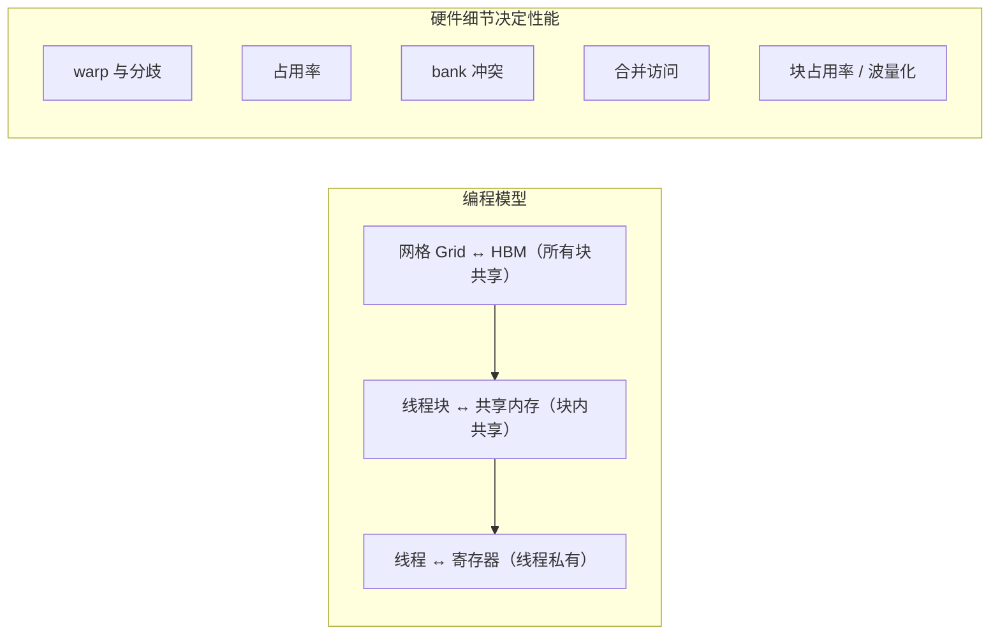
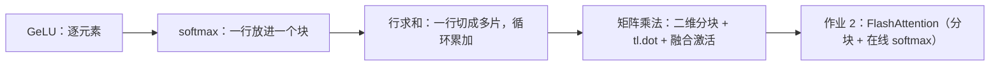

# 第 6 章 Kernel 与 Triton：亲手写 GPU 程序

> 对应课程：Lecture 6《Kernels, Triton, XLA》（主讲：Percy Liang） · [YouTube](https://www.youtube.com/watch?v=xnDHaNUvHBg) · 官方讲义：[可执行讲义 lecture_06](https://cs336.stanford.edu/lectures/?trace=lecture_06)

<Video id="xnDHaNUvHBg" title="Lecture 6 原视频" />

## 本章你将学到

- 回顾 GPU 硬件与编程模型（网格 → 线程块 → 线程），以及“为什么需要线程块”。
- 编程模型之外决定性能的硬件细节：warp、占用率（occupancy）、共享内存 bank 冲突、内存合并访问、块占用率与波量化。
- 正确地做基准测试（benchmarking）和性能剖析（profiling），以及从 kernel 名字里读出信息。
- 用剖析器看清“朴素 GeLU、内置 GeLU、`torch.compile` 版 GeLU”为什么快慢不同——答案是 kernel 融合。
- 用 Triton 从易到难写四个 kernel：逐元素（GeLU）、行内归约（softmax）、行放不进一个块的归约（行求和）、分块矩阵乘法（matmul + ReLU）。
- 看一眼 Triton 编译出的 PTX 汇编，理解“线程粗化”。

## 先说结论（一分钟版）

GPU 的编程模型很干净：你定义一个由线程块组成的网格，告诉每个块做什么。但**正确性只取决于编程模型，性能却取决于硬件细节**——warp、寄存器数量、bank、缓存行、SM 个数都会影响速度。所以第一原则是：**先测量（基准测试 + 剖析），再动手优化**。PyTorch 里每个运算都是一个独立 kernel，中间结果要往返 HBM；融合成一个 kernel 就能大幅提速。Triton 让你以“线程块”为单位思考：**从 HBM 读一块数据到片上 → 在片上做尽可能多的事（融合）→ 写回 HBM**。逐元素、softmax、行求和、矩阵乘法，都是这一个套路的变体，矩阵乘法则用上了分块。

---

## 6.1 GPU 回顾：硬件与编程模型

### 6.1.1 硬件：三代 NVIDIA GPU 对比

Percy 开场先帮大家回忆上一讲（[第 5 章](./ch05-gpus-tpus)）。下面这张表是讲义原样的数据：[▶ 01:05](https://www.youtube.com/watch?v=xnDHaNUvHBg&t=65s)

| 加速器 | A100 | H100 | B200 |
|---|---|---|---|
| SM 个数 | 108 | 132 | 148 |
| 寄存器（每 SM） | 256 KB | 256 KB | 256 KB |
| L1 + 共享内存（每 SM） | 192 KB | 256 KB | 256 KB |
| L2 缓存 | 40 MB | 50 MB | 96–126 MB |
| HBM 容量 | 80 GB | 80 GB | 192 GB |
| 寄存器带宽 | ~116 TB/s | ~401 TB/s | ~447 TB/s |
| L1/共享内存带宽 | ~19 TB/s | ~33 TB/s | ~40 TB/s |
| L2 带宽 | ~5–8 TB/s | ~12 TB/s | ~17 TB/s |
| HBM 带宽 | 2 TB/s | 3.35 TB/s | 8 TB/s |

Percy 指出几个规律：

- SM 个数一直在 100～200 之间，**没怎么变**；每个 SM 的寄存器（B200 每个 SM 有 65536 个 32 位寄存器，共 256 KB）也没怎么变。
- 真正大幅增长的是 **HBM 容量**（A100、H100 都是 80 GB，到 B200 一下涨到 192 GB）。
- 带宽和容量大致“成反比”：寄存器最快，L1 次之，L2 再次，HBM 最慢——虽然 8 TB/s 在绝对意义上也不算慢。[▶ 02:06](https://www.youtube.com/watch?v=xnDHaNUvHBg&t=126s)

要记住的心智模型就一句：**大内存又慢又远，快内存（寄存器、L1）在 SM 上，又近又快但很小。**

讲义还提到两个新硬件特性，本讲不展开：H100 和 B200 有**线程块簇（thread block cluster）**，可以让多个线程块共享“分布式共享内存”；B200 还有给 Tensor Core 用的**张量内存（TMEM）**，介于寄存器和共享内存之间，对程序员不可见。

### 6.1.2 编程模型：网格、线程块、线程

[▶ 03:06](https://www.youtube.com/watch?v=xnDHaNUvHBg&t=186s)

- **线程（thread）**：执行一段代码，处理一小部分数据。
- **线程块（thread block）**，也叫 **CTA（cooperative thread array）**：一组线程。
- **网格（grid）**：所有线程块的集合。

启动一个 kernel（GPU 函数）时，你就是启动了一整个网格，所有块并行地执行计算。

### 6.1.3 为什么需要线程块？

一个好问题：为什么不直接给每个数据元素一个线程，干脆不要“块”这一层？[▶ 04:07](https://www.youtube.com/watch?v=xnDHaNUvHBg&t=247s)

- 对**逐元素运算**（比如 GeLU），这样确实很自然：$f(i)$ 对 $i = 0, \dots, N-1$，一个线程处理一个元素。
- 但对 **softmax、矩阵乘法**这类需要线程之间**通信**的运算，就不够了。理论上线程可以通过 HBM 互相传数据，但 HBM 太慢。

所以需要**共享内存**——它在 SM 本地，又快。而**线程块的定义就是：一组访问同一块共享内存的线程**。因此一个线程块被调度到**一个** SM 上，它从 HBM 读一批数据，块内线程通过共享内存协作处理，最后写回去。[▶ 06:09](https://www.youtube.com/watch?v=xnDHaNUvHBg&t=369s)

Percy 强调：在 Triton 里，我们**天然地以线程块为单位思考**。一旦习惯了这种思维，写 kernel 会容易很多。

::: tip 移动端类比
把一个线程块想象成 iOS 里的一个 `DispatchGroup` 加上一块只有组内成员能访问的“私有缓存”：组内任务可以很便宜地共享中间结果；不同组之间要交换信息，就只能写到“磁盘”（HBM）上再读出来。
:::

---

## 6.2 编程模型之外：决定性能的硬件细节

编程模型是对硬件的抽象。**只要你关心正确性，懂编程模型就够了**——定义好线程块、写好每个块做什么，就像写 Python。但**性能对硬件极其敏感**，我们之所以要写 kernel，本来就是为了榨性能。[▶ 07:09](https://www.youtube.com/watch?v=xnDHaNUvHBg&t=429s)

下面是 Percy 给的五个例子，让你感受一下“编程模型之下”的世界。

### 6.2.1 Warp：32 个线程同进同退

一个线程块里的线程会被分组成 **warp**，每个 warp 32 个线程。比如一个块有 64 个线程，就有 2 个 warp。[▶ 09:10](https://www.youtube.com/watch?v=xnDHaNUvHBg&t=550s)

```
| TTTTTTTTTTTTTTTTTTTTTTTTTTTTTTTT | TTTTTTTTTTTTTTTTTTTTTTTTTTTTTTTT |
           warp 0（32 线程）                    warp 1（32 线程）
```

- 一个 warp 内所有线程**每个时钟周期都执行同一条指令**（lockstep）。
- **控制分歧**：如果 warp 里有的线程走 `if A`、有的走 `else B`，只能先执行完 A（B 那部分线程等着），再执行 B——被串行化了。所以 kernel 里一般要避免分支。

```
| AAAAAAAAA....................... |   先执行 A 的线程
| .........BBBBBBBBBBBBBBBBBBBBBBB |   再执行 B 的线程
```

**延迟隐藏**：Percy 认为 warp 最酷的一点是，一个 SM 上同时驻留着多个 warp，有一个 **warp 调度器**，可以**零开销**在 warp 之间切换。当某个 warp 在等 HBM 读取（可能要上百个周期）时，调度器立刻切换到另一个能干活（比如做 Tensor Core 运算）的 warp。[▶ 10:11](https://www.youtube.com/watch?v=xnDHaNUvHBg&t=611s) 这在 CPU 上是做不到的（CPU 线程切换代价高），GPU 就是这样设计来隐藏延迟的。

::: tip 移动端类比
这很像 Kotlin 协程的挂起：一个协程 `await` 网络请求时不占线程，调度器去跑别的协程；数据回来后再恢复。GPU 的 warp 调度器在硬件层面做了同样的事，而且切换几乎不花时间。
:::

### 6.2.2 占用率（Occupancy）：寄存器是有限的

硬件约束：每个线程最多使用 255 个寄存器；每个 SM 的寄存器总数是固定的。所以**每个线程用的寄存器越多，SM 上能同时跑的线程就越少**——这就是**占用率**下降。[▶ 11:12](https://www.youtube.com/watch?v=xnDHaNUvHBg&t=672s)

**手算一遍**（讲义里的例子，B200）：

- 你想跑的：每个线程块 128 个线程，每个线程用 160 个寄存器；
- 硬件提供的：每个 SM 最多 65536 个寄存器，最多同时驻留 64 个 warp。

```python
num_threads_per_block = 128
num_registers_per_thread = 160          # 必须 ≤ 255
max_registers = 65536                    # 每个 SM 的寄存器总数
max_warps = 64                           # 每个 SM 最多同时驻留的 warp 数

regs_per_block = num_threads_per_block * num_registers_per_thread  # 20480
num_blocks = max_registers // regs_per_block                       # 3 个块
num_warps = num_blocks * num_threads_per_block / 32                # 12 个 warp
occupancy = num_warps / max_warps                                  # 0.1875
print(regs_per_block, num_blocks, num_warps, occupancy)
```

每个块需要 20480 个寄存器，一个 SM 只能放 3 个块，也就是 12 个 warp，占用率只有 **18.75%**。[▶ 13:13](https://www.youtube.com/watch?v=xnDHaNUvHBg&t=793s)

但 Percy 提醒：**低占用率不一定是坏事**。如果每个线程做更多的活，线程少一点反而可能更好。典型例子是**线程粗化（thread coarsening）**：对逐元素运算，与其一个线程处理一个元素，不如一个线程处理 8 个元素——线程少了，调度更简单，每个线程的工作更“厚实”。（讲义正文写的例子是“64 个线程”，但代码和课堂讲解都是 128 个线程，这里以代码为准。）

### 6.2.3 Bank 冲突：共享内存也会堵车

共享内存在硬件上被分成 **32 个 bank**，每个 bank 4 字节宽。[▶ 14:15](https://www.youtube.com/watch?v=xnDHaNUvHBg&t=855s)

```
B00 B01 B02 B03 ... B30 B31     ← 第 0 行：32 个 bank 各 4 字节
B00 B01 B02 B03 ... B30 B31     ← 第 1 行：又从 B00 开始
...
```

约束是：**每个时钟周期，每个 bank 只能被一个线程访问**（除非它们访问的是完全相同的地址）。如果多个线程同时访问同一个 bank 的不同位置，访问就要排队——这叫 **bank 冲突（bank conflict）**。

最坏情况：一个矩阵每行恰好占满 32 个 bank，32 个线程同时读**第一列**——它们全都落在 B00 上，形成 **32 路 bank 冲突**，大家排成一列。

你可能会说：那就按行访问呗？但做矩阵乘法 $A \times B$ 时，你**必须**访问 A 的行和 B 的列，有时还要转置，无法总是选最友好的方向。解决办法叫 **swizzling（重排）**：用类似“行号 XOR 列号”的方式重新排列数据在共享内存里的位置，使得按列访问时也分散到不同 bank 上。[▶ 16:17](https://www.youtube.com/watch?v=xnDHaNUvHBg&t=977s)

### 6.2.4 内存合并访问：HBM 按缓存行取数

这一条第 5 章讲过，Percy 快速重温：一个 warp 的 32 个线程访问 HBM 时，访问会被**合并成 128 字节的事务**（Percy 叫它缓存行，cache line；就是第 5 章 Tatsu 说的“突发段”，两位老师叫法不同），一次取回来。[▶ 17:18](https://www.youtube.com/watch?v=xnDHaNUvHBg&t=1038s)

```
M00 M01 M02 ... M31    ← 一条 128 字节的缓存行（32 个 4 字节 float）
M32 M33 M34 ... M63    ← 下一条
```

- **最好的情况（完全合并）**：线程 0 读 M00、线程 1 读 M01……32 个线程 × 4 字节 = 128 字节，恰好一条缓存行，一次取完。
- 如果沿着列读（线程 0 读 M00、线程 1 读 M32……），每个线程都触发一条缓存行，取回大量用不上的数据。

Percy 特别指出：bank 冲突和合并访问**感觉很像，但是两回事**——前者是共享内存的约束，后者是 HBM 的约束。

### 6.2.5 块占用率：波量化又来了

线程块被调度到 SM 上执行。逻辑上你可以定义任意多的块，但物理上 SM 是有限的。[▶ 18:19](https://www.youtube.com/watch?v=xnDHaNUvHBg&t=1099s)

B200 有 148 个 SM。如果你启动 160 个线程块，第一波跑 148 个，第二波只有 12 个——这时 136 个 SM 闲着。这就是第 5 章讲过的**波量化（wave quantization）**，最后一波的块太少，导致块占用率低。

解决办法：**让线程块的数量能被 SM 数整除**（或至少接近整数倍）。有学生问，能不能让一个块“分摊”到多个 SM 上来消除这条尾巴？Percy 的回答是：块必须整体待在一个 SM 上，没法拆；正确的做法是**调整块的大小，从而改变块的数量**。[▶ 20:20](https://www.youtube.com/watch?v=xnDHaNUvHBg&t=1220s)

### 6.2.6 小结：干净的模型，混乱的现实



Percy 的总结是：编程模型很优雅，但 warp、bank 冲突、合并访问、占用率等硬件细节才真正决定性能，而且很多细节很难知道——你得清楚有多少个 SM、各级内存多大，调度器有时还会做你控制不了的事。所以现实比编程模型“混乱”得多。[▶ 19:19](https://www.youtube.com/watch?v=xnDHaNUvHBg&t=1159s)

---

## 6.3 基准测试与性能剖析

### 6.3.1 成功的秘诀：先测量

Percy 把这部分放在写 Triton **之前**，是有意为之。他给出的“成功配方”是：[▶ 21:20](https://www.youtube.com/watch?v=xnDHaNUvHBg&t=1280s)

1. 对代码做基准测试和剖析；
2. 做修改；
3. 再做基准测试和剖析。

**永远先测量，找到瓶颈，再考虑写 kernel。**

::: tip 移动端类比
这和用 Android Studio Profiler / Xcode Instruments 是一个道理：你不会凭感觉去优化启动速度，而是先看 Systrace / Time Profiler 里到底哪个方法占了时间。GPU 上的对应工具是 PyTorch Profiler 和 NVIDIA Nsight Systems（作业里用后者）。
:::

### 6.3.2 基准测试：测端到端时间

**基准测试（benchmarking）**测量完成某个操作的墙钟时间。它只给你一个总时间，不告诉你时间花在哪；但它很有用：比较不同实现谁快，以及观察性能如何随规模变化。PyTorch 有现成的 `torch.utils.benchmark`，但本课程从零开始，讲义自己写了一个，顺便强调几个坑：[▶ 23:20](https://www.youtube.com/watch?v=xnDHaNUvHBg&t=1400s)

```python
import torch

def benchmark(run, num_warmups=1, num_trials=3):
    """返回 run() 的平均耗时（毫秒）"""
    for _ in range(num_warmups):   # 坑 1：先热身，排除首次编译、懒加载等开销
        run()
    torch.cuda.synchronize()       # 坑 2：GPU 是异步的，必须等它真正跑完

    times = []
    for _ in range(num_trials):    # 坑 3：多测几次，时间有波动
        start = torch.cuda.Event(enable_timing=True)   # 用 CUDA 事件计时
        end = torch.cuda.Event(enable_timing=True)     # 避免把 CPU 开销算进去
        start.record()
        run()
        end.record()
        torch.cuda.synchronize()   # 同步屏障：等 GPU 上的工作完成
        times.append(start.elapsed_time(end))
    return sum(times) / len(times)
```

要点：

- **热身（warmup）**：第一次运行可能包含编译、懒初始化等开销。我们关心的是稳态速度，因为实际训练时会反复运行。
- **同步（synchronize）**：CPU 向 GPU 提交任务后立刻返回，GPU 在后台异步执行。不同步的话，你测到的只是“提交任务”的时间。
- **多次测量**：讲义取平均；如果特别讲究，可以看分布，比如 P95。[▶ 24:22](https://www.youtube.com/watch?v=xnDHaNUvHBg&t=1462s)

::: warning 常见误区
用 `time.time()` 包住一行 `a @ b` 就以为测出了矩阵乘法时间——这通常只测到了 kernel 的**启动**时间，因为 GPU 是异步的。就像你在 Android 里 `enqueue` 了一个 WorkManager 任务就开始计时结束，测到的根本不是任务本身。
:::

**扩展性观察**：讲义对 256、512、1024、2048、4096、8192 维的方阵乘法做了基准测试。结果是：**维度不大时时间几乎是常数，之后才按三次方增长**。Percy 说大约直到接近 2000 维时间都差不多平。原因是 GPU 是为大矩阵设计的，小矩阵根本喂不饱它，时间主要花在固定开销上。[▶ 25:22](https://www.youtube.com/watch?v=xnDHaNUvHBg&t=1522s)

### 6.3.3 性能剖析：时间花在哪里

**剖析（profiling）**告诉你时间具体花在哪。即使你不关心时间，它也能告诉你**底层到底发生了什么**——对 PyTorch 这种高层框架尤其有用。[▶ 26:26](https://www.youtube.com/watch?v=xnDHaNUvHBg&t=1586s)

```python
import torch
from torch.profiler import ProfilerActivity

def profile(run, num_warmups=1):
    for _ in range(num_warmups):
        run()
    torch.cuda.synchronize()
    with torch.profiler.profile(activities=[ProfilerActivity.CUDA]) as prof:
        run()
        torch.cuda.synchronize()
    # 按 CUDA 总耗时排序，打印前 10 个 kernel
    return prof.key_averages().table(sort_by="cuda_time_total", row_limit=10)
```

几个观察：

- `a + b`：剖析结果里出现一个名字很长的 kernel，大意是“CUDA functor add”——这就是底层真正执行加法的 kernel。[▶ 27:28](https://www.youtube.com/watch?v=xnDHaNUvHBg&t=1648s)
- `a @ b`（2048 维）和 `a @ b`（128 维）：**调用的 kernel 不一样**！一个名字里有 `64x64x16`，另一个是 `32x32x16`。PyTorch 表面上只是 `@`，底层会根据张量形状选不同的实现。[▶ 28:30](https://www.youtube.com/watch?v=xnDHaNUvHBg&t=1710s)

**从 kernel 名字读信息**。以讲义里的一个名字为例：`cutlass3x_sm100_simt_sgemm_f32_f32_f32_f32_f32_64x64x16_...`

| 片段 | 含义 |
|---|---|
| `cutlass` | NVIDIA 的 CUDA 线性代数库 |
| `sm100` | 对应 Blackwell 架构（B200），专门为它写的 kernel |
| `f32` | FP32 数据类型 |
| `64x64x16` | 分块形状（后面讲矩阵乘法时会看到） |

（讲义没有解释名字里的其他片段。`sgemm` 是线性代数库里的标准叫法：s 表示单精度，gemm 表示通用矩阵乘法（general matrix multiply）。`simt` 讲义未作说明，这里不展开。）

作业里你会用 NVIDIA Nsight 得到更详细的信息，本讲为节省时间跳过了。[▶ 29:31](https://www.youtube.com/watch?v=xnDHaNUvHBg&t=1771s)

---

## 6.4 案例：三种 GeLU 为什么快慢不同

### 6.4.1 三匹赛马

GeLU 是常用激活函数，通常用 tanh 近似（对计算更友好）：

$$
\mathrm{GeLU}(x) \approx 0.5\,x\left(1 + \tanh\!\left(\sqrt{2/\pi}\,\left(x + 0.044715\,x^3\right)\right)\right)
$$

$x$ 是输入；$\sqrt{2/\pi} \approx 0.79788456$；$\tanh$ 是双曲正切。不用记，知道它是“一串逐元素运算”就够了。

讲义比较了三个实现：[▶ 30:32](https://www.youtube.com/watch?v=xnDHaNUvHBg&t=1832s)

```python
import torch

def naive_gelu(x):
    # 1. 朴素实现：把公式直接翻译成 PyTorch
    return 0.5 * x * (1 + torch.tanh(0.79788456 * (x + 0.044715 * x * x * x)))

def builtin_gelu(x):
    # 2. PyTorch 内置实现
    return torch.nn.functional.gelu(x, approximate="tanh")

# 3. 编译版：对朴素实现调用 torch.compile
compiled_gelu = torch.compile(naive_gelu)
```

`torch.compile` 是个值得知道的工具：传入任何 PyTorch 函数，它返回一个做同样事情（语义不变）的新函数。[▶ 31:32](https://www.youtube.com/watch?v=xnDHaNUvHBg&t=1892s)

在 16384 × 16384 的输入上测速：朴素版最慢（课上读出的数字是 3.75；Percy 没念单位，按 `benchmark` 函数的返回值应是毫秒），内置版快得多，编译版也快得多，但略慢于内置版。三者算的是同一个东西，性能却差很多。为什么？

### 6.4.2 剖析器揭晓答案

- **朴素版**：剖析器里出现一大堆 kernel——乘法、加法、tanh……**每个 PyTorch 原语都对应一个 kernel**。每个 kernel 都要从 HBM 读数据到 SM、计算、写回 HBM，下一个 kernel 再从 HBM 读……数据在 HBM 和 SM 之间来回跑了很多趟。[▶ 32:33](https://www.youtube.com/watch?v=xnDHaNUvHBg&t=1953s)
- **内置版**：只有一个 GeLU 的 CUDA kernel。为什么有它？因为大家常用 GeLU，有人专门写了一个 kernel 放进标准库——没什么魔法。
- **编译版**：也只有**一个** kernel，而且是一个 **Triton kernel**。编译器分析了计算图，自动把整串运算写成了一个 Triton kernel。[▶ 34:35](https://www.youtube.com/watch?v=xnDHaNUvHBg&t=2075s)

结论：**朴素版没有 kernel 融合，多次读写 HBM；内置版和编译版都是一个融合 kernel，每个元素只从 HBM 读一次、写一次。**

有学生问：编译出的 Triton kernel 为什么比内置版慢？Percy 说这里 Triton kernel 本来就不比内置的快；去年他做这个实验时两者更接近，这些结果和硬件很相关，而且这里的东西都没有被极致优化，只是为了说明大意。

下面的演示把“不融合”和“融合”的执行过程做成了动画，逐个 kernel 数 HBM 读写次数，并按所选 GPU 的带宽估算搬运时间。也可以切换到 softmax 和第 5 章的 $\sin^2 x + \cos^2 x$ 例子。

<Demo src="ch06-fusion.html" title="算子融合：数一数往返 HBM 的次数" :height="600" />

::: tip 移动端类比
朴素 GeLU 就像一个图片处理管线：缩放 → 写临时文件 → 读出来加滤镜 → 写临时文件 → 读出来加水印 → 写最终文件。融合 kernel 则是把 Bitmap 留在内存里一口气处理完再写一次。磁盘 IO 次数从 6 次变成 2 次。
:::

---

## 6.5 Triton 入门

### 6.5.1 CUDA 与 Triton：以谁为单位思考

[▶ 37:40](https://www.youtube.com/watch?v=xnDHaNUvHBg&t=2260s)

- **CUDA**（NVIDIA 开发，多年来写 kernel 的标准方式）：你描述**每个线程**做什么。
  - 优点：细粒度控制，和硬件实际执行的方式很接近。
  - 缺点：要自己管理很多事，比如共享内存、线程间同步——线程要一起从 HBM 读、同步、计算……这些簿记工作都得自己写。
- **Triton**（OpenAI 开发，现在已经相当标准）：你描述**每个线程块**做什么。
  - 一般来说够用（尤其是入门阶段），只有想榨干最新硬件的每一个新特性时才可能不够灵活。
  - 概念框架：**把数据读进共享内存，在上面操作，再写回全局内存。**

Percy 的描述很精辟：在 PyTorch 里，你思考的是“整个大矩阵相乘”；在 CUDA 里，你思考的是“单个元素”；而 Triton 处在两者之间——**以块为单位**。[▶ 38:42](https://www.youtube.com/watch?v=xnDHaNUvHBg&t=2322s)

有学生问：Triton 和 CUDA 的区别到底是什么？对逐元素运算，二者几乎一样，甚至 CUDA 更简单（醒来、认出自己是哪个线程、处理那个元素）。Triton 像是“向量化版本”：你拿到一个块，对整个块操作。一旦运算超出逐元素，比如要归约、要共享数据，CUDA 就会麻烦得多。

### 6.5.2 第一个 kernel：Triton 版 GeLU

先看“启动端”（普通 Python + PyTorch 代码）：[▶ 39:43](https://www.youtube.com/watch?v=xnDHaNUvHBg&t=2383s)

```python
import torch, triton

def triton_gelu(x: torch.Tensor):
    assert x.is_cuda and x.is_contiguous()
    y = torch.empty_like(x)                 # Triton 不是函数式的：先分配输出
    num_elements = x.numel()
    BLOCK_SIZE = 1024                       # 每个块处理 1024 个元素
    num_blocks = triton.cdiv(num_elements, BLOCK_SIZE)   # 向上取整
    # 方括号里是网格形状：启动 num_blocks 个块，每个块执行同一个 kernel
    triton_gelu_kernel[(num_blocks,)](x, y, num_elements, BLOCK_SIZE=BLOCK_SIZE)
    return y
```

注意两点：一是 Triton 不再是“函数返回值”的思维，你要显式地分配输出、显式地读写；二是那个奇怪的 `kernel[(num_blocks,)](...)` 语法，方括号里是**网格形状**。

再看 kernel 本身：[▶ 42:47](https://www.youtube.com/watch?v=xnDHaNUvHBg&t=2567s)

```python
import triton
import triton.language as tl

@triton.jit
def triton_gelu_kernel(x_ptr, y_ptr, num_elements, BLOCK_SIZE: tl.constexpr):
    pid = tl.program_id(axis=0)              # 我是第几个块？
    start = pid * BLOCK_SIZE                 # 我负责的数据从哪开始
    offsets = start + tl.arange(0, BLOCK_SIZE)   # 我负责的一整段下标
    mask = offsets < num_elements            # 最后一块可能越界，用掩码屏蔽

    x = tl.load(x_ptr + offsets, mask=mask)  # 从 HBM 读一整块
    # tanh(a) = (exp(2a) - 1) / (exp(2a) + 1)（讲义里说 tl.tanh 不存在，所以手写）
    a = 0.79788456 * (x + 0.044715 * x * x * x)
    exp = tl.exp(2 * a)
    tanh = (exp - 1) / (exp + 1)
    y = 0.5 * x * (1 + tanh)                 # 全部在片上完成
    tl.store(y_ptr + offsets, y, mask=mask)  # 写回 HBM 一次
```

逐行理解：

1. `x_ptr`、`y_ptr` 是**指针**——就是内存地址，可以当整数看。你要习惯这一点。
2. 每个块被“唤醒”后问自己：**我是谁？** `tl.program_id(0)` 返回块编号 `pid`（0、1、2……）。
3. **我负责哪段数据？** 起点 `start = pid * BLOCK_SIZE`；`tl.arange(0, BLOCK_SIZE)` 概念上给出 0 到 BLOCK_SIZE−1 的整数；两者相加得到这一块所有元素的下标 `offsets`。
4. **掩码**：元素总数不一定是 BLOCK_SIZE 的整数倍，最后一块可能有一部分越界。`mask` 在界内为真、界外为假，读写时只处理为真的位置。非最后一块的掩码全为真。[▶ 44:48](https://www.youtube.com/watch?v=xnDHaNUvHBg&t=2688s)
5. `tl.load`：指针加偏移 = 一组地址，从 HBM 读出这些地址的数据。之后你就可以把 `x` 当一个向量来算。
6. `tl.store`：写回。

几乎所有 kernel 都是这个样子：**输入、输出 → 醒来确认自己负责哪部分 → 读 → 算 → 写回 HBM。**

::: warning 手写 tanh 的一个坑
讲义这种 `(exp(2a) - 1) / (exp(2a) + 1)` 的写法只适合演示：FP32 下 $x$ 大于约 10 时，`exp(2a)` 会溢出成无穷大，结果变成 NaN。自己写 kernel（比如练习 4）时，可以改用等价的 `1 - 2 / (exp(2a) + 1)`，溢出时它会正确地得到 1。
:::

用 Kotlin 伪代码理解“每个块做什么”：

```kotlin
// 伪代码：GPU 会让所有 pid 并行执行这段函数
fun geluKernel(pid: Int, x: FloatArray, y: FloatArray, n: Int, blockSize: Int) {
    val start = pid * blockSize
    val offsets = (start until start + blockSize).filter { it < n }  // mask
    val xs = offsets.map { x[it] }                 // 一次性 load 整块
    val ys = xs.map { v -> 0.5f * v * (1 + tanh(0.79788456f * (v + 0.044715f * v * v * v))) }
    offsets.forEachIndexed { i, idx -> y[idx] = ys[i] }  // store 回去
}
```

::: details 课堂问答：数据到底是怎么从 HBM 到寄存器的？
有学生问：执行到 `tl.load` 时，数据是一步一步从 HBM → 共享内存 → 寄存器吗？线程会不会干等着？

Percy 的回答分两层。机械层面：这段 Triton 代码其实是“写给人看的”，GPU 并不会真的执行 Python；编译器会把它编译成 PTX，再由硬件执行。概念层面：`x_ptr + offsets` 是一组 HBM 地址，`tl.load` 返回这些地址上的数据，局部变量 `x` 实际上会放在寄存器或共享内存里——放哪里由 Triton 编译器决定，你不用显式指定。

至于“干等”：另一位同学补充得很准确——执行到 load 时这个 warp 会阻塞若干周期，SM 上的 warp 调度器会切换到另一个 warp 去执行，等数据到了再切回来。这正是 6.2.1 讲的延迟隐藏。[▶ 55:59](https://www.youtube.com/watch?v=xnDHaNUvHBg&t=3359s)
:::

### 6.5.3 看一眼 PTX：线程粗化

Triton 编译器生成 **PTX（Parallel Thread Execution）**，这是 NVIDIA GPU 的一种中间汇编语言。讲义把生成的 PTX 写到文件里，Percy 带大家粗看了一下：[▶ 50:55](https://www.youtube.com/watch?v=xnDHaNUvHBg&t=3055s)

- `ld.global.*` 和 `st.global.*`：从全局内存（HBM）读、往全局内存写。
- `%ctaid.x` 是**块编号**，`%tid.x` 是**块内线程编号**。PTX 只编译一份，每个线程都执行同一段代码，靠这两个编号区分自己。
- `%f*` 是浮点寄存器，`%r*` 是整数寄存器。
- PTX 描述的是**单个线程**做什么（块的抽象已经被编译掉了）。
- 你会看到很多重复的代码段：这是**线程粗化**——编译器觉得每个线程的活太轻，于是让**一个线程同时处理 8 个元素**。[▶ 52:57](https://www.youtube.com/watch?v=xnDHaNUvHBg&t=3177s)

PTX 里仍有很多东西没写，比如在哪个 SM 上跑、warp 怎么分，这些都由硬件控制。有学生问 PTX 是不是只能由编译器生成——确实有人手写 PTX（如果你觉得比编译器聪明），尤其在一些编译器不成熟的加速器上；但 NVIDIA 的编译器已经相当成熟，一般不需要。

---

## 6.6 归约：softmax

### 6.6.1 朴素 softmax 读写了多少次？

逐元素运算之后，来看需要**汇总多个值**的运算。softmax 对矩阵的每一行做指数和归一化：[▶ 58:01](https://www.youtube.com/watch?v=xnDHaNUvHBg&t=3481s)

```
[0 0 0]      =>   [1/3 1/3 1/3]
[1 1 -inf]        [1/2 1/2 0  ]
```

先看朴素实现（作业 1 里你写过类似的），并数一数读写次数（$M$ 行 $N$ 列）：

```python
def naive_softmax(x):
    M, N = x.shape
    x_max = x.max(dim=1)[0]          # 读 MN，写 M
    x = x - x_max[:, None]           # 读 MN + M，写 MN
    numerator = torch.exp(x)         # 读 MN，写 MN
    denominator = numerator.sum(dim=1)   # 读 MN，写 M
    y = numerator / denominator[:, None] # 读 MN + M，写 MN
    return y
    # 合计：约 5MN + 2M 次读，3MN + 2M 次写
    # （讲义把最后一步记成“读 MN”、合计 5MN + M，漏了读分母的 M 次；差别可忽略）
    # 理想情况：只需 MN 次读、MN 次写 —— 差了约 4 倍
```

在普通 PyTorch 里（不调用 `torch.compile`），每一行都是一个独立的 kernel，都要读写 HBM。[▶ 60:06](https://www.youtube.com/watch?v=xnDHaNUvHBg&t=3606s)

### 6.6.2 Triton softmax：一行一个块

思路：**每一行分配一个线程块**。为什么？softmax 不是逐元素的，但它是**逐行**的：每一行内部要归一化和求和，行与行之间没有关系。块与块之间本来就不共享内存，这正好合适。[▶ 61:07](https://www.youtube.com/watch?v=xnDHaNUvHBg&t=3667s)

启动端：块大小设为列数（向上取到 2 的幂，Percy 笑称“图个吉利”），块的数量就是行数 $M$，同时把**步长（stride）**传进去，告诉 kernel 每行在内存里相隔多远。

```python
@triton.jit
def triton_softmax_kernel(x_ptr, y_ptr, x_row_stride, y_row_stride,
                          num_cols, BLOCK_SIZE: tl.constexpr):
    row_idx = tl.program_id(0)                       # 我负责第几行
    col_offsets = tl.arange(0, BLOCK_SIZE)
    x_ptrs = x_ptr + row_idx * x_row_stride + col_offsets   # 这一行所有元素的地址
    # 越界位置填 -inf：exp(-inf) = 0，对 softmax 没有影响
    x_row = tl.load(x_ptrs, mask=col_offsets < num_cols, other=float("-inf"))

    x_row = x_row - tl.max(x_row, axis=0)            # 以下和朴素版一模一样
    numerator = tl.exp(x_row)                        # 但全部发生在片上
    denominator = tl.sum(numerator, axis=0)
    y_row = numerator / denominator

    y_ptrs = y_ptr + row_idx * y_row_stride + col_offsets
    tl.store(y_ptrs, y_row, mask=col_offsets < num_cols)   # 每个元素只写一次
```

注意中间那四行和朴素版**几乎一模一样**。Percy 的观察是：**只要数据能放进一个块，你写 Triton 就几乎和写普通 PyTorch 一样**。区别只在于：读一次、写一次，中间全在片上。[▶ 63:07](https://www.youtube.com/watch?v=xnDHaNUvHBg&t=3787s)

越界位置填 $-\infty$ 是个小技巧：$e^{-\infty} = 0$，相当于 softmax 里的“零”，不影响求和。

有学生问：如果想按列做 softmax 呢？Percy 说因为一切都是指针运算，只要改一下步长的用法（让列偏移乘以行步长之类）就行。

---

## 6.7 行太长放不进一个块：行求和与“小号分块”

如果一行有 4096 列，但块大小只有 1024 呢？一个块一次装不下一整行。[▶ 65:09](https://www.youtube.com/watch?v=xnDHaNUvHBg&t=3909s)

策略：

1. 把一行切成若干**分片（tile）**，这里是 4 片；
2. 每个线程在各片之间循环，维护自己的累加器；
3. 最后把所有线程的累加器再归约成一个数（用共享内存或 warp shuffle）。

为了简单，Percy 把 softmax 换成了**行求和**来演示。用一个小例子：一行 12 个元素，块大小为 4（4 个线程）：[▶ 67:10](https://www.youtube.com/watch?v=xnDHaNUvHBg&t=4030s)

```
一行：  T1 T2 T3 T4 | T1 T2 T3 T4 | T1 T2 T3 T4
        第 0 片        第 1 片        第 2 片
```

线程 T1 依次累加第 0、1、2 片的第 1 个元素，T2 累加第 2 个元素……三轮循环后，每个线程手里有一个部分和，最后把 4 个部分和加起来就是整行的和。

```python
@triton.jit
def row_sum_kernel(x_ptr, out_ptr, N, BLOCK_SIZE: tl.constexpr):
    row = tl.program_id(0)                           # 一个块仍然负责一整行
    acc = tl.zeros([BLOCK_SIZE], dtype=tl.float32)   # 每个线程一个累加器
    for start in range(0, N, BLOCK_SIZE):            # 在分片之间循环
        cols = start + tl.arange(0, BLOCK_SIZE)
        mask = cols < N
        x = tl.load(x_ptr + row * N + cols, mask=mask, other=0.0)  # 越界填 0
        acc += x                                     # 累加到各自的累加器
    result = tl.sum(acc, axis=0)                     # 最后把所有累加器归约成一个数
    tl.store(out_ptr + row, result)
```

和之前比，kernel 内部多了一个 `for` 循环。累加器放在寄存器还是共享内存里？在这个 Triton 程序里你不显式指定，由编译器决定；块足够大时一般会放在共享内存里。[▶ 70:13](https://www.youtube.com/watch?v=xnDHaNUvHBg&t=4213s)

::: warning 分清“块”和“片”
Percy 特意澄清：在 GeLU 里我们也把数据切成了很多段，但那些段是**块**，每段由一个独立的线程块并行处理。这里切出来的是**片（tile）**，它们属于**同一个**线程块，由这个块**按顺序**依次处理。这就是从“像写 PyTorch”走向“分块思维”的第一步——数据不能一次全放进共享内存时，就得一片一片地来。
:::

---

## 6.8 压轴：分块矩阵乘法（顺带融合 ReLU）

矩阵乘法是深度学习的“面包和黄油”，已经被优化到极致，也是最根本的运算。Percy 加了个小变化：做矩阵乘法后再接一个 ReLU（一个线性层接激活函数，这很常见），稍后你会明白为什么。[▶ 72:14](https://www.youtube.com/watch?v=xnDHaNUvHBg&t=4334s)

记号：$A$ 是 $M \times K$，$B$ 是 $K \times N$，$C = AB$ 是 $M \times N$。

```
|        k                  n
|   [ A1 A2 A3 ]       [ B1 B2 B3 ]   [ C1 C2 C3 ]
| m [ A4 A5 A6 ]  *  k [ B4 B5 B6 ] = [ C4 C5 C6 ]
|   [ A7 A8 A9 ]       [ B7 B8 B9 ]   [ C7 C8 C9 ]
```

### 6.8.1 朴素方法：算术强度是常数

固定一个输出位置 $(m, n)$，对每个 $k$：从 HBM 读 $A[m,k]$ 和 $B[k,n]$，相乘累加；最后把结果写回 $C[m,n]$。[▶ 73:14](https://www.youtube.com/watch?v=xnDHaNUvHBg&t=4394s)

这是正确的 kernel，但读写量很糟：总共要读约 $MKN$ 次（严格说 $A$、$B$ 各读一次，是 $2MKN$，量级一样）。运算量也是 $MKN$ 量级，所以

$$
\text{算术强度} = \frac{O(MKN)}{O(MKN)} = O(1)
$$

常数级的强度——第 5 章的 roofline 告诉我们，这一定是严重内存受限的。

### 6.8.2 理想方法：全部放进共享内存

仔细看会发现大量**重复读取**：计算 $C_4$ 要读 $A_4, A_5, A_6$；计算 $C_5$ 又要把它们读一遍。能不能只读一次？可以，用共享内存。[▶ 74:15](https://www.youtube.com/watch?v=xnDHaNUvHBg&t=4455s)

理想方法：把 $A$ 和 $B$ **全部**读进共享内存，再计算 $C$。这样只需 $MK + KN$ 次读、$MN$ 次写，算术强度达到 $O(N)$——这是第 2 讲说过的理想情况。

问题：$A$ 和 $B$ 通常大到根本放不进共享内存（每个 SM 只有一两百 KB）。

### 6.8.3 分块：全局像朴素，局部像理想

这就引出经典的**分块（tiling）**。Percy 的概括很好记：**全局上看像朴素方法，局部上看像理想方法**。[▶ 76:19](https://www.youtube.com/watch?v=xnDHaNUvHBg&t=4579s)

1. 把输出矩阵 $C$ 切成若干**输出块**，每个输出块由一个线程块负责（不同输出块完全独立地并行计算）；
2. 固定一个输出块。沿着 $K$ 方向，依次取 $A$ 的一个行块和 $B$ 的一个列块：
   - 把这两个小块从 HBM 读进共享内存（两者都沿 $K$ 方向一步步推进：$A$ 的小块在这几行里向右移，$B$ 的小块在这几列里向下移）；
   - 在共享内存里做一次小矩阵乘法（这一步就是“理想方法”）；
   - 累加到部分和里（部分和也在片上）；
3. 扫完整个 $K$ 方向后，把输出块写回 HBM。

算术强度提高到 $O(\text{块大小})$。达不到 $O(N)$（那需要整个矩阵放进共享内存），但块够大的话也不错了。[▶ 78:19](https://www.youtube.com/watch?v=xnDHaNUvHBg&t=4699s)

下面的动画演示了这个过程。格子里的数字是该元素到目前为止被从 HBM 读了几次。试试把分块边长 $T$ 从 1（不分块）调到 4 或 6，跳到结束，对比总读取量。

<Demo src="ch06-tiling.html" title="分块矩阵乘法：一块搬进共享内存，反复使用" :height="760" />

**附赠的融合**：既然输出块在写回 HBM 之前还在片上，那顺手对它做个逐元素激活函数（如 ReLU、GeLU）几乎是免费的——这就是 kernel 融合。这就是 Percy 加 ReLU 的原因。

::: tip 移动端类比
想象你要把一个大相册的所有照片两两比对（相似度矩阵）。内存放不下全部照片，于是你每次只加载“第 i 组 20 张”和“第 j 组 20 张”，比完 400 对再换下一组。这就是分块：每张照片从磁盘读的次数从“和每张比都读一次”变成“每组只读几次”。
:::

### 6.8.4 实现细节：步长

先复习**步长（stride）**。张量在逻辑上是多维数组，但在内存里是一维排开的。步长告诉你：多维下标 (行, 列) 怎么换算成一维位置：[▶ 79:19](https://www.youtube.com/watch?v=xnDHaNUvHBg&t=4759s)

$$
\text{index} = \text{row} \times \text{stride}_\text{row} + \text{col} \times \text{stride}_\text{col}
$$

比如 `[[0,1,2,3],[4,5,6,7]]` 的步长是 (4, 1)：下移一行跳 4 个位置，右移一列跳 1 个位置。(1, 2) 位置对应一维下标 $1 \times 4 + 2 \times 1 = 6$，值正是 6。如果是转置，步长就反过来。

### 6.8.5 Triton 矩阵乘法 kernel

启动端选块大小 `BLOCK_M, BLOCK_N, BLOCK_K = 64, 64, 32`，网格是二维的：`(cdiv(M, BLOCK_M), cdiv(N, BLOCK_N))`，即每个输出块一个线程块。

```python
@triton.jit
def matmul_relu_kernel(a_ptr, b_ptr, c_ptr, M, N, K,
                       stride_am, stride_ak, stride_bk, stride_bn, stride_cm, stride_cn,
                       BLOCK_M: tl.constexpr, BLOCK_N: tl.constexpr, BLOCK_K: tl.constexpr):
    pid_m = tl.program_id(0)                     # 我负责第 (pid_m, pid_n) 个输出块
    pid_n = tl.program_id(1)
    rm = pid_m * BLOCK_M + tl.arange(0, BLOCK_M) # 这块对应 A 的哪些行
    rn = pid_n * BLOCK_N + tl.arange(0, BLOCK_N) # 这块对应 B 的哪些列
    rk = tl.arange(0, BLOCK_K)
    a_ptrs = a_ptr + rm[:, None] * stride_am + rk[None, :] * stride_ak   # [BLOCK_M, BLOCK_K]
    b_ptrs = b_ptr + rk[:, None] * stride_bk + rn[None, :] * stride_bn   # [BLOCK_K, BLOCK_N]
    acc = tl.zeros([BLOCK_M, BLOCK_N], dtype=tl.float32)   # 片上累加器

    for k in range(0, K, BLOCK_K):               # 沿 K 方向逐块推进
        a = tl.load(a_ptrs, mask=(rm[:, None] < M) & (rk[None, :] + k < K), other=0.0)
        b = tl.load(b_ptrs, mask=(rk[:, None] + k < K) & (rn[None, :] < N), other=0.0)
        acc += tl.dot(a, b)                      # 片上的小矩阵乘：像 PyTorch 一样写
        a_ptrs += BLOCK_K * stride_ak            # 移到 A 的下一个块
        b_ptrs += BLOCK_K * stride_bk            # 移到 B 的下一个块

    acc = tl.maximum(acc, 0.0)                   # 融合 ReLU：写回前顺手做掉
    c_ptrs = c_ptr + rm[:, None] * stride_cm + rn[None, :] * stride_cn
    tl.store(c_ptrs, acc, mask=(rm[:, None] < M) & (rn[None, :] < N))
```

结构和行求和非常像：一个 `for` 循环在片之间推进、一个累加器。不同之处是现在要**同时**移动两个指针——都沿 $K$ 方向推进，$A$ 的小块在行内向右移、$B$ 的小块在列内向下移，并且每一步做的是 `tl.dot`（小矩阵乘法）。Percy 再次强调：**数据一旦在共享内存里，代码就长得像 PyTorch**，直接说“把它们乘起来”就行。[▶ 80:19](https://www.youtube.com/watch?v=xnDHaNUvHBg&t=4819s)

`tl.dot` 会不会用到 Tensor Core？课上有学生问过类似问题，Percy 的回答是：这不由你直接控制，由编译器和硬件决定把计算放在哪。

回想一下第 6.3 节剖析器里看到的 `64x64x16`，现在你知道它是什么了：那个 cutlass kernel 用的分块形状。（它的第三个数是 16，我们这里沿 $K$ 方向的块大小选的是 32——块大小本来就是各个实现自己调出来的，不必相同。）

---

## 6.9 关于标题里的 XLA

本讲的标题是“Kernels, Triton, XLA”，但从字幕和讲义看，课上**没有专门讲 XLA**。这里补充一句背景，方便你理解第 5 章提到的“JAX 的编译器”：XLA 是 Google 的机器学习编译器，JAX（以及 TensorFlow）通过它把计算图编译到 GPU/TPU 上，它和 `torch.compile` 一样会自动做算子融合之类的优化。两边的用法也很像：不加任何修饰时，JAX 和 PyTorch 都是逐个运算立即执行（eager）的；要让整段函数被编译、融合，JAX 需要你套上 `jax.jit`，PyTorch 需要你调用 `torch.compile`。只是 JAX 社区习惯上几乎处处都用 `jit`。课程的作业以 PyTorch + Triton 为主。

---

## 6.10 总结与展望

Percy 的总结：[▶ 82:23](https://www.youtube.com/watch?v=xnDHaNUvHBg&t=4943s)

- **懂编程模型**（PyTorch、Triton、PTX）保证正确性——这些是程序员能控制的层级，甚至可以手写 PTX 精确控制每一件事；
- **懂硬件**（SM、warp、占用率、bank 冲突等）才能优化性能——代码终究要在有限的 SM、有限的 bank、有限的寄存器上运行，你的大矩阵和 Transformer 必须适应这些约束；
- **基准测试**看性能如何随规模变化；
- **剖析**看时间具体花在哪个 kernel；
- **Triton 的思维**：以线程块为单位——从 HBM 读进共享内存、做事（融合）、写回 HBM；不必显式同步线程、管理共享内存，比按线程思考容易得多；
- 四个由易到难的例子：GeLU（逐元素）、softmax（按行归约）、行求和（小号分块）、矩阵乘法（分块）。



最后有学生问：除了 Triton 还有什么选择？Percy 说每种语言都有自己的“归纳偏置”，让某些事容易、某些事困难。Triton 是训练 Transformer 的人做的，所以写 Transformer 相关的东西相对容易；极端情况下可以直接写 PTX，但不建议作为第一步；还有其他库和 DSL，比如 ThunderKittens、CuTe 等，它们不一定是“更高层”或“更低层”的关系，而是提供了不同的特性。[▶ 84:25](https://www.youtube.com/watch?v=xnDHaNUvHBg&t=5065s) ThunderKittens 正是第 18 章嘉宾 Dan Fu 参与开发的库。

## 动手练习

1. **占用率计算**（热身）：在 B200 上（每 SM 65536 个寄存器、最多 64 个 warp），线程块有 256 个线程，每个线程用 64 个寄存器。每个 SM 最多能放几个块？占用率是多少？如果每个线程用 32 个寄存器呢？（提示：此时还要检查 warp 数上限。）

   ::: details 参考答案
   64 寄存器：每块 $256 \times 64 = 16384$，$65536 / 16384 = 4$ 块，$4 \times 8 = 32$ 个 warp，占用率 50%。32 寄存器：寄存器允许 8 块，即 64 个 warp，恰好等于上限，占用率 100%。（实际硬件还有每 SM 最大块数、共享内存等其他限制，这里只考虑讲义给出的两个约束。）
   :::

2. **数一数读写**：仿照讲义对 `naive_softmax` 的计数，给 LayerNorm（减均值、除以标准差、乘 $\gamma$ 加 $\beta$）的朴素 PyTorch 实现数一数 HBM 读写次数，并说出融合后的理想次数。

3. **基准测试的坑**：写两个版本测量 `a @ b`（4096 维）的耗时，一个用 `time.time()` 且不调用 `torch.cuda.synchronize()`，另一个用本章的 `benchmark` 函数。对比结果，解释差异。（需要一块 GPU，Colab 免费版即可。）

4. **写一个融合 kernel**（对接作业 2）：参照 Triton GeLU kernel，写一个计算 $y = \mathrm{ReLU}(x) \cdot w + b$ 的 Triton kernel（$w$、$b$ 是与 $x$ 同形状的张量），用 `torch.allclose` 验证正确性，并用 `benchmark` 和朴素 PyTorch 版本对比速度。

5. **分块与步长**（进阶）：修改本章的矩阵乘法 kernel，使它支持 $B$ 以转置形式存储（即传入的是 $B^\top$ 的内存）。你只需要改哪几个参数？为什么步长让这件事变得这么简单？然后思考：从合并访问的角度，转置存储对读取 $B$ 块是好是坏？

## 本章小结

- 编程模型：网格（HBM）→ 线程块（共享内存）→ 线程（寄存器）。线程块存在的意义是“一组共享同一块共享内存的线程”，所以它被整体调度到一个 SM 上。
- 性能由硬件细节决定：warp 与控制分歧、warp 调度隐藏延迟、寄存器决定占用率、共享内存 bank 冲突（用 swizzling 缓解）、HBM 合并访问（128 字节缓存行）、块数与 SM 数的波量化。
- 先测量：基准测试要热身、要同步、要多次测量；剖析能告诉你底层调用了哪些 kernel，kernel 名字里藏着架构、数据类型和分块形状。
- 朴素 PyTorch 每个运算一个 kernel，中间结果往返 HBM；内置 kernel 和 `torch.compile` 生成的 Triton kernel 通过融合只读写一次。
- Triton 以块为单位思考；从 GeLU 到 softmax、行求和、矩阵乘法，复杂度来自“数据放不进一个块时要循环分片”。矩阵乘法的分块把算术强度从 $O(1)$ 提升到 $O(\text{块大小})$，还能顺手融合激活函数。

下一章（[第 7 章](./ch07-parallelism-1)）我们从一块 GPU 走向多块 GPU：数据、模型如何切分到成百上千张卡上，以及卡与卡之间的通信如何成为新的瓶颈。

## 延伸阅读

- [Triton 官方教程：Fused Softmax](https://triton-lang.org/main/getting-started/tutorials/02-fused-softmax.html)（本讲 softmax 例子大致参照它）
- [Triton 官方文档与教程](https://triton-lang.org/)（向量加法、矩阵乘法等入门教程）
- [PyTorch Profiler 教程](https://pytorch.org/tutorials/recipes/recipes/profiler_recipe.html)
- [torch.utils.benchmark 教程](https://pytorch.org/tutorials/recipes/recipes/benchmark.html)
- [NVIDIA PTX ISA 文档](https://docs.nvidia.com/cuda/parallel-thread-execution/)（讲义中网格/CTA 示意图的出处）
- Philippe Tillet 等，Triton: An Intermediate Language and Compiler for Tiled Neural Network Computations（Triton 原始论文，MAPL 2019）
- [ThunderKittens](https://github.com/HazyResearch/ThunderKittens)（课上提到的另一种 kernel 编写库）
- 作业 2 仓库：[stanford-cs336/assignment2-systems](https://github.com/stanford-cs336/assignment2-systems)
