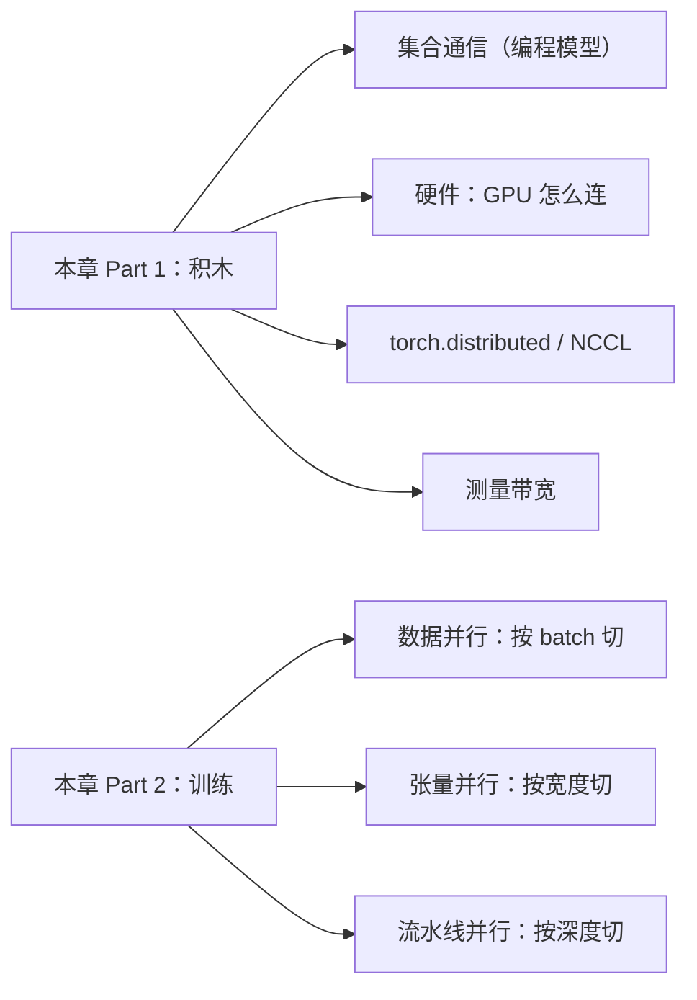
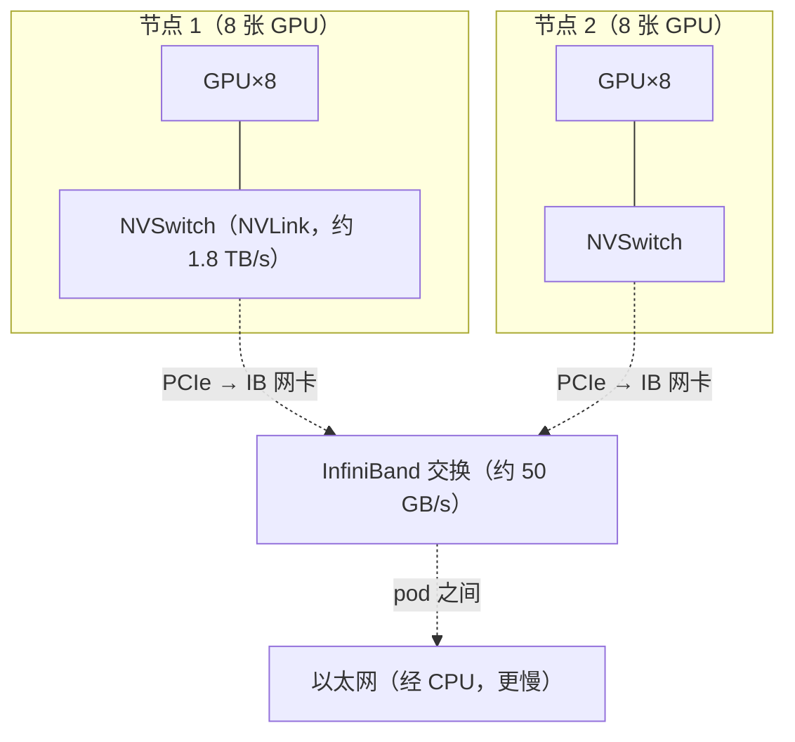
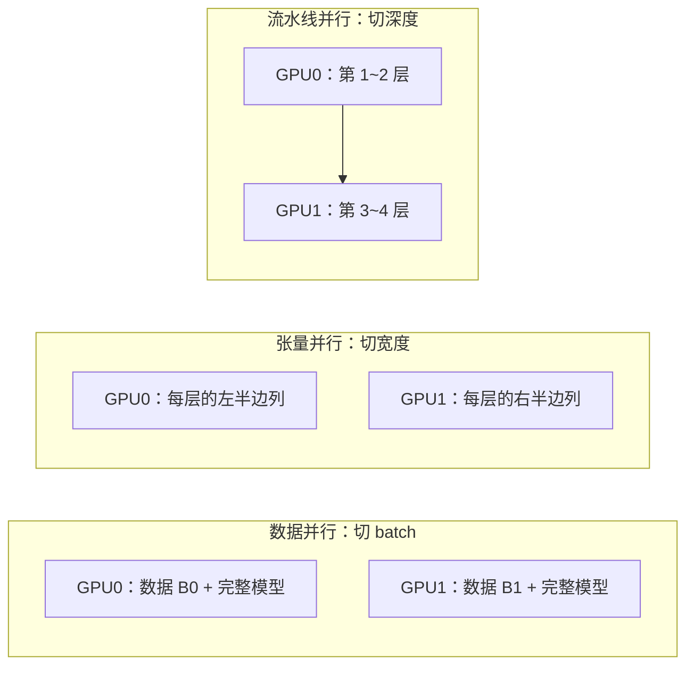

# 第 7 章 并行训练（上）：集合通信与三种基本切分

> 对应课程：Lecture 7《Parallelism》 · [YouTube](https://www.youtube.com/watch?v=SzpOcwdIL0Y) · 官方讲义：[可执行讲义 lecture_07](https://cs336.stanford.edu/lectures/?trace=lecture_07)

<Video id="SzpOcwdIL0Y" title="Lecture 7 原视频" />

## 本章你将学到

- 为什么训练大模型一定要用多张 GPU：**装不下**和**算得慢**两个理由。
- 分布式编程的“标准库”：broadcast、scatter、gather、reduce、**all-gather、reduce-scatter、all-reduce**、all-to-all，以及为什么 all-reduce = reduce-scatter + all-gather。
- GPU 之间到底怎么连：PCIe、NVLink/NVSwitch、InfiniBand、以太网、RDMA、NCCL 各自是什么、有多快。
- 用 `torch.distributed` 写出第一个多进程通信程序，并学会测量“有效带宽”。
- 三种最基本的切分方式，并用几十行代码实现：**数据并行（按 batch 切）**、**张量并行（按宽度切）**、**流水线并行（按深度切）**。

## 先说结论（一分钟版）

1. 上一章（[第 6 章](./ch06-kernels-triton)）讲的是**单卡内部**怎么少搬数据：融合、分块。本章把同样的思路推广到**多卡之间**：计算单元离数据很远，要通过“复制”和“切分”来少搬数据。
2. 多卡通信不用自己写点对点收发，而是用几个“集合通信”原语。最重要的三个是 all-reduce、reduce-scatter、all-gather，且 **all-reduce 恰好等于 reduce-scatter 加 all-gather**，这个等式是下一章 ZeRO/FSDP 的基石。
3. 硬件是分层的：卡内显存（HBM）最快，同一台机器里的 NVLink 次之，跨机器的 InfiniBand 再慢一个数量级，以太网最慢。**通信越频繁的并行方式，越要放在越快的链路上。**
4. 数据并行只需在反向传播后加一行 `all_reduce` 平均梯度；张量并行每一层都要 all-gather 激活值，通信量大，只能放在机器内部；流水线并行只在相邻 GPU 之间传激活，通信省，但会产生“气泡”空等，需要切成微批次（micro-batch）来缓解。

---

## 7.1 为什么要用多张 GPU

### 同一个主题，换了一个尺度

回忆一下前两章的画面：一张 GPU 里有一堆 SM（流式多处理器），它们旁边有又小又快的 L1 缓存/共享内存，再远一点是又大又慢的 HBM 显存。上一章的核心心法是：**计算单元离数据很远，所以要精心安排计算，尽量少搬数据**（[▶ 01:05](https://www.youtube.com/watch?v=SzpOcwdIL0Y&t=65s)）。

现在把视野放大：一台机器里不止一张 GPU，可能是 8 张；一个集群里可能有上千、上万张。你要的数据可能根本不在本卡上，而在另一张卡，甚至另一台机器上。于是“存储层级”又多了两层（[▶ 02:06](https://www.youtube.com/watch?v=SzpOcwdIL0Y&t=126s)）：

| 层级 | 位置 | 相对速度 |
|---|---|---|
| L1 缓存 / 共享内存 | 单卡、SM 旁边 | 最快 |
| HBM 显存 | 单卡 | 快（上一章我们嫌它慢，本章它算“快”的了） |
| NVLink / NVSwitch | 同一台机器内的多卡之间 | 较快 |
| InfiniBand / 以太网 | 不同机器之间 | 最慢 |

上周的武器是**融合（fusion）与分块（tiling）**：减少对 HBM 的访问；本周的武器是**复制（replication）与切分（sharding）**：减少 GPU 之间的通信。

::: tip 移动端类比
你可以把这套层级想成手机 App 里的数据来源：内存里的对象（L1/共享内存）→ 本地数据库（HBM）→ 局域网里另一台设备（NVLink）→ 远端服务器（InfiniBand/以太网）。你写 App 时会尽量把数据缓存在离 UI 近的地方，避免每次都请求网络；分布式训练也是同样的道理，只是“网络请求”换成了 GPU 之间的通信。
:::

### 两个理由：装不下、算得慢

为什么非要用多卡？课上把它说得很具体（[▶ 03:06](https://www.youtube.com/watch?v=SzpOcwdIL0Y&t=186s)）：

1. **装不下**。参数、梯度、优化器状态、激活值加起来超过单卡显存。一张 B200 有 192 GB 显存，而一个一万亿（1T）参数的模型光是 bf16 权重就要 2 TB，根本放不进去。
2. **算得慢**。即使模型放得下，你也希望用更多 GPU（更多 FLOPs）把训练时间压短。

这两个目标之间有张力：把东西摊到更多卡上，每张卡的负担轻了，但你得为卡间通信付出带宽代价。到底怎么切，要做一笔账，这就是本章和下一章要教你算的账。



---

## 7.2 集合通信：分布式编程的“标准库”

### 什么叫“集合”通信

集合通信（collective operations）是 20 世纪 80 年代并行计算领域就有的概念，并不是为大模型发明的（[▶ 05:08](https://www.youtube.com/watch?v=SzpOcwdIL0Y&t=308s)）。“集合”的意思是：你不去逐个指定“GPU 2 发给 GPU 3 多少字节”，而是声明一个**作用于所有设备的通信模式**，比如“大家把手里的数加起来，每人都拿到结果”，然后由底层库去决定具体怎么发、走哪条路。

::: tip 移动端类比
这很像你不会手写 socket 去和每台设备握手，而是调用一个高层 API（比如 `URLSession` / `OkHttp`，或者推送服务的“群发”接口）。你描述“要做什么”，库替你决定“怎么做”。集合通信库还能根据硬件拓扑选最优路线，往往比你手写的点对点通信更快。
:::

先约定两个术语（这套命名有点怪，但它是行业标准）：

- **rank**：一个设备的编号。本课里一个 rank 就是一张 GPU，编号 0、1、2、3……
- **world size**：设备总数。下面的例子都用 world size = 4。

八个操作可以分成三组：

| 分组 | 操作 | 地位 |
|---|---|---|
| 热身（基础） | broadcast、scatter、gather、reduce | 帮你理解概念，训练主路径里不常用 |
| 主力 | **all-gather、reduce-scatter、all-reduce** | 分布式训练里反复出现 |
| MoE 专用 | all-to-all | 混合专家模型（MoE）路由 token 时用 |

### 热身四件套

**Broadcast（广播）**：把 rank 0 上的张量复制到所有 rank（[▶ 08:11](https://www.youtube.com/watch?v=SzpOcwdIL0Y&t=491s)）。

| | rank 0 | rank 1 | rank 2 | rank 3 |
|---|---|---|---|---|
| 输入 | [0,1,2,3] | — | — | — |
| 输出 | [0,1,2,3] | [0,1,2,3] | [0,1,2,3] | [0,1,2,3] |

用途比较次要：比如 rank 0 从磁盘读入初始 checkpoint，再广播给大家。整个训练只做一次。

**Scatter（分发）**：rank 0 把张量切成 world size 份，第 i 份发给 rank i。

| | rank 0 | rank 1 | rank 2 | rank 3 |
|---|---|---|---|---|
| 输入 | [0,1,2,3] | — | — | — |
| 输出 | [0] | [1] | [2] | [3] |

它本身不常用，但它是理解 reduce-scatter 的垫脚石。

**Gather（收集）**：scatter 的逆操作，把每个 rank 的一份拼起来放到 rank 0。

| | rank 0 | rank 1 | rank 2 | rank 3 |
|---|---|---|---|---|
| 输入 | [0] | [1] | [2] | [3] |
| 输出 | [0,1,2,3] | | | |

**Reduce（归约）**：和 gather 起点一样，但不是拼接，而是用某种运算（求和、最大、最小……）合并，结果放到 rank 0。

| | rank 0 | rank 1 | rank 2 | rank 3 |
|---|---|---|---|---|
| 输入 | [0] | [1] | [2] | [3] |
| 输出（求和） | [6] | | | |

写过函数式编程（Kotlin 的 `reduce`、Swift 的 `reduce(_:_:)`）的同学会觉得很眼熟。实际上 gather 也可以看成运算是“拼接”的 reduce。

有同学问：目标一定是 rank 0 吗？不是。调用时你可以指定目标 rank，只是它必须在调用那一刻确定（[▶ 20:25](https://www.youtube.com/watch?v=SzpOcwdIL0Y&t=1225s)）。

### 主力三件套

**All-gather**：对**所有** rank 做 gather，而不只是 rank 0（[▶ 12:15](https://www.youtube.com/watch?v=SzpOcwdIL0Y&t=735s)）。

| | rank 0 | rank 1 | rank 2 | rank 3 |
|---|---|---|---|---|
| 输入 | [0] | [1] | [2] | [3] |
| 输出 | [0,1,2,3] | [0,1,2,3] | [0,1,2,3] | [0,1,2,3] |

典型用途：每张卡只存了一部分参数（一个“分片”），前向计算之前用 all-gather 把完整参数凑齐。

**Reduce-scatter**：对每个位置分别做 reduce，再把结果 scatter 出去（[▶ 13:17](https://www.youtube.com/watch?v=SzpOcwdIL0Y&t=797s)）。

| | rank 0 | rank 1 | rank 2 | rank 3 |
|---|---|---|---|---|
| 输入 | [0,1,2,3] | [1,2,3,4] | [2,3,4,5] | [3,4,5,6] |
| 输出 | [6] | [10] | [14] | [18] |

手算一遍：第 0 个位置是 0+1+2+3 = 6，放到 rank 0；第 1 个位置 1+2+3+4 = 10，放到 rank 1；第 2 个位置 2+3+4+5 = 14；第 3 个位置 3+4+5+6 = 18。

典型用途：反向传播之后，每张卡在自己那份数据上算出了**完整但不同**的梯度。我们要把它们加起来，但每张卡只需要保存自己负责的那一段。

**All-reduce**：先 reduce-scatter，再 all-gather（[▶ 15:21](https://www.youtube.com/watch?v=SzpOcwdIL0Y&t=921s)）。

| | rank 0 | rank 1 | rank 2 | rank 3 |
|---|---|---|---|---|
| 输入 | [0,1,2,3] | [1,2,3,4] | [2,3,4,5] | [3,4,5,6] |
| 输出 | [6,10,14,18] | [6,10,14,18] | [6,10,14,18] | [6,10,14,18] |

从效果上看它最好理解：大家把张量逐元素加起来，每个人都拿到同一份结果。数据并行（DDP）同步梯度用的就是它。

$$
\text{all-reduce} = \text{reduce-scatter} + \text{all-gather}
$$

这个等式请务必记住。为什么要把一个操作拆成两个？因为**拆开之后，你可以在两步之间插手**：比如 reduce-scatter 之后，每张卡只拿着自己那一段梯度，正好可以只更新自己负责的那一段参数，再 all-gather 回去。这正是下一章 ZeRO / FSDP 的核心套路（[▶ 16:22](https://www.youtube.com/watch?v=SzpOcwdIL0Y&t=982s)）。

### All-to-all：最一般的形式

每个 rank 给每个 rank 各发一份不同的数据（[▶ 17:23](https://www.youtube.com/watch?v=SzpOcwdIL0Y&t=1043s)）：

| | rank 0 | rank 1 | rank 2 | rank 3 |
|---|---|---|---|---|
| 输入 | [0,1,2,3] | [4,5,6,7] | [8,9,10,11] | [12,13,14,15] |
| 输出 | [0,4,8,12] | [1,5,9,13] | [2,6,10,14] | [3,7,11,15] |

输入里第 j 个位置的数要发给 rank j。如果每对 rank 之间发的数据量都一样，all-to-all 就像把一个 4×4 矩阵**转置**。它也支持不均衡的发送量，但实际中要尽量均衡。

它在 MoE（混合专家模型）里很关键：每个 rank 既有一部分数据，又负责一部分专家；每个 token 该去哪个专家要“看数据才知道”，于是 token 的激活要动态地发往各个 rank，这就是 all-to-all。也正因此，MoE 需要做负载均衡，让 all-to-all 尽量均匀。

### 名字怎么记

课上给了一个记忆口诀（[▶ 19:25](https://www.youtube.com/watch?v=SzpOcwdIL0Y&t=1165s)）：

- **reduce**：做某种满足结合律/交换律的运算（sum、max、min）。
- **scatter 与 gather 互逆**：scatter 是“分出去”，gather 是“收回来”。
- **all**：结果的目的地是**所有**设备。

所以 all-reduce = 所有人都拿到 reduce 的结果；all-gather = 所有人都拿到 gather 的结果。

### 动手看：4 张卡上的数据流

下面的演示把每个操作拆成动画。建议依次点 Reduce-scatter、All-gather、All-reduce，感受一下 all-reduce 确实就是前两者首尾相接。再切换到“环形算法”，看看真实的通信库是怎么让每张卡只和邻居说话、却依然完成全局求和的。

<Demo src="ch07-collectives.html" title="集合通信：4 张 GPU 间的数据流动画" :height="920" />

::: details 深入一点：环形 all-reduce 为什么每卡只发 2(N−1)/N 份数据（可跳过）
课上只提了一句：NCCL 会根据拓扑选择环形（ring）或树形（tree）算法（[▶ 51:17](https://www.youtube.com/watch?v=SzpOcwdIL0Y&t=3077s)）。这里用环形算法说明通信量公式是怎么来的。

设张量大小为 $S$ 字节，有 $N$ 张卡，把张量切成 $N$ 块，每块 $S/N$。

- **reduce-scatter 阶段**：共 $N-1$ 步。每一步，每张卡把一块“部分和”发给下一张卡，下一张卡把它加到自己的同一块上。走完 $N-1$ 步后，每一块都累加了所有 $N$ 张卡的贡献，并各自落在一张卡上。每张卡共发出 $(N-1)\cdot S/N$ 字节。
- **all-gather 阶段**：同样 $N-1$ 步，把完整的块沿环传一圈。每张卡又发出 $(N-1)\cdot S/N$ 字节。

合计每张卡发送：

$$
2\cdot\frac{N-1}{N}\cdot S
$$

其中 $S$ 是张量字节数，$N$ 是卡数。当 $N$ 很大时 $\frac{N-1}{N}\to 1$，于是每卡发送量约为 $2S$，**几乎与卡数无关**。这就是为什么 all-reduce 的有效带宽不随卡数增加而变差，也是后面“数据并行通信量 = 2 倍参数量”这句话的来源。

在演示里切到“环形算法”跑一遍 All-reduce，下方计数器会显示每张卡恰好发了 6 块 = 1.5 份张量 = $2\times 3/4$。
:::

---

## 7.3 硬件：GPU 之间是怎么连起来的

### 家用级：PCIe + 以太网

先看一张“老派”的电脑结构（[▶ 21:27](https://www.youtube.com/watch?v=SzpOcwdIL0Y&t=1287s)）：主板上有 CPU 和内存，有一条 PCIe 总线（以前插鼠标键盘、声卡的那种），GPU 挂在 PCIe 上；电脑之间用以太网连。

- 同一台机器上的 GPU 通过 **PCIe** 通信。讲义给的数字是 PCIe 7.0、16 通道约 242 GB/s。
- 不同机器上的 GPU 通过**以太网**通信，讲义给的量级是约 200 MB/s。

如果你买了两块游戏显卡、再拉上朋友的电脑想一起训练大模型，你面对的就是这种拓扑。

### 数据中心级：NVLink、NVSwitch、InfiniBand

认真训练大模型的机房长这样（[▶ 23:27](https://www.youtube.com/watch?v=SzpOcwdIL0Y&t=1407s)）：

- **一台机器（node，节点）通常 8 张 GPU**，通过 NVIDIA 的 **NVLink** 连到一个 **NVSwitch** 上。以 B200 使用的 NVLink 5.0 为例，总带宽约 **1.8 TB/s**。对比一下：B200 的 HBM 显存带宽约 **8 TB/s**，所以 NVLink 大约慢 4 倍多。作为“卡与卡之间”的连接，这已经非常快了。
- 有了 NVSwitch，从编程角度看，**机器内任意两张卡都能直接互通**：你只管发，交换机负责路由。
- 机器多了，一个 NVSwitch 就挂不下了。于是把很多台机器组成一个 **pod（机柜组）**，用 **InfiniBand** 连接。路径变成 GPU → PCIe → InfiniBand 网卡（HCA）→ InfiniBand 线缆，讲义给的量级约 **0.05 TB/s（50 GB/s）**，比 NVLink 慢一个数量级以上。（讲义里“每个 pod 256 台机器”这个数字，老师说是随手举的例子。）
- pod 再多，就只能用**以太网**把它们连起来，而且要经过 CPU，更慢。



这和显存层级是同一个故事：**节点越多，越慢**。你不可能用一个 NVSwitch 连十万张 GPU。

### 绕开 CPU：RDMA

传统以太网要过 CPU（[▶ 26:31](https://www.youtube.com/watch?v=SzpOcwdIL0Y&t=1591s)）：GPU 的数据先拷到 CPU 内核（这里的“内核”指操作系统内核，不是 GPU kernel）的 socket 缓冲区，CPU 组 TCP 包，再拷到网卡的环形缓冲区发出去。层层拷贝带来大量延迟。

**RDMA（Remote Direct Memory Access，远程直接内存访问）** 允许一张 GPU **直接读写另一张 GPU 的显存，不经过 CPU**。

- NVLink/NVSwitch 天然支持 RDMA；
- InfiniBand 也支持 RDMA；
- 标准以太网不支持。

有同学问 RDMA 和 NVLink、InfiniBand 是什么关系（[▶ 32:37](https://www.youtube.com/watch?v=SzpOcwdIL0Y&t=1957s)）。可以这样理解：**NVLink、NVSwitch、InfiniBand 是硬件（线缆、交换机）；RDMA 是一种“通信方式”**，即一张卡直接读写另一张卡的内存。RDMA 可以跑在 NVLink 上，也可以跑在 InfiniBand 上。

::: tip 移动端类比
普通以太网通信像是：App A 要把一张图片给 App B，得先写进系统剪贴板，系统再复制给 B，中间多次拷贝。RDMA 像两个进程共享同一块内存（类似 Android 的 `SharedMemory`/ashmem 或 iOS 的共享内存映射），对方直接读，不需要中间人搬运。
:::

### 两个新进展

- **GB200/GB300 NVL72**：每个托盘（tray）8 张 GPU，9 个托盘装一个机架，于是 **72 张 GPU 处于同一个 NVLink 域**（[▶ 27:33](https://www.youtube.com/watch?v=SzpOcwdIL0Y&t=1653s)）。普通人只有“8 卡高速，再往外就慢”，有钱可以把高速域扩到 72 卡。
- **RoCE（RDMA over Converged Ethernet）**：让以太网也能绕过 CPU 做 RDMA，比 InfiniBand 便宜但稍弱。Meta 有论文在探索，课上说 Llama 可能（也可能没有）是在这种网络上训练的。

### NCCL：把集合通信翻译成数据包

最底层是 **NCCL**（NVIDIA Collective Communication Library，读作 “nickel”）（[▶ 29:36](https://www.youtube.com/watch?v=SzpOcwdIL0Y&t=1776s)）。你说“我要 all-reduce”，NCCL 负责：

1. 探测硬件拓扑（几个节点、几个交换机、是 NVLink 还是 PCIe）；
2. 规划 GPU 之间的最优路径；
3. 启动 GPU kernel 去收发数据。

记住：GPU 上运行的一切都是 kernel，所以**通信本身也是 kernel**。

### 一张速查表

| 连接 | 讲义给的量级 | 是否绕过 CPU | 一般用在 |
|---|---|---|---|
| HBM（卡内） | ~8 TB/s（B200） | — | 单卡内部 |
| NVLink 5 + NVSwitch | ~1.8 TB/s | 是 | 同一节点（8 卡，NVL72 可到 72 卡） |
| PCIe 7.0 x16 | ~242 GB/s | — | 家用机多卡 |
| InfiniBand | ~50 GB/s | 是（RDMA） | 节点之间 |
| 普通以太网 | ~200 MB/s | 否 | 机器/机房之间 |

::: warning 常见误区
“卡多就一定快”是错的。课上有同学问：如果有 9 张卡怎么分（[▶ 34:53](https://www.youtube.com/watch?v=SzpOcwdIL0Y&t=2093s)）？答案是要看第 9 张卡在哪：如果每节点 8 卡、第 9 张在另一台机器上又没有 NVLink，它贡献的算力很少，通信却很贵，反而可能拖慢整体。**用上很多 GPU 很容易，用好它们很难。**
:::

---

## 7.4 用 torch.distributed 写第一个分布式程序

PyTorch 的 `torch.distributed`（下面简写为 `dist`）给集合通信提供了干净的接口，你不需要直接碰 NCCL（[▶ 35:56](https://www.youtube.com/watch?v=SzpOcwdIL0Y&t=2156s)）。它支持多种后端：GPU 用 `nccl`，CPU 用 `gloo`。它还提供了 `FullyShardedDataParallel` 等高层封装，但本课程要从零搭建，所以不用。

### 进程模型：一张卡一个进程

讲义写了一个 `spawn` 辅助函数：启动 world size 个进程，每个进程跑同一个函数，只是传入的 `rank` 不同。这和你在 App 里开 4 个后台线程执行同一段代码、各自处理不同任务很像，只不过这里是**进程**，彼此不共享内存，只能靠通信交换数据。

```python
import os, torch
import torch.distributed as dist
import torch.multiprocessing as mp

def setup(rank, world_size):
    # 主节点地址只用于“协调/握手”，真正的数据走 NCCL
    os.environ["MASTER_ADDR"] = "localhost"
    os.environ["MASTER_PORT"] = "15623"
    backend = "nccl" if torch.cuda.is_available() else "gloo"
    dist.init_process_group(backend, rank=rank, world_size=world_size)

def worker(rank, world_size):
    setup(rank, world_size)
    data = torch.tensor([0., 1, 2, 3]) + rank      # 每个 rank 的数据不同
    dist.barrier()                                  # 等所有进程都走到这里
    dist.all_reduce(data, op=dist.ReduceOp.SUM)     # 原地修改 data
    print(f"rank {rank}: {data}")                   # 每个 rank 都打印 [6,10,14,18]
    dist.destroy_process_group()                    # 好习惯：收尾清理

if __name__ == "__main__":
    mp.spawn(worker, args=(4,), nprocs=4, join=True)  # 起 4 个进程
```

几个要点（[▶ 38:59](https://www.youtube.com/watch?v=SzpOcwdIL0Y&t=2339s)）：

- **`MASTER_ADDR/PORT` 只用于协调元数据**，不是数据通道。数据走 NCCL，否则会非常慢。
- **`dist.barrier()` 是同步屏障**：每个进程跑到这里都要停下，等所有进程都到了才继续。进程是异步的，谁先跑完谁后跑完不受你控制；如果你需要“某段代码一定在另一段之前执行”，就要加屏障。代价是可能白白等待，所以只在必要处加。
- 打印顺序是乱的，因为各进程异步执行，但数据是对的。

::: tip 移动端类比
`barrier()` 很像 Kotlin 协程里对一组 `Deferred` 调用 `awaitAll()`，或 Java 的 `CountDownLatch` / Swift 的 `DispatchGroup.wait()`：所有任务都到达这个点之前，谁也别往下走。
:::

### reduce-scatter 和 all-gather 的写法

和 `all_reduce` 原地修改不同，这两个操作有**单独的输入和输出张量**，输出要你先分配好：

```python
# reduce-scatter：输入长度 world_size，输出长度 1
inp = torch.arange(world_size, dtype=torch.float32) + rank
out = torch.empty(1)
dist.reduce_scatter_tensor(output=out, input=inp, op=dist.ReduceOp.SUM)
# rank 0 得到 6，rank 1 得到 10，rank 2 得到 14，rank 3 得到 18

# all-gather：把上一步的结果再收集回来
full = torch.empty(world_size)
dist.all_gather_into_tensor(output_tensor=full, input_tensor=out)
# 每个 rank 都得到 [6, 10, 14, 18]，和 all_reduce 的结果完全一样
```

课上管这叫“举例证明”：all-reduce 确实等于 reduce-scatter + all-gather（[▶ 45:11](https://www.youtube.com/watch?v=SzpOcwdIL0Y&t=2711s)）。

（注：按 PyTorch 文档的后端支持表，CPU 上的 gloo 后端并不支持所有集合操作，例如 reduce-scatter 支持有限；需要时请在 GPU 上用 nccl 后端运行。）

### 同步与异步

上面的调用都是 `async_op=False`（默认，同步）。如果设成 `True`，调用会立刻返回一个句柄，NCCL 在后台通信，你可以先去做别的事（比如加载下一批数据），需要结果时再 `wait()`（[▶ 44:10](https://www.youtube.com/watch?v=SzpOcwdIL0Y&t=2650s)）。这就是**通信与计算重叠**的基础，本章的简化实现没有做，但它在实际系统里非常重要，作业 2 会让你实践。

注意这里有**两层异步**：CUDA kernel 相对于 Python 进程本来就是异步的（见[第 5 章](./ch05-gpus-tpus)），现在多个进程之间也是异步的。

---

## 7.5 测一测：通信到底有多快

### 正确的计时姿势

和第 2、6 章的 benchmark 一样，要先预热，再计时。但现在要同时处理两层异步（[▶ 47:14](https://www.youtube.com/watch?v=SzpOcwdIL0Y&t=2834s)）：

```python
data = torch.randn(100 * 1024**2, device=f"cuda:{rank}")  # 1 亿个 fp32 ≈ 419 MB
dist.all_reduce(data)                     # 预热（第一次会建立连接等，很慢）
torch.cuda.synchronize(); dist.barrier()  # 等本卡 kernel 跑完 + 等所有进程到齐

start = time.time()
dist.all_reduce(data)
torch.cuda.synchronize(); dist.barrier()  # 同上，确保真的做完了
duration = time.time() - start
```

为什么既要 `synchronize` 又要 `barrier`？`synchronize` 确保**本卡**的 CUDA kernel 跑完；`barrier` 确保**所有进程**都到了这一步。顺序也有讲究：如果先 barrier 再 synchronize，kernel 可能还没跑完，barrier 就已经“空过”了，各进程其实没有真正对齐（[▶ 54:25](https://www.youtube.com/watch?v=SzpOcwdIL0Y&t=3265s)）。

### 有效带宽怎么算

光看“1.6 毫秒”看不出好坏。类比 MFU（模型 FLOPs 利用率），我们算一个**有效带宽**（[▶ 48:16](https://www.youtube.com/watch?v=SzpOcwdIL0Y&t=2896s)）：

$$
\text{带宽} = \frac{\text{size\_bytes}\times 2\times (N-1)}{N\times \text{duration}}
$$

- size\_bytes：张量的字节数；
- $N-1$：把 $N$ 份数据加起来需要 $N-1$ 次加法，对应 $N-1$ 步；
- 2：all-reduce 既要“归约”又要“分发”，数据要走两遍；
- $N\times\text{duration}$：所有 rank 一共等待的总时间。

**手算一遍。** 讲义在 4 张 GPU 上对 $100\times 1024^2 = 104{,}857{,}600$ 个 fp32 做 all-reduce，共 $104{,}857{,}600\times4\approx 4.19\times10^8$ 字节。rank 0 测得 1.60 ms：

$$
\frac{4.19\times10^8\times2\times3}{4\times1.6\times10^{-3}} = \frac{2.52\times10^9}{6.4\times10^{-3}}\approx 3.9\times10^{11}\ \text{B/s}
$$

约 390 GB/s（讲义按 $1024^3$ 换算报告为 366 GB/s），其他 rank 在 390~426 GB/s，所以课上说“大约 400 GB/s”。

公式化简一下：当 $N$ 变大，$\frac{N-1}{N}\to1$，带宽 ≈ $\frac{2\times\text{size}}{\text{duration}}$。这说明两点：

1. **有效带宽与卡数无关**：卡数增加，带宽并不会变差，这是好消息。
2. **与拓扑无关**：用环形还是树形，由 NCCL 决定，公式不变。

reduce-scatter 的算法类似，只是**没有那个 2**，因为它只做了“一半”的事。课上测出来两者带宽都在 400 多 GB/s：all-reduce 搬了两倍的数据，也花了约两倍的时间，比值相近。

下面这个计算器把同样的公式用在“数据并行同步梯度”上。试着把连接从 NVLink 换成 InfiniBand、以太网，体会一下为什么不同的并行方式要放在不同的链路上。

<Demo src="ch07-comm-cost.html" title="梯度 all-reduce 耗时计算器" :height="740" />

---

## 7.6 数据并行：按 batch 切

从这里开始进入 Part 2：用最朴素的代码实现三种并行。模型统一用**多层 MLP**（每层一个 `num_dim × num_dim` 矩阵加 GeLU）。之所以选 MLP，是因为它是 Transformer 里真正的计算大头，具有代表性（[▶ 55:27](https://www.youtube.com/watch?v=SzpOcwdIL0Y&t=3327s)）。

先建立一张总图（示意，别抠细节）：



### 思路

数据矩阵大小是 batch\_size × num\_dim = 128 × 1024。把 128 行切成 4 份，每张卡拿 32 行（[▶ 56:27](https://www.youtube.com/watch?v=SzpOcwdIL0Y&t=3387s)）。每张卡都持有**完整的模型参数**和**自己的一份优化器状态**，在自己那 32 条数据上正常前向、反向。

问题是：数据不同，算出来的梯度也不同。如果各自更新，4 份模型就“走散”了。解决办法只有一行：**反向之后，把所有卡的梯度 all-reduce 求平均**。

### 代码

```python
def data_parallel_step(rank, world_size, data, params, optimizer):
    # 1. 取出本 rank 负责的那一段数据（实际中应让每个 rank 自己加载，避免瓶颈）
    local_bs = data.size(0) // world_size
    x = data[rank * local_bs:(rank + 1) * local_bs]

    # 2. 普通的前向 + 反向
    for W in params:
        x = F.gelu(x @ W)
    loss = x.square().mean()
    loss.backward()

    # 3. 唯一的区别：把梯度在所有 rank 之间求平均
    for W in params:
        dist.all_reduce(W.grad, op=dist.ReduceOp.AVG)

    # 4. 每个 rank 用相同的梯度更新，参数保持一致
    optimizer.step()
```

课上特别欣赏这一点：这就是标准训练，只在 backward 之后多了一行（[▶ 59:30](https://www.youtube.com/watch?v=SzpOcwdIL0Y&t=3570s)）。最后的结论是：

- 各 rank 的 **loss 不同**（因为数据不同）；
- **梯度**经 all-reduce 后相同；
- 因此**参数**始终相同。

每个 rank 处理的只是一部分数据，但更新效果就像它看到了全部数据。这种方式叫 **DDP（Distributed Data Parallel）**。

::: tip 移动端类比
就像 4 个人分头给一个相册的 400 张照片打标签，每人 100 张，各自得出“我觉得这个分类器该怎么调”的意见；每轮结束开个会，把意见取平均，然后大家按同一个结论修改各自手里那份一模一样的分类器。会开得越快（通信越快），整体越高效。
:::

### 几个问答

- **batch size 至少要等于 world size**，否则有的卡没数据可算；最好远大于它（[▶ 60:32](https://www.youtube.com/watch?v=SzpOcwdIL0Y&t=3632s)）。
- **batch size 最好是 world size 的整数倍**；不是也行（比如补零），只是麻烦。
- **换成 Transformer 也一样**。DDP 非常模块化：它根本不关心前向长什么样，只管在反向后平均梯度（[▶ 61:44](https://www.youtube.com/watch?v=SzpOcwdIL0Y&t=3704s)）。

### 它的问题

DDP 要求**每张卡都装得下完整的参数、梯度和优化器状态**。模型一大就不行了。下一章会讲 FSDP/ZeRO：把 all-reduce 拆成 reduce-scatter + all-gather，从而不必在每张卡上保存所有东西。

---

## 7.7 张量并行：按宽度切

### 思路

这次不切数据，而是**把每一层切开**（[▶ 62:44](https://www.youtube.com/watch?v=SzpOcwdIL0Y&t=3764s)）。为了简单，假设每个 rank 都有全部数据。每层的参数矩阵原本是 num\_dim × num\_dim，现在按**列**切成 4 份，每个 rank 拿 num\_dim × (num\_dim/4)。这叫**列切分的张量并行**（也可以按行切，下一章会讲）。

它依赖一个朴素的矩阵事实：一个大矩阵乘法可以拆成几个小矩阵乘法，分别算完再拼起来。

$$
X\,[W_0\ W_1\ W_2\ W_3] = [XW_0\ \ XW_1\ \ XW_2\ \ XW_3]
$$

$X$ 是输入激活（batch × num\_dim），$W_i$ 是第 $i$ 个 rank 拿到的那几列。每个 rank 算出结果的一部分列，拼起来就是完整结果。

### 代码

```python
def tensor_parallel_forward(rank, world_size, data, params):
    # params[i] 的形状是 num_dim × local_num_dim（只有 1/world_size 的列）
    batch_size, num_dim = data.shape
    local_dim = num_dim // world_size
    x = data
    for W in params:
        x = F.gelu(x @ W)    # 只算出 batch × local_dim 这一片；GeLU 是逐元素的，可以直接做
        # 分配接收缓冲区：world_size 个 batch × local_dim
        parts = [torch.empty(batch_size, local_dim) for _ in range(world_size)]
        dist.all_gather(parts, x)          # 每个 rank 把自己那一片发给所有人
        x = torch.cat(parts, dim=1)        # 拼回 batch × num_dim，作为下一层输入
    return x
```

注意 **GeLU 可以在切片上直接做**，因为它是逐元素（element-wise）运算，不需要别的列的信息（[▶ 64:46](https://www.youtube.com/watch?v=SzpOcwdIL0Y&t=3886s)）。但下一层的矩阵乘法需要完整的输入，所以**每一层都要 all-gather 一次激活值**。

### 和数据并行的对比

- 数据并行很优雅：模型被当作一个黑盒，不用动它的内部。
- 张量并行要“动刀”改模型内部，深度依赖“矩阵乘法可拆分”这一性质（[▶ 66:49](https://www.youtube.com/watch?v=SzpOcwdIL0Y&t=4009s)）。

### 反向传播呢？

讲义把反向留作作业。课上点出了一个**对偶关系**：前向里做 all-gather 的地方，反向里就要做 reduce-scatter（[▶ 67:51](https://www.youtube.com/watch?v=SzpOcwdIL0Y&t=4071s)）。直接调用 `.backward()` 不会自动帮你做这些通信，因为 autograd 并不知道并行的存在。本课程故意手动管理，实际工程里框架会替你处理。

::: warning 常见误区
张量并行**每一层**都要通信，而且传的是整块激活值（batch × 序列 × 隐藏维），量很大。所以它**几乎只在节点内部（NVLink）使用**。把张量并行跨机器做，会被 InfiniBand 的带宽活活卡死（[▶ 75:57](https://www.youtube.com/watch?v=SzpOcwdIL0Y&t=4557s)）。
:::

---

## 7.8 流水线并行：按深度切

### 思路

第三种切法：**每个 rank 拿一部分层**（[▶ 68:52](https://www.youtube.com/watch?v=SzpOcwdIL0Y&t=4132s)）。比如 4 层 MLP、2 个 rank：rank 0 负责第 1、2 层，rank 1 负责第 3、4 层。每层内部是完整的 num\_dim × num\_dim，所有数据都会流过每个 rank。

数据像工厂流水线一样：rank 0 处理完把激活值**发给** rank 1，rank 1 接着算。

### 气泡问题和微批次

最朴素的做法是：rank 0 算完整个 batch 再交给 rank 1。问题是 rank 0 算的时候 rank 1 闲着，rank 1 算的时候 rank 0 又闲着。这些空闲时间叫**流水线气泡（pipeline bubble）**，非常浪费（[▶ 72:55](https://www.youtube.com/watch?v=SzpOcwdIL0Y&t=4375s)）。

解决办法：把 batch 再切成若干**微批次（micro-batch）**。rank 0 算完第 1 个微批次立刻发出去，然后马上开始第 2 个；与此同时 rank 1 在处理第 1 个。这样大家能同时忙起来，气泡变小。（下一章会给出气泡比例的公式并画时间线动画。）

::: tip 移动端类比
就像一个图片处理管线：下载 → 解码 → 缩放 → 显示。如果等 100 张图全部下载完才开始解码，解码线程前面一直在等；把它们一张张（或一小批一小批）往下传，各个阶段就能同时工作。微批次就是那“一小批”。
:::

### 代码

```python
def pipeline_forward(rank, world_size, data, local_params, num_micro_batches):
    micro_bs = data.size(0) // num_micro_batches
    if rank == 0:
        micro_batches = data.chunk(num_micro_batches, dim=0)  # 第一段：手里有数据
    else:
        micro_batches = [torch.empty(micro_bs, data.size(1)) for _ in range(num_micro_batches)]
    for x in micro_batches:
        if rank > 0:
            dist.recv(tensor=x, src=rank - 1)    # 从上一段接收激活
        for W in local_params:                   # 只算自己负责的层
            x = F.gelu(x @ W)
        if rank < world_size - 1:
            dist.send(tensor=x, dst=rank + 1)    # 发给下一段
    return x
```

这里用的是 `send`/`recv`，属于**点对点通信**，前面没讲但含义一目了然：从某个 rank 收、发给某个 rank（[▶ 71:54](https://www.youtube.com/watch?v=SzpOcwdIL0Y&t=4314s)）。

这个朴素版本还**没有做通信与计算重叠**：如果把 `send/recv` 换成异步的 `isend/irecv`，就能边算边收发，进一步缩小气泡。对流水线并行来说，这种重叠尤其关键（[▶ 73:56](https://www.youtube.com/watch?v=SzpOcwdIL0Y&t=4436s)）。反向传播同样留作作业。

---

## 7.9 还缺什么，以及怎么选

### 本章的简化版漏掉了什么

讲义列了一份“缺失清单”（[▶ 73:56](https://www.youtube.com/watch?v=SzpOcwdIL0Y&t=4436s)）：

1. **通信与计算重叠**。数据并行里，我们是等反向全部算完才逐个 all-reduce；聪明的做法是某一层的梯度一算好就立刻开始发送，同时继续算前面层的梯度。作业 2 会让你实现。
2. **更一般的模型**（带注意力等）。MLP 已包含核心思想，完整 Transformer 只是多了大量记账工作。
3. **其他并行方式**：
   - **序列并行（sequence parallelism）**：把一条长序列切成几段，分摊注意力计算；
   - **专家并行（expert parallelism）**：把 MoE 的专家分到不同卡，这里会用到 all-to-all；
   - 以及它们的**组合**。
4. **JAX/TPU 的做法**：你只需定义模型和“切分策略”（这块数据放哪儿），编译器自动推导需要哪些通信。讲义提到了斯坦福的 [Levanter](https://crfm.stanford.edu/2023/06/16/levanter-1_0-release.html)。这很省心，但本课程故意用 PyTorch 的原语，让你看清机制（[▶ 77:59](https://www.youtube.com/watch?v=SzpOcwdIL0Y&t=4679s)）。

### 选哪种并行，强烈依赖硬件

| 并行方式 | 切什么 | 通信内容 | 通信频率/量 | 对网络的要求 |
|---|---|---|---|---|
| 数据并行（DDP） | batch | 梯度（all-reduce） | 每步一次，约 2 倍参数量 | 中等 |
| 张量并行 | 每层的宽度 | 激活值（all-gather 等） | 每层都要，量大 | 很高，限节点内 NVLink |
| 流水线并行 | 层（深度） | 相邻段之间的激活（点对点） | 少且小 | 低，可跨慢速链路 |

课上的几条经验（[▶ 75:57](https://www.youtube.com/watch?v=SzpOcwdIL0Y&t=4557s)）：

- **张量并行放在节点内**，因为它通信量大，需要 NVLink 级别的带宽。
- **流水线并行能忍受慢速链路**。一些“去中心化训练”项目，GPU 分布在世界各地，就用流水线并行；这种场景绝不能用张量并行。
- 常见组合：**节点内张量并行，节点间数据并行/FSDP，必要时再加流水线并行。**
- 数据并行也不能无限扩：batch 太大会撞上**临界 batch size（critical batch size）**，再增大 batch 对训练帮助很小，等于浪费算力。这时不如把 GPU 拿去做张量并行。（第 9 章“缩放定律”会再谈到 batch size。）

### 一个更高层的视角：重算、存储、还是通信

课上最后总结了一条贯穿全课的模式（[▶ 79:00](https://www.youtube.com/watch?v=SzpOcwdIL0Y&t=4740s)）。面对“需要某个数据”时，你有三种选择：

1. **重新计算（re-compute）**：比如激活检查点（activation checkpointing），用算力换显存；
2. **存在本卡显存里（memory）**；
3. **存在别的 GPU 上，需要时通信取回（communicate）**。

从这个角度看，数据并行其实做了“冗余”的事：每张卡都保存并更新全部参数。但这样做的好处是**不必把优化器状态在卡间搬来搬去**。硬件会越来越快，但我们总会想要更大的模型，所以这种分层结构和这三种取舍会一直存在。

---

## 动手练习

1. **手算 all-reduce（热身）**：4 张卡分别持有 [1,0,2,1]、[3,1,0,0]、[0,0,5,2]、[2,2,2,2]。写出 reduce-scatter 后每张卡上的结果，再写出接着做 all-gather 后的结果，验证它与直接 all-reduce 一致。

   ::: details 答案
   逐位置求和：第 0 位 1+3+0+2 = 6，第 1 位 0+1+0+2 = 3，第 2 位 2+0+5+2 = 9，第 3 位 1+0+2+2 = 5。reduce-scatter 后 rank 0~3 分别得到 [6]、[3]、[9]、[5]；all-gather 后每张卡都是 [6,3,9,5]，与 all-reduce 结果相同。
   :::

2. **跑通集合通信**：用 `mp.spawn` 起 4 个进程，复现本章 7.4 节的 all-reduce，并打印每个 rank 的结果（没有多张 GPU 时可用 CPU 上的 `gloo` 后端）。然后把 `all_reduce` 换成“先 `reduce_scatter_tensor` 再 `all_gather_into_tensor`”的两步（若所用后端不支持 reduce-scatter，可以用“`reduce` 到各自目标 rank”的循环来模拟），确认结果一致。

3. **通信量估算**：一个 7B 参数模型，用 bf16 梯度做 64 路数据并行，每卡每步要发送多少字节？若走 InfiniBand（按 50 GB/s 估），一次 all-reduce 约多久？

   ::: details 答案
   梯度 $7\times10^9\times2 = 14$ GB；每卡发送 $2\times\frac{63}{64}\times14\approx 27.6$ GB；耗时约 $27.6/50\approx 0.55$ 秒。可以用本章的计算器验证。
   :::

4. **张量并行的反向传播（对应作业 2）**：为 7.7 节的列切分 MLP 补上反向传播。提示：前向里 `all_gather` 了激活，反向里收到的是完整激活的梯度，每个 rank 只需要自己那一片列对应的梯度，但输入 x 的梯度需要把所有 rank 的贡献加起来。想想该用哪个集合通信。

5. **梯度通信与计算重叠（对应作业 2）**：用 `register_post_accumulate_grad_hook`（或 `register_hook`）在每个参数的梯度算好时立即发起 `dist.all_reduce(..., async_op=True)`，在 `optimizer.step()` 前统一 `wait()`。对比改进前后每步的耗时。

## 本章小结

- 多卡训练的根本原因：**单卡装不下**、**单卡算太慢**。核心心法与单卡优化一致：计算离数据远，要通过复制/切分来减少数据搬运。
- 集合通信是分布式编程的标准库。主力是 **all-reduce、reduce-scatter、all-gather**，且 **all-reduce = reduce-scatter + all-gather**。环形 all-reduce 每卡发送约 $2\frac{N-1}{N}$ 倍张量大小，几乎与卡数无关。
- 硬件分层：HBM（~8 TB/s）> NVLink（~1.8 TB/s）> InfiniBand（~50 GB/s）> 以太网。RDMA 让 GPU 绕过 CPU 直接读写对方显存；NCCL 负责把集合通信翻译成实际的收发 kernel。
- `torch.distributed` 提供 `all_reduce`、`reduce_scatter_tensor`、`all_gather_into_tensor`、`send/recv`、`barrier` 等接口；计时要同时 `cuda.synchronize()` 和 `barrier()`。
- 三种基本切分：**数据并行**（切 batch，反向后 all-reduce 梯度），**张量并行**（切每层宽度，每层 all-gather 激活，需高速互联），**流水线并行**（切层，相邻段点对点传激活，有气泡，靠微批次缓解）。

本章的数据并行要求每张卡装下全部参数和优化器状态，这在大模型上行不通。[下一章](./ch08-parallelism-2)将讲解 ZeRO 的三个阶段（FSDP）如何利用 “all-reduce = reduce-scatter + all-gather” 几乎“免费”地切掉这些冗余；同时深入张量并行、流水线并行、序列并行、专家并行，以及工业界如何把它们组合成“3D/4D 并行”。

## 延伸阅读

- [Collective operation（维基百科）](https://en.wikipedia.org/wiki/Collective_operation)：集合通信的定义与历史。
- [PyTorch Distributed 文档](https://pytorch.org/docs/stable/distributed.html)：本章用到的所有接口。
- [NCCL Tests：如何理解集合通信的性能（PERFORMANCE.md）](https://github.com/NVIDIA/nccl-tests/blob/master/doc/PERFORMANCE.md#allreduce)：有效带宽（busbw）公式的来源。
- [stas00/ml-engineering：all-reduce benchmark 示例代码](https://github.com/stas00/ml-engineering/blob/master/network/benchmarks/all_reduce_bench.py)
- NVIDIA GTC 2021 关于 NCCL 的演讲（讲义中有链接）。
- [Levanter 1.0 发布博客](https://crfm.stanford.edu/2023/06/16/levanter-1_0-release.html)：JAX 中“声明切分、编译器生成通信”的做法。
- [PCI Express（维基百科）](https://en.wikipedia.org/wiki/PCI_Express)
- 作业仓库：[stanford-cs336/assignment2-systems](https://github.com/stanford-cs336/assignment2-systems)
