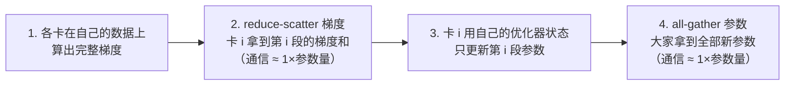
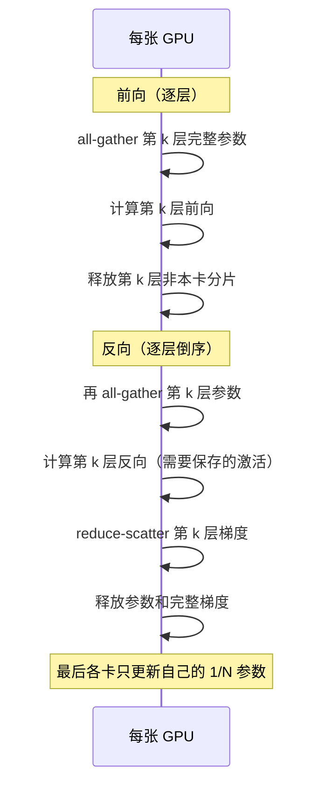
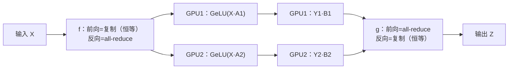
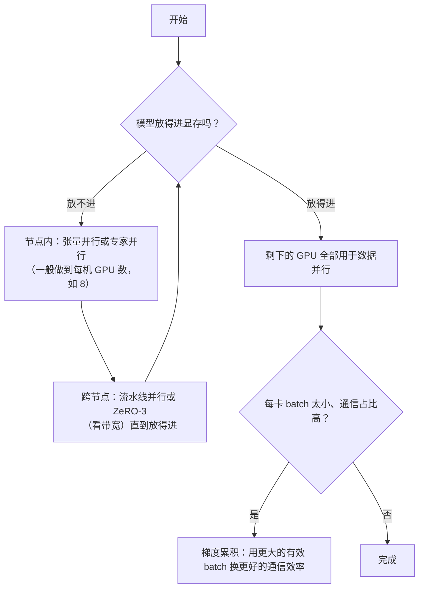

# 第 8 章 并行训练（下）：ZeRO/FSDP、模型并行与 3D 并行

> 对应课程：Lecture 8《Parallelism》（主讲 Tatsunori Hashimoto） · [YouTube](https://www.youtube.com/watch?v=6-cXp-aOmdg) · 官方讲义：[幻灯片 lecture_08.pdf](https://github.com/stanford-cs336/lectures/blob/main/lecture_08.pdf)

<Video id="6-cXp-aOmdg" title="Lecture 8 原视频" />

## 本章你将学到

- 为什么朴素数据并行（DDP）的显存是“灾难”：每个参数要 16 字节，而且每张卡都存一份。
- **ZeRO 三个阶段（Stage 1/2/3，Stage 3 即 FSDP）** 如何利用“all-reduce = reduce-scatter + all-gather”，几乎免费地把优化器状态、梯度乃至参数切到各卡上。
- **流水线并行**的气泡从哪来、如何用微批次、1F1B、零气泡调度把它压小。
- **张量并行**怎么切矩阵（列切/行切）、为什么只能放在节点内；**序列并行**如何补上激活显存的最后一块；**专家并行**为何是 MoE 的首选。
- 激活显存的估算公式 $sbh(34+5as/h)$，以及工业界组合多种并行的**经验法则（3D/4D 并行）**和真实模型的并行配置。

## 先说结论（一分钟版）

1. 我们需要多机多卡，是因为**算力**和**显存**都不够。单卡之上，真正的“计算单元”是整个数据中心，目标是让显存和算力都随 GPU 数**线性**扩展。
2. 数据并行的显存问题可以用 ZeRO 解决：ZeRO-1、ZeRO-2 的通信量和 DDP 一样（2 倍参数量），省显存是“免费”的；ZeRO-3/FSDP 多一次 all-gather（3 倍参数量），但靠通信与计算重叠，几乎没有速度损失。
3. 但数据并行有两个硬伤：它**消耗 batch size**（受临界 batch size 限制），而且**不切激活值**。于是需要模型并行：流水线（切深度，通信省但有气泡）、张量（切宽度，无气泡但通信极大）、专家（切 MoE 专家）、序列/上下文（切序列）。
4. 经验法则：**先用张量/专家并行占满一台机器内的高速互联（通常 ≤ 8），再用流水线或 ZeRO-3 跨机器把模型塞进显存，剩下的 GPU 全部用来做数据并行。**

---

## 8.1 回顾与动机：为什么要并行，硬件长什么样

### 两个瓶颈

上一章 Percy 讲了“机制”，这一章 Tatsu 讲“工业界真实怎么做”（[▶ 00:05](https://www.youtube.com/watch?v=6-cXp-aOmdg&t=5s)）。多机多卡要解决两个瓶颈（[▶ 01:06](https://www.youtube.com/watch?v=6-cXp-aOmdg&t=66s)）：

- **算力**：世界上最快的超级计算机有 exaFLOPs（$10^{18}$ 次/秒）量级的算力，单张 GPU 远远达不到。
- **显存**：模型太大，一张卡装不下，必须切成小块分到各卡。

贯穿本章的一个重要区分是**节点内（intra-node）**和**节点间（inter-node）**（[▶ 02:06](https://www.youtube.com/watch?v=6-cXp-aOmdg&t=126s)）：节点内连接很快，可以做通信很“贵”的事；节点间连接慢，必须用更“省通信”的方法。

本章的讨论都停留在**集合通信原语**这一层：说“这里要一次 all-reduce”，而不去管数据包怎么发。其中最重要的仍是上一章那个等式（[▶ 03:07](https://www.youtube.com/watch?v=6-cXp-aOmdg&t=187s)）：

$$
\text{all-reduce} = \text{reduce-scatter} + \text{all-gather}
$$

在带宽受限的情况下，两种做法代价相同。这个“相同”就是 ZeRO 能“免费”省显存的根源。

### TPU 与 GPU：两种网络哲学

虽然本章的算法与硬件无关，但网络拓扑会影响各家公司偏好的并行策略（[▶ 04:08](https://www.youtube.com/watch?v=6-cXp-aOmdg&t=248s)）：

| | TPU（Google） | GPU（NVIDIA） |
|---|---|---|
| 拓扑 | **环面网格（toroidal mesh）**：每个芯片只连邻居，边缘绕回相连（实际是 3D 的） | **类 all-to-all 的树（fat tree）**：底层 GPU 高速互连，往上是 pod、再往上是 spine 交换机 |
| 优点 | 拓扑简单、可以几乎无限扩展；每条连接可以更“粗”；成本和功耗低 | 灵活，适合不规则、随机的通信 |
| 擅长 | 规整、可预测的切分，比如稠密模型的张量并行 | MoE 那种 token 随机路由到专家的通信 |

有趣的是，两者正在“趋同演化”（[▶ 07:10](https://www.youtube.com/watch?v=6-cXp-aOmdg&t=430s)）：讲课当天 Google 发布的 TPU 8i（推理芯片）改用了更接近树形的拓扑，TPU 8t（训练芯片）的跨机架网络（Virgo）也采用交换式网络。原因很可能是现代大模型多为 MoE，推理时 token 在专家间满天飞，需要更多 all-to-all 带宽。**是工作负载在定义网络。**

### “为什么不把所有卡都连起来？”

另一个极端是华为的方案（[▶ 09:10](https://www.youtube.com/watch?v=6-cXp-aOmdg&t=550s)）：昇腾芯片单颗比 H200 慢不少，但华为用大量光模块把 384 颗芯片连成一个高速域（CloudMatrix 384）。代价是功耗：课上说大约是同等 NVIDIA 系统的 4 倍。这和“为什么不全用 SRAM”（Groq）是同一类权衡：愿意付出功耗和成本，就能用蛮力解决很多通信问题。

### 我们想要什么

Part 1 的小结（[▶ 10:11](https://www.youtube.com/watch?v=6-cXp-aOmdg&t=611s)）：

- **新的计算单元是整个数据中心**，不是一张 GPU。
- 希望**显存线性扩展**：能训练的最大参数量随 GPU 数线性增长。
- 希望**算力线性扩展**：有效 FLOPs 随 GPU 数线性增长。
- 用简单的集合通信原语实现这一切。

---

## 8.2 数据并行的显存账：为什么说它是“灾难”

### 朴素数据并行

先忘掉 Adam，只看最朴素的 SGD（[▶ 12:13](https://www.youtube.com/watch?v=6-cXp-aOmdg&t=733s)）：

$$
\theta_{t+1} = \theta_t - \eta\sum_{i=1}^{B}\nabla f(x_i)
$$

$\theta$ 是参数，$\eta$ 是学习率，$B$ 是 batch 大小，$\nabla f(x_i)$ 是第 $i$ 个样本的梯度。把 $B$ 个样本分给 $M$ 台机器，每台算 $B/M$ 个样本的梯度和，再把梯度同步（加起来）即可。

| 指标 | 表现 |
|---|---|
| 算力扩展 | 好：每卡处理 $B/M$ 个样本，只要每卡样本够多就行 |
| 通信开销 | 每步传约 **2 × 参数量**（一次 all-reduce），batch 大时可接受 |
| 显存扩展 | **完全没有**：每张卡都要存完整的模型 |

### 一个参数到底占多少字节

“显存看起来有点问题”，实际情况是“显存糟糕透了”（[▶ 13:13](https://www.youtube.com/watch?v=6-cXp-aOmdg&t=793s)）。按常见的混合精度 + Adam，每个参数要存约 **5 份拷贝、16 字节**：

| 内容 | 精度 | 字节/参数 |
|---|---|---|
| 模型参数 | bf16 | 2 |
| 梯度 | bf16 | 2 |
| fp32 主权重（master weights，SGD 累加更新用的高精度副本） | fp32 | 4 |
| Adam 一阶矩 $m$ | fp32（或 bf16） | 4（或 2） |
| Adam 二阶矩 $v$ | fp32（或 bf16） | 4（或 2） |
| **合计** | | **16** |

后三项统称**优化器状态（optimizer state）**，记每参数 $K$ 字节（这里 $K=12$）。它才是显存大头：参数和梯度一样大，而优化器状态是它们的好几倍。

**手算一遍。** 一个 7.5B 参数的模型：

$$
(2+2+12)\times 7.5\times10^9 = 120\ \text{GB}
$$

一张 80 GB 的卡连这个都放不下，还没算激活值。而朴素 DDP 让 **64 张卡每张都存这 120 GB**，显存消耗随卡数线性增长，却一点也没“分摊”。

::: tip 移动端类比
朴素数据并行就像团队里每个人的电脑上都克隆了一份完整的、带全部历史记录和构建缓存的巨型 monorepo：大家各自改一部分代码，但每人都背着全部仓库。ZeRO 的思路是：历史记录和构建缓存（优化器状态）按目录分给不同人保管，需要时再互相要。
:::

---

## 8.3 ZeRO：把冗余状态切开

ZeRO（Zero Redundancy Optimizer）的核心思路：**把占地方的状态切开，并利用 reduce-scatter 的等价关系**（[▶ 15:14](https://www.youtube.com/watch?v=6-cXp-aOmdg&t=914s)）。ZeRO 论文给出的例子（7.5B 参数、64 张卡、$K=12$）里，每卡显存从 120 GB 一路降到：

| 方案 | 每卡显存公式 | 7.5B、64 卡时 |
|---|---|---|
| 朴素 DDP | $(2+2+K)\Psi$ | 120 GB |
| ZeRO-1（切优化器状态） | $(2+2)\Psi + K\Psi/N$ | 约 31.4 GB |
| ZeRO-2（再切梯度） | $2\Psi + (2+K)\Psi/N$ | 约 16.6 GB |
| ZeRO-3（再切参数） | $(2+2+K)\Psi/N$ | 约 1.9 GB |

其中 $\Psi$ 是参数量，$N$ 是 GPU 数，$K$ 是每参数优化器状态字节数。“没有免费午餐”，往下走似乎要付出越来越多的通信。但神奇之处在于：**大部分是免费的**。

### ZeRO Stage 1：切优化器状态

思路（[▶ 16:14](https://www.youtube.com/watch?v=6-cXp-aOmdg&t=974s)）：

- 每张卡仍有完整的**参数**和**梯度**；
- **优化器状态**切成 $N$ 份，卡 $i$ 只保存第 $i$ 段参数对应的 Adam 状态；
- 于是卡 $i$ 只负责**更新第 $i$ 段参数**。

一步训练怎么走（[▶ 17:14](https://www.youtube.com/watch?v=6-cXp-aOmdg&t=1034s)）：

对比一下：

| | 朴素 DDP | ZeRO-1 |
|---|---|---|
| 通信原语 | 一次 all-reduce（梯度） | 一次 reduce-scatter（梯度）+ 一次 all-gather（参数） |
| 通信量 | 2 × 参数量 | 2 × 参数量 |
| 每卡显存 | $(4+K)\Psi$ | $(4+K/N)\Psi$ |

因为 reduce-scatter + all-gather 与 all-reduce 等价，**ZeRO-1 和 DDP 的通信量完全一样**。省下的显存是“白送”的（在带宽受限的情况下）。所以课上说：**ZeRO-1 你应该总是开着。**

### ZeRO Stage 2：再切梯度

既然这么顺利，那梯度也切了吧（[▶ 19:15](https://www.youtube.com/watch?v=6-cXp-aOmdg&t=1155s)）。难点在于：数据并行要求每张卡**计算**完整梯度，但我们又不想**存下**完整梯度。

解决办法是一个系统技巧：**反向传播是逐层往回走的**。

1. 每算完一层的梯度，立刻 reduce 发给负责这一段的卡；
2. 这一层的梯度在反向图里不再需要了，立刻释放；
3. 全部反向完成后，各卡更新自己那段参数，再 all-gather 参数。

“一次性发”和“逐层发”的总通信量相同，所以 ZeRO-2 依然几乎免费（只多了一些逐层通信的开销）。

### ZeRO Stage 3 / FSDP：连参数也切

最“魔法”的一步：**把参数也切开**（[▶ 20:15](https://www.youtube.com/watch?v=6-cXp-aOmdg&t=1215s)）。每张卡在任何时刻只持有参数、梯度、优化器状态的 1/N。这就是 PyTorch 里的 **FSDP（Fully Sharded Data Parallel）**。

关键是**按需请求、用完即丢**（[▶ 21:15](https://www.youtube.com/watch?v=6-cXp-aOmdg&t=1275s)）：

通信量：**2 次 all-gather + 1 次 reduce-scatter ≈ 3 × 参数量**，比 DDP 多一次 all-gather，是 1.5 倍。

::: warning 常见误区
有同学以为 FSDP 是“GPU 0 算第一层、GPU 1 算第二层”（[▶ 26:16](https://www.youtube.com/watch?v=6-cXp-aOmdg&t=1576s)）。不是！那是流水线并行。FSDP 里**每张卡都从头到尾跑完整个模型**，只是谁也不长期持有全部参数：每算一层前临时把这层参数凑齐，算完就扔。它本质上仍是数据并行，计算与单卡完全一样。
:::

还有同学问：每层都要通信，通信量为什么不乘以层数？因为每层的通信只涉及**这一层**的参数，所有层加起来正好是一份完整参数，和一次性 all-reduce 全模型是同一个量级（[▶ 27:16](https://www.youtube.com/watch?v=6-cXp-aOmdg&t=1636s)）。

### 为什么 FSDP 几乎没有额外开销：通信与计算重叠

每层都通信，听起来很慢。FSDP 靠两个思想变得“几乎免费”（[▶ 22:15](https://www.youtube.com/watch?v=6-cXp-aOmdg&t=1335s)）：

1. **增量地通信与计算**：沿计算图逐层走，需要时取、用完即释放；
2. **重叠通信与计算**：在 GPU 上，计算和通信跑在不同的 stream 上。算第 0 层前向时，就已经在 all-gather 第 1 层的参数；算第 1 层时，在取第 2 层……

```mermaid
gantt
  title FSDP 前向的重叠示意（时间从左到右）
  dateFormat X
  axisFormat %s
  section 通信流
  all-gather 第0层 :a0, 0, 2
  all-gather 第1层 :a1, 2, 4
  all-gather 第2层 :a2, 4, 6
  section 计算流
  前向 第0层 :c0, 2, 5
  前向 第1层 :c1, 5, 8
  前向 第2层 :c2, 8, 11
```

只要**每层的计算时间比通信时间长**，通信就被完全藏在计算下面（[▶ 24:16](https://www.youtube.com/watch?v=6-cXp-aOmdg&t=1456s)）。实际跑 FSDP，GPU 利用率接近单卡水平，“相当惊人”。作业 2 里你就要写一个 FSDP：本质上是一个包装任意模块的 wrapper，做“all-gather → 计算 → 释放”，反向时再来一遍。

::: tip 移动端类比
这就像列表滚动时的**预加载（prefetch）**：用户在看第 10 张卡片时，你已经在后台请求第 11、12 张的图片。只要“看一张”的时间比“下载一张”长，用户永远感觉不到网络延迟。FSDP 在算第 k 层时预取第 k+1 层的参数，是同一个道理。
:::

### 小结：ZeRO 各阶段的代价

| 方案 | 通信量 | 评价 |
|---|---|---|
| DDP | 2 × 参数量 | 基线 |
| ZeRO-1 | 2 × 参数量 | **免费**，应该总是开 |
| ZeRO-2 | 2 × 参数量 | 几乎免费（逐层通信有少量开销） |
| ZeRO-3 / FSDP | 3 × 参数量 | 1.5 倍通信，但能被重叠藏住（忽略延迟） |

### 能装下多大的模型？

讲义给了一个 8 × A100 80G 的例子（[▶ 27:16](https://www.youtube.com/watch?v=6-cXp-aOmdg&t=1636s)）。这里假设除了主权重外都用 bf16（配合 Kahan 求和这种补偿舍入误差的累加方法，可以做纯 bf16 训练），即每参数 12 字节：参数 2 + 梯度 2 + 主权重 4 + Adam 两个矩各 2。注意它和第 2 章的 12 字节拆法不同：那里是参数 2 + 梯度 2 + Adam 两个矩各 4，没有主权重，总数碰巧一样。忽略激活，每卡 80 GB：

| 方案 | 每参数在每卡上的字节数 | 最大参数量 |
|---|---|---|
| 基线 DDP | 12 | 80 / 12 ≈ **6.67B** |
| ZeRO-1 | $4 + 8/8 = 5$ | 80 / 5 = **16B** |
| ZeRO-2 | $2 + 10/8 = 3.25$ | 80 / 3.25 ≈ **24.6B** |
| ZeRO-3 | $12/8 = 1.5$ | 80 / 1.5 ≈ **53.3B** |

手算 ZeRO-2：参数 2 字节不切；梯度 2 + 优化器 8 = 10 字节切成 8 份，每卡 1.25；合计 3.25 字节/参数。同学问换成 H200 怎么算（[▶ 28:18](https://www.youtube.com/watch?v=6-cXp-aOmdg&t=1698s)）？答案是线性缩放：把 80 换成 141 即可。

下面的演示可以直观看到每张卡上放了什么。选“80 GB、12 字节、N=8”，依次点 DDP、ZeRO-1、ZeRO-2、ZeRO-3，表格最后一行就会复现上面这张表。

<Demo src="ch08-parallel-memory.html" title="六种切法：每卡存什么、要多少显存" :height="1440" />

---

## 8.4 数据并行的极限：batch size 与激活值

FSDP 很干净、很优雅，Tatsu 说“真希望讲到这里就结束”（[▶ 28:18](https://www.youtube.com/watch?v=6-cXp-aOmdg&t=1698s)），可惜还有两个问题。

### 问题一：数据并行在消耗 batch size

数据并行把 batch 分给各卡，所以**卡数不能超过 batch size**：batch 只有 8，就不可能用 8 张以上的卡做数据并行。那把 batch 无限加大呢？不行。存在一个**临界 batch size（critical batch size）**：超过它之后，batch 再大，带来的收益还不如多走几步 SGD（[▶ 29:19](https://www.youtube.com/watch?v=6-cXp-aOmdg&t=1759s)）。小 batch 时，加样本几乎等于多走步；过了临界点就收益递减。

于是你面临两难：小 batch 让 GPU 闲着，大 batch 让优化变差。**batch size 是一种有限的资源**，要省着花。（第 9 章“缩放定律”会进一步讨论 batch size 和学习率怎么选。）

### 问题二：激活值没有被切

ZeRO-1、ZeRO-2 根本不减少参数显存；ZeRO-3 切了参数，但**激活值**一点没动（[▶ 30:20](https://www.youtube.com/watch?v=6-cXp-aOmdg&t=1820s)）。而大模型、长序列下，激活值往往比参数还大。我们需要更细粒度地切模型。

### 模型并行登场

**模型并行**和 ZeRO-3 一样把参数切到各卡上，但有一个关键的概念差别：

- ZeRO-3 / FSDP：**传参数**，计算本身不变；
- 模型并行：**传激活值**。比如第 1 层在 GPU 0、第 2 层在 GPU 1，那么要传的是两层之间的激活。

接下来讲三种模型并行，对应三种切法：**流水线并行**（切深度）、**张量并行 + 序列并行**（切宽度和序列）、**专家并行**（切 MoE 专家）。

---

## 8.5 流水线并行：切深度

### 朴素的按层切分：利用率只有 1/n

最直观的想法：把层切开放到不同 GPU 上，前向时往后传激活，反向时往前传部分梯度（[▶ 31:20](https://www.youtube.com/watch?v=6-cXp-aOmdg&t=1880s)）。

结果是一张“非常令人沮丧”的时间线：4 张卡各管 1/4 的层，GPU 0 算完前向就交给 GPU 1，然后**一直闲着**，直到反向传回来。任意时刻只有一张卡在干活，**n 张卡时每张卡只有 1/n 的时间在工作**。这些空闲时段叫**气泡（bubble）**。

### 微批次：让流水线流动起来

解决办法是像流水线一样处理：把 batch 切成若干**微批次（micro-batch）**，GPU 0 处理完第 1 个就交出去，立刻开始第 2 个（[▶ 33:21](https://www.youtube.com/watch?v=6-cXp-aOmdg&t=2001s)）。讲义给出气泡时间与有用计算的比值：

$$
\frac{\text{气泡时间}}{\text{有用计算时间}} = \frac{n_{\text{stages}}-1}{n_{\text{micro}}}
$$

$n_{\text{stages}}$ 是流水线段数（GPU 数），$n_{\text{micro}}$ 是微批次数。换算成“气泡占总时间的比例”就是 $\frac{p-1}{m+p-1}$（$p$ 为段数，$m$ 为微批数）。

**手算一遍。** 4 段、8 个微批：比值 $3/8 = 0.375$，气泡占总时间 $3/11\approx 27\%$。若微批增加到 32：比值 $3/32\approx0.09$，气泡占 $3/35\approx 8.6\%$。

所以**要想气泡小，就需要很大的 batch**，让微批数远大于段数。这又回到了“batch size 是资源”的主题：现在我们可以把 batch 花在“填满流水线”上。

下面的演示用一个简单的调度模拟器画出时间线。切换四种调度，拖动 p 和 m，看气泡（粉色）怎么变化。特别注意“峰值激活”：GPipe 要同时存 m 个微批的激活，1F1B 只要存 p 个左右。

<Demo src="ch08-pipeline-bubble.html" title="流水线并行的气泡：四种调度的时间线" :height="740" />

::: details GPipe 与 1F1B 的区别（课上图中隐含的内容，可跳过）
- **GPipe**：所有微批先做完前向，再统一做反向。实现简单，但每段要保存所有 $m$ 个微批的激活，显存随 $m$ 增长。
- **1F1B（one-forward-one-backward）**：先做几次前向“预热”，之后前向和反向交替进行。总时长和气泡与 GPipe 相同，但第 $s$ 段（从 0 数起，第一段是 $s=0$）同时“在途”的微批最多 $p-s$ 个，激活显存大幅降低。Megatron 等框架默认用它。

这两个名字课上没有展开，但它们是理解后面“零气泡”调度的基础，在演示里可以直接对比。
:::

### 流水线这么麻烦，为什么还要用？

业内有个说法：并行代码一直都挺好懂的，直到你实现了流水线并行（[▶ 34:22](https://www.youtube.com/watch?v=6-cXp-aOmdg&t=2062s)）。那为什么还用它？

1. **省显存**：按层切，每卡只存 1/p 的参数（相比 DDP）。它也可以和数据并行组合。
2. **通信性质很好**：只传激活值，大小是 $b\times s\times h$（batch × 序列长度 × 隐藏维），而且是**点对点**通信，不是 all-to-all。同学追问为什么比 FSDP 省：因为 $bsh$ 几乎总比一整个参数矩阵小得多（[▶ 35:24](https://www.youtube.com/watch?v=6-cXp-aOmdg&t=2124s)）。

因此实践中，**流水线并行放在最慢的链路上**：跨机器、跨 pod 甚至跨数据中心。

NVIDIA Megatron 论文（Narayanan 等，2021）的扫描实验显示：batch 大时，即使流水线段数多，利用率也能接近不用流水线；batch 小时，流水线会迅速拖垮性能。

### 更聪明的调度

人们想出了更复杂的流水线排布：把不同微批、不同阶段的前向和反向穿插起来，用更多通信带宽换更高的利用率。课上展示的例子来自 DeepSeek 的论文（[▶ 36:25](https://www.youtube.com/watch?v=6-cXp-aOmdg&t=2185s)）。

### 零气泡流水线（Zero Bubble）

更巧妙的思路不在于调度本身，而在于**看清反向传播的结构**（[▶ 37:25](https://www.youtube.com/watch?v=6-cXp-aOmdg&t=2245s)）。反向传播在每个节点上其实做两件事：

1. **B：把梯度继续往前（往输入方向）传播**。上一段 GPU 要等它才能开始自己的反向，所以它在关键路径上，必须尽快做。
2. **W：计算本层权重的梯度**。它是计算图上的“叶子”，没人等它，**什么时候算都行**。

于是把两者拆开：B 尽早做，W 推迟到流水线有空隙时再做，用它来填补气泡。这样几乎可以把流水线完全填满，代价是实现复杂得多。在演示里选“零气泡”，就能看到紫色的 W 块填满了 1F1B 末尾的空隙。

---

## 8.6 张量并行：切宽度

### 矩阵乘法可以拆开算

流水线是沿**深度**切。模型还有另一个维度：**宽度**（[▶ 39:27](https://www.youtube.com/watch?v=6-cXp-aOmdg&t=2367s)）。张量并行利用一个朴素事实：大矩阵乘法可以拆成若干小矩阵乘法，再把部分和加起来。这和第 5、6 章的分块（tiling）是同一个思想，这个原语在课程里反复出现。

以 MLP 为例：输入 $X$，乘矩阵 $A$（上投影），过 GeLU，再乘矩阵 $B$（下投影），得到输出 $Z$。

$$
Z = \text{GeLU}(XA)\,B
$$

在 2 路张量并行里：

- $A$ **按列**切成 $[A_1, A_2]$，GPU 1 算 $Y_1=\text{GeLU}(XA_1)$，GPU 2 算 $Y_2=\text{GeLU}(XA_2)$。因为 GeLU 是逐元素的，可以各自算。
- $B$ **按行**切成 $\begin{bmatrix}B_1\\B_2\end{bmatrix}$，GPU 1 算 $Y_1B_1$，GPU 2 算 $Y_2B_2$。
- 最终结果 $Z = Y_1B_1 + Y_2B_2$，需要把两张卡的部分和**加起来**：一次 all-reduce。

这和第 7 章的代码并不矛盾。第 7 章只做了列切，每层算完用 all-gather 把各卡的那一片激活拼回完整的；这里是 Megatron 的做法，列切之后紧跟行切，两次矩阵乘法之间不通信，最后用一次 all-reduce 把部分和加起来。两种写法都是张量并行，只是通信放的位置和用的原语不同。

### f 和 g 的对偶

课上强调了一个**前向/反向的对偶关系**（[▶ 40:28](https://www.youtube.com/watch?v=6-cXp-aOmdg&t=2428s)）：

- 前向：$f$ 是恒等（把 $X$ 复制给两张卡），$g$ 是 all-reduce（把部分和加起来）。
- 反向：反过来，$g$ 是恒等（梯度直接分给两张卡），$f$ 是 all-reduce（$X$ 被两边都用了，它的梯度要把两边的贡献加起来）。

写张量并行代码时，这个对偶非常关键。

### Transformer 里怎么切

在一个 Transformer block 里（[▶ 41:28](https://www.youtube.com/watch?v=6-cXp-aOmdg&t=2488s)）：

| 切法 | 用在哪里 |
|---|---|
| **列切（column-wise）** | 注意力的 Q、K、V 投影；MLP 的上投影 |
| **行切（row-wise）** | 注意力的输出投影；MLP 的下投影 |
| **复制（replicated）** | LayerNorm、非线性、MoE 的路由器等小部件，切它们不划算 |

先列切再行切，正好中间不需要通信，每个子层只在结尾做一次 all-reduce。

### 只在节点内用

张量并行**极其消耗通信**：每个注意力子层、每个 MLP 子层都要通信一次（前向、反向各一次 all-reduce），而且传的是激活值大小的数据，频率极高（[▶ 42:29](https://www.youtube.com/watch?v=6-cXp-aOmdg&t=2549s)）。所以在 GPU 上，它只在**一台机器内部的 8 张卡**之间做，因为那里有 NVLink。一旦超过 8、跨到另一台机器，性能会大幅下降。

这正好呼应前面 TPU 的话题（[▶ 43:29](https://www.youtube.com/watch?v=6-cXp-aOmdg&t=2609s)）：TPU 没有“8 卡快、再往外慢”的分界，整个环面网格上规则通信的带宽都很高，所以 **TPU 上可以做比 GPU 大得多的张量并行**。TPU 和 GPU 上，张量并行与流水线并行的比例会很不一样。

### 张量并行 vs 流水线并行

| | 张量并行 | 流水线并行 |
|---|---|---|
| 气泡 | **没有**（网络够快就不用等） | 有，需要大 batch 填 |
| 复杂度 | 低：只是切几个矩阵乘法，容易“包装”现有模型 | 高 |
| 对 batch size 的要求 | 不需要大 batch | 需要大 batch |
| 通信量 | **大**：每层约 $8bsh\cdot\frac{n-1}{n}$，且是 all-reduce | 小：每个微批 $bsh$，点对点 |
| 适用链路 | 低延迟、高带宽（节点内） | 慢速链路（节点间） |

结论（[▶ 44:29](https://www.youtube.com/watch?v=6-cXp-aOmdg&t=2669s)）：**有高速互联就用张量并行，其他情况考虑别的。**

---

## 8.7 激活显存：被忽视的大头，以及序列并行

### 显存是动态的

最天真的看法是“显存 = 参数”。我们已经知道还有优化器状态。但用 PyTorch 显存分析器看一次真实训练，会发现还有大量**动态**显存（[▶ 45:30](https://www.youtube.com/watch?v=6-cXp-aOmdg&t=2730s)）：前向时激活值不断堆积，反向开始后又陆续产生梯度。**峰值通常出现在反向刚开始不久**：激活还没释放多少，梯度已经开始占地方了。

而且模型越大，激活越可能**超过**参数显存（Korthikanti 等 2022 年的论文对此有实测）。任何省显存的方案都必须处理激活。

### 每层激活有多少

如果什么都存，每个 Transformer 层的激活约为（单位：字节，按 16 位存储）（[▶ 46:32](https://www.youtube.com/watch?v=6-cXp-aOmdg&t=2792s)）：

$$
\text{激活}_{\text{每层}} = sbh\left(34 + \frac{5as}{h}\right)
$$

- $s$：序列长度；$b$：batch 大小（微批）；$h$：隐藏维度；$a$：注意力头数。
- $sbh$ 项是“基本盘”：序列里每个位置、batch 里每个样本、隐藏维的每一维都要存点东西，这很自然。
- $\frac{5as}{h}$ 项来自注意力里**平方级**的部分（注意力分数矩阵、softmax、dropout），它和 $s$ 成正比，所以整体是 $s^2$ 级别。用 FlashAttention 式的**重计算**就能去掉这一项。

**手算一遍。** 一个 7B 级模型：$h=4096$，$a=32$，$L=32$ 层，$s=2048$，$b=1$。

- $sbh = 2048\times1\times4096\approx 8.39\times10^6$
- $5as/h = 5\times32\times2048/4096 = 80$
- 每层：$8.39\times10^6\times(34+80)\approx 9.6\times10^8$ 字节 ≈ 0.96 GB
- 32 层：约 **30.6 GB**。用 FlashAttention 去掉 80 那项后：$8.39\times10^6\times34\times32\approx$ **9.1 GB**。

### 张量并行能省多少激活

张量并行切开了注意力和 MLP 里的矩阵乘法，相关的激活也随之被切成 $t$ 份（$t$ 是张量并行度）（[▶ 47:33](https://www.youtube.com/watch?v=6-cXp-aOmdg&t=2853s)）：

$$
\text{激活}_{\text{每层}}^{\text{TP}} = sbh\left(10 + \frac{24}{t} + \frac{5as}{ht}\right)
$$

34 里的 24 被切了，但还剩 **10**：LayerNorm（4sbh）、Dropout（2sbh）、注意力和 MLP 的输入（4sbh，要留给反向用的残差输入）。张量并行**不切**这些逐点操作，所以哪怕你像 Google 那样做一千路张量并行，每层也还剩 $10sbh$ 的激活。

### 序列并行：把最后的 10sbh 也切掉

**序列并行（sequence parallel）**这个名字“极具误导性”（还有个叫上下文并行的东西更配这个名字），它的意思是（[▶ 48:33](https://www.youtube.com/watch?v=6-cXp-aOmdg&t=2913s)）：

- 剩下的那 10sbh 都是**逐点操作**（LayerNorm、Dropout 等），对序列里每个位置独立计算；
- 所以可以**沿序列维度**把它们切开，每张卡只处理序列的 1/t；
- 进入下一个需要完整序列的张量并行区域前，做一次 **all-gather**；离开时做 **reduce-scatter**。前向时 $g$ 是 all-gather、$\bar g$ 是 reduce-scatter，反向时互换。

这非常像 FSDP 的思路：东西平时分片存着，需要时才凑齐。

最终（[▶ 50:34](https://www.youtube.com/watch?v=6-cXp-aOmdg&t=3034s)）：

| 方案 | 每层激活 |
|---|---|
| 不并行 | $sbh(34 + 5as/h)$ |
| 张量并行 | $sbh(10 + 24/t + 5as/(ht))$ |
| 张量并行 + 序列并行 | $\frac{sbh}{t}(34 + 5as/h)$ |
| 再加注意力重计算 | $\frac{34\,sbh}{t}$ |

**$34sbh/t$ 值得记住**：它大约是正常训练中激活显存的合理下限。估算“模型能不能放进 GPU”时：激活至少这么多，再加上优化器状态、参数和梯度，就有了大致的显存预算。

同学问 MLP 的 24 那部分能不能也用重计算省掉（[▶ 51:34](https://www.youtube.com/watch?v=6-cXp-aOmdg&t=3094s)）？可以，但代价很高：等于反向时把 MLP 再算一遍。注意力的重计算相对便宜（按块做，且省掉了平方级存储）。

---

## 8.8 专家并行与上下文并行

### 专家并行（EP）

如今大模型多是 MoE，它带来一个福利：**专家并行**（[▶ 52:35](https://www.youtube.com/watch?v=6-cXp-aOmdg&t=3155s)）。和张量并行类似，它切的是 MLP（FFN）部分，只不过不是把一个矩阵切碎，而是把**整个专家**放到不同设备上，然后把 token 的激活**路由**过去。

系统行为上，EP 和 TP 相似：高带宽需求，也能减少激活。但对 MoE，**几乎总是优先用 EP 而不是 TP**。NVIDIA Megatron 的并行指南明确这么建议，原因是（[▶ 54:37](https://www.youtube.com/watch?v=6-cXp-aOmdg&t=3277s)）：

- TP 把矩阵切得太细，矩阵乘法变小，GPU 利用率下降（第 5、6 章讲过：矩阵越大越容易算满）；
- MoE 层里路由稀疏的 token 激活，比传输稠密的 TP 激活更高效；
- 既然有很多专家，正好可以分散到所有设备上。

**但 EP 很难做好**（[▶ 55:38](https://www.youtube.com/watch?v=6-cXp-aOmdg&t=3338s)）。每个 MoE 层都要 all-to-all 地分发 token，而计算在等 token 到达，所以对**延迟**极其敏感。DeepSeek 为此写了 **DeepEP** 库，在很底层的 GPU 网络原语上优化分发与合并，甚至找到并使用了**未公开的 PTX 指令**（类似 GPU 机器码）来加速通信；NVIDIA 也有类似的 Hybrid-EP。这就是前沿并行效率需要的功夫。

### EP 与其他并行的组合

大多数并行方式可以像乐高一样随意组合，但 EP 有额外约束（[▶ 57:39](https://www.youtube.com/watch?v=6-cXp-aOmdg&t=3459s)）：

- 老一点的库里，EP 的副本组和 DP 的副本组是同一批：比如 DP=8，就把专家分到这 8 个副本上，数据也分到这 8 个副本上再路由。所以通常 **EP ≤ DP**，这也限制了 DP 和 TP 的组合方式。
- **注意力与 MLP 的矛盾**：MoE 只改 MLP，不改注意力。EP 只能并行 MLP，注意力需要 TP 来切；但 TP 一高，MLP 的矩阵又被 TP 和 EP 切得太碎、利用率很差。于是**注意力想要高 TP，MLP 想要低 TP**（[▶ 59:39](https://www.youtube.com/watch?v=6-cXp-aOmdg&t=3579s)）。

解决方案是更灵活的系统：让注意力层和 MoE 层使用**不同的**并行配置。Megatron 里注意力用 TP/CP/DP，MLP 用 ETP/EP/EDP（专家张量并行、专家并行、专家数据并行），彼此解耦。

### 上下文并行 / Ring Attention

**上下文并行（context parallel，CP）**或 **Ring Attention**：把一条很长序列的激活切到多张卡上，并沿着类似 TPU 环形网格的方式在设备间传递 K/V（[▶ 60:39](https://www.youtube.com/watch?v=6-cXp-aOmdg&t=3639s)）。最早的 Ring Attention 论文展示了它在 TPU 上的良好效果。它主要用于**长上下文扩展阶段**和模型推理服务。课上没有展开，因为概念上与前面内容重叠。

---

## 8.9 一张总表：没有一种方法完胜

讲义把所有方法汇成一张表，并把各自的缺点标成红色（[▶ 61:39](https://www.youtube.com/watch?v=6-cXp-aOmdg&t=3699s)）。下面是整理后的中文版：

| 方法 | 通信/同步 | 每卡参数显存 | 每卡激活/KV 显存 | 主要带宽开销 | 能扩大全局 batch？ | 易用性 |
|---|---|---|---|---|---|---|
| DDP / ZeRO-1 | 每步梯度 all-reduce | 不随卡数减少（ZeRO-1 只切优化器状态） | 不减少 | 梯度，约 O(参数量) | 能，随 DP 线性 | 很容易 |
| FSDP / ZeRO-3 | 参数 all-gather + 梯度 reduce-scatter，可重叠 | 约 1/DP（参数/梯度/优化器状态） | 不减少 | 参数，约 O(参数量)，高于 DDP | 能，随 DP 线性 | 中等 |
| 流水线并行 | 层间传激活，有气泡 | 约 1/PP | 取决于流水线缓冲 | 段间激活 | 不能，但需要微批 | 难 |
| 张量并行 | 阻塞式激活通信 | TP 切分的权重约 1/TP | 配合 SP 时相关激活约 1/TP | 每个 block 都有激活大小的集合通信 | 不能 | 难 |
| 序列/上下文并行 | 每层交换序列分片 | 不减少 | 序列侧激活/KV 约 1/SP 或 1/CP | 激活/KV 通信 | 不能 | 难 |
| 专家并行（MoE） | 每个 MoE 层 all-to-all 分发 token | 仅专家权重约 1/EP | 不减少 | token 路由 all-to-all | 不能，且每个专家需要足够多 token | 难 |

要点：**每种方法都有红色格子**。FSDP 很好，但不减激活、还消耗全局 batch；加上张量并行能减激活、不吃 batch，但需要快网络；为了利用慢链路，又要引入别的并行……所以大规模训练几乎都是**组合拳**。同学问流水线和 FSDP 能否用于 MoE：当然可以，所有前沿模型都大量使用 FSDP/数据并行、流水线和张量并行（[▶ 62:39](https://www.youtube.com/watch?v=6-cXp-aOmdg&t=3759s)）。

---

## 8.10 3D/4D 并行：组合的经验法则

### 可以用数学来选

并行的一大好处是**可以算**（[▶ 63:40](https://www.youtube.com/watch?v=6-cXp-aOmdg&t=3820s)）：每种切法每层算多少、通信多少，分到多少设备上怎么缩放，都能写出式子。然后画出“计算时间 / 通信时间”随每卡 batch size 变化的曲线：只要计算比通信长，通信就能藏在计算下面（这就是第 5 章 roofline 的思路）。

结论很直观（[▶ 64:40](https://www.youtube.com/watch?v=6-cXp-aOmdg&t=3880s)）：**每卡 batch 很大时，只用 FSDP 就够了**，完全受算力约束；batch 变小后，FSDP 会变成受通信约束。这时加入模型并行（张量并行），把“算力受限”的区域往小 batch 方向推；再不够，继续叠加策略。这就是 **3D/4D 并行**（“我不觉得有 5D”）。

### 简单的配方

听起来复杂，但配方其实很简单（[▶ 65:42](https://www.youtube.com/watch?v=6-cXp-aOmdg&t=3942s)）：

1. **直到模型放进显存为止**：
   - 节点内用**张量并行/专家并行**，做到每台机器的 GPU 数；
   - 跨机器用**流水线并行**（或者看带宽用 ZeRO-3）。
2. **然后直到用完所有 GPU**：剩下的全部做**数据并行**。
3. 如果 batch 太小，用**梯度累积**换取更好的通信效率。

NVIDIA Megatron 的官方建议是同一件事反过来说（[▶ 66:42](https://www.youtube.com/watch?v=6-cXp-aOmdg&t=4002s)）：

1. 尽量少用模型并行，尽量多用数据并行；
2. GPU 上 EP 和 TP 保持在 NVLink 域内（一台机器）；
3. 跨节点用流水线并行；
4. MoE 优先 EP 而不是 TP；
5. 长序列用上下文并行（Ring Attention）。

另外，序列并行通常是和张量并行一起开的“附加项”，用来减少激活，而不是独立的并行方式。

::: tip 移动端类比
这很像给一个大型 App 分配工程团队：同一个功能模块里沟通极频繁的工作（张量并行），只分给坐在同一个办公室的人；跨城市的团队（跨节点）只按“上下游模块”交接（流水线并行），接口清晰、沟通少；人手再多，就复制几个相同配置的小组，各自负责不同的用户需求（数据并行）。
:::

有同学问：如果传言中的“循环 Transformer（looped transformer）”是真的，会怎样（[▶ 68:43](https://www.youtube.com/watch?v=6-cXp-aOmdg&t=4123s)）？Tatsu 说不太信这个传言，但如果权重在循环中被反复使用，FSDP 那种“取权重、扔权重”的模式就不太适用了；另一方面参数效率更高，模型并行可能也没那么重要。

### Megatron 论文的证据

Narayanan 等 2021 年的 Megatron 论文虽然老，但网络基本面没变，结论依然适用（[▶ 69:43](https://www.youtube.com/watch?v=6-cXp-aOmdg&t=4183s)）：

- 随着模型变大，**张量并行先增长到 8 就封顶**；
- 然后**流水线并行不断增大**，以便把模型塞进去；
- **数据并行逐步减小**：讲义列出的 DP 依次为 32、32、32、32、32、32、24、15、9、6，最大的模型只有 DP=6，因为大部分 GPU 都被模型并行占用了；
- 即使 GPU 数极其庞大，**每卡利用率依然保持平稳**。这就是为什么人们敢建超大数据中心，甚至跨数据中心训练。

论文还有几条定量证据（[▶ 70:43](https://www.youtube.com/watch?v=6-cXp-aOmdg&t=4243s)）：

- 在 64 路并行时（讲义写作 “64 machines”，论文实验中为 64 张 GPU），**8（TP）× 8（PP）** 的配置最好，张量并行超过 8 就会出问题；
- 流水线并行段数越多，越需要大 batch 才能维持利用率；
- **激活重计算能“自己付清账单”**：多算一点，换来更多显存，显存能换成更大的 batch，大 batch 又提高利用率。多做计算反而跑得更快，这一点初看非常反直觉。

### 在演示里组合一下

回到前面的显存演示，选约 65B 的模型、序列 4096、80 GB 的卡。先看 N=8：六种切法都放不下，光是参数、梯度和优化器状态，每卡就要约 129 GB（16 字节口径）。再把 N 拉到 16：ZeRO-3 的训练状态降到了约 64 GB，但约 91 GB 的激活一点没少，还是放不下；流水线并行的第一段同样要背这么多激活；只有选张量并行并勾上序列并行，激活也跟着除以 16，合计约 70 GB，才放得下。可见切参数和切激活是两件事，一种方法通常只解决其中一件；真实训练里还要再叠加流水线和数据并行去用好更多的卡，这正是需要组合的原因。

---

## 8.11 真实模型是怎么并行的

最后看几个公开了细节的训练实例（[▶ 72:44](https://www.youtube.com/watch?v=6-cXp-aOmdg&t=4364s)）：

- **OLMo（AI2，7B，在 Dolma 数据集上训练）**：纯 FSDP。许多 7B 左右的模型都只用 FSDP，小模型下 FSDP 能扩展到相当多的 GPU。
- **DeepSeek**：系统能力很强。早期版本用 ZeRO-1 + 张量、序列、流水线并行。**DeepSeek-V3**（MoE）用 PP=16、**64 路专家并行**（把 8 台机器编成一个 EP 域）、ZeRO-1，并借用流水线调度的技巧让 EP 的 all-to-all 与计算重叠（讲义里的“1F1B A2A overlap”）。
- **Yi（零一万物）**：经典的 ZeRO-1 + 张量 + 流水线。后来的 MoE 版本 Yi-Lightning 把张量并行换成了专家并行：两者目标相似，但 EP 更高效。
- **Llama 3 405B**：报告里给出了各阶段完整的并行配置（[▶ 74:46](https://www.youtube.com/watch?v=6-cXp-aOmdg&t=4486s)）。主预训练阶段是很标准的 **TP=8、CP=1、PP=16、DP=128**（8×16×128 = 16384 张 GPU）；长上下文扩展阶段**调大 CP、调小 DP**来应对极耗显存的长序列。它是稠密模型，所以是张量并行而非专家并行。
  - 题外话：这种规模下 **GPU 经常坏**。讲者说 Llama 3 405B 训练期间 GPU 坏了 148 次。按 Llama 3 报告的口径，这是 54 天统计窗口里的数字：共 466 次中断，其中 419 次是意外中断，归因于“GPU 故障”这一类的有 148 次。除了快速并行，你还需要冗余和容错，这是一个分布式系统问题（[▶ 75:46](https://www.youtube.com/watch?v=6-cXp-aOmdg&t=4546s)）。
- **Gemma 2（Google，2B/9B/27B）**：只用 ZeRO-3 + 模型并行（TP+SP）+ 数据并行，**没有流水线**。这体现了 Google 的主张：在 TPU 的大环面网格上直接做张量并行，不需要流水线。能否无限扩展尚不清楚，但在 Gemma 的规模上确实如此。
- **Mixtral 8x22B（Megatron 推荐配置）**：TP=4、PP=4、CP=1、EP=8，推测 DP=2 凑成 256 张卡。TP=4 主要是给注意力用的，EP 保持在 8 左右（[▶ 76:47](https://www.youtube.com/watch?v=6-cXp-aOmdg&t=4607s)）。
- **Nemotron 3 Super（120B 总参数，每个 token 只激活其中约 12B）长上下文阶段**：TP=2、CP=64、EP=64，沿用 DeepSeek-V3 式的大 EP，并为长上下文开了大 CP。
- **Qwen 3（235B-A22B、30B-A3B，Megatron 配置）**：沿用 DeepSeek 的做法，EP=32、PP=8、TP=2（TP 用来切注意力矩阵）。

（Mixtral、Nemotron、Qwen 3 的配置来自 NVIDIA 的 Megatron Bridge 仓库给出的推荐训练配置。）

| 模型 | DP | TP/SP | EP | PP | CP |
|---|---|---|---|---|---|
| DeepSeek（早期） | ?（ZeRO-1） | 有 | — | 有 | ? |
| DeepSeek-V3 | ?（ZeRO-1） | 1 | 64 | 16 | ? |
| Yi | ?（ZeRO-1） | 有 | — | 有 | ? |
| Llama 3 405B | 128 | 8 | — | 16 | 1 |
| Gemma 2 | 768 | 8 | — | — | — |
| Mixtral 8x22B | 2 | 4 | 8 | 4 | 1 |
| Nemotron 3 Super（长上下文） | ? | 2 | 64 | ? | 64 |
| Qwen 3（Megatron） | ? | 2 | 32 | 8 | 1 |

规律（[▶ 78:49](https://www.youtube.com/watch?v=6-cXp-aOmdg&t=4729s)）：

- 所有模型都**尽可能多用数据并行**；
- **TP 几乎总是 ≤ 8**；
- **EP 有时可以很大**，这部分归功于 DeepSeek-V3 为大规模专家并行打造的基础设施；
- **长上下文阶段使用大 CP**。

---

## 动手练习

1. **ZeRO 显存手算**：一个 13B 模型，16 字节/参数，在 16 张 80 GB GPU 上，分别计算 DDP、ZeRO-1、ZeRO-2、ZeRO-3 的每卡显存（忽略激活）。哪些放得下？

   ::: details 答案
   $\Psi=13\times10^9$，$K=12$，$N=16$。DDP：$16\Psi=208$ GB；ZeRO-1：$(4+12/16)\Psi=4.75\Psi\approx61.8$ GB；ZeRO-2：$(2+14/16)\Psi=2.875\Psi\approx37.4$ GB；ZeRO-3：$16\Psi/16=\Psi$ 字节 = 13 GB。除 DDP 外都放得下（还要给激活留空间）。可用本章显存演示验证。
   :::

2. **气泡计算**：4 段流水线，想让气泡占总时间的比例低于 10%，至少需要多少个微批？如果每个微批是 4 条样本，全局 batch 至少多大？

   ::: details 答案
   $\frac{p-1}{m+p-1}<0.1$，即 $\frac{3}{m+3}<0.1$，得 $m>27$，至少 28 个微批；全局 batch 至少 $28\times4=112$ 条（若再叠加数据并行还要乘以 DP 数）。
   :::

3. **激活显存**：$h=8192$，$a=64$，$L=80$，$s=4096$，$b=1$。分别估算不并行、TP=8、TP=8+SP、TP=8+SP+注意力重计算时整个模型的激活显存。

   ::: details 提示
   $sbh=4096\times8192\approx3.36\times10^7$；$5as/h=5\times64\times4096/8192=160$。不并行每层 $sbh\times194$，乘 80 层约 521 GB。TP=8：每层 $sbh(10+3+20)=33sbh$，共约 88.6 GB。TP+SP：$sbh\times194/8$，共约 65 GB。再加重计算：$34sbh/8$，共约 11.4 GB。
   :::

4. **实现 ZeRO-1（对应作业 2）**：在上一章 DDP 代码的基础上，把 `all_reduce` 改成 `reduce_scatter_tensor`（梯度）+ 只更新本 rank 负责的参数片段 + `all_gather_into_tensor`（参数）。验证训练结果与 DDP 一致，并测量每卡显存的下降。

5. **实现一个最小 FSDP wrapper（对应作业 2）**：写一个 `nn.Module` 包装器，每个 rank 只保存参数的 1/N；`forward` 前 all-gather 出完整参数、算完释放；用 autograd hook 在反向时再次 all-gather 并在梯度算好后 reduce-scatter。进阶：用 `async_op=True` 预取下一层参数，实现通信与计算重叠。

## 本章小结

- 多机多卡的目标是让**显存和算力都线性扩展**；拓扑决定策略：GPU 是“节点内快、节点外慢”的树，TPU 是均匀的环面网格。
- 朴素 DDP 每参数约 16 字节且每卡一份，显存毫无扩展。**ZeRO-1/2** 利用 all-reduce = reduce-scatter + all-gather，通信量不变（2 倍参数量）却切掉了优化器状态和梯度；**ZeRO-3/FSDP** 再切参数，通信 3 倍参数量，但靠逐层预取与计算重叠几乎无损。
- 数据并行吃 batch size（受临界 batch 限制），而且不切激活，所以需要**模型并行**：
  - **流水线并行**：切层，点对点传 $bsh$ 激活，适合慢链路；气泡与有用计算之比 $(p-1)/m$，需要大 batch；1F1B 省激活显存，零气泡调度把 W 挪去填空。
  - **张量并行**：列切 + 行切，前向 $g$ 为 all-reduce、反向 $f$ 为 all-reduce；无气泡但通信极大，只在节点内（≤8）。
  - **序列并行**：把 LayerNorm/Dropout 等逐点操作沿序列切开，让激活降到 $34sbh/t$。
  - **专家并行**：MoE 首选，但 all-to-all 对延迟敏感，工程难度很高；**上下文并行**用于长序列。
- 经验法则：**TP/EP 占满节点内 → PP/ZeRO-3 跨节点直到放得下 → 剩余全做 DP → batch 小就梯度累积。** 真实模型的规律：DP 尽量大、TP ≤ 8、EP 可以很大、长上下文用大 CP。

前两章我们学会了“如何在一定数量的 GPU 上高效训练一个给定大小的模型”。但给定一笔算力预算，模型应该多大、数据应该多少？下一章（[第 9 章 缩放定律](./ch09-scaling-laws-1)）会回答这个问题。

## 延伸阅读

- Rajbhandari et al., *ZeRO: Memory Optimizations Toward Training Trillion Parameter Models*（2020）。
- [PyTorch FSDP 教程](https://pytorch.org/tutorials/intermediate/FSDP_tutorial.html)
- Zhao et al., *PyTorch FSDP: Experiences on Scaling Fully Sharded Data Parallel*（2023），[arXiv:2304.11277](https://arxiv.org/abs/2304.11277)：讲义中 FSDP 通信/计算重叠示意图的出处。
- Narayanan et al., *Efficient Large-Scale Language Model Training on GPU Clusters Using Megatron-LM*（2021）：3D 并行的经典实验。
- Korthikanti et al., *Reducing Activation Recomputation in Large Transformer Models*（2022）：激活显存公式与序列并行。
- Qi et al., *Zero Bubble Pipeline Parallelism*（2023）。
- Liu et al., *Ring Attention with Blockwise Transformers for Near-Infinite Context*（2023）。
- [Megatron Core 的 MoE 并行指南](https://docs.nvidia.com/megatron-core/developer-guide/latest/user-guide/features/moe.html)：讲义中“经验法则”截图的来源。
- [SemiAnalysis：Huawei AI CloudMatrix 384](https://newsletter.semianalysis.com/p/huawei-ai-cloudmatrix-384-chinas-answer-to-nvidia-gb200-nvl72)
- [Google Scaling Book](https://jax-ml.github.io/scaling-book/)：TPU 视角下的并行与通信计算。
- DeepSeek-V3 技术报告、Llama 3 技术报告（*The Llama 3 Herd of Models*）、Gemma 2 技术报告：各自的并行配置。
- 作业仓库：[stanford-cs336/assignment2-systems](https://github.com/stanford-cs336/assignment2-systems)
