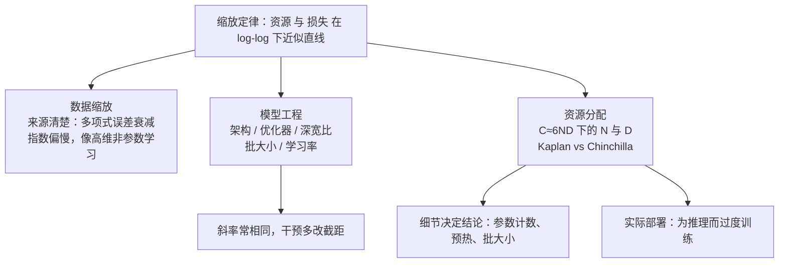

# 第 9 章 缩放定律（上）：用小模型预测大模型

> 对应课程：Lecture 9《Scaling Laws》（Basics） · [YouTube](https://www.youtube.com/watch?v=Q15rhEWZPQ4) · 官方讲义：[幻灯片 lecture_09.pdf](https://github.com/stanford-cs336/lectures/blob/main/lecture_09.pdf)

<Video id="Q15rhEWZPQ4" title="Lecture 9 原视频" />

## 本章你将学到

- 什么是缩放定律（scaling law）：为什么"在对数-对数坐标里画出一条直线"就能指导上亿美元的训练决策。
- 数据缩放定律从哪里来：用"估计平均数"这个最简单的统计问题推导出幂律，并理解神经网络的指数为什么那么"慢"。
- 如何用缩放定律做工程决策：选架构（Transformer vs LSTM）、选优化器（Adam vs SGD）、定深宽比、定批大小和学习率。
- 临界批大小（critical batch size）的含义，以及它为什么随着损失下降而变大。
- Kaplan 与 Chinchilla 之争：同样是拟合缩放定律，为什么一个说"把模型做大"，另一个说"每个参数配 20 个 token"？三种拟合方法（下包络、IsoFLOP、联合拟合）各是怎么做的。
- 为什么真实世界的模型几乎都"过度训练"（overtrain），远超 Chinchilla 比例。

## 先说结论（一分钟版）

缩放定律是一类"经验公式"：把投入的资源（数据量、参数量、算力）和模型的损失同时取对数后，它们之间往往近似是一条直线，也就是幂律关系。有了这条直线，我们就可以**在小模型上做所有实验，然后把结论外推到大模型**，而不必在昂贵的大模型上反复试错。这条思路可以回答很多工程问题：哪种架构更好、哪个优化器更好、批大小设多大、给定算力该训多大的模型配多少数据。其中最有名的结论来自 Chinchilla：在固定训练算力下，参数量和 token 数应该**同比例增长**，大约每个参数配 20 个 token。但缩放定律并不是自动成立的"物理定律"——参数怎么数、学习率预热怎么设、批大小是否调好，这些细节都会让结论大幅偏移（Kaplan 与 Chinchilla 的分歧正源于此）。最后，因为模型上线后的推理开销远大于训练，现实中大家会刻意训练比 Chinchilla 最优更小、喂更多数据的模型。

## 9.1 一个现实问题：一万张 B200 给你一个月，你怎么花？

讲者用一个场景开场 [▶ 01:06](https://www.youtube.com/watch?v=Q15rhEWZPQ4&t=66s)：一位非常有钱的朋友给了你一万张 B200 GPU，用一个月，请你训练一个尽可能好的开源语言模型。你已经有了分布式训练框架（作业 2 做的事），也有了一个好的预训练数据集（作业 4 要做的事），接下来要"跑一个大模型"——但跑**哪一个**？

这背后有一长串问题：

- 用多宽、多深的模型？注意力头多少个？激活函数用哪个？
- 学习率多大？批大小多大？
- 一共训练多少 token？算力是花在"更大的模型"上，还是花在"更多的数据"上？

在第 3 章我们看到，很多架构选择可以"抄作业"——照着已经成功的开源模型来设。但如果你想做出**比现有最好的模型更好**的东西，光抄是不够的，你必须真正去优化这些选择。而在一次可能花费数百万美元的大训练上反复调参，显然不现实。

**老办法（又贵又痛苦）**：直接在大模型上调超参数。

**新办法（也可能过于乐观）**：在小模型上调，然后用简单的规律外推到大模型。

这个"简单的规律"就是缩放定律。讲者说，在大实验室里做缩放的人，几乎把缩放定律当成一种"信仰"或"生活方式" [▶ 02:06](https://www.youtube.com/watch?v=Q15rhEWZPQ4&t=126s)。本章会告诉你它为什么有用，也会告诉你它为什么有时候很"滑"。

::: tip 移动端类比
你做过 App 启动性能优化吧？你不会每改一行代码就在全球所有机型上跑一遍，而是在几台代表性机器上测，找到"启动耗时随着某个因素（比如初始化的模块数）增长"的规律，再外推到低端机、外推到下一版本。缩放定律就是 LLM 领域的"性能 benchmark 外推"：在小模型上测，拟合曲线，预测大模型。区别在于，LLM 的这条曲线在对数坐标下出奇地直、出奇地稳定。
:::

## 9.2 缩放定律不是新东西：一段简短历史

很多人以为缩放定律是 2020 年 OpenAI 那篇论文发明的，其实它的根很深 [▶ 04:06](https://www.youtube.com/watch?v=Q15rhEWZPQ4&t=246s)。

### 理论的视角：泛化界

机器学习理论很早就在问："我的模型会有多好？"理论家的答案叫**泛化界**（generalization bound）：模型在测试集上的误差，最多比训练集上差多少。这类公式通常长成"误差上界 ∝ 某个复杂度 / 样本数 n 的某次方"的样子。

注意，这已经是在描述"误差如何随数据量 n 变化"了——这和数据缩放定律问的是同一个问题。区别是：泛化界给的是**上界**，而缩放定律关心的是**实际观测到的**损失值。

### 1993 年的"数据缩放定律"

讲者追溯到贝尔实验室的 Corinna Cortes、Vladimir Vapnik 等人在 1993 年的工作 [▶ 05:07](https://www.youtube.com/watch?v=Q15rhEWZPQ4&t=307s)：在很大的数据集上训练分类器很贵，那不如先在小样本上训练，拟合"错误率随样本量衰减的曲线"，再用曲线估计在大数据上的表现。这几乎就是今天数据缩放定律的原型。

### NLP 里的早期证据

- **Banko & Brill（2001）**：在 NLP 任务上观察到性能随数据量呈对数线性增长，并提出"与其花钱改算法，不如去收集更多数据"[▶ 07:09](https://www.youtube.com/watch?v=Q15rhEWZPQ4&t=429s)。
- **Kolachina 等（2012）**：研究机器翻译 BLEU 分数随数据量增长的函数形式，发现幂律拟合得很好。

### Hestness 等（2017）：神经网络缩放的真正起点

讲者特别推崇百度的 Hestness 等人 2017 年的工作 [▶ 08:09](https://www.youtube.com/watch?v=Q15rhEWZPQ4&t=489s)，认为它被引用得远远不够。这篇论文在机器翻译、语言模型、语音识别等多个任务上都观察到了漂亮的幂律，并且已经讨论了今天的很多话题：

- **涌现**（emergence）：准确率这类指标比损失"更不连续"，能力可能会突然出现。
- **按算力缩放**：如果性能随数据可预测地提升，那么算力就是关键资源。
- **速度即精度**：既然按算力缩放，那么系统优化（让训练更快）直接等于模型更准。

讲者的感慨是：很多今天的现象，2017 年就可以预见，只要当时认真读这些论文。

::: details 课堂问答：缩放定律是纯经验拟合吗？
有同学问这些规律是凭经验拟合出来的，还是有理论依据？讲者的回答是：基本是**曲线拟合**练习，但多项式（幂律）形式在理论上很自然——理论研究常常给出"误差随样本数按多项式衰减"的结论，物理学家喜欢研究极限行为，也会给出各种候选函数形式。并没有"只能是幂律"的金科玉律 [▶ 10:11](https://www.youtube.com/watch?v=Q15rhEWZPQ4&t=611s)。
:::

## 9.3 数据缩放定律：为什么是 log-log 直线？

### 9.3.1 经验观察

现代神经语言模型里，幂律关系出现在各种"资源"上 [▶ 11:11](https://www.youtube.com/watch?v=Q15rhEWZPQ4&t=671s)：横轴可以是算力、数据集大小、参数量，取对数后，纵轴的对数测试损失都近似是直线（Kaplan 2020 那张经典三联图）。甚至有人把"日期"放到横轴上做能力预测。

先聚焦最简单的一种：**数据缩放定律**。设定是：固定训练方法，模型足够大（比数据"大"），只改变数据量 n，观察误差。

我们对这条曲线的预期是：

1. **单调**：数据越多，误差越低（前提是超参数调得好）。
2. **两端平缓**：数据极少时，模型接近随机猜测；数据极多时，误差逼近一个下限——任务本身的"不可约误差"（噪声底，比如语言本身的不确定性）。
3. **中间段**：在 log-log 坐标下，是一条直线。

所以完整的形状像一个"S 形"，而我们通常工作在中间那段直线区——**幂律区**。你会在作业 3 中亲手画出类似的图 [▶ 14:14](https://www.youtube.com/watch?v=Q15rhEWZPQ4&t=854s)。

### 9.3.2 "log-log 是直线"到底意味着什么？

如果 $\log(\text{误差}) = -\alpha \log n + c$，两边取指数就得到：

$$
\text{误差} = e^{c} \cdot n^{-\alpha}
$$

- $n$：数据量（样本数或 token 数）。
- $\alpha$：衰减指数，也就是 log-log 图上直线斜率的相反数。
- $e^c$：一个常数系数，对应直线的截距。

也就是说，误差随数据量**按多项式衰减**。这种关系也叫"无标度"（scale-free）或幂律（power law）：数据量每翻 10 倍，误差就乘以同一个固定倍数 $10^{-\alpha}$，不管你从 1 万还是从 1 亿开始翻。

讲者还提醒一个隐含信息 [▶ 15:15](https://www.youtube.com/watch?v=Q15rhEWZPQ4&t=915s)：能在 log-log 图上看到直线，通常说明你**离渐近线还很远**。一旦靠近不可约误差，曲线就会变平。

::: tip 手算一下"每翻 10 倍省多少"
假设 $\alpha = 0.1$（神经语言模型的典型量级）。数据量翻 10 倍，误差乘以 $10^{-0.1} \approx 0.794$，也就是只下降约 21%。想让误差减半，需要 $10^{x \cdot 0.1} = 2$，即 $x = \log_{10}2 / 0.1 \approx 3.0$——数据量要涨约 **1000 倍**。这就是为什么大模型要吃那么多数据。
:::

### 9.3.3 玩具例子：估计平均数

为什么会是幂律？讲者把课堂短暂变成了统计课 [▶ 15:15](https://www.youtube.com/watch?v=Q15rhEWZPQ4&t=915s)。

**问题**：有 $n$ 个样本 $x_1, \dots, x_n$，来自均值为 $\mu$、方差为 $\sigma^2$ 的正态分布。用样本平均 $\hat\mu = \frac{1}{n}\sum_i x_i$ 估计 $\mu$，误差有多大？

标准结论是：

$$
\mathbb{E}\big[(\hat\mu - \mu)^2\big] = \frac{\sigma^2}{n}
$$

- $\hat\mu$：我们的估计值；$\mu$：真实均值。
- $\mathbb{E}[\cdot]$：对随机抽样取平均（期望）。
- $\sigma^2$：单个样本的方差，代表数据本身的噪声大小。
- 整个式子：平均平方误差与样本数成反比。

两边取对数：

$$
\log(\text{误差}) = -\log n + 2\log\sigma
$$

这就是一个缩放定律！斜率是 $-1$，截距由噪声 $\sigma$ 决定。更一般地，**任何 $1/n^\alpha$ 形式的多项式误差衰减，在 log-log 图上都是直线**。而统计学里的经典参数模型（估计均值、线性回归等）通常都是 $1/n$ 的速率（回归里可能是 $d/n$）。

::: details 直觉：为什么平均数的误差是 σ²/n？
把 $n$ 个独立噪声加在一起，总的"波动能量"（方差）是 $n\sigma^2$；再除以 $n$ 求平均，方差要除以 $n^2$（因为方差对缩放是平方关系），得到 $\sigma^2/n$。直觉上：样本越多，正负噪声互相抵消得越彻底。
:::

### 9.3.4 神秘之处：神经网络的指数太"慢"了

如果神经网络像经典模型一样学习，我们应该看到斜率约为 $-1$。但实际测出来 [▶ 17:17](https://www.youtube.com/watch?v=Q15rhEWZPQ4&t=1037s)：

| 任务（来源） | 数据缩放指数（约） |
|---|---|
| 机器翻译（Hestness 2017） | −0.1 量级 |
| 语音识别（Hestness 2017） | −0.3 量级 |
| 语言模型（Kaplan 2020） | −0.1 量级 |

仍然是多项式，但比估计平均数**慢得多**。为什么？

### 9.3.5 非参数回归：维度决定指数

讲者给出了一个解释思路 [▶ 18:17](https://www.youtube.com/watch?v=Q15rhEWZPQ4&t=1097s)。神经网络能逼近任意函数，所以它更像"非参数"方法。考虑这个问题：

- 输入 $x_1, \dots, x_n$ 均匀分布在二维单位正方形里，$y_i = f(x_i) + \text{噪声}$，$f$ 是未知的光滑函数。
- 最朴素的估计方法：把正方形切成边长 $n^{-1/4}$ 的小格子，每个格子里取 $y$ 的平均值作为预测。

算一下：边长 $n^{-1/4}$，二维面积就是 $n^{-1/2}$，于是一共有 $\sqrt{n}$ 个格子，每个格子里平均落 $\sqrt{n}$ 个样本。每个格子相当于做一次"估计平均数"，误差约为 $1/\sqrt{n}$。所以总误差约为 $n^{-1/2}$。

推广到 $d$ 维，误差变成：

$$
\text{误差} \approx n^{-1/d}
$$

- $d$：输入空间的维度（更准确地说是数据的"内在维度"）。
- 对应 log-log 斜率为 $-1/d$。

**结论：越灵活的非参数学习，缩放指数越依赖维度；维度越高，学得越慢。** 如果把神经语言模型的 $-0.1$ 斜率代进来，它表现得像是在"约 10 维空间里做非参数回归"。

Bahri 等（2021）等工作更进一步，主张缩放指数直接反映了数据的**内在维度**。讲者对此持保留态度：这个论证依赖"内在维度估计"，而这类估计器本身就不太靠谱 [▶ 19:17](https://www.youtube.com/watch?v=Q15rhEWZPQ4&t=1157s)。但它提供了一个有趣的视角：指数告诉我们神经网络"到底学得有多快"。

::: details 课堂问答："模型比数据大"是什么意思？
讲者说做数据缩放时要让模型"比数据大"。这里的意思是：当数据远多于模型容量时，你会进入"不可约误差区"——模型已经把这个模型类能拟合的都拟合了，加数据也没用。做缩放研究时，我们希望待在幂律区；要么保证模型足够大（经验上大概比数据"大"一个量级就够），要么显式地拟合渐近线再做修正 [▶ 20:17](https://www.youtube.com/watch?v=Q15rhEWZPQ4&t=1217s)。
:::

下面这个演示让你亲手体验"拟合直线并外推"。注意试试：把不可约损失 $E$ 调大、只用纯直线拟合，会发生什么？

<Demo src="ch09-powerlaw-fit.html" title="缩放定律拟合与外推：log-log 直线、噪声与渐近线" :height="720" />

## 9.4 数据缩放定律的工程用途

单纯的"数据越多越好、按幂律变好"只能用于预测，工程上更关心的是这些问题 [▶ 21:18](https://www.youtube.com/watch?v=Q15rhEWZPQ4&t=1278s)：

- 最佳的**数据配比**（data mixture）是什么？
- 数据要不要**重复**多轮？
- 高质量数据重复、低质量数据不重复？质量与重复次数如何权衡？

### 9.4.1 数据组成影响截距，不影响斜率

如果把数据缩放定律看作"经验版的泛化界"，那么经典理论告诉我们：**斜率主要由模型类决定，数据分布主要影响截距（偏移）** [▶ 22:18](https://www.youtube.com/watch?v=Q15rhEWZPQ4&t=1338s)。讲者引用了他自己的工作（Hashimoto 2021）：在一个两种数据源的线性回归玩具模型中，只用一种数据误差始终很高，混合两种反而最好——截距随配比变化的形状揭示了"数据多样性"的价值。

### 9.4.2 用缩放定律选数据配比

自然的想法：假设有新闻和维基百科两种数据，想知道各用多少。可以在不同配比下训练一批小模型，拟合"配比 → 性能"的函数，再看随着模型规模增大趋势如何变化，外推到目标规模，挑出最优配比。这就是"数据混合定律"（data mixing laws）类论文的思路。

但讲者坦言 [▶ 24:19](https://www.youtube.com/watch?v=Q15rhEWZPQ4&t=1459s)：现实噪声很大。实践中很多人直接**在小规模上挑最好的配比，然后直接放大**，根本不拟合缩放定律。AI2 的 DataDecide 研究也发现，这种朴素方法效果不错。这和"配比只改截距、不改斜率"是吻合的：如果斜率都一样，小规模的最优配比在大规模上也是最优的。

### 9.4.3 数据重复：大约 4 轮以内几乎无损

算力在增长，可用数据却没怎么涨，于是"数据重复"成了热门问题 [▶ 25:22](https://www.youtube.com/watch?v=Q15rhEWZPQ4&t=1522s)。《Scaling Data-Constrained Language Models》（Muennighoff 等 2023）发现：

- 用标准训练方法，数据**重复大约 4 轮以内，几乎没有损失**；
- 超过之后，实际的缩放曲线明显劣于"假如全是新数据"的预测曲线。

他们提出了"有效数据量"的修正公式，大意是：

$$
D' = U_D + U_D R_D^{*}\left(1 - e^{-R_D / R_D^{*}}\right)
$$

- $U_D$：不重复的独立 token 数（unique tokens）。
- $R_D$：重复的次数（第一轮之外又重复了几轮）。
- $R_D^{*}$：一个拟合出来的常数，刻画"重复数据价值衰减有多快"。
- $D'$：等效于多少"新数据"。当 $R_D$ 很小时，$D' \approx U_D(1 + R_D)$，重复几乎和新数据一样好；当 $R_D$ 很大时，$D'$ 最多只能涨到 $U_D(1 + R_D^{*})$，再重复也白搭。

讲者团队还研究过把这个想法推到极致——**算力无限、数据有限**时能做到多好 [▶ 26:22](https://www.youtube.com/watch?v=Q15rhEWZPQ4&t=1582s)：一直重复数据、一直加大模型都会边际递减，于是要用正则化、模型集成（ensemble）等手段再挤出一些收益。一个反复出现的现象是：这些干预措施大多**只改变截距，斜率惊人地相似**。讲者说，等你自己拟合缩放定律时会发现，斜率很少变。

### 9.4.4 数据过滤应该随规模变化

最后一个例子 [▶ 27:22](https://www.youtube.com/watch?v=Q15rhEWZPQ4&t=1642s)：如果你我明天要过滤数据训练模型，我们会**非常激进**地只保留最高质量的数据——反正算力少，训不完整个互联网。但如果算力非常多，就不能只在小小的高质量子集上反复训练，必须放宽过滤标准，把质量稍低的数据也用上。

所以"数据质量""过滤阈值"这些看似静态的东西，其实是**规模相关**的：最优过滤器随算力变化。

::: warning 常见误区：只看一小段，分不清是幂律还是指数
有同学注意到某张图的坐标轴看起来是线性的。讲者解释那是"坏坐标轴"（横轴其实按倍数翻倍，等价于对数），并借此强调：如果你只观察**很窄的一段**算力范围，几乎无法区分幂律和指数——泰勒展开告诉我们，任何光滑曲线放大到足够局部都像直线 [▶ 29:24](https://www.youtube.com/watch?v=Q15rhEWZPQ4&t=1764s)。外推要保持警惕。
:::

## 9.5 用缩放定律做模型工程

现在进入讲者"开头承诺的部分"：用缩放定律设计大模型 [▶ 30:25](https://www.youtube.com/watch?v=Q15rhEWZPQ4&t=1825s)。也许你是个激进派，坚信 LSTM 才是未来；或者你想用 SGD 而不是 Adam；又或者你在纠结：资源有限，是训更大的模型、训更久，还是去收集更多数据？缩放定律给出了量化回答这些问题的方法。

### 9.5.1 架构：Transformer vs LSTM

暴力方法：花几千万美元训一个 GPT-3 规模的 LSTM 看看。缩放定律方法：在多个算力规模上分别训练 Transformer 和不同层数的 LSTM，画出"算力-损失"曲线 [▶ 31:25](https://www.youtube.com/watch?v=Q15rhEWZPQ4&t=1885s)。

Kaplan 的结果显示 LSTM 的截距明显更差，斜率可能也更差。那就别选 LSTM。今天几乎所有新架构论文（Mamba、Gated DeltaNet 等）都有这样一张图：普通 Transformer 一条线，"我们的酷模型"一条线——你要的是**截距更低、斜率至少不更差**的那条，因为斜率更差意味着规模越大越吃亏。

Yi Tay 等（2022）在 T5 风格模型上做了大规模的跨架构缩放研究 [▶ 33:25](https://www.youtube.com/watch?v=Q15rhEWZPQ4&t=2005s)。有意思的是，他们在小得多的算力上，就已经"预言"了今天前沿模型实际采用的改动：

- Performer 这类高效注意力缩放得不好——今天确实没人用；
- 门控线性单元（GLU）在所有规模上都更好——今天的 SwiGLU 正是它；
- Switch Transformer（MoE）缩放趋势良好——今天的 MoE 正当红。

这也是为什么很多人奉行"缩放曲线上看不出好处的改动，就不是好改动"。

### 9.5.2 优化器：Adam vs SGD

Hestness 2017 在一个循环网络（RHN，循环高速网络）语言模型上比较了 Adam 和 SGD [▶ 34:26](https://www.youtube.com/watch?v=Q15rhEWZPQ4&t=2066s)：两条线**截距不同，斜率非常接近**。讲者说他每次看到这种结果都会惊讶：在你亲手训练时感觉天差地别的改动（SGD 换 Adam），缩放趋势却几乎一样。

### 9.5.3 深度与宽度：寻找"规模不变量"

第 3 章说深宽比随便选个合理的数就行。缩放分析可以告诉我们更精确的事 [▶ 35:27](https://www.youtube.com/watch?v=Q15rhEWZPQ4&t=2127s)：

- 层数：1 层非常糟糕，2 层以上就有竞争力了，层数越多在每个算力点上都略好，但边际收益递减。
- **深宽比**（aspect ratio，即 $d_{\text{model}}$ / 层数）是一个更好的研究对象，因为它是"规模不变量"：模型变大时层数自然要增加，但最优深宽比也许不变。Kaplan 发现在不同模型大小下，最优深宽比都在约 100 附近（每层约 100 维 $d_{\text{model}}$），只是略有漂移。

有了这样的图，你就能放心地采用"固定深宽比、整体放大"的缩放策略。

### 9.5.4 不是所有参数都生而平等

这是讲者说"会在多张幻灯片里反复出现"的大坑 [▶ 37:28](https://www.youtube.com/watch?v=Q15rhEWZPQ4&t=2248s)。Kaplan 发现，如果把**嵌入层参数**算进参数量，缩放曲线会变得很怪；于是他们只统计**非嵌入参数**（理由是这些参数"在做计算"）。后面我们会看到，这个决定对 Kaplan 的结论有不小影响。

讲者转述 Percy 的观点：缩放定律的可预测性是**工程出来的**，不是自动发生的。你要选对横轴（参数怎么数），要把每个点的超参数设对，才能在许多个数量级上得到干净的直线。

MoE 让"什么是参数"更复杂了：总参数和激活参数解耦了。Apple 与 MIT 的研究者（Abnar 等 2025）用 IsoFLOP 风格的实验分析了这一点 [▶ 38:28](https://www.youtube.com/watch?v=Q15rhEWZPQ4&t=2308s)：总参数越大，最优的稀疏度越高；在激活参数（也就是计算量）不变时，增加"不激活的"专家参数仍然能降低损失。也就是说，MoE 的各种设计量同样遵循可预测的规律。

### 9.5.5 批大小：临界批大小

真正要训练新模型时，架构你多半会照着成熟方案选（比如一个 DeepSeek 风格的 MoE），但有两件事你几乎总得重新定：**批大小和学习率** [▶ 40:31](https://www.youtube.com/watch?v=Q15rhEWZPQ4&t=2431s)。它俩还相互纠缠：改一个就得改另一个。

从系统角度（第 7、8 章），我们希望批越大越好——数据并行需要大批。那么问题是：**批能大到多少才开始吃亏？这个上限如何随模型规模变化？**

#### 噪声受限区与偏差受限区

**临界批大小**（critical batch size）的直觉是 [▶ 41:31](https://www.youtube.com/watch?v=Q15rhEWZPQ4&t=2491s)：

- **噪声受限区**：批比较小时，梯度估计噪声大。每往批里多加一个样本，都在降低梯度噪声，带来几乎"完美"的收益——批翻倍，所需步数就几乎减半。
- **偏差受限区**：批大到一定程度后，梯度已经很准了。但梯度只反映**局部**地形，它指向的方向和真正的最优点方向总有偏差。此时再加大批，也没法让每一步走得更准，收益急剧递减。

临界批大小就是两种区域的分界点——在这里，你能用尽可能大的批，又不至于严重浪费数据。

::: tip 移动端类比
想象一个下载任务分片并发：并发数从 1 加到 4，总耗时几乎线性下降（瓶颈在单连接）；加到 32 之后，瓶颈变成了服务器带宽或磁盘写入，再加并发只会白白占资源。临界批大小就是这个"再加并发不再划算"的拐点。
:::

#### 怎么实际测出临界批大小

操作步骤 [▶ 43:34](https://www.youtube.com/watch?v=Q15rhEWZPQ4&t=2614s)：

1. 选一个**目标损失**，目标是尽快达到它。
2. 扫一系列批大小，分别记录达到目标所需的**步数 $S$** 和**样本数 $E$**（显然 $E = S \times$ 批大小）。
3. OpenAI 的 McCandlish 等人推导出这两者大致满足：

$$
\left(\frac{S}{S_{\min}} - 1\right)\left(\frac{E}{E_{\min}} - 1\right) = 1
$$

- $S_{\min}$：批无限大时，最少需要的步数。
- $E_{\min}$：批无限小时，最少需要的样本数。
- 这是一条双曲线：想省步数就得多花样本，想省样本就得多走步数。

4. 用数据拟合出 $S_{\min}$ 和 $E_{\min}$，取

$$
B_{\text{crit}} = \frac{E_{\min}}{S_{\min}}
$$

在这个批大小下，两边恰好平衡：$S = 2S_{\min}$，$E = 2E_{\min}$，即步数和样本数都"只多花一倍"。

::: details 手算验证：为什么 B_crit 处恰好是 2 倍？
令批大小 $B = E/S$。把 $B = B_{\text{crit}} = E_{\min}/S_{\min}$ 代入：设 $S = k S_{\min}$，则 $E = B S = k E_{\min}$。代入双曲线：$(k-1)(k-1) = 1$，得 $k = 2$。所以步数是最小值的 2 倍，样本数也是最小值的 2 倍。论文中还指出 $B_{\text{crit}}$ 近似等于"梯度协方差的迹 / 梯度范数的平方"，即梯度噪声与梯度信号之比。
:::

#### 为什么这放在缩放定律这一讲？

因为临界批大小**随目标损失按幂律变化**：目标损失越低（模型越好、算力越多），临界批大小越大 [▶ 46:35](https://www.youtube.com/watch?v=Q15rhEWZPQ4&t=2795s)。直觉是：离最优点越近，你在优化越来越细微的差别，此时梯度噪声的影响就越大，降噪的价值也就越高。

这对大规模训练是好消息：最大的训练恰好可以用非常大的批，正好满足数据并行的需求。

### 9.5.6 学习率：两种流派

学习率的故事更复杂，详细内容在第 11 章 [▶ 48:35](https://www.youtube.com/watch?v=Q15rhEWZPQ4&t=2915s)。先给一个心智图：只加宽一个普通 MLP，模型越宽，最优学习率越小——参数越多，一次同时改变的东西越多，每个参数就该走得小心一点。一个常见经验法则是学习率按 $1/\text{宽度}$ 缩放。

两种处理方式：

1. **拟合派**：在小规模上找最优学习率，观察它如何随规模变化（变化通常是可预测的），外推出大模型的最优学习率。
2. **重参数化派**：修改初始化方式和各层的学习率缩放，使得**不同规模的最优学习率保持不变**，然后在小模型上调好直接用。代表方法是 **μP**（Maximal Update Parametrization）。

两种方法都在大规模训练中成功用过。讲者的印象是，似乎拟合派用得稍多一些。

### 9.5.7 警惕：上游损失 ≠ 下游能力

讲者用 Tay 等的架构论文举了一个反例 [▶ 50:37](https://www.youtube.com/watch?v=Q15rhEWZPQ4&t=3037s)：困惑度（perplexity）和参数量之间是漂亮的直线，按困惑度看 NL-12 是最好的模型；可在下游任务上，困惑度更差的 NL-32 XL 反而更好。

- 缩放定律最适合用在**困惑度/损失**这类上游指标上：干净、规则、可预测。
- 从困惑度到下游任务的迁移**远没有看上去那么确定**。

讲者还讲了个段子：他的学生去公司做后训练，常抱怨"预训练的人把模型丢过来说困惑度很好，剩下都是你的问题"——但问题往往从预训练就开始了。别做那样的人。

### 9.5.8 基于缩放定律的设计流程

总结起来，流程是 [▶ 52:37](https://www.youtube.com/watch?v=Q15rhEWZPQ4&t=3157s)：


关键心态：**在开大训练之前，你应该能大致预测出它的结果**，甚至能预测"选这个优化器能赢多少"。

::: details 课堂问答：每个点要跑几次？用训练损失还是测试损失？
- **方差**：大多数论文里每个点只跑一次。因为困惑度非常稳定——训练数据同质且海量、评测集很大，重跑的差异大概在小数点后第二位。但学习率、临界批大小这类缩放分析会"非常难看"，理应多做方差控制，可实际上做的人并不多 [▶ 53:37](https://www.youtube.com/watch?v=Q15rhEWZPQ4&t=3217s)。
- **下游指标直接拟合**：可以，但有同样的问题。思路应该是：先在低方差的指标上确立规律，再单独建立/相信它到下游的迁移 [▶ 54:37](https://www.youtube.com/watch?v=Q15rhEWZPQ4&t=3277s)。
- **训练还是测试损失**：严谨做法是用测试损失。但除了数据重复等少数场景，大家都只过一遍数据（单轮 SGD），训练损失和验证损失几乎相同，所以两者经常混用，有些预训练代码甚至没有验证损失 [▶ 55:37](https://www.youtube.com/watch?v=Q15rhEWZPQ4&t=3337s)。
:::

## 9.6 更多数据还是更大模型？联合缩放定律

### 9.6.1 问题设定

这是缩放定律最著名的用途 [▶ 56:37](https://www.youtube.com/watch?v=Q15rhEWZPQ4&t=3397s)。你手里的资源是**算力**（FLOPs）。回忆第 1、2 章：训练一个 Transformer 的算力大约是

$$
C \approx 6ND
$$

- $C$：总训练 FLOPs。
- $N$：模型参数量。
- $D$：训练 token 数。
- 系数 6：前向传播中每个参数对每个 token 做一次乘加，约 2 FLOPs；反向传播约是前向的 2 倍，约 4 FLOPs；合计约 6。

预算固定时，$N$ 和 $D$ 此消彼长。很小的模型喂海量数据是浪费（曲线早就平了）；很大的模型只喂一点数据也不划算。中间必然有一个最优分配。

::: tip 手算一下
Chinchilla：$N = 70\text{B}$，$D = 1.4\text{T}$。$C = 6 \times 7\times10^{10} \times 1.4\times10^{12} = 5.88 \times 10^{23}$ FLOPs。
Gopher：$N = 280\text{B}$，$D = 300\text{B}$。$C = 6 \times 2.8\times10^{11} \times 3\times10^{11} = 5.04 \times 10^{23}$ FLOPs。
两者算力相近，但 Chinchilla 小 4 倍、数据多近 5 倍——而且效果更好。
:::

### 9.6.2 联合缩放定律的函数形式

Kaplan 和 Rosenfeld 几乎同时提出了把模型大小和数据量放进同一个公式的做法 [▶ 58:38](https://www.youtube.com/watch?v=Q15rhEWZPQ4&t=3518s)。Rosenfeld 的形式最直白——两个幂律相加：

$$
\text{Error} = n^{-\alpha} + m^{-\beta} + C
$$

- $n$：数据量；$m$：模型大小。
- $\alpha, \beta$：各自的衰减指数。
- $C$：不可约误差。

Kaplan 的形式更复杂一点，但思想相同。Chinchilla 论文的方法 3 用的是同类形式：

$$
L(N, D) = E + \frac{A}{N^{\alpha}} + \frac{B}{D^{\beta}}
$$

- $E$：不可约损失（语言本身的熵）。
- $A/N^\alpha$：模型有限带来的损失。
- $B/D^\beta$：数据有限带来的损失。

讲者建议：**拿到一个缩放定律公式，先把每个变量取极限看看** [▶ 58:38](https://www.youtube.com/watch?v=Q15rhEWZPQ4&t=3518s)。数据无穷多时，$B/D^\beta \to 0$，剩下纯模型大小缩放律；模型无穷大时，剩下纯数据缩放律。公式行为合理。

更厉害的是，Rosenfeld 等人展示了这类公式可以**只用小模型、小数据的点拟合**，然后准确预测大模型、大数据角落的误差 [▶ 59:39](https://www.youtube.com/watch?v=Q15rhEWZPQ4&t=3579s)。有了公式，"给定 FLOPs 预算，最小化损失"就是一个简单的约束优化问题。

::: details 推导：最优 N 和 D 如何随算力增长（可跳过）
在 $C = 6ND$ 约束下最小化 $A N^{-\alpha} + B D^{-\beta}$。把 $D = C/(6N)$ 代入，对 $N$ 求导令其为 0，可得

$$
N_{\text{opt}} = G \left(\frac{C}{6}\right)^{\frac{\beta}{\alpha+\beta}}, \quad D_{\text{opt}} = G^{-1}\left(\frac{C}{6}\right)^{\frac{\alpha}{\alpha+\beta}}, \quad G = \left(\frac{\alpha A}{\beta B}\right)^{\frac{1}{\alpha+\beta}}
$$

关键在指数：如果 $\alpha \approx \beta$，那么 $N$ 和 $D$ 都约按 $C^{0.5}$ 增长，二者之比恒定——这就是"每个参数配固定数量 token"的由来。如果 $\alpha \ne \beta$，比例就会随算力漂移。
:::

### 9.6.3 Kaplan 说"做大模型"，Chinchilla 说"不对"

Kaplan 解出来的结论是 [▶ 60:40](https://www.youtube.com/watch?v=Q15rhEWZPQ4&t=3640s)：

$$
N_{\text{opt}} \propto C^{0.73}, \quad D_{\text{opt}} \propto C^{0.27}
$$

（讲者在课上一度把两者说反了，随即更正。）这意味着算力增加时，大部分该投到模型大小上，每个参数分到的 token 越来越少。GPT-3 时代人人都在训几千亿参数的巨型稠密模型，部分原因就在于此。

2022 年，DeepMind 的 Hoffmann 等人（Chinchilla 论文）指出这些预测**大错特错** [▶ 61:41](https://www.youtube.com/watch?v=Q15rhEWZPQ4&t=3701s)：当时那些巨型模型（Gopher 等）都太大了，同样算力应该训练小得多的模型。于是有了广为人知的"**每个参数约 20 个 token**"。

讲者强调，Chinchilla 的价值不只在 20:1 这个数字，更在于它告诉我们**应该如何认真、细致地拟合缩放定律**——这不是摇一摇曲柄就出答案的事。

## 9.7 Chinchilla 的三种拟合方法

Chinchilla 作者用了三种不同方法估计最优分配，这本身就是一种"对建模假设的鲁棒性检查" [▶ 62:41](https://www.youtube.com/watch?v=Q15rhEWZPQ4&t=3761s)。结果如下（$N_{\text{opt}} \propto C^a$，$D_{\text{opt}} \propto C^b$）：

| 方法 | $a$（参数指数） | $b$（数据指数） |
|---|---|---|
| 1. 训练曲线的下包络 | 0.50 | 0.50 |
| 2. IsoFLOP 曲线 | 0.49 | 0.51 |
| 3. 损失函数参数化拟合 | 0.46 | 0.54 |
| Kaplan 等（2020） | 0.73 | 0.27 |

### 方法 1：最小值包络（下包络）

[▶ 63:42](https://www.youtube.com/watch?v=Q15rhEWZPQ4&t=3822s) 把所有不同大小模型的训练曲线（横轴 FLOPs，纵轴损失）画在一起，取它们的**下包络**：在每个 FLOPs 点上，所有训练过程中达到的最低损失。包络上的每个点都对应某个特定大小的模型。把"FLOPs → 该点模型大小"画在 log-log 图上，得到一条直线，由此估计最优关系。按这个方法，Chinchilla 的算力预算应训练约 **67B** 参数的模型。

优点是简单；难点是包络本身不好找准。

### 方法 2：IsoFLOP（讲者最喜欢的方法）

[▶ 64:43](https://www.youtube.com/watch?v=Q15rhEWZPQ4&t=3883s)

1. 选几个算力预算（例如按 3 倍或"1-3-6"间隔递增）。
2. 对每个预算，固定 FLOPs，扫描不同的模型大小（模型翻倍、数据减半……），每个配置训练到底，记录最终损失。
3. 每个预算得到一条"U 形"曲线（损失 vs 模型大小），拟合一个二次函数，找出谷底。
4. 把各个谷底的 $(C, N_{\text{opt}})$ 画在 log-log 图上，拟合直线。

这个方法给出约 **63B** 参数，与方法 1 非常接近。它简单、稳健、干净，已经成为最流行的方法。

### 方法 3：联合拟合

[▶ 65:43](https://www.youtube.com/watch?v=Q15rhEWZPQ4&t=3943s) 在 $(N, D)$ 网格上训练一批模型，直接用最小二乘拟合 $L(N,D) = E + A/N^\alpha + B/D^\beta$ 这个曲面。最"暴力"，但曲面拟合有很多变量，拟合方法本身就很讲究。

下面的演示用的正是方法 3 形式的损失函数。你可以拖动参数量 $N$，观察在固定预算下损失如何先降后升；也可以切换"原始拟合"和"重新拟合"两套参数，体会下一节要讲的故事。

<Demo src="ch09-isoflop.html" title="Chinchilla IsoFLOP：固定算力，滑动模型大小找最优" :height="760" />

::: tip 用演示手算一组数字
用重新拟合的参数，预算 $C = 10^{21}$ FLOPs 时，最优约为 $N^* \approx 2.8\text{B}$、$D^* \approx 60\text{B}$，每参数约 21 个 token，损失约 2.306。如果换成 $N = 1\text{B}$（$D \approx 167\text{B}$），损失约 2.338；换成 $N = 8\text{B}$（$D \approx 21\text{B}$），损失约 2.341。两边都只差 1.5% 左右——IsoFLOP 谷底很平，这也是为什么"过度训练"一个小一点的模型代价不大。
:::

## 9.8 为什么 Kaplan 和 Chinchilla 差这么多？

两家都做的是很合理的事，都拟合了联合缩放定律，结论却天差地别 [▶ 66:43](https://www.youtube.com/watch?v=Q15rhEWZPQ4&t=4003s)。今天大家普遍认同 Chinchilla 更接近正确——你自己做一遍 Chinchilla 式分析，大概率也会得到接近的结论。那 Kaplan 错在哪？

### 解释一：一串"看似微小"的细节

论文《Resolving Discrepancies in Compute-Optimal Scaling of Language Models》（Porian 等 2024，最后作者 Yair Carmon 曾是斯坦福的学生）先用 Kaplan 的设置复现了 Kaplan 的结果，然后一步步修改 [▶ 67:43](https://www.youtube.com/watch?v=Q15rhEWZPQ4&t=4063s)：

1. **参数计数方式**：Kaplan 排除了嵌入参数，这本身问题不大；但他们**连最后一层输出投影（softmax 前的线性层）也一起排除了**——因为它和嵌入矩阵形状相同（一个是 词表×隐藏维，一个是 隐藏维×词表）。把它算回来，曲线就明显移动。
2. **学习率预热**：Kaplan 的很多模型非常小，小到预热（warmup）还没结束模型就该收敛了，学习率设置严重不当。
3. **批大小**：Kaplan 用了一个固定的大批，对小模型来说并不合适。按规模调好批大小后……

三步改完，就得到了与 Chinchilla 几乎完全一致的结果。（他们还发现，学习率衰减本身也许不是关键，只要批大小和学习率调对。）

讲者借此强调：**缩放定律在某种意义上是"下界"**——它说的是"如果我把**这个配方**放大，就会得到这个结果"。如果配方本身有毛病（预热离谱、批大小离谱），你得到的就是一条"坏"的缩放曲线。所以小规模实验要尽可能贴近真实的大规模配方。

### 解释二：小算力区 + 非嵌入参数造成的非线性

Pearce & Song（2024）用了一个巧妙的办法 [▶ 70:44](https://www.youtube.com/watch?v=Q15rhEWZPQ4&t=4244s)：**一个模型都不训练**，只用 Chinchilla 拟合出的函数模拟训练曲线，然后看"如果只数非嵌入参数、并且只在 Kaplan 那么小的算力范围内拟合"会得到什么。结论是：Kaplan 工作的算力规模小得多，对细节非常敏感；而在小模型里，嵌入参数占比很大，只数非嵌入参数会带来轻微的非线性，足以把结论带偏。

两篇论文的解释略有不同，但传达的是同一个信息：**细节决定缩放定律**。

### 尾声：Chinchilla 方法 3 自己也有错

还有一个小谜团 [▶ 71:44](https://www.youtube.com/watch?v=Q15rhEWZPQ4&t=4304s)：Chinchilla 的方法 3 与方法 1、2 并不一致（0.46/0.54 vs 0.50/0.50）。数字差得不多，作者也没太在意，但含义并不小：如果指数不同，随着算力增长，每参数 token 数会**持续变化**，渐近结论完全不同。

Epoch AI 的研究者（Besiroglu 等 2024）拿不到原始数据和代码，于是**从论文的图里把数据点抠了出来**，重新拟合方法 3。他们发现原论文的拟合是欠拟合的，重新拟合的损失低得多，而且结论恰好回到了"约 20 个 token / 参数"。讲者笑称：Chinchilla 作者"比自己以为的更正确"——方法 3 的偏差只是拟合失误，方法本身是稳健的。

在上面的 IsoFLOP 演示里切换两套参数就能看到：原始拟合下，最优 $D/N$ 从约 26 一路涨到 100 以上；重新拟合后，它在各个算力下都稳定在 17~26 之间。

## 9.9 训练最优 ≠ 你真正想要的：过度训练

讲完 Chinchilla 的故事，讲者说：**你大概并不想要 Chinchilla 比例** [▶ 73:46](https://www.youtube.com/watch?v=Q15rhEWZPQ4&t=4426s)。

Chinchilla 回答的是"**固定训练算力**下，什么模型最好"。但对一个生产模型，训练算力往往不是大头：各种外部调研显示，前沿实验室的算力主要花在研发和**推理服务**上。推理时，每生成一个 token 的计算量约为 $2N$，模型越大，服务越贵。所以你想要的是**小而强**的模型，即便训练时多花一些算力。

这就是所谓"过度训练"（overtraining）——讲者特意加了引号，因为这其实才是"正确"的训练量。看看历年模型每参数的 token 数：

| 模型 | 每参数 token 数（约） |
|---|---|
| GPT-3 | 2 |
| Chinchilla | 20 |
| LLaMA 65B | 22 |
| Llama 2 70B | 29 |
| Mistral 7B | 110 |
| Llama 3 70B | 215 |

早期（GPT-3）明显训练不足；之后一段时间大家停在 20 左右——那时模型还没被大规模服务；等到推理服务成为现实，大家开始大幅过度训练，并转向 MoE 等对推理友好的设计。预期使用量越大，前期多付的训练成本就越值得。

::: tip 手算一下：过度训练划算吗？
回到 $10^{21}$ FLOPs 的例子：最优是 2.8B 模型，换成 1B 模型损失只高约 1.4%，但每次推理的计算量只有 $1/2.8 \approx 36\%$。如果这个模型要服务十亿次请求，推理省下的算力远远超过训练多花的那点。这就像 App 的包体积优化：多花一个月工程时间压缩安装包，换来上亿次下载节省的流量和更高的转化，非常值得。
:::

所以讲者认为 Chinchilla 的重要性不在于 20:1 是"黄金比例"（做研究时也许是），而在于它教会我们**如何拟合和思考缩放定律**。

### IsoFLOP 无处不在

最后，讲者认为 IsoFLOP 作为研究工具经久不衰 [▶ 75:47](https://www.youtube.com/watch?v=Q15rhEWZPQ4&t=4547s)：固定算力预算，扫描其他自由度，看损失曲面长什么样。它容易执行，读数通常很可靠。他的学生把它用于扩散语言模型（Gulrajani & Hashimoto 2023），前面提到的 MoE 稀疏度研究也是 IsoFLOP 风格。**每当你需要在多个设计选项之间权衡时，IsoFLOP 都是一个好的默认选择。**

## 9.10 全讲回顾

[▶ 76:48](https://www.youtube.com/watch?v=Q15rhEWZPQ4&t=4608s)



## 动手练习

1. **平均数的缩放定律（热身）**：用 Python 从 $N(0, 1)$ 采样，对 $n = 10, 100, \dots, 10^5$ 分别重复 1000 次估计均值，画出平均平方误差 vs $n$ 的 log-log 图，拟合斜率。应接近 $-1$。

   ::: details 参考代码
   ```python
   import numpy as np
   ns = [10, 100, 1000, 10000, 100000]
   errs = []
   for n in ns:
       # 每行一次实验：采样 n 个数求均值，真实均值为 0
       est = np.random.randn(1000, n).mean(axis=1)
       errs.append((est ** 2).mean())
   # 在 log-log 空间拟合直线，slope 就是缩放指数
   slope, intercept = np.polyfit(np.log10(ns), np.log10(errs), 1)
   print(slope)  # 约 -1.0
   ```
   :::

2. **非参数回归的维度效应**：在 $d = 1, 2, 4$ 维单位立方体中做"切格子取平均"的回归（目标函数取 $f(x) = \sin(\sum x)$），画误差 vs $n$ 的 log-log 曲线，验证斜率随 $d$ 增大而变平。

3. **IsoFLOP 手算**：用 $L(N,D) = 1.82 + 482/N^{0.348} + 2085/D^{0.366}$，在 $C = 10^{20}$ 下，对 $N \in \{0.2, 0.5, 1, 2, 5\}$B 分别算 $D = C/(6N)$ 和损失，找出最小点，并计算该点的 $D/N$。（答案应在 $N \approx 0.85\text{B}$ 附近，$D/N \approx 23$。）

4. **临界批大小**：假设拟合得到 $S_{\min} = 2000$ 步，$E_{\min} = 2\times10^8$ 个 token。临界批大小是多少？在该批大小下实际需要多少步、多少 token？如果把批再翻 4 倍，所需步数还能减少多少？（提示：用 $(S/S_{\min}-1)(E/E_{\min}-1)=1$ 和 $E = BS$ 联立。）

5. **与作业 3 挂钩**：作业 3（assignment3-scaling）的核心任务是在有限的实验预算下，拿到不同（模型大小、算力）配置的损失，拟合缩放定律并预测更大算力下的最优模型大小与损失（具体接口与预算以当年作业文档为准）。请先用本章的 IsoFLOP 方法设计你的查询方案：选几个算力预算？每个预算扫几个模型大小？如何分配预算让拟合最稳健？

## 本章小结

- 缩放定律是"资源-损失"在 log-log 坐标下的近似直线关系，本质是多项式衰减。它让我们**在小规模做实验、在大规模做预测**。
- 估计平均数给出斜率 $-1$；神经网络的数据缩放斜率约 $-0.1$ 到 $-0.3$，更像高维非参数学习。
- 数据组成、优化器、很多架构改动往往**只改变截距、不改变斜率**；斜率更差的方案规模越大越吃亏。
- 临界批大小 $B_{\text{crit}} = E_{\min}/S_{\min}$，随目标损失降低而增大，所以大训练可以用大批。
- 学习率有"拟合外推"和"μP 重参数化"两种流派，下一次缩放定律讲座（第 11 章）详细展开。
- Kaplan（$N \propto C^{0.73}$）与 Chinchilla（$N, D \propto C^{0.5}$，约 20 token/参数）之争说明：参数计数、预热、批大小等细节会彻底改变缩放结论；Chinchilla 方法 3 的偏差后来被证明是拟合失误。
- 真实部署要考虑推理成本，因此几乎所有现代模型都"过度训练"。

下一章（[第 10 章](./ch10-inference)）我们先转去讲推理；之后在 [第 11 章](./ch11-scaling-laws-2) 回到缩放定律的进阶话题：真实开源模型的缩放配方、WSD 学习率、μP 的推导以及优化器的缩放。

## 延伸阅读

- Kaplan et al., 2020. *Scaling Laws for Neural Language Models*. [arXiv:2001.08361](https://arxiv.org/abs/2001.08361)
- Hoffmann et al., 2022. *Training Compute-Optimal Large Language Models*（Chinchilla）. [arXiv:2203.15556](https://arxiv.org/abs/2203.15556)
- Hestness et al., 2017. *Deep Learning Scaling is Predictable, Empirically*. [arXiv:1712.00409](https://arxiv.org/abs/1712.00409)
- Rosenfeld et al., 2020. *A Constructive Prediction of the Generalization Error Across Scales*. [arXiv:1909.12673](https://arxiv.org/abs/1909.12673)
- Bahri et al., 2021. *Explaining Neural Scaling Laws*. [arXiv:2102.06701](https://arxiv.org/abs/2102.06701)
- Muennighoff et al., 2023. *Scaling Data-Constrained Language Models*. [arXiv:2305.16264](https://arxiv.org/abs/2305.16264)
- Goyal et al., 2024. *Scaling Laws for Data Filtering — Data Curation cannot be Compute Agnostic*. [arXiv:2404.07177](https://arxiv.org/abs/2404.07177)
- Tay et al., 2022. *Scaling Laws vs Model Architectures*. [arXiv:2207.10551](https://arxiv.org/abs/2207.10551)
- Abnar et al., 2025. *Parameters vs FLOPs: Scaling Laws for Optimal Sparsity for Mixture-of-Experts Language Models*. [arXiv:2501.12370](https://arxiv.org/abs/2501.12370)
- McCandlish et al., 2018. *An Empirical Model of Large-Batch Training*. [arXiv:1812.06162](https://arxiv.org/abs/1812.06162)
- Yang et al., 2022. *Tensor Programs V: Tuning Large Neural Networks via Zero-Shot Hyperparameter Transfer*（μP）. [arXiv:2203.03466](https://arxiv.org/abs/2203.03466)
- Porian et al., 2024. *Resolving Discrepancies in Compute-Optimal Scaling of Language Models*. [arXiv:2406.19146](https://arxiv.org/abs/2406.19146)
- Pearce & Song, 2024. *Reconciling Kaplan and Chinchilla Scaling Laws*. [arXiv:2406.12907](https://arxiv.org/abs/2406.12907)
- Besiroglu et al., 2024. *Chinchilla Scaling: A Replication Attempt*. [arXiv:2404.10102](https://arxiv.org/abs/2404.10102)
- Banko & Brill, 2001. *Scaling to Very Very Large Corpora for Natural Language Disambiguation*.
- Hashimoto, 2021. *Model Performance Scaling with Multiple Data Sources*.
- Magnusson et al., 2025. *DataDecide*（AI2 关于用小规模实验选择预训练数据的研究）。
- 作业仓库：[stanford-cs336/assignment3-scaling](https://github.com/stanford-cs336/assignment3-scaling)
