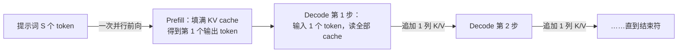
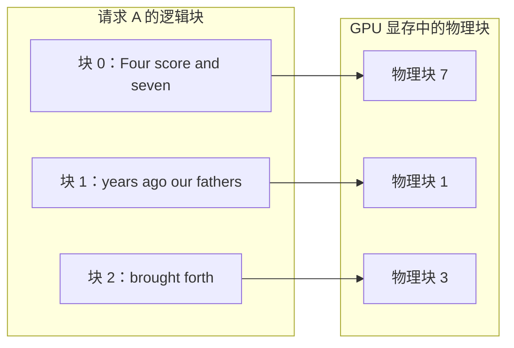

# 第 10 章 推理：KV cache、访存瓶颈与加速技巧

> 对应课程：Lecture 10《Inference》 · [YouTube](https://www.youtube.com/watch?v=EfM546A79aM) · 官方讲义：[可执行讲义 lecture_10](https://cs336.stanford.edu/lectures/?trace=lecture_10)

<Video id="EfM546A79aM" title="Lecture 10 原视频" />

## 本章你将学到

- 推理为什么越来越重要，以及衡量“快”的三个指标：**首 token 延迟（TTFT）、延迟、吞吐**。
- 推理的两个阶段：**prefill（预填充）** 和 **decode（逐个生成）**，以及 **KV cache** 为什么必不可少。
- 用算术强度（arithmetic intensity）严格推出：**prefill 受算力限制，decode 受显存带宽限制**，而 decode 阶段的注意力几乎无法靠 batch 改善。
- 用 Llama 2 13B 手算延迟、吞吐和显存，理解**延迟与吞吐的权衡**。
- 一系列加速手段：**缩小 KV cache（GQA、MLA、CLA、局部注意力）**、**量化**、**剪枝 + 蒸馏**、**投机解码（无损）**、**连续批处理**和 **PagedAttention**。

## 先说结论（一分钟版）

1. 训练时整条序列并行处理；推理时只能**一个 token 一个 token 地生成**，这是推理效率问题的根源。
2. KV cache 把历史 token 的 Key/Value 存起来，避免重复计算；但它也成了**显存和带宽的头号消耗者**。
3. Prefill 像训练一样是大矩阵乘法，**受算力限制**；decode 每步要把全部参数和全部 KV cache 读一遍、却只算很少的 token，**受显存带宽限制**。所以“推理是 memory-bound 的”。
4. 几乎所有加速手段都围绕一句话：**在不太伤害精度的前提下，减少要搬运的字节数**（更小的 KV cache、更低的精度、更小的模型）。投机解码则利用“验证比生成快”的不对称性，做到**数学上无损**的加速。
5. 线上服务还要处理请求到达时间不同、长度不同、前缀共享等“动态负载”，于是有了**连续批处理**和借鉴操作系统分页思想的 **PagedAttention**（vLLM）。

---

## 10.1 推理的版图：为什么它越来越重要

### 推理无处不在

推理的问题定义很简单：给定一个训练好的模型和一段提示词，尽可能又准又快地生成回复（[▶ 00:05](https://www.youtube.com/watch?v=EfM546A79aM&t=5s)）。它出现在很多地方（[▶ 01:06](https://www.youtube.com/watch?v=EfM546A79aM&t=66s)）：

- **实际使用**：聊天机器人、代码补全、智能体（agent）、批量数据处理；
- **模型评测**：很多评测需要模型生成文本；
- **强化学习**：要采样大量回答（rollout）、打分，再更新模型（第 16 章会讲）。

### 为什么效率至关重要

训练是**一次性**成本，推理是**反复发生**的成本（[▶ 02:06](https://www.youtube.com/watch?v=EfM546A79aM&t=126s)）。讲义引用的估算：OpenAI 每天处理约 **8.6 万亿（8.6T）token**；作为参照，DeepSeek V4 的训练数据约 32T token。也就是说，不到 4 天的推理量就赶上了一个前沿模型的全部训练 token。

而且推理的重要性还在上升（[▶ 03:07](https://www.youtube.com/watch?v=EfM546A79aM&t=187s)）：

- 聊天机器人场景里，大部分 token 是给人看的，人读得没那么快，推理快到一定程度就“够了”；
- 智能体场景里，一个请求进来，智能体要思考、推理、调用工具、反思，最后才给人一点输出。**大部分 token 根本不是给人读的**，生成的 token 数就等于花掉的算力，而且没有上限。

所以推理快 2 倍、哪怕只快 10%，都是大事。

### 谁在做推理

- 闭源模型的提供方：OpenAI、Anthropic、Google 等；
- 开源权重模型的推理服务商：Together、Fireworks、Baseten、DeepInfra、Groq、Cerebras 等。

开源推理框架（[▶ 04:08](https://www.youtube.com/watch?v=EfM546A79aM&t=248s)）：

| 框架 | 来源 | 特点 |
|---|---|---|
| vLLM | 伯克利 | 首创 PagedAttention，流行，是不错的默认选择 |
| SGLang | 伯克利 | 首创 RadixAttention，适合智能体类负载 |
| TensorRT-LLM | NVIDIA | 针对 NVIDIA GPU 深度优化，但适用面窄一些 |
| llama.cpp | 社区 | 纯 C++，支持 CPU 推理，可本地运行 |

### “快”的三种含义

（[▶ 05:09](https://www.youtube.com/watch?v=EfM546A79aM&t=309s)）

| 指标 | 含义 | 适用场景 |
|---|---|---|
| **TTFT**（time-to-first-token，首 token 延迟） | 用户发出请求后，等多久才看到第一个字 | 交互式应用 |
| **延迟**（latency，秒/token） | 对**单个**请求，token 一个个冒出来有多快 | 交互式应用 |
| **吞吐**（throughput，token/秒） | 对**很多**请求，整体每秒产出多少 token | 批量处理（比如用模型处理 1 PB 数据） |

延迟和吞吐看起来是一回事的两面，很多优化也会同时改善两者，但后面会看到，它们之间存在**真实的权衡**。

::: tip 移动端类比
TTFT 就像 App 冷启动后首屏出现的时间；延迟像列表滚动时每一帧的耗时；吞吐像后台批量上传照片时每秒处理多少张。用户对前两者敏感，后台任务只关心第三个。
:::

### 根本难点：不能沿序列并行

这是本讲最该记住的一点（[▶ 07:09](https://www.youtube.com/watch?v=EfM546A79aM&t=429s)）：

- **训练**（监督学习）时你能看到所有 token，可以沿序列维度并行。在 Transformer 里，序列只是张量的一个维度，整条序列一次性做大矩阵乘法。
- **推理**是自回归的，必须**一个一个**生成 token，无法沿生成方向并行，于是很难把算力用满。

---

## 10.2 记号回顾与算术强度

### 记号

本讲大量参考 Google 的 [Scaling Book](https://jax-ml.github.io/scaling-book/)（Transformer 与推理章节），记号类似 einops（[▶ 09:11](https://www.youtube.com/watch?v=EfM546A79aM&t=551s)）：

| 符号 | 含义 |
|---|---|
| B | batch 维度（推理时 = 并发序列数） |
| S | 已有（被条件化的）token 数 |
| T | 本次要算输出的 token 数 |
| D | 模型维度 |
| F | MLP 中间维度，约定 F = 4D |
| N | 查询头数，D = N·H |
| H | 每个头的维度 |
| K | KV 头数（GQA 里 K 小于 N） |
| L | 层数 |
| V | 词表大小 |

训练时 S = T；推理的 prefill 阶段 T = S，decode 阶段 **T = 1**。

一个矩阵乘法写成 `BTD × DH → BTH`：出现在两个操作数里、却从结果中消失的维度（这里的 D）是**收缩维**；只出现在一个操作数里的是普通维；在两个操作数里都出现、并保留在结果中的是**批处理维**。记住“批处理维”这个概念，它就是后面注意力成为瓶颈的原因。

### 算术强度复习

第 2、5 章讲过：**算术强度 = FLOPs ÷ 搬运的字节数**。它越高越好（[▶ 14:16](https://www.youtube.com/watch?v=EfM546A79aM&t=856s)）。

以 $X$（B×D）乘 $W$（D×F）为例，按 bf16（每数 2 字节）记账：

| 步骤 | 字节 | FLOPs |
|---|---|---|
| 从 HBM 读 X | 2BD | |
| 从 HBM 读 W | 2DF | |
| 计算 Y = XW | | 2BDF |
| 把 Y 写回 HBM | 2BF | |

$$
\text{强度} = \frac{2BDF}{2BD + 2DF + 2BF}
$$

当 B 远小于 D 和 F（推理里很常见）时，分母由 $2DF$ 主导，强度 ≈ **B**。

**硬件的“算术强度”**：H100 的 bf16 算力约 989 TFLOP/s，显存带宽 3.35 TB/s：

$$
\frac{989\times10^{12}}{3.35\times10^{12}}\approx 295
$$

规则（[▶ 17:17](https://www.youtube.com/watch?v=EfM546A79aM&t=1037s)）：

- 计算的强度 **大于** 硬件强度 → **受算力限制（compute-bound）**，好；
- 计算的强度 **小于** 硬件强度 → **受带宽限制（memory-bound）**，差。

所以这个矩阵乘法在 H100 上需要 **B > 295** 才能吃满算力。极端情况 **B = 1**（矩阵乘向量）：强度 = 1，读了整个 D×F 矩阵，却只做 2DF 次运算，严重受带宽限制。而这**基本上就是推理时的状况**：矩阵是“瘦”的（[▶ 18:17](https://www.youtube.com/watch?v=EfM546A79aM&t=1097s)）。

---

## 10.3 KV cache 与推理的两个阶段

### 最朴素的推理：O(T³)

把提示词 “Never gonna give you” 送进 Transformer，得到下一个 token 的概率分布，采样出 “up”；把 “up” 拼到后面，再整段送进去……（[▶ 20:20](https://www.youtube.com/watch?v=EfM546A79aM&t=1220s)）

这能用，但很浪费：每生成一个 token 都要把整段重算一遍。一次前向的注意力是 $O(T^2)$，生成 T 个 token 就是 $O(T^3)$。

### 关键观察：前缀的计算可以复用

在**因果（causal）**Transformer 里，后面追加的 token 不会改变前面 token 的激活（[▶ 22:21](https://www.youtube.com/watch?v=EfM546A79aM&t=1341s)）。所以 “Never gonna give you” 这几个位置的 Key 和 Value，生成下一个 token 时完全不变，没必要重算。（如果是双向模型，追加一个 token 会改变所有位置，就不能这样做了。）

于是把每层算出的 K、V **存在 HBM 里**，这就是 **KV cache**。形式上：

> 对每条序列（B）、每个 token（S）、每一层（L）、每个 KV 头（K），存一个 H 维的 Key 向量和一个 H 维的 Value 向量。

::: tip 移动端类比
KV cache 就像图片列表里的**内存缓存**（如 `LruCache` / `NSCache`）：已经解码过的缩略图不要每次滚动都重新解码。代价也一样：缓存占内存，缓存越大，内存压力越大。
:::

### 两个阶段

（[▶ 23:21](https://www.youtube.com/watch?v=EfM546A79aM&t=1401s)）

1. **Prefill（预填充）**：拿到整段提示词，一次性算出所有位置的 K、V 填进 cache，并得到第一个输出 token 的分布。整段提示词都已知，所以**可以像训练一样并行**。
2. **Decode / Generation（生成）**：每步只把上一步生成的 1 个 token 送进去，用它的 Query 和 cache 里所有的 K、V 做注意力，算出新 token 的 K、V 追加进 cache，并得到下一个 token 的分布。这一步**必须串行**。



下面的演示把这个过程画出来了。先点几次“单步”，注意 prefill 时 4 个提示词 token 的 K/V **同时**出现；decode 时每步只追加一列，但每步都要读取（黄色高亮）全部旧的 K/V。下方的统计会显示当前模型、并发数、提示词长度下每一步的 FLOPs、字节数、算术强度和瓶颈；切到下半部分的计算器，可以看到 KV cache 和延迟/吞吐如何随 batch 变化。

<Demo src="ch10-kv-cache.html" title="Prefill vs Decode：KV cache 增长动画与显存计算器" :height="1320" />

---

## 10.4 为什么 decode 是 memory-bound：严格推导

现在分别对 MLP 和注意力做 FLOPs 与字节的记账（只看矩阵乘法，因为它们是计算大头，其余操作量小且可以融合进去）（[▶ 25:22](https://www.youtube.com/watch?v=EfM546A79aM&t=1522s)）。

### MLP 层

带门控的 MLP（SwiGLU 一类）有三个矩阵：$W_{up}$、$W_{gate}$（D×F）和 $W_{down}$（F×D）。

| 步骤 | 字节 | FLOPs |
|---|---|---|
| 读 X（B×T×D） | 2BTD | |
| 读三个权重矩阵 | 3 × 2DF | |
| U = X·W_up，写 U | 2BTF | 2BTDF |
| G = X·W_gate，写 G | 2BTF | 2BTDF |
| Y = (GeLU(G)·U)·W_down，写 Y | 2BTD | 2BTDF |
| **合计** | 4BTD + 4BTF + 6DF | **6BTDF** |

假设 $B\cdot T$ 远小于 D 和 F，分母由 $6DF$ 主导：

$$
\text{MLP 强度} \approx \frac{6BTDF}{6DF} = B\cdot T
$$

这很好理解：MLP 本质上就是大矩阵乘法，batch 维和序列维彼此独立，合起来当作“B·T 个样本”（[▶ 27:23](https://www.youtube.com/watch?v=EfM546A79aM&t=1643s)）。

- **Prefill**：B·T 可以很大（大 batch、长序列），很容易受算力限制，好。
- **Decode**：T = 1，强度只有 B。而 B 是**并发请求数**，在交互式服务里取决于此刻有多少用户在线，不可预测（[▶ 28:24](https://www.youtube.com/watch?v=EfM546A79aM&t=1704s)）。只要并发够多（B 大于约 295），MLP 还是能吃满。

### 注意力层

按 FlashAttention 的方式（中间结果不写回 HBM）记账，S 是已有 token 数，T 是要算的 token 数（[▶ 29:24](https://www.youtube.com/watch?v=EfM546A79aM&t=1764s)）：

| 步骤 | 字节 | FLOPs |
|---|---|---|
| 读 Q（B×T×D）、K（B×S×D）、V（B×S×D） | 2BTD + 4BSD | |
| A = Q·Kᵀ | | 2BSTD |
| Y = softmax(A)·V | | 2BSTD |
| 写 Y（B×T×D） | 2BTD | |
| **合计** | 4BSD + 4BTD | **4BSTD** |

$$
\text{注意力强度} = \frac{4BSTD}{4BSD + 4BTD} = \frac{ST}{S+T}
$$

注意：**B 被约掉了**。

- **Prefill**（T = S）：强度 = $S^2/(2S) = S/2$。序列长就还行。
- **Decode**（T = 1）：强度 = $S/(S+1)$，**小于 1**！而 H100 需要约 295 才能吃满算力（[▶ 30:24](https://www.youtube.com/watch?v=EfM546A79aM&t=1824s)）。

### 为什么加大 batch 救不了注意力

（[▶ 31:24](https://www.youtube.com/watch?v=EfM546A79aM&t=1884s)）

- **MLP**：所有序列共用同一套权重 $W_{up}, W_{gate}, W_{down}$。权重从显存读一次，就能给 B 条序列用，B 越大越划算。
- **注意力**：每条序列都有**自己的** KV cache。Q、K、V 都带着 B 维（它是“批处理维”），B 条序列就是 B 份各自独立的小运算，相当于做 B 次点积，读 B 份数据，强度不随 B 提高。

| | Prefill | Decode |
|---|---|---|
| MLP 强度 | B·S（很好） | B（需要大并发） |
| 注意力强度 | S/2（还行） | 小于 1（**无法改善**） |

**结论：prefill 受算力限制，decode 受带宽限制。** 以后再听到有人说“推理是 memory-bound 的”，你就知道原因了（[▶ 33:27](https://www.youtube.com/watch?v=EfM546A79aM&t=2007s)）。只要还用标准 Transformer，decode 阶段注意力的这个瓶颈就绕不过去。

::: warning 常见误区
“GPU 利用率低，说明代码写得差”在推理里不一定成立。decode 阶段 GPU 的计算单元大部分时间就是在等显存送数据，这是由算术强度决定的“物理限制”。优化方向应该是**少搬字节**，而不是多塞计算。
:::

---

## 10.5 手算延迟与吞吐：Llama 2 13B on H100

既然推理受带宽限制，事情反而简单了：**耗时 ≈ 要搬运的字节数 ÷ 显存带宽**（假设计算和访存完全重叠、忽略其他开销）（[▶ 35:29](https://www.youtube.com/watch?v=EfM546A79aM&t=2129s)）。

### 显存里有什么

Llama 2 13B 的配置：S = 1024，D = 5120，F = 13824，N = K = 40（没有 GQA），H = 128，L = 40，V = 32000；H100 带宽 3.35 TB/s。

**参数量**（[▶ 37:32](https://www.youtube.com/watch?v=EfM546A79aM&t=2252s)）：

$$
\underbrace{2VD}_{\text{输入/输出嵌入}} + \underbrace{3DFL}_{\text{MLP}} + \underbrace{(2DNH + 2DKH)L}_{\text{注意力 Q、O 与 K、V}}
$$

逐项手算：

- $2VD = 2\times32000\times5120 \approx 0.33$B
- $3DFL = 3\times5120\times13824\times40 \approx 8.49$B
- $(2DNH+2DKH)L = 4\times5120\times5120\times40 \approx 4.19$B
- 合计约 **13.0B**，与“13B”吻合。bf16 下参数占 $2\times13.0\text{B}\approx 26.0$ GB。

**每条序列的 KV cache**：

$$
S\times K\times H\times L\times 2\,(\text{K 与 V})\times 2\,(\text{bf16 字节})
$$

$= 1024\times40\times128\times40\times4 \approx 838.9$ MB，每个 token 约 0.82 MB。

**总显存** $= B\times 838.9\text{MB} + 26.0\text{GB}$。

### 延迟和吞吐

decode 每一步都要把**全部参数 + 全部 KV cache** 从 HBM 读一遍：

$$
\text{延迟} = \frac{\text{总显存}}{\text{带宽}},\qquad \text{吞吐} = \frac{B}{\text{延迟}}
$$

延迟是 B 的线性函数（斜率是每条序列的 KV cache，截距是参数）；吞吐 $\propto \frac{B}{B+\text{常数}}$，随 B 增大但会饱和（[▶ 39:33](https://www.youtube.com/watch?v=EfM546A79aM&t=2373s)）。

| B | 总显存 | 每 token 延迟 | 吞吐 | 能否放进 80 GB |
|---|---|---|---|---|
| 1 | 26.9 GB | 8.0 ms | 约 125 token/s | 能 |
| 64 | 79.7 GB | 23.8 ms | 约 2690 token/s | 刚好能（还没算激活等） |
| 256 | 240.8 GB | 71.9 ms | 约 3560 token/s | **放不下** |

手算 B = 1：$26.87\times10^9 / 3.35\times10^{12}\approx 8.0$ ms，吞吐 $1/0.008\approx125$ token/s。

规律（[▶ 42:35](https://www.youtube.com/watch?v=EfM546A79aM&t=2555s)）：

- **加大 batch 让延迟变差**：KV cache 随 B 线性增长，每步要读的东西更多；而且你的请求要等整个 batch 一起算完。
- **加大 batch 让吞吐变好**：参数只读一次，被更多序列分摊。
- 但吞吐增长会**递减**，而且很快就**撞上显存上限**（B = 256 时需要 240 GB）。

课上用了一个公交车的比喻（[▶ 43:38](https://www.youtube.com/watch?v=EfM546A79aM&t=2618s)）：公交车要等人上齐了才开，单个乘客的等待（延迟）变长了，但一趟能运很多人（吞吐高）。

::: tip 移动端类比
这就是网络请求合并（batching）的经典权衡：把 50 个埋点事件攒成一批上传，服务器和电量都更省（吞吐高），但每个事件的上报延迟变长。实时性要求高的事件就不能攒太久。
:::

### 其他几点

- **最简单的并行**：部署 M 份模型副本，延迟不变，吞吐变为 M 倍。更难的做法是把模型和 KV cache 切到多卡上（参见 Scaling Book 的推理章节，本讲不展开）（[▶ 44:39](https://www.youtube.com/watch?v=EfM546A79aM&t=2679s)）。
- **TTFT 基本就是 prefill 的耗时**。prefill 时用较小的 batch 以加快 TTFT；decode 时用较大的 batch 以提高吞吐。

---

## 10.6 有损捷径一：缩小 KV cache

既然显存是瓶颈，而 KV cache 很大（batch 一大甚至超过参数本身），最直接的办法就是**把 KV cache 变小**，同时注意别丢太多精度（[▶ 45:47](https://www.youtube.com/watch?v=EfM546A79aM&t=2747s)）。

### GQA：分组查询注意力

（[▶ 46:48](https://www.youtube.com/watch?v=EfM546A79aM&t=2808s)）

- **MHA（多头注意力）**：N 个查询头，每个都有自己的 K、V 头，K = N。
- **MQA（多查询注意力）**：所有查询头共享 1 组 K、V，K = 1。省得多，但效果差，“没人用”。
- **GQA（分组查询注意力）**：N 个查询头分成 K 组，每组共享一组 K、V，介于两者之间。

GQA 把 KV cache 缩小 **N/K 倍**。因为推理受带宽限制，**少搬内存就等于加速**。GQA 论文（2023）显示：K = 1 比 MHA 快得多，K 增加到 8 左右依然很快，再大才明显变慢。

回到 Llama 2 13B，用 GQA 把 K 从 40 改为 8（1:5），手算一下（[▶ 48:48](https://www.youtube.com/watch?v=EfM546A79aM&t=2928s)）：

| 配置 | 总显存 | 每 token 延迟 | 吞吐 |
|---|---|---|---|
| MHA（K=40），B=64 | 79.7 GB | 23.8 ms | 约 2690 token/s |
| GQA（K=8），B=64 | 33.4 GB | 10.0 ms | 约 6420 token/s |
| GQA（K=8），B=256 | 65.6 GB | 19.6 ms | 约 13070 token/s |

（K、V 投影矩阵也变小了，参数从 13.0B 降到约 11.3B。）

两个观察：

1. 同样 B=64，GQA **同时改善了延迟和吞吐**。所以延迟和吞吐并不总是对立的：**减少内存就能两者兼得**，真正制造矛盾的是 batch 大小（[▶ 49:49](https://www.youtube.com/watch?v=EfM546A79aM&t=2989s)）。
2. 原来 B=256 放不下，现在放得下了，吞吐几乎再翻一倍。各种参数往往要**联合调整**：先缩小 KV cache，再用省下的显存加大 batch。

最后必须检查精度。GQA 论文说精度基本没掉；但后来 DeepSeek 的论文表明 GQA 确实会有损失（[▶ 50:50](https://www.youtube.com/watch?v=EfM546A79aM&t=3050s)）。对这类“不是纯数学”的评测结论，要保持一点怀疑。

### MLA：多头潜在注意力（DeepSeek）

GQA 是减少 K、V 的**个数**；MLA 是**压缩**它们（[▶ 51:51](https://www.youtube.com/watch?v=EfM546A79aM&t=3111s)）：

- 普通注意力：$K = W_K h$，$V = W_V h$，维度都是 N·H，很大；
- MLA：先把激活压成一个低维向量 $c = W_c h$（C 维），cache 里只存 $c$；需要时再投影回 $K = W_K c$、$V = W_V c$。

DeepSeek V2 把 N·H = 16384 压到 C = **512**，非常激进。一个小麻烦：MLA 和 RoPE 不兼容（RoPE 直接作用在 K 上），所以额外加了 64 维给 RoPE，总共 512 + 64 = **576 维**。

精度方面（[▶ 53:54](https://www.youtube.com/watch?v=EfM546A79aM&t=3234s)），DeepSeek V2 论文显示：MHA 比 GQA 好（但更贵）；MLA 甚至比 MHA 还略好一点，而且便宜得多。

有同学问：这和直接缩小模型维度比如何？论文没做这个消融。老师的看法是：直接缩小维度是“无差别地削弱一切”，大概率更差；诀窍是找到模型里**可以挤压的地方**，而这往往只能靠实验（[▶ 54:55](https://www.youtube.com/watch?v=EfM546A79aM&t=3295s)）。

### CLA：跨层注意力

GQA 在**头**之间共享 KV，CLA 在**层**之间共享 KV：只有部分层计算 KV，其他层直接复用上一层的 KV cache（[▶ 55:56](https://www.youtube.com/watch?v=EfM546A79aM&t=3356s)）。论文显示它改善了“精度 vs KV cache 大小”的帕累托前沿。

### 局部（滑动窗口）注意力

每个 token 只看最近的 k 个 token，而不是全部历史（[▶ 56:57](https://www.youtube.com/watch?v=EfM546A79aM&t=3417s)）。这样：

- **KV cache 大小与序列长度无关**，对长上下文特别有利；
- 由于有多层，信息可以逐层往前传，**有效上下文随层数线性增长**；
- 问题是会**伤害精度**（表达能力下降，“没有免费的午餐，或者说这顿午餐很贵”）。

解决办法：**混合层**，一部分层用全局注意力，一部分层用局部注意力，在精度和速度之间折中。

有同学问线性注意力和滑动窗口怎么比（[▶ 58:59](https://www.youtube.com/watch?v=EfM546A79aM&t=3539s)）。线性注意力类方法（最朴素的版本把历史 KV 求和成一个向量；更高级的有 Mamba、DeltaNet、Gated DeltaNet 等）把全部历史压缩成固定大小的状态，同样与序列长度无关。老师认为它们比滑动窗口**更强**（它们至少能模拟滑动窗口的某些行为，而滑动窗口“做了就到头了”），也常与全注意力、滑动窗口混合使用。但没有免费午餐：在“大海捞针”这类需要精确检索的长上下文任务上，压缩一定会丢信息。（第 4 章对这些注意力替代方案有更详细的介绍，见[第 4 章](./ch04-attention-alternatives)。）

### DeepSeek V4 的注意力

为支持 1M 上下文，DeepSeek V4 继续在注意力上做文章（[▶ 62:02](https://www.youtube.com/watch?v=EfM546A79aM&t=3722s)）：

- **CSA（压缩稀疏注意力）**：每 m 个 token 压缩成 1 个；
- **DSA（DeepSeek 稀疏注意力）**：用一个轻量的“索引器”（小的 Q、K 做一次快速注意力打分）选出 top-k 个最相关的位置，只关注它们；
- **HCA（重度压缩注意力）**：压缩得更狠。

### 小结

| 思路 | 方法 |
|---|---|
| 更低维的 KV | GQA（跨头共享）、MLA（压缩）、CLA（跨层共享） |
| 截断 KV | 局部注意力（部分层） |
| 其他 | 线性注意力 / 状态空间模型（Mamba 2、Gated DeltaNet）、扩散模型（非自回归生成） |

目标始终是：**在不伤精度的前提下缩小 KV cache**，因为 KV cache 就是显存，显存就是推理速度。

---

## 10.7 有损捷径二：量化

量化（quantization）更偏系统而非架构：**降低数字的精度**（[▶ 64:03](https://www.youtube.com/watch?v=EfM546A79aM&t=3843s)）。内存少了，带宽受限的推理自然就快了。

### 机制

以一个数为例：

```python
x = 5.2342
scale, zero_point = 0.1, 4
x_quant = round(x / scale) + zero_point   # 量化：变成整数 56
x_approx = (x_quant - zero_point) * scale # 反量化：5.2，有误差
```

每个张量（或每层、每组）选一个缩放因子 `scale` 和零点 `zero_point`，把浮点数映射成小整数。

### 常见精度

| 格式 | 字节 | 用途 |
|---|---|---|
| fp32 | 4 | 训练时的参数和优化器状态 |
| bf16 | 2 | 推理的默认精度 |
| fp8（H100 上 e4m3，范围约 ±448；讲义写的 ±240 是 AMD 变体的数） | 1 | 胆子大的话可以用来训练 |
| int8（−128 ~ 127） | 1 | 比 fp8 便宜但不太准，只用于推理 |
| int4（−8 ~ 7） | 0.5 | 更便宜，更不准 |

### 两种做法

- **量化感知训练（QAT）**：训练的前向过程中就“量化再反量化”，模拟量化误差，让权重适应量化。效果好，但要大规模训练，很贵。
- **训练后量化（PTQ）**：训练完再量化，便宜得多。在一些样本数据上跑一遍，为每层/每个张量确定 scale 和零点。朴素做法效果一般；**GPTQ** 逐层量化，利用 Hessian（二阶导）信息，把量化误差补偿到还没量化的权重上（[▶ 66:04](https://www.youtube.com/watch?v=EfM546A79aM&t=3964s)）。

### AWQ：看激活决定精度

**激活感知量化（Activation-aware Weight Quantization）**基于一个经验观察：有些激活通道的数值特别大，与它们相乘的权重也就更重要。于是：

- 根据激活挑出 0.1%~1% 的关键权重，保留高精度（如 fp16）；
- 其余权重量化到很低精度（如 int3）。

讲义给出的效果：fp16 → int3，内存降为约 1/4，速度提升约 3.2 倍。

---

## 10.8 有损捷径三：剪枝 + 蒸馏

**直接把大模型的一部分拆掉，再修好**（[▶ 67:06](https://www.youtube.com/watch?v=EfM546A79aM&t=4026s)）。NVIDIA 的一篇论文（Minitron 相关工作）的做法：

1. 在一个小的校准集（1024 个样本）上，评估各个**层、注意力头、隐藏维度**的重要性；
2. 移除不重要的部分，得到一个更小的模型（此时它效果很差）；
3. 用原模型对它做**蒸馏**，“治愈”它。

他们把一个 15B 模型压到 8B，精度损失不大，而且所需训练量比从头训练少得多。

怎么判断“重要”？用校准数据跑一遍模型，看激活的大小：接近 0 的（比如“死”神经元）可以删，大的要保留。有同学追问：如果某个神经元总是 100 呢（[▶ 71:13](https://www.youtube.com/watch?v=EfM546A79aM&t=4273s)）？那就不能简单删掉，否则整个模型会坏；可以看方差，均值高而方差低的，可以合并进偏置项。

### 有损方法的两种配方

| 从头训练 | 蒸馏 |
|---|---|
| 1. 设计更快的模型架构 | 1. 设计更快的模型架构 |
| 2. 训练这个更快的模型 | 2. 用原模型的权重初始化它（架构可以不同，拼一个“弗兰肯斯坦”出来） |
| | 3. 用蒸馏修复这个更快的模型 |

---

## 10.9 无损捷径：投机解码

前面的方法都是**有损**的，多少会影响精度。投机解码（speculative decoding / speculative sampling）是一个**无损**的优雅方法（[▶ 72:13](https://www.youtube.com/watch?v=EfM546A79aM&t=4333s)）。

### 核心不对称：验证比生成快

回顾两个阶段：

- prefill 能并行编码一整段 token，受算力限制，而且**顺便给出了每个位置的概率**；
- decode 一次只能生成一个 token，受带宽限制。

换句话说：**给你一段文本，检查它好不好（算每个位置的概率），比一个个生成它快得多。** 在带宽受限的 decode 阶段，大模型处理 1 个 token 和处理 5 个 token 的耗时差不多，因为主要时间都花在读参数上。

### 算法

（[▶ 73:13](https://www.youtube.com/watch?v=EfM546A79aM&t=4393s)）

- 用一个便宜的**草稿模型** $p$ 串行猜 k 个 token（比如 4 个）。小模型虽然也是带宽受限、一次一个，但它小，所以快。
- 用真正想要的**目标模型** $q$ **一次并行**算出这 k 个位置（以及下一个位置）的概率。
- 从第 1 个草稿 token 开始逐个检查：以概率 $\min\left(1, \frac{q(x)}{p(x)}\right)$ **接受**；
- 一旦某个被拒绝，就从**残差分布** $\max(q-p, 0)$（归一化后）中重新采样一个 token 替换它，本轮结束；
- 如果 k 个全被接受，目标模型那次前向已经给出了第 k+1 个位置的分布，再从中采样一个“奖励” token。

$q(x)$ 比 $p(x)$ 大，说明目标模型比草稿模型更想要这个 token，那就一定接受；$q(x)$ 小于 $p(x)$，说明草稿模型“过度热情”，按比例打折接受。

### 为什么是“精确”的

这是**改进版的拒绝采样**：提议分布是 $p$，目标分布是 $q$。普通拒绝采样被拒后会继续循环，而这里保证每轮至少产出一个 token。关键性质：**输出的 token 严格服从目标模型 $q$ 的分布**，不是近似！

讲义用两个词的词表 $\{A, B\}$ 举例证明（[▶ 75:13](https://www.youtube.com/watch?v=EfM546A79aM&t=4513s)）。假设草稿模型过采样 A：$p(A) > q(A)$，于是 $p(B) < q(B)$。残差 $\max(q-p,0) = [0,\ q(B)-p(B)]$，归一化后是 $[0, 1]$，即被拒绝时一定重采样出 B。

$$
P[\text{输出 } A] = p(A)\cdot\frac{q(A)}{p(A)} + p(B)\cdot 1\cdot 0 = q(A)
$$

第一项：草稿抽到 A（概率 $p(A)$），以 $q(A)/p(A)$ 被接受；第二项：草稿抽到 B 时总被接受（因为 $q(B) > p(B)$），不会变成 A。

$$
P[\text{输出 } B] = p(B)\cdot 1 + p(A)\cdot\left(1-\frac{q(A)}{p(A)}\right)\cdot 1 = p(B) + p(A) - q(A) = q(B)
$$

第一项：抽到 B 直接接受；第二项：抽到 A 但被拒绝，从残差分布中一定抽到 B。最后一步用到了 $p(A)+p(B) = 1 = q(A)+q(B)$。

两个结果正好等于 $q(A)$ 和 $q(B)$：**投机解码的输出与目标模型自己采样完全同分布**。

::: tip 移动端类比
这很像 App 里的**乐观更新（optimistic UI）**：用户点赞后，界面先“猜”成功、立即显示红心（草稿模型），同时请求服务器确认（目标模型）；服务器确认了就什么都不用做，拒绝了就回滚到正确状态。只要“猜对”的概率够高，用户体验就快得多；而最终状态永远以服务器为准，不会出错。
:::

下面的演示用一个 8 个词的玩具语言模型跑投机解码。调高 λ（草稿模型越像目标模型），接受率越高，每次目标模型前向平均产出的 token 越多；调大 k，猜得多但被拒的机会也多。页面下方的“抽样验证”会统计 2 万次，直观证明输出分布与 $q$ 一致，而与草稿模型 $p$ 无关。

<Demo src="ch10-speculative.html" title="投机解码：猜测-验证动画与无损性抽样验证" :height="1300" />

### 实践中

- 草稿 token 数有一个**最佳点**：太少，没充分利用目标模型的并行验证；太多，被拒绝的概率变大。原论文中大约是 3~4 个（[▶ 75:13](https://www.youtube.com/watch?v=EfM546A79aM&t=4513s)）。
- 常见搭配：目标 70B + 草稿 8B，或目标 8B + 草稿 1B。
- 草稿模型越接近目标模型越好，通常用**蒸馏**得到。所以前面讲的各种有损压缩方法在这里都能用上：压缩得到的模型如果足够好，直接部署；不够好，就拿来当草稿模型，再由大模型兜底（[▶ 76:13](https://www.youtube.com/watch?v=EfM546A79aM&t=4573s)）。
- 改进草稿模型的工作：**Medusa**（草稿模型并行生成多个 token）、**EAGLE**（草稿模型利用目标模型的高层特征）。

小结：数学保证了从目标模型精确采样；它利用了“验证 vs 生成”的不对称；草稿模型（需要训练）还有大量创新空间。

---

## 10.10 处理动态负载：连续批处理与 PagedAttention

线上服务的流量远比训练“乱”（[▶ 77:14](https://www.youtube.com/watch?v=EfM546A79aM&t=4634s)）：

1. **请求到达时间不同**：为了凑 batch 让早到的请求干等，体验很差；
2. **请求有共享前缀**：比如系统提示词，或者同一个提示词要生成多个回答；
3. **请求长度不同**：补齐（padding）很浪费。

### 连续批处理（Continuous Batching）

来自 Orca 系统（OSDI 2022）。问题：训练时拿到的是一整块规整的 token（batch × 序列长度）；推理时请求随时到达、随时结束，是一个参差不齐的数组。

**解决办法：迭代级调度（iteration-level scheduling）**（[▶ 78:15](https://www.youtube.com/watch?v=EfM546A79aM&t=4695s)）：

- 一步一步地 decode，每一步为 batch 里所有序列各生成一个 token；
- 某条序列结束了，立刻把它移出 batch；
- 新请求到了，立刻加入 batch，不用等当前这批全部生成完。

batch 是动态变化的，因此叫“连续”批处理。

::: tip 移动端类比
这像一个线程池的任务队列：不会等 8 个任务全部做完才开始下一批 8 个，而是哪个工作线程空了，就立刻从队列里取下一个任务。
:::

**新问题**：批处理要求张量形状一致，可每个请求的长度都不同怎么办？

**选择性批处理（selective batching）**：

- 注意力计算依赖各自的序列长度（3×3 和 9×9 的注意力没法拼成一个张量），**逐个序列单独处理**；
- 非注意力部分（MLP 等，FLOPs 大头）对每个 token 独立，可以把所有序列**拼成一个超长序列**一起算：比如长度 3、9、5 的序列拼成 $[3+9+5, H]$。

### PagedAttention（vLLM）

vLLM 论文提出的核心思想（当然现在 vLLM 还有很多别的功能）（[▶ 79:15](https://www.youtube.com/watch?v=EfM546A79aM&t=4755s)）。

**以前的做法**：请求进来，就为它的提示词和回复预留一段**连续**的 KV cache 空间，按最大长度（比如 1024 token）预留。问题是**碎片化**，就像以前的硬盘需要“碎片整理”：

- **内部碎片**：预留了 1024 个位置，实际只生成了 100 个，剩下的空间别人也不能用；
- **外部碎片**：不同请求的空间之间留下的小空隙，太小而用不上。

**解决办法：借用操作系统的分页（paging）思想**（[▶ 80:15](https://www.youtube.com/watch?v=EfM546A79aM&t=4815s)）：

- 把每条序列的 KV cache 切成固定大小的**块（block）**，比如每块 4 个 token；
- 块在物理显存里**不需要连续**，用一张“块表”记录逻辑块到物理块的映射；
- 按需分配，用多少分配多少。

例如 “Four score and seven years ago our fathers brought forth” 被切成若干个 4-token 的块，散落在显存各处，只要块表记得它们在哪里就行。



**共享与写时复制（copy-on-write）**（[▶ 81:16](https://www.youtube.com/watch?v=EfM546A79aM&t=4876s)）：

- **共享系统提示词**：很多用户用同一个系统提示词，它的 KV cache 只需算一次、存一份，所有请求的块表都指向它；
- **同一提示词采样多个回答**（比如程序合成里一次采 10 个解）：提示词部分的块共享；当不同样本在某个块里生成了不同的 token，才把这个块**复制一份再修改**，与操作系统 fork 进程后的写时复制一模一样。

::: tip 移动端类比
PagedAttention 就是虚拟内存。App 看到的是连续的地址空间（逻辑块），操作系统按 4KB 页把它映射到零散的物理内存上；fork 出的子进程和父进程共享页，谁写谁复制。vLLM 把这套几十年前的老办法用在了 KV cache 上。
:::

vLLM 的其他优化：把“按块读取”和注意力计算融合成一个 kernel；使用最新的 FlashAttention、FlashDecoding kernel；用 CUDA Graphs 减少 kernel 启动开销（第 6 章讲过 kernel 启动开销）。

---

## 10.11 总结与展望

（[▶ 83:17](https://www.youtube.com/watch?v=EfM546A79aM&t=4997s)）

- 推理非常重要：实际使用、评测、强化学习都离不开它。
- 同一个模型，推理的特征与训练完全不同：**受带宽限制**，而且负载**动态**多变。
- 技术手段：新架构（缩小 KV cache）、量化、剪枝/蒸馏、投机解码。
- 借鉴系统领域的思想：投机执行、分页。
- 所有这些都遵循一条原则：**缩小 KV cache（和要搬运的字节），但别太伤精度。**

老师最后强调：**新架构可能有巨大的提升空间**（[▶ 84:18](https://www.youtube.com/watch?v=EfM546A79aM&t=5058s)）。KV cache 和注意力的结构，从根本上让 Transformer 成为一种“对推理不友好”的架构。状态空间模型、线性注意力、扩散模型这类**为推理而设计**的架构，也许能带来更大的突破。

## 动手练习

1. **KV cache 手算**：Llama 3 8B（L=32，K=8 个 KV 头，H=128），bf16。每个 token 的 KV cache 多大？一条 8192 token 的序列呢？如果 K 改成 32（即 MHA）呢？

   ::: details 答案
   每 token：$2\times8\times128\times32\times2 = 131072$ 字节 = 128 KB；8192 token：1 GB。MHA（K=32）是 4 倍：每 token 512 KB，8192 token 4 GB。可用本章演示的计算器验证。
   :::

2. **算术强度**：用本章 10.4 节的公式，计算 decode 阶段 MLP 在 B = 32 和 B = 512 时的近似强度，判断在 H100 上分别受什么限制。为什么注意力在 decode 阶段无论 B 多大都受带宽限制？

   ::: details 思路
   MLP decode 强度约为 B：32 远小于 295，受带宽限制；512 大于 295，MLP 可以接近算力限制。注意力强度为 $S/(S+1)$，与 B 无关，因为每条序列都有自己的 KV cache，B 是批处理维而非收缩维。
   :::

3. **延迟-吞吐权衡**：仍用 Llama 2 13B（MHA，S=1024，H100），写一个 Python 函数输出 B = 1, 2, 4, …, 128 时的显存、延迟和吞吐，并找出在 80 GB 显存内吞吐最高的 B。再把 K 改为 8，重复一次。

4. **投机解码的无损性（编程）**：实现单步投机采样：给定两个概率向量 $p$、$q$，按“从 $p$ 采样 → 以 $\min(1,q/p)$ 接受 → 否则从 $\text{norm}(\max(q-p,0))$ 重采样”的流程抽 10 万次，验证经验分布与 $q$ 一致。再推导：单个 token 的期望接受率为 $\sum_x \min(p(x), q(x))$。

   ::: details 提示
   接受概率 $= \sum_x p(x)\min(1, q(x)/p(x)) = \sum_x \min(p(x), q(x)) = 1 - \text{TV}(p,q)$，即 1 减去两者的总变差距离。草稿模型越像目标模型，接受率越高。
   :::

5. **简易 KV cache 实现（选做，可在作业 1 的文本生成函数上扩展）**：在你自己实现的 Transformer 里，给注意力层加上 `past_kv` 参数：prefill 时一次性计算并返回所有位置的 K、V；decode 时只输入最后一个 token，把新的 K、V 拼接到缓存上。对比有无 KV cache 时生成 256 个 token 的耗时。

## 本章小结

- 推理的根本难点：**自回归生成无法沿序列并行**。KV cache 把 $O(T^3)$ 的朴素推理降下来，但也让显存和带宽成为瓶颈。
- 算术强度：MLP 约为 $B\cdot T$，注意力约为 $\frac{ST}{S+T}$。**Prefill 受算力限制，decode 受带宽限制**；decode 阶段注意力强度小于 1，且与 batch 无关。
- 带宽受限时，**延迟 ≈ (参数字节 + KV cache 字节) ÷ 带宽**，吞吐 = B ÷ 延迟。加大 batch：延迟变差、吞吐变好但饱和，并很快撞上显存上限。TTFT 主要由 prefill 决定。
- 有损加速：缩小 KV cache（GQA、MLA、CLA、局部/混合注意力、线性注意力）、量化（QAT、PTQ、GPTQ、AWQ）、剪枝 + 蒸馏。
- 无损加速：投机解码利用“验证比生成快”，配合修正的拒绝采样，**输出严格服从目标模型分布**。
- 线上服务：连续批处理（迭代级调度 + 选择性批处理）应对请求的动态到达和长度差异；PagedAttention 用分页和写时复制解决 KV cache 碎片并共享前缀。

下一章（[第 11 章](./ch11-scaling-laws-2)）回到缩放定律的第二部分。值得记住的是，推理成本正在反过来影响模型设计：如果一个模型要被调用万亿次，那么“训练时多花点算力、换一个推理更便宜的小模型”往往是划算的。

## 延伸阅读

- [Google Scaling Book：Transformer 章节](https://jax-ml.github.io/scaling-book/transformers/) 与 [推理章节](https://jax-ml.github.io/scaling-book/inference/)：本讲的主要参考。
- Ainslie et al., *GQA: Training Generalized Multi-Query Transformer Models from Multi-Head Checkpoints*（2023）。
- DeepSeek-AI, *DeepSeek-V2*（2024）：MLA。
- [Brandon et al., *Reducing Transformer Key-Value Cache Size with Cross-Layer Attention*（2024）](https://arxiv.org/abs/2405.12981)
- Beltagy et al., *Longformer*（2020）；Child et al., *Sparse Transformer*（2019）；*Mistral 7B*（2023）：局部/滑动窗口注意力。
- [Frantar et al., *GPTQ*](https://arxiv.org/abs/2210.17323)；[Lin et al., *AWQ*](https://arxiv.org/abs/2306.00978)
- [Muralidharan et al., *Compact Language Models via Pruning and Knowledge Distillation*（NVIDIA，2024）](https://arxiv.org/abs/2407.14679)
- [Leviathan et al., *Fast Inference from Transformers via Speculative Decoding*](https://arxiv.org/abs/2211.17192)；[Chen et al., *Accelerating Large Language Model Decoding with Speculative Sampling*](https://arxiv.org/abs/2302.01318)
- [Google Research：Looking back at speculative decoding](https://research.google/blog/looking-back-at-speculative-decoding/)
- [Medusa](https://arxiv.org/abs/2401.10774)；[EAGLE](https://arxiv.org/abs/2401.15077)
- [Yu et al., *Orca: A Distributed Serving System for Transformer-Based Generative Models*（OSDI 2022）](https://www.usenix.org/system/files/osdi22-yu.pdf)
- [Kwon et al., *Efficient Memory Management for Large Language Model Serving with PagedAttention*（vLLM）](https://arxiv.org/abs/2309.06180)
- 开源框架：[vLLM](https://github.com/vllm-project/vllm)、[SGLang](https://sgl-project.github.io/)、[TensorRT-LLM](https://nvidia.github.io/TensorRT-LLM/overview.html)、[llama.cpp](https://github.com/ggml-org/llama.cpp)
