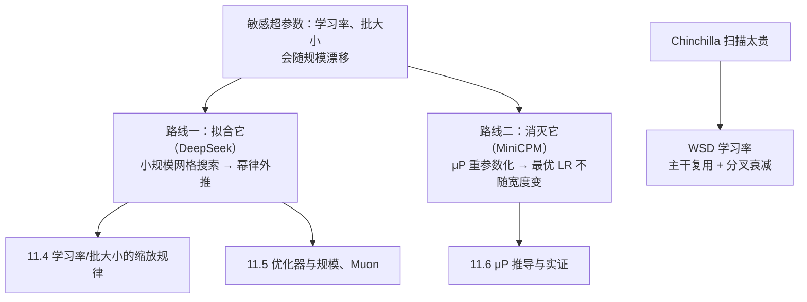

# 第 11 章 缩放定律（下）：真实配方、学习率调度、优化器与 μP

> 对应课程：Lecture 11《Scaling Laws》（Case Study and Details） · [YouTube](https://www.youtube.com/watch?v=vTfEyOyzV9E) · 官方讲义：[幻灯片 lecture_11.pdf](https://github.com/stanford-cs336/lectures/blob/main/lecture_11.pdf)

<Video id="vTfEyOyzV9E" title="Lecture 11 原视频" />

## 本章你将学到

- 真实的开源模型（MiniCPM、DeepSeek、Qwen、Kimi K2、Hunyuan、Llama 3、MiniMax）是怎么做缩放分析的，两种主流"配方"有什么区别。
- WSD（Warmup-Stable-Decay）学习率调度：为什么它能把 Chinchilla 式数据扫描的成本从"平方级"降到接近"线性"。
- 学习率和批大小如何随规模变化：临界批大小、DeepSeek 的算力幂律、StepFun 的 Step Law。
- 优化器与规模：为什么新优化器"小规模大胜、大规模缩水"很常见，算法评估要盯住哪两条轴；Muon 优化器的原理。
- μP（最大更新参数化）：它想解决什么问题，如何用"激活大小不随宽度变化"两个条件推导出初始化和逐层学习率的缩放规则，以及它在实践中哪里会失效。

## 先说结论（一分钟版）

第 9 章的缩放定律在真实模型上大体是成立的：DeepSeek、MiniCPM 等都复现了 Chinchilla 式的分析，并用小模型准确预测了大模型的最终损失。实践中最敏感、最需要随规模调整的超参数是**学习率和批大小**，处理它们有两条路：**DeepSeek 路线**——在小规模网格搜索最优值，拟合它们随算力变化的幂律再外推；**MiniCPM 路线**——用 μP 重新设计初始化和逐层学习率，让最优学习率不随模型宽度变化，从而"调一次、到处用"。为了让 Chinchilla 式扫描不至于太贵，大家普遍用 **WSD 学习率**：长时间恒定学习率，最后短暂衰减，于是可以从同一条主干上分叉出不同训练长度。优化器的好坏强烈依赖规模和"每参数 token 数"，Muon 就是一个"小规模大胜、规模变大后优势缩小、但最终被 Kimi K2 在全规模采用"的例子。μP 的推导来自两个物理学家式的假设：初始化时激活大小 $\Theta(1)$，更新一步后激活变化也 $\Theta(1)$。它整体有用，但会被可学习的 RMSNorm 增益、强权重衰减等打破。缩放在现实中仍然半是科学、半是手艺。

## 11.1 承上启下：2022 年之后，大家怎么做缩放？

第 9 章讲的是"经典缩放定律"：Hestness、Kaplan、Chinchilla，时间停在 2022 年 [▶ 01:05](https://www.youtube.com/watch?v=vTfEyOyzV9E&t=65s)。本讲要回答三个问题：

1. Chinchilla 那一套在真正做开源大模型的规模上**真的管用吗**？
2. 拟合缩放定律本身很耗算力，**能省吗**？
3. 要不要为了"缩放友好"而选特定的架构或**参数化方式**？

讲者指出一个趋势：之后发表详细缩放细节的论文越来越少，而且大多来自中国的开源社区 [▶ 02:05](https://www.youtube.com/watch?v=vTfEyOyzV9E&t=125s)。原因可能是这套方法已经成为"人人都会"的常识，没必要再写进论文。所以本讲会花较多时间在两篇稍早但非常详细、且**思路恰好相反**的论文上——MiniCPM 和 DeepSeek LLM，然后快速浏览更新的模型。

本讲的结构可以用一张图概括：



## 11.2 案例一：MiniCPM——μP + WSD

MiniCPM（2024）是清华等机构合作推出的 1~2.5B 参数级小模型，在当时同量级里性能领先，能和不少 7B 模型打平 [▶ 04:07](https://www.youtube.com/watch?v=vTfEyOyzV9E&t=247s)。今天 Gemma 等同尺寸模型更强了，但 MiniCPM 的缩放实验做得非常细致，很多经验至今适用。

### 11.2.1 技巧一：用 μP 让学习率稳定

讲者反复强调：**初始化非常重要，因为它能让某些超参数变得与规模无关** [▶ 05:07](https://www.youtube.com/watch?v=vTfEyOyzV9E&t=307s)。μP 的目标就是：模型放大缩小时，**最优学习率保持不变**。MiniCPM 列出的具体操作是：

| 操作 | 具体做法 |
|---|---|
| 嵌入输出缩放 | 嵌入层输出乘以 `scale_emb`（=12） |
| 残差连接缩放 | 每层残差分支的增量乘以 `scale_depth / sqrt(num_layers)`（`scale_depth`=1.4） |
| 张量初始化 | 每个二维（矩阵）参数的初始化标准差设为 `init_std / sqrt(d_m / d_base)`（`init_std`=0.1） |
| 张量学习率缩放 | 每个矩阵参数的学习率乘以 `1 / (d_m / d_base)` |
| 输出头缩放 | 输出 logits 乘以 `1 / (d_m / d_base)` |

- $d_m$：当前模型宽度；$d_{\text{base}}$：调参时用的"基准小模型"宽度。
- 基础学习率为 0.01。

注意"逐参数学习率"（per-parameter learning rate）——不同形状的参数用不同的学习率。如果你只用过全局统一学习率，这一点会显得很新奇。为什么是这些缩放？11.6 节会推导。

MiniCPM 的整体策略是：**用 μP 初始化、固定深宽比、整体放大模型**。他们在一系列小模型（"缩放阶梯"）上做实验，阶梯上最大的模型与最终发布的模型之间约有 **5 倍**差距 [▶ 06:07](https://www.youtube.com/watch?v=vTfEyOyzV9E&t=367s)。要通过拟合确定的有：最优批大小、学习率，以及 Chinchilla 式的 token/参数比。

**μP 真的让学习率稳定了吗？** 在 MiniCPM 的实验里非常干净 [▶ 07:07](https://www.youtube.com/watch?v=vTfEyOyzV9E&t=427s)：对不同规模的模型扫学习率，各条曲线的最低点几乎都落在 $10^{-2}$ 附近，只有最小的模型略有偏移。于是学习率不再需要随规模调整。

### 11.2.2 批大小仍需拟合

但即便学习率被"钉住"了，**最优批大小仍会随规模变化** [▶ 08:07](https://www.youtube.com/watch?v=vTfEyOyzV9E&t=487s)。MiniCPM 在三个模型规模（9M、30M、170M）上做实验：每一列点是一个固定批大小的训练过程（往上走代表处理的 token 越来越多），颜色表示损失。对每个数据量找损失最低的批大小，就得到"最优批大小"。

把最优批大小对**最终损失**作图，得到一条相当干净的幂律 [▶ 09:07](https://www.youtube.com/watch?v=vTfEyOyzV9E&t=547s)：损失越低，批应该越大。这正是第 9 章 Kaplan 临界批大小分析的翻版。有了这条线，只要从缩放定律推出目标损失，就能直接定批大小。

### 11.2.3 技巧二：WSD 学习率，让 Chinchilla 扫描变便宜

**问题**：做 Chinchilla 分析（比如 IsoFLOP）要训练很多不同数据量的模型。如果用余弦学习率，调度曲线的形状取决于**总训练步数**——你必须事先知道训练多久。于是想要一个训练 8M 序列的结果，不能从 4M 序列那个模型的终点接着训，因为两者的学习率曲线根本不同，只能从头再训 [▶ 10:07](https://www.youtube.com/watch?v=vTfEyOyzV9E&t=607s)。数据扫描的代价因此是"平方级"的。

**解法**：Warmup-Stable-Decay（WSD）调度，形状是一个梯形 [▶ 11:08](https://www.youtube.com/watch?v=vTfEyOyzV9E&t=668s)：

1. **Warmup（预热）**：固定步数（不是按总长度的比例），学习率从 0 升到峰值。
2. **Stable（平稳）**：长时间保持恒定学习率，占训练的绝大部分。
3. **Decay（衰减）**：最后 10%~20% 的训练里快速衰减，通常降到峰值的 10% 左右。

关键在于：平稳段与总长度无关。想要不同训练长度的结果，只需在平稳段的不同位置**存档**，从存档点分叉出去单独做衰减即可 [▶ 12:10](https://www.youtube.com/watch?v=vTfEyOyzV9E&t=730s)。每次只需额外付出衰减段（约 10%~20%）的成本，而不是整个预训练。

::: tip 手算：扫描 1×、2×、4×、8× 四个训练长度要多少算力？
设最短训练为 1 单位，衰减段占 15%。
- **余弦**：每个长度从头训，共 $1 + 2 + 4 + 8 = 15$ 单位。
- **WSD**：主干只训一次，到最长那次的衰减起点：$0.85 \times 8 = 6.8$；四个分叉的衰减段共 $0.15 \times (1+2+4+8) = 2.25$；合计约 **9.05** 单位，节省约 40%。长度个数越多，省得越多。
:::

::: tip 移动端类比
WSD 很像 Git 的分支工作流：主干（stable）一直往前开发；需要发布某个版本时，从主干拉出 release 分支做"收尾打磨"（decay），打磨完就发版，主干不受影响，接着往前走。余弦调度则像每发一个版本都要从第一个 commit 重新开发一遍。
:::

**WSD 效果如何？** [▶ 13:11](https://www.youtube.com/watch?v=vTfEyOyzV9E&t=791s) 很多研究（讲者提到 EPFL Martin Jaggi 团队的系统比较）都画出过同样的图：WSD 在平稳段损失看起来**明显比**调好的余弦差，可一进入衰减段就迅速下降，追平甚至反超余弦。讲者的经验是：不少人觉得余弦在很多情况下略好一点，但 WSD 在很多情况下一样好，而且非常灵活——想续训也不必从头来。顺带一提：学习率衰减对最终损失的影响之大，往往超出新手想象。

<Demo src="ch11-wsd.html" title="余弦 vs WSD：数据扫描的成本与损失曲线" :height="640" />

### 11.2.4 MiniCPM 的 Chinchilla 分析

有了 WSD，Chinchilla 式分析就很便宜了：跑一条长主干、反复回滚做衰减，得到数据维度的扫描；再在模型维度上扫描 [▶ 14:11](https://www.youtube.com/watch?v=vTfEyOyzV9E&t=851s)。MiniCPM 选择了 Chinchilla 的方法 1（下包络）和方法 3（联合拟合）——讲者认为这恰好是**最不可靠**的两种——但曲线看起来还算漂亮。

不过他们的联合拟合给出的指数与 Chinchilla 差别很大，据此声称应该用比 Chinchilla 多得多的数据训练（数据/模型比非常高） [▶ 15:11](https://www.youtube.com/watch?v=vTfEyOyzV9E&t=911s)。讲者对此存疑：不清楚这是真实规律，还是他们的拟合有点奇怪。

**MiniCPM 的两个要点**：μP 是稳定学习率的有用技巧；WSD 学习率是每个人都应该知道的基本工具。

## 11.3 案例二：DeepSeek LLM——直接拟合超参数的缩放律

DeepSeek LLM（2024，7B 和 67B）是在 MoE、R1 之前的第一篇 DeepSeek 论文。讲者认为它至今仍是开源世界执行得最漂亮的缩放分析之一，"从这篇论文就看得出这些人会走得很远" [▶ 16:11](https://www.youtube.com/watch?v=vTfEyOyzV9E&t=971s)。

### 11.3.1 策略：不用 μP，直接拟合

DeepSeek 的思路与 MiniCPM 相反：**不做任何 μP 式的重参数化**，承认学习率和批大小会随规模变化，但只要变化是可预测的（像缩放定律一样），直接拟合出来就行 [▶ 17:11](https://www.youtube.com/watch?v=vTfEyOyzV9E&t=1031s)。

具体做法：

1. 固定算力预算（如 $10^{17}$、$10^{20}$ FLOPs），在小规模上对**批大小 × 学习率**做网格搜索，记录最终损失。他们发现在相当宽的参数范围内泛化误差都差不多——近似最优的区域很宽。
2. 在每个规模上，收集损失在最小值 0.25% 以内的"近似最优"配置。
3. 把这些点画在"非嵌入训练 FLOPs"为横轴的 log-log 图上，拟合直线：

$$
\eta_{\text{opt}} = 0.3118 \cdot C^{-0.1250}, \qquad B_{\text{opt}} = 0.2920 \cdot C^{0.3271}
$$

- $C$：非嵌入部分的训练 FLOPs。
- $\eta_{\text{opt}}$：最优学习率，随算力**缓慢下降**。
- $B_{\text{opt}}$：最优批大小（以 token 计），随算力**上升**。

::: tip 手算一下
取 67B 模型训练 2T token，粗略 $C \approx 6 \times 67\times10^9 \times 2\times10^{12} \approx 8\times10^{23}$。$\log_{10} C \approx 23.9$。
- $\eta_{\text{opt}} = 0.3118 \times 10^{-0.125 \times 23.9} = 0.3118 \times 10^{-2.99} \approx 3.2\times10^{-4}$。
- $B_{\text{opt}} = 0.292 \times 10^{0.3271 \times 23.9} = 0.292 \times 10^{7.82} \approx 1.9\times10^{7}$ token，约 2000 万 token 一批。

这和论文图中 67B 模型所标的数值（学习率约 3.2e-4，批约 19.7M token）基本一致。（这里用 6ND 粗估 FLOPs，与论文的非嵌入 FLOPs 定义略有出入。）
:::

讲者的评价是：批大小的拟合看起来确实像一条直线；学习率那条……"不是我这辈子见过最好的线性拟合" [▶ 18:13](https://www.youtube.com/watch?v=vTfEyOyzV9E&t=1093s)。但模型确实训出来了，效果也不错，所以大概没问题。这正是网格搜索路线的缺点：网格位置不对就会有量化误差，拟合出来的线可能有些随意 [▶ 19:14](https://www.youtube.com/watch?v=vTfEyOyzV9E&t=1154s)。

### 11.3.2 复现 Chinchilla，并准确预测最终损失

DeepSeek 同样用了 WSD 式调度——一个小变化是**两段阶梯式衰减**（各占训练的约 10%：训练到 80% 时降到峰值的 31.6%，到 90% 时再降到 10%），讲者也不清楚为什么，这个做法后来也没流行起来 [▶ 20:15](https://www.youtube.com/watch?v=vTfEyOyzV9E&t=1215s)。他们用 IsoFLOP（Chinchilla 方法 2）做模型/数据权衡，得到的曲线比 MiniCPM 干净得多，成功复现了 Chinchilla 结论。讲者想借此说明：**Chinchilla 规律已经被其他人在相当大的算力范围上复现，这套分析总体可靠。**

最后是缩放定律工作的"终极卖点" [▶ 21:15](https://www.youtube.com/watch?v=vTfEyOyzV9E&t=1275s)：用一批精心设计的小模型画出幂律，外推到真正训练的 7B 和 67B，预测的最终损失与实际结果相当接近。讲者有点遗憾这样的图如今在开源论文里越来越少见了。

**一句话总结 DeepSeek**：对付敏感超参数，要么想办法让它稳定（μP），要么直接拟合它的缩放规律然后照着走——DeepSeek 是后者的代表。

## 11.4 快速浏览更多模型的缩放实践

讲者接着快速过了几个更新的模型 [▶ 22:16](https://www.youtube.com/watch?v=vTfEyOyzV9E&t=1336s)：

| 模型 | 缩放分析的重点 |
|---|---|
| **Qwen 2.5 / Qwen 3** | 对批大小、学习率做缩放实验并拟合，用于预测最优超参数，且推广到 MoE；Qwen 3 直接沿用 Qwen 2.5 的做法（细节很少） |
| **Kimi K2** | MoE **稀疏度缩放定律**：固定激活专家数（固定每 token 算力），增加总专家数；稀疏度越高，同 FLOPs 下验证损失越低。最终选稀疏度 48（384 个专家中激活 8 个），因为再往上收益递减且基础设施更复杂 |
| **Hunyuan-Large** | IsoFLOP 风格的 MoE 缩放，固定稀疏度，得到每个**激活参数**约 96 个数据 token 的最优比例 |
| **Llama 3** | IsoFLOP 缩放，得到约 39:1 的 token/参数比；更有意思的是"算力 → 基准任务的对数概率 → 下游准确率"的两段式映射，后一段近似 sigmoid |
| **MiniMax-01** | **架构缩放**：比较线性注意力（Lightning Attention）、softmax 注意力和混合架构的缩放曲线，结论是三者差不多、所需模型大小也相近，以此论证采用混合架构 |

几点评论：

- 字幕中"Chinchilla 2"应是 Kimi K2 的误听 [▶ 23:17](https://www.youtube.com/watch?v=vTfEyOyzV9E&t=1397s)。各家转向 MoE 后，最关心的新问题是"激活参数该多少、稀疏度该多高"，所以 MoE 缩放律成了新常态 [▶ 24:18](https://www.youtube.com/watch?v=vTfEyOyzV9E&t=1458s)。
- Llama 3 那条"损失 → 准确率"的 sigmoid 曲线上能看到系统性偏差，讲者不认为这是唯一真理，但它说明对数损失和下游准确率之间在很多情况下确实紧密相关 [▶ 25:18](https://www.youtube.com/watch?v=vTfEyOyzV9E&t=1518s)。
- MiniMax 的例子正是第 9 章说的"用缩放定律做架构决策"的实际应用 [▶ 26:18](https://www.youtube.com/watch?v=vTfEyOyzV9E&t=1578s)。

**两套配方的对照** [▶ 28:20](https://www.youtube.com/watch?v=vTfEyOyzV9E&t=1700s)：

| | DeepSeek 配方 | MiniCPM 配方 |
|---|---|---|
| 其他 Transformer 超参数 | 假设与规模无关 | 用 μP 使其与规模无关 |
| 学习率/批大小 | 小规模缩放分析，拟合最优值的幂律 | 学习率被 μP 固定；批大小拟合 |
| 模型/数据权衡 | IsoFLOP（方法 2） | 曲线拟合（方法 3） |
| 让 Chinchilla 扫描变便宜 | 分段线性（WSD 式）调度 | 分段线性（WSD）调度 |

::: details 课堂问答：后训练会改变这些结论吗？
有同学问：现在后训练已成标准流程，缩放分析要不要考虑它？讲者说这仍是开放问题。后训练有时会从根本上改变"什么样的预训练是好的"，目前最接近的研究是关于预训练的"覆盖度/多样性"如何预测后训练效果，但还很初步 [▶ 29:26](https://www.youtube.com/watch?v=vTfEyOyzV9E&t=1766s)。
:::

## 11.5 路线一深入：学习率、批大小与优化器的缩放

### 11.5.1 各家公式连输入变量都不一样

讲者主要参考了 StepFun（阶跃星辰）的一篇大规模超参数研究——他们训练了大量模型、烧了很多算力去网格搜索超参数空间 [▶ 30:29](https://www.youtube.com/watch?v=vTfEyOyzV9E&t=1829s)。论文里有一张表，汇总了各家的学习率/批大小缩放公式：

| 名称 | 学习率 | 批大小 |
|---|---|---|
| OpenAI（Kaplan） | 随参数量 $N$ 变化 | $2\times10^{18} \cdot L^{-4.76}$（随**损失**变化，即临界批大小） |
| DeepSeek | $0.3188\, C^{-0.125}$（随**算力**） | $0.2920\, C^{0.3271}$（随**算力**） |
| MiniCPM | （μP 固定） | 随损失变化 |
| Porian 等 | $3.7\, N^{-0.36}$ | $0.7576\, N^{0.703}$ |
| StepFun（Step Law） | $1.79\, N^{-0.713} D^{0.307}$ | $0.58\, D^{0.571}$（只依赖**数据量**） |

（表中 DeepSeek 学习率系数与 DeepSeek 原文的 0.3118 略有不同，以原文为准。）

讲者想强调的是：**大家连公式的自变量都没达成一致** [▶ 32:31](https://www.youtube.com/watch?v=vTfEyOyzV9E&t=1951s)——有人用最终损失，有人用算力，有人用参数量和数据量。所以别把最后一行当成真理，但从实验现象中能学到很多。

### 11.5.2 StepFun 的三个观察

**观察 1：损失关于学习率和批大小是凸的。** [▶ 34:33](https://www.youtube.com/watch?v=vTfEyOyzV9E&t=2073s) 在 1B 参数、100B token 这一切片上，他们画了高分辨率的等高线图：固定批大小或固定学习率的每个切面都近似凸、甚至相当光滑。这意味着最优超参数能被干净地找到——如果曲面坑坑洼洼，网格搜索这条路根本走不通。

**观察 2：最优批大小主要只依赖数据量 $D$。** [▶ 35:34](https://www.youtube.com/watch?v=vTfEyOyzV9E&t=2134s) 不同大小的模型（59M 到 1B），最优批大小在 log-log 图上几乎落在同一条直线上，与模型大小基本无关。讲者说他没见过与此矛盾的证据。最优学习率则不同：**模型越大，最优学习率越小；数据越多，最优学习率反而越大**——后者有点反直觉，可能比较脆弱，换用 WSD 调度时可能会变（讲义引用了 InternLM 团队的相关工作）。

把两者合起来理解 [▶ 38:37](https://www.youtube.com/watch?v=vTfEyOyzV9E&t=2317s)：如果按 Chinchilla 方式放大，$N$ 和 $D$ 都随算力增长，学习率里的 $N^{-0.713}$ 和 $D^{0.307}$ 部分抵消，整体仍然是"算力越大、学习率越小，批越大"——和 DeepSeek 的结论方向一致，只是指数不同。

::: tip 手算 Step Law
$N = 10^9$，$D = 10^{11}$：
- $\eta = 1.79 \times 10^{-0.713 \times 9} \times 10^{0.307 \times 11} = 1.79 \times 10^{-6.42} \times 10^{3.38} \approx 1.79 \times 10^{-3.04} \approx 1.6\times10^{-3}$。
- $B = 0.58 \times 10^{0.571 \times 11} = 0.58 \times 10^{6.28} \approx 1.1\times10^{6}$ token。

讲者口头概括为"批大小大约是数据量的平方根乘个常数"（指数 0.571 接近 0.5）。学习率 1.6e-3 也正落在大家凭经验认为"合理"的 1e-3 ~ 1e-4 区间。
:::

**观察 3：规律有一定稳健性，但依赖数据。** [▶ 36:34](https://www.youtube.com/watch?v=vTfEyOyzV9E&t=2194s) 用稠密模型拟合的规律，在控制激活参数后基本能迁移到 MoE；但换训练数据时，最优学习率和批大小会有所移动——这些具体数字**依赖于你的数据**。

::: details 课堂问答：直接照抄别人的规律，还是自己做网格搜索？
讲者说取决于你的算力和精度要求 [▶ 39:38](https://www.youtube.com/watch?v=vTfEyOyzV9E&t=2378s)。如果你的规模接近 StepFun 做网格的范围，他们的规律是很好的默认值，比"拍脑袋"强得多。但如果你要做自己的大训练，总会有些细节不同（比如你坚持用很大的权重衰减），这就是为什么各家报告都要重做一遍 Chinchilla 和学习率分析——确认自己"一阶上是对的"。他还说了句大实话：**缩放定律看起来很科学，但很大一部分仍然是"感觉"（vibes）**——你永远无法确定别人的实验设置与你的足够相似，规律能够迁移 [▶ 40:39](https://www.youtube.com/watch?v=vTfEyOyzV9E&t=2439s)。
:::

### 11.5.3 优化器是规模敏感的

讲者认为不讲优化器"有失职责"，因为过去一两年 LLM 优化器有很多令人兴奋的进展，而且优化器**强烈依赖规模** [▶ 41:39](https://www.youtube.com/watch?v=vTfEyOyzV9E&t=2499s)。

故事从 nanoGPT speedrun 开始（作业 1 的灵感来源之一）：用一个很小的模型、尽快把验证损失降到某个值。Muon 优化器在这个榜单上相对 Adam 有显著提升，而且速度不比 Adam 慢多少。但随后的缩放研究显示，规模变大后它的优势没那么大了 [▶ 42:40](https://www.youtube.com/watch?v=vTfEyOyzV9E&t=2560s)。"小规模大赢、大规模缩水"在研究中非常常见。那该怎么办？

讲者引用了 Kaiyue Wen、马腾宇、Percy Liang、David Hall 等人系统比较预训练优化器的工作 [▶ 43:40](https://www.youtube.com/watch?v=vTfEyOyzV9E&t=2620s)，总结出几个教训：

**问题 1：基线没调好。** 不同优化器需要不同的超参数（甚至有不同的超参数缩放指数）。Adam 学习率调得不好，你会觉得新算法遥遥领先；稍微改一下学习率，"优势"就消失了。权重衰减等其他超参数同理。这本身不是缩放问题，却是非常重要的经验机器学习常识。

**问题 2：显著的规模依赖。** 讲者说做算法研究时**永远要盯住两条轴** [▶ 44:40](https://www.youtube.com/watch?v=vTfEyOyzV9E&t=2680s)：

1. **算力轴**：固定"每参数 token 数"、放大模型，看相对 Adam 的加速比怎么变。这项研究中，Muon 在小规模加速很明显，但随着规模增大优势逐渐缩小。
2. **Chinchilla 比例轴**（数据/参数）[▶ 45:40](https://www.youtube.com/watch?v=vTfEyOyzV9E&t=2740s)：有的算法在"模型大、数据少"时表现好（比如它自带某种隐式正则化），有的在"数据多、模型小"时表现好（能更高效地把知识压进参数）。这是一个非常大的混杂因素，很多论文即使在模型大小上做得很规范，也因为算力不够而忽略了这条轴。在这项研究中，各优化器的相对优势在不同比例下比较一致，但并非总是如此。

**问题 2.5：确立缩放趋势本身就不容易。** [▶ 46:41](https://www.youtube.com/watch?v=vTfEyOyzV9E&t=2801s) 讲者展示了 Will Held 在 Marin 项目（Percy 的开源语言模型训练项目，字幕误作 "Moraine"）中的一组实验：用 Cautious AdamC、批大小平方根缩放学习率等看起来很标准的设置做 Chinchilla 分析，在 $10^{20}$ 量级之前曲线非常漂亮；可再往上，先是略差，然后很差，最后直接崩掉 [▶ 47:42](https://www.youtube.com/watch?v=vTfEyOyzV9E&t=2862s)。修复办法是改用更仔细的 μP 式参数化、调整优化器，之后才在更多数量级上得到好的缩放。教训是：**看起来很好的缩放趋势，跨过某个规模后也可能突然翻车。**

### 11.5.4 Muon：给矩阵参数用的优化器

Muon 已经进入大规模训练，满足了课程纳入新话题的标准，所以讲者花几分钟讲它 [▶ 48:42](https://www.youtube.com/watch?v=vTfEyOyzV9E&t=2922s)。

**起点：参数不都一样。** 普通梯度下降把所有参数一视同仁。但语言模型里有**向量参数**（如 RMSNorm 的增益）和**矩阵参数**（注意力、MLP 的权重），矩阵有奇异值，有自己的"形状"。为什么不利用这一点？

**算法**：

$$
\begin{aligned}
G_t &= \nabla_\theta \mathcal{L}(\theta_{t-1}) \\
B_t &= \mu B_{t-1} + G_t \\
O_t &= \text{NewtonSchulz5}(B_t) \approx U V^{\top}, \quad \text{其中 } B_t = U S V^{\top} \\
\theta_t &= \theta_{t-1} - \eta\, O_t
\end{aligned}
$$

- $G_t$：当前梯度；$B_t$：带动量 $\mu$ 的累计梯度（标准动量法）。
- $B_t = USV^\top$：奇异值分解，$S$ 是对角的奇异值矩阵。
- $O_t \approx UV^\top$：把所有奇异值都变成 1——太大的缩回来，太小的放大，即对更新矩阵做"正交化"。
- $\eta$：学习率。

直觉对比 [▶ 50:44](https://www.youtube.com/watch?v=vTfEyOyzV9E&t=3044s)：Adam/Adagrad 用梯度大小做逐坐标归一化，让**每个坐标**的步长差不多；Muon 在谱范数意义下归一化，让**每个方向**（每个奇异方向）的步长都是单位大小。这只对矩阵有意义，所以 Muon 只用在矩阵参数上，向量参数仍用 AdamW 之类。

**Newton-Schulz 是什么？** 真做 SVD 在 GPU 上很慢。Newton-Schulz 迭代只用矩阵乘法、固定迭代几次，就能近似完成正交化，对系统非常友好（讲者答疑时也强调了这一点）[▶ 54:45](https://www.youtube.com/watch?v=vTfEyOyzV9E&t=3285s)。

```python
import torch

def newton_schulz5(G, steps=5, eps=1e-7):
    # 近似计算 G 的"正交化"版本 U V^T，只用矩阵乘法
    a, b, c = 3.4445, -4.7750, 2.0315   # 常用实现中调好的五次多项式系数
    X = G / (G.norm() + eps)           # 先归一化，保证奇异值落在迭代收敛范围内
    transposed = X.shape[0] > X.shape[1]
    if transposed:                      # 让矩阵"矮胖"，X @ X.T 更小更省算
        X = X.T
    for _ in range(steps):
        A = X @ X.T
        X = a * X + (b * A + c * A @ A) @ X   # 每次迭代把奇异值推向 1
    return X.T if transposed else X
```

::: details 为什么这个迭代能把奇异值推向 1？
设 $X = USV^\top$，则 $XX^\top X = US^3V^\top$。所以迭代式 $aX + bXX^\top X + c(XX^\top)^2X$ 等价于对每个奇异值 $s$ 施加多项式 $p(s) = as + bs^3 + cs^5$，而 $U, V$ 不变。系数被调成：对 $(0, 1]$ 区间里的 $s$，反复套用 $p$ 会把它推到 1 附近（不要求精确等于 1，大致落在 0.5~1.5 之间就够用）。归一化那一步保证初始奇异值都不超过 1。
:::

**Muon 的结局** [▶ 52:44](https://www.youtube.com/watch?v=vTfEyOyzV9E&t=3164s)：讲者本以为故事到此为止——小规模很强，缩放研究说优势变小，大概没人会花大算力在全规模上用它了。结果 Kimi K2 发布了：整个模型都用 Muon（加了一些防止训练不稳定的机制，K2 报告里称为 MuonClip）训练，而且 K2 是非常好的模型。K2 没做"Muon vs Adam"的同规模消融，所以我们不知道在那个规模上谁更好，但至少证明了 Muon 是**可行的**大规模方案。

这个故事想说的是：**判断一个方法在大规模是否有效非常非常难**。但迄今为止，"小规模实验 → 迁移到大规模"一直是我们做科学的方式。nanoGPT speedrun 这类小规模竞赛依然值得尊重——好点子从那里诞生，最终走进大模型。

::: details 课堂问答
- **Muon 和 AdamW 的超参数一样吗？** 不一样。讲者提到 Jeremy Bernstein 等做 μP 路线的人甚至主张"每一层都应该有自己的学习率，乃至自己的优化器"，极限是每个参数都用不同的优化器——那样就得给每个都调超参数，讲者表示"我不想干"，但这也许是优化的未来 [▶ 55:46](https://www.youtube.com/watch?v=vTfEyOyzV9E&t=3346s)。
- **只调学习率和批大小，不怕和其他超参数相互作用吗？** 怕，但超参数组合随数量指数爆炸，不可能把整个空间都网格化。通常做法是对最敏感的（学习率最重要）做网格，对权重衰减等做单变量扫描，保证局部最优即可 [▶ 56:46](https://www.youtube.com/watch?v=vTfEyOyzV9E&t=3406s)。
:::

## 11.6 路线二深入：μP（最大更新参数化）

### 11.6.1 目标：让最优学习率不随宽度变化

μP 是个有点神秘的东西：论文很多、实现很多，但并非所有人都认同底层数学或具体实现应该是什么样 [▶ 56:46](https://www.youtube.com/watch?v=vTfEyOyzV9E&t=3406s)。不过核心思想是共享的，而且总体有效。

目标很清楚 [▶ 57:47](https://www.youtube.com/watch?v=vTfEyOyzV9E&t=3467s)：**模型变宽时，最优学习率通常会漂移；我们希望无论多宽，最优学习率都一样。** 为此允许调整的旋钮有：

- 逐层的初始化尺度；
- 逐参数的学习率；
- 有时还会按模型大小缩放残差连接等。

**实证上它有效吗？** Cerebras（芯片公司，其语言模型团队由 Hestness 领导）训练的 Cerebras-GPT（0.1B~13B，Chinchilla 配方）对比了标准参数化和 μP [▶ 58:47](https://www.youtube.com/watch?v=vTfEyOyzV9E&t=3527s)：用 μP 时，缩放定律的拟合更稳定，预测几乎正中实际模型；不用 μP 时，损失预测的波动大得多。MiniCPM 等也是 μP 训练的成功例子。

### 11.6.2 两个"物理学家式"的假设

讲者推荐了一篇他认为最好懂的论文：Greg Yang、James Simon、Jeremy Bernstein 的《A Spectral Condition for Feature Learning》（他称之为"给初学者的 μP"）[▶ 59:48](https://www.youtube.com/watch?v=vTfEyOyzV9E&t=3588s)。Greg Yang 开创这个方向的 Tensor Programs 系列论文，讲者觉得"有些难以理解"。

μP 的出发点是两个关于网络宽度 $n_l$ 的断言 [▶ 60:48](https://www.youtube.com/watch?v=vTfEyOyzV9E&t=3648s)：

- **A1**：初始化时，激活值（每个分量）的大小应保持 $\Theta(1)$——不随宽度爆炸，也不随宽度消失。
- **A2**：更新一步之后，激活值（每个分量）的**变化量**也应保持 $\Theta(1)$。

这里 $\Theta(1)$ 的意思是"与宽度无关的常数量级"。

A2 被称为**特征学习**（feature learning）：每走一步，网络内部的表示都会有实质性变化，而且变化幅度不随宽度变。讲者对熟悉理论的同学补充：神经正切核（NTK）的极限就不同——宽度趋于无穷时，激活变化会消失，网络等于不学特征 [▶ 61:48](https://www.youtube.com/watch?v=vTfEyOyzV9E&t=3708s)。我们不想要那样。

一个记号约定：如果每个分量是 $\Theta(1)$，那么整个长度为 $n_l$ 的激活向量的范数就是 $\Theta(\sqrt{n_l})$（$n_l$ 个约为 1 的数平方求和再开方）。

::: tip 移动端类比
想象你在做一个能适配任意屏幕尺寸的 UI 布局：无论是 4 寸手机还是 13 寸平板，按钮的"视觉大小"都应该合适（A1），用户每次滑动时，界面的变化幅度也应该相近、不应在大屏上一滑就飞出去（A2）。标准参数化就像用固定像素写布局，换屏幕就要重调；μP 像用 dp/pt 这类与密度无关的单位，换屏幕不用改。
:::

### 11.6.3 推导 A1：初始化该多大

考虑一个简单的深层线性网络：$h_l = W_l h_{l-1}$，其中 $W_l$ 的形状是 $n_l \times n_{l-1}$（$n_{l-1}$ 是输入宽度 fan-in，$n_l$ 是输出宽度 fan-out），初始化为 $W_l \sim \mathcal{N}(0, \sigma^2)$ [▶ 62:48](https://www.youtube.com/watch?v=vTfEyOyzV9E&t=3768s)。

随机矩阵理论告诉我们，高斯随机矩阵的**谱范数**（最大奇异值，记 $\|W_l\|_*$）约为：

$$
\|W_l\|_* \approx \sigma\left(\sqrt{n_{l-1}} + \sqrt{n_l}\right)
$$

在高维情形下（并作为上界），输出范数约为 $\|h_l\|_2 \approx \|W_l\|_* \cdot \|h_{l-1}\|_2$。

现在"猜一个答案再验证"（ansatz）：取

$$
\sigma = \frac{\sqrt{n_l}}{\sqrt{n_{l-1}}}\cdot\frac{1}{\sqrt{n_l} + \sqrt{n_{l-1}}} = \Theta\!\left(\frac{1}{\sqrt{n_{l-1}}}\min\!\left(1, \sqrt{\frac{n_l}{n_{l-1}}}\right)\right)
$$

**归纳验证**：假设上一层 $\|h_{l-1}\|_2 = \sqrt{n_{l-1}}$（每分量约为 1）。代入得 $\|W_l\|_* = \sigma(\sqrt{n_{l-1}} + \sqrt{n_l}) = \sqrt{n_l}/\sqrt{n_{l-1}}$，于是

$$
\|h_l\|_2 \approx \frac{\sqrt{n_l}}{\sqrt{n_{l-1}}} \cdot \sqrt{n_{l-1}} = \sqrt{n_l}
$$

每一层的激活都保持"每分量约为 1"，A1 成立 ✓。

注意 $\min$ 那一项：当 fan-out 不小于 fan-in 时，$\sigma \approx 1/\sqrt{n_{l-1}}$，就是我们熟悉的标准初始化（如 Kaiming/Xavier 一族）；只有当 fan-out 明显小于 fan-in 时，μP 的初始化才不同。

### 11.6.4 推导 A2：学习率该多大

这部分"更毛"一些 [▶ 64:50](https://www.youtube.com/watch?v=vTfEyOyzV9E&t=3890s)。只考虑 SGD、批大小为 1、深层线性网络。

**第一步：权重更新是秩一的。** 反向传播时，线性层的权重梯度是"输出梯度"和"输入激活"的外积：

$$
\Delta W_l = -\eta_l \, \nabla_{h_l}\ell \; h_{l-1}^{\top}
$$

- $\eta_l$：第 $l$ 层的学习率。
- $\nabla_{h_l}\ell$：损失对本层输出的梯度（列向量）。
- $h_{l-1}^\top$：本层输入激活（行向量）。列向量乘行向量得到一个秩为 1 的矩阵。

**第二步：展开激活变化。** 由 $h_l = W_l h_{l-1}$，更新后：

$$
\Delta h_l = W_l\,\Delta h_{l-1} + \Delta W_l\, h_{l-1} + \Delta W_l\,\Delta h_{l-1}
$$

第一项来自上一层激活的变化，后两项来自本层权重的变化。A2 要求 $\|\Delta h_l\|_2 = \Theta(\sqrt{n_l})$。假设各项不会恰好相互抵消，那就要求**每一项**都是 $\Theta(\sqrt{n_l})$：

- $W_l \Delta h_{l-1}$：由归纳假设和 A1 的论证，自动满足。
- $\Delta W_l h_{l-1}$：因为 $\Delta W_l$ 是秩一的，而且它的"输入方向"恰好就是 $h_{l-1}$，所以 $\|\Delta W_l h_{l-1}\|_2 = \|\Delta W_l\|_* \cdot \sqrt{n_{l-1}}$。要它等于 $\sqrt{n_l}$，就需要

$$
\|\Delta W_l\|_* = \Theta\!\left(\sqrt{\frac{n_l}{n_{l-1}}}\right)
$$

- 第三项是更高阶的小量，量级不超过前一项。

**第三步：再加一个假设，解出学习率** [▶ 68:52](https://www.youtube.com/watch?v=vTfEyOyzV9E&t=4132s)。假设每一步损失的变化 $\Delta\ell = \Theta(1)$（模型每步都在取得与规模无关的实质进展——讲者坦言这是他觉得最难接受的假设）。由一阶泰勒展开：

$$
\Delta\ell \approx \langle \Delta W_l, \nabla_{W_l}\ell\rangle = \|\Delta W_l\|_F\,\|\nabla_{W_l}\ell\|_F = \|\Delta W_l\|_*\,\|\nabla_{W_l}\ell\|_*
$$

- $\langle\cdot,\cdot\rangle$：矩阵内积（对应元素相乘再求和）。
- 第一个等号：SGD 中 $\Delta W_l = -\eta\nabla_{W_l}\ell$，两者方向一致，内积等于范数之积。
- 第二个等号：秩一矩阵的 Frobenius 范数等于谱范数。

把 $\Delta\ell = \Theta(1)$、$\|\Delta W_l\|_* = \Theta(\sqrt{n_l/n_{l-1}})$ 代入，得到 $\|\nabla_{W_l}\ell\|_* = \Theta(\sqrt{n_{l-1}/n_l})$。最后由 $\Delta W_l = -\eta_l\nabla_{W_l}\ell$：

$$
\eta_l = \frac{\|\Delta W_l\|_*}{\|\nabla_{W_l}\ell\|_*} = \Theta\!\left(\frac{n_l}{n_{l-1}}\right)
$$

即 SGD 下，每层学习率应正比于 **fan-out / fan-in**。对 Adam，由于它会把梯度逐坐标归一化，推导结果变成 $\eta_l = \Theta(1/n_{l-1})$，即正比于 **1 / fan-in** [▶ 69:53](https://www.youtube.com/watch?v=vTfEyOyzV9E&t=4193s)。

讲者提醒：别把这当成"严格数学"，它更像物理学家的数量级推演——跟踪每一项的量级，在一串假设下看各个量应该多大。

### 11.6.5 μP 速查表

[▶ 70:55](https://www.youtube.com/watch?v=vTfEyOyzV9E&t=4255s)

| | 标准参数化（SP） | μP（"婴儿版"） |
|---|---|---|
| 初始化标准差 | $1/\sqrt{n_{l-1}}$ | $\Theta\!\left(\frac{1}{\sqrt{n_{l-1}}}\min\!\left(1,\sqrt{\frac{n_l}{n_{l-1}}}\right)\right)$ |
| 学习率（SGD） | $\Theta(1)$ | $n_l / n_{l-1}$ |
| 学习率（Adam） | $\Theta(1)$ | $1/n_{l-1}$ |

两者的主要区别：Adam 下学习率要按 fan-in 缩小（fan-in 大的层学习率小）；以及 fan-out 小于 fan-in 时初始化不同。回看 MiniCPM 那张表，"矩阵参数学习率乘以 $1/(d_m/d_{\text{base}})$"正是 Adam 版 μP 的"学习率 ∝ 1/fan-in"。

下面的演示做了一件具体的事：对一个 $n \times n$ 隐藏层做一步 Adam 式更新，**真实计算**输出激活变化了多少。你会看到：标准参数化下，宽度翻倍，激活变化也翻倍；μP 下它保持不变。

<Demo src="ch11-mup.html" title="μP：一步更新后的激活变化 & 最优学习率随宽度的漂移" :height="780" />

::: details 为什么 Adam 下激活变化 ∝ 宽度？（演示背后的计算）
Adam 的第一步近似是 $\Delta W_{ij} = -\eta\,\text{sign}(g_{ij})$，每个权重都走约 $\eta$ 的一步。梯度是秩一的 $g_{ij} = \delta_i h_j$，所以 $\text{sign}(g_{ij}) = \text{sign}(\delta_i)\,\text{sign}(h_j)$。于是

$$
(\Delta W h)_i = -\eta\,\text{sign}(\delta_i)\sum_{j=1}^{n}\text{sign}(h_j)\,h_j = -\eta\,\text{sign}(\delta_i)\sum_{j=1}^{n}|h_j| \approx -\eta\,\text{sign}(\delta_i)\cdot 0.8\,n
$$

（标准正态的 $\mathbb{E}|h| \approx 0.8$。）$n$ 个同号的项**同向累加**，所以变化量正比于 $\eta n$。要让它是 $\Theta(1)$，就得 $\eta \propto 1/n$——正是 μP 的 Adam 规则。
:::

### 11.6.6 这个推导本身的价值

讲者认为，μP 不只是给了有用的规则，**得出规则的方法**本身就很有意思 [▶ 71:56](https://www.youtube.com/watch?v=vTfEyOyzV9E&t=4316s)：取网络的缩放极限 → 断言一些不变量 → 加上若干假设 → 推出超参数必须满足的约束 → 得到超参数的缩放规则。这是一种和计算机科学、常规机器学习训练很不一样的思维方式，可以用来设计其他算法或超参数缩放。

### 11.6.7 μP 对什么稳健、对什么不稳健

一位独立研究者（Lucas Lingle）对 μP 做了大量压力测试 [▶ 72:56](https://www.youtube.com/watch?v=vTfEyOyzV9E&t=4376s)。μP 规定了嵌入、注意力、MLP 输入/输出、softmax 输出层等各部分的学习率缩放。在严格控制、只改宽度的设置下，他复现了 MiniCPM 等的核心结论：最优学习率在不同宽度下保持不变。

但现代语言模型有很多 μP 理论没覆盖的组件 [▶ 73:57](https://www.youtube.com/watch?v=vTfEyOyzV9E&t=4437s)。哪些会打破 μP？

| 偏离 μP 理论的组件 | 是否打破 μP |
|---|---|
| SwiGLU、平方 ReLU 等激活函数 | 基本不影响 |
| 大批 / 小批 | 基本不影响 |
| 初始化变体（如零初始化注意力） | 基本不影响 |
| **RMSNorm 的可学习增益** | **会打破**（但去掉增益几乎不损失性能） |
| **Lion 等基于梯度符号的特殊优化器** | **会打破**（Muon 等在精神上与之相近，可能也有问题） |
| **较强的解耦权重衰减（如 0.1）** | **会打破**，是最显著的失败 |

**μP 有用吗？** [▶ 74:57](https://www.youtube.com/watch?v=vTfEyOyzV9E&t=4497s) 至少在一定程度上有用：标准参数化下，随着宽度增加，最优学习率会可预测地、但大幅度地漂移；μP 下基本不漂移。目前的证据表明 μP 的参数化/初始化可能更容易调。它是控制"超参数随规模漂移"的众多工具之一，是有前景但尚未定论的研究方向；直接拟合缩放定律同样有前景。

## 11.7 结语：缩放是科学，也是手艺

讲者的收尾 [▶ 75:57](https://www.youtube.com/watch?v=vTfEyOyzV9E&t=4557s)：最初介绍缩放定律时，它听起来像严谨的科学——画线、按步骤做，就能确知大规模会发生什么。现实要混乱得多。人们确实用缩放定律选架构、选优化器、定超参数，但你永远不确定它能否一直外推下去，只能尽力提高成功概率。

实践中缩放的三大挑战与对策：

| 挑战 | 对策 |
|---|---|
| 设置模型架构超参数（宽度等） | 假设它们与规模无关，或用 μP 使其无关 |
| 设置优化器超参数（学习率、批大小） | 小规模搜索最优值，或固定，或拟合其缩放规律后外推 |
| 拟合 Chinchilla 扫描的算力开销 | 用 WSD 这类可复用的学习率调度 |

"还没有银弹。也许明年就有人说'我们解决了'，但现在还没有。"

## 动手练习

1. **WSD 成本账**：设要扫描的训练长度为 $1, 2, 4, \dots, 2^{k-1}$ 单位，衰减段占比为 $f$。写出余弦与 WSD 的总成本公式，并计算 $k=6$、$f=0.2$ 时 WSD 节省了多少。（用演示验证你的结果。）

   ::: details 答案
   余弦：$\sum_{i=0}^{k-1}2^i = 2^k - 1$。WSD：$(1-f)\,2^{k-1} + f(2^k-1)$。$k=6,f=0.2$：余弦 63，WSD $= 0.8\times32 + 0.2\times63 = 25.6 + 12.6 = 38.2$，节省约 39%。
   :::

2. **用 DeepSeek 公式估超参数**：对 $C = 10^{20}$ 和 $C = 10^{22}$ 分别计算 $\eta_{\text{opt}}$ 和 $B_{\text{opt}}$。算力涨 100 倍，学习率和批大小各变了多少倍？

   ::: details 答案
   $\eta$ 变为 $100^{-0.125} \approx 0.56$ 倍；$B$ 变为 $100^{0.3271} \approx 4.5$ 倍。$C=10^{20}$ 时 $\eta \approx 9.9\times10^{-4}$，$B \approx 1.0\times10^6$ token。
   :::

3. **验证 μP 的 A1**：用 PyTorch 对宽度 $n \in \{256, 1024, 4096\}$ 构造 8 层 $n\times n$ 线性网络，分别用 $\sigma = 1$ 和 $\sigma = 1/\sqrt{n}$ 初始化，输入 $x \sim \mathcal{N}(0, I)$，打印每层输出每分量的均方根（RMS）。观察哪种初始化让 RMS 保持在 1 附近。

   ::: details 参考代码
   ```python
   import torch
   for n in [256, 1024, 4096]:
       for sigma_name, sigma in [("1", 1.0), ("1/sqrt(n)", n ** -0.5)]:
           h = torch.randn(n)                      # 输入，每个分量约为 1
           rms = []
           for _ in range(8):
               W = torch.randn(n, n) * sigma       # 高斯初始化
               h = W @ h
               rms.append(h.pow(2).mean().sqrt().item())  # 每分量 RMS
           print(n, sigma_name, [f"{r:.2g}" for r in rms])
   ```
   :::

4. **验证 μP 的 A2（Adam 版）**：在上题 $\sigma = 1/\sqrt{n}$ 的单层网络上，构造随机的 $\delta$ 和 $h$，用 $\Delta W = -\eta\,\text{sign}(\delta h^\top)$ 模拟 Adam 第一步，比较 $\eta$ 固定 与 $\eta = \eta_0 \cdot 256/n$ 两种设置下 $\Delta W h$ 的每分量 RMS 随 $n$ 的变化。

5. **与作业挂钩**：作业 1 训练 Transformer 时你用的是余弦学习率。尝试实现 WSD 调度（预热固定步数、平稳、最后 20% 线性衰减到峰值的 10%），在同一模型上比较两种调度的最终验证损失，并尝试"从平稳段存档分叉"得到两个不同训练长度的结果。在作业 3 中，思考 WSD 能否帮你在固定预算下做更多数据扫描。

## 本章小结

- 真实开源模型（DeepSeek、MiniCPM 等）复现了 Chinchilla 式分析，并能用小模型较准确地预测大模型最终损失——缩放定律在实践中基本可用。
- 两条主流配方：**DeepSeek 拟合派**（网格搜索 + 学习率/批大小随算力的幂律）与 **MiniCPM μP 派**（重参数化使最优学习率不随宽度变化）。
- **WSD 学习率**让 Chinchilla 式数据扫描可以复用主干、只付衰减段的代价，是必须掌握的基本工具。
- 最优批大小随规模（损失下降、数据增加）而增大；StepFun 发现它主要取决于数据量。最优学习率随模型增大而减小。各家公式连自变量都不统一，细节依赖数据。
- 评估新优化器要同时看**算力轴**和**每参数 token 数轴**，并把基线调好；Muon 用 Newton-Schulz 迭代把矩阵更新正交化，已被 Kimi K2 在全规模采用。
- μP 来自"激活及其一步变化都为 $\Theta(1)$"两个条件：初始化约 $1/\sqrt{\text{fan-in}}$（fan-out 小时更小），学习率 SGD 下 ∝ fan-out/fan-in、Adam 下 ∝ 1/fan-in。它会被可学习的 RMSNorm 增益、符号类优化器和强权重衰减打破。

至此，我们已经知道如何设计架构、高效训练、并用缩放定律规划训练。下一章（[第 12 章](./ch12-evaluation)）讨论一个看似简单实则深刻的问题：训练出来的模型，到底怎样才算"好"？

## 延伸阅读

- Hu et al., 2024. *MiniCPM: Unveiling the Potential of Small Language Models with Scalable Training Strategies*. [arXiv:2404.06395](https://arxiv.org/abs/2404.06395)
- DeepSeek-AI, 2024. *DeepSeek LLM: Scaling Open-Source Language Models with Longtermism*. [arXiv:2401.02954](https://arxiv.org/abs/2401.02954)
- Hägele et al., 2024. *Scaling Laws and Compute-Optimal Training Beyond Fixed Training Durations*（WSD 与余弦的系统比较）. [arXiv:2405.18392](https://arxiv.org/abs/2405.18392)
- Qwen Team, 2024. *Qwen2.5 Technical Report*. [arXiv:2412.15115](https://arxiv.org/abs/2412.15115)
- Kimi Team. *Kimi K2: Open Agentic Intelligence*. [arXiv:2507.20534](https://arxiv.org/abs/2507.20534)
- Tencent Hunyuan Team, 2024. *Hunyuan-Large: An Open-Source MoE Model with 52 Billion Activated Parameters by Tencent*. [arXiv:2411.02265](https://arxiv.org/abs/2411.02265)
- Llama Team, Meta, 2024. *The Llama 3 Herd of Models*. [arXiv:2407.21783](https://arxiv.org/abs/2407.21783)
- MiniMax, 2025. *MiniMax-01: Scaling Foundation Models with Lightning Attention*. [arXiv:2501.08313](https://arxiv.org/abs/2501.08313)
- StepFun（Li et al.）, 2025. *Predictable Scale: Part I — Optimal Hyperparameter Scaling Law in Large Language Model Pretraining*（Step Law）。
- Wen et al., 2025. *Fantastic Pretraining Optimizers and Where to Find Them*。
- Will Held. Delphi / Marin 缩放实验博客：[oa.williamheld.com/blog/delphi](https://oa.williamheld.com/blog/delphi/)
- Keller Jordan. *Muon: An optimizer for hidden layers in neural networks*. [博客](https://kellerjordan.github.io/posts/muon/)
- Liu et al., 2025. *Muon is Scalable for LLM Training*. [arXiv:2502.16982](https://arxiv.org/abs/2502.16982)
- Dey et al., 2023. *Cerebras-GPT: Open Compute-Optimal Language Models Trained on the Cerebras Wafer-Scale Cluster*. [arXiv:2304.03208](https://arxiv.org/abs/2304.03208)
- Yang, Simon & Bernstein, 2023. *A Spectral Condition for Feature Learning*. [arXiv:2310.17813](https://arxiv.org/abs/2310.17813)
- Yang et al., 2022. *Tensor Programs V: Tuning Large Neural Networks via Zero-Shot Hyperparameter Transfer*. [arXiv:2203.03466](https://arxiv.org/abs/2203.03466)
- Lingle, 2024. *A Large-Scale Exploration of μ-Transfer*. [arXiv:2404.05728](https://arxiv.org/abs/2404.05728)
- Porian et al., 2024. *Resolving Discrepancies in Compute-Optimal Scaling of Language Models*. [arXiv:2406.19146](https://arxiv.org/abs/2406.19146)
