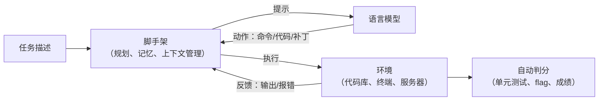
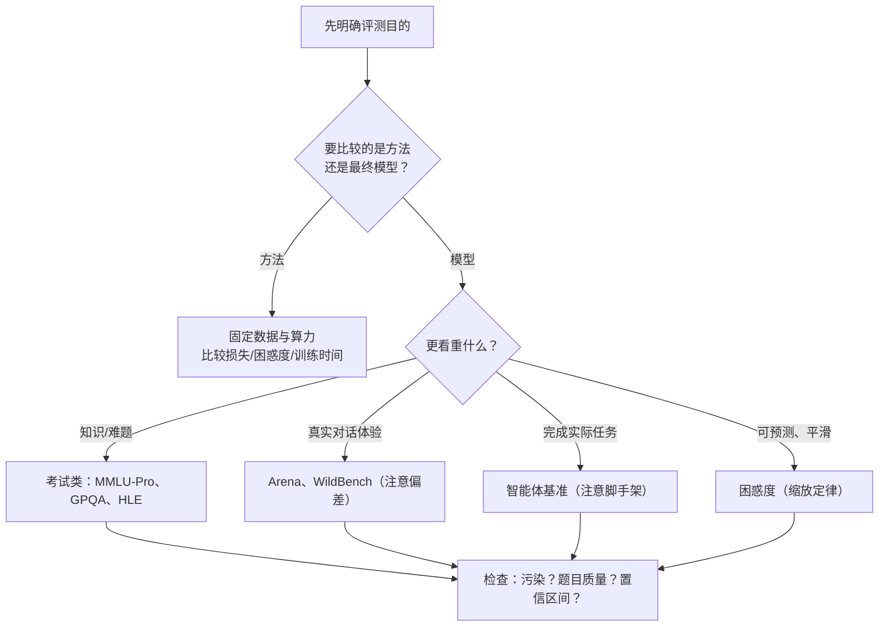

# 第 12 章 评测：怎样才算一个"好"模型？

> 对应课程：Lecture 12《Evaluation》 · [YouTube](https://www.youtube.com/watch?v=JpAxdTWQJxM) · 官方讲义：[可执行讲义 lecture_12](https://cs336.stanford.edu/lectures/?trace=lecture_12)

<Video id="JpAxdTWQJxM" title="Lecture 12 原视频" />

## 本章你将学到

- 评测的核心难题：把"抽象概念"（会聊天、会推理）变成"具体指标"。
- 困惑度（perplexity）是什么、怎么算、为什么它仍是预训练的主力指标，以及它的局限。
- 主要的基准测试家族：考试类（MMLU、GPQA、HLE）、对话类（Chatbot Arena、AlpacaEval、WildBench）、智能体类（SWE-bench、Terminal-Bench、CyBench、MLE-bench）、纯推理类（ARC-AGI）、安全类（HarmBench、AIR-Bench）。
- 评测的三大考量：难度、真实性（生态效度）、有效性（训练-测试污染、数据集质量）。
- 想清楚"评测的目的"和"游戏规则"：评的是方法，还是模型/系统？

## 先说结论（一分钟版）

评测看起来是机械活：准备题目、让模型作答、算准确率。但它其实决定了整个 AI 的发展方向——大家都朝着评测指标去优化。最自然的指标是困惑度：语言模型是一个概率分布，就看它给测试数据分配了多少概率。困惑度平滑、适合拟合缩放定律，但它对每个 token 一视同仁，而且排行榜需要信任提交者的概率是合法的。为了衡量真实能力，人们设计了越来越难的考试题（MMLU → GPQA → HLE），但它们很快饱和，也不像真实使用场景。对话类评测用人类或大模型做裁判进行两两比较，要提防风格、长度、讨好等偏差。智能体评测衡量模型"做事"的能力，但评的其实是"模型 + 脚手架"。所有评测都要面对训练数据可能包含测试题的污染问题，以及题目本身有错的问题。没有唯一正确的评测——先想清楚你要回答什么问题。

## 12.1 什么是"好"？

到目前为止，我们已经讲完了训练语言模型所需的一切：架构、优化器、训练循环，用 kernel 和并行让训练变快，用缩放定律做规划，也稍微讲了推理加速 [▶ 00:05](https://www.youtube.com/watch?v=JpAxdTWQJxM&t=5s)。只剩下一块：**用什么数据训练**（下两章的主题）。数据决定模型行为——训练代码，模型就擅长代码；只训练 DNA 序列，它大概就不会说英语。所以在谈数据之前，我们得先回答：**我们想要模型有什么样的行为？** 这就是评测。

评测问的问题很简单：给定一个训练好的模型，它有多"好"？[▶ 01:05](https://www.youtube.com/watch?v=JpAxdTWQJxM&t=65s)

看起来流程很机械：

1. 准备一些提示（prompt）；
2. 发给模型，拿回回答；
3. 计算准确率。

但评测其实是一个深刻而重要的话题，因为**评测塑造了 AI 的发展**：它设定了"北极星"，开源和闭源的开发者都把评测分数当作进步的度量。你怎么设计评测，就隐式地决定了模型将会擅长什么。

**核心挑战**：从<span style="color:#dc2626">抽象概念</span>到<span style="color:#2563eb">具体指标</span> [▶ 02:06](https://www.youtube.com/watch?v=JpAxdTWQJxM&t=126s)。你一开始想要的是"擅长对话""擅长推理"这样的抽象概念，评测就是把它落成由具体题目或环境驱动的具体数字。本章会反复看到这个转换过程。

::: tip 移动端类比
这很像给 App 定义"好用"。"好用"是抽象概念，你得把它落到具体指标：冷启动耗时、崩溃率、卡顿率、7 日留存、应用商店评分、付费转化……每个指标都只抓住了"好用"的一个侧面，而且团队一旦只盯一个指标（比如只追求启动耗时），就可能牺牲别的体验。LLM 评测面临同样的问题。
:::

那么什么样的模型算好？讲者列了几种视角：

| 视角 | 代表 | 说明 |
|---|---|---|
| 基准分数高 | [Artificial Analysis](https://artificialanalysis.ai/) | 综合多个数据集的"智能指数"，已成为一种事实标准 |
| 基准分数高**且**便宜 | Artificial Analysis 的成本图 | 智能指数 vs 运行成本，两者相关但并不完全对齐 |
| 人们更喜欢它的回答 | [Arena AI](https://arena.ai/leaderboard)（原 Chatbot Arena） | 基于人类两两偏好的排名 |
| 人们愿意用它、为它付费 | [OpenRouter](https://openrouter.ai/rankings) | 多模型统一接口平台公布的使用量统计，是一种"经济学"视角：我不知道什么是好，但大家都掏钱用，那它应该挺好 |

这些都不是"唯一正确答案"，也许根本不存在正确答案 [▶ 04:08](https://www.youtube.com/watch?v=JpAxdTWQJxM&t=248s)。接下来我们逐一看具体的评测方法。

## 12.2 困惑度：语言模型最"原生"的指标

### 12.2.1 定义与计算

回到语言模型的本质：它是 token 序列上的一个概率分布 $p(x)$ [▶ 05:08](https://www.youtube.com/watch?v=JpAxdTWQJxM&t=308s)。评估一个分布，最自然的方式就是看它给一份测试数据 $D$ 分配了多少概率。困惑度定义为：

$$
\text{PPL}(D) = \left(\frac{1}{p(D)}\right)^{1/|D|}
$$

- $D$：测试数据集（一长串 token）；$|D|$：其中 token 的个数。
- $p(D)$：模型给整份数据的概率，按链式法则等于每个 token 条件概率的乘积 $\prod_i p(x_i \mid x_{\lt i})$。
- 开 $|D|$ 次方根，是为了把"整份数据的概率"归一化成"每个 token 的平均水平"，否则数据越长概率越小，无法比较。

取对数就得到我们训练时最熟悉的东西：

$$
\log \text{PPL} = -\frac{1}{|D|}\sum_{i=1}^{|D|} \log p(x_i \mid x_{\lt i})
$$

右边就是**平均交叉熵损失**（第 0 章、第 1 章里的那个 loss）。所以：

- 困惑度 = $e^{\text{平均交叉熵}}$（交叉熵用自然对数时）；
- 困惑度、似然、对数损失本质上是同一个东西的不同写法。

**直觉**：困惑度是"模型平均在多少个候选词之间犹豫"。如果模型对每个位置都在 5 万个词里均匀乱猜，PPL = 50000；如果它每次都百分之百猜中，PPL = 1。

::: tip 手算一个例子
句子 "Stanford was founded in 1885." 切成 7 个 token，模型给每个正确 token 的概率依次为 0.002、0.35、0.25、0.9、0.5、0.9、0.6。

每个 token 的损失 $-\ln p$：6.215、1.050、1.386、0.105、0.693、0.105、0.511，合计 10.065。
平均交叉熵 = 10.065 / 7 ≈ 1.438 nats ≈ 2.07 bits。
PPL = $e^{1.438}$ ≈ **4.21**。

注意第一个 token 的概率只有 0.002，它一个就贡献了 6.2 / 10.1 ≈ 62% 的总损失。困惑度是概率的**几何平均**的倒数，一个极小的概率就能把整体拉坏。
:::

用 PyTorch 计算非常直接：

```python
import torch
import torch.nn.functional as F

def perplexity(logits, targets):
    # logits: [序列长度, 词表大小]，模型在每个位置输出的未归一化分数
    # targets: [序列长度]，每个位置真正出现的下一个 token 的 id
    nll = F.cross_entropy(logits, targets, reduction="mean")  # 平均负对数似然（nats）
    return torch.exp(nll)                                     # 困惑度 = e^交叉熵
```

### 12.2.2 困惑度的历史：从同分布到零样本

[▶ 06:09](https://www.youtube.com/watch?v=JpAxdTWQJxM&t=369s) 训练时我们最小化训练集上的困惑度，显然的评测方法就是测测试集上的困惑度。整个 2010 年代的语言模型论文几乎都这么做。标准数据集有：

- **Penn Treebank**（PTB，华尔街日报文本）；
- **WikiText-103**（维基百科）；
- **One Billion Word Benchmark**（1BW，来自机器翻译 WMT11 的语料：欧洲议会、联合国、新闻）。

这是经典的**同分布评测**范式：在某个数据集的训练集上训练，在它的测试集上评测。进展就体现为困惑度的下降。例如 2016 年一篇著名论文用纯 CNN + LSTM 在 1BW 上把困惑度从 51.3 降到 30.0 [▶ 07:09](https://www.youtube.com/watch?v=JpAxdTWQJxM&t=429s)——在那个人们还在讨论 n-gram 和混合模型的年代，这是"纯神经网络才是正道"的决定性证据。

2019 年的 **GPT-2** 改变了玩法 [▶ 08:10](https://www.youtube.com/watch?v=JpAxdTWQJxM&t=490s)：它在 WebText（40GB，Reddit 上外链的网页）上训练，然后**零样本**地在上述标准数据集上评测——这是**分布外评测**。结果在小数据集上效果很好（例如 PTB 上约 35，而当时最好成绩约 46），因为迁移有帮助；在 1BW 这样的大数据集上则不如专门训练的模型。（讲者也提醒，当时是否做了严格的训练-测试去重并不清楚。）"在大数据上训练、在标准基准上评测"从此成为新的范式。

### 12.2.3 "困惑度就是你需要的全部"？

讲者半开玩笑地提出一个论证 [▶ 09:12](https://www.youtube.com/watch?v=JpAxdTWQJxM&t=552s)，但他认为这种心态确实推动了很多语言模型研究：

- 设真实分布为 $t$，模型为 $p$。
- 能达到的最好困惑度是真实分布的熵 $H(t)$，当且仅当 $p = t$ 时取到。
- 如果 $p = t$，你就能解决所有任务：以问题为条件，生成答案，即 $p(\text{答案} \mid \text{问题})$。
- 所以不断压低困惑度，最终就会"达到 AGI"。

这听起来有点玄，但在 GPT-3 之前、收益还不明显的年代，正是"把困惑度压下去就会有好事发生"的信念驱动着人们不断扩大规模 [▶ 11:14](https://www.youtube.com/watch?v=JpAxdTWQJxM&t=674s)。

### 12.2.4 困惑度也许"多于你需要的"

反过来看，困惑度可能管得太宽了 [▶ 11:14](https://www.youtube.com/watch?v=JpAxdTWQJxM&t=674s)。还是 "Stanford was founded in 1885"：困惑度会对每个 token 都扣分。其中 "1885" 体现了世界知识，很有价值；但句首第一个词、"founded" 这类词就没那么重要——困惑度不管，偏离真实分布多少就扣多少比特。

**解决办法：条件困惑度。** 以提示为条件，只计算回答部分的困惑度：

$$
\text{PPL}_{\text{cond}} = p(\text{回答} \mid \text{提示})^{-1/|\text{回答}|}
$$

这样就能把注意力集中在你关心的 token 上。在上面的例子里，以 "Stanford was founded in" 为提示，只看 " 18"、"85"、"." 三个 token：平均交叉熵 =（0.693 + 0.105 + 0.511）/ 3 ≈ 0.436，条件 PPL ≈ $e^{0.436}$ ≈ **1.55**。

<Demo src="ch12-perplexity.html" title="困惑度计算器：逐 token 概率 → 交叉熵 → 困惑度" :height="720" />

### 12.2.5 很多基准其实是"变相的困惑度"

[▶ 13:15](https://www.youtube.com/watch?v=JpAxdTWQJxM&t=795s)

- **LAMBADA**（2016）：完形填空。给一段上下文和一句 "Do you honestly think that I would want you to have a ___?"，预测最后那个词。名义上是准确率，本质是下一个 token 预测。关键在于它**精心挑选**了那些需要长距离上下文才能猜出的词——相当于把困惑度"聚焦"到长程依赖上。早期 GPT 论文很看重它，因为当时人们认为长上下文建模是解锁推理等能力的关键。
- **HellaSwag**：多选形式的句子补全。"A woman is outside with a bucket and a dog. The dog is running around trying to avoid a bath. She ___"，从几个候选结尾中选最合理的 [▶ 14:15](https://www.youtube.com/watch?v=JpAxdTWQJxM&t=855s)。它不完全是困惑度，但某种程度上就是在比较各个候选结尾的似然。

### 12.2.6 运营困惑度排行榜的陷阱

[▶ 15:18](https://www.youtube.com/watch?v=JpAxdTWQJxM&t=918s) 假设你被困惑度说服了，要办一个困惑度排行榜：大家提交模型 `LM`，你计算 `log_prob = LM(test_data)`。问题来了：你必须**信任**提交者返回的概率是合法的（对所有可能的 token 求和为 1）。否则我实现一个永远返回概率 1（log 概率为 0）的"模型"，就能拿到完美的困惑度——但它根本不是一个概率分布。这种契约下你很难检查对方内部是否真的有一个合法分布，可能得去看代码。

下游任务就简单得多：`response = LM(prompt)`，把模型当黑盒，拿回答算准确率即可。对于 VAE 等无法精确计算似然、只能算一个界的模型，你还得相信那个数学界是对的 [▶ 16:20](https://www.youtube.com/watch?v=JpAxdTWQJxM&t=980s)。（在上面的演示里点"作弊模型"试试。）

**小结** [▶ 17:21](https://www.youtube.com/watch?v=JpAxdTWQJxM&t=1041s)：困惑度仍被大量用于语言模型开发，它随规模平滑变化，是拟合缩放定律的首选（见[第 9 章](./ch09-scaling-laws-1)）。但对于"不信者"，你还需要能反映真实场景的基准来证明模型好。

## 12.3 考试类基准

[▶ 18:22](https://www.youtube.com/watch?v=JpAxdTWQJxM&t=1102s) 我们用考试测人，也可以用考试测模型。考试的好处：可以控制科目和难度；可以设计成有唯一正确答案，便于判分。所以大量 LLM 评测文化是建立在"考试"上的。

### 12.3.1 MMLU（2020）

**Massive Multitask Language Understanding**，Hendrycks 等：

- 57 个科目（数学、美国历史、法律、道德……），四选一。
- 题目由研究生和本科生从网上免费资源收集。
- 名字里有"语言理解"，实际考的主要是**知识**（和一些推理），而非纯粹的语言理解。
- 当时用 GPT-3 + 少样本提示（few-shot）评测：先给几个"问题-答案"示例，再给目标问题 [▶ 19:23](https://www.youtube.com/watch?v=JpAxdTWQJxM&t=1163s)。

在 GPT-3 刚出来、很多人还把语言模型当"生成流畅英文的东西"的年代，构造这么复杂的提示、期待模型给出合理答案是相当激进的。结果：小模型接近随机，GPT-3 明显高于随机。之后几年，分数一路涨到 90 多分，**基本饱和** [▶ 21:24](https://www.youtube.com/watch?v=JpAxdTWQJxM&t=1284s)。

### 12.3.2 MMLU-Pro（2024）

[▶ 22:25](https://www.youtube.com/watch?v=JpAxdTWQJxM&t=1345s) MMLU 太容易了，那就升级：

- 删除了有噪声或过于简单的题；
- 选项从 4 个扩展到 10 个；
- 用思维链（chain of thought）评测，给模型更多机会推理。

模型准确率比 MMLU 下降了 16% 到 33%。但如今它也已涨到接近 90。

### 12.3.3 GPQA（2023）

**Graduate-Level Google-Proof Q&A** [▶ 23:29](https://www.youtube.com/watch?v=JpAxdTWQJxM&t=1409s)。思路是：如果一道题能用 Google 搜到答案，而模型又是在互联网上训练的，那它对模型来说多半太容易。于是要出"搜不到答案"的题：

- 由 61 位来自 Upwork 的博士级合同工出题；
- 流程：出题 → 专家验证并反馈 → 出题人修改 → 另一位专家验证 → 交给非专家（可以用 Google）尝试；
- **Diamond 子集**：两位专家都认同答案、且非专家中最多只有一人答对的题 [▶ 24:30](https://www.youtube.com/watch?v=JpAxdTWQJxM&t=1470s)。

当时的结果：博士专家正确率 65%（考试拿 65 分可不算好成绩）；非专家花 30 分钟、可以用 Google，只有 34%（比四选一的随机略高）；GPT-4 是 39%。而现在榜单上已经到了约 94% [▶ 25:30](https://www.youtube.com/watch?v=JpAxdTWQJxM&t=1530s)。讲者感叹：这些基准的"保质期"并不长。不过饱和的基准对于开发小模型、拟合缩放定律仍然有用。

::: warning 课堂问答：这些题会不会早就进了训练集？
有同学问：怎么知道这些题没有被用于训练？讲者的回答很直接：**我们不知道**，因为我们不知道训练集里有什么 [▶ 26:30](https://www.youtube.com/watch?v=JpAxdTWQJxM&t=1590s)。所以对这些数字永远要保留几分怀疑。而且污染往往比"直接在测试集上训练"更隐蔽：题目可能派生自其他来源，而那些来源被训练过了。12.8 节会详细讨论。
:::

### 12.3.4 Humanity's Last Exam（HLE，2025）

[▶ 27:30](https://www.youtube.com/watch?v=JpAxdTWQJxM&t=1650s) 名字很吓人："人类最后的考试"。

- 2500 道题，多模态，涵盖众多学科，有选择题也有简答题；
- 众包出题，用 50 万美元奖金池和论文共同作者身份激励出题者；
- 先用前沿大模型过滤（模型能答对的题淘汰），再经过多轮人工审核；
- 保留了一个**不公开的私有测试集**，防止进入训练数据（当然你仍得把题目发给模型 API，只能希望这些提示不会被拿去训练）。

讲者调侃：每篇数据集论文都长一个样——"以前的基准，模型都做得很好；我的数据集，所有模型都很差"。HLE 刚发布时模型只有个位数正确率；到 2026 年讲课时，最好的模型（课上提到的 Mythos）也只有 64.7% [▶ 28:30](https://www.youtube.com/watch?v=JpAxdTWQJxM&t=1710s)，看起来确实还有不少余地。

### 12.3.5 考试类基准的小结

[▶ 29:33](https://www.youtube.com/watch?v=JpAxdTWQJxM&t=1773s)

- 随着模型进步、旧基准饱和，题目越来越难。
- 有意思的是**多选题格式一直活着**。有人觉得多选题太简单，但难度完全可以做到任意高——多选题限制的是"能问哪类问题"，而不是难度。
- 考试类基准最大的问题是**不反映真实使用**：除了评测 HLE 时，没人会拿 HLE 式的题去问模型。真实使用中的问题大多是开放式的，不一定有正确答案，甚至问得都不严谨。

::: details 课堂问答：多选题的准确率是怎么算出来的？
模型生成一个字母（A/B/C/D），与标准答案比较即可。更常见的做法是让模型先生成思维链，再给出答案，然后用某种方式**抽取**最终答案。讲者提到，评测结果对答案抽取方式可能非常敏感，但本讲不展开 [▶ 30:33](https://www.youtube.com/watch?v=JpAxdTWQJxM&t=1833s)。
:::

## 12.4 对话类基准：开放式回答怎么评？

[▶ 31:34](https://www.youtube.com/watch?v=JpAxdTWQJxM&t=1894s) 大多数人不会问 AI 助手考试题。一个更真实的例子："我想做一道配山羊奶酪的甜菜沙拉，什么香草搭配得好、什么不好？"回答也是开放式的一大段。**没有标准答案，不能精确匹配**，怎么评？

### 12.4.1 Chatbot Arena（现 Arena AI）：让人来比

[▶ 32:35](https://www.youtube.com/watch?v=JpAxdTWQJxM&t=1955s) 巧妙之处在于数据收集方式：

1. 互联网上的任何人都可以来网站输入提示；
2. 他会同时拿到**两个随机、匿名**模型的回答；
3. 他评判哪个更好（A 更好 / 都好 / 都差 / B 更好）。

于是得到大量"模型 A vs 模型 B，谁赢"的两两比较数据，再用 **Elo 评分**算出排名 [▶ 33:35](https://www.youtube.com/watch?v=JpAxdTWQJxM&t=2015s)：

$$
P(A \text{ 胜 } B) = \frac{1}{1 + 10^{(R_B - R_A)/400}}
$$

- $R_A, R_B$：模型 A、B 的 Elo 分数（待估计的参数）。
- 分差越大，强者获胜概率越高；这是一个从分差到胜率的平滑映射。
- 拟合方法：选择一组分数，使所有观测到的两两比较结果的概率（似然）最大。

::: tip 手算 Elo 胜率
- 分差 100：$P = 1/(1 + 10^{-0.25}) = 1/(1 + 0.562) \approx 0.64$
- 分差 200：$P \approx 0.76$
- 分差 400：$P = 1/(1+0.1) \approx 0.91$

所以榜单上差 20~30 分的两个模型，用户体感上的胜率只是 53%~54% 左右，几乎是"五五开"。
:::

**优点** [▶ 35:36](https://www.youtube.com/watch?v=JpAxdTWQJxM&t=2136s)：

- **真实提示**：用户可以免费使用模型，所以隐含假设是他们真的在用它做有用的事。
- **不需要所有模型做同一批题**：这正是 Elo 的妙处。国际象棋里不需要人人互相下过棋，只要对战关系"连通"，就能推出全局排名。这很重要，因为评分的是人，你不能指望一个人评测所有模型，甚至两个以上都难 [▶ 37:37](https://www.youtube.com/watch?v=JpAxdTWQJxM&t=2257s)。
- **动态**：新提示、新模型不断加入，排名自然更新。

**问题**：

- **这些人是谁？** "来 LLM 竞技场的随机网民"是什么分布，谁也说不清；可能有偏见、有刷票者，甚至有人提交了自己的模型想让它看起来更好。
- **二元偏好混淆了风格和正确性** [▶ 36:36](https://www.youtube.com/watch?v=JpAxdTWQJxM&t=2196s)。国际象棋里只有输赢，Elo 很合适；但"哪个回答更好"远没那么清楚。
- **人怎么判断正确性？** 提问者有明确意图，能判断意图是否被满足；但他之所以提问，往往正是因为不知道答案——给他两个答案，他怎么判断哪个对？
- **讨好（sycophancy）**：让人听着舒服的回答可能比正确但诚实的回答得分更高。

<Demo src="ch12-elo-arena.html" title="竞技场 Elo 排名：从稀疏的两两投票拟合分数，以及长度偏好如何扭曲排名" :height="640" />

### 12.4.2 AlpacaEval：让大模型当裁判

[▶ 38:40](https://www.youtube.com/watch?v=JpAxdTWQJxM&t=2320s)

- 805 条来自多个来源的指令；
- 指标：对基线模型（GPT-4 preview）的**胜率**，由 GPT-4 preview 当裁判——这立刻引出"自己评自己是否有偏"的问题；
- 这就是今天非常流行的 **LLM-as-a-judge**（大模型当裁判）。可以用多个裁判集成来缓解偏差。

最初的 AlpacaEval 有个明显问题：**大模型裁判偏爱更长的回答**。结果大批微调模型只靠"写得更长"就刷到很高的分数。后续工作用一个简单的回归方法做了**长度去偏**（AlpacaEval 2.0 的长度控制版本）[▶ 39:42](https://www.youtube.com/watch?v=JpAxdTWQJxM&t=2382s)。

这引出一个更一般的问题：**怎么评测一个评测指标？** 没有标准答案。一个"健全性检查"是看它与其他指标的相关性（前提是你本来就想模仿那个指标，否则相关性越高不一定越好）。AlpacaEval 与 Chatbot Arena 的相关性高达 0.98 [▶ 40:42](https://www.youtube.com/watch?v=JpAxdTWQJxM&t=2442s)。所以如果你不想把模型放上 Arena、不想等人工评分，可以用 AlpacaEval 代替。当然这种相关性是在特定一批模型上测的，对比 GPT-4 preview 更强的模型未必成立。（这个榜单已经一年多没维护了。）

### 12.4.3 WildBench：给裁判一份检查清单

[▶ 41:43](https://www.youtube.com/watch?v=JpAxdTWQJxM&t=2503s)

- 从 100 万条真实人机对话中挑出 1024 个样例（同样是通过提供免费聊天服务收集的）；
- 用 GPT-4 turbo 当裁判；
- 主要创新是**针对每个任务生成的检查清单（checklist）**：如果只问裁判"这个回答好不好"，任务定义非常模糊——好在哪方面？检查清单或评分细则（rubric）把评判范围限定清楚，相当于给裁判用的思维链。

WildBench 同样展示了与 Chatbot Arena 的高相关性。讲者指出这有点"循环论证"：凭什么 Chatbot Arena 就是金标准？但至少"大家在同一条船上"——它已成为事实上的健全性检查基准。

::: tip 移动端类比
这就像做 Code Review：只说"帮我看看这段代码好不好"，不同评审者给出的意见天差地别；给一份 checklist（线程安全？内存泄漏？空指针？是否有单测？），评审结果就稳定得多。人类评审如此，大模型裁判也如此。
:::

### 12.4.4 对话评测的小结

[▶ 42:43](https://www.youtube.com/watch?v=JpAxdTWQJxM&t=2563s)

- 开放式回答的评测没有完美方案。
- **两两比较**（参考回答 vs 模型回答，或两个模型之间）比绝对打分信号更强：判断"这个比那个稍好"比判断"这是 7 分还是 8 分"可靠得多。
- 时刻警惕偏差——人类和大模型裁判有不同的偏差。能做的也许只是多裁判（人类 + 模型），如果所有裁判都说你的模型更好，那它也许真的更好。
- 开放式评测本身**定义不清**，因此越来越需要**评分细则或检查清单**来提高可靠性。无论裁判是人还是模型都一样：做过众包的人都知道，不给 rubric 直接让人打分，结果基本没法用 [▶ 43:43](https://www.youtube.com/watch?v=JpAxdTWQJxM&t=2623s)。

## 12.5 智能体类基准：评测模型"做"了什么

[▶ 44:43](https://www.youtube.com/watch?v=JpAxdTWQJxM&t=2683s) 之前评测的是模型"说"了什么（对话），现在评测它"做"了什么（智能体）。

**智能体 = 语言模型 + 智能体脚手架（scaffold）**。脚手架是决定如何调用语言模型、可以使用哪些工具等的那部分逻辑。这类任务需要使用工具（比如运行代码），并在一段时间内反复迭代。



### 12.5.1 SWE-bench

[▶ 45:43](https://www.youtube.com/watch?v=JpAxdTWQJxM&t=2743s)

- 来自 12 个 Python 仓库的 2294 个任务；
- 给定代码库 + GitHub issue 描述，提交一个 PR（补丁）；
- 评测指标：**单元测试**。这些测试在修复前不通过，修复后应该通过，同时不能破坏其他测试。

好处是判分非常直接。分数变化很惊人：2024 年 SWE-bench Verified 上的成绩还在 16% 左右，现在已到约 93% [▶ 46:44](https://www.youtube.com/watch?v=JpAxdTWQJxM&t=2804s)。SWE-bench 开创了"在真实环境中评估智能体写代码能力"的范式，大量智能体研究都投入在编程能力上。

### 12.5.2 Terminal-Bench

[▶ 47:45](https://www.youtube.com/watch?v=JpAxdTWQJxM&t=2865s) 更通用：环境就是一个**计算机终端**，任务是能在终端里敲命令完成的各种事情。终端环境简单又通用。

- 229 个任务由来自世界各地的 93 位贡献者众包；其中 89 个构成 Terminal-Bench 2.0；
- 这些任务对人类来说耗时从 1 小时到一周以上不等（取决于是专家还是新手）；
- 有意思的是：**同一个模型配不同的智能体脚手架，准确率不同**——脚手架很关键。

### 12.5.3 CyBench

[▶ 48:45](https://www.youtube.com/watch?v=JpAxdTWQJxM&t=2925s) 网络安全：40 个 CTF（夺旗赛）任务。智能体处在一个环境里，可以查看源码、访问 Web 服务器等，目标是"黑进"服务器拿到 flag（一串证明你成功入侵的唯一字符串）。这些本来是人类的网络安全竞赛题，用**人类首次解出用时**来衡量题目难度。

论文里的脚手架很简单：一个不断增长的记忆缓冲区——产生动作、获取环境反馈、把结果拼接进历史。这个历史很快会变得非常长，需要更好的上下文管理。发布时最好的模型约 10%，如今已经被**完全解决** [▶ 50:46](https://www.youtube.com/watch?v=JpAxdTWQJxM&t=3046s)。

### 12.5.4 MLE-bench

75 个 Kaggle 竞赛，需要处理数据、训练模型等。智能体可以查看数据集、阅读说明、写代码、训练模型，最后提交结果并得到成绩。榜单上又是"老面孔"的语言模型，但不同脚手架之间差异显著。

### 12.5.5 脚手架很重要

[▶ 51:47](https://www.youtube.com/watch?v=JpAxdTWQJxM&t=3107s) 所以"语言模型评测"其实比语言模型本身更宽。要解决复杂任务，脚手架必须更复杂。人们发现有用的做法有：

- **显式规划**：别只是一路"意识流"地生成思维链、堆积上下文，那样智能体很容易迷失。维护一个待办清单，逐项打勾。
- **分层委派**：主智能体调用子智能体，子智能体在干净的上下文里干活，只把结果返回。主智能体不需要看所有细节，起到封装作用。
- **持久化记忆**：上下文变长后不能全塞进窗口，于是显式地读写文件。
- **极致的上下文工程**：对流程给出更多明确指示——何时委派给子智能体、何时换策略、该把什么写进持久记忆 [▶ 52:47](https://www.youtube.com/watch?v=JpAxdTWQJxM&t=3167s)。这些通常会针对特定的语言模型做优化。

::: tip 移动端类比
脚手架之于大模型，好比 App 架构之于 CPU。同样一颗芯片，一个把所有活都堆在主线程、没有缓存的 App，和一个有任务队列、后台线程、磁盘缓存、模块化分层的 App，用户体验天差地别。所以评测"智能体"时，评的是"芯片 + 架构"的组合，而不仅仅是芯片。
:::

**小结**：智能体极大地扩展了语言模型的能力边界；脚手架非常重要；**评测智能体 = 评测脚手架 + 语言模型**。

## 12.6 纯推理基准：ARC-AGI

[▶ 53:48](https://www.youtube.com/watch?v=JpAxdTWQJxM&t=3228s) 前面所有任务都需要语言知识和世界知识。能不能把**推理**从**知识**中剥离出来？可以论证，推理代表了一种更"纯粹"的智能（流体智力），而不只是记住事实。

**ARC-AGI** 项目正是为此而生：

- 对人类 100% 可解，但对 AI 很难；
- 每道题都是独一无二的"雪花"，记住事实或做过往题目帮助不大；
- 输入是小网格图案（例如给几组"输入网格 → 输出网格"的示例，推断变换规则），人类花十几秒就能看出规律。

发展历程 [▶ 55:51](https://www.youtube.com/watch?v=JpAxdTWQJxM&t=3351s)：

| 版本 | 时间 | 特点与进展 |
|---|---|---|
| ARC-AGI-1 | 2019（GPT-2 时代，很有先见之明） | 很长时间里预训练语言模型（如 GPT-3）几乎是 0 分，正如设计者所愿；2024 年 o1、o3 等**推理模型**出现后分数陡升，如今基本被解决 |
| ARC-AGI-2 | 2025 年 3 月 | 更多多步推理；尚未解决，但看起来正在被攻克 |
| ARC-AGI-3 | 2026 年 3 月 | **交互式环境**（像玩小游戏，没有语言，只能靠模式推断）；当前分数极低 |

讲者的观察：预训练模型本身没有推动 ARC 的进展，是推理能力解锁了它。但没有预训练就不会有推理模型的爆发，所以预训练也许仍然重要，只是没有直接体现在 ARC 的历史曲线上 [▶ 56:54](https://www.youtube.com/watch?v=JpAxdTWQJxM&t=3414s)。

**小结与局限** [▶ 57:55](https://www.youtube.com/watch?v=JpAxdTWQJxM&t=3475s)：

- 目标是把推理与知识解耦——这非常难。ARC 也许是最好的尝试，但题目仍来自某种先验，并不存在真正"纯粹"的推理测试；而且只要大家足够在乎某个基准，几乎任何基准都能被刷。
- 它受限于**人类能做的推理**（明确要求人类在合理时间内 100% 可解），不涵盖超人推理，比如拿 IMO 金牌、解决开放数学问题——而那些同样重要。
- 但它清楚地暴露了当前模型的短板。

::: details 课堂问答：ARC-AGI-3 那么"图形化"，模型输入是什么？
可以直接给图像，也可以用 ASCII 字符画之类的文本表示网格（讲者印象中是 64×64 的网格）。无论哪种，模型都必须对一种**空间结构**进行推理，这不是英语或自然语言 [▶ 58:55](https://www.youtube.com/watch?v=JpAxdTWQJxM&t=3535s)。
:::

## 12.7 安全类基准

[▶ 59:55](https://www.youtube.com/watch?v=JpAxdTWQJxM&t=3595s) 在汽车领域，"安全"的含义很清楚：把车撞向墙、看安全气囊能否保护假人，这背后是几十年的游说和标准制定。那 AI 的安全是什么意思？讲者说没有好答案，但给了几个例子。

- **HarmBench**：基于 510 种违反法律或社会规范的有害行为，用有害请求去提示模型，期望模型**拒绝**。这是大多数人想到"安全"时的第一反应：防止坏人用模型干坏事 [▶ 60:57](https://www.youtube.com/watch?v=JpAxdTWQJxM&t=3657s)。
- **AIR-Bench**：从欧盟、中国、美国的监管框架以及公司政策出发，整体性地梳理"可能出错的所有情况"，构建了 314 个风险类别的分类体系和 5694 条提示。

**越狱（jailbreaking）** 是一个独立的子问题 [▶ 61:58](https://www.youtube.com/watch?v=JpAxdTWQJxM&t=3718s)：模型被训练成拒绝有害指令，但聪明人总能绕过去。早期工作 **GCG**（贪心坐标梯度）用一种逐坐标优化算法**自动**搜索能绕过安全限制的提示后缀（看起来像乱码）。令人惊讶的是，在开源模型（Llama）上优化出的攻击能**迁移**到闭源模型（GPT-4）上——当时就能让模型乖乖给出"毁灭人类的分步计划"。（讲者希望这些攻击现在已经失效了。）

**到底什么是安全？** [▶ 62:59](https://www.youtube.com/watch?v=JpAxdTWQJxM&t=3779s)

- 很多安全问题**高度依赖语境**：政治、法律、社会规范在不同国家各不相同。
- 风险**种类繁多**，需要的关注也不同：
  - 幻觉——在医疗、法律、金融场景尤其危险，但它与能力正相关，模型越准确、幻觉越少；
  - 讨好（sycophancy）；
  - 协助犯罪——这可能与能力是反向关系；
  - 加剧不平等、让人丧失批判性思维——这些也可能随能力增强而加剧。
- 如果把安全理解为"确保 AI 对人类有益"，这是一个比本讲所能覆盖的复杂得多的话题。
- **两用性（dual-use）**：一个强大的网络安全智能体（讲义以 Mythos 为例）既能用来入侵系统，也能做渗透测试让系统更安全 [▶ 64:00](https://www.youtube.com/watch?v=JpAxdTWQJxM&t=3840s)。它算安全风险还是安全收益？是一把双刃剑。

## 12.8 评测的三大考量：难度、真实性、有效性

### 12.8.1 真实性（生态效度）

[▶ 65:00](https://www.youtube.com/watch?v=JpAxdTWQJxM&t=3900s) **生态效度**（ecological validity）：评测在多大程度上反映真实世界的使用？

- 考试类基准（如 GPQA）离真实使用很远；
- Chatbot Arena 的提示来自真人，但分布不受控，不知道是不是"正确的"用户群体和使用场景。

几个试图在"用例层面"提高真实性的工作：

- **GDPval**（OpenAI）[▶ 66:00](https://www.youtube.com/watch?v=JpAxdTWQJxM&t=3960s)：按美国 GDP 排名前 9 的行业，选出 44 个职业，请平均约 14 年经验的从业者（护士、礼宾、房产经纪、影视剪辑……）出任务。
- **MedHELM**：此前的医疗基准大多基于标准化考试（人类也是这样：考完试毕业……当然在给病人做手术前还有很长的流程）。但模型不能只因为通过医学考试就直接部署。MedHELM 从 29 位临床医生那里收集了 121 个临床任务，代表医生真正会问模型的问题，并混合了私有和公开数据集 [▶ 67:00](https://www.youtube.com/watch?v=JpAxdTWQJxM&t=4020s)。
- **Clio**（Anthropic）：谁拥有真实使用数据？模型开发者。出于隐私，不能直接翻看用户数据，但可以让语言模型去分析、汇总真实数据中的**总体模式**，从而告诉我们人们都用 Claude 做什么。

遗憾的是，**真实性和隐私有时是矛盾的** [▶ 68:01](https://www.youtube.com/watch?v=JpAxdTWQJxM&t=4081s)：理想情况下应直接从真实请求流中采样来评估、深入分析错误，但那会碰到隐私问题。

### 12.8.2 有效性之一：训练-测试污染

[▶ 69:01](https://www.youtube.com/watch?v=JpAxdTWQJxM&t=4141s) 机器学习第一课：**不要在测试集上训练**。在基础模型时代之前（ImageNet、SQuAD），这件事很清楚：有明确的训练集和测试集划分，大家玩同一个游戏。现在模型在互联网乃至更多数据上训练，而且开发者通常不公开训练数据。怎么办？讲者给了四条路：

**路线 1：从模型行为推断是否见过测试数据。** 讲者组里的一个巧妙想法 [▶ 70:04](https://www.youtube.com/watch?v=JpAxdTWQJxM&t=4204s)：利用数据点的**可交换性**（exchangeability）。基准中题目的排列顺序本应是任意的；如果模型明显偏好与基准原始文件一致的那个顺序（给这个顺序的似然显著高于随机打乱的顺序），那它多半训练过这个基准。

::: tip 移动端类比
这有点像检测盗版 App：如果一个 App 连你源码里随手写的注释顺序、无意义的变量命名都和你一模一样，那几乎可以肯定它是抄的。原始顺序本身不含任何"该被学到"的信息，模型偏好它，只能说明它见过原文。
:::

**路线 2：建立报告规范。** 统计学里报告一个估计值，总要附上置信区间，这是基本操作。同理，有立场论文主张：模型提供者如果声称某个 GPQA 分数，就应该同时给出证据，说明没有在测试集上训练（报告训练-测试重叠程度）[▶ 71:04](https://www.youtube.com/watch?v=JpAxdTWQJxM&t=4264s)。

**路线 3：用新鲜的评测。** 干脆假设最坏情况：所有公开评测都被训练过了。我们的优势是永远可以构造新评测。LiveCodeBench、UncheatableEval 等不断抓取模型训练截止日期之后的新网页、arXiv 论文、GitHub 代码来出题。但时间戳也不总是安全的：有人可能把旧仓库的代码复制到一个新仓库里，你怎么知道它真的"新鲜"？

**路线 4：用私有评测** [▶ 72:05](https://www.youtube.com/watch?v=JpAxdTWQJxM&t=4325s)。模型公司会用不在互联网上的内部代码库来评测（他们当然不会拿它训练）。个人也可以用自己的私人写作——讲者说他有一堆读博时被拒、从未公开的论文可以用。这类评测特别适合困惑度：你只需要一份干净的数据集，算对数概率即可。

下面的演示把"测量噪声"和"污染"放在一起：前者是随机误差，题目多了就会变小；后者是系统偏差，题目再多也消除不了。

<Demo src="ch12-benchmark-noise.html" title="基准测试的噪声与污染：差 2 分的两个模型分得出来吗？" :height="620" />

::: tip 手算置信区间
一个模型真实准确率 72%，基准有 200 道题。每道题对错是一次伯努利试验，测得准确率的标准误为 $\sqrt{0.72 \times 0.28 / 200} \approx 0.0317$，95% 置信区间约为 $\pm 1.96 \times 3.17\% \approx \pm 6.2$ 个百分点。题目增加到 2000 道，区间缩小为约 $\pm 2.0$ 个百分点（$\sqrt{10} \approx 3.16$ 倍）。所以在几百道题的基准上，两个模型差 2 分，很可能只是噪声。
:::

### 12.8.3 有效性之二：数据集质量

[▶ 73:06](https://www.youtube.com/watch?v=JpAxdTWQJxM&t=4386s) 基准本身也可能有错。

- **SWE-bench → SWE-bench Verified**：原版里有很多任务的单元测试不够严格等问题，后来人工修正得到 Verified 版（前面看到的榜单就是 Verified）。
- **Platinum 版基准**：有人对 GSM8K、MMLU 等做了更仔细的审查，发现不少题目本身是坏的。例如一道题要求根据曲线作答，但文本里根本没给曲线；另一道题问"宝宝有没有穿袜子"，根本无从判断 [▶ 74:07](https://www.youtube.com/watch?v=JpAxdTWQJxM&t=4447s)。
- **智能体基准的问题更难发现**：不只是看题目和答案，而是整个环境。测试用例可能不完整——你通过了所有测试，解决方案却并不真的正确。有研究发现，某些基准上智能体**只输出空回答**就能拿到约 38% 的分数。
- **Docent**（Transluce）：用语言模型检查智能体的执行轨迹、发现问题——这是对我们"纯定量"评测文化的一种定性补充 [▶ 75:07](https://www.youtube.com/watch?v=JpAxdTWQJxM&t=4507s)。

讲者的建议：**无论是开发基准，还是在基准上跑模型，都要亲自看输出、做审计**，确认你测的确实是你以为在测的东西。

::: warning 常见误区：只看排行榜上的一个数字
排行榜数字背后有大量隐藏变量：答案抽取方式、提示模板、是否用思维链、采样温度、脚手架、是否被污染、题目本身是否有错。只拿一个数字比较两个模型，很容易得出错误结论。
:::

## 12.9 评测的目的与游戏规则

### 12.9.1 你为什么要评测？

[▶ 76:08](https://www.youtube.com/watch?v=JpAxdTWQJxM&t=4568s) 没有"一统天下"的评测，关键是想清楚目的——而这一点往往没被明确说出来：

1. **用户或公司做采购决策**：在某个具体场景（如客服机器人）下，选模型 A 还是模型 B？
2. **研究者衡量原始能力**：对"智能"有一个直觉概念，想以某种方式度量它。
3. **理解收益与危害**：出于商业或政策原因。
4. **模型开发者获取反馈**：用来改进模型。

不同的目的会引导你选择不同的基准或评测组合。

### 12.9.2 你在评测什么：方法，还是模型？

[▶ 76:08](https://www.youtube.com/watch?v=JpAxdTWQJxM&t=4568s)

- **基础模型时代之前**，我们评测的是**方法**：训练集和测试集是标准化的，唯一变化的是算法。
- **今天**，我们（大多）在评测**模型/系统**：数据、算力、脚手架……怎样都行。

也有例外：**nanoGPT speedrun** 固定数据，比较达到某个验证损失需要多少训练时间——它是在刻意评测**算法** [▶ 77:09](https://www.youtube.com/watch?v=JpAxdTWQJxM&t=4629s)。

| | 评测方法 | 评测模型/系统 |
|---|---|---|
| 固定什么 | 数据、算力等 | 几乎什么都不固定 |
| 鼓励什么 | 研究者的算法创新 | 对下游用户有用的最终产品 |
| 例子 | nanoGPT speedrun、经典 PTB 困惑度 | MMLU、Arena、SWE-bench 排行榜 |

无论哪种，都**必须定义清楚游戏规则**。

### 12.9.3 没有"又难又真又干净"的评测

[▶ 78:09](https://www.youtube.com/watch?v=JpAxdTWQJxM&t=4689s) 我们讲过的评测——困惑度、考试、对话、智能体、推理、安全——在难度、真实性、有效性上各有取舍。很难同时做到"真实、困难、生态效度高、且没有训练-测试污染"，通常只能牺牲其中某一项，而牺牲哪一项取决于你的目标。



## 动手练习

1. **困惑度热身**：用演示（或手算）回答：如果模型对一段 10 个 token 的文本，9 个 token 给出概率 0.9，1 个 token 给出概率 0.0001，困惑度是多少？如果那一个 token 的概率提高到 0.01 呢？由此体会"几何平均"对极小概率的敏感性。

   ::: details 答案
   平均交叉熵 =（9 × 0.105 + 9.21）/ 10 ≈ 1.016，PPL ≈ 2.76。改成 0.01 后：（0.948 + 4.605）/ 10 ≈ 0.555，PPL ≈ 1.74。
   :::

2. **在作业 1 的模型上算条件困惑度**：用你在作业 1 训练的 TinyStories / OpenWebText 模型，对若干"提示 + 回答"对分别计算整句困惑度和只算回答部分的条件困惑度。提示：把提示部分的 target 设为 `-100`，`F.cross_entropy(..., ignore_index=-100)` 就会忽略它们。

3. **把多选题变成似然比较**：给定一个 HellaSwag 风格的题目（上下文 + 4 个候选结尾），用你的模型计算每个候选结尾的平均对数概率，选最大者作为答案。思考：为什么要按 token 数归一化？不归一化会偏向什么样的选项？

4. **实现 Bradley-Terry / Elo 拟合**：随机生成 5 个模型的真实分数，模拟 1000 场两两对战，用梯度上升或演示中的 MM 迭代拟合分数，比较与真实值的误差。然后给某个模型加上"长度偏好"加成，观察排名如何变化。

5. **设计一个私有评测**：从你自己的、从未公开过的文字（日记、笔记、未发布的博客）中整理一份几千 token 的数据，比较两个开源模型在上面的困惑度。思考：为什么这类评测几乎不可能被污染？它衡量的是什么，又衡量不了什么？

## 本章小结

- 评测的核心是把**抽象概念**落成**具体指标**；评测设定了"北极星"，从而塑造了整个领域的发展方向。
- **困惑度** = $e^{\text{平均交叉熵}}$，平滑、适合缩放定律；但它对所有 token 一视同仁（可用条件困惑度缓解），排行榜还需要信任概率的合法性。很多基准（LAMBADA、HellaSwag）本质上是变相的困惑度。
- **考试类基准**越来越难（MMLU → MMLU-Pro → GPQA → HLE），饱和得很快，而且不反映真实使用。
- **对话类基准**依赖人类或大模型裁判做两两比较（Elo），要警惕风格、长度、讨好等偏差；检查清单/评分细则能显著提高可靠性。
- **智能体基准**（SWE-bench、Terminal-Bench、CyBench、MLE-bench）评的是"模型 + 脚手架"。
- **ARC-AGI** 试图把推理与知识分离；**安全**评测高度依赖语境，且存在两用性。
- 评测的有效性面临**训练-测试污染**（可交换性检测、报告规范、新鲜评测、私有评测）和**数据集质量**问题；要亲自看输出、做审计，并报告置信区间。
- 没有唯一正确的评测：先明确目的和游戏规则，再在难度、真实性、有效性之间做取舍。

下一章（[第 13 章](./ch13-data-sources)）开始讲最后一块拼图——**数据**：预训练数据从哪里来、有哪些主要的数据集。

## 延伸阅读

- Hendrycks et al., 2021. *Measuring Massive Multitask Language Understanding*（MMLU）. [arXiv:2009.03300](https://arxiv.org/abs/2009.03300)
- Wang et al., 2024. *MMLU-Pro*. [arXiv:2406.01574](https://arxiv.org/abs/2406.01574)
- Rein et al., 2023. *GPQA: A Graduate-Level Google-Proof Q&A Benchmark*. [arXiv:2311.12022](https://arxiv.org/abs/2311.12022)
- Phan et al., 2025. *Humanity's Last Exam*. [arXiv:2501.14249](https://arxiv.org/abs/2501.14249)
- Jozefowicz et al., 2016. *Exploring the Limits of Language Modeling*. [arXiv:1602.02410](https://arxiv.org/abs/1602.02410)
- Paperno et al., 2016. *The LAMBADA dataset*. [arXiv:1606.06031](https://arxiv.org/abs/1606.06031)
- Zellers et al., 2019. *HellaSwag: Can a Machine Really Finish Your Sentence?* [arXiv:1905.07830](https://arxiv.org/abs/1905.07830)
- Chiang et al., 2024. *Chatbot Arena: An Open Platform for Evaluating LLMs by Human Preference*. [arXiv:2403.04132](https://arxiv.org/abs/2403.04132)
- Dubois et al., 2024. *Length-Controlled AlpacaEval*. [arXiv:2404.04475](https://arxiv.org/abs/2404.04475)；AlpacaEval [排行榜](https://tatsu-lab.github.io/alpaca_eval/)
- Lin et al., 2024. *WildBench*. [arXiv:2406.04770](https://arxiv.org/abs/2406.04770)
- Jimenez et al., 2023. *SWE-bench*. [arXiv:2310.06770](https://arxiv.org/abs/2310.06770)；[SWE-bench Verified 介绍](https://openai.com/index/introducing-swe-bench-verified/)
- *Terminal-Bench*. [arXiv:2601.11868](https://arxiv.org/abs/2601.11868)；[网站](https://www.tbench.ai/)
- Zhang et al., 2024. *Cybench*. [arXiv:2408.08926](https://arxiv.org/abs/2408.08926)
- Chan et al., 2024. *MLE-bench*. [arXiv:2410.07095](https://arxiv.org/abs/2410.07095)
- ARC Prize：[ARC-AGI](https://arcprize.org/arc-agi)
- Mazeika et al., 2024. *HarmBench*. [arXiv:2402.04249](https://arxiv.org/abs/2402.04249)
- Zeng et al., 2024. *AIR-Bench 2024*. [arXiv:2407.17436](https://arxiv.org/abs/2407.17436)
- Zou et al., 2023. *Universal and Transferable Adversarial Attacks on Aligned Language Models*（GCG）. [arXiv:2307.15043](https://arxiv.org/abs/2307.15043)
- *GDPval*（OpenAI）. [arXiv:2510.04374](https://arxiv.org/abs/2510.04374)
- *MedHELM*. [arXiv:2505.23802](https://arxiv.org/abs/2505.23802)
- Tamkin et al., 2024. *Clio: Privacy-Preserving Insights into Real-World AI Use*. [arXiv:2412.13678](https://arxiv.org/abs/2412.13678)
- Oren et al., 2023. *Proving Test Set Contamination in Black Box Language Models*. [arXiv:2310.17623](https://arxiv.org/abs/2310.17623)
- Zhang et al., 2024. *Language model developers should report train-test overlap*. [arXiv:2410.08385](https://arxiv.org/abs/2410.08385)
- Vendrow et al., 2025. *Do Large Language Model Benchmarks Test Reliability?*（Platinum 基准）. [arXiv:2502.03461](https://arxiv.org/abs/2502.03461)
- Zhu et al., 2025. *Establishing Best Practices for Building Rigorous Agentic Benchmarks*. [arXiv:2507.02825](https://arxiv.org/abs/2507.02825)
- Transluce：[Docent](https://transluce.org/introducing-docent)
- Phil Schmid：[Agents 2.0: Deep Agents](https://www.philschmid.de/agents-2.0-deep-agents)
