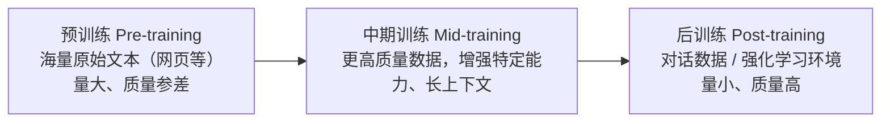
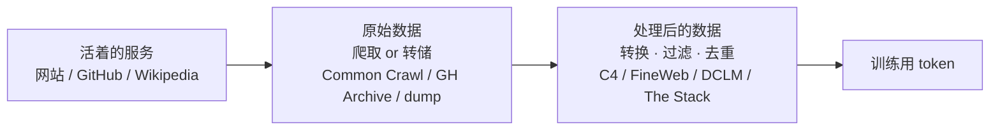

# 第 13 章 数据（上）：数据从哪里来——来源、版权与经典数据集

> 对应课程：Lecture 13《Data (Sources, Datasets)》 · [YouTube](https://www.youtube.com/watch?v=-qm0ln33G24) · 官方讲义：[可执行讲义 lecture_13](https://cs336.stanford.edu/lectures/?trace=lecture_13)

<Video id="-qm0ln33G24" title="Lecture 13 原视频" />

## 本章你将学到

- 为什么课程认为“数据是训练语言模型时最需要做对的事”，以及为什么各家公司对数据讳莫如深。
- “模型是在整个互联网上训练的”这句话错在哪里：爬虫、动态内容、登录墙、robots.txt、服务条款都在挡路。
- 版权的基本框架：几乎所有网上内容都受版权保护，想用就得靠“许可（license）”或“合理使用（fair use）”，以及 2023~2025 年几起关键诉讼的走向。
- 几个最重要的原始来源：Common Crawl、Wikipedia、GitHub、arXiv，它们分别怎么获取、有什么坑。
- 从 2018 年的 BERT 到 2025 年的 Common Pile，主流预训练数据集是怎么一步步演化的：规则过滤 vs. 模型过滤、数量 vs. 质量。

## 先说结论（一分钟版）

1. 数据是区分不同语言模型的关键：架构大家都差不多，开源权重模型甚至会把训练细节写得很清楚，但几乎没人公开数据——一是竞争，二是怕版权官司。
2. 数据不会从天上掉下来。从“活着的网站”到“可训练的 token”，中间隔着爬取/转储、HTML→文本、语言识别、质量过滤、去重等一长串处理，每一步都在扔掉大部分数据。
3. 你能合法、技术上拿到的网页，比“整个互联网”小得多，而且限制在逐年变多。
4. 网上几乎所有东西都有版权。目前几起判决倾向于“训练本身属于合理使用”，但“盗版获取数据”明确违法；这一领域仍在快速变化。
5. 数据集的历史就是一部“怎样从脏乱的 Common Crawl 里捞出又多又好的子集”的历史：先是 Reddit 链接、像不像维基、手写规则，后来转向训练质量分类器，再后来加入合成数据。

---

## 13.1 为什么说数据最重要

[▶ 00:04](https://www.youtube.com/watch?v=-qm0ln33G24&t=4s)

前面十几章我们一直在回答“**给定数据**，怎么把模型训好”：分词、架构、GPU、并行、scaling law、推理、评测。接下来两讲换一个问题：**到底该用什么数据来训？**

课程的观点很鲜明：**数据是训练语言模型时最需要做对的事情**。一个佐证是看看公司们愿意公开什么。以 Llama 3 的论文为例：它是开源权重模型，架构当然完全透明，连训练流程都写得很细，可一到数据部分，基本就只有一句“我们从多种数据来源训练”。

为什么这么讳莫如深？课上给了两个理由：

1. **竞争**：数据处理是一家公司的“秘方”，告诉对手等于把配方送人。
2. **版权责任**：你说自己用了某类数据，就可能招来官司（13.3 节会细讲）。

::: tip 移动端类比
这有点像 App 圈的“推荐算法 + 运营数据”：客户端框架（SwiftUI、Compose）大家都一样，开源出来也无妨；真正拉开差距的是你后台积累的数据和清洗规则，这些从来不会写进技术博客。
:::

### 数据工作的本质：长尾问题，随人力扩展

在“基础模型”出现之前，做数据主要意味着**人工标注**：给图片打标签、给句子标情感，然后做监督学习。现在预训练阶段的人工标注少了很多，但**筛选（curation）和清洗**的工作一点没少。

课程强调数据“永远是瓶颈”，因为它本质上是一个**长尾问题**：模型要会的东西千千万万，每一个小领域（法律文书、化学、某种冷门编程语言……）都需要有人去找数据、看数据、写规则。架构和系统优化能投入的人有限，但数据工作很容易**并行地分给很多人**，所以各家的数据团队往往相当庞大。

### 训练的三个阶段

[▶ 02:06](https://www.youtube.com/watch?v=-qm0ln33G24&t=126s)

数据出现在训练流程的不同阶段：



- **预训练**：在原始文本（主要是网页）上训练。
- **中期训练（mid-training）**：用更高质量的数据“加强”某些能力，比如数学、代码、长上下文。很多合成数据会放在这里。
- **后训练**：在对话记录上做指令微调，或者用强化学习环境训练（第 15、16 章）。

现实中阶段之间的边界很模糊，也可能不止三个阶段，但总体趋势是：**从大量低质量数据，过渡到少量高质量数据**。

相应的术语：

- **基座模型（base model）**：一般指预训练 + 中期训练之后的模型。
- **指令/对话模型（instruct / chat model）**：后训练之后的模型。

课上顺便提到一个趋势：越来越多的大模型干脆不发布基座模型了，例如 Qwen3.5-397B-A17B 发布出来的就是指令模型，你看不到中间检查点。

想看清每个阶段到底用了什么数据，最好的研究对象是像 AI2 的 **OLMo** 这样的全开放模型：它的预训练数据包括网页、学术论文、数学网页、证明等；中期训练有更高质量的网页、指令数据和不少合成数据；后训练（Tülu 系列）有对话日志、数学/推理/代码数据和安全数据。

那么问题来了：这些数据集都是什么？怎么挑选、怎么处理？本章先回答“从哪里来、能不能用、历史上大家怎么做”，下一章（[第 14 章](./ch14-data-processing)）再深入“怎么处理”。

---

## 13.2 “在整个互联网上训练”？先拆穿这句话

[▶ 04:07](https://www.youtube.com/watch?v=-qm0ln33G24&t=247s)

你可能常听到“语言模型是在整个互联网上训练的”。课程从源头开始拆这句话。

首先，“互联网（Internet）”是网络基础设施，严格说应该是**公开的万维网（public World Wide Web）**。但即便改成“在整个公开 Web 上训练”，也仍然不对。

### 网页是“活的服务”，训练需要“死的快照”

Web 本质上是一堆**正在运行的服务器**，你发一个请求（比如 `curl https://cs336.stanford.edu/`），它回一个响应。你没法直接在“活服务器”上做预训练（除非你训练的是一个会上网的强化学习智能体，那是另一回事）。

所以需要一个**爬虫（crawler）**：

1. 从一组**种子 URL** 出发，发现网页；
2. 下载发现的网页，并把网页里的超链接加入待爬队列。

有了爬虫，也不可能把所有网页都下载下来。课上列了四类障碍：

| 障碍 | 例子 | 说明 |
|---|---|---|
| 动态内容 | Discord、wandb | 现在很多网站其实是“应用”，URL 不能完整描述内容，要点按钮、提交表单才能看到东西 |
| 登录/付费 | Facebook、X、LinkedIn、纽约时报 | 大量内容锁在“围墙花园”里；除非你就是这家公司本身 |
| 技术限制 | robots.txt、Cloudflare 人机验证、封 IP、限流 | robots.txt 是**自愿遵守**的约定，不是法律 |
| 法律限制 | 服务条款（ToS）、许可 | ToS 常写明“禁止机器人访问”“禁止用于 AI 训练” |

::: tip 移动端类比
- 动态内容：就像你想“爬”一个 App——它没有可遍历的 HTML 链接，内容藏在一次次 API 调用和用户交互之后。
- robots.txt：类似 App Store 的审核指南，**是规则不是防火墙**；守不守取决于你是不是“好公民”。
- Cloudflare 的人机验证、IP 封禁、限流：就像你给自家后端接口加的风控和 rate limit。
:::

以纽约时报的 robots.txt 为例，里面列了一长串被禁止的爬虫名字，包括 OpenAI、Perplexity、Anthropic 等公司的爬虫。

### 限制在逐年变多

[▶ 09:10](https://www.youtube.com/watch?v=-qm0ln33G24&t=550s)

论文《Consent in Crisis》检查了 C4、RefinedWeb、Dolma 等常用数据集里 URL 的 robots.txt 和服务条款，结论是：**限制在随时间增加**。课上展示的图里，大约从 2023 年年中开始，robots.txt 里“完全禁止”的比例陡然上升，接近一半；服务条款方面，2016 年几乎没人写条款，现在大多数页面都有，而且多数条款不允许用于 AI。

换句话说：即使 2020 年你可以爬到一个“完整”的 Web，今天你**合法**能爬的范围已经小了很多。

### 不守规矩的爬虫

现实中，规则有时会被有意无意地违反。课上举了例子：有网站站长抱怨某 AI 公司的爬虫 24 小时内访问了约一百万次；Read the Docs 也曾被各路爬虫“打爆”。这里的问题甚至还没涉及版权：违反 ToS/robots.txt、给对方服务器制造大量负载（站长要花钱，其他用户体验变差），本身就是问题。

### 影子图书馆

[▶ 12:13](https://www.youtube.com/watch?v=-qm0ln33G24&t=733s)

还有一类“技术上也在 Web 上”的来源：**影子图书馆（shadow libraries）**，例如 Library Genesis（LibGen）、Z-Library、Anna's Archive、Sci-Hub。它们无视版权、绕过付费墙，把大量书籍和论文免费放出来。它们收到过很多下架令、诉讼，在不少国家被封锁，但往往通过在多国部署服务器来规避。支持者认为这是让本该免费的知识自由流通；**从法律角度看，这就是盗版和侵权**。规模上，LibGen 约 400 万本书（2019 年），Sci-Hub 约 8800 万篇论文（2022 年）。这一点后面讲诉讼时还会回来。

**小结**：互联网很大、很乱，你拿不到全部；技术限制和法律限制共同决定了你能访问什么。下次有人说“我在整个互联网上训练”，你就可以把这些讲给他听。

---

## 13.3 能不能用：版权、许可与合理使用

[▶ 14:13](https://www.youtube.com/watch?v=-qm0ln33G24&t=853s)

假设你是个好公民：遵守 robots.txt、遵守限流、遵守服务条款。接下来还有一个问题：**你被允许用这些数据训练吗？** 这是一个尚未完全解决、但近一年有不少进展的问题。

::: warning 声明
以下是课程对美国版权法的通俗介绍（讲者也反复说“我不是律师”），本书转述同样不构成法律建议。不同国家/地区法律差异很大。
:::

### 知识产权与版权的基本概念

**知识产权法**的目标是**激励**智力成果的创造——这一点很重要：法律的精神不是“一律说不”，而是让创作者有动力创作。知识产权有几种：版权（copyright）、专利、商标、商业秘密。和语言模型数据最相关的是**版权**。

- 历史：可追溯到 1709 年英国的《安妮法令》，这是政府和法院第一次规制版权；美国现代版权的基础是 **1976 年版权法**。
- 保护对象：“固定在任何有形表达媒介上的原创作品”。

几个要点：

1. **不是所有东西都受版权保护**：单纯的“汇编”（比如电话簿）不受保护，除非选择或编排上有创造性。
2. **保护的是表达，不是思想**：你不能给“快速排序”这个算法申请版权，但某一份快排的具体代码实现受版权保护。
3. **门槛极低**：1909 年时要“发表”才受保护，1976 年后只要“固定”下来就受保护，**不需要登记**（这一点和专利完全不同）。你在个人网站上写的东西，自动就有版权。
4. 想**起诉**侵权需要先登记，但登记费只要 65 美元，比律师费便宜得多，所以门槛依然很低。
5. 版权有期限，过期后进入**公有领域（public domain）**，人人可用——莎士比亚、贝多芬的作品，以及古腾堡计划里的大部分书都是如此。（课上用了“大约 75 年”这个简化说法，实际年限因作品类型和国家而异。）

**结论：互联网上几乎所有东西都受版权保护。**

那是不是“训练任何东西都侵权”？不一定。使用受版权保护的作品有两条路：

1. **拿到许可（license）**；
2. **主张合理使用（fair use）**。

### 第一条路：许可

[▶ 19:16](https://www.youtube.com/watch?v=-qm0ln33G24&t=1156s)

许可来自合同法，是许可方授予被许可方的权利。课上一句话概括：**“许可就是一个不起诉你的承诺。”**

- **知识共享许可（Creative Commons，CC）**：2001 年由 Lessig 和 Eldred 创立，用来在“公有领域”和“传统版权”之间架桥——作者不必等几十年，就能让作品像公有领域一样被自由使用。例子：Wikipedia、OpenCourseWare、可汗学院、Free Music Archive、Flickr 上的数亿张图片等。
- **花钱买许可**：很多模型公司和内容平台签了数据授权协议，例如 Google 与 Reddit、OpenAI 与 Shutterstock、OpenAI 与 StackExchange。

课后有同学问：如果许可后来改了怎么办？讲者的理解是：已经按旧许可拿到的数据通常仍可使用，但像 Reddit 这样持续产生新内容的平台，许可变更意味着你不能再用之后的新内容。

### 第二条路：合理使用

[▶ 21:17](https://www.youtube.com/watch?v=-qm0ln33G24&t=1277s)

美国版权法第 107 条的“合理使用”说：即使没有许可，在某些情况下你也可以使用。法院主要权衡**四个因素**（都是倾向而非硬规则）：

| 因素 | 更可能算合理使用 | 更不可能 |
|---|---|---|
| 1. 使用的目的和性质 | 教育、**转化性**使用 | 商业、原样复制 |
| 2. 被使用作品的性质 | 事实性、非创造性 | 虚构、高度创造性（如诗歌） |
| 3. 使用的数量和实质性 | 只用片段 | 用整部作品 |
| 4. 对原作品市场的影响 | 开拓新市场、不替代原作 | 替代原作、让作者少赚钱 |

合理使用的例子：

- 看完电影写一篇摘要；
- 重新实现一个算法（思想），而不是复制代码（表达）；
- Google Books 的索引和片段展示：作者协会起诉 Google，官司打了十多年，最终判 Google 合理使用——这也成为思考“训练语言模型是否算合理使用”的一个先例。

一个对机器学习背景的人可能比较新的观点：**版权不只是“逐字记忆”的问题**。很多 ML 论文关注模型会不会逐字背出训练文本，但那只是侵权的一种方式。比如“哈利·波特”这个角色本身就可能受保护，即使你没有复制任何一句原文；反过来，戏仿（parody）虽然看起来是衍生作品，却更可能被认定为合理使用。**版权关心的是语义和经济，而不是 n-gram 重叠。**

### 落到语言模型上

[▶ 25:19](https://www.youtube.com/watch?v=-qm0ln33G24&t=1519s)

- **复制本身就可能已经构成侵权**：训练的第一步是把数据拷下来，哪怕你还没拿它做任何事。
- **训练模型直觉上有“转化性”**：它显然不同于把别人的作品原样再托管一份。
- **模型应该学到一般性的“思想”**（比如“巫师”这种概念），而不是具体的表达（比如《哈利·波特》的文字）。
- 但不管版权如何，**语言模型确实会影响市场**（作家、画家的生计），而这正是第四个因素，会让判定更倾向于“非合理使用”。

还有一层：**服务条款**。即使你有许可或能主张合理使用，平台的 ToS 也可能额外限制你。例如 YouTube 上很多视频是 CC 许可的，但 YouTube 的服务条款禁止用机器人下载视频。限制是**一层叠一层**的。

### 近年的诉讼

[▶ 27:20](https://www.youtube.com/watch?v=-qm0ln33G24&t=1640s)

| 案件 | 指控 | 进展（截至课上） |
|---|---|---|
| 纽约时报 v. OpenAI（2023） | 用其新闻训练；能诱导模型近乎逐字输出文章 | 仍在进行中 |
| 作者们（Bartz 等） v. Anthropic（2024） | 盗版数百万本书并用于训练 | 2025 年简易判决：**用原告作品训练属于合理使用**；但**盗版获取不是**（即使不拿来训练）。Anthropic 也曾购买并扫描纸质书，这部分属于合理使用，但无法“洗白”先前的盗版。最终以 15 亿美元和解，课上估算约每本书 3000 美元 |
| 作者们（Kadrey 等） v. Meta | 用原告的书训练（Llama 论文里自己写了） | 2025 年简易判决：在该案情形下训练属于合理使用；“种子下载书籍”的指控仍待审 |

课上的总结：

- 到目前为止，训练在这些具体案例中被认定为合理使用（或至少没被认定为不是），但判决范围都很窄，不等于“用任何版权内容训练都没事”；
- **盗版书籍明确违法**；
- 这是一个非常活跃、仍在演化的领域。

::: warning 常见误区
“开源模型 + MIT 许可”不等于“训练数据也是干净的”。“数据集在 Hugging Face 上标了宽松许可”也不等于“里面每篇文档都可以随便用”——13.5 节讲 Common Pile 时会看到这些坑。
:::

还有同学问：既然 Web 上有大量盗版书网站，直接爬 Common Crawl 时怎么保证没把它们爬进来？讲者坦言：**没法保证**。Common Crawl 里大概率混有本不该用的版权内容；而且本质上一切都有版权，书和你的个人网站在法律地位上并无本质区别，只是出版的书在法庭上更容易维权。真想极度谨慎，就走 Common Pile 那条路（只用明确授权的数据）。

---

## 13.4 原始数据从哪里来

[▶ 31:33](https://www.youtube.com/watch?v=-qm0ln33G24&t=1893s)

大多数头部模型公司都有**自己的爬虫**，以便完全掌控数据。对其余人来说，好在有公共资源可用。

### Common Crawl：大家共用的“网页快照”

[Common Crawl](https://commoncrawl.org/) 是 2007 年成立的非营利组织：

- 大约**每月**做一次 Web 抓取，每次新增 30~50 亿个网页；
- 各次抓取之间有重叠，但会尽量覆盖新页面；
- 累计约 3000 亿个网页（这是官网数字；讲者也吐槽它和“每月几十亿 × 年数”对不太上）；
- 2026 年 4 月那次抓取有 21.9 亿个网页，共 **372.2 TB**（主要是文本，不含图片）。

作为对比，Web 上到底有多少 URL 很难估计，Google 说它的搜索索引至少有 100 PB。

#### 爬虫怎么工作

Common Crawl 使用 Apache Nutch。概念上很简单——就是**图的广度优先遍历**：

1. 从种子 URL 开始（至少数亿个）；
2. 从队列里弹出一个 URL，下载它；
3. 把页面里的超链接加入队列；
4. 在很多机器上并行做这件事。

细节都藏在策略里：

- **选择策略**：下载哪些页面？
- **礼貌策略**：遵守 robots.txt，别把对方服务器压垮；
- **重访策略**：页面会变，经常变的要常回来看，不变的别浪费时间；
- **URL 是动态的**：同一个 URL 可能因浏览器状态返回不同内容；许多不同 URL 又可能指向同一内容（镜像站更是专门制造重复）——这给后面的去重埋下伏笔。

下面是一个极简的“礼貌爬虫”骨架，只为说明结构（真实爬虫要处理分布式队列、重试、限流、去重等）：

```python
from collections import deque
from urllib import robotparser
from urllib.parse import urljoin, urlparse

def crawl(seeds, fetch, extract_links, max_pages=1000):
    """fetch(url)->html 或 None；extract_links(html)->相对/绝对链接列表"""
    queue, seen, pages = deque(seeds), set(seeds), {}
    robots = {}                                  # 每个域名缓存一份 robots.txt
    while queue and len(pages) < max_pages:
        url = queue.popleft()                    # 广度优先：先进先出
        host = urlparse(url).scheme + "://" + urlparse(url).netloc
        if host not in robots:
            rp = robotparser.RobotFileParser(host + "/robots.txt")
            rp.read()
            robots[host] = rp
        if not robots[host].can_fetch("MyCrawler", url):
            continue                             # 礼貌策略：被禁止就跳过
        html = fetch(url)
        if html is None:
            continue
        pages[url] = html                        # 存下原始响应（相当于 WARC）
        for link in extract_links(html):
            nxt = urljoin(url, link)
            if nxt not in seen:                  # 简单 URL 去重
                seen.add(nxt)
                queue.append(nxt)
    return pages
```

::: tip 移动端类比
这和你写一个“离线缓存整站文档”的功能很像：一个 URL 队列 + 已访问集合 + 并发下载；区别在于规模（几十亿页）和“礼貌”（你的 App 不该把别人的服务器打挂）。
:::

#### WARC 与 WET：原始响应 vs. 抽好的文本

Common Crawl 发布两种主要格式：

- **WARC**：原始 HTTP 响应（例如完整 HTML）；
- **WET**：已经转换成纯文本的版本——这个转换**必然有损**。

（字幕里把 WET 听写成了 “WAT”。Common Crawl 确实还有一种 WAT 格式，存的是元数据，但课上讲的“转成文本”的那种是 WET。）

把 HTML 转成文本有很多工具，比如 [trafilatura](https://trafilatura.readthedocs.io/en/latest/)、[resiliparse](https://resiliparse.chatnoir.eu/en/stable/)。而且**用哪个工具会影响最终模型的效果**：DCLM 论文做过对比实验，用 Common Crawl 自带的 WET 文本训练，不如自己用 trafilatura 或 resiliparse 从 WARC 抽取的文本效果好。所以很多后来的数据集都选择从 WARC 自己抽。

下面这个演示把整条流水线串起来：23 个玩具网页依次经过“可抓取 → HTML 抽取 → 语言识别 → 规则过滤 → 去重 → 质量分类器”，你可以看到每一步扔掉了谁、为什么。试着把抽取方式切到“WET 式（保留导航/页脚）”，观察中文页面的英文概率如何因为英文导航栏被抬高——这正是“抽取方式会影响后续每一步”的缩影。

<Demo src="ch13-pipeline-funnel.html" title="预训练数据漏斗：每一步还剩多少" :height="760" />

真实规模上，这个漏斗非常陡：DCLM 把 Common Crawl 处理成 240T token 的 DCLM-pool，最终的 DCLM-baseline 只保留了约 3.8T token，不到 2%。

### 专门的高质量“口袋”

[▶ 35:34](https://www.youtube.com/watch?v=-qm0ln33G24&t=2134s)

Web 并不均匀：不是随便抽一部分网站就是好数据集，其中有一些特别有价值的“口袋”。课上讲了三个。

#### Wikipedia

- 2001 年创立；截至 2026 年 5 月，361 个语言版本共约 6700 万篇文章（英语、西班牙语、德语、法语最多）。
- **不收录原创观点**：不允许个人观点、推广、个人主页，一切都要引用可靠来源；条目要满足**关注度（notability）**要求，不是谁都能有词条。
- **谁来写**：任何人都能编辑，破坏行为由管理员（现在也有机器人）回滚。和所有协作生产系统一样，少数人贡献了大部分内容——比如有位编辑者做了约 500 万次编辑。
- **不需要爬**：Wikipedia 每隔几周发布一次完整的**数据转储（dump）**，打成压缩包直接下载。他们也希望你下载转储而不是去爬网站。

**插曲：数据投毒**。Carlini 等人发现了一个漏洞：Wikipedia 的破坏性编辑虽然会被回滚，但转储是按固定节奏生成的。攻击者可以**在转储前一刻**插入恶意编辑，转储完成后编辑被回滚，但转储里已经留下了恶意内容。结合另一类研究，攻击者可以通过注入样本，让模型把负面情绪和某个触发词（比如 “iPhone”）关联起来。启示：**考虑到对手的存在，即使是所谓的高质量来源也可能藏着坏东西。**（据讲者说这个具体漏洞后来已修复。）

#### GitHub

代码不仅对编程能力有用，业内普遍相信它对**一般推理能力**也有帮助（讲义里用的词是“民间说法 folklore”）。

- 2008 年成立，2018 年被微软收购；截至 2026 年 5 月有 4.2 亿多个仓库，其中约 2800 万是公开的。
- 一个仓库不是一个文件，而是目录结构 + 提交历史 + issue + PR + 评论等。
- **重复非常多**：复制粘贴的代码、fork。
- 允许用**宽松许可**（MIT、Apache 等）的公开仓库训练。
- 两类数据：**仓库本身**用 git 协议下载（不要去爬 GitHub 网页）；**元数据**（issue、PR、评论）可以通过 GitHub API 获取，GitHub Archive 提供事件流的每小时快照——几乎每一次评论、star、操作都被记录下来，这是很有意思的数据。
- **Software Heritage**：2016 年成立的非营利组织，专注于收集和保存软件**仓库**（不含 issue 等元数据），聚合了 GitHub、GitLab、Bitbucket、PyPI 等来源。

#### arXiv

- 1991 年起供研究者免费分享论文，最早是物理，后来扩展到数学、计算机、统计等，约 300 万份提交。
- 每份提交包括元数据、PDF，以及可选的 LaTeX 源码——那么“在 arXiv 上训练”到底是用 PDF 转文本，还是用一堆 LaTeX 文件？这本身就是一个设计选择。
- 有轻量审核但不是同行评审。
- **许可很清楚**：作者选择“保留所有权利”或 CC 许可（如 CC-BY）；标题、摘要等元数据是 CC0。你可以挑出 CC 许可的论文来用。
- 同样**不用爬**：可以从 Amazon S3 批量下载。

::: tip 规律
高质量来源往往提供**官方转储/批量下载**：Wikipedia dump、arXiv S3、StackExchange XML dump、GitHub 用 git clone。能下载就别爬——对你、对对方都更好。
:::

---

## 13.5 预训练数据集简史：一部“从 Common Crawl 里淘金”的历史

[▶ 44:45](https://www.youtube.com/watch?v=-qm0ln33G24&t=2685s)

有了原始来源的概念，我们按时间顺序看看真实模型用过的数据集。边看边留意每个数据集的**设计选择**：用什么当“质量”的代理？用规则还是模型？怎么去重？

<Demo src="ch13-dataset-timeline.html" title="预训练数据集年表：来源、规模、过滤方式" :height="720" />

### BERT（2018）：Wikipedia + 书

BERT 的训练数据只有 Wikipedia 和“书”。这个“书”是 **BooksCorpus**：

- 来源是 Smashwords——2008 年成立、任何人都能自出版电子书的网站（2024 年约 15 万作者、50 万本书）；
- 2015 年有论文抓取了其中**标价 0 美元**的自出版书：约 7000 本书、9.85 亿词；
- 那是“没人在意这些问题”的年代，这个语料在学术界流行了很多年；后来因为**违反 Smashwords 的服务条款**被下架。免费能下载，不等于可以合法用。

BERT 还有一个重要的点：**训练序列是整篇文档而不是单个句子**。在那之前，语言建模研究大多基于句子，比如 2013 年的“十亿词基准（1 Billion Word Benchmark）”就是从机器翻译数据里来的句子。

### GPT-2 的 WebText（2019）：用 Reddit 投票当质量信号

[▶ 46:47](https://www.youtube.com/watch?v=-qm0ln33G24&t=2807s)

GPT-2 想要高质量网页。当时大家知道 Common Crawl，但觉得太脏。OpenAI 想了个聪明的办法：**取 Reddit 上 karma ≥ 3 的帖子里的外链**——好帖子链接的网页大概率也是好网页。结果是 800 万个网页、40 GB 文本。

WebText 没有公开，但有开源复现 **OpenWebText**：从 Reddit 提交数据里抽出所有 URL，用 Facebook 的 fastText 分类器去掉非英语，再去掉近似重复。（CS336 作业 1 用的 OpenWebText 样本就是它。）

### CCNet（2019）：保留“像维基百科”的网页

Facebook 的 CCNet 目标是**自动化**地构建大规模高质量预训练数据，并且特别关心**低资源语言**（比如乌尔都语），所以不想要只适用于英语的手工流程。它的三个组件后来成了标准配置：

1. **去重**：基于轻度规范化，删除重复段落；
2. **语言识别**：用 fastText 语言识别分类器，只保留目标语言；
3. **质量过滤**：在 Wikipedia 上训练一个 **KenLM 5-gram 语言模型**，给新文档打概率分，保留“看起来像 Wikipedia”的文档。

结果：用 CCNet 处理的 Common Crawl 训练出的 BERT，**超过了只用 Wikipedia 训练的版本**——因为数据多得多。CCNet 既是工具名也是数据集名，后面还会多次出现。

### C4（2019）：几条手写规则也很管用

[▶ 48:47](https://www.youtube.com/watch?v=-qm0ln33G24&t=2927s)

Google 的 T5 论文更出名的是“把所有 NLP 任务统一成文本到文本”的思想，但它的另一大贡献是 **C4（Colossal Clean Crawled Corpus）**。

当时的共识是：Common Crawl **大部分不是有用的自然语言**；一边是小而精的数据集，一边是巨大但一塌糊涂的 Common Crawl，直接在上面训练只会得到垃圾。大家都在想：怎么拿到“又大又干净”的子集？前面我们见过 Reddit 链接、“像不像维基”两种思路，C4 用的是第三种：**定一组规则**。

从一个 Common Crawl 快照（2019 年 4 月，约 1.4T token）出发：

- 只保留以标点结尾、且至少 5 个词的**行**；
- 删除少于 3 个句子的页面；
- 删除包含任何“脏词表”中词语的页面；
- 删除包含 `{` 的页面（等于把代码都删了——当时显然没考虑代码模型）、包含 “lorem ipsum”、“terms of use” 等模板文字的页面；
- 用 langdetect 过滤，只保留英语概率 ≥ 0.99 的页面。

结果：**806 GB 文本，1560 亿 token**，比 GPT-2 的 40 GB 大得多。后续对 C4 的分析显示了它包含哪些网站：Wikipedia 很多，专利文档也很常见。

C4 还做了一个“类 WebText”版本：用 Reddit karma ≥ 3 的外链去筛 Common Crawl，用了 12 个 dump 也只得到 17 GB——而 WebText 有 40 GB。这说明 **Common Crawl 并不完整**，否则应该能凑够 40 GB。这份数据也在 GLUE、SQuAD 等当时的基准上带来了提升。

::: details 动手算：bytes / token
C4：806 GB ÷ 1560 亿 token ≈ 806 × 10⁹ ÷ 156 × 10⁹ ≈ **5.2 字节/token**。
The Pile（下面会讲）：825 GB ÷ 约 2750 亿 token ≈ **3.0 字节/token**。
不同数据集、不同分词器下这个比例差异不小，所以比较数据集大小时，GB 和 token 不能随便换算。
:::

### GPT-3（2020）：质量分类器登场

[▶ 51:51](https://www.youtube.com/watch?v=-qm0ln33G24&t=3111s)

GPT-3 的数据由四部分组成：

- 自己处理过的 Common Crawl；
- WebText2（WebText 的扩展版）；
- Books1、Books2——论文里只说是“基于互联网的书籍语料”，具体是什么至今是个谜；
- Wikipedia。

总计约 570 GB、4000 亿 token。处理 Common Crawl 时，他们**训练了一个质量分类器**，把 {WebText, Wikipedia, Books1, Books2} 当作正例，区分它们和其余网页；还做了文档级**模糊去重**（包括与 WebText 和评测基准之间的去重）。具体做法第 14 章会再展开。

### The Pile（2021）：开源社区的回应

[▶ 53:54](https://www.youtube.com/watch?v=-qm0ln33G24&t=3234s)

GPT-3 出来后，开源社区掀起了复现热潮。**The Pile** 来自 EleutherAI（字幕里常被听写成 “Luther”），是一群志愿者在 Discord 上协作出来的草根项目，精选了 **22 个高质量领域**，总计 825 GB（约 2750 亿 token）。其中一些有代表性的组成部分：

- **Pile-CC**：从 WARC 出发、用 jusText 抽取文本（比直接用 WET 好）；
- **PubMed Central**：约 500 万篇论文，美国 NIH 资助的研究被要求公开；
- **arXiv**：使用 LaTeX 源码；
- **Enron 邮件**：安然公司 2002 年破产调查中公开的约 50 万封邮件，来自 150 名高管——它是少有的公开邮件数据集，虽然“高管邮件”这个分布挺奇怪；
- **Project Gutenberg**：1971 年由 Michael Hart 发起，约 7.5 万本书（2025 年），以英语为主，只收录通过版权审查的书（大部分已进入公有领域）；PG-19 是其中 2019 年前的书；
- **Books3**：来自影子图书馆 Bibliotik 的约 19.6 万本书，包括很多知名作家的作品。2020 年时没人在意，大家都拿来训模型；后来因版权侵权和诉讼被下架。**现在不能也不应该再用 Books3。**
- **StackExchange**：2008 年从 StackOverflow 起步，扩展到数学、文学等各种主题的问答网站，靠声望分和徽章激励参与。它的特别之处在于**问答格式本身就很像指令微调数据**——这提醒我们，很多所谓“涌现”的问答能力，其实网上本来就有这种格式的数据。它还带有投票、评论、标签等元数据，便于过滤；以匿名化的 XML 转储形式发布，无需爬取。

### Gopher 的 MassiveText（2021）：坚持规则

[▶ 58:00](https://www.youtube.com/watch?v=-qm0ln33G24&t=3480s)

DeepMind 训练了 Gopher（从未发布，后来被 Chinchilla 取代）。讲者推荐读这篇论文的数据部分，描述非常细致（除了没说具体数据内容的那部分）。MassiveText 包含 MassiveWeb、C4、书籍、新闻、GitHub、Wikipedia（后几项几乎没给细节）。

MassiveWeb 的处理：只保留英语、去重、去除训练/测试重叠；质量过滤用**手写规则而不是分类器**（例如：至少 80% 的词含有至少一个字母）；有害内容用 Google SafeSearch 而不是词表。选择规则的部分原因是**可控**。最终得到 10.5 TB 文本，但 Gopher 只训练了 3000 亿 token（约 12%）。

到这里你可以看出一条分界线：**有人坚持用规则，有人转向分类器**。（CS336 作业 4 要实现的“Gopher 质量规则”就来自这篇论文。）

### LLaMA（2023）：最后一批“认真写数据”的论文之一

[▶ 59:00](https://www.youtube.com/watch?v=-qm0ln33G24&t=3540s)

第一代 LLaMA 的论文是少数详细交代数据处理的大模型论文之一（讲义里标的年份是 2022，论文发布于 2023 年 2 月）。它的数据：

- Common Crawl，用 CCNet 处理，但分类器判断的是“**是否是 Wikipedia 引用过的页面**”，而不是“像不像 Wikipedia 条目”——维基条目本身风格太统一，而被维基引用的页面大概率是好网页，又更多样；
- C4（更多样；回忆一下它是规则过滤）；
- GitHub：只保留宽松许可，按手写规则过滤；
- Wikipedia：2022 年 6~8 月，20 种语言，手工过滤；
- Project Gutenberg 和 **Books3**（来自 The Pile）；
- arXiv：删除注释、内联展开宏、删除参考文献；
- StackExchange：最大的 28 个站点，答案按得分排序。

总计 **1.2T token**。数据没公开，但描述足够详细，Together 据此做了 **RedPajama v1** 复现；Cerebras 又用 MinHashLSH 去重，从中得到 6270 亿 token 的 **SlimPajama**。

LLaMA 公开说用了 Books3，这让它惹了大麻烦：人们一查，Books3 来自 The Pile，再往上是影子图书馆。**这也是为什么后来大家都不愿意谈自己的数据了。** RedPajama v1 起初也包含 Books3，后来被剥离。早期在版权上的随意决定，产生了深远的连锁影响。

### RefinedWeb 与 FineWeb：“网页数据就够了”

[▶ 61:01](https://www.youtube.com/watch?v=-qm0ln33G24&t=3661s)

**RefinedWeb**（Falcon 模型的数据）想证明：**只用 Web 数据就够了**，不需要那些专门来源。做法：

- 从 WARC 出发，用 trafilatura 抽取正文；
- 用 Gopher 规则过滤，**刻意避开基于机器学习的过滤**，以免引入偏差、只留下 Web 的一个狭窄子集；
- 用基于 5-gram 的 MinHash 做模糊去重（第 14 章详解）。

共得到 5T token，公开了其中 6000 亿。

Hugging Face 的 **FineWeb** 起初是 RefinedWeb 的复现，后来做了改进：用了当时全部 95 个 Common Crawl dump；URL 过滤；语言识别保留 p(英语) > 0.65 的页面；Gopher、C4 加更多手写规则；MinHash 模糊去重；匿名化邮箱和公网 IP 地址（PII）。最终 **15T token**。你可以感受到数据集的规模在快速增长。

### Dolma（2024）：AI2 的全开放数据

[▶ 63:03](https://www.youtube.com/watch?v=-qm0ln33G24&t=3783s)

Dolma 包括自己处理的 Common Crawl、The Stack、C4、来自 Pushshift 项目的 Reddit 数据（2005~2023，提交和评论分开收录；那时数据还能拿到，后来被锁了）、来自 Semantic Scholar 的 4000 万篇学术论文（peS2o）、Project Gutenberg、Wikipedia/Wikibooks 等。

Common Crawl 的处理：fastText 语言识别保留英语；质量过滤仍然用 Gopher 和 C4 规则、**避开模型过滤**；用规则加 Jigsaw 分类器过滤有害内容；用 **Bloom filter** 去重。最终 3T token。

### DCLM（2024）：模型过滤成为主流

[▶ 64:03](https://www.youtube.com/watch?v=-qm0ln33G24&t=3843s)

DataComp-LM（DCLM）的初衷是建立一个**标准竞赛平台**：大家在同一个数据池上尝试不同的数据处理算法，公平比较。不过实际上它最常被用作“直接拿来训模型的数据集”。

- 先把 Common Crawl 处理成 **DCLM-pool**：完全未过滤，**240T token**——可能比任何人实际训练用的 token 都多，但大部分质量很低。
- 再经过规则、去重、**模型过滤**，得到 **DCLM-baseline**，只占原池的一小部分（讲者口头说约 1.4%）。

模型过滤的做法有点“奇怪但好用”：训练一个 fastText 分类器（可以把它想成一个线性分类器），

- **正例（20 万条）**：OpenHermes-2.5（多为 GPT-4 生成的指令数据）+ ELI5（Reddit 上“像给五岁小孩解释一样”的问答版块）；
- **负例（20 万条）**：RefinedWeb（几乎就是一个宽松过滤的 Web）。

用它给整个 DCLM-pool 打分并筛选，得到 **3.8T token**。实验显示这个质量分类器优于他们尝试过的其他过滤方法。DCLM 由此成为开源社区一段时间内质量过滤的“金标准”，也标志着**模型过滤成为常态**。

### Nemotron-CC（2024）：既要质量也要数量

[▶ 67:06](https://www.youtube.com/watch?v=-qm0ln33G24&t=4026s)

NVIDIA 的 Nemotron-CC 认为 DCLM 和 FineWeb-Edu **过滤得太狠**（删掉了约 90% 的数据），可我们需要更多 token。它的做法更精细：

- HTML 转文本用 jusText 而不是 trafilatura，因为能保留更多 token；
- **分类器集成**：让 Nemotron-340B-instruct 按“教育价值”给 FineWeb 文档打分，再把这些标签蒸馏成一个快速模型；同时也用 DCLM 分类器；
- **合成数据改写**：对低质量数据，用语言模型改写（比如改得更像维基）；对高质量数据，用语言模型生成任务（问答对、摘要、提取关键信息等）。这是最早大力在预训练中使用合成数据的数据集之一。

结果是 **6.3T token**（其中高质量子集 1.1T），且高质量子集在评测上超过了之前的数据集。作为参照：Llama 3 训练了 15T token，Qwen3 训练了 36T token。

::: warning 常见误区
论文里写的“训练了 X 万亿 token”不一定是**唯一** token 数。训两个 epoch，token 数就翻倍。比较数据规模时要分清“训练 token”和“唯一 token”。
:::

### 小结一下“过滤”这条主线

[▶ 70:08](https://www.youtube.com/watch?v=-qm0ln33G24&t=4208s)

这些方法在高层上非常相似：拿一份 Web 抓取，要么用**规则**过滤，要么用**模型**过滤；如果用模型，就得先定义“好数据长什么样”，再训练分类器去给所有文档打分、挑选。并且存在明显的**数量-质量权衡**：你可以拿到 240T 的低质量 token，也可以只要 1T 的高质量 token，最佳点在中间某处——而且这个最佳点和你的训练规模有关（第 14 章会讲）。

| 思路 | 代表 | “好”的定义 |
|---|---|---|
| 外链投票 | WebText | 被 Reddit 高赞帖子链接 |
| 像不像参考语料（生成模型打分） | CCNet | 在 Wikipedia 上训练的 KenLM 给高概率 |
| 手写规则 | C4、Gopher、RefinedWeb、FineWeb、Dolma | 长度、标点、字母比例、脏词等 |
| 判别式分类器 | GPT-3、LLaMA、DCLM | 与正例（WebText/维基引用页/指令数据）可区分 |
| 分类器集成 + 合成改写 | Nemotron-CC | 大模型打的“教育价值”分 + DCLM 分 |

### 代码数据：The Stack

[▶ 70:08](https://www.youtube.com/watch?v=-qm0ln33G24&t=4208s)

到 2022 年，代码的重要性已经很明显。**The Stack** 的第一版：

- 从 GitHub Archive（2015~2022）拿到仓库名，`git clone` 了 1.37 亿个仓库、510 亿个文件——其中**只有 50 亿个是唯一的**！
- 用 go-license-detector 只保留宽松许可（MIT、Apache）；
- 用 MinHash 和 Jaccard 相似度去除近似重复；
- 结果是 3.1 TB 代码。

**Stack v2（2024）** 走得更远：

- 从 GitHub Archive 拿 issue、评论、PR；
- 仓库来自 Software Heritage；
- 爬取 PyPI、npm、devdocs.io 等网站的文档；
- 处理：删二进制文件、恶意软件、机器人活动（很多 PR 是 bot 发的），去重，PII 脱敏，对 PR 下采样；
- 一个巧妙的做法：对于 Nim 这种**低资源编程语言**，把源码编译成共享的底层中间表示 **LLVM IR**，把两者配对放在一起。模型在 LLVM 上数据很多，可以借此学习低资源语言与共享表示之间的映射；
- 再加入现成的数据集（GSM8K、编程竞赛题、StackOverflow、arXiv、Wikipedia、OpenWebMath 等）。

PR 数据还有一个**线性化**问题：PR 和它的元数据本质上不是一段线性文本，必须决定怎么把这个结构化对象“摊平”成 token 序列，以及给多少上下文——一个 diff 可能只改了一行，但要学懂它，你可能需要周围几行甚至整个文件。最终训练用的数据长得像一种类 XML 的结构：PR 标题、一组 diff、评论事件、评审状态……这样模型学到的不只是“写代码”，还有**围绕代码的软件开发过程**。

::: tip 移动端类比
线性化 PR 有点像把一个 Kotlin 数据类序列化成 JSON：嵌套对象（PR → 多个 diff → 多条评论）要选定字段顺序和格式，决定要不要“内联”关联对象（比如 diff 周围的文件内容）。序列化方案选得好坏，直接影响下游（模型）能学到什么。
:::

### 只用合法授权数据：Common Pile（2025）

[▶ 74:15](https://www.youtube.com/watch?v=-qm0ln33G24&t=4455s)

回顾一下：网上几乎一切都有版权；一部分有宽松许可，一部分在公有领域；对版权内容主张合理使用**尚无定论**。如果你非常保守——“不确定能不能用，就是不能用”——那么核心问题是：**只用宽松许可的数据，能训练出多好的模型？**

**Common Pile** 就是这么做的：搜遍互联网，把所有值得训练且宽松许可的数据收集起来，包括 Stack v2 的代码、政府文件（很多是宽松许可的）、wiki、部分新闻网站、学术论文、在线论坛、公有领域作品、教育资源等，最终约 **8 TB**——对“宽松许可数据”来说相当可观。

这件事比听上去难得多，因为有很多微妙之处：

- **许可证洗白（license laundering）**：有人把受版权保护的作品重新发布、随手贴上一个 CC-BY 许可。任何人都能在网上写这一行字，很难分辨真假。
- **合集许可不覆盖个体**：例如 Dolma 整体是 ODC-By 许可，但这不代表其中每篇文档都可以自由使用。Hugging Face 上很多数据集标着宽松许可，深挖下去单篇文档并不是。
- **合成数据的地位不明**：用一个在未授权数据上训练出来的模型（即使它本身是 MIT 许可的开源权重）生成合成数据，算不算一种“数据洗白”？Common Pile 选择不用合成数据。

用这份数据训练的模型（Comma）与 LLaMA 1、MPT、Qwen 等做了对比：明显比不上 Qwen，但胜过一些较老的模型。结论：**能做得还不错，但在 token 不够多的情况下很难和前沿竞争**。讲者认为这不是定论，如果更努力，或许能从宽松许可数据里榨出更多价值。

---

## 13.6 总结：数据不会从天上掉下来

[▶ 79:16](https://www.youtube.com/watch?v=-qm0ln33G24&t=4756s)



- **关键教训**：数据不是从天上掉下来的，也不是“去 Hugging Face 下一个”那么简单。总得有人做“产出原始数据”的工作——要么网站提供转储，要么有人写爬虫；然后又得有人决定怎么把它处理成可用的形式。
- **处理的每一步都影响最终模型质量**，其中过滤可能是最重要的：怎么从 200 多 T 的 token 走到不到 3T？这么大的削减值得投入大量注意力。
- **数据是区分语言模型的关键要素**：大家的架构大同小异，数据怎么处理却能带来很大差别。
- **法律和伦理问题**（版权、隐私等）比一节课能讲的多得多。
- **整个流水线目前大量依赖启发式**：定一个分类器、写一条规则、设一个阈值，很多时候靠“感觉（vibes）”，不像课程其他部分那样有第一性原理。所以这里**有大量改进空间**——做作业 4 时不妨想想有没有更好的方法，这本身就可能是研究方向。

---

## 动手练习

1. **看看 Common Crawl 长什么样**（对应作业 4 的 `look_at_cc`）
   下载一个 WET 文件（或作业 4 仓库用 `--offline-only` 下载的离线样本），随机看 25 篇文档，记录：语言、域名、页面类型；数一数看到第一篇“你认为高质量”的网页之前看了多少篇。
   ::: details 提示
   用 `fastwarc` 的 `ArchiveIterator` 迭代记录；先别写任何过滤代码，纯粹“看数据”。大多数人会惊讶于导航栏、商品页、色情/垃圾页面的比例。
   :::

2. **做一个礼貌的爬虫检查器**
   用 Python 标准库 `urllib.robotparser`，写一个函数：输入一个 URL 和爬虫名，判断是否允许抓取。分别对几家新闻网站试试你自己的 User-Agent 和 `GPTBot`、`CCBot` 这些名字。
   ::: details 提示
   `RobotFileParser(host + "/robots.txt")` → `.read()` → `.can_fetch(agent, url)`。注意：这只是“礼貌”，robots.txt 不是技术屏障，也不涉及版权与 ToS。
   :::

3. **复刻几条 C4 规则**
   写一个函数 `c4_filter(text) -> bool`，实现：保留以标点结尾且 ≥ 5 个词的行；页面至少 3 句；含 `{` 或 “lorem ipsum” 则丢弃。拿几段文本（维基段落、代码教程、商品列表）测一测，体会“含 `{` 就删”对代码数据的误伤。作业 4 要实现的是 Gopher 规则，思路相通。

4. **手算：bytes 与 token 的换算**
   C4 是 806 GB / 1560 亿 token，The Pile 是 825 GB / 约 2750 亿 token。
   (a) 分别算出每 token 平均多少字节；(b) 如果按约 4 字节/token 估计，Gopher 的 MassiveText（10.5 TB）大约有多少 token？Gopher 只训练了 3000 亿 token，占比多少？和课上说的“约 12%”对得上吗？
   ::: details 答案
   (a) C4 ≈ 5.2 字节/token，Pile ≈ 3.0 字节/token。
   (b) 10.5 × 10¹² ÷ 4 ≈ 2.6 × 10¹² token；300B ÷ 2.6T ≈ 11.5%，和“约 12%”基本一致（只是数量级估算，真实比例取决于分词器）。
   :::

5. **思考题：许可的层层叠加**
   假设你想用 YouTube 上一批 CC-BY 许可视频的字幕训练模型。请列出你需要考虑的至少三层限制（提示：许可、服务条款、获取方式、合理使用四因素）。再想想：如果数据来自一个标着 ODC-By 许可的 Hugging Face 数据集，你还需要额外检查什么？

## 本章小结

- 数据是最需要做对、也最不透明的环节；它是长尾问题，靠人力扩展。
- “在整个互联网上训练”是误解：动态内容、登录墙、robots.txt、ToS、限流让可获取的数据远小于 Web，而且限制在增加。
- 网上几乎一切都有版权；使用途径是许可或合理使用。近期判决倾向于“训练是合理使用”，但盗版获取明确违法；版权关注语义与经济影响，不只是逐字记忆。
- 原始来源：Common Crawl（WARC/WET，HTML→文本工具的选择会影响效果）、Wikipedia（dump；小心数据投毒）、GitHub（git clone + GH Archive；大量重复；宽松许可）、arXiv（S3 批量下载；许可清晰）。
- 数据集演化：WebText（Reddit 外链）→ CCNet（像维基）→ C4（规则）→ GPT-3（分类器）→ The Pile（多领域）→ Gopher（规则）→ LLaMA（维基引用页分类器）→ RefinedWeb/FineWeb/Dolma（规则 + MinHash）→ DCLM（指令数据当正例的分类器）→ Nemotron-CC（分类器集成 + 合成改写）；代码有 The Stack；合法性极端保守有 Common Pile。

本章讲的是“数据从哪来、历史上大家怎么做”。下一章 [第 14 章](./ch14-data-processing) 会深入流水线的每个环节：HTML/PDF 转换、过滤的一般框架（KenLM 与 fastText）、去重算法（哈希、MinHash、LSH）、数据配比（mixing），以及后训练数据（合成数据）。

## 延伸阅读

- Llama 3 技术报告：[The Llama 3 Herd of Models](https://arxiv.org/abs/2407.21783)
- OLMo 2：[2 OLMo 2 Furious](https://arxiv.org/abs/2501.00656)；Tülu 3（后训练数据）：[arXiv:2411.15124](https://arxiv.org/pdf/2411.15124)
- Consent in Crisis（数据许可的衰退）：[arXiv:2407.14933](https://arxiv.org/abs/2407.14933)
- Wikipedia 转储投毒：[Poisoning Web-Scale Training Datasets is Practical](https://arxiv.org/pdf/2302.10149)；触发词投毒：[arXiv:2010.12563](https://arxiv.org/pdf/2010.12563)
- BERT：[arXiv:1810.04805](https://arxiv.org/pdf/1810.04805)；BooksCorpus：[arXiv:1506.06724](https://arxiv.org/abs/1506.06724)
- GPT-2（WebText）：[Language Models are Unsupervised Multitask Learners](https://cdn.openai.com/better-language-models/language_models_are_unsupervised_multitask_learners.pdf)；[OpenWebText](https://skylion007.github.io/OpenWebTextCorpus/)
- CCNet：[arXiv:1911.00359](https://arxiv.org/pdf/1911.00359)
- T5 / C4：[arXiv:1910.10683](https://arxiv.org/pdf/1910.10683v4)；C4 分析：[Documenting Large Webtext Corpora](https://arxiv.org/pdf/2104.08758)
- GPT-3：[arXiv:2005.14165](https://arxiv.org/pdf/2005.14165)
- The Pile：[arXiv:2101.00027](https://arxiv.org/pdf/2101.00027)
- Gopher：[arXiv:2112.11446](https://arxiv.org/pdf/2112.11446.pdf)
- LLaMA：[arXiv:2302.13971](https://arxiv.org/pdf/2302.13971)；[RedPajama-Data-1T](https://huggingface.co/datasets/togethercomputer/RedPajama-Data-1T)
- RefinedWeb：[arXiv:2306.01116](https://arxiv.org/pdf/2306.01116)；[FineWeb](https://huggingface.co/datasets/HuggingFaceFW/fineweb)
- Dolma：[arXiv:2402.00159](https://arxiv.org/abs/2402.00159)
- DCLM：[arXiv:2406.11794](https://arxiv.org/abs/2406.11794)
- Nemotron-CC：[arXiv:2412.02595](https://arxiv.org/abs/2412.02595)
- The Stack：[arXiv:2211.15533](https://arxiv.org/pdf/2211.15533)；Stack v2：[arXiv:2402.19173](https://arxiv.org/abs/2402.19173)
- Common Pile：[arXiv:2506.05209](https://arxiv.org/pdf/2506.05209)
- HTML 抽取工具：[trafilatura](https://trafilatura.readthedocs.io/en/latest/)、[resiliparse](https://resiliparse.chatnoir.eu/en/stable/)
