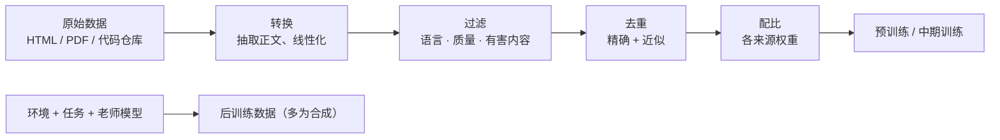
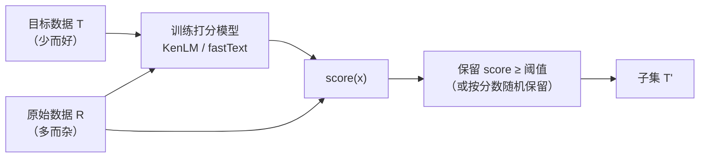
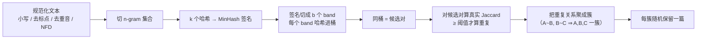

# 第 14 章 数据（下）：处理流水线——转换、过滤、去重、配比与后训练数据

> 对应课程：Lecture 14《Data》 · [YouTube](https://www.youtube.com/watch?v=5sxHosTLPF8) · 官方讲义：[可执行讲义 lecture_14](https://cs336.stanford.edu/lectures/?trace=lecture_14)

<Video id="5sxHosTLPF8" title="Lecture 14 原视频" />

## 本章你将学到

- 原始数据（HTML、PDF）怎样变成文本，以及为什么这一步“有损”且会影响模型效果。
- 过滤的通用框架：给定少量“目标数据 T”和海量“原始数据 R”，训练一个便宜的打分器，从 R 中挑出像 T 的子集；它如何统一了语言识别、质量过滤、有害内容过滤。
- 去重的完整算法链：哈希 → 精确去重 → Jaccard 相似度 → MinHash → 局部敏感哈希（LSH），并能手算 LSH 的碰撞概率。
- 数据配比（mixing）：为什么不能只看质量、还要看 epoch 数；UniMax、回归式配比、“模拟 epoch”分别解决什么问题。
- 后训练数据的基本配方，以及 OpenThoughts、SWE-smith、SWE-Zero 等数据集的经验。

## 先说结论（一分钟版）

1. 数据流水线 = **转换**（HTML/PDF → 文本）→ **过滤**（语言、质量、有害内容）→ **去重** → **配比**。每一步都靠启发式，但每一步都实实在在影响模型。
2. 几乎所有过滤都是同一个套路：**定义“好数据长什么样”（目标 T），训练一个极快的模型（KenLM 或 fastText）去给海量数据打分，按阈值保留**。而且最佳阈值取决于你要训多少 token。
3. 去重的难点是“两两比较是 O(n²)”。MinHash 让“哈希碰撞概率 = Jaccard 相似度”，LSH 再用“分 band：band 内全相等（与）、任一 band 命中（或）”把碰撞概率变成一条陡峭的 S 曲线，从而在近似线性时间里找出近似重复。
4. 配比时最容易犯的错是让小而精的数据源被重复几十遍；小规模实验要“模拟 epoch”，才能把结论外推到大规模。
5. 后训练数据大多是合成的：定义环境和任务，再让强模型（老师）生成回答；老师不一定越强越好，代码环境尤其麻烦。

---

## 14.1 回顾与路线图

[▶ 00:05](https://www.youtube.com/watch?v=5sxHosTLPF8&t=5s)

上一章（[第 13 章](./ch13-data-sources)）我们看到：数据不会从天上掉下来。互联网是一堆活着的服务（比如 GitHub），数据要先被转储或爬取（比如 GitHub Archive），再经过处理（比如 The Stack）；过程中还要考虑服务条款和版权（许可或合理使用）。

这一章深入“处理”本身：



前半部分主要针对预训练；最后讲后训练数据，特别是合成数据。

::: tip 移动端类比
把它想象成一条**日志清洗管线**：原始埋点（HTML）先解析成结构化事件（文本），丢掉格式不对、来自测试设备、明显作弊的事件（过滤），合并重复上报（去重），最后按业务线加权汇总成报表（配比）。每一步的规则都“拍脑袋”，但每一步都会影响最终的数据结论。
:::

---

## 14.2 转换：从 HTML / PDF 到文本

[▶ 01:05](https://www.youtube.com/watch?v=5sxHosTLPF8&t=65s)

就算你爬到了数据，它也**不是文本**：可能是 HTML、PDF（arXiv），或者整个目录（代码仓库）。转换工作的重心是 HTML，因为 Web 的大头是 HTML。

### HTML → 文本

HTML 转文本相当依赖启发式：

- **去掉模板内容（boilerplate）**：导航栏、广告、页眉页脚、菜单；**抽取正文**。
- **什么算正文并不总是清楚**：有时导航元素也能帮模型学到“网页长什么样”。
- **图片、表格怎么办？** 简单表格可以渲染成 Markdown，嵌套表格就很难，到某个程度只能放弃或近似。
- **本质上有损**：HTML 是层级结构（DOM 树），渲染后又是二维的视觉布局，而我们要把它**线性化**成一串 token。

常用工具都是**基于规则**的：trafilatura、resiliparse、jusText、lynx 等。为什么用规则？因为它**极快**，而这一步也不需要太多“智能”。讲者认为在这里加入基于模型的干预或许有空间，但前提是要非常快、并且真能做得更聪明。只要你仔细看数据，就会发现规则抽取总有一定失败率。

工具的选择会影响效果：上一章提到的 DCLM 实验显示，在他们的扩展评测上，用 resiliparse 或 trafilatura 自己从 WARC 抽取，比直接用 Common Crawl 的 WET 文本更好。

::: tip 移动端类比
这就是 Safari 的“阅读模式”或 Android 的无障碍文本提取：从一棵复杂的视图树里，猜出哪部分是“正文”，扔掉 Tab 栏、广告位和推荐卡片。阅读模式偶尔也会把正文切掉一半——规则抽取天生有失败率。
:::

### PDF → 文本：FinePDFs

[▶ 04:10](https://www.youtube.com/watch?v=5sxHosTLPF8&t=250s)

Hugging Face 的 FinePDFs 处理的是 Common Crawl 里的 PDF。用文本编辑器打开 PDF，你看到的是一堆绘图指令，需要“渲染”才能得到文字。几个要点：

- **来源**仍是 Common Crawl。一个 URL 在下载前你可能都不知道它是不是 PDF（没有扩展名的话）。
- Common Crawl 里很多 PDF **被截断了**（PDF 文件大），需要**重新抓取**。
- 有些 PDF 本质是扫描图片，所以要做 **OCR**：用视觉语言模型（如 RolmOCR）或 Docling 等工具，并想办法让它们跑得快。这比处理文本贵得多。
- PDF 只占互联网很小一部分，但**价值高**：愿意专门做成 PDF 的内容，平均质量通常高于普通网页。
- 清理和过滤工作比网页还多；而且**大量版面信息丢失**：HTML 有 `h1`、`p` 这类语义标签，PDF 天生只关心“东西画在哪里”，不保留语义结构。

转换完成后，你手里有了文本，但离可训练还远着呢。

---

## 14.3 过滤：从海量原始数据里找出“像目标数据”的子集

[▶ 06:13](https://www.youtube.com/watch?v=5sxHosTLPF8&t=373s)

### 通用框架

几乎所有过滤都可以套进这个骨架：

- 你有一小份**目标数据 T**（通常量小、质量高）；
- 你有海量**原始数据 R**（上一步转换出的“新鲜货”）；
- 目标：在 R 中找一个子集 T'，使它**和 T 相似**。



**应用**：

- **语言识别**：英语 vs. 其他语言；
- **质量过滤**：高质量 vs. 低质量；
- **有害内容过滤**：无毒 vs. 有毒。

**对过滤算法的两个要求**：

1. **能从 T 泛化**：如果只能找出和 T 一模一样的东西，那就没意义了——你已经有 T 了；
2. **极快**：要在整个 R 上运行，R 可能有上百万亿 token。最终留下的往往只是原始数据的个位数百分比。

（讲义还推荐了一篇数据选择的综述：[A Survey on Data Selection for Language Models](https://arxiv.org/abs/2402.16827)。）

具体做法分两步：(1) 基于 R 和 T 估计某个模型，得到打分函数；(2) 根据分数保留 R 中的样本。

### 两类打分器

[▶ 09:16](https://www.youtube.com/watch?v=5sxHosTLPF8&t=556s)

**① 生成式：给目标数据建模，score(x) = p_T(x)**

在 T 上训练一个便宜的语言模型，比如 **KenLM**（一个高效的 n-gram 语言模型工具，常用 5-gram），然后看新文档在这个模型下的概率有多高。概率高 = “读起来像 T”。

n-gram 模型的直觉：只根据前面 n−1 个词预测下一个词的概率，概率直接从 T 里数出来。实践中常用**困惑度（perplexity）**来表示：

$$
\text{PPL}(x) = \exp\Big(-\frac{1}{|x|}\sum_{i=1}^{|x|}\log p_T(x_i \mid x_{i-n+1},\dots,x_{i-1})\Big)
$$

- $x$ 是一篇文档，$|x|$ 是它的词数；
- $p_T(x_i \mid \dots)$ 是在 T 上训练的 n-gram 模型给第 $i$ 个词的概率；
- 整体就是“每个词平均有多意外”的指数；**困惑度越低，越像 T**。（困惑度在 [第 12 章](./ch12-evaluation) 讲过。）

**② 判别式：直接训练一个分类器，score(x) = p(T | x)**

这是现在更常见的做法：把 T 的样本当**正例**，从 R 中随机抽一些当**负例**（可以做平衡），训练一个二分类器。工具几乎都是 **fastText**：它就是一个**词袋（bag-of-words）线性分类器**——每个词（或 n-gram）一个向量，求平均后过一个线性层，非常快。

把它写成最简形式：

$$
\text{score}(x) = \sigma\Big(b + \sum_{w \in x} \theta_w\Big)
$$

- $\theta_w$ 是词 $w$ 的权重（正数表示“这个词让文档更像 T”）；
- $b$ 是偏置，$\sigma$ 是 sigmoid 函数，把任意实数压到 0~1 之间当作概率；
- （fastText 实际用的是词向量的平均再接线性层，但“每个词贡献一点分数”的直觉是一样的。）

有了打分器，对每篇新文档算分，根据你的质量要求设一个阈值，**保留 score ≥ 阈值** 的文档——有时是确定性地保留，有时是**按分数随机保留**（下面 GPT-3 的例子）。

下面的演示实现了一个最小的词袋分类器：用 8 条“好数据”和 8 条“垃圾网页”训练出每个词的权重，然后给原始池打分。拖动阈值，观察保留比例、误留的垃圾和误杀的好文档如何此消彼长；也可以切换到 GPT-3 式的随机保留，或在底部输入自己的句子，看每个词把分数往哪边推。

<Demo src="ch14-quality-filter.html" title="质量分类器：训练、打分、按阈值筛选" :height="760" />

注意演示里两个“失误”：一篇措辞正式的赌场广告拿了高分，一篇口语化但有用的修车经验拿了低分。词袋模型只看“用词风格”，这既是它快的原因，也是它的局限。

### 用不用模型过滤？

[▶ 10:16](https://www.youtube.com/watch?v=5sxHosTLPF8&t=616s)

回忆上一章：

- **刻意不用**模型过滤：C4、Gopher、RefinedWeb、FineWeb、Dolma——担心引入偏差；
- **使用**模型过滤：GPT-3、LLaMA、DCLM——**正在成为常态**。

讲者的解释：除非你算力极其充裕（那样你可以什么都训，干脆不太需要过滤），否则大家都是“算力穷人”，必须聪明地挑数据，不然就是把 FLOPs 浪费在低质量内容上。

### 实例一：语言识别

[▶ 11:16](https://www.youtube.com/watch?v=5sxHosTLPF8&t=676s)

目标：判断一段文本是不是某种语言（比如英语）。

- Meta 发布了一组 **fastText 语言识别模型**，可以直接拿来用，支持 **176 种语言**；
- 训练数据来自多语言网站：Wikipedia、Tatoeba（翻译句子网站）、SETimes（东南欧新闻）；
- 用法：选个阈值，比如 **Dolma 保留 p(英语) ≥ 0.5 的页面**（上一章提到 FineWeb 用的是 > 0.65）。

语言识别相对容易：看几个词就能分辨西班牙语还是日语。但也有难点：**语码混用（code switching）**、方言等，所以不能说完全解决了，只是它通常不是训练好模型的瓶颈。

::: warning 常见误区
语言识别的错误会直接传导到模型：如果把某种方言或混合语言的文本大量判为“非英语”丢掉，模型对这类用户就会表现更差。作业 4 专门有一道题让你思考这种问题、以及在面向用户的产品里怎么缓解。
:::

### 实例二：OpenWebMath——为数学“定义质量”

[▶ 12:16](https://www.youtube.com/watch?v=5sxHosTLPF8&t=736s)

如果你想让模型擅长数学，就去 Common Crawl 里找数学数据。OpenWebMath（讲义中写作 OpenMathText，2023）是个多步流水线：

1. **规则**：例如是否包含 LaTeX 命令；
2. **KenLM**（生成式）：在已知的数学数据集 ProofPile 上训练，困惑度 **< 15000** 才保留；
3. **fastText 分类器**（判别式）：预测是否是数学写作，阈值有两档——**含 LaTeX 的门槛低（0.17），不含 LaTeX 的门槛高（0.8）**；
4. 结果：**147 亿 token**。用它训练的 1.4B 模型，数学能力超过了用 20 倍数据（但未这样过滤）训练的模型。

启示：**质量没有统一定义**。你可以把“质量”定义成“是数学”，然后就能得到数学更好的模型。

### 实例三：GPT-3 与 LLaMA 的质量分类器

[▶ 14:17](https://www.youtube.com/watch?v=5sxHosTLPF8&t=857s)

**GPT-3**：

- 正例：来自 {Wikipedia, WebText2, Books1, Books2} 的样本；
- 负例：来自 Common Crawl 的样本；
- 基于词特征（Spark 的分词器）训练线性分类器；
- **按分数随机保留**：

```python
import numpy as np

def keep_document(score: float) -> bool:
    # score 越接近 1 越可能保留；低分文档也有小概率被留下（保持多样性）
    return np.random.pareto(9) > 1 - score
```

::: details 手算：保留概率到底是多少？
NumPy 的 `pareto(a)` 实际是 Lomax 分布，满足 $P(X > t) = (1+t)^{-a}$（$t \ge 0$）。代入 $t = 1-\text{score}$、$a=9$：

$$
P(\text{保留}) = (2 - \text{score})^{-9}
$$

- score = 1.0：$1^{-9} = 1$，必定保留；
- score = 0.9：$1.1^{-9} \approx 1/2.36 \approx 0.42$；
- score = 0.5：$1.5^{-9} \approx 1/38.4 \approx 0.026$；
- score = 0：$2^{-9} = 1/512 \approx 0.002$。

所以它是一个“很陡但不为零”的保留曲线：高分几乎全留，低分偶尔漏进来一点，避免数据分布被分类器“剪得太窄”。
:::

**LLaMA / RedPajama**：

- 正例：**被 Wikipedia 引用的页面**的样本（不是维基条目本身）；
- 负例：Common Crawl 样本；
- 保留被分类为正的文档。

### 实例四：phi-1——用大模型定义“好数据”，再蒸馏成小分类器

[▶ 14:17](https://www.youtube.com/watch?v=5sxHosTLPF8&t=857s)

微软 phi-1 的理念是：用**极高质量的数据**（“教科书级”）训练小模型（1.3B~1.5B）。数据包括 GPT-3.5（后来 GPT-4）生成的合成数据，以及过滤过的数据。过滤部分同样套进我们的框架：

- **R**：The Stack 的 Python 子集；
- **T 怎么来**：用 GPT-4 和一个提示词——“判断这段代码对一个想学习基础编程概念的学生有多大教育价值”——给 R 中 **10 万条**样本打标签，正的就是 T；
- 训练一个**便宜的分类器**：在预训练代码模型（codegen）的输出嵌入上训练随机森林（换成 fastText 应该也行）；
- 用它筛整个 R。

HumanEval 结果：

| 训练数据 | 步数 | HumanEval |
|---|---|---|
| The Stack Python 子集 | 96K 步 | 12.19% |
| 过滤后的子集 | 36K 步 | **17.68%** |

**更少的步数，更高的分数**。

::: tip 套路总结
“好数据”从哪来有两条路：(1) 找一个你很喜欢、想要“更多同款”的现成数据集；(2) 写一个提示词，让大模型给一小批原始数据打标签，再用这批标签训练一个**小而快**的分类器，外推到全部数据。第 13 章的 Nemotron-CC（教育价值分）也是第二条路。
:::

### 实例五：有害内容过滤

[▶ 16:21](https://www.youtube.com/watch?v=5sxHosTLPF8&t=981s)

Dolma 用 **Jigsaw Toxic Comments** 数据集（2018）训练有毒内容分类器。这个数据来自一个“帮助人们在网上更好地讨论”的项目：Wikipedia **讨论页**（talk page）上的评论——争议条目的讨论页可能相当火爆——被标注成 {toxic、severe_toxic、obscene、threat、insult、identity_hate} 几类。照样定义正负例、训练分类器、去筛 Common Crawl。（作业 4 直接使用 Dolma 发布的两个 fastText 分类器：NSFW 和仇恨言论。）

### 过滤的“尺度依赖”：没有放之四海皆准的阈值

[▶ 17:21](https://www.youtube.com/watch?v=5sxHosTLPF8&t=1041s)

一个重要的微妙之处：**你想要什么样的数据，取决于你要训练什么样的模型**，尤其是**训练多少 token**。

- 如果要训练很久（token 多），可以容忍**更多、质量稍低**的数据；
- 如果训练时间短，就要**更少、更高质量**的数据。

（当然，最理想的是“训练很久，而且有很多高质量数据”，但数据池就这么大，你只能在质量和数量之间取舍。）

课上展示了 Michael Ryan 的一个初步实验：一个 1.57 亿参数的模型，用很小的数据池（Common Crawl 的一小部分），越训越久。

- **DCLM 过滤的数据**（蓝线）：一开始 loss 下降很快；数据很少，所以很快就得**重复**（epoch），第二遍、第三遍还在学到东西，但最终开始过拟合。
- **几乎不过滤的数据**（resiliparse 直接抽取）：一开始明显更差；但因为数据多，重复得少，后期下降得更持久。

结论：**在不需要重复数据的区间，高质量数据更好；一旦训练到需要大量重复，高质量数据就不再那么占优**，甚至不如“训得更久的低质量数据”。

::: details 课堂问答
- **每个点只跑了一次，需要置信区间吗？** 理想情况下应该多跑几次，但每次训练都很贵，论文里很少见；讲者的经验是，至少在预训练里这类实验通常相当稳定。
- **如果有更多高质量数据，训得更久会怎样？** 任何有限的数据集最终都会边际收益递减，但那条曲线会一直往更低处走。
:::

**过滤小结**：过滤对训练好模型至关重要，尤其在算力有限时。配方是：**定义“好数据长什么样”，训练一个分类器，外推到其余数据。**

---

## 14.4 去重：在线性时间里找出“几乎一样”的文档

[▶ 22:28](https://www.youtube.com/watch?v=5sxHosTLPF8&t=1348s)

过滤之后，数据里通常仍有大量重复。

### 两种重复

- **精确重复**：镜像站（存在的意义就是复制）、GitHub fork（即使改了几处，99% 的文件也一样）。爬虫往往不够聪明，认不出两个镜像是同一个东西。
- **近似重复**：相同文本、只差几个 token。

近似重复的例子：

- **服务条款和许可证**：MIT 许可证出现在无数地方，往往一字不差——但嵌着它的页面其余部分不同；
- **页眉页脚**：大量网站共享相同的模板；
- **格式差异**：课上展示了 LM1B（十亿词基准）里只差一个逗号的两篇文章；
- **模板化内容**：一看就是低质量的广告类文本，只是把 “Canada” 换成 “USA”。如果模型在这些变体上反复训练，就是在**浪费 GPU**。

更极端的例子：对 C4 的审计发现，一段（莫名其妙的、关于某款防毒面具的）商品描述**出现了 61,036 次**。“Web 就是这么奇怪”——这也说明了为什么要**亲自看数据**。

### 为什么要去重

- **训练更高效**：去重减少 token 数，却几乎不损失信息；
- **避免记忆**：重复多次的内容更容易被模型逐字记住，这涉及版权和隐私问题（论文 *Deduplicating Training Data Makes Language Models Better*）；
- 与之相关的还有**去污染（decontamination）**：确保测试集没有混进训练集，这可能更重要（评测污染问题见 [第 12 章](./ch12-evaluation)）。

### 设计空间

[▶ 26:30](https://www.youtube.com/watch?v=5sxHosTLPF8&t=1590s)

1. **什么是一个“条目”（item）**：句子、段落，还是整篇文档？
2. **怎么判定匹配**：完全相同？存在共同的子条目？共同子条目的比例超过阈值？
3. **发现重复后怎么办**：全部删除，还是保留一份？

**核心算法挑战**：过滤是对单个条目做判断（“这篇好不好”），天然可并行、线性时间；去重本质上是**条目与条目之间的比较**，朴素做法是 $O(n^2)$ 两两比较——在 Web 规模上完全不可行。我们需要**线性时间**的算法，而答案是**哈希**。

### 哈希函数

[▶ 28:32](https://www.youtube.com/watch?v=5sxHosTLPF8&t=1712s)

- 哈希函数 $h$ 把一个条目（比如字符串）映射成一个哈希值（整数或短字符串），哈希值比条目小得多；
- **哈希碰撞**：$x \ne y$ 但 $h(x) = h(y)$。

效率和抗碰撞性之间有权衡：

| 类型 | 例子 | 特点 | 用途 |
|---|---|---|---|
| 密码学哈希 | SHA-256 | 抗碰撞、慢 | 密码学、比特币 |
| 非密码学哈希 | DJB2、MurmurHash、CityHash | 不抗碰撞、快 | 哈希表 |

去重用后者，课上用 **MurmurHash**（Python 库 `mmh3`）。例如 `mmh3.hash("hello")` 得到 613153351。

::: tip 移动端类比
你在 App 里做图片缓存时，用 URL 的 MD5 当文件名，就是在用哈希把“长字符串”压成“短而固定长度的键”。去重用的是同一个思想，只不过追求的是速度而不是安全性。
:::

### 精确去重

[▶ 29:32](https://www.youtube.com/watch?v=5sxHosTLPF8&t=1772s)

最简单的例子：条目 = 字符串；匹配 = 完全相同；动作 = 保留一份。

```python
import itertools
import mmh3

items = ["Hello!", "hello", "hello there", "hello", "hi", "bye"]

# 按哈希值排序并分组：哈希相同的字符串落在同一组
hash_items = itertools.groupby(sorted(items, key=mmh3.hash), key=mmh3.hash)

# 每组只保留第一个
deduped_items = [next(group) for h, group in hash_items]
# -> 5 个元素：两个 "hello" 只留下一个；"Hello!" 和 "hello" 不同，都保留
```

- **优点**：简单、语义清晰、精确度高；
- **缺点**：抓不到近似重复；
- 这段代码是 **MapReduce 风格**（先映射成哈希，再按键归并），很容易并行和扩展到海量数据。

**C4 的做法**：条目 = **3 个句子组成的片段**；精确匹配；保留一份。注意一个副作用：从一篇文档中间删掉三句话，剩下的文档可能**读不通了**。

### Jaccard 相似度：定义“近似”

[▶ 30:32](https://www.youtube.com/watch?v=5sxHosTLPF8&t=1832s)

要做近似去重，先得定义相似度。把每篇文档表示成一个**集合**（通常是它的 n-gram 集合，也叫 shingle），然后用 **Jaccard 相似度**：

$$
J(A, B) = \frac{|A \cap B|}{|A \cup B|}
$$

- $|A \cap B|$：两个集合共有元素的个数；
- $|A \cup B|$：两个集合合起来（去重后）的元素个数；
- 结果在 0（完全不相交）到 1（完全相同）之间。

**手算**：$A = \{1,2,3,4\}$，$B = \{1,2,3,5\}$。交集 $\{1,2,3\}$ 有 3 个元素，并集 $\{1,2,3,4,5\}$ 有 5 个，所以 $J = 3/5 = 0.6$。

定义：两篇文档的 Jaccard 相似度 ≥ 某个阈值（比如 0.99）时，称它们**近似重复**。挑战变成：**怎么在线性时间里找出所有近似重复对？**

### MinHash：让“碰撞概率 = Jaccard”

[▶ 32:34](https://www.youtube.com/watch?v=5sxHosTLPF8&t=1954s)

**MinHash** 是一个随机哈希函数 $h$，满足：

$$
\Pr[h(A) = h(B)] = J(A, B)
$$

这很有意思：平常我们希望不同的东西哈希到不同的值，尽量**避免**碰撞；这里我们反而**想要**碰撞——但不是乱碰撞，而是让**越相似的集合越容易碰撞**。哈希让我们能做到线性时间，Jaccard 是我们想要的度量，MinHash 把两者连了起来。

做法简单得出奇：**对集合里每个元素算哈希，取最小值**。

```python
import mmh3

def minhash(S: set[str], seed: int) -> int:
    # 不同的 seed 相当于不同的随机哈希函数
    return min(mmh3.hash(x, seed) for x in S)
```

（取 min 还是 max 无所谓，只是一种“从集合里选一个代表”的方式。）

**为什么成立？** 用“特征矩阵”来看 $A=\{1,2,3,4\}$ 和 $B=\{1,2,3,5\}$：

| 元素 | A | B |
|---|---|---|
| 1 | 1 | 1 |
| 2 | 1 | 1 |
| 3 | 1 | 1 |
| 4 | 1 | 0 |
| 5 | 0 | 1 |

一个随机哈希函数相当于给这 5 个元素随机排了个序。取最小值 = 看“排在最前面”的是哪个元素。**每个元素排第一的概率相同**：

- 如果排第一的是 1、2 或 3（两个集合都有），那么 A 的最小值和 B 的最小值是同一个元素 → **碰撞**；
- 如果排第一的是 4 或 5（只有一个集合有），两者的最小值不同 → **不碰撞**。

所以碰撞概率 = 3/5 = **交集大小 / 并集大小** = Jaccard。证毕。

**验证**：用 100 个不同的种子（100 个哈希函数），数一数 `minhash(A, seed) == minhash(B, seed)` 的比例，得到约 0.6。

```python
A = {"1", "2", "3", "4"}
B = {"1", "2", "3", "5"}
n = 100
matches = [minhash(A, seed) == minhash(B, seed) for seed in range(n)]
estimated_jaccard = sum(matches) / n   # 约 0.6
```

关键是：**不用两两比较**。每篇文档独立算出自己的 MinHash 值，然后只需要找“哪些文档的值相同”——这就是哈希表分组，线性时间。把 $k$ 个 MinHash 值排成一个向量，就是这篇文档的 **MinHash 签名**；两份签名中相等位置的比例，就是 Jaccard 的估计。

但还没完：**一次碰撞并不能告诉我们 Jaccard 超过了阈值**。单个 MinHash 碰撞的概率等于 Jaccard 本身，随机性太大，方差很高。

### 局部敏感哈希（LSH）：把概率“锐化”成阈值

[▶ 37:41](https://www.youtube.com/watch?v=5sxHosTLPF8&t=2261s)

目标：Jaccard 高于阈值时**几乎一定**碰撞，低于阈值时**几乎一定不**碰撞。我们需要把概率曲线“锐化”。

解法：用 $n$ 个独立的哈希函数，分成 **$b$ 个 band，每个 band 有 $r$ 个**（$n = b \times r$）。例如 $n=12$、$b=3$、$r=4$：

```
h1 h2 h3 h4  |  h5 h6 h7 h8  |  h9 h10 h11 h12
```

**规则**：A 和 B 碰撞（成为候选对），当且仅当**存在某个 band，这个 band 里的所有哈希值都相等**。

- band 内部是“**与**”：r 个都相等才算这个 band 命中；
- band 之间是“**或**”：任意一个 band 命中就算碰撞。

正是这个“与-或”结构在锐化阈值。

**碰撞概率推导**：设 $J(A,B) = s$。

1. 单个哈希函数相等的概率是 $s$；
2. 一个 band 的 $r$ 个全相等：$s^r$（“与”让概率变小，指数级）；
3. 一个 band 不命中：$1 - s^r$；
4. $b$ 个 band 全不命中：$(1 - s^r)^b$；
5. 至少一个命中（“或”让概率变大）：

$$
P(\text{碰撞}) = 1 - (1 - s^r)^b
$$

- $s$：两篇文档的真实 Jaccard 相似度；
- $r$：每个 band 里的哈希函数数；
- $b$：band 的个数。

```python
def get_prob_collision(sim, b, r):
    prob_match = sim ** r                       # 某个固定 band 命中
    prob_collision = 1 - (1 - prob_match) ** b  # 至少一个 band 命中
    return prob_collision
```

**手算**：$s=0.8$，$b=5$，$r=10$。

- $0.8^{10} \approx 0.107$（单个 band 命中的概率很低，因为是 $r$ 次方）；
- $1 - 0.107 = 0.893$；$0.893^5 \approx 0.567$；
- $P = 1 - 0.567 \approx 0.43$。

把 $P$ 画成 $s$ 的函数，会得到一条 **S 形曲线**：相似度低时接近 0，高时接近 1，中间有一个陡峭的“相变”。这正是我们想要的。

**调参直觉**（课上用 $s \in \{0.7, \dots, 0.98\}$ 做了对比）：

| $s$ | 0.7 | 0.75 | 0.8 | 0.85 | 0.9 | 0.95 | 0.98 |
|---|---|---|---|---|---|---|---|
| $b=10, r=10$ | 0.25 | 0.44 | 0.68 | 0.89 | 0.99 | 1.00 | 1.00 |
| $b=10, r=20$ | 0.008 | 0.03 | 0.11 | 0.33 | 0.73 | 0.99 | 1.00 |
| $b=20, r=20$ | 0.02 | 0.06 | 0.21 | 0.55 | 0.92 | 1.00 | 1.00 |

- **增大 $r$**：曲线**变陡并右移**（更难匹配）。$s=0.7$ 的碰撞概率从 0.25 降到 0.008；
- **增大 $b$**：曲线**左移**（更容易匹配，因为有更多次机会）。$s=0.9$ 的碰撞概率从 0.73 升到 0.92。
- $b$ 和 $r$ 都加大可以让相变任意陡峭，代价是计算更多哈希。

**相变点在哪？** 大约在

$$
s^* \approx \left(\frac{1}{b}\right)^{1/r}
$$

在这一点上，单个 band 命中的概率恰好是 $(s^*)^r = 1/b$，于是碰撞概率 $= 1 - (1 - 1/b)^b \approx 1 - 1/e \approx 0.63$，是一个与 $b$、$r$ 无关的常数。随着 $b$、$r$ 增大，低于 $s^*$ 的碰撞概率趋于 0，高于 $s^*$ 的趋于 1。

**真实设置**：去重论文 *Deduplicating Training Data Makes Language Models Better* 用了 $n=9000$、$b=20$、$r=450$。

- 相变点：$(1/20)^{1/450} = e^{\ln 0.05 / 450} = e^{-2.996/450} \approx e^{-0.00666} \approx 0.993$；
- 在相变点的碰撞概率：$1 - (1 - 1/20)^{20} = 1 - 0.95^{20} \approx 1 - 0.358 = 0.64$。

也就是说这套参数在找 Jaccard 约 0.99 以上的“几乎一模一样”的文档。反过来，**如果你想以 0.9 为阈值去重，就要选 $b$ 和 $r$ 让 $(1/b)^{1/r} \approx 0.9$**，再用两者的大小控制陡峭程度。

这套方法叫 **MinHash LSH**。LSH 本身适用于各种“局部敏感”的哈希族；对语言模型数据去重，我们用的是近似 Jaccard 的 MinHash。

下面的演示把整个过程摊开：编辑 4 段文本，看它们的 n-gram 集合、MinHash 签名（相等位置标绿）、每个 band 的分桶碰撞、对候选对用真实 Jaccard 复核、最后聚类只留一份；底部的 S 曲线会随 $b$、$r$ 实时变化。

<Demo src="ch14-minhash-lsh.html" title="MinHash + LSH 近似去重" :height="900" />

完整的工程流程（也是作业 4 `minhash_deduplication` 的结构）：



::: tip 移动端类比
手机相册里的“相似照片清理”是同一类问题：几千张照片两两比较太慢，所以先给每张图算一个“感知哈希”（相似的图哈希也相近），按哈希分桶，只在桶内细比。LSH 就是把“相似”变成“容易进同一个桶”的那套数学。
:::

::: warning 常见误区
- 只在**单个数据集内部**去重是不够的：不同数据集之间常常高度冗余（比如 C4 和其他 CC 派生数据），应当在**整个训练语料**上做去重。课上特别提到这一点经常被忽略。
- 从未进同一个桶的对永远不会被比较：LSH 有**假阴性**（漏掉的重复），也有**假阳性**（进了同一个桶但真实 Jaccard 不够），后者靠复核真实 Jaccard 过滤掉。
:::

---

## 14.5 数据配比（Mixing）：每个来源该给多少权重？

[▶ 48:55](https://www.youtube.com/watch?v=5sxHosTLPF8&t=2935s)

到这里，我们把每个数据源都做了转换、过滤、去重，得到了一批较小的高质量文档。但语言模型是在**多个数据源**上训练的。例如 Marin 项目有一个 token 查看器，列出下一个模型要用的各种来源：Nemotron-CC、FinePDFs、一些机构藏书、代码等等。The Pile 也给每个组成部分分配了一个权重。

**数据配比**就是一个**在各数据源上的概率分布**：

```python
sources = {"Wikipedia", "CC", "GitHub"}
p = {"Wikipedia": 0.3, "CC": 0.5, "GitHub": 0.2}   # 一种可能的配比
```

训练时怎么实现？课上有同学问到：通常是在**填充一个 batch 时，对每条序列先按 p 抽一个来源，再从该来源取一条序列**——一条序列来自同一个来源，不会逐 token 抽样；一个 batch 里通常混有多个来源，以降低方差。

### 三个基线

- **凭感觉（vibes）**：按直觉手动设定——比你想象的更常见，即使是最近的论文也常常是“用某种方法算一下，再手动调一调”；
- **均匀采样**：$p(s) \propto 1$；
- **按大小比例**：$p(s) \propto \mathrm{num\_tokens}(s)$——合理，但一个巨大的低质量来源会吃掉大部分份额。

直觉上应该**给高质量来源更高权重**。但有两点要注意：

1. **多样性**：来源之间常常不可比——文学、代码、论文，你很难说一篇论文比一段代码“质量更高”；把所有权重压在论文上，模型别的能力就差了。
2. **每个来源都是有限的**：权重给得太大，就会把这个小来源**重复训练很多遍（epoch）**。

### 手算：最容易翻车的地方

[▶ 53:02](https://www.youtube.com/watch?v=5sxHosTLPF8&t=3182s)

假设两个来源：低质量 **10T token**，高质量 **10B token**（高质量来源通常更小）。天真地五五开，训练 **1T token**（注意这是训练 token 数，即步数 × batch 大小 × 序列长度，不是唯一 token 数）。

- 低质量来源的 epoch 数：$0.5 \times 1\text{T} / 10\text{T} = 0.05$——**95% 的低质量 token 一次都没见过**；
- 高质量来源的 epoch 数：$0.5 \times 1\text{T} / 10\text{B} = 500\text{B} / 10\text{B} = 50$——你需要 5000 亿高质量 token，可只有 100 亿，于是**每条数据重复 50 遍**！

最好的情况是浪费算力，最坏的情况是**过拟合**。讲者说一些大模型训练确实在这里栽过跟头：只看质量定一个分布然后采样，却没注意每个来源**到底有多少数据**。教训：**一定要算一算你在每个来源上实际训了多少个 epoch。**

<Demo src="ch14-data-mixing.html" title="数据配比计算器：权重、epoch、UniMax 与模拟 epoch" :height="820" />

### UniMax：均匀 + epoch 上限

[▶ 58:14](https://www.youtube.com/watch?v=5sxHosTLPF8&t=3494s)

这个问题很早就被注意到了，尤其在多语言模型里——有些语言的数据极少。

- 之前的做法：在“均匀”和“按比例”之间插值，$p(s) \propto \mathrm{num\_tokens}(s)^{\alpha}$，$\alpha \in [0, 1]$，把分布压平一点；
- **UniMax** 的想法更直接：**尽量均匀地采样各来源，但对任何来源的 epoch 数设一个硬上限 $C$**。某个来源达到上限就不再给它更多 token，剩余预算分给别的来源。约束写成：

$$
\frac{p(s) \cdot T}{\mathrm{num\_tokens}(s)} \le C \quad \text{对所有来源 } s
$$

- $T$：总训练 token 数；
- $p(s) \cdot T$：分给来源 $s$ 的训练 token；
- 除以来源大小就是 epoch 数，要求不超过 $C$。

求解也简单：把来源按大小从小到大排，依次给每个来源分配“剩余预算的平均份额”和“$C$ × 来源大小”中较小的那个。（演示里的 UniMax 按钮就是这样算的。）它像一张安全网。

### 回归式配比：在小模型上试，外推到大模型

[▶ 60:15](https://www.youtube.com/watch?v=5sxHosTLPF8&t=3615s)

如果有 50 个来源，就要填 50 个数。按比例不够好，按“质量估计”加权又是启发式。最有原则、也最容易理解的是**回归式配比**（如 RegMix 等）：

1. 去小规模（比如三亿参数，甚至更小）；
2. 采样很多种不同的配比，**训练一群小模型**，每个得到一个目标指标上的 loss（可以是下游评测，也可以是困惑度）；
3. 拟合一个**回归模型**：输入 = 配比权重，输出 = loss。现在你有了一个很便宜的“配比 → loss”预测器；
4. **优化**这个预测器，找出 loss 最低的配比；
5. 用这个配比训练大模型。

这和 [第 9 章](./ch09-scaling-laws-1)/[第 11 章](./ch11-scaling-laws-2) 的 scaling law 是一个思路：**用便宜的小实验找答案，再外推到大规模**。

设计选择：

- **在哪些配比上采样**：需要一个“分布上的分布”，常用狄利克雷（Dirichlet）分布；
- **回归方法**：线性模型、梯度提升树；对数线性模型通常效果不错；
- **目标**：常基于下游评测——**要非常小心过拟合**。预训练本该得到通用模型，如果你的评测里代码题很多，结果自然是把代码数据权重拉满；然后你想让它写诗，就发现过拟合了。（按比例/均匀配比没有这个问题，因为根本不看评测。）
- **小规模与大规模的差距**：成本与准确度的权衡。模型太小可能不具代表性；太大则失去了意义——那等于在最大规模上做超参搜索。讲义引用的一篇 2026 年论文（arXiv:2602.12237）整理了一张表，比较多种此类方法的代理模型大小（通常几千万参数）、采样多少种配比、用什么分布和回归模型等。

**两个“祈祷”**：

1. **回归模型在最优点附近仍然准确**。随机采样一个配比来预测，属于“分布内”，通常没问题；但优化会把你推向**极端**区域，那里可能没有多少训练点覆盖。
2. **小规模的最优配比能迁移到大规模**。在开源社区常见的规模上，这似乎大体成立（至少不是明显不成立）；但显然存在尺度依赖效应——回忆 14.3 节：训练 token 越多，越能容忍低质量数据，所以最优点不会完全一样。

### 尺度依赖的 epoch 问题与“模拟 epoch”

[▶ 66:24](https://www.youtube.com/watch?v=5sxHosTLPF8&t=3984s)

还有一个前面已经见过、在这里必须处理的尺度效应。还是低质量 10T + 高质量 10B：

- 在**小规模**（token 少）上训练小模型时，你不会重复数据，于是会发现“哇，高质量数据真好”，给出类似 $p = \{\text{low}: 0.1, \text{high}: 0.9\}$ 的配比（课上的虚构例子）；
- 但用这个配比在**大规模**上训练，就会在高质量数据上**疯狂 epoch** 并过拟合。

两种修正：

1. **限制 epoch 数**（上面 UniMax 的思路，讲义引用的配比论文中也这样做）；
2. **模拟 epoch（simulated epoching）**：原则是**让小规模看起来像大规模**——这是贯穿整门课的主题（[第 11 章](./ch11-scaling-laws-2) 的 μP 也是让超参数能跨规模迁移）。具体做法是：**把每个来源按比例下采样**。

**手算**：小规模实验 10B token，大规模 1T token，比例 = 10B / 1T = 0.01。下采样后：

- 低质量：10T × 0.01 = 100B；
- 高质量：10B × 0.01 = 100M。

在下采样后的数据上做小实验，“猛加高质量数据”的配比会在 100M 的小源上重复很多遍、loss 变差，于是回归优化会自然地偏向更**均衡**的方案（课上示意为 $\{0.7, 0.3\}$）。你在小规模上**模拟出了**大规模时的数据稀缺。

::: details 课堂问答
- **下采样后某个来源太小怎么办？** 确实可能。那样优化通常只会给它很小的权重，放大后也许恰好合适；但可能有“取整误差”，比如本该训一遍的数据意外训了零遍。可以加一条规则兜底：每个来源至少训一遍。
- **能不能在一个数据集内部做配比？** 可以，而且课上补充说这很常见：比如拿到 Common Crawl，可以**按主题分组**（AI2 有一个叫 WebOrganizer 的工具），再按**质量分档**，得到“主题 × 质量”的二维网格，每个格子当作一个配比单元（Nemotron、OLMo 都有类似做法），然后再加上人工给的额外来源。
:::

**配比小结**：问题是如何给不同来源（维基、通用网页、代码……）加权；回归式配比是一个好框架——在小规模估计“配比 → loss”，优化，再外推；要特别小心 epoch 与过拟合，用 epoch 上限或模拟 epoch 解决。还有一个更一般的教训：**只要你在优化某个东西，就有优化错对象的危险。**

---

## 14.6 后训练数据：合成数据的天下

[▶ 72:29](https://www.youtube.com/watch?v=5sxHosTLPF8&t=4349s)

到目前为止讲的是预训练（或中期训练）数据，它们大体与具体任务无关（回归式配比除外），目标是打下基础能力。后训练数据则高度**依赖任务**。课上不做全面综述，只挑几个最近的、尤其是**代码**方向的数据集。

**通用配方**：

1. 定义一组**环境**（对代码来说，比如 GitHub 仓库）；
2. 定义一组**任务 / 提示词**；
3. 从一个**强模型（老师）**那里收集回答。

在开源社区，几乎所有后训练数据都是这样**合成**出来的。老师也可以换成人类，但又慢又贵；几年前前沿实验室确实要花大钱请人写回答，现在即使在前沿也可以做人机混合。总之，总有一个“老师”在提供回答。（后训练方法本身见 [第 15 章](./ch15-mid-post-training) 和 [第 16 章](./ch16-rlvr)。）

### OpenThoughts：推理数据

[▶ 74:32](https://www.youtube.com/watch?v=5sxHosTLPF8&t=4472s)

o1 出来后大家开始关注推理（主要是数学和科学），OpenThoughts 研究“怎样构建好的推理后训练数据集”，最终得到 **120 万条样本**，老师是 **QwQ-32B**。

- **问题来源**：来自 27 个人工和合成来源（如 StackExchange、NuminaMath、化学等），代码类的包括编程练习、代码评审等，规模很大、协作者很多；
- **每个问题采样多个回答（16 个）有帮助**——所以 120 万条样本除以 16 才是真正的问题数；
- **更强的模型不一定是更好的老师**：QwQ-32B（现在看是又老又小的模型）当老师，比当时最强的开源模型之一 DeepSeek-R1 效果更好；
- **对答案做过滤没有帮助**；
- **少量高质量来源（如 OpenMath-2-Math）比大而杂的来源更好**。

整个流水线：各来源的问题 → 去重 → 随机下采样问题 → 为每个问题生成多个回答 → 最终数据集。

### SWE-smith：用模型给真实仓库“造任务”

[▶ 77:37](https://www.youtube.com/watch?v=5sxHosTLPF8&t=4657s)

最近大家越来越关注**智能体式编程（agentic coding）**：不只是写一段代码，而是真的做软件开发。SWE-smith 的思路：

- 给定一个仓库，用一个智能体把它配置成可用状态（安装依赖等）；
- 用语言模型**生成任务**：通常是以某种方式修改代码，比如**引入 bug**；
- 验证这些任务，得到任务实例。

从 **128 个 GitHub 仓库得到 5 万个任务**——在去年算是相当大的规模。这些是**合成任务**（真实环境 + 合成任务）。

### SWE-Zero：不执行代码也能学

[▶ 78:37](https://www.youtube.com/watch?v=5sxHosTLPF8&t=4717s)

观察：与数学或编程竞赛不同，**软件工程任务依赖繁重**。大多数 GitHub 仓库根本跑不起来，依赖要装一大堆，回滚到某个 PR 当时的版本更是一团糟；为几千个仓库各配一个 Docker 镜像是**基础设施噩梦**。

另一个观察：**强模型不执行代码也能解决很多任务**。课上展示的结果里，允许执行大约 80 分，不允许执行也有接近 70 分——这些模型似乎有一个关于代码语义的内部“世界模型”。

于是：

- **SWE-Zero**：30 万条**不需要仓库专属执行环境**的智能体轨迹，来自 15 万个**真实** GitHub PR（比 SWE-smith 的合成任务更真实）；
- 使用 OpenHands 框架；有很多细节，比如**移除未来的 git 提交**，防止智能体“git hacking”（直接从历史里偷看答案）；
- 给智能体的指令改成“不能运行 Python 代码，只能用 sed、grep 这类基础操作”；
- 从 **Qwen3-Coder-480B** 蒸馏，并过滤掉那些无视指令、仍然尝试执行的轨迹；
- **SWE-Hero**：另有 1.3 万条**需要**执行反馈的轨迹。训练时先在 SWE-Zero 上微调，再在 SWE-Hero 上微调，取得了一定进展（离前沿仍有距离）。

### SWE-rebench 与更大规模的 SWE-Zero

[▶ 81:42](https://www.youtube.com/watch?v=5sxHosTLPF8&t=4902s)

- **SWE-rebench**：又一次大规模抓取 PR 的尝试——从 3400 个 GitHub 仓库得到 **2.1 万个可交互的 Python 软件工程任务**，来源是 GitHub 和 GitHub Archive 的 45 万个 PR；用 Qwen2.5-72B-Instruct 来安装依赖并评估 PR 质量。这类工作都长一个样：抓很多仓库，尝试安装（大多数会失败），再努力一点，然后用语言模型生成回答。
- **SWE-ZERO-12M-trajectories**（课上说“今天刚出”）：把 SWE-Zero 的思路扩展到 **1200 万条**智能体轨迹。任务来自 SWE-rebench-v2：其中只有 3.2 万个能执行、12 万个不能——但 Zero 的思路不在乎能不能执行，全都能用。由于数据量很大，用的是一个很小的模型 mini-coder-1.7b（pass@100 为 50.4）和 mini-swe-agent 框架。

**后训练数据小结**：

- **提示词/任务**来源有三种：完全合成、半合成（真实环境 + 合成任务）、真实（如 GitHub PR）；
- **回答**来自能力强、同时也是**好老师**的模型；
- 代码环境很痛苦；
- 还有大量过滤和其他细节。

---

## 14.7 总结

[▶ 83:43](https://www.youtube.com/watch?v=5sxHosTLPF8&t=5023s)

- **过滤**：定义“好”长什么样，训练轻量分类器（语言识别、质量、有害内容），扫一遍 Web 抓取，得到匹配目标的小子集；最佳阈值依赖训练规模。
- **去重**：避免过拟合、节省 FLOPs；哈希让模糊匹配能扩展到海量数据（MinHash + LSH）。
- **配比**：在小规模尝试配比，外推到最优配比和大规模；时刻警惕 epoch 与过拟合（上限或模拟 epoch）。
- **后训练数据**：长得像评测；大量使用合成数据。
- 讲者最后强调：真实的数据工作**非常“脏活累活”**，高度领域相关，需要一篇篇看具体样本。这一讲并不代表数据工作的日常，但希望你对数据版图有了整体认识。

---

## 动手练习

1. **手算 LSH 参数**
   你有 $k = 128$ 个 MinHash，想以 Jaccard ≈ 0.8 为去重阈值。在 $(b, r) \in \{(32, 4), (16, 8), (8, 16)\}$ 中选一个，并计算 $s = 0.5, 0.7, 0.9$ 时的碰撞概率。
   ::: details 答案
   相变点 $(1/b)^{1/r}$：(32,4) ≈ 0.42；(16,8) ≈ 0.71；(8,16) ≈ 0.88。离 0.8 最近的是 (16,8) 或 (8,16)，看你更怕漏还是更怕多。
   以 (16,8) 为例：$s=0.5$ → $1-(1-0.5^8)^{16} \approx 0.06$；$s=0.7$ → ≈ 0.61；$s=0.9$ → ≈ 1.00。
   以 (8,16) 为例：$s=0.7$ → ≈ 0.03；$s=0.8$ → ≈ 0.20；$s=0.9$ → ≈ 0.81。
   (16,8) 召回高、假阳性多（之后靠真实 Jaccard 复核剔除）；(8,16) 更严格、可能漏掉 0.8 左右的重复。作业 4 的说明里也写到：固定签名长度时，band 越多召回越高、精确度越低。
   :::

2. **验证 MinHash 的性质**（对应讲义代码）
   用 `mmh3` 实现 `minhash(S, seed)`，对课上的 $A$、$B$ 用 1000 个种子估计 Jaccard；再构造一对 Jaccard = 0.9 的集合，观察估计值的波动随种子数（10、100、1000）怎样变化。
   ::: details 提示
   每个种子的“是否相等”是一个成功概率为 $J$ 的伯努利试验，估计值的标准差约为 $\sqrt{J(1-J)/k}$。$J=0.6$、$k=100$ 时约 0.05。
   :::

3. **GPT-3 式随机保留**
   用 `np.random.pareto(9) > 1 - score` 对 score ∈ {0.5, 0.8, 0.9, 1.0} 各模拟 10 万次，统计保留比例，和公式 $(2-\text{score})^{-9}$ 对比。再想想：为什么要让低分文档也有一点点机会被保留？

4. **配比与 epoch**
   来源大小：网页 10T、代码 1T、论文 100B、维基 10B、数学 5B；训练 2T token；epoch 上限 $C = 4$。
   (a) 均匀配比时每个来源各训多少 epoch？(b) 用 UniMax 的贪心法算出各来源的 token 分配。（可以用上面的演示核对。）
   ::: details 答案
   (a) 每个来源 0.4T：网页 0.04、代码 0.4、论文 4、维基 40、数学 80 个 epoch——维基和数学严重超限。
   (b) 从小到大：数学 min(4×5B=20B, 2T/5=400B) = 20B；维基 min(40B, 1.98T/4≈495B) = 40B；论文 min(400B, 1.94T/3≈647B) = 400B；代码 min(4T, 1.54T/2=770B) = 770B；网页得到剩下的 770B。
   :::

5. **对接作业 4：质量与语言识别的思考题**
   (a) 作业 4 的 Gopher 规则要求文档 50~100,000 词、平均词长 3~10、以省略号结尾的行不超过 30%、至少 80% 的词含字母。分别举一个“会被误杀的好文档”和“会漏网的坏文档”。
   (b) 作业 4 的质量分类器建议用“被 Wikipedia 引用的网页”作正例、随机 Common Crawl 作负例。这和 LLaMA 的做法有什么关系？你会如何检查正例本身是否干净？

## 本章小结

- **转换**：HTML→文本靠规则工具（trafilatura、resiliparse、jusText），本质有损，工具选择影响效果；PDF 需要重新抓取和 OCR，价值高但昂贵、丢失版面信息。
- **过滤**：通用框架“目标 T + 原始 R → 打分 → 保留”；生成式（KenLM，$p_T(x)$）与判别式（fastText，$p(T|x)$）；统一了语言识别、质量、有害内容过滤；“好”可以是维基引用页、指令数据、大模型打的“教育价值”分，甚至“是数学”；最佳阈值依赖训练规模。
- **去重**：精确去重用哈希分组；近似去重用 Jaccard 定义相似度，MinHash 让碰撞概率等于 Jaccard，LSH 用 band 的“与-或”结构得到陡峭的 S 曲线 $1-(1-s^r)^b$，相变点约 $(1/b)^{1/r}$。
- **配比**：注意有限来源的 epoch 数；UniMax 设上限；回归式配比在小规模拟合“配比 → loss”再优化；用模拟 epoch 让小实验反映大规模的稀缺性。
- **后训练数据**：环境 + 任务 + 老师；老师不一定越强越好；代码数据从“需要执行环境”走向“无需执行也能学”。

下一章 [第 15 章](./ch15-mid-post-training) 会进入中期训练与后训练：有了这些数据，具体怎么做指令微调和偏好对齐。

## 延伸阅读

- 数据选择综述：[A Survey on Data Selection for Language Models](https://arxiv.org/abs/2402.16827)
- DCLM（HTML 抽取工具对比、质量分类器）：[arXiv:2406.11794](https://arxiv.org/abs/2406.11794)
- FinePDFs 博客：[huggingface.co/spaces/HuggingFaceFW/FinePDFsBlog](https://huggingface.co/spaces/HuggingFaceFW/FinePDFsBlog)
- fastText 语言识别：[fasttext.cc/docs/en/language-identification.html](https://fasttext.cc/docs/en/language-identification.html)
- Dolma：[arXiv:2402.00159](https://arxiv.org/abs/2402.00159)
- OpenWebMath：[arXiv:2310.06786](https://arxiv.org/pdf/2310.06786)
- GPT-3（附录 A 的过滤细节）：[arXiv:2005.14165](https://arxiv.org/pdf/2005.14165)
- LLaMA：[arXiv:2302.13971](https://arxiv.org/pdf/2302.13971)
- phi-1（Textbooks Are All You Need）：[arXiv:2306.11644](https://arxiv.org/pdf/2306.11644)
- Jigsaw Toxic Comment 数据集：[Kaggle](https://www.kaggle.com/datasets/julian3833/jigsaw-toxic-comment-classification-challenge)
- 去重让模型更好：[Deduplicating Training Data Makes Language Models Better](https://arxiv.org/pdf/2107.06499)
- MinHash 与 LSH 教材章节：Mining of Massive Datasets 第 3 章，[infolab.stanford.edu/~ullman/mmds/ch3n.pdf](http://infolab.stanford.edu/~ullman/mmds/ch3n.pdf)
- UniMax：[arXiv:2304.09151](https://arxiv.org/abs/2304.09151)
- RegMix（回归式配比）：[arXiv:2407.01492](https://arxiv.org/abs/2407.01492)；讲义引用的配比方法比较：[arXiv:2602.12237](https://arxiv.org/pdf/2602.12237)
- 模拟 epoch：[arXiv:2501.11747](https://arxiv.org/pdf/2501.11747)
- Marin token 查看器：[marin-community/token-count-viewer](https://huggingface.co/spaces/marin-community/token-count-viewer)
- OpenThoughts：[arXiv:2506.04178](https://arxiv.org/abs/2506.04178)
- SWE-smith：[arXiv:2504.21798](https://arxiv.org/abs/2504.21798)
- SWE-Zero：[arXiv:2604.01496](https://arxiv.org/abs/2604.01496)
- SWE-rebench：[arXiv:2505.20411](https://arxiv.org/pdf/2505.20411)
- SWE-ZERO-12M-trajectories 数据：[Hugging Face](https://huggingface.co/datasets/AlienKevin/SWE-ZERO-12M-trajectories)
