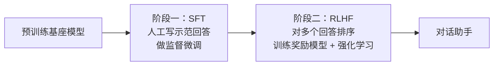
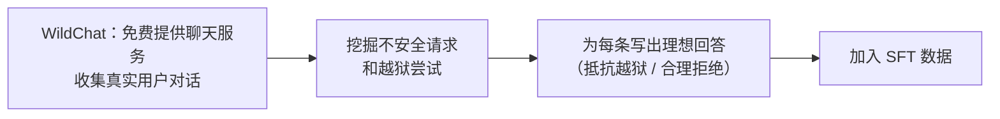
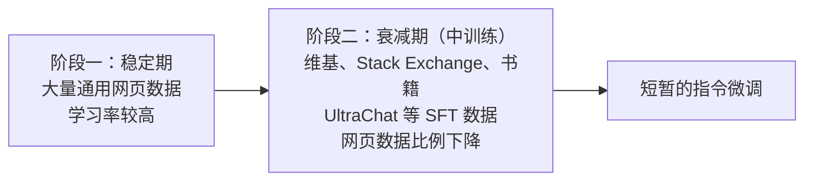
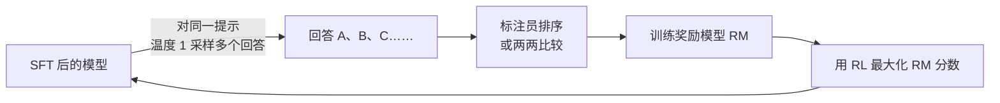

# 第 15 章 预训练之后：中训练、SFT 与 RLHF

> 对应课程：Lecture 15《After Pretraining (Mid/Post-Training)》 · [YouTube](https://www.youtube.com/watch?v=2oH6PWPrYFo) · 官方讲义：[幻灯片 lecture_15.pdf](https://github.com/stanford-cs336/lectures/blob/main/lecture_15.pdf)

<Video id="2oH6PWPrYFo" title="Lecture 15 原视频" />

## 本章你将学到

- 为什么一个很强的「基座模型」（如 GPT-3）依然不好用，以及「后训练（post-training）」要解决什么问题
- 监督微调（SFT）的数据是怎么一步步演化的：从 FLAN 到 Alpaca、Open Assistant，再到今天的工具调用/智能体数据
- SFT 数据里的几个坑：风格与长度偏好、「教模型它不知道的知识」会诱发幻觉、安全数据怎么做
- 「中训练（mid-training）」：为什么今天几乎所有人都把指令数据混进预训练末期
- RLHF 的核心思想：从「模仿一个分布」变成「最大化一个奖励」；偏好数据怎么收集，标注员是谁
- PPO 的直觉，以及 DPO 是怎么把 RLHF 变成「几乎就是 SFT」的；RLHF 的两大副作用：过度优化与模式坍缩

## 先说结论（一分钟版）

1. 预训练决定了模型「会什么」，后训练决定了模型「愿意怎么表现」。没有好的预训练，后训练什么都救不了；但只有预训练，模型就是一锅「原始汤」，你很难让它可靠地听指令。
2. SFT 在算法上毫无新意——就是在「指令 → 回答」数据上继续做下一个 token 预测。真正的门道全在**数据**：少量、高质量、与模型已有能力匹配的数据最有效；硬塞模型不知道的长尾知识，反而会让它学会「一本正经地编」。
3. 今天的主流做法是把高质量数据和指令数据混入预训练的学习率衰减阶段（中训练），所以「纯基座模型」这个说法已经不太成立。
4. RLHF 把问题从「拟合分布」换成了「最大化奖励」。数据通常是成对偏好（A 比 B 好），标注成本高、偏差多，如今大量由 AI 反馈替代。
5. PPO 有效但难调；DPO 通过一个巧妙的数学变换，把 RLHF 变成「把好回答的概率往上推、把差回答的概率往下压」，简单到几乎和 SFT 一样。
6. RLHF 最大的隐患是**过度优化奖励模型**（KL 正则因此至关重要）和**模式坍缩**（模型不再是校准良好的概率模型）。这为下一章的 RLVR 埋下伏笔。

## 15.1 从 GPT-3 到 ChatGPT：缺的到底是什么

到这一章为止，你已经学会了怎么训练一个「加强版 GPT-3」：更好的架构、更多的 FLOPs、更干净的数据。但讲师 Tatsu 开场就泼了一盆冷水：如果你第一次接触大模型就是 ChatGPT，再回头去用 GPT-3，你多半会问「这东西到底有什么用？」[▶ 00:05](https://www.youtube.com/watch?v=2oH6PWPrYFo&t=5s)

GPT-3 时代，想让模型干点正事，基本只能靠精心构造的 few-shot 提示词，然后祈祷它照猫画虎。它适合写写广告文案这类「不需要可靠性」的任务。而到了 GPT-3.5 / GPT-4，你可以丢给它一段又长又复杂、几乎像程序一样的指令，它能一次性完成。这种能力叫**指令遵循（instruction following）**，课上称之为「一种了不起的控制方式」。

这一讲的目标：**让我们对语言模型的输出有更好、更紧的控制**。拆成三个问题：

1. 我们想要的行为，对应的数据长什么样？
2. 怎么最好地利用这些数据？
3. 这件事需要规模吗？

::: tip 移动端类比
预训练像是把一个新人工程师扔进图书馆读完所有书——他知识渊博，但你让他「修一下登录页的 bug」，他可能给你背一段 HTTP 协议的历史。后训练则像入职培训 + 代码评审：不教太多新知识，而是教他「在这家公司，被问到问题时应该怎么回答、用什么格式、哪些事不能做」。
:::

### 一个让人沮丧的前提：后训练的公开信息很少

课上特别强调：关于前沿后训练的公开资料非常稀缺 [▶ 03:06](https://www.youtube.com/watch?v=2oH6PWPrYFo&t=186s)。真正详细的资料，反而都出自 ChatGPT 引发激烈竞争**之前**：

- Stiennon et al. 2020《Learning to summarize from human feedback》（RLHF 论文），附录里有详细的标注指南；
- Anthropic 2022 年的 HH（Helpful & Harmless）论文，讲了安全标注怎么搭。

竞争白热化之后，数据就成了商业机密。开源模型的配方又大量依赖**蒸馏（distillation）**——拿更强模型的输出当训练数据——这和前沿实验室花重金做人工数据采集是两回事。讲师还举了个八卦：2023 年 Scale AI 的内部文件泄露，里面提到他们为了改进 Google Bard，想「逆向工程」为什么 GPT-4 好那么多，要求标注员写出比 GPT-4 更详细的回答。

结论是：**算法层面我们理解得不错，但算法不是秘方，数据才是。**

## 15.2 标准两段式配方：先模仿，再强化

InstructGPT（Ouyang et al. 2022）给出了沿用至今的两段式配方：



- **阶段一：监督微调（Supervised Fine-Tuning, SFT）**。对每个提示（prompt），请标注员写一个参考回答，然后在这些「提示 → 回答」对上继续训练。这一步本质上是**模仿（imitation）**。
- **阶段二：基于人类反馈的强化学习（Reinforcement Learning from Human Feedback, RLHF）**。让模型对同一提示生成多个回答，人来评哪个更好，再用强化学习把模型往「人觉得好」的方向推。

本章前半讲 SFT（主要讲数据），后半讲 RLHF（数据 + 算法）。

## 15.3 SFT 数据的演化史

SFT 的方法和预训练几乎一模一样，唯一的区别是**训练数据**。所以这一部分几乎全在讲数据。下面按时间顺序（课上的「左上到右下」）梳理开源世界的 SFT 数据集 [▶ 07:08](https://www.youtube.com/watch?v=2oH6PWPrYFo&t=428s)：

| 数据集 | 思路 | 特点 |
|---|---|---|
| FLAN | 把 NLP 界已有的大量监督数据集（输入→输出）统统转成指令格式 | 规模大，但格式很不自然 |
| Self-Instruct | 用模型自己来生成指令数据 | 前瞻性的「合成数据」思路 |
| Alpaca | 用 ChatGPT（text-davinci）生成的回答做蒸馏 | 自然的输入，偏「聊天风」的长输出 |
| ShareGPT / Vicuna | 用户在网上分享的 ChatGPT 对话 | 真实用户提示 |
| Open Assistant | 志愿者众包写提示和回答，类似维基百科 | 回答详细、偏专家风格 |
| WizardLM、Tulu 3 | 用越来越复杂的方式让 LLM 合成指令数据 | 合成数据管线越来越精巧 |
| Nemotron 等 | 大量智能体、工具调用数据 | 结构化输出、并行工具调用 |

### FLAN：聪明的想法，不自然的数据

FLAN 的想法很合理：既然下游要做各种任务，那就把所有现成的下游任务都拿来训练。但打开数据一看，很奇怪 [▶ 11:11](https://www.youtube.com/watch?v=2oH6PWPrYFo&t=671s)：

- 一封邮件正文，后面接一句「Write a subject line for this email」，答案是邮件标题。这是从 Enron 邮件数据集里硬造出来的任务——正文当输入，标题当输出。你大概从来没这样给模型下过指令，更别说把指令放在最末尾。
- 「Write highlights for this article」后面接一段摘要，取自某个摘要数据集。摘要非常短，而且仔细看还有**幻觉**——摘要里有原文里没有的细节。

所以 FLAN 继承了原始 NLP 数据集的缺陷，以及它们格式上的不自然。另外，FLAN 当时的理论假设是「后训练也需要规模」，所以堆了海量数据。后来大家发现：**如果预训练模型足够强，少量高质量样本就够了**，因为预训练带来的泛化会帮你走完大部分路。FLAN 在「质量 vs 数量」的权衡上站错了位置——不过不把整个空间探索一遍，当时也没人知道。

### Alpaca：聊天风数据的转折点

ChatGPT 出来后，斯坦福的学生做了 Alpaca：蒸馏 ChatGPT 的回答得到输入输出对。输入更自然，输出更长、更「聊天风」。效果是：这种数据能稳定地让模型表现出类似 ChatGPT 的行为——但前提是用在 LLaMA 这类足够强的基座上。人们意识到，**拿到聊天风格的数据后，做一个「大致像 ChatGPT」的系统并不难**（把细节做对依然很难）。

### Open Assistant：众包的理想主义

Alpaca 之后，开源社区一度很乐观：只要能收集到足够大、足够好的指令数据，就能追上闭源大厂。Open Assistant 就是这种热情的产物——大量志愿者写难题、写高质量回答，规模大约一万到几万条量级（讲师记不清确切数字），后来项目停滞了。它的回答非常详细、像专家写的。稍后我们会看到，「详细」恰恰埋着一个坑。

### 最新一代：工具调用和智能体数据

今天大家想要的不只是一个聊天窗口，而是一个完整的智能体：要会调用工具、会列待办清单——如果你用过 Claude Code 或 Codex，就知道它们会先列个 to-do 再逐项完成 [▶ 16:12](https://www.youtube.com/watch?v=2oH6PWPrYFo&t=972s)。英伟达的 Nemotron SFT 数据里就有一大块这样的样本：助手字段里既有文本，又有和文本并行的 `tool_calls`，参数是 JSON。这同样是 SFT 数据，被直接「监督」进模型。

### 有学生问：数据的正确性有多重要？

讲师的回答很微妙 [▶ 10:09](https://www.youtube.com/watch?v=2oH6PWPrYFo&t=609s)：原则上你应该收集质量尽可能高的回答，因为坏数据会教坏模型；但事实上，你可以在各种奇怪的数据上 SFT，模型照样能学会听指令——甚至有工作只用很少的或不完整的回答就训出了指令遵循能力。这说明**预训练的泛化能力让你可以容忍相当差的数据**。

### 这些数据集在哪些维度上不同

课上总结了三个大趋势：

1. **「聊天感」（chattiness）**：传统 NLP 数据是「输入 → 程序化的输出」，但人们不想和一个 NLP benchmark 聊天，于是数据转向更详细、更像人的回答。
2. **细节程度**：从众包到专家撰写，回答越来越详细。
3. **工具使用**：找到正确的接口、API 格式，是最近的大转变。

此外还有两个不那么显眼但很重要的维度：**规模**和**安全**。

## 15.4 SFT 数据的三个坑

假设你被任命去负责 SFT 的人工数据采集，你需要注意什么？

### 坑一：风格和长度会「骗过」偏好评估

人们常说 Claude 的语气和 ChatGPT 不一样、ChatGPT 太啰嗦——这些都是数据团队**有意识的决策**。不同数据集的回答长度差异巨大。

关键问题在于：**做偏好评估时，风格因素影响极大** [▶ 20:13](https://www.youtube.com/watch?v=2oH6PWPrYFo&t=1213s)。人们（以及 GPT-4 这样的模型评委）非常倾向于选择带项目符号列表的、更长更详细的回答。这在「把两个回答摆在面前问你哪个好」的场景里很自然，但会系统性地扭曲聊天机器人的语气。

课上展示的数据（Wang et al. 2023、Dubois et al. 2023）显示：用不同的 SFT 数据训练，AlpacaEval 这类偏好指标会剧烈波动，但 MMLU 这类标准 benchmark 几乎不动。

::: warning 常见误区
「偏好胜率上涨 = 模型变聪明了」——不一定！很可能只是模型学会了写更长、更多列表的回答。公司如果只盯着用户参与度信号（engagement），很容易自欺欺人。**风格控制和能力提升要分开看。**
:::

::: tip 移动端类比
这很像 App Store 的评分：同样的功能，换一套更花哨的 UI、加几个动画，评分可能就涨了，但 App 的核心能力没变。如果你只看评分做决策，就会把精力花在「装修」上。
:::

### 坑二：教模型「它不知道的知识」会诱发幻觉

看 Open Assistant 里的一个例子 [▶ 21:14](https://www.youtube.com/watch?v=2oH6PWPrYFo&t=1274s)：提示要求「写一段关于买方垄断（monopsony）在经济学中意义的简介，并引用相关研究」，回答写得很好，末尾附了参考文献「Bivens, J., & Mishel, L. (2013)...」。

在这条数据上做下一个 token 预测，其实同时在教模型**两件事**：

1. 关于 Bivens & Mishel 这篇文章的**知识**；
2. 一种**格式/行为**：被要求引用时，就输出一条参考文献。

问题来了：如果模型其实并不「知道」这篇文章，它学到的更可能是第二件事——「在这种场合输出一个看起来像参考文献的东西」。泛化到新问题时，它就会**编造**参考文献。模型本身并不一定知道一条引用是真是假。

业界的「民间经验」（folklore）是：**在 SFT 阶段，让模型去输出它不知道的事实，会让它更爱幻觉。** 这有实证支持：Gekhman et al. 2024 发现，在模型原本不知道的知识上微调，会导致更多幻觉和过拟合；只在已知事实上训练则没有这个问题。

John Schulman（PPO 的作者）由此提出另一个论点：这正是我们需要强化学习的原因。要让模型知道「自己知道什么、不知道什么」，监督信号必须**依赖于模型自身（policy-dependent）**——外部的人硬塞知识，没法让模型校准自己的不确定性。

有学生问：为什么 RL 能帮助减少幻觉？讲师给了一个「民间故事」式的解释 [▶ 26:19](https://www.youtube.com/watch?v=2oH6PWPrYFo&t=1579s)：

> 想象模型内部的激活里有一个「我知道这个」的方向。SFT 时你强迫它不管三七二十一都输出引用。而在 RL 时，它会发现：在「我知道」方向上输出引用得高分，在「我不知道」方向上输出引用得低分。于是它学会把内部的「知道/不知道」信号和「是否输出引用」联系起来。**前提是模型内部某处确实知道自己知道什么**——如果完全没有这种信号，RL 也无能为力。

另一个学生追问：SFT 不也在惩罚错误吗？讲师说，SFT 并没有做错——这条序列本身是正确的，SFT 会惩罚所有偏离它的概率分配。问题在于**泛化**：一个样本里纠缠着「引用模板」和「知识内容」两样东西，如果模型按模板去泛化，就麻烦了。

什么是「长尾知识（tail knowledge）」？没有严格定义。讲师以前的研究里用维基百科文章长度当作「知名度」的代理指标：越冷门的知识，训练后越容易幻觉。

**小结**：你可能**不应该**在长尾知识上做微调，哪怕你的应用场景正好需要它；知识在语言模型里的存储和提取是很混乱、很微妙的事。

### 坑三：安全数据——在「放行坏请求」和「过度拒绝」之间取舍

预训练的人可以活在象牙塔里「压缩全世界」，后训练的人必须面对现实：有人会用你的系统做政治操纵、虚假信息、定向钓鱼（spear phishing）。后训练团队某种意义上是防止滥用的**最后一道防线** [▶ 28:21](https://www.youtube.com/watch?v=2oH6PWPrYFo&t=1701s)。

安全微调要平衡两件事：

- **违规率（violation rate）**：坏请求有多少被放过去了，要低；
- **误拒率（false refusal rate）**：正常请求被错误拒绝的比例，也要低。经典例子：用户问「how do I kill a Python process?」，机器人回答「我不能让你杀死任何东西」——非常恼人。

目标是在两者之间找到好的帕累托（Pareto）权衡。公开资料里安全 SFT 的细节比能力 SFT 还少。Llama 2 的描述算是最详细的之一，但连用了多少条安全样本都没说——讲师估计是几千条量级。

更具体的参考是 Tulu 3（Allen AI 为 OLMo 系列做的后训练管线），它的安全部分大约有五万条样本。做法很朴素：



闭源公司从技术报告和模型卡来看也类似：看真实使用日志，找到不安全行为，让标注员「打地鼠」。

一个让初学者惊讶的事实：**对足够强的模型，几百条样本就能显著改变它的行为。** 课上展示的研究里，只加入约 500 条安全样本，模型遵循恶意指令、输出仇恨言论的比例就大幅下降 [▶ 32:23](https://www.youtube.com/watch?v=2oH6PWPrYFo&t=1943s)。一种理解方式：预训练后，模型内部本来就有一根「安全 ↔ 不安全」的轴，只需要轻轻一推就能把它拉出来。

但要注意：能用很少样本引导模型，**不代表更多样本没用**。如果你是 OpenAI 或 Anthropic，想在「什么安全、什么不安全」上做精细区分，仍然需要大规模数据。

### SFT 数据的三条结论

1. SFT 在**提取**预训练已有的行为时效果最好，而不是**添加**新行为；
2. 加入（哪怕事实正确的！）数据有时反而有害——比如在幻觉方面；
3. 少量对的数据（安全、指令遵循、风格）能产生巨大影响，但长尾行为仍然受益于更多数据。

有学生问：怎么知道某个行为是不是预训练里已经有的？讲师坦白：其实不知道。我们能证明某些东西**不在**预训练里（比如极冷门的编程语言很难靠 SFT 学会），但没法证明「安全」这种东西「在」预训练里。

## 15.5 怎么做 SFT：就是梯度下降（外加一个掩码）

方法部分是整节课「最无聊」的：就是梯度下降，`loss.backward()`，完事 [▶ 35:26](https://www.youtube.com/watch?v=2oH6PWPrYFo&t=2126s)。讲师在幻灯片上放这张图几乎是开玩笑。

不过在动手做作业时，有一个工程细节你必须搞清楚：**对话模板（chat template）和损失掩码（loss mask）**。课上提到「有些 SFT 配方也会预测提示部分」，言下之意，常见做法是**只在回答部分计算损失**。

对话数据要先用特殊标记拼成一条序列，例如（不同模型的模板各不相同，这里只是示意）：

```text
<|im_start|>system
你是一个乐于助人的助手。<|im_end|>
<|im_start|>user
1+1 等于几？<|im_end|>
<|im_start|>assistant
等于 2。<|im_end|>
```

然后做下一个 token 预测，但用一个掩码把系统提示和用户输入位置的损失置零：

```python
import torch
import torch.nn.functional as F

def sft_loss(logits, input_ids, response_mask):
    # logits: [B, T, V]  模型输出
    # input_ids: [B, T]  拼好模板的 token 序列
    # response_mask: [B, T]  回答部分为 1，提示部分为 0
    # 用位置 t 的输出预测位置 t+1 的 token，所以整体错开一位
    logits = logits[:, :-1]
    targets = input_ids[:, 1:]
    mask = response_mask[:, 1:].float()
    # 逐 token 交叉熵，先不求平均
    nll = F.cross_entropy(logits.reshape(-1, logits.size(-1)),
                          targets.reshape(-1), reduction="none")
    nll = nll.view(targets.shape)
    # 只对回答 token 求平均：提示部分不计损失
    return (nll * mask).sum() / mask.sum()
```

为什么要掩掉提示？直觉是：我们想教模型「怎么回答」，而不是「怎么提问」；用户的问题千奇百怪、质量参差，让模型去模仿它们没有意义，还会浪费模型容量。但这不是铁律，有的配方会对提示也计算损失，差别通常不大。

下面的演示可以让你切换不同的掩码策略，看看哪些 token 参与了损失计算：

<Demo src="ch15-sft-loss-mask.html" title="SFT 对话模板与损失掩码" :height="600" />

::: details 深入一点：求平均的方式也有讲究（可跳过）
上面代码是「整个 batch 里所有回答 token 一起平均」。另一种是「先在每条样本内部平均，再在样本间平均」。前者让长回答的样本权重更大，后者让每条样本权重相同。下一章讲 GRPO 时你会看到，这种「按长度归一化」的细节能显著影响模型行为（例如回答长度失控）。
:::

## 15.6 中训练：把指令微调变成预训练的一部分

这一节是方法部分唯一的重点：**越来越多的人把指令数据混进预训练** [▶ 36:26](https://www.youtube.com/watch?v=2oH6PWPrYFo&t=2186s)。

最早，预训练和后训练是泾渭分明的两件事：先在网页数据上预训练，再在指令数据上后训练。后来人们想：为什么要分开？于是有了这样的配方：

1. 在网页/预训练数据上预训练；
2. 在预训练的末尾（通常就是学习率**衰减阶段**），混入大量高质量数据和指令微调数据；
3. 再做一轮真正的（但较短的）指令微调。

这种做法叫**中训练（mid-training）**或**两阶段训练（two-phase training）**。好处是：可以大规模扩展指令数据而不引起**灾难性遗忘（catastrophic forgetting）**——即模型学了新东西却把旧本领忘了。各大厂普遍这么做（没写成文档），中国团队的 MiniCPM、JetMoE 等公开描述过这个配方。



课上用 MiniCPM 的图说明：第一阶段是标准的网页数据大杂烩；第二阶段切换到更高质量、也更「聊天风」的混合——Stack Exchange 问答、UltraChat、各种 SFT 数据，通用预训练数据占比明显下降。

::: warning 常见误区
「这是一个 base model（基座模型），没做过任何对齐。」——讲师说这是他的「pet peeve」：今天所谓的基座模型，往往在预训练末期就已经吃过 UltraChat 这类专门为聊天设计的合成数据了，很难再称之为传统意义上「只会预测互联网下一个词」的基座模型。
:::

几个学生问题的要点：

- **中训练数据要掩掉提示吗？** 不，这就是纯预训练，提示也参与预测。不过这差别没那么大，因为有些 SFT 配方本来也预测提示。
- **衰减期的数据质量是不是可以低一点？** 恰恰相反。衰减期是最接近部署的阶段，学习率也最低，所以应该把最高质量的数据放在这里。
- **数据配比怎么定？** 大量靠试错。好在中训练比完整预训练短得多，跑一次完整预训练的成本可以跑十来次中训练消融实验。业界常见的做法是：**在衰减阶段做大量便宜的数据消融**，估计各数据源的价值，再把结论反推回预训练阶段的配比。为什么不干脆整个预训练都用高质量数据？因为高质量 token 根本不够用——你不可能只用维基百科做完整个预训练。
- 一个被泄露的真实例子：Meta 因使用图书数据被起诉，法庭文件里有研究员做消融、估计各个图书子集价值的记录——这正是上面说的流程。

::: tip 移动端类比
中训练有点像 App 发布前的「灰度 + 回归测试」阶段：主体功能（预训练）早就开发完了，最后这段时间你换上最接近真实用户的数据（高质量 + 对话数据），并且步子迈得最小（低学习率），确保上线前的状态最贴近你要的样子。
:::

## 15.7 RLHF：从「模仿」到「优化」

SFT 讲完了，现在进入第二阶段。在讲算法之前，讲师停下来强调了一个**概念上的根本区别** [▶ 42:28](https://www.youtube.com/watch?v=2oH6PWPrYFo&t=2548s)：

**模仿（SFT）**：找一个 $\hat p(y|x)$，使它近似某个参考分布 $p^*(y|x)$。

- $x$ 是提示，$y$ 是回答，$p^*$ 是「人类会怎么写」的分布。
- 这是纯粹的**生成式建模**视角，需要从参考分布里采样（即人工写的示范）。

**优化（RLHF）**：找一个 $\hat p(y|x)$，使得

$$\max_p \; \mathbb{E}_{y \sim p}\left[ R(y, x) \right]$$

- $R(y,x)$ 是一个我们能测量的奖励函数，衡量回答 $y$ 对提示 $x$ 有多好；
- $\mathbb{E}_{y\sim p}$ 表示「按模型自己的分布采样回答，再求平均奖励」。

在这个视角下，语言模型不再是「某个分布的模型」，而是一个**策略（policy）**——在强化学习里，策略就是「给定状态，决定采取什么动作」的规则。这里的含义是：在第二个世界里，模型完全可以对每个提示**坍缩到单一答案**，只要奖励高就行。它不再需要保持任何「分布的多样性」。记住这一点，本章末尾会回来。

### 为什么不一直收集 SFT 数据就好？

两个理由：

**1. 生成与验证之间的差距（G-V gap）。** 人们自己写出来的东西，不一定是他们最喜欢的东西。课上讲了一个有趣的研究（Zhang et al. 2023，新闻摘要 benchmark）：请自由撰稿人写新闻摘要，结果一些撰稿人**更喜欢模型写的摘要**而不是自己写的。研究者一度怀疑他们在偷懒，访谈后发现撰稿人说：「我看了之后觉得，嗯，这确实写得挺好。」人并不是最优的生成器，判断和生成是不同的能力。所以有时让人**评判**输出，比让人**写**示范更有价值。

**2. 有些领域验证比生成容易得多。** 数学是典型：验证一个证明往往比写出它容易。这就是下一章 RLVR 的出发点。

### RLHF 的整体流程



SFT 结束时模型还比较多样，所以温度 1 采样是合理的。之所以要经过奖励模型，是因为**训练一个验证器可能比直接训练一个好模型更容易**。

## 15.8 RLHF 的数据：谁在标、怎么标、有什么偏差

### 标注形式：成对比较

最常见的是**成对偏好（pairwise preference）**：界面上并排展示两个 AI 回答，标注员选「回答 1 更好」还是「回答 2 更好」。

想了解工业界真实做法，讲师推荐读 **InstructGPT 的附录**，那几乎是我们最后一次看到工业界数据采集流程的细节。InstructGPT 要求标注员按三个标准打分：

- **有用（helpful）**：写得清楚、考虑国际化、不过度冗长；
- **真实（truthful）**：不要幻觉；
- **无害（harmless）**：对可疑请求，倾向于拒绝回答的输出。

另一个泄露的例子是 Google Bard 的标注指南：结构相似，但用的是李克特量表（Likert scale，比如 1~5 分）而不是成对比较。

### 标注员是谁：越来越贵、越来越专家化

课上展示了某个平台（Scale AI 旗下）的标注员调查 [▶ 49:34](https://www.youtube.com/watch?v=2oH6PWPrYFo&t=2974s)：

- 学历：本科和硕士合计七成多；
- 年龄：众数约 35 岁；
- 任务：创意写作、技术写作等。

近一两年还出现了大量**定制化专家标注**：实验室想把模型部署到白领工作中，就需要医生、律师来写 SFT 数据、评判回答。课上引用的报道显示，各领域的中位时薪在 50 美元以上，部分专家超过 100 美元。所以如果你脑中的标注员形象是「海外廉价众包」，那不是全貌——但这是一座金字塔，底层的低价规模化标注也没有消失。

### 众包的难点

- 很难找到高质量、可核验身份的标注员；
- 很难让他们真的去检查正确性——Bard 标注员曾抗议说，要在一分钟内核验一个长回答的正确性，根本不可能；
- 很难防止标注员**自己用 AI 来答题**。讲师说，如今做问卷或众包，你几乎一定会发现有人用 ChatGPT 作答，而且极难杜绝。很多标注公司的核心卖点就是「我们保证是真人在干活」。

此外还有伦理问题：大规模低薪外包曾让一些公司陷入麻烦。

### 标注员会深刻影响模型的「价值观」

后训练是模型发布前最后一道塑形工序，标注员的偏差会直接写进模型。

讲师和 Percy 的博士后做过一项研究（Santurkar et al. 2023）[▶ 52:35](https://www.youtube.com/watch?v=2oH6PWPrYFo&t=3155s)：用标准民意调查问题去问语言模型，看它的观点最接近哪个人群。结果：基座模型比较接近新教徒、天主教徒的观点；经过后训练的模型则更接近佛教徒、印度教徒和无神论者。为什么是这三类？翻开 InstructGPT 附录看标注员构成——大量东南亚人和美国西海岸人，正好对得上。

讲师还提到：近年发现非常细微的偏好可以通过数据「潜移默化」地传递。例如一个被训练成「喜欢猫头鹰」的模型生成了一批看似无关的数据，另一个模型在这批数据上训练后，也继承了对猫头鹰的偏好。（讲师口头称之为 emergent misalignment；这类「数据中的隐性传递」现象在文献里通常被称为 subliminal learning，具体请以原论文为准。）

**专业程度同样重要。** Hosking, Blunsom, Bartolo 2024 的研究对比了专家标注员和普通众包工：非专家更看重**格式**；专家更看重**事实性和一致性**。毕竟检查事实难得多，不是专家就不会去查。

有学生问：怎么衡量标注员质量？讲师给了两种思路：

1. 足够详细的标注指南应该是「半客观」的，比如定义「事实性」为「在 Google 搜索前三页找不到与之矛盾的内容」——违反指南的就是不好的标注；
2. **标注员间一致性（inter-annotator agreement）**。但它只反映方差，不反映偏差：主观任务天然方差大；而如果所有人都在用 ChatGPT 作答，方差也会是零。

### AI 反馈：如今的主流

如果你的目标是**追上**前沿而不是**超越**前沿，用模型来标注是非常好的选择。GPT-4 刚出时，讲师的学生做过对比 [▶ 59:37](https://www.youtube.com/watch?v=2oH6PWPrYFo&t=3577s)：GPT-4 的成对判断与人类的一致率接近人类彼此之间的一致率；在系统级排名上相关性接近完美；成本低一个数量级。

一个很有启发的故事：Hugging Face 做 Zephyr（7B）时，起初坚决不用任何模型蒸馏数据，找了和 OpenAI 同样的供应商去采集人类数据。结果发现极其耗时、昂贵，而效果并不比 AI 反馈好，最终还是用了 AI 反馈。如今 UltraChat（SFT）、UltraFeedback（偏好数据）这类模型生成的数据已是标配，Tulu 3 的整条管线都用模型标注。

还有一类不完全是蒸馏的「自训练」：Anthropic 的 **Constitutional AI（宪法式 AI）** 让模型依据一组原则自己生成安全数据，再拿来训练自己。Self-Instruct 则是能力方向上的类似思路。但如果你需要律师、科学家级别的世界知识，就绕不开人类标注。

::: warning 常见误区
AI 评委不是中立的。它和人类一样偏爱长回答，有时更严重。课上展示：单纯把回答拉长，模型评委的胜率就能持续上升（Chen et al. 2024）；还有工作（Singhal et al. 2024）表明，**只用「长度」做奖励**来 RLHF，就能在许多 benchmark 上表现不错。长度效应是 RLHF 最显著的产物之一。
:::

## 15.9 RLHF 的算法（一）：PPO 速览

### 目标函数

InstructGPT 论文里的目标（等式 2）基本就是 [▶ 65:40](https://www.youtube.com/watch?v=2oH6PWPrYFo&t=3940s)：

$$\max_{\pi_\theta} \; \mathbb{E}_{x\sim D,\, y\sim \pi_\theta(\cdot|x)}\big[ r(x,y) \big] \;-\; \beta\, \mathrm{KL}\big(\pi_\theta(\cdot|x)\,\|\,\pi_{\mathrm{ref}}(\cdot|x)\big)$$

- $\pi_\theta$：正在训练的模型（策略），参数是 $\theta$；
- $\pi_{\mathrm{ref}}$：参考模型，通常是 SFT 后的模型，训练中冻结不动；
- $r(x,y)$：奖励模型给回答 $y$ 打的分；
- $\mathrm{KL}$：KL 散度，衡量两个分布有多不一样；
- $\beta$：一个旋钮，控制「多大程度上允许偏离参考模型」。

大白话：**多拿奖励，但别离原来的模型太远**，否则模型可能变得怪异、退化。讲师说这是「婴儿版强化学习」——它更像一个**多臂老虎机（bandit）**问题：给一个提示，生成一整个回答，最后拿一个分，而不是多轮交互的真正 RL。

### 奖励模型：Bradley-Terry

Stiennon et al. 的奖励模型是在成对偏好上训练的二分类器。常用 **Bradley-Terry 模型**：

$$P(y_w \succ y_l \mid x) = \sigma\big(r(x,y_w) - r(x,y_l)\big)$$

- $y_w$ 是被偏好的回答（winner），$y_l$ 是不被偏好的（loser）；
- $\sigma(z) = 1/(1+e^{-z})$ 是 sigmoid 函数，把任意实数压到 0~1 之间。

大白话：两个回答的「奖励分」差得越多，人选择高分那个的概率越接近 1。训练奖励模型就是最大化人类实际选择的对数概率。

### PPO 的三步演化

**第一步：策略梯度（policy gradient）。** 想最大化 $\mathbb{E}_{p_\theta}[R(z)]$，就对 $\theta$ 求梯度，利用一个恒等式：

$$\nabla_\theta\, \mathbb{E}_{p_\theta}[R(z)] = \mathbb{E}_{p_\theta}\big[ R(z)\, \nabla_\theta \log p_\theta(z) \big]$$

- $z$ 是采样出的一个回答；$\log p_\theta(z)$ 是模型给它的对数概率；
- 右边意思是：采样一些回答，按奖励加权，去增大它们的对数概率。

这其实就是**加权的 SFT**：奖励高的样本多学一点，奖励低（甚至为负）的样本反着学。问题是：方差太大，而且每走一步梯度都要重新采样，而采样（推理）非常昂贵——回想系统部分，推理很难做高效，训练才是算术密集的好活儿。

**第二步：TRPO。** 想采样一次、复用多次，这就是**离策略（off-policy）**。但不能走太远，否则对局部奖励的估计会失真。TRPO 在当前策略附近线性化问题，加一个「别走太远」的约束，并用**重要性采样（importance weighting）**做修正。

**第三步：PPO。** TRPO 的距离约束很难处理，PPO 改用一个启发式的**裁剪（clip）**：当新旧策略的概率比超出 $[1-\epsilon, 1+\epsilon]$ 时，就不再给更多奖励，从而抑制策略跑得太远。

细节下一章再展开（作业里也要用到）。先记住路线：**策略梯度 → 离策略复用 → PPO 裁剪**。

## 15.10 RLHF 的算法（二）：DPO

### 人们尝试过的「去掉 PPO」方案

PPO 的公式看着就很吓人，所以多年来大家都在想：能不能不要 PPO？讲师列了一些「合理但不太行」的尝试，免得你在研究中重蹈覆辙 [▶ 68:43](https://www.youtube.com/watch?v=2oH6PWPrYFo&t=4123s)：

- **控制 token**：对偏好对做 SFT，好回答前加 `[GOOD]`，差回答前加 `[BAD]`，生成时用 `[GOOD]` 开头。——不行。
- **只在好回答上训练**。——效果不太好。
- **训奖励模型，采样，只在奖励模型选出的最好输出上训练**。——有点用，但不如 RL。
- **训奖励模型，采 1024 个输出，挑最好的那个**（best-of-N）。

最终我们得到了一个比 PPO 简单得多、效果也不错、看起来几乎就是 SFT 的方法：**DPO（Direct Preference Optimization，直接偏好优化）**。

### DPO 的核心直觉

DPO 去掉了 PPO 里两样最复杂的东西：

- 去掉**奖励模型**；
- 去掉一切**在线（on-policy）**的东西（采样 rollout、外层循环等）。

取而代之的是一个非常朴素的想法：深度学习里一切都是朝「好东西」走梯度步——**对好回答做对数似然的正向梯度，对差回答做负向梯度**（相当于对差回答做「反向 SFT」），两者适当加权。这几乎是你能想到的最天真的做法，但只要权重设对了，它就相当好用。

### 推导（四步，跟着走一遍）

**第一步：写出目标。** 就是上面带 KL 的 RLHF 目标。

**第二步：做一个强假设——非参数化。** 假设 $\pi$ 不是神经网络，而是「所有可能的策略」，可以表示任意分布。这样上面的优化问题就有**闭式解**：

$$\pi_r(y|x) = \frac{1}{Z(x)}\, \pi_{\mathrm{ref}}(y|x)\, \exp\!\Big(\frac{1}{\beta} r(x,y)\Big)$$

- $Z(x)$ 是归一化常数，保证所有回答的概率加起来是 1；
- 大白话：把参考模型的分布按奖励做**指数倾斜**——奖励高的回答被指数级放大，奖励低的被指数级压低。非常符合直觉。

**第三步：反解出「隐含奖励」。** 两边取对数、移项：

$$r(x,y) = \beta \log \frac{\pi_r(y|x)}{\pi_{\mathrm{ref}}(y|x)} + \beta \log Z(x)$$

大白话：如果你知道最优策略，就能反推出它「暗含」的奖励——就是 $\beta$ 乘以「最优策略相对参考模型的对数概率比」，再加一个只跟提示有关的常数。（讲师提到，Kimi 的思考模型论文也用了同样的等价关系，下一章会看到。）

**第四步：把隐含奖励代入 Bradley-Terry 损失。** 用我们正在训练的 $\pi_\theta$ 代替 $\pi_r$，代入 $P(y_w \succ y_l) = \sigma(r_w - r_l)$。神奇的是 $\beta\log Z(x)$ 在相减时**抵消**了（同一个提示），于是得到 DPO 损失：

$$\mathcal{L}_{\mathrm{DPO}} = -\,\mathbb{E}\left[\log \sigma\!\left( \beta \log\frac{\pi_\theta(y_w|x)}{\pi_{\mathrm{ref}}(y_w|x)} - \beta \log\frac{\pi_\theta(y_l|x)}{\pi_{\mathrm{ref}}(y_l|x)} \right)\right]$$

- 第一项：好回答相对参考模型的对数概率提升了多少；
- 第二项：差回答相对参考模型的对数概率提升了多少；
- 损失希望前者比后者大得越多越好。

整个过程的要点：

1. 做非参数假设（把 $\pi_\theta$ 和 $r$ 用闭式联系起来）；
2. 用策略来**参数化**奖励；
3. 用监督式的损失去优化这个奖励（于是顺带优化了策略）。

概念上：**DPO 就是在「非参数假设 + 换一种参数化」之下，对成对奖励做最大似然估计。**

### DPO 的梯度：最直观的形式

对上面的损失求梯度，讲师认为这是最直观的形式 [▶ 72:45](https://www.youtube.com/watch?v=2oH6PWPrYFo&t=4365s)：

$$\nabla_\theta \mathcal{L}_{\mathrm{DPO}} = -\beta\, \mathbb{E}\Big[\, \underbrace{\sigma\big(\hat r_\theta(x,y_l) - \hat r_\theta(x,y_w)\big)}_{\text{隐含奖励判断错了多少}} \big( \underbrace{\nabla_\theta \log \pi_\theta(y_w|x)}_{\text{推高好回答}} - \underbrace{\nabla_\theta \log \pi_\theta(y_l|x)}_{\text{压低差回答}} \big) \Big]$$

其中 $\hat r_\theta(x,y) = \beta\log\frac{\pi_\theta(y|x)}{\pi_{\mathrm{ref}}(y|x)}$ 是隐含奖励。

大白话：对每一对标注好的数据，**增大赢家的概率，减小输家的概率**，步长由「隐含奖励模型错得有多离谱」决定。如果模型已经给赢家很高的隐含奖励，步子就小；如果模型觉得两者差不多甚至判反了，步子就大。

### 手算一遍

设 $\beta = 0.1$。训练刚开始时 $\pi_\theta = \pi_{\mathrm{ref}}$，两个对数比都是 0：

- 括号里是 $0.1\times 0 - 0.1\times 0 = 0$，$\sigma(0) = 0.5$；
- 损失 $= -\log 0.5 \approx 0.693$；梯度权重 $= \sigma(0 - 0) = 0.5$。

训练一段时间后，假设赢家的对数概率比参考模型高了 3（nats），输家的低了 2：

- 隐含奖励：$\hat r_w = 0.1\times 3 = 0.3$，$\hat r_l = 0.1\times(-2) = -0.2$；
- 括号里 $= 0.5$，$\sigma(0.5)\approx 0.622$，损失 $\approx -\log 0.622 \approx 0.474$；
- 梯度权重 $= \sigma(-0.5) \approx 0.378$——比一开始小，因为模型已经「基本判对了」。

如果某一对数据模型判反了（$\hat r_w - \hat r_l = -0.5$），权重就是 $\sigma(0.5)\approx 0.622$，比开始时还大——**错得越离谱，学得越用力**。

<Demo src="ch15-dpo.html" title="DPO：偏好对的概率如何变化" :height="620" />

### 用 PyTorch 写出来

```python
import torch.nn.functional as F

def dpo_loss(pi_logp_w, pi_logp_l, ref_logp_w, ref_logp_l, beta=0.1):
    # 每个输入：[B]，是整条回答所有 token 的对数概率之和
    # pi_*：当前模型；ref_*：冻结的参考模型（不需要梯度）
    ratio_w = pi_logp_w - ref_logp_w   # 好回答：相对参考模型提升了多少
    ratio_l = pi_logp_l - ref_logp_l   # 差回答：相对参考模型提升了多少
    logits = beta * (ratio_w - ratio_l)
    # -log sigmoid(z)，用 logsigmoid 保证数值稳定
    return -F.logsigmoid(logits).mean()
```

对照之前的 SFT 损失你会发现：DPO 只是多了一个参考模型的前向计算，加一个「好减坏」的组合。没有采样、没有奖励模型、没有价值网络。

::: tip 移动端类比
PPO 像一套完整的 A/B 实验平台：要实时下发版本（在线采样）、要单独训练一个「打分服务」（奖励模型）、还要一个预估基线的服务（价值模型），环节多、容易出故障。DPO 像是直接拿历史的「用户在 A 和 B 之间选了哪个」日志离线训练，一个批处理脚本就搞定。
:::

### DPO 在实践中

- **Llama 3** 的后训练以 DPO 为核心原语：SFT → DPO → 用 DPO 模型生成候选、做拒绝采样（rejection sampling）→ 重复这个外层循环 [▶ 73:46](https://www.youtube.com/watch?v=2oH6PWPrYFo&t=4426s)。讲师说：「DPO 对 Llama 够用了，对我也够用了。」
- **变体非常多**（太多了）。Tulu 3 论文里值得一提的两个：**SimPO**，去掉参考模型 $\pi_{\mathrm{ref}}$，改用回答长度做归一化；**长度归一化 DPO**，按长度归一化以避免「刷长度」问题。但看起来这些变体都没有本质区别。
- **DPO 和 PPO 谁更好？** 结论高度依赖实验设置。甚至同一家 AI2，有论文说从 DPO 换成 PPO 更好，也有论文（Tulu 2）说 DPO 做对了能比 PPO 更好。如今的共识大致是：除非你在前沿训练最好的模型，否则差别不大。核心思想——「对好的走正梯度，对坏的走负梯度，步长设对」——已经足够接近正确答案。

## 15.11 RLHF 要提防的两件事

### 过度优化（overoptimization）

InstructGPT 刚出来时，很多人真心相信：只要收集足够多的点赞点踩，就能一路 RLHF 到超级智能。事实证明很难 [▶ 76:48](https://www.youtube.com/watch?v=2oH6PWPrYFo&t=4608s)。

如果你用力推进 RLHF，就会开始**过拟合学到的奖励模型**：代理奖励（奖励模型的分数）继续上涨，真实质量（人的真实偏好）却先升后降。课上的图显示，这一现象在多种 RLHF 优化器上都存在，对真人偏好、带噪声的 LM 偏好都成立，只有在「无噪声的 LM 偏好」上不明显。这就是为什么上面目标里的 **KL 正则项至关重要**——它把模型拴在参考模型附近，防止优化过度。

::: tip 移动端类比
这就是古德哈特定律（「一个指标一旦变成目标，就不再是好指标」）。好比你把「崩溃率」定成团队唯一 KPI，最后有人干脆把异常全 catch 掉吞了——崩溃率很好看，用户体验却更糟。奖励模型就是那个 KPI。
:::

### 模式坍缩与校准丧失

RL 之后的模型多样性大幅下降，输出集中在少数几种答案上。这正呼应了前面的概念区分：RLHF 模型**不再是对某个分布的建模**，而是一个策略，只要奖励高，坍缩到一个点也无所谓。

OpenAI 在 GPT-4 报告里少有地承认过一个开放问题：**RLHF 之后模型不再校准（calibrated）**。所谓校准，就是模型说「我有 80% 把握」时，真的约有 80% 是对的。预训练模型校准得不错，RLHF 后就偏了。讲师认为至今没人真正解决这个问题。

这在下一章会变得很关键：在 RLVR 里，**熵和探索**对模型找到难题的解法至关重要。

## 动手练习

1. **（热身）掩码计数**：一条对话被模板化后共 120 个 token，其中系统提示 20 个、用户输入 35 个、助手回答 60 个，其余 5 个是特殊标记（其中 2 个属于助手轮次的结束标记 `<|im_end|>`）。在「只对助手回答计算损失（含其结束标记）」的策略下，有多少个 token 计入损失？如果改成「全部计入」，损失的分母变化多少倍？

   ::: details 参考答案
   回答 60 + 结束标记 2 = 62 个（具体是否包含 `assistant` 角色头，取决于实现，常见做法是不包含）。全部计入时分母为 119（错位后少一个），约 1.9 倍。要点是：分母变了，同样的回答 token 在两种策略下得到的梯度权重也不同。
   :::

2. **（理解）DPO 手算**：$\beta=0.2$，某个偏好对上当前模型相对参考模型的对数概率比为：赢家 $+1$，输家 $+2$（两者都被推高了，但输家更多）。计算 DPO 损失和梯度权重 $\sigma(\hat r_l - \hat r_w)$。这一步更新后，赢家和输家的概率分别会怎么变？

   ::: details 参考答案
   $\hat r_w = 0.2$，$\hat r_l = 0.4$，括号内 $= -0.2$，$\sigma(-0.2)\approx 0.450$，损失 $\approx 0.799$。权重 $\sigma(0.2)\approx 0.550$，比初始的 0.5 更大，说明模型「判反了」。更新会推高赢家、压低输家。注意 DPO 只关心**相对差**：可能出现两者概率都下降、只是输家降得更多的情况——这是 DPO 的一个已知现象，值得在作业中观察。
   :::

3. **（推导）闭式解验证**：只有两个可能回答 $y_1, y_2$，参考模型 $\pi_{\mathrm{ref}} = (0.5, 0.5)$，奖励 $r = (1, 0)$，$\beta = 0.5$。用 $\pi_r \propto \pi_{\mathrm{ref}}\exp(r/\beta)$ 算出最优策略。$\beta$ 变大或变小时会怎样？这和「KL 正则防止过度优化」有什么关系？

   ::: details 参考答案
   $\exp(1/0.5) = e^2 \approx 7.39$，$\exp(0)=1$，所以 $\pi_r \approx (7.39/8.39, 1/8.39) \approx (0.881, 0.119)$。$\beta \to 0$ 时坍缩到 $(1,0)$，完全按奖励走（容易过度优化）；$\beta\to\infty$ 时回到 $(0.5,0.5)$，完全不动。$\beta$ 就是「信任奖励模型」和「保持原样」之间的旋钮。
   :::

4. **（作业关联）实现 SFT 损失与 DPO 损失**：在 Assignment 5（alignment）中，你需要实现 SFT 的逐 token 对数概率、响应掩码，以及（视作业版本）偏好优化相关的损失。用一个小模型（如 Qwen 系列的小尺寸模型）和几条手造数据，验证：(a) 只训练回答部分时，提示部分的 token 概率几乎不变；(b) DPO 训练若干步后，赢家与输家的隐含奖励差持续增大。

5. **（思考）长度偏差实验**：设计一个小实验检验「AI 评委偏爱长回答」：对同一组问题，让模型分别生成简短回答和「同样内容 + 多加一段礼貌性的总结」的回答，让另一个模型当评委做成对比较，统计胜率。思考：如何在 RLHF 中缓解这种偏差？（提示：长度归一化 DPO、对长度做惩罚、在评委提示中控制长度。）

## 本章小结

- **后训练让基座模型变得可控**：指令遵循、风格、安全都是在这一阶段塑造的。公开资料稀缺，算法透明但数据是秘方。
- **SFT = 换了数据的预训练**。数据从 FLAN 的「NLP 任务大杂烩」演化到聊天风、专家风，再到如今的工具调用与智能体轨迹。少量高质量、与模型已有能力相符的数据最有效；长尾知识可能诱发幻觉；几百条安全数据就能显著改变行为。
- **中训练**把高质量和指令数据混进预训练衰减期，模糊了预训练与后训练的边界，「纯基座模型」已名存实亡。
- **RLHF 把目标从「拟合分布」换成「最大化奖励」**。偏好数据大多是成对比较，标注员的身份、专业度、是否偷用 AI 都会影响模型；如今 AI 反馈已是主流，但它同样偏爱长度。
- **PPO** 的路线是策略梯度 → TRPO → 裁剪；**DPO** 借助非参数假设和隐含奖励，把 RLHF 化为「推高赢家、压低输家、步长看错得多离谱」的监督式损失。
- **两大隐患**：过度优化奖励模型（靠 KL 正则缓解）和模式坍缩/校准丧失。

RLHF 的根本瓶颈在于奖励来自一个**可被过拟合的、学出来的模型**，不能无限地往里砸算力。那么，有没有一种奖励是「砸再多算力也不会被钻空子」的？比如数学题的标准答案、代码的单元测试？这就是下一章 [第 16 章](./ch16-rlvr) 的主题：**基于可验证奖励的强化学习（RLVR）**，也是 o1、DeepSeek R1 这类「思考模型」背后的方法。

## 延伸阅读

- Ouyang et al. 2022, *Training language models to follow instructions with human feedback*（InstructGPT）：[arXiv:2203.02155](https://arxiv.org/abs/2203.02155)
- Stiennon et al. 2020, *Learning to summarize from human feedback*：[arXiv:2009.01325](https://arxiv.org/abs/2009.01325)
- Bai et al. 2022, *Training a Helpful and Harmless Assistant with RLHF*（Anthropic HH）：[arXiv:2204.05862](https://arxiv.org/abs/2204.05862)
- Bai et al. 2022, *Constitutional AI: Harmlessness from AI Feedback*：[arXiv:2212.08073](https://arxiv.org/abs/2212.08073)
- Rafailov et al. 2023, *Direct Preference Optimization*：[arXiv:2305.18290](https://arxiv.org/abs/2305.18290)
- Schulman et al. 2017, *Proximal Policy Optimization Algorithms*：[arXiv:1707.06347](https://arxiv.org/abs/1707.06347)
- Taori et al. 2023, *Alpaca: A Strong, Replicable Instruction-Following Model*（斯坦福 CRFM 博客）
- Wang et al. 2023, *How Far Can Camels Go? Exploring the State of Instruction Tuning on Open Resources*：[arXiv:2306.04751](https://arxiv.org/abs/2306.04751)
- Dubois et al. 2023, *AlpacaFarm: A Simulation Framework for Methods that Learn from Human Feedback*：[arXiv:2305.14387](https://arxiv.org/abs/2305.14387)
- Gekhman et al. 2024, *Does Fine-Tuning LLMs on New Knowledge Encourage Hallucinations?*：[arXiv:2405.05904](https://arxiv.org/abs/2405.05904)
- Santurkar et al. 2023, *Whose Opinions Do Language Models Reflect?*：[arXiv:2303.17548](https://arxiv.org/abs/2303.17548)
- Hosking, Blunsom, Bartolo 2024, *Human Feedback is not Gold Standard*
- Lambert et al. 2024, *Tulu 3: Pushing Frontiers in Open Language Model Post-Training*：[arXiv:2411.15124](https://arxiv.org/abs/2411.15124)
- Hu et al. 2024, *MiniCPM: Unveiling the Potential of Small Language Models with Scalable Training Strategies*
- Meng et al. 2024, *SimPO: Simple Preference Optimization with a Reference-Free Reward*
- Singhal et al. 2023, *A Long Way to Go: Investigating Length Correlations in RLHF*
