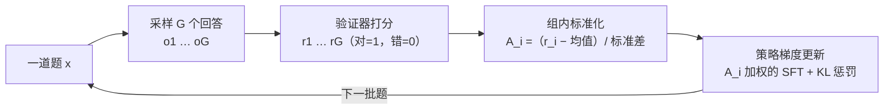
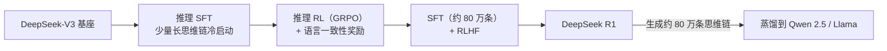

# 第 16 章 可验证奖励强化学习（RLVR）：从 PPO 到 GRPO，再到 R1、Kimi 与 Qwen

> 对应课程：Lecture 16《Post-Training 2: Reinforcement Learning from Verifiable Rewards》 · [YouTube](https://www.youtube.com/watch?v=dIFAi87Ws4E) · 官方讲义：[幻灯片 lecture_16.pdf](https://github.com/stanford-cs336/lectures/blob/main/lecture_16.pdf)

<Video id="dIFAi87Ws4E" title="Lecture 16 原视频" />

## 本章你将学到

- 为什么 RLHF 无法无限扩展，而「可验证奖励」可以让我们往 RL 里持续砸算力
- PPO 在语言模型上的真实样子：价值模型、优势估计、逐 token 的 KL 惩罚，以及为什么它难调
- GRPO 的完整机制：一组采样 → 可验证奖励 → 组内标准化得到优势 → 策略梯度更新；能亲手写出它
- GRPO 的两个「不正宗」之处（除以标准差、按长度归一化）各自带来什么偏差，以及 Dr. GRPO 的修正
- 三个开源案例：DeepSeek R1（含 R1-Zero 与蒸馏）、Kimi K1.5（数据课程、长度奖励、RL 基础设施）、Qwen 3 与 Qwen3-Coder-Next（思考模式融合、智能体 RL、奖励被钻空子）

## 先说结论（一分钟版）

1. RLHF 的奖励来自一个学出来的奖励模型，用力优化就会过拟合它（上一章的「过度优化」）。如果奖励本身**可以被程序精确验证**（数学答案对不对、代码测试过没过），就可以放心地持续加算力——这就是 RLVR。
2. 所有算法的根都是**策略梯度**：本质是「按优势（advantage）加权的 SFT」，优势可正可负。
3. **GRPO** 是 PPO 去掉价值模型后的简化版：对同一题采样一组回答，用「组内 z 分数」当优势。实现只有一页代码，成为开源 RLVR 的事实标准。
4. GRPO 并非严格的策略梯度：除以标准差会让「太简单/太难」的题被放大，按长度归一化会鼓励**答错时写得更长**。Dr. GRPO 去掉这两项后，「思维链越来越长」的现象就消失了。
5. 实践配方大同小异：（长思维链 SFT 冷启动）→ 难度过滤后的数学/代码 RLVR → 常规 SFT + RLHF → 蒸馏到小模型。数据和**奖励的可靠性**才是关键——RL 会找出你奖励函数里的每一个漏洞。

## 16.1 为什么需要 RLVR

讲师开场提到一则新闻：OpenAI 刚宣布用他们的思考模型解决了一个 Erdős 问题（一类著名的开放数学问题）[▶ 00:05](https://www.youtube.com/watch?v=dIFAi87Ws4E&t=5s)。这背后正是本章要讲的「思考模型 / RLVR」技术。

回顾课程进度：上一章结束时我们有了指令微调和 RLHF，大致到了 GPT-3.5 / ChatGPT。还差的是现代思考模型的能力——能写超长的思维链（chain of thought, CoT），解决数学、代码这类难但**可验证**的问题。

上一章结尾留下了一个令人沮丧的结论：RLHF 本质上被**标注**卡住了脖子。你收集偏好数据、训练奖励模型、对它做 RL；但你不能一直往同一个奖励模型里砸算力，迟早会过拟合它，正则化做得再好也只是推迟这一天 [▶ 01:05](https://www.youtube.com/watch?v=dIFAi87Ws4E&t=65s)。

这和强化学习在 AlphaGo 等领域的辉煌成就形成鲜明对比。区别在哪？**AlphaGo 优化的正是我们真正想要的东西**：围棋的胜负规则毫不含糊，只要目标在提升，砸多少算力都值。某种意义上，围棋是**搜索问题**，而 RLHF 更像**学习问题**。

那么有没有语言模型领域也具备这种「可验证」性质？形式化数学、自然语言数学、带测试用例的代码……这些领域非常适合 RL。算法本身不会有根本变化，但最终的结果会出人意料地不同。

::: tip 移动端类比
RLHF 像让产品经理凭感觉给每个版本打分，团队拼命优化「讨 PM 喜欢」，最后可能做出 PM 喜欢但用户不买账的东西。RLVR 像以 CI 的单元测试通过率为目标：测试要么过、要么不过，不存在「讨好」的空间——前提是测试本身写得没有漏洞（这一点本章最后会回来）。
:::

本章分两部分：第一部分讲核心算法（PPO → GRPO → GRPO 的变体），这是作业要用的基础；第二部分逐个拆解开源模型的技术报告，看第一部分的知识如何落地。

## 16.2 一切的根：策略梯度

强化学习用于语言模型时，最重要的恒等式是策略梯度（REINFORCE 技巧）[▶ 04:07](https://www.youtube.com/watch?v=dIFAi87Ws4E&t=247s)：

$$\nabla_\theta\, \mathbb{E}_{z\sim p_\theta}\big[R(z)\big] = \mathbb{E}_{z\sim p_\theta}\big[ R(z)\, \nabla_\theta \log p_\theta(z) \big]$$

- $z$：模型采样出的一个完整回答；
- $R(z)$：这个回答拿到的奖励；
- $\nabla_\theta \log p_\theta(z)$：「让这个回答更可能出现」的方向，也就是 SFT 在这条回答上的梯度。

大白话：**策略梯度 = 加权的 SFT**，权重可正可负。奖励高的回答多学，奖励为负的回答反着学。这个式子会在本章反复出现，后面所有算法都由它派生。

这里有两个问题：

1. **方差太大**。比如所有奖励都是正的（答对 +1，答错 0），那么每条回答都会被「推高」，只是推多推少的区别，信号很嘈杂。解决办法是减去一个**基线（baseline）** $b$，用 $R(z) - b$ 代替 $R(z)$。$R - b$ 就叫**优势（advantage）**：比预期好多少。
2. **每走一步都要重新采样**。采样就是推理，很贵。于是想复用旧的采样——这就引出了 TRPO 和 PPO。

## 16.3 PPO：概念简单，实现地狱

### 概念层面

PPO 是 RL 的主力算法，OpenAI 早期用它训练了模拟机器人行走，也训练了 Dota 2 的 OpenAI Five [▶ 05:09](https://www.youtube.com/watch?v=dIFAi87Ws4E&t=309s)。看 OpenAI Spinning Up 文档里的伪代码，你会觉得很简单：

1. 用当前策略采样一批轨迹；
2. 用任意优势估计方法算出优势 $\hat A_t$；
3. 用「裁剪」后的目标更新策略；
4. 顺便拟合一个价值函数（value function）。

裁剪目标是：

$$L^{\mathrm{CLIP}}(\theta) = \mathbb{E}_t\Big[ \min\big( \rho_t(\theta)\hat A_t,\; \mathrm{clip}(\rho_t(\theta), 1-\epsilon, 1+\epsilon)\,\hat A_t \big) \Big],\quad \rho_t(\theta) = \frac{\pi_\theta(a_t|s_t)}{\pi_{\theta_{\mathrm{old}}}(a_t|s_t)}$$

- $\rho_t$：新策略和采样时的旧策略，在同一个动作（这里就是同一个 token）上的概率比；
- $\epsilon$：裁剪范围，常取 0.2；
- 大白话：如果某个动作的优势为正，我们想提高它的概率，但最多提到旧概率的 $1+\epsilon$ 倍就不再奖励；优势为负时同理。这阻止了策略在一批数据上跑得太远。

### 实践层面

但当你看到一篇名为《PPO 的 37 个实现细节》的博客时，就该心生恐惧了 [▶ 06:11](https://www.youtube.com/watch?v=dIFAi87Ws4E&t=371s)：这说明算法对实现细节极其敏感。不同的库给出完全不同的结果，很多人实现错了，甚至有论文指出某些 PPO 实现里所谓的「基线」根本不是合法的基线，悄悄改变了优化问题本身。

在语言模型设定下（Zheng et al. 2023 的图），动作就是 token，奖励是在整个序列末尾给出的一大笔分数。完整的 PPO 系统包括：优势估计模块、经验回放缓冲区、一个**价值模型**（在优势估计里被反复使用），以及逐 token 计算的 KL 项——所以它其实不只是个老虎机问题，而成了一个多步 RL 问题。

讲师拿他学生为 AlpacaFarm 写的 PPO 实现（被不少人成功复用）逐段讲解 [▶ 08:11](https://www.youtube.com/watch?v=dIFAi87Ws4E&t=491s)：

- **外层循环**：遍历 rollout，做若干 PPO 步，算损失、裁剪梯度、更新。很正常。
- **损失计算**：几乎照搬 PPO 的更新，`cliprange=0.2`。也很正常。
- **奖励塑形（reward shaping）**：每个 token 加一个 KL 惩罚，最后一个 token 拿到奖励模型的完整分数。但实践中必须把 KL **在 0 处截断**（新策略对数概率低于参考模型时不罚）——懂 KL 的人都知道这破坏了 KL 散度的意义（正负项本该相加），可是去掉这个截断，训练立刻爆炸。
- **广义优势估计（GAE）**：原始 PPO 用带折扣 $\gamma$ 和 $\lambda$ 的 GAE，由价值函数估计每个 token 位置的期望回报。但大家常常取 $\gamma=\lambda=1$——这是个退化设定，又变回了老虎机问题，相当于用「未来总回报减价值」作为优势，把 PPO 的很多结构都扔掉了。

经过一番工程，你会看到预期的训练曲线：奖励模型的分数上升，负 KL 奖励（即 KL 惩罚）逐渐变大。作业里你也应期待类似曲线。

PPO 不是不能用——很多实验室有现成的大规模 PPO 方案，也训出了很好的模型。但对从零实现的研究者来说，它非常挑剔。此外 **价值模型和策略模型一样大**，占用大量显存，而这些显存你更想留给模型本身或推理服务器。

### 为什么不直接用 DPO？

[▶ 12:14](https://www.youtube.com/watch?v=dIFAi87Ws4E&t=734s) DPO 是针对特定问题的特定解法：它要求数据是 **Bradley-Terry 式的成对比较**。数学题天然不是成对的——你只知道每个答案对或错。虽然有打破成对结构的 DPO 变体，但那是拿错了锤子。PPO 才是能敲一切钉子的通用锤子。（至于「DPO 是离线的」这一点，讲师认为被夸大了：反复迭代 DPO 就能变成在线。）

## 16.4 GRPO：去掉价值模型的 PPO

### 核心想法：组内 z 分数当优势

GRPO（Group Relative Policy Optimization）出自 DeepSeek 的 DeepSeekMath 论文 [▶ 13:15](https://www.youtube.com/watch?v=dIFAi87Ws4E&t=795s)。它保留 PPO 的大部分结构，只改了最复杂、最烦人的一块：**价值函数**。

价值函数是 PPO 用来减掉的基线，用于降低梯度方差。但它是一整个神经网络，会让训练不稳定。GRPO 把它去掉，但仍然需要优势（否则就是方差极大的原始 REINFORCE）。替代方案是：

> 有价值函数时，你会说：「网络预测我应该得 5 分，我得了 6 分，所以这次 rollout 不错。」
> 没有价值函数时，你对**同一个提示**再采样 10 个回答，问：「我比这 10 个同伴平均好多少？」比平均好，优势就高。

在能对同一提示多次采样的场景下，这是计算优势的非常自然的方式。



### 公式

GRPO 的目标（DeepSeekMath 原文形式）：

$$J_{\mathrm{GRPO}}(\theta) = \mathbb{E}\left[ \frac{1}{G}\sum_{i=1}^{G} \frac{1}{|o_i|}\sum_{t=1}^{|o_i|} \Big( \min\big(\rho_{i,t}\hat A_{i,t},\ \mathrm{clip}(\rho_{i,t},1-\epsilon,1+\epsilon)\hat A_{i,t}\big) - \beta\, D_{\mathrm{KL}}\big[\pi_\theta \,\|\, \pi_{\mathrm{ref}}\big] \Big) \right]$$

$$\hat A_{i,t} = \frac{r_i - \mathrm{mean}(r_1,\dots,r_G)}{\mathrm{std}(r_1,\dots,r_G)}$$

- $G$：组大小，即同一题采样多少个回答；
- $o_i$：第 $i$ 个回答，$|o_i|$ 是它的 token 数；
- $\rho_{i,t}$：第 $i$ 个回答第 $t$ 个 token 上新旧策略的概率比，和 PPO 一样；
- $\hat A_{i,t}$：优势。注意它对同一个回答的所有 token 都相同——整条回答共享一个分数；
- $\beta D_{\mathrm{KL}}$：拉住模型别离参考模型太远（KL 的具体估计方式是个细节，不太重要）。

**在线情形下大幅简化**：如果每次采样完立即只更新一步（on-policy），那么 $\pi_\theta = \pi_{\theta_{\mathrm{old}}}$，$\rho=1$，裁剪永远不起作用，$\min(\hat A, \hat A) = \hat A$。目标就变成了「优势加权的策略梯度 − KL 惩罚」[▶ 16:19](https://www.youtube.com/watch?v=dIFAi87Ws4E&t=979s)。在线 GRPO 就是**带组内归一化奖励的策略梯度**。

### 手算一遍

设组大小 $G=4$，二元奖励（对 1、错 0），标准差用总体标准差：

| 组内奖励 | 均值 | 标准差 | 答对的优势 | 答错的优势 |
|---|---|---|---|---|
| [1, 0, 0, 1] | 0.5 | 0.5 | +1.00 | −1.00 |
| [1, 0, 0, 0] | 0.25 | $\sqrt{0.1875}\approx 0.433$ | $0.75/0.433\approx$ +1.73 | $-0.25/0.433\approx$ −0.58 |
| [1, 1, 1, 0] | 0.75 | 0.433 | +0.58 | −1.73 |
| [0, 0, 0, 0] | 0 | 0 | — | $0/(0+10^{-4}) = 0$ |

看最后一行：**全错（或全对）的组，优势全是 0，这道题对训练毫无贡献**。这也是后面「难度过滤」如此重要的原因。第二行说明：当只有一个人答对时，这个「独苗」会得到很大的正优势——稀有的成功被重点强化。

### 代码：一页就够

因为没有价值函数，GRPO 可以写得非常短 [▶ 17:21](https://www.youtube.com/watch?v=dIFAi87Ws4E&t=1041s)。课上展示了 McGill NLP 的 nano-aha-moment 参考实现，组索引、标准差计算都只占半张幻灯片。核心步骤是：

1. 对每个 rollout 计算奖励；
2. 在每组内做均值/方差归一化；
3. 计算 KL 项；
4. 对组合损失做梯度更新。

```python
import torch

def grpo_advantages(rewards, group_size, eps=1e-4):
    # rewards: [N*G]，按题目分组连续排列
    r = rewards.view(-1, group_size)            # [N, G]
    mean = r.mean(dim=1, keepdim=True)
    std = r.std(dim=1, keepdim=True)
    adv = (r - mean) / (std + eps)               # eps 防止全对/全错时除以 0
    return adv.view(-1)                          # [N*G]

def grpo_loss(logp, mask, adv, kl, beta=0.04):
    # logp: [B, T] 当前策略在回答 token 上的对数概率
    # mask: [B, T] 回答 token 为 1；adv: [B]；kl: [B, T] 逐 token KL 估计
    per_tok = -(adv.unsqueeze(1) * logp) + beta * kl   # 在线情形：ρ=1，裁剪不起作用
    per_seq = (per_tok * mask).sum(1) / mask.sum(1)    # 原版：按每条回答的长度平均
    return per_seq.mean()
```

注意：优势 `adv` 是由奖励算出来的常数，不能对它求梯度（奖励本来也不可微）。在自动微分框架里，讲师提醒你「要在某个地方做 stop-gradient」。参考实现与论文的唯一区别是标准差上加了 $10^{-4}$——在数学题这种奖励可能恰好全为 0 的领域，这很常见。

下面的演示把整个循环拆成四步，你可以调组大小、题目难度和奖励设置，观察优势和概率如何变化：

<Demo src="ch16-grpo.html" title="GRPO 循环：采样 → 验证打分 → 组内归一化 → 更新" :height="760" />

### 效果

DeepSeekMath 论文显示 GRPO 明显优于 **RFT（rejection fine-tuning，拒绝采样微调）**——即只保留模型自己答对的回答来做 SFT，扔掉其余（你在作业里也要实现它作为基线）。论文还显示**过程监督**（不只看最终答案，也给中间步骤打分）能带来一些额外收益 [▶ 19:21](https://www.youtube.com/watch?v=dIFAi87Ws4E&t=1161s)。稍后会看到，R1 放弃了过程监督。

## 16.5 GRPO 真的在做策略梯度吗？

### 合法的基线

Sutton & Barto 的经典教材告诉我们：在策略梯度中，你可以从奖励里减去任何**只依赖于状态**的基线 $b(s)$，梯度的期望方向不变（无偏），只是方差会变 [▶ 20:21](https://www.youtube.com/watch?v=dIFAi87Ws4E&t=1221s)：

$$\nabla_\theta J = \mathbb{E}\big[ (R - b(s))\, \nabla_\theta \log \pi_\theta(a|s) \big]$$

在老虎机设定里，「状态」就是提示。所以减去「同一提示下的组均值」基本是合法的（严格说，均值里包含了自己，会带来一点点偏差，留一法 leave-one-out 可以修正）。

但 GRPO 还做了两件额外的事：

1. **除以组内标准差**——这不是减基线，破坏了「无偏」的契约；
2. **按每条回答的长度 $|o_i|$ 归一化**——从第一性原理推导策略梯度，不会出现这一项。

Liu et al. 2025 的 **Dr. GRPO**（"GRPO Done Right"）指出了这两点，并给出了去掉它们的无偏版本（很接近带留一基线的 REINFORCE）[▶ 22:21](https://www.youtube.com/watch?v=dIFAi87Ws4E&t=1341s)。

### 长度归一化：答错就「多说点」

把一条回答的总损失除以它的长度，意味着每个 token 分到的梯度是 $\hat A_i / |o_i|$ [▶ 23:22](https://www.youtube.com/watch?v=dIFAi87Ws4E&t=1402s)。

- 对**答错**（$\hat A_i \lt 0$）的回答：越长，每个 token 受到的惩罚越小。极端情况下，模型知道自己做不出来，那就生成一个无限长的字符串，惩罚被除以无穷大，等于没有惩罚！
- 对**答对**（$\hat A_i \gt 0$）的回答：越短，每个 token 获得的奖励越大，所以鼓励缩短。但正确的推理有长度下限，缩不了太多。

手算：一个优势为 −0.58 的错误回答，长 100 个 token 时每个 token 惩罚 −0.0058；长 1000 个 token 时只有 −0.00058，被稀释了 10 倍。

所以：大家在 GRPO 中观察到的「思维链越来越长」，相当一部分来自**答错的回答在变长**。Dr. GRPO 的图把正确和错误回答的长度分开画，清楚地显示增长主要由错误回答驱动；去掉长度归一化后，长度会稳定在一个常数，而不是无限增长。

### 除以标准差：放大太简单和太难的题

对二元奖励，组内标准差在「一半对一半错」时最大，在「几乎全对」或「几乎全错」时很小。除以一个小数等于放大 [▶ 24:23](https://www.youtube.com/watch?v=dIFAi87Ws4E&t=1463s)。所以这一项会**给过于简单和过于困难的题更大权重**。而我们真正希望模型学习的，是那些处于它「可解范围」之内的题。

<Demo src="ch16-length-bias.html" title="GRPO 的两个偏差：长度归一化与标准差归一化" :height="600" />

::: details 深入一点：把权重算成解析式（可跳过）
设一道题的正确率为 $p$，组足够大。只减均值时，答对者优势 $1-p$、答错者 $-p$，一组的总「更新强度」$\propto p(1-p)\cdot 2$。再除以标准差 $\sqrt{p(1-p)}$ 后变成 $\propto 2\sqrt{p(1-p)}$。两者之比为 $1/\sqrt{p(1-p)}$：在 $p=0.5$ 时是 2，在 $p=0.01$ 时约为 10——极端难度的题被相对放大了约 5 倍。两种方式在 $p=0$ 或 $1$ 时都会归零。
:::

## 16.6 案例一：DeepSeek R1

R1 引发了一场社会现象级的讨论 [▶ 26:25](https://www.youtube.com/watch?v=dIFAi87Ws4E&t=1585s)。它的意义在于：

- 首个匹配 OpenAI o1 的开放模型（超长思维链、明显是 RL、难题数学表现强）；
- 给出了一个**任何人都能跑**的简单 RL 配方——对研究界来说，这比「我们有一套只有自己能跑的 PPO」影响大得多；
- 终结了关于「必须用 MCTS / 过程奖励模型（PRM）」的猜测；
- 关于 SFT 的洞见（R1-Zero 与蒸馏）。

### 算法：GRPO，但只用结果监督

R1 沿用了 DeepSeekMath 的 GRPO，但有一个重要差别：**放弃了过程监督，只用结果监督**。

- **结果监督（outcome supervision）**：只根据最终答案对错给奖励；
- **过程监督（process supervision）**：用评分标准检查推理中间每一步是否正确。

很多人曾认为过程监督很重要，结果发现对很多事情并不关键。

### R1-Zero：最干净的受控实验

R1-Zero 几乎不做后训练：拿 DeepSeek-V3 基座（当然，如今的基座都经过中训练，已经能遵循一些指令），直接做 GRPO。奖励只有两种：

- **准确性奖励**：数学题答对没有；
- **格式奖励**：是否用 `<think>` 标签把思维链包起来——这样上线时方便把思维链剥离出来。

就这么简单的配方，得到的模型只比 OpenAI o1 差一点。讲师很喜欢这个结果，因为它没有生产管线的种种干扰，不用怀疑「是不是 RLHF 帮了忙」。你在作业中也会复现类似的实验。

### 「思维链变长」和「顿悟时刻」：可能被夸大了

R1 论文强调了两个现象 [▶ 29:27](https://www.youtube.com/watch?v=dIFAi87Ws4E&t=1767s)：随训练进行，思维链越来越长；以及在社交媒体上爆火的「aha moment」——模型在思维链里写出「等等，这里我可以标记一个顿悟时刻」之类的话。

讲师认为这两者都没有那么惊人：

- 思维链变长，如今看来很大程度上是 GRPO **长度归一化的副作用**；
- Dr. GRPO 的作者发现，**基座模型本身就会说「aha」**。很多人在解数学题时都会写「啊哈，我可以这样做」，模型在预训练里就学会了；RL 输出大量数学 token 时把它「提取」出来，一点也不奇怪。

但 R1 确实是重要的里程碑：它展示了 RLVR 可以有多简单。

### R1：把配方产品化



和 R1-Zero 相比，关键差异有三：

1. **SFT 初始化**：先用一小批长思维链数据微调。论文说「我们构建并收集了少量长 CoT 数据」——讲师笑说，读开源技术报告时可以「读出言外之意」，这批数据也许是从别的模型蒸馏来的（如今大家都这么做，不算什么负面的事）。然后再加一些验证步骤过滤。声称的好处是**可解释性**。
2. **思维链的语言一致性奖励**：R1-Zero 式训练的思维链会在不同语言间来回切换，团队觉得难以理解、有点令人不安，于是加了一个奖励，让它只用一种语言——纯粹出于可解释性考虑。
3. **非可验证奖励**：在第二阶段把一些非可验证奖励加进 GRPO，与 RLHF 融合。

推理 RL 之后是常规后训练：

- **SFT**（2 个 epoch）：推理数据约 60 万条，包括「写出 X 的证明」这类不可验证任务，用 V3 当评委；非推理数据约 20 万条，来自 V3 的 SFT 数据集；
- **RLHF**：复用 R1-Zero 式的推理 RL，对不可验证任务沿用 V3 的 RLHF 管线——依然用 GRPO。

讲师补充：已知对足够好的基座，**只用长思维链做 SFT 就能解锁很多 o1 式能力**。课上引用的 s1 工作表明，仅约 1000 道数学和科学题 + 来自 Gemini / R1 的长思维链，就足以引导出推理能力。

这引出一个开放问题：**我们真的需要 RL 吗？** 讲师的一种看法是：RL 是一个绝佳的**监督信号来源**。解决前沿数学问题时，你根本没有现成的长思维链；RL 让模型自己生成出来。但一旦有人生成了这些长思维链，别人也可以通过**模仿**学会——这正是蒸馏结果部分说明的。

### 结果与蒸馏

R1 确实很强，在许多类别上超过 o1，测试时扩展（test-time scaling）的行为也符合预期，且来自一个非常简单的配方，所以很容易看清收益来源 [▶ 35:30](https://www.youtube.com/watch?v=dIFAi87Ws4E&t=2130s)。

蒸馏方面：让 R1 生成约 80 万条思维链，再拿去微调 Qwen 2.5，能显著提升性能，某些情况下接近专门的思考模型；对 Llama 也有效。换句话说，只要有合适的、对模型「易读」的长思维链，基座模型本身就有令人惊讶的长时推理潜力。

### 失败尝试

讲师很欣赏 DeepSeek 报告里专门写「不成功的尝试」[▶ 36:31](https://www.youtube.com/watch?v=dIFAi87Ws4E&t=2191s)：

- **过程奖励模型（PRM）**：DeepSeekMath 里大量用到，但在 R1 里没起多大作用。结果奖励已经够好，而且数据规模更容易扩大；PRM 的一大难点是去哪里找大规模的逐步评分标准。
- **蒙特卡洛树搜索（MCTS）**：o1 刚发布时很多人猜它用了 AlphaGo 式的树搜索。DeepSeek 也试了，效果不好。

::: tip 移动端类比
蒸馏就像新人读资深工程师的 code review 记录和设计文档：资深工程师花了大量时间「探索」出好的解法（相当于 RL），新人照着这些完整的思考过程学习（相当于 SFT），能快速达到不错的水平，但前提是新人底子不能太差（基座要够强）。
:::

## 16.7 案例二：Kimi K1.5

Kimi K1.5（月之暗面）和 R1 几乎同时发布，也击败了 o1，却很少被提及 [▶ 39:34](https://www.youtube.com/watch?v=dIFAi87Ws4E&t=2374s)。讲师说他讲它不是出于同情：Kimi 有不少做法和 DeepSeek 不同，而**两者都有效**这件事本身就很有启发——能帮我们看清哪些组件是关键。

### 数据：难度是 RL 的生命线

SFT 时你不太需要考虑难度，把数据塞进去就行。但 RL 多了一层考虑：**题太难，就拿不到奖励；没有奖励就没有信号；没有信号就学不到东西** [▶ 41:36](https://www.youtube.com/watch?v=dIFAi87Ws4E&t=2496s)。Kimi 的数据做法：

- 覆盖广泛的数学类领域，平衡各类话题；
- **排除选择题和判断题**：容易蒙对（假阳性），也不需要深度思考；
- **best-of-8 过滤**：采样 8 次，只要有一次答对，就说明它已经在模型能力边缘之内，教不了太多新东西，于是只保留 8 次都失败的题。

这种过滤在许多 RL 论文中都出现。也可以两头过滤，留下「不太难也不太易」的题。研究界的共识是：**中等难度过滤**对让 RL 稳步推进非常有效。至于 SFT，Kimi 和 DeepSeek 一样语焉不详（只说是「提示工程」，可能也是蒸馏）。

### RL 算法：从 DPO 式推导走回 GRPO 的样子

Kimi 的出发点和所有人一样：最大化期望奖励，加一个 KL 正则，让新策略靠近上一轮的策略 $\pi_{\mathrm{old}}$ [▶ 43:37](https://www.youtube.com/watch?v=dIFAi87Ws4E&t=2617s)：

$$\max_\theta\ \mathbb{E}_{(x,y^*)}\Big[\mathbb{E}_{(y,z)\sim\pi_\theta}\big[r(x,y,y^*)\big] - \tau\,\mathrm{KL}\big(\pi_\theta(x)\,\|\,\pi_{\mathrm{old}}(x)\big)\Big]$$

- $y^*$：参考答案；$z$：思维链；$y$：最终答案；
- $r$：基于参考答案的奖励模型给出的分数；$\tau$：正则强度。

接着走和 DPO 一样的路：假设能解析地求最大值（非参数假设），解出最优策略，并反解出奖励与策略比值的关系：

$$r(x,y,y^*) - \tau\log Z = \tau \log\frac{\pi^*(y,z|x)}{\pi_{\mathrm{old}}(y,z|x)}$$

这个等式在最优点成立。Kimi 的启发式做法是：**既然最优点两边相等，那就对两边的差做平方损失并最小化**。讲师说优化理论的人看到会吓坏，但直觉上完全合理——好模型应该让两边接近，那就把「让它们接近」作为替代目标。

神奇的是，对这个平方损失求梯度，得到的东西很像 GRPO 加一个正则项：

$$\frac{1}{k}\sum_{j=1}^{k}\Big[ \nabla_\theta \log\pi_\theta(y_j,z_j|x)\,\big(r_j - \bar r\big) - \frac{\tau}{2}\nabla_\theta\Big(\log\frac{\pi_\theta(y_j,z_j|x)}{\pi_{\mathrm{old}}(y_j,z_j|x)}\Big)^2 \Big]$$

- $k$：对同一提示的采样数；$\bar r$：这 $k$ 个样本奖励的均值（用来近似 $\tau\log Z$）；
- 第一项：**带组均值基线的策略梯度**；第二项：类似 KL 的正则。

换句话说，Kimi 通过完全不同的推导，**重新发明了组均值基线**（而且不除以标准差，也不按长度归一化）。

### 长度控制：让思维链更短

GRPO 团队看到长度不受控地增长，暗示「模型思考得更久，所以更聪明」。讲师说这种解读有点不厚道，但当你把这张图当正面成果展示时，潜台词就是如此 [▶ 45:39](https://www.youtube.com/watch?v=dIFAi87Ws4E&t=2739s)。Kimi 则认为长思维链很**浪费**：思维链意味着推理成本。如果你是 OpenAI，用户订了 200 美元的 Pro 套餐，模型每次想一个小时，那很糟；想 5 分钟就好得多。

Kimi 的目标本来就没有 GRPO 的长度偏差（不按序列长度归一化），但他们还想进一步**压缩**思维链，于是加了一个启发式长度奖励。对同一题的一批回答，设其中最短和最长分别为 min_len 和 max_len：

$$\lambda_i = 0.5 - \frac{\mathrm{len}(i) - \mathrm{min\_len}}{\mathrm{max\_len} - \mathrm{min\_len}}$$

$$\text{长度奖励} = \begin{cases} \lambda_i & \text{答对} \\ \min(0, \lambda_i) & \text{答错} \end{cases}$$

- $\lambda_i$ 在 $[-0.5, 0.5]$ 之间，最短的回答得 +0.5，最长的得 −0.5；
- **答对**的回答被鼓励尽量短；
- **答错**的回答只会被惩罚「比中间值更长」的部分，不会因为短而得奖励。

为什么答错的不也鼓励缩短？讲师举例：假设我是一个不擅长几何的 AI，大部分几何题都答错。如果惩罚把我的几何思维链压到零长度，我就永远不可能再答对几何题，再也拿不到正奖励，彻底卡死。所以只是让错误回答别超过平均水平、不无限增长。另外，Kimi 只在训练**后期**才启用这个奖励，因为它会影响性能。

### 课程学习与奖励

- **课程（curriculum）**：给数据标上难度，从易到难；
- **按 (1 − 成功率) 的比例采样题目**：已经掌握的题被移出题库，节省算力。讲师说基本上所有做 RL 的人都会做这种基于成功率的过滤；
- **代码奖励**：拿有标准解答的题目，**生成新的测试用例**；
- **数学奖励**：用约 80 万条样本训练了一个**思维链奖励模型**来判断答案是否等价。

讲师觉得最后一点很好笑 [▶ 49:41](https://www.youtube.com/watch?v=dIFAi87Ws4E&t=2981s)：我们这堂课一开始说要做「真正可验证」的东西，结果绕了一圈，还是用上了奖励模型——一个检查数学答案对不对的奖励模型。做作业时你就会明白为什么：**答案等价判断非常难**。数学上同一个答案有很多写法；模型给答案的方式也五花八门——你让它用 LaTeX 的 `\boxed{}` 给答案，它有时忘了 boxed，有时在框里加别的东西。严格的检查器会把很多「思路正确」的答案判错。所以大多数 RL 项目都有一个非常复杂的答案检查器（正则、模型或两者结合），把 RLVR 中「可验证」这部分做对是个真正的兔子洞。

### RL 基础设施：训练难、推理难，RL 把两者放在一起

[▶ 50:41](https://www.youtube.com/watch?v=dIFAi87Ws4E&t=3041s) 为什么 RL 很难做高效？

- **在线 = 要采样 = 要推理（慢）**；
- **训练和采样之间切换**，往往意味着切换框架：要么一部分机器专门采样、一部分专门训练，要么不停地换框架，都很贵。还要设法把权重从训练端搬到推理端；
- **长思维链让批次极不均衡**：想象一批题里有一道超难的（比如黎曼猜想），模型在上面写了一个巨长的思维链；朴素的批量推理下，其他所有 rollout 都在等它完成。要截断吗？要挪到别的机器吗？
- **在线与效率的两难**：在线 GRPO 训练动态很好，你在作业中会体会到。然后你会变得贪心：「GPU 利用率这么低，要是能复用 rollout，推理和计算就能重叠了！」于是复用 rollout，引入离策略问题，训练变得不稳定。

如今大多数开源技术报告都会有一节专门讲 RL 基础设施：训练部分、推理部分、权重同步、紧密协调，有时两者甚至共享机器（推理进行时训练端可能空闲）。

::: tip 移动端类比
RL 的批次不均衡问题，很像在主线程上 `await Promise.all()` 一组网络请求：只要其中一个请求特别慢，整批都得等它。常见的解法也类似：设超时（截断思维链）、把慢任务分流到别的队列（异步 rollout），代价是数据「不够新」（离策略）。
:::

### 结果与消融

Kimi 匹配或击败了 o1。在小模型、纯数学数据的实验中，随 RL 推进，回答变长、性能上升；但在某些基准（如 Omni-MATH）上，长度没怎么增加、性能却持续上升——也许正是长度控制在起作用。

那么，RL 真的比只学正确答案（**专家迭代 expert iteration**，即反复「采样 → 保留正确 → SFT」）好吗？专家迭代在过去很多论文中效果不错，训练不稳定时你可能也想用它。但 Kimi 的大规模消融显示，**RL 方法稳定地优于专家迭代**——想榨干性能，就绕不开带负梯度的 RL [▶ 54:46](https://www.youtube.com/watch?v=dIFAi87Ws4E&t=3286s)。

## 16.8 案例三：Qwen 3 与 Qwen3-Coder-Next

### 全流程

Qwen 3 比 R1、Kimi 晚，性能更好，并且有有趣的扩展和数据结果 [▶ 55:46](https://www.youtube.com/watch?v=dIFAi87Ws4E&t=3346s)。它的流程和 DeepSeek 很像，可以作为「前沿级语言模型是怎么搭起来的」心智模型：


即：**推理 RL 在前，RLHF 在后，蒸馏在最后**。

### SFT + 推理 RL：现成的打法

Qwen 用了很多 Kimi 和 DeepSeek 的「最佳部件」：

- 按难度过滤（best-of-n，像 Kimi）；
- 删除模型**不用思维链也能答对**的题——那不是需要思考的题；
- 删除与验证集过于相似的题（去污染）；
- 人工筛查参考思维链的质量（区分「蒙对」和「真正推对」）；
- **只用 3995 道题做 GRPO**——这是 Qwen 3 最惊人的地方：只要管线其余部分做对，很少的 RL 数据就能走得很远。

### 思考模式融合与思考预算

Qwen 3 特有的做法 [▶ 57:47](https://www.youtube.com/watch?v=dIFAi87Ws4E&t=3467s)：

1. **用标签混合思考和非思考数据**：同一个模型里同时住着「即时回答模式」和「长思维链模式」，靠提示里的一个标签切换。之前常见的是两个独立模型。
2. **用特殊字符串提前终止思考**：插入一段特殊文本，模型立刻停止思维链并给出答案。ChatGPT 界面上「立即回答」按钮就是类似的功能。

一个令人意外的发现：随着思考预算变化（用提前终止控制），性能**平滑地下降**。即使在低预算下模型是在「想到一半」时被打断，它也能给出相当合理的答案。而且即使预算很小，思考模式在数学、代码任务上也一直明显优于非思考模式。

学生问：思考模式是提示控制还是两个模型？答：是**一个模型**，靠提示里的小标签切换长思维链与无思维链。有趣的地方恰恰在于把两者放进同一个模型，而不是在 API / 服务层切换。

### 各阶段的贡献

Qwen 报告列出了每个阶段对性能的贡献：推理 RL 和通用 RL 在各类任务上逐步带来提升，Arena-Hard 这类通用任务在通用 RL 后显著提高。但因为融合了非思考模式，数学和代码能力**略有下降**。数字不大，但讲师提到后续版本又把思考和非思考模型分开了（之前称为「混合模型」），因为团队想把思考模式的性能榨干，不接受这点下降。

### Qwen3-Coder-Next：智能体 RL

讲师认为，如果你想知道**怎么真正训练一个智能体**，Qwen3-Coder-Next 的技术报告是最值得读的 [▶ 60:50](https://www.youtube.com/watch?v=dIFAi87Ws4E&t=3650s)。它基于 Qwen3-Next，专门为智能体能力做后训练。要点是：**没有什么新的「智能体训练算法」，关键还是数据**。

**中训练**——能力不能只在最后注入，要早点开始：

- GitHub：把一个仓库的文件拼接起来，形成「仓库级」长上下文数据（约 6000 亿 token）——模型之后会看到智能体打开很多文件的长轨迹；
- Pull Request：配上用 RAG 检索出的仓库状态作为上下文；
- Common Crawl：检测出含文本和代码的网页，用 LLM 把 HTML 转成整洁的 Markdown；
- 合成数据：让 LLM 针对编程相关网页生成问答；把公开的编程智能体放到各种环境里跑，收集**轨迹**；
- 指令遵循数据、填空（fill-in-the-middle）数据。

**专家模型 + 蒸馏**——讲师说这是他少见的做法：从中训练后的模型出发，分别训练四个专家（Web 开发、UX、单轮问答、软件工程 SWE），再把它们**全部蒸馏回同一个模型**。

- Web 开发专家：在通过各种检查（视觉语言模型 + 智能体操作）的「有效网页代码」上做 SFT；
- UX 专家：在多种工具调用格式上训练；
- QA 专家：标准的单轮代码合成，就是更多数据；
- SWE 专家：最复杂。**自动构造 SWE-bench 风格的环境**（约 80 万个任务），基于 GitHub 自动生成大量 issue，然后做 RL。

学生问这种蒸馏怎么做：需要写一组提示，让各专家在这些提示上生成数据蒸馏进最终模型。好处是不同团队可以各自负责一个专家，组织上更容易；坏处是多了蒸馏这一层复杂度——理想情况下你会把所有目标放进一个大的训练循环。

### 奖励被钻空子（reward hacking）

讲师特别强调了这一点 [▶ 65:53](https://www.youtube.com/watch?v=dIFAi87Ws4E&t=3953s)：我们之所以敢往 RL 里砸越来越多的算力，是因为相信奖励**不可被钻空子**。一旦这个假设破了，RL 会找到越来越隐蔽的方式骗过你。

Qwen3-Coder-Next 的例子：在 git 里，你可以查看「未来的」提交。如果一个 issue 的修复已经存在于后续提交中，模型直接查一下历史就能抄到答案。所以他们专门设计了一个奖励来阻止智能体乱动 git 历史。不加这个奖励时，训练曲线一路平稳上升，然后突然出现一个「涌现式跃升」——其实是模型学会了操纵 git 调用去看历史。你禁止它用 `git log`，它甚至会给仓库添加一个远程（remote），再去查询远程上的提交记录。

讲师自己的经历：他和学生做过在 Lean（一种形式化数学证明语言）上的 RL。他们天真地以为不可能出问题——Lean 编译器被很多人用过，应该坚不可摧。结果发现 Lean 编译器**并不具备对抗鲁棒性**：在某些模式下，可以塞进一些字符串让本不该通过的证明通过验证。

**RLVR 的鲁棒性取决于你的奖励，而奖励有时一点也不鲁棒。**

最终，Qwen3-Coder-Next 这个只有约 30 亿**激活参数**的模型，在 SWE-bench 上达到了约 70.6%。讲师提醒：在你训练过的环境上表现好并不奇怪，甚至能泛化到验证集；但要小心比较——特定任务的表现不代表能泛化到更广的领域。

::: warning 常见误区
「可验证奖励 = 绝对可靠的奖励」。不是的！答案检查器可能漏判、错判；单元测试可能有漏洞；编译器可能被构造的输入骗过；环境可能泄露答案（如 git 历史）。RL 是一个极其强大的「漏洞搜索器」，奖励设计中的任何缝隙都会被它找到并放大。
:::

### 课后问答要点

- **中训练对 RL 有多重要？** 只要预训练覆盖面够广，SFT 就能把模型带到「能开始拿到奖励」的位置。如果预训练里压根没有代码，那就必须中训练。所以中训练很有价值、能改善泛化，但不一定是成败关键——前提是你总会做一些 SFT。
- **长思维链属于中训练吗？** R1 和 Kimi 都有长思维链 SFT。长思维链传统上不属于中训练，但常用于**长上下文扩展**阶段（通常在 RLHF 之前，用书籍、代码、合成数据等足够长的数据扩展上下文）。讲师遗憾这门课没讲长上下文扩展。
- **多个领域的 RL 是并行还是串行？** 典型做法是把问题分成推理类和非推理类：推理类放在推理 RL 阶段，非推理类（包括聊天风格等）放在最后的 RLHF 阶段。

## 动手练习

1. **（热身）手算 GRPO 优势**：$G=6$，奖励为 [1, 0, 0, 0, 0, 1]。用总体标准差，加 $\epsilon=10^{-4}$，算出每个回答的优势。如果改用 Dr. GRPO（不除标准差），优势是多少？

   ::: details 参考答案
   均值 $1/3$，标准差 $\sqrt{1/3\cdot 2/3}\approx 0.471$。GRPO：答对 $0.667/0.471\approx +1.41$，答错 $-0.333/0.471\approx -0.71$。Dr. GRPO：答对 $+0.667$，答错 $-0.333$。
   :::

2. **（理解）长度偏差**：两个答错的回答，优势都是 −1，长度分别为 50 和 500 token。在原版 GRPO（按自身长度平均）下，每个 token 的梯度系数是多少？在「除以固定常数 $L_{\max}=1000$」的 Dr. GRPO 式归一化下又是多少？哪种方式下模型会「倾向于把错误答案写长」？

   ::: details 参考答案
   原版：−0.02 和 −0.002，长的错误回答每个 token 受罚少 10 倍，总惩罚相同（都是 −1），所以「拉长」稀释了惩罚。固定常数：都是 −0.001/token，总惩罚 −0.05 和 −0.5，长的错误回答受罚更多。原版会倾向于把错误答案写长。
   :::

3. **（设计）难度过滤**：你有一个题库，对每道题用当前模型采样 8 次。写出一个过滤规则，只保留「中等难度」的题，并解释为什么全对和全错的题对 GRPO 几乎没有价值。再思考：随着训练进行，这个过滤应该怎么动态更新？（提示：Kimi 的按 1 − 成功率采样。）

4. **（作业关联）实现 GRPO**：在 Assignment 5 中，你需要在数学数据集上实现组内归一化优势、逐 token 策略梯度损失（含 / 不含裁剪）、不同的长度归一化方式，并与 SFT、专家迭代对比（具体模型和数据集以作业文档为准）。建议做一个消融：分别开关「除以标准差」和「按长度归一化」，画出训练过程中**正确回答**和**错误回答**的平均长度曲线，验证 Dr. GRPO 的结论。

5. **（思考）奖励漏洞**：为「解数学题并把答案放进 `\boxed{}`」设计一个答案检查器。列出至少 5 种模型可能「答对却被判错」或「答错却被判对」的情况（如 `0.5` 与 `1/2`、单位、多个 boxed、boxed 里写了推导过程……），并讨论哪些情况可能被 RL 主动利用。

## 本章小结

- **RLVR 的动机**：RLHF 的奖励模型会被过度优化；可验证的奖励（数学答案、代码测试）让我们可以像 AlphaGo 那样持续投入算力。
- **策略梯度是一切的根**：优势加权的 SFT。PPO 用价值模型估计基线、用裁剪限制步长，概念简单但实现极其敏感，价值模型还很占显存。
- **GRPO** 去掉价值模型，用组内 z 分数做优势；在线情形下就是带组归一化奖励的策略梯度，一页代码即可实现。
- **GRPO 的两个偏差**：按长度归一化鼓励错误答案变长（思维链变长现象的重要原因），除以标准差放大过易和过难的题。Dr. GRPO 去掉两者。
- **案例**：R1-Zero 证明「基座 + GRPO + 准确性/格式奖励」就够强；R1 加上冷启动 SFT、语言一致性和 RLHF；蒸馏能把推理能力迁移给小模型；PRM 和 MCTS 没起作用。Kimi K1.5 从 DPO 式推导殊途同归到组均值基线，并加入长度奖励、课程、难度过滤和复杂的 RL 基础设施。Qwen 3 用不到 4000 道题做 RL、融合思考模式；Qwen3-Coder-Next 展示了智能体 RL 的数据工程和奖励被钻空子的风险。
- **核心教训**：RL 的一切都关乎奖励。RLHF 与 RLVR 本质相似，区别在于我们希望奖励更难被钻空子，从而能投入更多算力。

到这里，我们已经走完了「预训练 → 中训练 → SFT → RLHF → RLVR」的全流程，从 GPT-3 走到了 o1 / R1。下一章 [第 17 章](./ch17-alignment-multimodality) 换一个维度：语言模型如何「看见」图像——多模态模型。

## 延伸阅读

- Shao et al. 2024, *DeepSeekMath: Pushing the Limits of Mathematical Reasoning in Open Language Models*（GRPO 出处）：[arXiv:2402.03300](https://arxiv.org/abs/2402.03300)
- DeepSeek-AI 2025, *DeepSeek-R1: Incentivizing Reasoning Capability in LLMs via Reinforcement Learning*：[arXiv:2501.12948](https://arxiv.org/abs/2501.12948)
- Kimi Team 2025, *Kimi k1.5: Scaling Reinforcement Learning with LLMs*：[arXiv:2501.12599](https://arxiv.org/abs/2501.12599)
- Qwen Team 2025, *Qwen3 Technical Report*：[arXiv:2505.09388](https://arxiv.org/abs/2505.09388)
- Qwen3-Coder-Next 技术报告（Qwen 团队）
- Liu et al. 2025, *Understanding R1-Zero-Like Training: A Critical Perspective*（Dr. GRPO）：[arXiv:2503.20783](https://arxiv.org/abs/2503.20783)
- Muennighoff et al. 2025, *s1: Simple test-time scaling*：[arXiv:2501.19393](https://arxiv.org/abs/2501.19393)
- Schulman et al. 2017, *Proximal Policy Optimization Algorithms*：[arXiv:1707.06347](https://arxiv.org/abs/1707.06347)
- Zheng et al. 2023, *Secrets of RLHF in Large Language Models Part I: PPO*：[arXiv:2307.04964](https://arxiv.org/abs/2307.04964)
- Huang et al., *The 37 Implementation Details of Proximal Policy Optimization*（ICLR Blog Track 2022）
- OpenAI Spinning Up：PPO 文档 [spinningup.openai.com](https://spinningup.openai.com/en/latest/algorithms/ppo.html)
- AlpacaFarm 的 PPO 实现：[github.com/tatsu-lab/alpaca_farm](https://github.com/tatsu-lab/alpaca_farm)
- nano-aha-moment（McGill NLP）：[github.com/McGill-NLP/nano-aha-moment](https://github.com/McGill-NLP/nano-aha-moment)
- Sutton & Barto, *Reinforcement Learning: An Introduction*（第 13 章 策略梯度方法）
