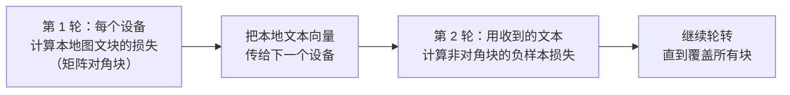
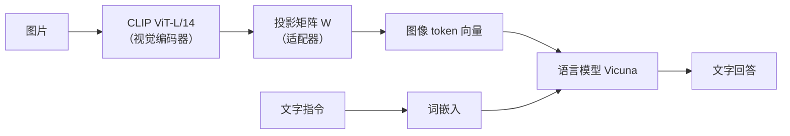
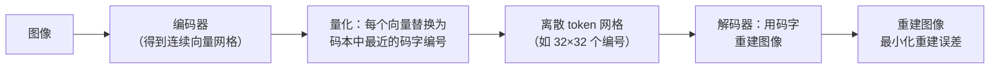

# 第 17 章 多模态模型：让语言模型看见图像

> 对应课程：Lecture 17《Multimodal Models》（课程表标题为 Alignment - Multimodality） · [YouTube](https://www.youtube.com/watch?v=26FtD08ZpOU) · 官方讲义：[可执行讲义 lecture_17](https://cs336.stanford.edu/lectures/?trace=lecture_17)

<Video id="26FtD08ZpOU" title="Lecture 17 原视频" />

## 本章你将学到

- 为什么多模态的核心难题是「把非文本数据变成 token」，以及它和第 1 章文本分词的类比
- CLIP 如何用 4 亿对「图片-文字」做对比学习，得到能理解图像语义的编码器；SigLIP 怎样把它改成更易并行的二分类
- 视觉 Transformer（ViT）如何把图片切成 patch 当作 token
- 视觉语言模型（VLM）的标准模板：视觉编码器 + 适配器（投影层）+ 语言模型，以 LLaVA 和 Qwen-VL 系列为例
- 处理任意分辨率、多图和视频的工程技巧：AnyRes、动态分辨率、M-RoPE、时间戳 token、按长度归一化的损失
- Chameleon 的「一切皆离散 token」路线：VQ-VAE、训练不稳定，以及为什么它没有成为主流

## 先说结论（一分钟版）

1. Transformer 效果太好了，所以我们得用它；而 Transformer 只「说」token。于是多模态的根本问题就是：**怎么把图片、音频、视频变成 token**——就像第 1 章用 BPE 把文本变成 token 一样，只是难得多。
2. **CLIP**（2021）用对比学习让图片向量和对应文字向量靠近，得到捕捉「语义」的图像编码器；**SigLIP** 把多分类 softmax 换成逐对的 sigmoid 二分类，更省、更好并行。五年过去，这类编码器仍是主流的「看图」方式。
3. **VLM 的标准模板**：用 ViT 把图像切成 patch 编码成向量 → 一个小的适配器把它们映射到语言模型的词嵌入空间 → 和文字 token 拼在一起送进语言模型。语言模型占了绝大部分参数，视觉编码器通常不到 10 亿参数。
4. 大部分工作在**数据和工程细节**上：保留高分辨率（OCR 需要）、平衡单图/多图/视频的 token 数、处理二维/三维位置、超长上下文。
5. **Chameleon** 把图像也离散化成 token，用一个纯自回归模型统一理解和生成，很优雅，但离散化丢信息、混合训练不稳定。目前更可能的前沿做法是：连续编码器负责理解 + 扩散模型负责生成（讲师的推测）。

## 17.1 从「文本到文本」到「任意到任意」

到目前为止，这门课只讲语言模型。语言模型已经相当通用了：它能把任何文本映射成任何文本——各种语言、代码、诗歌，甚至 DNA 序列 [▶ 00:05](https://www.youtube.com/watch?v=26FtD08ZpOU&t=5s)。但世界是多模态的：文字、图像、音频、视频。

北极星目标是所谓的**全模态模型（omni model）**：

- **输入**任意模态组合（理解）：比如给一张图片和一段视频，问一个关于它们的问题；
- **输出**任意模态组合（生成）：比如生成图片，或把音频转成图片。

本章不会搭一个完整的全模态模型，但会给你能「吃进」图像的关键组件——这也是本章的重点。

### 一切都得变成 token

讲师坦言这个动机有点「怪」，但却是现实 [▶ 01:05](https://www.youtube.com/watch?v=26FtD08ZpOU&t=65s)：

- Transformer 效果非常好。尽管很多人努力尝试别的架构，在各种模态上，大规模时它仍是最好的选择。所以**我们得用它**。
- Transformer 「说」的是 token。这里把 token 的概念扩展一下：不只是文本里的**离散 token**（词表里的一个编号），也可以是**连续 token**（直接就是一个向量，可以理解为 token 的嵌入）。
- 关键是：**一个 token 应该代表某种有语义的信息单元**。文本里的 token 是子词，多少有点意义；而单个像素本身毫无意义。
- 所以必须把一切都转换成离散或连续的 token。

我们在第 1 章就为文本做过这件事：BPE 分词器。它还不错，虽然大家都希望有更好的分词器，或者干脆不需要分词器。但对非文本模态，我们得花更多心思：**图像的「BPE」是什么？**

::: tip 移动端类比
这很像跨平台开发里的「序列化协议」：Kotlin 对象和 Swift 对象要互相通信，必须先统一成 JSON 或 Protobuf 这种双方都懂的格式。Transformer 只懂 token 序列，所以图像、音频都得先「序列化」成 token。选什么序列化格式（像素？patch？离散码本？），决定了能保留多少信息、序列有多长。
:::

两个问题：

1. 如何**输入**非文本数据（例如理解图像）？——本章主要讲这个。
2. 如何**输出**非文本数据（例如生成音频）？——本章末尾通过 Chameleon 略谈。

## 17.2 CLIP：用网上的「图片 + 说明文字」学会看图

### 时代背景

回到 2021 年 [▶ 04:10](https://www.youtube.com/watch?v=26FtD08ZpOU&t=250s)。语言领域已经进入 GPT-2、GPT-3 的「基础模型」时代：从网上抓海量文本，虽然很嘈杂，但只要模型够大就能学出有用的东西。而计算机视觉还主要依赖 ImageNet 这类**人工标注**的数据集，训练 ResNet 等模型，再加上各种数据增强。

OpenAI 的研究者问：**能不能利用网上大量的「图片 + 文字说明」？** 于是诞生了 CLIP（Contrastive Language-Image Pre-training，对比式语言-图像预训练）。

### 方法：让配对的图文互相「认出」对方

设想一个批次里有 $N$ 对（图片，文字），比如 $N = 32768$ [▶ 05:10](https://www.youtube.com/watch?v=26FtD08ZpOU&t=310s)：

1. 用**图像编码器**把每张图编码成向量 $I_1, \dots, I_N$；
2. 用**文本编码器**把每段文字编码成向量 $T_1, \dots, T_N$；
3. 目标：对图片 $I_1$，它与配对文字 $T_1$ 的点积要远大于它与其他所有文字的点积；
4. 反过来，对文字 $T_1$，它与 $I_1$ 的点积要远大于它与其他所有图片的点积。

把所有点积排成一个 $N\times N$ 矩阵：**对角线是正确配对，非对角线都是「错配」**。CLIP 的损失相当于做 $2N$ 个 softmax 多分类问题：每一行（每张图从 $N$ 段文字里挑出自己的那段）和每一列（每段文字从 $N$ 张图里挑出自己的那张）。

$$\mathcal{L}_{\mathrm{CLIP}} = -\frac{1}{2N}\sum_{i=1}^{N}\left[ \log\frac{e^{t\, I_i\cdot T_i}}{\sum_{j} e^{t\, I_i\cdot T_j}} + \log\frac{e^{t\, I_i\cdot T_i}}{\sum_{j} e^{t\, I_j\cdot T_i}} \right]$$

- $I_i, T_i$：归一化（长度为 1）后的图像和文本向量，点积就是余弦相似度，范围 $[-1, 1]$；
- $t$：温度参数（可学习），把相似度放大，让 softmax 更「尖」；
- 第一项：第 $i$ 张图在所有文字中选对的对数概率；第二项：第 $i$ 段文字在所有图中选对的对数概率。

用 PyTorch 写出来（对应论文里的伪代码）：

```python
import torch
import torch.nn.functional as F

def clip_loss(img_emb, txt_emb, t):
    # img_emb, txt_emb: [N, d]，同一行是一对配对的图和文
    I = F.normalize(img_emb, dim=-1)        # 归一化到单位长度
    T = F.normalize(txt_emb, dim=-1)
    logits = t * I @ T.T                     # [N, N] 相似度矩阵
    labels = torch.arange(len(I))            # 正确答案都在对角线上
    loss_i = F.cross_entropy(logits, labels)     # 每张图选文字（按行）
    loss_t = F.cross_entropy(logits.T, labels)   # 每段文字选图（按列）
    return (loss_i + loss_t) / 2
```

<Demo src="ch17-clip-matrix.html" title="CLIP 与 SigLIP：图文相似度矩阵的对比学习" :height="640" />

### 数据

论文对数据描述不多 [▶ 08:15](https://www.youtube.com/watch?v=26FtD08ZpOU&t=495s)：大致是用约 50 万个查询词去网上搜索，每个查询收集最多约 2 万对图文，最终得到 **4 亿对**。数据集没有公开。

后来的 **OpenCLIP** 复现并扩展了 CLIP，使用公开的 **LAION-5B** 数据集（50 亿张带文字描述的图片）。有趣的是，LAION 在过滤数据时用的正是 CLIP——有点「自举」的味道，但至少这是一个你能指出训练数据和代码的模型。

有学生问：如果一张狗的图片，别的说明文字也提到了狗，会不会让模型困惑？讲师说：这个过程本来就很嘈杂。偶尔有另一只狗没关系，平均来说，批次里的其他样本大多是苹果、猫之类。更大的噪声来源是：网页上图片旁的文字或 alt 文本**并不会逐字描述图片内容**——一张狗的照片，配文往往不会说「一只狗」。这么嘈杂的数据居然能行，有点出人意料，当然前提是做了大量数据过滤。

另一个学生问：为什么要用图文对，而不是只用图片（比如 SimCLR 那样，对同一张图做裁剪、扰动、旋转，要求它们的嵌入相近）？讲师答：数据增强能学到低层细节，但你没法通过数据增强从一种狗「变」到另一种狗。**文字提供了更高层的语义**。

### 数据预处理：缩放 + 中心裁剪

网上的图片分辨率千奇百怪，有又宽又扁的，也有又窄又长的 [▶ 09:17](https://www.youtube.com/watch?v=26FtD08ZpOU&t=557s)。而神经网络不喜欢动态的东西，偏爱固定尺寸。CLIP 的处理方法很启发式：

1. 用双三次插值（bicubic）缩放，使**短边**为 336 像素（也可以是 224）；
2. **中心裁剪**成 336×336 的正方形，切掉两边。

这纯粹是为了方便。CLIP 作者当时脑子里想的是 ImageNet 分类，物体通常在画面中央，切掉一点背景无伤大雅。后面我们会看到更好的做法。

### 视觉编码器：ViT 把图片切成「词」

CLIP 实验了 ResNet 和刚出现不久的**视觉 Transformer（Vision Transformer, ViT）**，发现 ViT 最好。所以人们说 CLIP 时，通常指 ViT 版本 [▶ 12:23](https://www.youtube.com/watch?v=26FtD08ZpOU&t=743s)。

ViT 的做法：

1. 把图片切成不重叠的小方块，叫 **patch**（原始 ViT 用 16×16 像素，CLIP 用 14×14）；
2. 每个 patch 展平成一个向量，经过线性层映射到模型维度——**每个 patch 就是这个 Transformer 的一个 token**；
3. 加上位置嵌入，和语言模型一样；
4. 送进标准的 Transformer 编码器，输出一串向量。

要得到整张图的单个向量，可以把输出向量取平均；CLIP 发现**注意力池化（attention pooling）**更好：先用所有激活的全局平均作为 query，再对每个位置的 key / value 做一次注意力，得到一个「更有见识」的加权平均。

**手算一遍 token 数**：CLIP 最好的模型叫 **ViT-L/14@336px**——L 是 Large（讲师记得大约 24 层），14 是 patch 边长，336 是训练分辨率（其实先在较低分辨率训练，最后阶段换成高分辨率，以节省时间）。

- 每边 patch 数：$336 / 14 = 24$；
- patch 总数：$24 \times 24 = 576$ 个 token；
- 每个 patch 的原始数值：$14 \times 14 \times 3$（RGB 三通道）$= 588$ 个数。

所以一张 336×336 的图变成了 576 个 token，每个 token 来自 588 个像素值。对比一下：一句 20 个汉字的话大概只有十几个 token。**图片是很「费 token」的**。

<Demo src="ch17-vit-patches.html" title="图像如何变成 token：ViT 切 patch、中心裁剪、AnyRes 与动态分辨率" :height="760" />

有学生问：文本位置是一维的，图像是二维的，位置嵌入是不是该更复杂？讲师说 CLIP 论文里试过二维版本，发现和一维（就是把 patch 按行展开编号 0, 1, 2, …）差别不大。但要记住这是在**分类**任务上的结论；对其他任务也许不同，后面会看到考虑空间结构的更高级位置编码。

### 文本编码器

文本编码器是标准的 GPT-2 式 Transformer（同一个团队做的），约 6300 万参数、12 层。为了从一串 token 里得到一个向量，在开头加 `[BOS]`、末尾加 `[EOS]`，取 `[EOS]` 在最高层的激活作为整个句子的表示。

### 惊艳的结果：零样本分类

CLIP 在 2021 年让人兴奋的结果是 [▶ 16:29](https://www.youtube.com/watch?v=26FtD08ZpOU&t=989s)：在 ImageNet 上，**零样本（zero-shot）的 CLIP 超过了在 128 万张 ImageNet 标注图片上训练的 ResNet-50**。那 128 万张图片背后是 Amazon Mechanical Turk 工人大量的标注时间；而 CLIP 用的是更「天然」的网页数据（当然，那也是无数网民的劳动）。

零样本分类的做法：把每个类别名写成文字（例如「一张狗的照片」），用文本编码器编码；把待分类图片用图像编码器编码；看图片向量与哪个类别的文字向量点积最大。不需要任何 ImageNet 训练数据。

### 一个消融：为什么不直接「看图说话」？

CLIP 还试了另一种目标：**直接从图片预测文字**——要么预测词袋（bag of words），要么用语言模型逐字生成说明文字 [▶ 19:33](https://www.youtube.com/watch?v=26FtD08ZpOU&t=1173s)。结果：用更强的语言模型去预测，反而**更差**（至少计算效率更低）；CLIP 式的排序（对比）目标效率最高。

这说明：对于学到图像的大致表示（至少对 ImageNet 分类而言），**精确建模说明文字的每个 token 并不重要**。讲师说本章结尾会回到这一点。

### CLIP 小结

- 编码捕捉的是（嘈杂的）文字所给出的**语义**；
- 设计决策基于图像分类，所以不太精细（细粒度信息不足）；
- 技术上：需要**超大批次**（约 3 万），批次为 1 或 10 时完全不行；而且 softmax 要在**整个批次**上计算，不像语言模型训练那样各样本互不相干、可以干净地分解并行。

## 17.3 SigLIP：把多分类换成二分类

Google 的 **SigLIP**（Sigmoid Loss for Language Image Pre-training）可以看作 CLIP 的改进版，正是为了解决上面最后一点 [▶ 22:37](https://www.youtube.com/watch?v=26FtD08ZpOU&t=1357s)。

- **CLIP**：多分类。对每对配对的图文，在「它 vs 批次里所有其他图（或文）」之间做 softmax。
- **SigLIP**：二分类。对**任意一对**（图，文），只问：它们配对吗？对角线是正样本，非对角线是负样本，就这样。

$$\mathcal{L}_{\mathrm{SigLIP}} = -\frac{1}{N}\sum_{i=1}^{N}\sum_{j=1}^{N} \log \sigma\big( z_{ij}\,( t\, I_i\cdot T_j + b ) \big),\qquad z_{ij} = \begin{cases} 1 & i=j \\ -1 & i\ne j\end{cases}$$

- $\sigma$ 是 sigmoid；$z_{ij}$ 是标签：配对为 +1，不配对为 −1；
- $t$ 是温度，$b$ 是偏置（都可学习）。由于负样本远多于正样本，$b$ 初始化为一个负数，让模型一开始倾向于「不配对」；
- 大白话：矩阵里每一格都是一个独立的「是/否」判断题，互不依赖。

```python
def siglip_loss(img_emb, txt_emb, t, b):
    I = F.normalize(img_emb, dim=-1)
    T = F.normalize(txt_emb, dim=-1)
    logits = t * I @ T.T + b                       # [N, N]
    n = len(I)
    labels = 2 * torch.eye(n) - 1                  # 对角线 +1，其余 -1
    return -F.logsigmoid(labels * logits).sum() / n
```

有学生问：这需要精心设计负样本采样吗？讲师说：对比学习方法通常要平衡正负样本，或者挑「难负样本」，但至少在最初的论文里，SigLIP 就直接用这个矩阵，很简单。

### 数据与效率

- 数据：**WebLI**，约十亿量级的图文对，从网上抓取；对含文字的图片做 OCR，作为另一种构造图文对的方式；只保留质量最高的 10%；支持 100 种语言。
- 效率：CLIP 用 256 块 TPUv3 训练 10 天；SigLIP 用 32 块 TPUv4 训练 5 天。讲师特别指出：TPUv4 每秒浮点运算数其实并不比 v3 高（单芯片甚至更慢），它的优势在于一个 pod 能放更多芯片、互连更好。（注：按 Google 公布的规格，TPUv4 单芯片 BF16 峰值约 275 TFLOP/s，明显高于 TPUv3 的约 123 TFLOP/s，讲师这里可能记反了；但「32 块芯片 5 天 vs 256 块芯片 10 天」的芯片·天数差距约 16 倍，远超单芯片算力差，所以 SigLIP 确实更高效。）另外，CLIP 论文里报告的硬件其实是 V100 GPU（ViT-L/14 用 256 块 V100 训了 12 天），“256 块 TPUv3”是讲义的说法。所以 SigLIP 是真正快得多（当然 CLIP 当年可能也没认真优化吞吐）。

**怎么并行？** 回想第 7 章的数据并行（DDP）：每个设备存一部分图文对。但这里样本之间有交互（每张图要和所有文字比较），不像语言模型训练那样完全可分解。SigLIP 的做法 [▶ 26:41](https://www.youtube.com/watch?v=26FtD08ZpOU&t=1601s)：



因为 sigmoid 损失每一格独立，可以一块一块地算再加起来；而 CLIP 的 softmax 需要整行整列的归一化，做不到这么干净。

::: tip 移动端类比
CLIP 像一个「排行榜」：要知道你排第几，必须拿到所有人的分数（全局 softmax）。SigLIP 像「及格线」：每个人只需和标准比，各算各的，天然适合分片并行处理——就像把一个大列表拆成分页，各页独立渲染。
:::

**批次大小与损失解耦**：CLIP 的损失和批次大小绑在一起，换批次大小就等于换了损失函数；SigLIP 的损失在期望上与批次大小无关，小批次只是方差更大。所以 SigLIP 在批次小于 16K 时明显优于 CLIP。他们试到了 100 万的批次，但发现没什么帮助，32K 就够了——回想第 9 章的**临界批次大小（critical batch size）**，32K 大致就是这里的临界值。

## 17.4 VLM 的标准模板：LLaVA

现在我们有了 CLIP / SigLIP 这样的图像编码器：输入一张固定尺寸（比如 336×336）的图，输出带有语义的向量。接下来搭**视觉语言模型（Vision-Language Model, VLM）**。讲师讲两个家族：LLaVA 和 Qwen-VL，大的模板很像，细节不同 [▶ 28:42](https://www.youtube.com/watch?v=26FtD08ZpOU&t=1722s)。

基本思路：**把图像嵌入「注射」进一个现成的语言模型**。这更像中训练或后训练：拿一个现成的图像编码器、一个现成的 LLM，把它们缝合起来，而不是从零训练。

### LLaVA（2023）

GPT-4 当时已经能做视觉推理，LLaVA（Large Language and Vision Assistant）作为一个开放模型，让大家看到了「引擎盖下」是什么样 [▶ 29:44](https://www.youtube.com/watch?v=26FtD08ZpOU&t=1784s)。

**组件**：

- 视觉编码器：CLIP ViT-L/14；
- 文本解码器：Vicuna——在 ShareGPT 对话（用户分享到网上的 ChatGPT 对话）上微调的 LLaMA（参见 [第 15 章](./ch15-mid-post-training) 的 SFT 数据演化）。

**数据：用 GPT-4 合成**。MS COCO 是一个人工标注的数据集，Mechanical Turk 工人为图片标了边界框和描述。LLaVA 把**人写的描述和检测到的物体**（文字形式）喂给 GPT-4，让它生成关于这张图的问题、对话、详细描述、复杂推理。注意 GPT-4 在这里并没有「看」图，只看了文字标注。然后把生成的文字和原图配对，共约 **15.8 万条**样本。

**模型**：



图片经过 CLIP 得到向量，但这些向量和文字的词嵌入**不在同一个空间**里。所以乘以一个矩阵 $W$，把它们变成和词嵌入同一空间的向量。文字照常经过词嵌入表。然后整串向量（图像向量 + 文字向量）送进标准 Transformer。某种意义上，我们把图像「翻译」成了一串伪文字 token，好利用预训练好的语言模型。（Flamingo、Q-Former 等更复杂的连接方式也存在，LLaVA 用了最简单的线性投影。）

**两阶段训练**：

1. **对齐阶段**：冻结视觉编码器和语言模型，**只训练 $W$**。如果 $W$ 是随机的，映射出来的向量根本不像任何自然语言 token 的嵌入；这一步的目标是让它们「看起来像」词嵌入。
2. **微调阶段**：仍冻结视觉编码器，同时训练 $W$ 和语言模型，在「图片 + 文字 → 文字」的数据上微调。

论文里有个有趣的例子：输入一张图，用户问「这张图有什么不寻常的？」模型能指出：一般人不会在一辆小货车的车尾熨衣服。论文还强调，即使用户的提示没有暗示「不寻常」，模型也会主动提到——GPT-4 能做到这点，但当时其他开源模型做不到。

有学生问：对齐阶段，适配器怎么「知道」语言模型的语言？讲师答：语言模型必须是预训练好的，否则对齐毫无意义。语言模型冻结，只训练适配器去连接**给定的**视觉编码器和**给定的**语言模型；训练就是选一个 token 预算然后跑，没有什么自适应的停止阈值。

## 17.5 LLaVA OneVision：多图、视频与任意分辨率

LLaVA 之后有 LLaVA 1.5、LLaVA-NeXT 等一系列工作，讲师用 2024 年的 **LLaVA OneVision** 概括它们的创新 [▶ 35:53](https://www.youtube.com/watch?v=26FtD08ZpOU&t=2153s)。配方相同，但目标更大：要处理**多张图片**和**视频**（视频就是按帧采样得到的一串图片）。

升级的部件：

- 视觉编码器：**SigLIP**（使用最后一层 Transformer 之前和之后的网格特征）；
- 文本解码器：**Qwen-2 72B**（当时可能最好的开源语言模型）；
- 投影器 / 适配器：**两层 MLP**，取代线性投影。

就像一个系统，只是把零件逐个升级。

### AnyRes：不缩放，切块

LLaVA OneVision 想做 **OCR**（光学字符识别，即读懂图里的文字）。OCR 需要保留非常精细的信息，否则字母 j 看起来就像 i。而 CLIP 把图缩放并裁剪到 336×336——一页文档缩成 336×336 根本没法读 [▶ 36:53](https://www.youtube.com/watch?v=26FtD08ZpOU&t=2213s)。

解决方案叫 **AnyRes**（最早在 LLaVA 1.5 论文中提出）：

1. 把图片切成 $a \times b$ 块，每块正好是视觉编码器期望的分辨率（如 336×336）；
2. 每块单独编码；
3. 另外再加一条路径：把**整张图**缩小后编码一次，提供全局视野；
4. 把所有向量拼接起来。

如果原图分辨率太高（或者是视频），token 会太多，就用双线性插值减少 token 数。讲师点评：这个想法很好，因为 Transformer 本来就是「自适应」的——句子可以任意长，Transformer 处理得很好；那么图像也可以任意分辨率，正好利用这种动态能力。

**手算**：一张 1008×672 的文档图，按 336 切块是 $3\times 2 = 6$ 块，加 1 个全局缩略图共 7 个 336×336 的视图，每个 576 个 token，合计 $7\times 576 = 4032$ 个 token。相比 CLIP 的 576，多了 6 倍，换来的是能看清文字。

### 平衡三种输入的 token 数

单图、多图、视频在技术上都能归结为「一堆图片」，但 LLaVA OneVision 有意「把拇指压在秤上」，让各模态产生**大致相同长度**的 token 序列 [▶ 39:57](https://www.youtube.com/watch?v=26FtD08ZpOU&t=2397s)——否则视频很长，数据集会被大量重复的帧主导：

- **单图**：用高分辨率——全图缩略 + 最多约 9 个裁剪块，看得仔细；
- **多图**：每张图只用基础分辨率，「远远地看一眼」；
- **视频**：每帧用更低的分辨率、更少的 token（最多 32 帧）。即便如此也会碰到上下文长度问题——后面会看到，处理多模态的一大挑战就是处理**长上下文**。

### 数据：质量优先，任务导向

LLaVA OneVision 声称的理念是「质量重于数量」。换个说法：数据**非常有针对性**，大量是按任务构造的——视觉问答、表格问答、找不同（给两张图找差异）……这已经是后训练的地盘：想让模型会某个任务，就造一堆这种任务的数据。而且这项工作毫不掩饰地大量**蒸馏 GPT-4**——讲师说这不理想，但没有标注预算时就是这么做的。

### 训练：由易到难的三阶段

1. **对齐**：只训练投影器（适配器）；
2. **高质量知识数据**：训练完整模型；
3. **类似下游任务的数据**：训练完整模型。

之前 LLaVA 是两阶段，现在三阶段。讲师说不确定有什么原则性理由，大致是第二阶段侧重知识、第三阶段侧重下游任务形态。

### 跨模态迁移

一个有趣的发现 [▶ 43:00](https://www.youtube.com/watch?v=26FtD08ZpOU&t=2580s)：

- 训练时图表类数据只有单图，但测试时能泛化到多图：给一张表格和一张图表，模型能就两者进行对话；
- OCR 只在单图数据上训练，关系推理只在多图数据上训练，却能组合泛化到 **GUI 智能体**场景：给一串截图，模型能描述它们；
- **视觉提示**（在图上画个圈，提示模型关注这里）只存在于单图数据，却能泛化到视频：「描述视频中被圈出的球员」，而这个球员跨越多帧。

讲师说，他第一次看到这些时想：「天哪，这就是针对每个任务做监督学习。」但只要任务足够多，模型确实展现出一些迁移能力，令人欣慰。

**LLaVA 系列小结**：标准 VLM 模板 = 视觉编码器 + 投影器 + 语言模型；大部分工作在数据整理上，大量使用合成的、任务特定的数据；难得的是它**开源了数据**，不仅仅是权重，因此可以复现和研究。

## 17.6 Qwen-VL 系列：动态分辨率与多维位置编码

### Qwen-VL（2023）

[▶ 46:01](https://www.youtube.com/watch?v=26FtD08ZpOU&t=2761s)

- 视觉编码器：OpenCLIP 的 ViT-bigG（14×14 patch）——基本就是一个 CLIP 编码器；
- 适配器：**一层交叉注意力**，融入二维位置编码，把图像特征压缩成**固定的 256 个** token——不够动态，后来改掉了（不过此时视觉编码器本身也不动态）；
- 特殊 token：``（图像）、`<box>`（边界框）、`<ref>`（指代描述）。

三阶段训练，和 LLaVA 思路相近但细节不同：

| 阶段 | 数据 | 训练哪些参数 |
|---|---|---|
| 1. 「预训练」 | 大规模、低质量图文数据（约 14 亿条） | 冻结 LM，训练视觉编码器 + 适配器 |
| 2. 多任务 | 更高质量的任务数据（VQA、图表问答等），提高分辨率 | 全部参数 |
| 3. 指令微调 | 指令数据 | 冻结视觉编码器，训练适配器 + LM |

注意与 LLaVA 的区别：Qwen-VL 在第一阶段**训练了视觉编码器**。这里的「预训练」也不是从零开始。Qwen 还希望视觉模型能「包含」语言模型的能力：语言模型会写代码，那视觉模型也该会；它能输出边界框坐标（以文字形式，而不是画一张图），能做 OCR，能比较图片……

### Qwen2-VL：动态分辨率

[▶ 49:03](https://www.youtube.com/watch?v=26FtD08ZpOU&t=2943s)

- 更大的视觉编码器：ViT，约 6.75 亿参数；视觉编码器初始化自 DFN，语言模型初始化自 Qwen2；
- **关键：动态分辨率**。一张大图可能映射成 1 万多个 token，一张小小的公式截图可能只有 8 个 token。

**手算 Qwen2-VL 的 token 数**：一个 224×224 的区域，用 14×14 的 patch 切成 $16\times 16 = 256$ 个 patch；为了缩短上下文，**每 2×2 个相邻 patch 压缩成 1 个 token**，得到 $8\times 8 = 64$ 个 token；再加上图像开始和结束两个特殊 token，共 **66** 个。

- 等价地说，每 $28\times 28$ 像素对应一个 token；
- 视频：每秒采样 2 帧，每个视频最多 16384 个 token。

### M-RoPE：三维的旋转位置编码

回忆第 3 章的 **RoPE（旋转位置编码）**：它让两个向量的内积只取决于它们的**相对距离**，而在文本里距离就是一维的「相隔几个 token」[▶ 51:04](https://www.youtube.com/watch?v=26FtD08ZpOU&t=3064s)。

**多模态 RoPE（Multimodal RoPE, M-RoPE）**把它扩展到三维：时间、高度、宽度。每个 patch 的位置是一个三元组 $(t, h, w)$。计算时，对每个维度分别算 RoPE，再拼接起来。文本 token 三个坐标相同，退化为普通 RoPE。

训练依然三阶段：先只训视觉编码器，再训全部参数，最后在指令数据上训语言模型。能力覆盖视频理解、数学、代码、函数调用等。

### Qwen3-VL：一堆小而重要的改进

[▶ 53:07](https://www.youtube.com/watch?v=26FtD08ZpOU&t=3187s) 讲师说这些算不上结构性的大改动，但很可能确实影响了模型质量。

**语言模型**：Qwen3 系列，包括稠密模型和 MoE 模型（最大 235B-A22B，即总参数 2350 亿、每个 token 激活 220 亿），本身就很强，极大地帮助了最终模型。**长上下文**支持到 256K，这对长视频非常重要。

**视觉编码器**：SigLIP-2，架构与 SigLIP 相同（为了向后兼容），是改进版。

**交错式 M-RoPE（Interleaved MRoPE）**：之前的 M-RoPE 把维度分块——前一块给时间、中间一块给宽、最后一块给高，即 `[t t t t w w w w h h h h]`。问题在于：RoPE 的每一对维度对应**不同的旋转频率**，分块意味着时间维全是低频（或高频）、高度维全是另一端的频率。Qwen3-VL 把它们**交错**排列：`[t w h t w h t w h t w h]`，让每个轴都同时拥有低频和高频分量。

**显式视频时间戳**：之前时间信息隐含在位置编码里（每一帧处于不同位置）。Qwen3-VL 把时间变成**单独的 token**，比如「0 秒」「2 秒」本身就是一个 token。好处可能是模型能直接引用，比如回答「两秒后发生了什么」。

**平方根归一化的逐 token 损失**：有的样本（视频）非常长，有的（单图）很短。如果每个 token 一视同仁，视频样本会主导训练。他们（细节不太清楚，讲师认为）按样本长度的**平方根**来归一化，降低超长样本的影响——介于「每个 token 等权」和「每个样本等权」之间。

**DeepStack 适配器**：适配器的演进是 线性投影（LLaVA）→ MLP → 交叉注意力 → DeepStack。DeepStack 注意到视觉编码器本来就逐层算出一叠视觉特征，于是把**多层**的视觉特征直接加到语言模型**多层**的残差流里。这是视觉编码器与语言模型更深度的融合，而不是把视觉编码器当成只输出一串向量的黑盒。

**训练**：预训练 4 个阶段——先训适配器，然后在 8K、32K、256K 的序列长度上依次训练全部参数（大部分 token 在第二、三阶段）；后训练 3 个阶段——长思维链 SFT、知识蒸馏、强化学习（参见 [第 16 章](./ch16-rlvr)）。讲师说到这一步，这基本是一篇系统论文了。在多项基准上，它与 Gemini、GPT-5、Claude Opus 4.1 等闭源模型相比颇具竞争力。

**Qwen 系列小结**：最先进的性能；大量数据工作但细节不多（想看数据细节，可以读 LLaVA 论文或 AI2 的 Molmo 论文）；架构上有一些小而可能重要的改进；然后就是扩大规模。

### 参数都去哪儿了？

有学生问：视觉编码器的参数量是不是远小于语言模型？是的 [▶ 64:22](https://www.youtube.com/watch?v=26FtD08ZpOU&t=3862s)。以 LLaVA OneVision 为例：

| 组件 | 参数量（量级） |
|---|---|
| 语言模型（Qwen-2） | 720 亿 |
| 投影器（2 层 MLP） | 约 7200 万 |
| 视觉编码器（ViT） | 通常不到 10 亿 |

原因是：视觉编码器做的是相当**局部**的操作——看一个个小 patch，理解它们是什么。这里没多少知识，也没有推理。模型的绝大部分能力仍在语言模型里。

### 课后问答

- **这些模型能生成视频吗？怎么知道该输出视频还是文字？** 这些 VLM 根本不生成图像或视频，多模态只在**输入**端，输出总是文字。除了 RL 阶段外，大部分阶段都是对每个 token 做监督（就是数据里写什么学什么）。
- **多模态训练在系统层面更难吗？** 当然不更容易。视频数据集更大，光是加载就是瓶颈。讲语言模型时我们几乎没关心数据加载，因为它很便宜；而这里必须保证数据加载与计算异步重叠。视频 token 多，可以通过损失加权（如上面的平方根归一化）或调整数据配比（第 13、14 章）来控制。不过讲师也提醒：文本 token 同样很多，模型要在数十万亿 token 上训练，多模态 token 并不会远远超过文本 token。

## 17.7 Chameleon：一切皆离散 token

到目前为止，VLM 用 CLIP / SigLIP 把图像编码成向量注入语言模型。因为输出端还是语言模型，**它只能生成文字，不能生成图像**。修补办法很多，比如给 VLM 接一个扩散模型的头。但讲师想介绍另一个思路：Meta 2024 年的 **Chameleon** [▶ 67:26](https://www.youtube.com/watch?v=26FtD08ZpOU&t=4046s)。

Chameleon 问：**如果把一切都映射成离散 token 呢？** 讲师说，也许因为他是做语言的，这在美学上很吸引人：理解和生成图像可以用**同一种方式**完成。要生成图像，只要给一段文字提示，然后继续生成 token（这些 token 恰好是图像 token）；反过来也可以。论文里的例子：「我很无聊，能给我看看鸟吗？」模型输出文字、图片、文字、图片……交错出现。全模态模型的愿景就是：文字和图像真正活在同一个空间——Chameleon 的做法是让一切看起来都像文字。

### VQ-VAE：图像的「词表」

关键是把图像映射成离散 token。这用到 2017 年的一个老想法 **VQ-VAE（Vector Quantized Variational Autoencoder，向量量化变分自编码器）**[▶ 69:31](https://www.youtube.com/watch?v=26FtD08ZpOU&t=4171s)：



- **码本（codebook）**：比如 8192 个「原型向量」，每个大致对应某种典型的 patch 外观；
- **编码**：图像先经过编码器变成连续向量，再「四舍五入」到码本中最近的那个码字，记下它的编号；
- **解码**：拿着码字编号重建图像；训练目标是让重建误差最小（因为「四舍五入」不可微，还要加一些额外的损失项，课上没展开）。

Chameleon 的设定：**512×512 的图像 → 1024 个 token，码本大小 8192**。手算一下：1024 个 token 就是 $32\times 32$ 的网格，每个 token 对应 $512/32 = 16$ 像素见方的区域。每个 token 只能从 8192 个码字里选一个，也就是 $\log_2 8192 = 13$ 比特信息。而原始的 16×16×3 个像素、每个 8 比特，是 6144 比特——压缩了约 470 倍。这就是为什么离散化会**丢信息**。

因为数据里混入了图像 token，数据分布和纯自然语言不同，他们还**重新训练了一个 BPE 分词器**。

::: tip 移动端类比
VQ-VAE 很像 GIF 的**调色板**（或 Android 里把图片压成 8 位索引色）：先挑出 256 种代表色组成调色板，每个像素只存「调色板里第几号颜色」。省空间、格式统一，但渐变和细节会出现色带、失真——Chameleon 的码本就是一个「patch 级的调色板」。
:::

### 训练

一旦图像变成 token，训练就是**普通的语言模型训练**：没有适配器，没有单独的视觉编码器，只有一个语言模型。这正是它吸引人的地方。

- 阶段 1（占 80%）：大规模无监督——2.9T 纯文本 token、1.5T 图文 token、4000 亿图文交错 token；
- 阶段 2（占 20%）：一半是阶段 1 的数据，一半是高质量数据。

### 问题：训练不稳定

[▶ 71:35](https://www.youtube.com/watch?v=26FtD08ZpOU&t=4295s) 文字和图像虽然住在同一个 token 空间，**行为却截然不同**——叫它们「离散 token」并不能掩盖那里住着一张图的事实：

- 文本 token 的**熵低**：大多数下一个词是可预测的；
- 图像 token 的**熵高**：「这个 token 到底是哪种蓝色？」几乎无法预测。

混合训练导致参数的范数不断增长、logit 漂移，产生损失不稳定。他们用 **QK norm**（对注意力中的 query 和 key 做归一化）和 **z-loss 正则**（惩罚 softmax 归一化项过大，参见第 3 章的训练稳定性技巧）在一定程度上缓解了这个问题，控制范数增长。

### Chameleon 小结

- **优雅**：就是对离散 token 做自回归建模；
- **性能不够好**：离散化丢失信息——想想 OCR，很小的字一离散化就读不出来了；
- **多模态混合训练很棘手**：Qwen 那边要调样本权重，这里问题更严重。

VQ-VAE 曾经很流行，很多人用它做图像生成，主要原因是：Transformer 只能生成离散的东西，那就把数据变成离散的。但后来**扩散模型（diffusion model）**兴起并成为可行的生成方案，这类方法就没那么流行了。

## 17.8 全章总结：理解与生成的不对称

讲师最后的反思 [▶ 74:37](https://www.youtube.com/watch?v=26FtD08ZpOU&t=4477s)：

- 前沿模型如今都被期望是**多模态**的，甚至是「原生多模态」的全模态模型。Gemini、GPT 发布时都宣称原生多模态，确实也能处理各种模态，但**怎么做的没有细节**。讲师推测：大概是**连续编码器**（因为不想丢信息）+ **扩散模型**负责生成——但这只是推测。
- **根本挑战**：如何编码非文本模态。
- **理解与生成之间存在不对称**：没有一个通用的编码器。CLIP 只为分类服务，只需捕捉高层语义，向量可以相当紧凑；但做 OCR 或生成图像，就需要**非常精细的细节**——这也是扩散模型擅长生成的原因，它能精细优化高频信息。这也呼应了 CLIP 的那个消融：只需要语义时，逐 token 精确建模文字反而低效。
- **要仔细权衡各模态**：视频的信息密度比文本低得多，不能让视频淹没文本，这关系到训练稳定性。
- **当前最好的组合**：连续编码器 + Transformer + 扩散模型（用于生成）。即便 CLIP 已经五年了，它（或类似的想法）仍然是捕捉图像语义的首选方式。

## 动手练习

1. **（热身）数 token**：一张 1920×1080 的截图，分别按以下方式计算送进语言模型的图像 token 数：(a) CLIP 式缩放 + 中心裁剪到 336、patch 14；(b) Qwen2-VL 式动态分辨率（先把宽高各取整到 28 的倍数，每 28×28 像素 1 个 token，加 2 个特殊 token）。(a) 丢掉了原图的哪部分？

   ::: details 参考答案
   (a) 576 个 token。短边 1080 → 336，缩放比约 0.311，宽变为约 597，中心裁剪 336，左右各裁掉约 130 像素（缩放后），即原图约 44% 的宽度被丢弃。(b) 取整：1932×1092（或 1904×1064，取决于向上/向下取整），约 $69\times 39 = 2691$ 个 token + 2 ≈ 2693。实际实现还有最大像素数上限，可能会再缩小。
   :::

2. **（理解）CLIP vs SigLIP**：批次大小 $N=4$ 时，CLIP 的损失由多少个 softmax 分类问题组成？每个分类问题有几个选项？SigLIP 由多少个独立的二分类组成？其中正样本、负样本各多少？当 $N$ 增大到 32768 时，SigLIP 正负样本比例如何？这解释了为什么偏置 $b$ 要初始化为负数。

   ::: details 参考答案
   CLIP：$2N = 8$ 个分类，每个 4 选 1。SigLIP：$N^2 = 16$ 个二分类，正样本 4、负样本 12。$N=32768$ 时正负比约为 $1 : 32767$，绝大多数格子都应判「不配对」，所以用负偏置让模型一开始就倾向输出「不配对」，避免初期巨大的损失。
   :::

3. **（实现）ViT 的 patchify**：用 PyTorch（推荐用第 2 章的 einops）写一个函数，把形状为 `[B, 3, H, W]` 的图像张量切成 `[B, N, P*P*3]` 的 patch 序列，其中 $N = (H/P)(W/P)$。再加一个 `nn.Linear(P*P*3, d)` 得到 patch 嵌入。检查 $H=W=336, P=14$ 时 $N=576$。提示：`rearrange(x, 'b c (h p1) (w p2) -> b (h w) (p1 p2 c)', p1=P, p2=P)`。

4. **（思考）适配器的演进**：比较线性投影（LLaVA）、两层 MLP（LLaVA OneVision）、固定 256 个 query 的交叉注意力（Qwen-VL）、2×2 patch 合并（Qwen2-VL）、DeepStack（Qwen3-VL）。哪些会改变图像 token 的数量？哪些允许视觉信息进入语言模型的中间层？各自的计算和上下文长度代价是什么？

5. **（拓展）模态权重**：一个训练批次里有 1 条视频样本（20000 个 token）和 50 条单图问答样本（每条 600 个 token）。分别计算在「每个 token 等权」「每个样本等权」「按 $1/\sqrt{\text{长度}}$ 归一化」三种方式下，视频样本对总损失的贡献占比。哪种方式最接近你想要的平衡？

   ::: details 参考答案
   每 token 等权：$20000/(20000+30000) = 40\%$。每样本等权：$1/51 \approx 2\%$。平方根归一化（每条样本的总权重 $\propto L/\sqrt{L} = \sqrt{L}$）：视频 $\sqrt{20000}\approx 141$，单图每条 $\sqrt{600}\approx 24.5$，共 $1225$，视频占 $141/(141+1225)\approx 10\%$。平方根是两个极端之间的折中。
   :::

## 本章小结

- 多模态的核心是**把非文本数据变成 token**：图像的「分词器」要么是连续编码器（CLIP / SigLIP 的 ViT），要么是离散码本（VQ-VAE）。
- **CLIP** 用 4 亿图文对做对比学习，ViT-L/14@336px 把一张图变成 576 个 patch token；零样本即可超越在 ImageNet 上训练的 ResNet-50。**SigLIP** 用逐格 sigmoid 替换全局 softmax，与批次大小解耦、更易并行、更省算力。
- **VLM 模板** = 视觉编码器 + 适配器 + 语言模型；先对齐适配器，再微调。LLaVA 用 GPT-4 合成数据起步，LLaVA OneVision 用 AnyRes 保留分辨率、平衡多图和视频，Qwen-VL 系列一路演进到动态分辨率、M-RoPE / 交错 M-RoPE、时间戳 token、平方根损失归一化与 DeepStack。
- 视觉编码器通常不到 10 亿参数，**能力主要来自语言模型**；而**数据工作**（大量合成、任务导向的数据）是重头戏。
- **Chameleon** 用离散 token 统一理解与生成，优雅但丢信息、训练不稳定；生成方向如今更多由扩散模型承担。

这一章把语言模型的输入从文字扩展到了图像，至此我们完成了 CS336 的核心课程内容。最后一章 [第 18 章](./ch18-guest-dan-fu) 是 Dan Fu 的嘉宾讲座。全书术语可以在 [附录 B 术语表](./appendix-b-glossary) 中查阅。

## 延伸阅读

- Radford et al. 2021, *Learning Transferable Visual Models From Natural Language Supervision*（CLIP）：[arXiv:2103.00020](https://arxiv.org/abs/2103.00020)
- Dosovitskiy et al. 2020, *An Image is Worth 16x16 Words: Transformers for Image Recognition at Scale*（ViT）：[arXiv:2010.11929](https://arxiv.org/abs/2010.11929)
- Cherti et al. 2022, *Reproducible scaling laws for contrastive language-image learning*（OpenCLIP）：[arXiv:2212.07143](https://arxiv.org/abs/2212.07143)
- Zhai et al. 2023, *Sigmoid Loss for Language Image Pre-Training*（SigLIP）：[arXiv:2303.15343](https://arxiv.org/abs/2303.15343)
- Tschannen et al. 2025, *SigLIP 2*：[arXiv:2502.14786](https://arxiv.org/abs/2502.14786)
- Chen et al. 2022, *PaLI: A Jointly-Scaled Multilingual Language-Image Model*（WebLI 数据集）：[arXiv:2209.06794](https://arxiv.org/abs/2209.06794)
- Liu et al. 2023, *Visual Instruction Tuning*（LLaVA）：[arXiv:2304.08485](https://arxiv.org/abs/2304.08485)
- Liu et al. 2023, *Improved Baselines with Visual Instruction Tuning*（LLaVA 1.5）
- Li et al. 2024, *LLaVA-OneVision: Easy Visual Task Transfer*：[arXiv:2408.03326](https://arxiv.org/abs/2408.03326)
- Bai et al. 2023, *Qwen-VL*：[arXiv:2308.12966](https://arxiv.org/abs/2308.12966)
- Wang et al. 2024, *Qwen2-VL*：[arXiv:2409.12191](https://arxiv.org/abs/2409.12191)
- Qwen Team 2025, *Qwen3-VL Technical Report*：[arXiv:2511.21631](https://arxiv.org/abs/2511.21631)
- Fang et al. 2023, *Data Filtering Networks*（DFN）：[arXiv:2309.17425](https://arxiv.org/abs/2309.17425)
- Meng et al. 2024, *DeepStack: Deeply Stacking Visual Tokens is Surprisingly Simple and Effective for LMMs*：[arXiv:2406.04334](https://arxiv.org/abs/2406.04334)
- Chameleon Team 2024, *Chameleon: Mixed-Modal Early-Fusion Foundation Models*：[arXiv:2405.09818](https://arxiv.org/abs/2405.09818)
- van den Oord et al. 2017, *Neural Discrete Representation Learning*（VQ-VAE）：[arXiv:1711.00937](https://arxiv.org/abs/1711.00937)
- Chiang et al. 2023, *Vicuna: An Open-Source Chatbot Impressing GPT-4 with 90% ChatGPT Quality*（LMSYS 博客）
