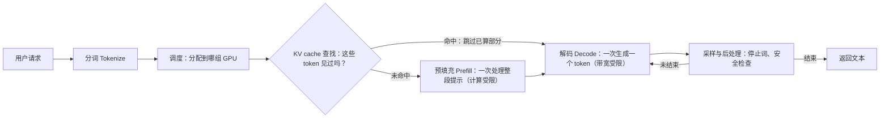
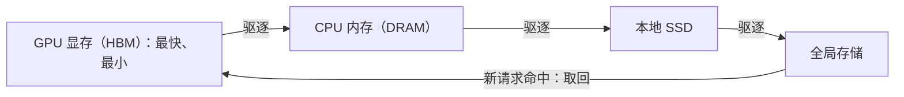
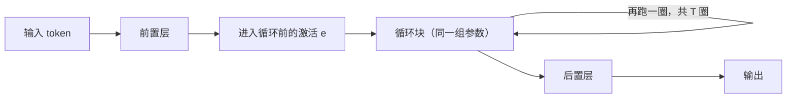
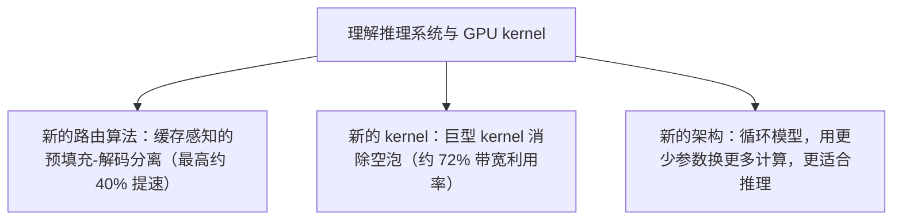

# 第 18 章 嘉宾讲座：从推理系统看全栈创新（Dan Fu）

> 对应课程：Guest Lecture（主讲：Dan Fu，UCSD / Together AI） · [YouTube](https://www.youtube.com/watch?v=9EEm4iMAF5s) · 本讲无官方讲义，内容整理自课堂字幕

<Video id="9EEm4iMAF5s" title="Lecture 18 原视频" />

## 本章你将学到

- 一个请求进入大模型推理服务后的完整旅程：调度、KV cache 查找、预填充（prefill）与解码（decode）、采样与后处理。
- 真实线上流量长什么样：不同应用的输入/输出长度、多轮对话、智能体工作流、延迟目标（SLA）。
- 推理系统的关键技术：连续批处理、前缀共享的 KV cache、预填充-解码分离、KV cache 分层存储，以及大规模部署时才会冒出来的诡异 bug。
- 研究案例一：**巨型 kernel（megakernel）**——把整个模型层融合进一个 kernel，消除 GPU 的“空泡”，让解码逼近硬件极限。
- 研究案例二：**Parcae 循环语言模型**——用状态空间模型（SSM）的稳定性理论驯服“循环 Transformer”的训练爆炸，并发现“循环次数也该随数据规模扩展”。
- 讲座的核心论点：**理解推理和 GPU kernel，才能做“全栈”的机器学习创新**。

## 先说结论（一分钟版）

前 17 讲教你怎么训练模型，Dan Fu 讲的是模型训练好之后“另一边”的世界：怎样把电变成 token。推理服务远比“跑一遍前向”复杂：真实流量形态各异，预填充是计算受限、解码是带宽受限，KV cache 要像操作系统管内存一样在 GPU、CPU、SSD 之间调度。在这个视角下，他展示了两类研究：一是 kernel 层面，把一层甚至整个模型融进一个巨型 kernel，让 GPU 不再在 kernel 之间空等；二是架构层面，把 Transformer 的某几层循环使用，用控制理论保证它不爆炸，从而“用更少的参数做更多的事”——而参数少，恰恰对推理最友好。

---

## 18.1 动机：一场新的工业革命

### 18.1.1 规模是能力的来源

Dan Fu 开场先做了大背景铺垫（他自嘲这些幻灯片是两年前求职时做的，例子有点旧了）：今天的模型能写代码、生成和理解图像视频、进入生物医学等科学领域。驱动这一切的一个主要因素是**规模**。[▶ 01:05](https://www.youtube.com/watch?v=9EEm4iMAF5s&t=65s)

- 2018 年他读博时，最大的模型约 1 亿参数，大家已经觉得很疯狂；
- 2019 年，GPT-2 被认为“危险到不能发布”——而今天，这门课的学生自己就能训出 GPT-2 水平的模型；
- 今天开源模型已经到了万亿参数以上，前沿模型大约在 5～10 万亿参数。[▶ 02:05](https://www.youtube.com/watch?v=9EEm4iMAF5s&t=125s)

### 18.1.2 马粪危机与 1912 时刻

他讲了一个有趣的类比：1902 年曼哈顿有 13 万匹干活的马，每匹每天产生大量马粪。1898 年纽约甚至专门开了一场学术会议讨论马粪问题，结论是“没办法，捏着鼻子忍吧”。结果仅仅十年后，到 1912 年，曼哈顿的汽车数量就超过了马。[▶ 03:06](https://www.youtube.com/watch?v=9EEm4iMAF5s&t=186s)

他认为对语言模型来说，“1912 时刻”大概就是去年：他自己开始用语言模型写大部分代码，团队里大多数人也是，他要求学生也这么做（写作业时除外）。[▶ 04:07](https://www.youtube.com/watch?v=9EEm4iMAF5s&t=247s)

### 18.1.3 GPU 是新的石油，推理是发动机

数千亿美元投向 GPU，主权财富基金把它当战略资产——“GPU 是新的石油”。但石油要有**发动机**才能变成动能；同样，GPU 要靠**推理引擎和 GPU kernel** 才能变成智能。[▶ 05:07](https://www.youtube.com/watch?v=9EEm4iMAF5s&t=307s)

机器学习模型本质上是一个运算组成的有向无环图（DAG），一个“存在于以太中”的数学对象；推理引擎和 kernel 才是真正要写代码、把它映射到硬件上的部分。这门课里你在训练侧做过一些（比如作业 2 的 FlashAttention），但推理侧还有一整个复杂的世界。

他希望大家从这次讲座带走的**一句话**是：

> 如果你理解推理引擎、理解底层的 GPU kernel，你就能在机器学习算法上做“全栈”创新。[▶ 06:09](https://www.youtube.com/watch?v=9EEm4iMAF5s&t=369s)

讲座结构：先概览“一个 token 的一生”，再深入两个研究项目。Dan Fu 同时代表两个机构：他在 UCSD 的实验室，以及 AI 云公司 Together AI（提供 GPU、推理、微调服务，有很强的研究背景，课程主讲 Percy 也在其中）。他还坦白：这部分概览幻灯片是他学生 Austin 的报告改编的，图全部由 AI 生成，“大体正确，但别细看上面的文字”。[▶ 07:11](https://www.youtube.com/watch?v=9EEm4iMAF5s&t=431s)

---

## 18.2 一个 token 的一生：推理服务全景

### 18.2.1 整体流程

[▶ 08:14](https://www.youtube.com/watch?v=9EEm4iMAF5s&t=494s)

1. 请求进来，先**分词**；
2. **调度**到某组 GPU 上——可能预填充和解码在不同的机器上（分离部署）；
3. 查 **KV cache**：这个请求或它的某个前缀以前算过吗？能省掉哪些计算？
4. 执行真正的机器学习计算：新的 token、新的运算。可以把计算拆到多台机器、一台机器的多张 GPU 上；随着硬件发展，这里的选择会越来越多；
5. 得到 token，转成字符串，做后处理，返回给用户。

推理引擎就在“调度—执行—采样”这个循环里不停转，等待新请求。

### 18.2.2 真实流量长什么样

一个很重要的思考角度是：**生产流量既不像训练数据，也不像你脑子里随便想象的流量**。[▶ 09:16](https://www.youtube.com/watch?v=9EEm4iMAF5s&t=556s)

- **编程类负载**（比如 Cursor 这样的产品，整个代码库对智能体可见）：输入很长，几万个 token；输出取决于模型，可能是一些“思考 token”，也可能很短。
- **摘要类负载**：比如把整本书贴进聊天框然后反复讨论，形态又完全不同。
- **普通聊天**：“给我讲讲微积分”，输入短，输出中等。

再叠加上**多轮**与**智能体**：[▶ 11:19](https://www.youtube.com/watch?v=9EEm4iMAF5s&t=679s)

- 和编程智能体来回交互（“这样做。不对，我是说那样”）；
- 智能体自己调用工具（grep 代码库、上网搜索），把结果喂回模型；
- 轮与轮之间的间隔差异很大：语音模式下要求即时响应；“你自己干吧，我走了”的后台智能体节奏完全不同；智能体卡住求助而你没注意到，中间又会空很久。Dan Fu 说他有一个关于健身计划的对话，大约每两周才打开一次。

这些因素共同定义了“负载形态”：每次进来多少新 token、要生成多少 token、会话多长、轮与轮之间隔多久。不同应用还有不同的**目标（SLA）**：交互式应用可能要求首个 token 在 1 秒内返回；另一些应用要求 500 个 token 的完整回复在一定时间内生成完，以便用户能跟上阅读速度。[▶ 13:19](https://www.youtube.com/watch?v=9EEm4iMAF5s&t=799s)

::: tip 移动端类比
这和你给 App 设计后端 API 一模一样：同一个服务，冷启动拉首页（大包、要求首屏时间）和后台同步（小包、频繁、不急）的流量特征完全不同。你会根据 P95 首屏时间、接口耗时 SLA 来规划服务器与缓存。推理服务就是一个“每个请求要跑一遍大模型”的后端。
:::

### 18.2.3 预填充与解码：两种截然不同的计算

这是理解推理系统的关键。[▶ 14:20](https://www.youtube.com/watch?v=9EEm4iMAF5s&t=860s)

**预填充（prefill）**：比如有 10000 个模型没见过的 token，要一次性算出它们的激活和 logits。“一万个 token 进、一个 token 出”——这是**计算受限**的，看起来很像训练：一大批 token，跑 FlashAttention，只是不做反向传播。

**解码（decode）**：之后模型一次只生成一个 token（如果投机解码有效，也许一次三四个）。每生成一个新 token，都要把它再送进整个模型跑一遍。算一下就会发现，需要的 FLOPs 并不多，但**每生成一个 token 都要把整个模型的权重从显存读一遍**——这是**内存带宽受限**的。[▶ 15:21](https://www.youtube.com/watch?v=9EEm4iMAF5s&t=921s)

用第 5 章的 Roofline 语言说：预填充是“矩阵 × 矩阵”，强度高，在屋顶的平顶上；解码是“矩阵 × 向量”，强度约为 1，在斜坡的最底部。（可以回到[第 5 章的 Roofline 演示](./ch05-gpus-tpus)里，分别点“矩阵×矩阵”和“矩阵×向量”对比。）第 10 章已系统讲过推理，这里从服务系统的角度再建立一遍直觉。

### 18.2.4 连续批处理

线上系统要同时处理很多请求。Dan Fu 用一张“时间向下流动”的示意图讲**连续批处理（continuous batching）**：[▶ 16:21](https://www.youtube.com/watch?v=9EEm4iMAF5s&t=981s)

- 第 1 步：一个长请求（分析长文档）正在生成；
- 又来一个请求，开始占用一部分资源——资源既包括**计算**（一次处理多个请求），也包括**内存**（每个请求的 KV cache 都占显存）；
- 短请求结束，立刻有新请求补位；
- 又来一个很长的请求，但 GPU 显存已经被 KV cache 占满了，只好**排队**；等前面的长请求结束腾出空间，它才开始。

可见，一旦系统里同时活跃着很多请求，复杂度会迅速上升。

### 18.2.5 KV cache 与前缀共享

很多用户的开头都是“你好 ChatGPT”或“你好 Claude”，理论上不需要为每个用户重新计算这部分的激活；用户贴了一本书，下一轮对话加了几句话，也不需要把整本书重新算一遍。[▶ 17:23](https://www.youtube.com/watch?v=9EEm4iMAF5s&t=1043s)

**KV cache** 的前缀共享机制用一个很传统的数据结构——**树**（前缀树/基数树）——来记录：新请求来了，查一查哪些 token 以前见过、哪些是新的，见过的部分直接取出缓存的激活（K 和 V 向量），只算新的部分。

::: tip 移动端类比
这就是图片缓存 + URL 前缀匹配：同一张图第二次显示时直接从缓存拿，而不是重新下载解码。只不过这里缓存的不是图片，而是“模型读过这段文字后的中间状态”。
:::

### 18.2.6 模型切分与预填充-解码分离

一个万亿参数的模型，一张 GPU 放不下（他举例一台机器 8 张 80GB 的 GPU）。所以要切分：[▶ 18:26](https://www.youtube.com/watch?v=9EEm4iMAF5s&t=1106s)

- **张量并行**：把每个张量切成 4 份，放到 4 张 GPU 上；
- **专家并行**：今天很多最先进的模型是混合专家（MoE）模型，可以把不同的专家放在不同 GPU 上。

这些选择决定了瓶颈在哪、需要多少 GPU、能同时服务多少会话。（并行化的细节见[第 7 章](./ch07-parallelism-1)和[第 8 章](./ch08-parallelism-2)。）

更重要的一个趋势是**预填充-解码分离（prefill-decode disaggregation）**：既然两者瓶颈完全不同，就把它们放在不同的机器上。[▶ 19:28](https://www.youtube.com/watch?v=9EEm4iMAF5s&t=1168s)

- 预填充像训练，FLOPs 密集，能把 GPU 用满；
- 解码是带宽密集的，算得不多但要不停读权重；
- 预填充一次耗时长但每个提示只做一次；解码每一步耗时短但每个 token 都要做一次。

分开之后，两边可以分别专门优化。这甚至影响到了硬件格局：Dan Fu 提到 NVIDIA 收购了 Groq，原因之一就是解码负载和预填充差别太大，适合用完全不同的芯片——据他说，NVIDIA 下一代计划用 GPU 做预填充、用 Groq 的 LPU 做解码；OpenAI 和 Cerebras 也有算力合作，Cerebras 的芯片更擅长解码；SambaNova 等公司也在这个空间下注。[▶ 20:30](https://www.youtube.com/watch?v=9EEm4iMAF5s&t=1230s)

### 18.2.7 规模化之后的诡异 bug

当你每天服务数万亿 token 时，小规模下运行良好的东西必然会在大规模下出问题——触发概率 0.001% 甚至更低的事件，也会频繁发生。他举了几个（大约发生在去年底开源推理引擎里的）例子：[▶ 21:31](https://www.youtube.com/watch?v=9EEm4iMAF5s&t=1291s)

- **NaN 导致复读**：某个 kernel 有极其罕见的错误条件，触发时计算中途的 logits 变成 NaN，之后模型开始不停输出同一个 token（比如一直“hi hi hi”或一串感叹号）。
- **工具调用处理错误导致输出暴涨**：有人改了引擎处理工具调用的方式，结果工具调用没有被正确执行。模型说“去搜索一下”，却一直没有结果返回，于是反复说“去搜索一下”，陷入长达数万 token 的“死循环”，表现为补全长度飙升。[▶ 22:31](https://www.youtube.com/watch?v=9EEm4iMAF5s&t=1351s)
- **突然冒出中文**：这个 bug 一度同时影响了多家推理服务商，一开始被归咎于量化问题，甚至有人猜测“他们肯定是在中文模型上微调的”。真正原因是某个 kernel 里一个**差一错误（off-by-one）**：偶尔会多读一点 GPU 上未初始化的内存，送进注意力，最后生成一个随机的中文字符；然后模型就会想“我怎么开始用中文思考了？用户大概是在用中文提问吧”，从此一路讲中文。[▶ 24:37](https://www.youtube.com/watch?v=9EEm4iMAF5s&t=1477s)

::: warning 常见误区
看到模型输出异常（复读、乱语言、超长输出），第一反应往往是“模型训练有问题”。但在生产环境中，它同样可能是推理引擎或 kernel 里的一个普通 bug。这也是为什么第 6 章强调写 kernel 时要用 `torch.allclose` 对照参考实现做正确性检查——而且要覆盖边界条件。
:::

### 18.2.8 KV cache 分层存储：像操作系统一样调度

大型生产系统希望 KV cache 越大越好：缓存越多用户、越多会话，命中率越高。但显存很快就满了。于是：[▶ 25:37](https://www.youtube.com/watch?v=9EEm4iMAF5s&t=1537s)

- 先放 GPU 显存；放满了，放到 **CPU 内存**——这就是为什么黄仁勋最近很关注 CPU 性能：上一代 CPU 太慢，一度拖累了重要负载，一台价值五亿美元的机器被几千美元的 CPU 卡住可不好；
- 再放不下就放到**磁盘（SSD）**上——你可能听说过 OpenAI 在大量采购 DRAM 和 SSD 的传闻，部分原因就是这类需求；
- 引擎要不停地做“这些 token 很久没用了，驱逐到 CPU 或磁盘”“新请求来了，去把它的缓存取回来”这样的复杂调度。[▶ 26:38](https://www.youtube.com/watch?v=9EEm4iMAF5s&t=1598s)

有学生问：这种卸载是针对特定类型的负载吗？Dan Fu 说这其实就是**经典的操作系统问题**：把图右边的 GPU 换掉，这张图和七八十年代操作系统教材里的图一模一样——那时打开太多程序，内存不够，就把程序换出到磁盘。[▶ 27:40](https://www.youtube.com/watch?v=9EEm4iMAF5s&t=1660s)

- 最近最少使用（**LRU**）是个不错的启发式（他记得有操作系统论文说 LRU 与最优策略相差在 2 倍以内）；
- 最好的策略当然是**预测未来**：比如你在聊天 App 里点开一个一个月前的旧对话，这是很强的信号，说明你马上要继续问它，系统可以提前把它的 KV cache 预取到 GPU 上。

他还顺带吐槽：“我相信你们都没上过操作系统课——去上吧。”

::: tip 移动端类比
这几乎就是 iOS/Android 的多级缓存：内存缓存（NSCache / LruCache）→ 磁盘缓存 → 网络。用户在列表里滑动时预加载下一屏的图片，就是“预测未来”式的预取。
:::

### 18.2.9 新硬件带来的新问题

[▶ 29:42](https://www.youtube.com/watch?v=9EEm4iMAF5s&t=1782s)

- NVIDIA Blackwell 一代推出了 GB200 NVL72 机柜：72 张 GPU 用高速互联连在一起。于是有了新问题：把万亿参数模型切到 72 张卡上有没有意义？能带来什么？
- **容错**：这些机器故障率不低。有一个原因很“接地气”：连接器是塑料做的，插得太用力会弯，导致 NVLink 不稳定。如果模型切在 64 张 GPU 上服务数百万用户，一张卡挂了怎么办？
- **百万级上下文**：要不要把上下文切分到多张 GPU 上？

### 18.2.10 一个小例子：缓存感知的预填充-解码分离

最后他展示了一个 Together AI 几个月前发布的优化，作为“从系统视角看问题”的范例。它简单到只是路由层的两行代码，但效果显著。[▶ 30:45](https://www.youtube.com/watch?v=9EEm4iMAF5s&t=1845s)

观察：大多数请求是对话中途的“续轮”。如果平均对话 10 轮，就意味着约 10% 的请求是全新的——它们有几千个从没见过的 token，计算代价高得多。你不希望某人贴了一整本书的预填充，和另一个人正在进行中的简短问答（“为什么 1+1=2？”“我还是没懂”）挤在同一组 GPU 上。

做法：一个简单的路由器——**缓存命中率低的新请求**发到一组预填充节点，**缓存热的续轮请求**发到另一组预填充节点。结果：服务速度最高提升约 **40%**。[▶ 32:49](https://www.youtube.com/watch?v=9EEm4iMAF5s&t=1969s)

Dan Fu 对这一领域的评价是：**我们还非常早期**。十到二十年后回头看，人们可能会想“这些人怎么还在讨论这么显然的事”——但正是因为我们第一次在生产中以这种方式运行这些系统、第一次看到这些新的流量形态，这些问题才刚刚浮出水面。

---

## 18.3 研究案例一：巨型 kernel（Megakernel）

这是 Stanford 与 Together AI 的合作项目。[▶ 33:51](https://www.youtube.com/watch?v=9EEm4iMAF5s&t=2031s)

### 18.3.1 问题：解码把 GPU 变成了“高级内存加载器”

解码的根本挑战是：**生成一个 token 就要跑完整个模型**。GPU 那种在预填充和训练中能发挥的大规模并行，在解码时用不上，这个大规模并行系统基本变成了一个“高级的内存加载器”——它的任务就是尽快把权重从 HBM 读出来。

更麻烦的是我们**写 kernel 的方式**。kernel 很难写（“我相信你们写 FlashAttention 时都很‘开心’”），所以通常的做法是**一个运算一个 kernel**：一个 norm kernel、一个 matmul kernel、一个 attention kernel……好写，但会在系统里引入大量**停机时间**。[▶ 34:52](https://www.youtube.com/watch?v=9EEm4iMAF5s&t=2092s)

### 18.3.2 GPU 时间线上的三种“空泡”

Dan Fu 展示了一张卡通化的时间线（取材自一个真实的注意力推理 kernel）：横轴是时间，纵轴是 GPU 上的每个 SM（H100 有 132 个，B200 大约 148 个），条形表示 SM 在干活，空白表示在等。[▶ 35:52](https://www.youtube.com/watch?v=9EEm4iMAF5s&t=2152s)

无论 kernel 写得多好，都会有空闲：

1. **kernel 启动和收尾（launch / teardown）**：每个 kernel 开始和结束时，都有一段所有 SM 都在等的时间；
2. **尾部效应（tail effect）**：就像短请求和长请求混在一起处理一样，到了单个注意力运算的层面也是如此——一批输入里有长有短，所有 SM 都要等最慢的那个做完。这和第 5、6 章讲的波量化是同一类问题；
3. 这些空隙在**一个接一个的 kernel 之间不断累积**。[▶ 36:52](https://www.youtube.com/watch?v=9EEm4iMAF5s&t=2212s)

### 18.3.3 解法：把多个运算写进一个 kernel

**巨型 kernel（megakernel）**的思路是：不再为每个运算写一个 kernel，而是**写一个 kernel 覆盖多个运算**。这和 FlashAttention 里的融合是同一个思想，只是做得更激进、覆盖更多运算。[▶ 37:54](https://www.youtube.com/watch?v=9EEm4iMAF5s&t=2274s)

关键的思维转变：**不再把 GPU 当作“一次执行一个运算”的设备，而是把它看作一个巨大的分布式系统**。我有一堆工作，其中一些依赖于另一些，我该怎么调度、怎么分配给各个 SM，才能让利用率最大？

- 只对注意力推理 kernel 做这件事，就能获得 **30%～70%** 的加速；
- 更进一步，可以对**整个模型**做。他展示了 Llama 1B 模型的**一整层**被融合进一个 kernel 后的时间线：各种条形以很“奇怪”的方式交叠在一起，因为现在可以把下一步的权重加载和当前的注意力重叠，或者在注意力结束前就开始部分归约。

两个具体的重叠例子：[▶ 38:56](https://www.youtube.com/watch?v=9EEm4iMAF5s&t=2336s)

- **QKV 投影 + RoPE 还没算完，就开始加载 KV cache**：解码时注意力需要读取 KV cache，而读 KV cache 并不依赖新 token 的 Q、K、V。于是可以在 QKV 计算的同时就把 KV cache 往片上搬；等 QKV 算完，拿到新的 query，就能立刻完成剩下的注意力计算。
- **注意力还没结束，O 投影就开始加载权重**：O 投影（注意力之后的输出投影）的权重同样不依赖注意力的结果，可以提前加载。[▶ 39:58](https://www.youtube.com/watch?v=9EEm4iMAF5s&t=2398s)

**有了对 GPU 的细粒度控制，你就可以在一些运算结束之前开始另一些运算。**

下面的演示用一个简化模型对比了“每个算子一个 kernel”和“巨型 kernel”在 12 个 SM 上的时间线。调大启动开销和耗时抖动，看看空白和黄色竖条如何吞掉时间；切到“两者对比”，看巨型 kernel 如何把下一个算子的加载提前塞进空隙里。

<Demo src="ch18-megakernel.html" title="逐算子 kernel vs 巨型 kernel：SM 时间线" :height="640" />

### 18.3.4 实现与结果

实现上，他们构建了一个相当复杂的 CUDA 框架：采用**基于指令的抽象**，每个子 kernel 在自己的文件里实现，再用一个大的**虚拟化共享内存系统**来编排这些运算的执行。底层用的是他们的 kernel 编写库 **ThunderKittens**——你可以把它想成“类似 Triton，但更底层、控制更细”。[▶ 39:58](https://www.youtube.com/watch?v=9EEm4iMAF5s&t=2398s)

回报是接近“**光速**”的解码推理：巨型 kernel 比当时其他最先进的推理引擎快得多，在 H100 上达到了 **72% 的带宽利用率**（他说现在的数字已经好得多）。所谓“光速（speed of light）”，就是“忽略所有实现细节，GPU 物理上最快能多快完成这个运算”——对带宽受限的解码来说，就是“把权重读一遍所需的时间”。[▶ 40:58](https://www.youtube.com/watch?v=9EEm4iMAF5s&t=2458s)

**手算一下“光速”**：Llama 1B 约 10 亿参数，BF16 下权重约 2 GB。H100 的 HBM 带宽 3.35 TB/s，读一遍权重至少需要

$$
\frac{2 \times 10^9\ \text{字节}}{3.35 \times 10^{12}\ \text{字节/秒}} \approx 0.6\ \text{毫秒}
$$

也就是说，批大小为 1 时，每秒最多约 1700 个 token（忽略 KV cache 读取等）。达到 72% 的带宽利用率，意味着已经很接近这个物理上限了。

这一部分的收获：**深入控制 kernel、深入理解硬件，可以开启完全不同的计算范式**——而这些只有在深入做推理时才看得到。

::: details 课堂问答：巨型 kernel 的代价是什么？
有学生问巨型 kernel 有什么权衡。Dan Fu 的回答是：代价是“人的血汗和泪水”。巨型 kernel 极其耗费人力：一个很有才华的 kernel 工程师干一年，大概能为一种硬件、两三个模型、批大小 1 到 16 写出巨型 kernel——批大小变成 17，可能就得从头再来。Together 正在尝试做能自动化部分流程的编译器。他说巨型 kernel 这个想法在过去几十年的 GPU 编程中时兴时衰：做得出来，它就是最快的，不可能更快了；但代价巨大。[▶ 63:13](https://www.youtube.com/watch?v=9EEm4iMAF5s&t=3793s)

另一个问题是多 GPU 通信能不能也融进巨型 kernel。答案是可以：设置得当的话，NCCL 通信调用也能融进去，但他们还没找到真正的杀手级用例，有时瓶颈就在通信调用本身的延迟上。他提到 DeepSeek 在发布 V4 时，开源了一个专门用于 MoE 推理层的巨型 kernel，里面就融合了部分通信。他观察到的趋势是：越来越多的模型会为**计算的某一部分**配一个小巨型 kernel，而不一定为整个模型写一个。[▶ 70:22](https://www.youtube.com/watch?v=9EEm4iMAF5s&t=4222s)
:::

---

## 18.4 研究案例二：Parcae——稳定的循环语言模型

第二个项目进入了新架构的领域：来自 Dan Fu 在 UCSD 实验室的 **Parcae**，由 Hayden Prairie 主导，与 Zachary Novack、Taylor Berg-Kirkpatrick 合作。（字幕把名字听写成了 "PERS" / "parse"，根据论文校正为 Parcae。）[▶ 41:59](https://www.youtube.com/watch?v=9EEm4iMAF5s&t=2519s)

### 18.4.1 动机：除了堆参数和数据，还有别的扩展方式吗？

讲座开头说，能力的提升来自扩大参数和数据。Parcae 问的是：**这是唯一的路吗？**

他们的答案是**循环 Transformer（looped transformer）**：选取 Transformer 中的某几层（一个“循环块”），让激活在这个块里**反复跑若干圈**，而不是一层一层只走一遍。[▶ 43:00](https://www.youtube.com/watch?v=9EEm4iMAF5s&t=2580s)

好处：

- **参数不变，FLOPs 可调**：如果“更多 FLOPs = 更高质量”，循环就是不增加参数成本而提升质量的一个旋钮；
- 早几年的理论工作表明，循环模型有**更强的表达能力**，能表达同样参数量下普通模型表达不了的东西；
- 他们的核心问题是：**每个参数（以及每份数据）能换来多少智能？**

还有一些令人鼓舞的早期结果：比如马里兰大学 Tom Goldstein 组的工作（循环深度模型，recurrent depth）显示这类模型可能优于 Transformer。Dan Fu 还提到，在他们发布前大约一周，一位 OpenAI 的人在推特上声称某个前沿 Claude 模型是循环模型，引发大量猜测，后来此人发文承认是自己编的——但这至少说明这个方向足够有趣。[▶ 45:02](https://www.youtube.com/watch?v=9EEm4iMAF5s&t=2702s)

::: tip 移动端类比
循环块有点像代码里的“复用函数”：与其写 12 个不同的函数（12 层不同参数），不如写 4 个，其中一个在 `for` 循环里调用多次。安装包（参数量）变小了，运行时多花一点 CPU（FLOPs）。
:::

### 18.4.2 问题：一调学习率就爆炸

循环模型有个大问题：**训练极不稳定**。只要对训练算法稍做改动，比如学习率改一点点，模型就可能爆炸。做一次学习率扫描，十次里有九次不收敛：出现 NaN、出现巨大的损失尖峰。[▶ 46:03](https://www.youtube.com/watch?v=9EEm4iMAF5s&t=2763s)

以前的工作用各种“补丁”应对：每层都加归一化，或者干脆只用某个特定学习率（比如 2e-4），别的都别碰。Dan Fu 的态度是：**如果你在扩大模型时看到很大的损失尖峰，说明训练过程中有些东西出了大问题，应该深入追查**，而不是打补丁。

### 18.4.3 动力系统视角：只看残差

直接分析循环块非常复杂：大量参数、softmax、RoPE、各种非线性。他们的洞察是：**只看残差流**——激活从一圈到下一圈是怎么变化的。[▶ 47:04](https://www.youtube.com/watch?v=9EEm4iMAF5s&t=2824s)

第一个经验观察：**每一圈对激活的改变其实不大**。既然变化不大，也许可以建模。于是他们在残差上写出一个**动力系统**：把注意力、前馈网络等所有非线性的复杂部分打包成一个盒子 $R$，先放到一边，剩下的就是两个矩阵：

$$
h_{t+1} = A\,h_t + B\,e + R(h_t, e)
$$

$h_t$ 是第 $t$ 圈时的残差状态；$e$ 是进入循环前的激活（每一圈都会“注入”一次）；$A$ 描述每一圈如何变换残差状态；$B$ 描述如何变换注入的初始向量；$R$ 是被打包的非线性部分。

用这个视角看，以往的循环模型其实都在对 $A$、$B$ 做某种选择：有的直接取恒等（把东西加起来），有的让它是完全可学习的矩阵。[▶ 49:05](https://www.youtube.com/watch?v=9EEm4iMAF5s&t=2945s)

他们经验上观察到，$A$ 和 $B$ 实际上**主导**了这个方程的量级。那如果干脆把复杂的 $R$ 去掉呢？就得到一个简单的线性系统，用高中水平的数学就能求出闭式解：

$$
h_{t} = A^{t} h_0 + \left(\sum_{k=0}^{t-1} A^{k}\right) B\,e
$$

$A^t$ 是矩阵 $A$ 自乘 $t$ 次；求和项是每一圈注入的 $Be$ 被后续各圈的 $A$ 不断变换后的累积。

### 18.4.4 谱半径：一切的关键

从闭式解里可以看出，结果被 $A$ 的高次幂主导。决定它命运的量是 $A$ 的**谱半径（spectral radius）** $\rho(A)$——即 $A$ 所有特征值中绝对值最大的那个。Dan Fu 说它基本可以看作“范数的另一种说法”。[▶ 50:06](https://www.youtube.com/watch?v=9EEm4iMAF5s&t=3006s)

**直觉**：退化到标量就很清楚了。假设 $A = 2$，循环 16 圈，激活就被放大了 $2^{16} = 65536$ 倍。而如果 $A = 0.5$，$A^{16}$ 趋近于 0，不会爆炸。

- $\rho(A) \gt 1$：**不稳定**，指数爆炸——这解释了那些巨大的损失尖峰；
- $\rho(A) = 1$：**临界稳定**（marginally stable），比如恒等映射，残差会线性累积；
- $\rho(A) \lt 1$：**稳定**，收敛到一个不动点。

他们发现，以往论文对 $A$、$B$ 的选择要么是临界稳定的，要么是不稳定的。

### 18.4.5 Parcae 的解法：从参数化上保证稳定

既然放任 $A$、$B$ 自由学习会爆炸，那就**约束它们，让数学上保证不会爆炸**：[▶ 51:07](https://www.youtube.com/watch?v=9EEm4iMAF5s&t=3067s)

- 对 $A$：把它参数化为一个**负对角矩阵**（再做离散化）。这样无论训练把底层参数学成多少，把它连乘多次后都趋向 0，不会爆炸；
- 对 $B$：只加一个简单的归一化，因为 $B$ 只作用一次，不会被连乘放大；
- 这样算出来的谱半径**一定小于 1**，系统就是稳定的。

一种符合这个描述的写法是（参考论文与 Together AI 博客的说法）：

$$
A = \exp\!\left(\Delta \cdot A_c\right),\quad A_c = -\exp(\theta)
$$

$\theta$ 是可以学成任何值的原始参数；$-\exp(\theta)$ 一定是负数，这就是“负对角”；$\Delta$ 是离散化步长；$\exp$ 一个负数一定落在 0 和 1 之间。所以每个对角元都在 (0,1) 内，$\rho(A) \lt 1$。

这其实正是状态空间模型（SSM，比如第 4 章提到的 Mamba 一类）里常见的参数化技巧——Dan Fu 本人就是 SSM 方向的研究者，这也是标题里“用 SSM 理论稳定循环”的含义。

下面的演示把这件事画了出来：三条曲线分别是无约束的 $A$、恒等 $A$、和 Parcae 参数化的 $A$。把无约束 $A$ 的 $\rho$ 调到 1 以上一点点，再把循环次数拉大，看它如何冲上天文数字；而无论你怎么拖 Parcae 的 $\theta$，曲线都会收敛。

<Demo src="ch18-looped-stability.html" title="循环模型：谱半径决定会不会爆炸" :height="660" />

### 18.4.6 结果：更稳定，也更好

[▶ 52:08](https://www.youtube.com/watch?v=9EEm4iMAF5s&t=3128s)

- **稳定的损失曲线**：即使在 6e-4 这样对其他循环模型很糟糕的学习率下，Parcae 也稳定收敛。
- **状态范数被自然约束**：完全无约束的基线，激活范数涨到了 $10^{19}$ 量级。另一个“加了归一化”的基线范数看起来很好，但损失仍会出现难看的尖峰——Dan Fu 的解释是：模型**想要**把激活撑大（更大的空间可以把不同概念分得更开），而归一化又硬把它压回 1，**两股力量在打架**，表现为损失尖峰。Parcae 则是从根源上让系统稳定。[▶ 53:08](https://www.youtube.com/watch?v=9EEm4iMAF5s&t=3188s)
- **更高的质量**：与之前的循环模型（循环深度模型）相比，Parcae 在多种任务上表现更好；也超过了一个很强的 Transformer 基线（一个基于 nanochat、大家拼命调过的版本）。把同样的 Transformer 架构拿来循环并加以稳定，可以得到更好的困惑度和端到端质量。

（Dan Fu 没有在讲座中报具体数字。据论文摘要，Parcae 的验证困惑度比以往的大规模循环模型最多低 6.3%；在 13 亿参数规模上，固定参数和数据时，它能达到两倍大小 Transformer 约 87.5% 的质量。此处以论文为准，仅供参考。）

### 18.4.7 循环的 Scaling Law：数据越多，循环越多

最后他们做了一些初步的 scaling law 研究。[▶ 54:08](https://www.youtube.com/watch?v=9EEm4iMAF5s&t=3248s)

先回顾（[第 9 章](./ch09-scaling-laws-1)详细讲过）：几年前大家问，模型该做大还是该多喂数据？画出的 IsoFLOP 曲线“向右下方走”，说明参数和数据应该**同时**扩大——于是有了“万亿参数模型训练 35 万亿 token”这样的配置。

Parcae 问：**循环次数在这张图里处于什么位置？** 几种可能：永远不要循环、尽量多循环、或者适度循环。

实验设置：**固定参数量**，改变训练 FLOPs（通过增加数据），同时改变循环次数。结果在不同大小的模型上都看到了同样的“向右下方”趋势：[▶ 56:09](https://www.youtube.com/watch?v=9EEm4iMAF5s&t=3369s)

- **固定模型大小时，随着数据增加，也应该增加循环次数**；
- 循环次数遵循经典的幂律，可以据此**预测**循环次数和 token 数联合扩展时的质量。

有学生问：如果把参数量也一起扫呢？Dan Fu 说他们画过一张很复杂的三维图，大意是参数、数据、循环次数**三者都应该一起扩大**，只是图太难看了没放出来。[▶ 57:09](https://www.youtube.com/watch?v=9EEm4iMAF5s&t=3429s)

这个结论之所以有意思，是因为据他所知，**今天所有的主流模型都没有循环**——它们都处在这些曲线的最左端（循环次数为 1），却用了海量数据。这暗示我们训练模型的方式也许还有改进空间。另一组实验也印证了这一点：在相同 FLOPs、相同模型大小下，通过“增加循环 + 增加数据”达到这个 FLOPs 的循环模型，比只增加数据的固定深度模型验证损失更低。他半开玩笑地说：也许我们应该在所有大型预训练中都加上循环。[▶ 58:10](https://www.youtube.com/watch?v=9EEm4iMAF5s&t=3490s)

### 18.4.8 为什么推理研究者关心循环模型

有学生问循环模型对推理有什么意义。这正是 Dan Fu 个人对它兴奋的原因：[▶ 61:12](https://www.youtube.com/watch?v=9EEm4iMAF5s&t=3672s)

- 推理的一大瓶颈是 **GPU 显存**。参数少，就能放下更多 KV cache；模型能切到更少的 GPU 上，通信也更少；
- 他还有个“梦想”：如果循环块足够小，可以写一个小巨型 kernel，让它在一个极快的循环里跑——目前还没能把块做得足够小；
- 下一代 Groq LPU 进入 NVIDIA 体系后，这类芯片片上内存只有大约 250 MB 量级，能放进去的东西非常小。但如果能设计出放得进去的模型，就能让权重一直待在片上，只让激活飞快地流过——跨过某些阈值，会带来非线性的收益。

另一个问题：能不能直接在预训练好的模型上做循环？Dan Fu 提到有人发过一篇很“恶搞”的博客：不训练任何东西，只是把一个 Qwen 模型里的两三层循环使用，就在某些数学排行榜上取得了更好成绩。他说这让他很困惑，“完全不明白为什么会这样”，他们正在研究，可能很快会有成果。[▶ 60:11](https://www.youtube.com/watch?v=9EEm4iMAF5s&t=3611s)

还有学生问：如果只关心计算最优训练，是否值得用循环代替增加参数？Dan Fu 认为“计算最优”本身有点人为：给定 FLOPs 预算才谈得上最优。如果你想要更好的模型，就该增加 FLOPs；如果模型大小已定，就训更久；如果受限于模型大小，就循环更多；如果数据用完了，就选一个能训得足够好的大小。最终的选择还要考虑：模型会不会被采用、怎么部署、开源的话大家在笔记本上能跑多大的模型。[▶ 66:14](https://www.youtube.com/watch?v=9EEm4iMAF5s&t=3974s)

---

## 18.5 软硬协同设计：问答精选

课程主讲人追问：如果你知道模型会部署在 Groq、Cerebras 这类推理芯片上，架构该怎么改？[▶ 64:14](https://www.youtube.com/watch?v=9EEm4iMAF5s&t=3854s)

- **首先受限于内存**：去查目标芯片（比如 Cerebras 的晶圆）有多少内存，然后把模型做到能放下，并留出足够的 KV cache 空间；
- **观察中国模型**：他注意到最近的中国模型开始做出一些有趣的选择，暗示它们可能在考虑华为的芯片；
- **量化格式**：如果打算在 NVIDIA GPU 上部署（比如 NVIDIA 自己发布的 Nemotron 模型），就会用 NVIDIA 专有的 **NVFP4** 格式训练；如果用 AMD 等其他硬件，就用 **MXFP4**。两者各有优劣（回顾[第 5 章](./ch05-gpus-tpus)的低精度一节）。

另一个问题：不同应用场景（智能体编程 vs 批量数据处理）对最优架构有什么影响？[▶ 68:18](https://www.youtube.com/watch?v=9EEm4iMAF5s&t=4098s)

- **智能体工作流**：要尽量让 KV cache 保持“热”。所以 KV cache 的大小非常关键：DeepSeek 的 **MLA** 注意力对 KV cache 做了大幅压缩；能用 FP8 或 FP4 处理 KV cache 的模型也大大减小了它。如果你关心智能体场景，就该关注这些设计；
- **批量处理**（每个文档只看一次，比如翻译）：KV cache 就没那么重要；
- **最大的区别是因果注意力 vs 非因果注意力**：Google 很长时间在搜索里用 BERT 模型（他猜现在可能还在用），因为不需要生成大量 token——做一次双向注意力，得到向量，存进数据库即可。而聊天类应用永远有解码这一步。T5 这类模型则是“先双向处理、再生成”的中间方案。

---

## 18.6 总结：全栈创新

[▶ 59:11](https://www.youtube.com/watch?v=9EEm4iMAF5s&t=3551s)

Dan Fu 回到开头的论点：如果你理解模型的推理、理解 GPU kernel、理解其中的每一块，你就能在机器学习算法上做全栈创新：

- 一个让你服务更多流量的路由算法；
- 一个让系统某部分快得多的新 kernel；
- 一个参数更少、能放进更少 GPU、减少通信的新架构。

这些都是同一个研究问题的不同侧面。他希望至少激励在座的一位同学去深入研究其中某一块。

::: tip 写给移动端工程师
这场讲座的思路对你其实很亲切：移动端开发天天在做“全栈性能”——从 UI 渲染、线程调度、缓存层级到网络协议，任何一层的理解都可能带来体验上的突破。大模型推理是同样的游戏，只是“设备”换成了 GPU 集群，“帧率”换成了 token 每秒。
:::

## 动手练习

1. **预填充 vs 解码的强度**（热身）：一个 70 亿参数的模型（BF16），在 H100 上解码，批大小为 1。估算每生成一个 token 需要读多少字节权重、做多少 FLOPs（约 2 × 参数量），算出算术强度。再估算批大小为 64 时的强度。对照第 5 章 H100 的拐点（约 295），说明为什么推理服务要做连续批处理。

   ::: details 参考思路
   权重约 14 GB。批大小 1：FLOPs 约 $1.4 \times 10^{10}$，强度约 1 FLOP/字节，远低于 295。批大小 64：FLOPs 乘以 64，而权重只需读一次（忽略 KV cache），强度约 64，仍然带宽受限，但吞吐提高了约 64 倍。批处理让一次权重读取服务多个用户。
   :::

2. **解码的“光速”**：仿照 18.3.4 的手算，估算 Llama 1B 在 B200（8 TB/s）上批大小为 1 时的理论最大解码速度（token/秒）。如果实际达到 72% 带宽利用率，是多少？

3. **KV cache 的 LRU**（编程）：用 Python 写一个简单的两级 KV cache 模拟器：GPU 层容量 4 个会话，CPU 层容量 16 个会话，按 LRU 驱逐。给定一个会话访问序列，统计 GPU 命中、CPU 命中（需要取回）和完全未命中（需要重新预填充）的次数。再试一个“预测未来”的策略（例如用户打开旧对话时预取），比较命中率。

4. **谱半径实验**：用 PyTorch 随机生成一个 $16 \times 16$ 矩阵 $A$，用 `torch.linalg.eigvals` 求谱半径；把 $A$ 缩放到谱半径分别为 0.9、1.0、1.1，计算 $\lVert A^{t} h_0 \rVert$ 随 $t = 1 \dots 64$ 的变化并画图。然后实现 Parcae 式的参数化 $A = \mathrm{diag}(\exp(-\exp(\theta)))$，验证无论 $\theta$ 取何值谱半径都小于 1。

5. **思考题**：本章提到的“突然冒出中文”的 bug 源于 kernel 中的差一错误。结合第 6 章 Triton kernel 里的 `mask` 写法，说说如果 `mask = offsets < num_elements` 被误写成 `mask = offsets <= num_elements` 会发生什么，以及你会用什么测试来尽早发现这类 bug。

## 本章小结

- 推理服务的核心循环：调度 → KV cache 查找 → 预填充 / 解码 → 采样后处理。真实流量形态多样，多轮与智能体工作流让会话长度、间隔和 SLA 都各不相同。
- 预填充计算受限、解码带宽受限，因此出现了预填充-解码分离，甚至影响了芯片产业格局。
- KV cache 用前缀树做共享，并像操作系统管理内存一样在 GPU、CPU、SSD 之间分层调度；LRU 是不错的启发式，最好是预测未来。
- 规模化部署会暴露极其罕见的 bug，比如 NaN 复读、工具调用死循环、差一错误导致的“说中文”。
- 巨型 kernel 把 GPU 看作分布式系统，消除 kernel 启动、收尾与尾部效应带来的空泡，并把权重/KV cache 加载与计算重叠，让解码接近“光速”；代价是巨大的工程投入。
- Parcae 用动力系统视角分析循环 Transformer：谱半径 $\rho(A) \gt 1$ 导致爆炸；用负对角加离散化的参数化保证 $\rho(A) \lt 1$，训练稳定且质量更高。初步 scaling law 显示：固定模型大小时，数据越多就该循环越多。

这是本书正文的最后一章。回顾全书：从分词、架构、GPU 与 kernel、并行、scaling law、推理、评测、数据，到后训练与对齐，你已经走过了“从零构建大语言模型”的完整旅程。接下来可以去[附录 A](./appendix-a-assignments) 按作业路线动手实践——正如 Dan Fu 所说，真正的理解来自动手，而“全栈”的视野会让你在任何一层都能找到创新的机会。

## 延伸阅读

- Hayden Prairie, Zachary Novack, Taylor Berg-Kirkpatrick, Daniel Y. Fu，[Parcae: Scaling Laws For Stable Looped Language Models](https://arxiv.org/abs/2604.12946)（项目页：[Parcae](https://sandyresearch.github.io/parcae/)；Together AI 博客：[Parcae](https://together.ai/blog/parcae)）
- Hazy Research，[Look Ma, No Bubbles! Designing a Low-Latency Megakernel for Llama-1B](https://hazyresearch.stanford.edu/blog/2025-05-27-no-bubbles)（巨型 kernel 项目的博客）
- [ThunderKittens](https://github.com/HazyResearch/ThunderKittens)（讲座中提到的 kernel 编写库）
- Jonas Geiping 等，Scaling up Test-Time Compute with Latent Reasoning: A Recurrent Depth Approach（讲座中提到的马里兰大学 Tom Goldstein 组的循环深度模型）
- Together AI 关于缓存感知预填充-解码分离（cache-aware prefill-decode disaggregation）的技术博客（讲座中提到，具体链接请在 Together AI 官网搜索）
- DeepSeek-V2 论文中的 MLA（Multi-head Latent Attention）：大幅压缩 KV cache 的注意力设计
- 本书相关章节：[第 5 章](./ch05-gpus-tpus)（Roofline、低精度）、[第 6 章](./ch06-kernels-triton)（kernel 融合）、[第 10 章](./ch10-inference)（推理）
