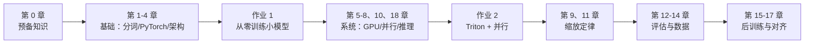

# 导读：怎么用这本书

## 这本书是什么

这是 Stanford **CS336《Language Modeling from Scratch》**（Spring 2026，Percy Liang 与 Tatsunori Hashimoto 主讲）的中文学习笔记。课程的目标很直接：**不调用任何现成的大模型，自己从零造一个**，包括分词器、Transformer、优化器、GPU kernel、分布式训练、缩放定律实验、数据清洗和强化学习对齐。

这本书没有逐句翻译字幕。我们看完了全部 18 讲视频和官方讲义，然后**用移动端工程师听得懂的话重新讲了一遍**：

- 每个概念先讲直觉和类比，再讲定义，最后才是公式
- 涉及的数学在[第 0 章](./chapters/ch00-primer)里一次补齐，起点只要求一点微积分
- 每章都配**交互演示**，可以单步执行、拖动滑块，看清机制是怎么运转的
- 每章开头嵌入原课视频，正文中的关键处附有**时间戳链接**，可以跳到对应位置看老师怎么讲

## 你需要准备什么

| 需要 | 程度 |
|---|---|
| 编程 | 会一门语言（Kotlin/Swift 即可），Python 能看懂 |
| 数学 | 知道导数是什么就够了，其他在第 0 章补 |
| 硬件 | 读书只要一台 Mac；做作业 1 大部分可以在 Mac 上完成，训练和测速需要云 GPU（见[附录 A](./chapters/appendix-a-assignments)） |

## 推荐学习路线

- **快速入门（1~2 周）**：第 0 章 → 第 1 章 → 第 3 章 → 第 10 章 → 第 16 章。学完能说清楚"一个大模型是怎么造出来、怎么跑起来的"
- **完整学习（2~3 个月）**：按章节顺序读，每读完一部分就做对应的作业
- **每一章的读法**：先读"先说结论"，再看正文，同时把演示都玩一遍，最后做"动手练习"。遇到看不懂的地方，点时间戳跳回原视频听老师讲

::: tip 写给移动端工程师
你其实已经具备很多相关直觉。比如做过列表滑动优化，就理解"少做重复工作"，这正是 kernel 融合的思想；处理过图片缓存，就理解 KV Cache；写过多线程下载，就理解数据并行。书里会经常用这些类比。
:::

## 章节与课程对照

| 章 | 主题 | 原课 |
|---|---|---|
| 0 | 预备知识速成 | （本书原创） |
| 1 | 课程总览与分词 | Lecture 1 |
| 2 | PyTorch 与资源核算 | Lecture 2 |
| 3 | 模型架构 | Lecture 3 |
| 4 | 注意力替代方案与 MoE | Lecture 4 |
| 5 | GPU 与 TPU | Lecture 5 |
| 6 | Kernel 与 Triton | Lecture 6 |
| 7–8 | 并行训练 | Lecture 7–8 |
| 9 | 缩放定律（上） | Lecture 9 |
| 10 | 推理 | Lecture 10 |
| 11 | 缩放定律（下） | Lecture 11 |
| 12 | 评估 | Lecture 12 |
| 13–14 | 数据 | Lecture 13–14 |
| 15 | 中训练与后训练 | Lecture 15 |
| 16 | 强化学习 RLVR | Lecture 16 |
| 17 | 多模态模型 | Lecture 17 |
| 18 | 嘉宾讲座：Dan Fu | Guest Lecture |

## 原始资料

- 课程主页：<https://cs336.stanford.edu/>
- 视频列表：[YouTube Playlist](https://www.youtube.com/playlist?list=PLoROMvodv4rMqXOcazWaTUHhq-yembLCV)
- 官方讲义：<https://github.com/stanford-cs336/lectures>
- 作业：<https://github.com/stanford-cs336/assignment1-basics>（以及 assignment2~5）

::: warning 声明
本书是个人学习笔记，非官方出品。课程内容版权归 Stanford CS336 课程组所有。如有理解偏差，以原课为准，也欢迎提 Issue 指正。
:::
